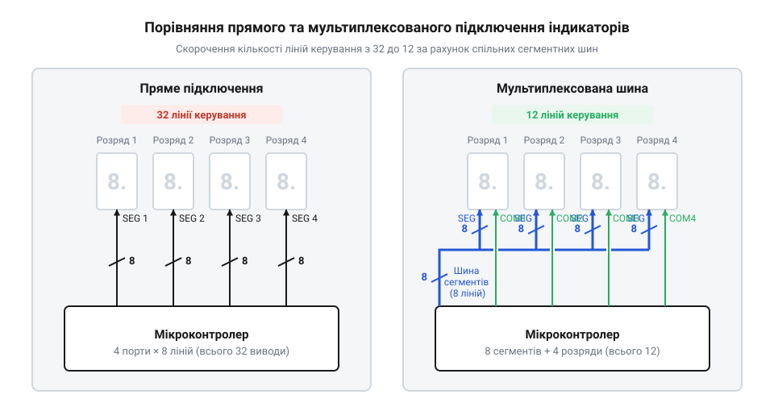
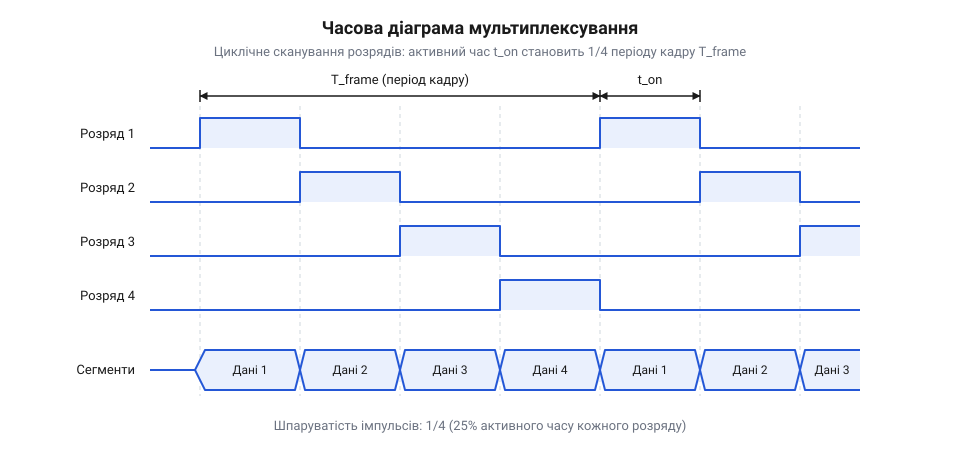
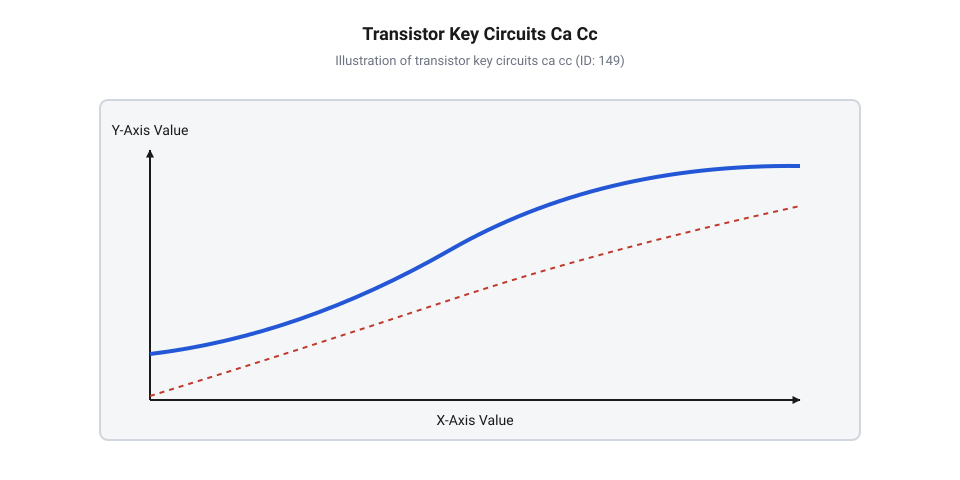
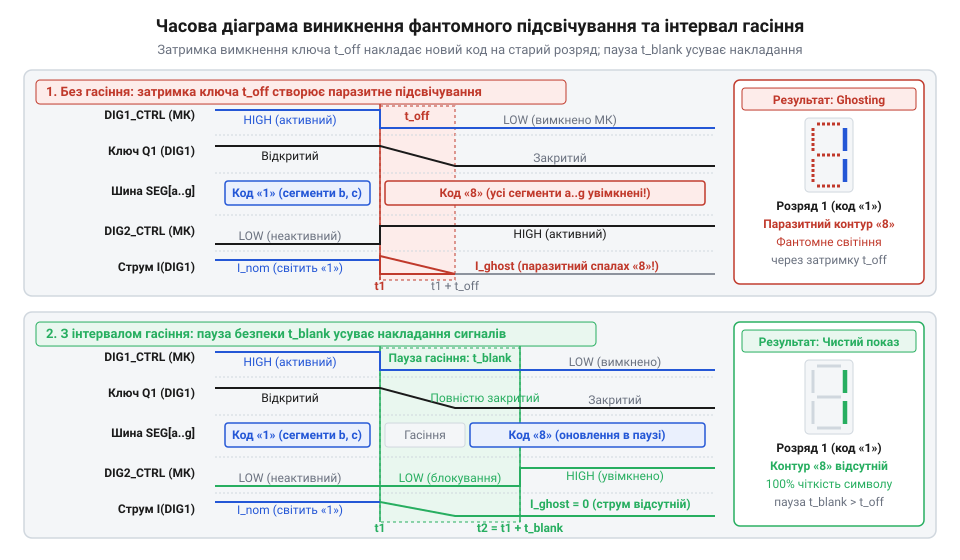
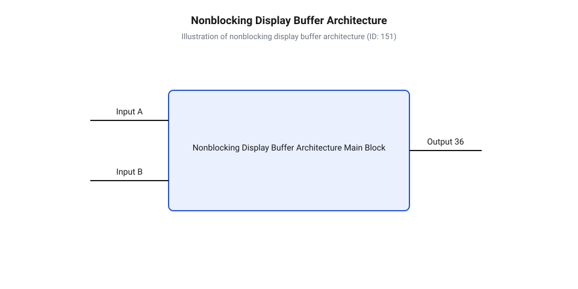
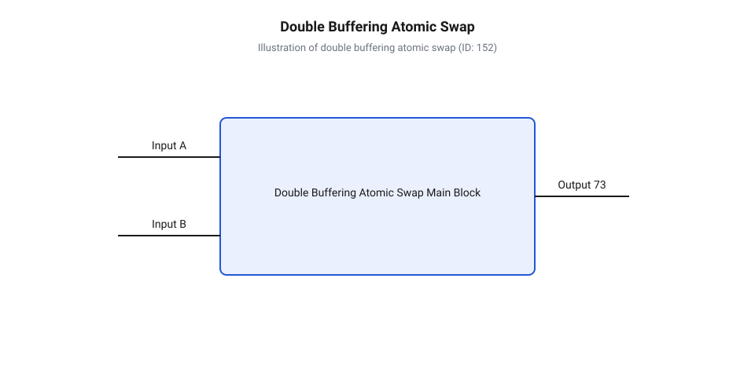
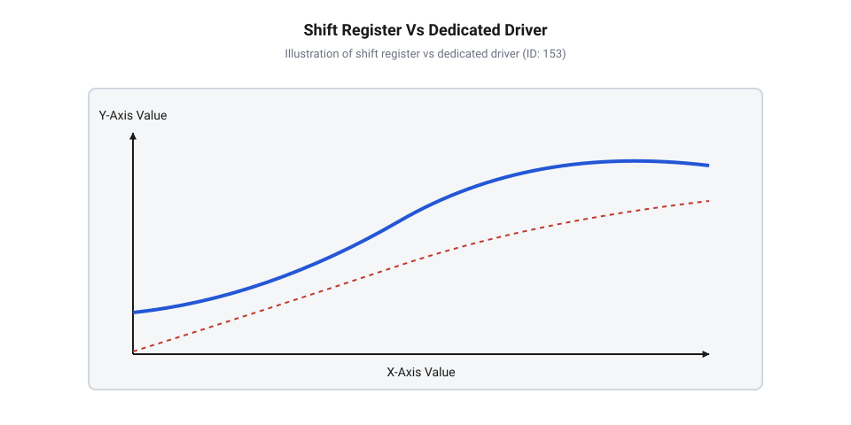

# Мультиплексування семисегментних індикаторів

<preknowlist>
- [Семисегментний індикатор 5161AS (1 розряд)](root:cat-hw-actuators/seg-5161as) — принципи роботи окремого семисегментного розряду, розпіновка світлодіодів та керування сегментами зі спільним катодом або анодом.
- [Семисегментний індикатор 5641AS (4 розряди)](root:cat-hw-actuators/seg-5641as) — схемотехніка об'єднання однойменних сегментів у багаторозрядній матриці та призначення спільних розрядних виводів.
</preknowlist>

## Обмеження прямого підключення багаторозрядних індикаторів

При проектуванні цифрових пристроїв із візуальним виводом даних першим природним кроком здається прямолінійне підключення кожного світлодіода до окремого керуючого виводу мікроконтролера. У разі використання [одиночного семисегментного індикатора 5161AS](root:cat-hw-actuators/seg-5161as) така схема працює бездоганно: вісім світлодіодних елементів (сім сегментів @@la|segment@@ `A`–`G` для формування цифр та один додатковий сегмент `DP` для десяткової крапки) мають індивідуальні виводи, а їхні другі виводи об'єднані в один спільний контакт. Для побудови однорозрядного лічильника або індикатора стану достатньо виділити 8 загальносистемних виводів вводу-виводу (англійською @@en|General Purpose Input/Output@@, скорочено @@en|GPIO@@).

Проблема виникає в момент, коли розрядність відображення зростає до практично необхідних значень. У цифрових годинниках, термометрах чи мультиметрах потрібно відображати три, чотири або більше десяткових цифр. Якщо застосувати статичний підхід і прямо підключити кожен розряд [чотирирозрядного модульного індикатора 5641AS](root:cat-hw-actuators/seg-5641as) як чотири окремі незалежні індикатори, загальна кількість потрібних ліній керування обчислюється як вираз:

 N_lines = N_digits × 8
         = 4 × 8                [підключення 4 розрядів по 8 сегментів]
         = 32 lines             [загальна кількість керуючих виводів]

Для восьмирозрядного дисплея ця величина сягає вже 64 окремих ліній. Таке вибухове зростання кількості провідників створює три фундаментальні перепони:

1. Дефіцит виводів мікроконтролера. Більшість стандартних 8-бітних та 32-бітних мікроконтролерів у компактних корпусах мають усього від 16 до 32 фізичних ніжок на весь чіп, з яких частина зарезервована під живлення, тактування та лінії скидання. Виділення 32 ліній виключно на дисплей унеможливлює підключення будь-яких датчиків чи інтерфейсів зв'язку. 2. Трасування друкованої плати. Фізичне розведення 32 паралельних силогромоздких трас від мікроконтролера до світлодіодного модуля вимагає багатошарових планарних плат, суттєво збільшує площу пристрою та підвищує ризик виникнення коротких замикань і паразитного наведення. 3. Електрична й апаратна надлишковість. Статичне керування вимагає встановлення 32 окремих струмообмежувальних резисторів та підтримки високого сумарного струму споживання, оскільки всі включені світлодіоди світяться безперервно й одночасно.

Історія виникнення та розвитку динамічної індикації бере початок у 1960–1970-х роках із появою перших електронних калькуляторів та настільних цифрових вимірювальних приладів. У той період напівпровідникові мікросхеми мали суворе обмеження за кількістю виводів корпусу, а дискретна жорстка логіка та дешифратори коштували надзвичайно дорого. Інженери були змушені шукати спосіб відмовитися від паралельного прямого керування кожним відображувальним елементом на користь часового розподілу сигналів. Перші рішення будувалися на кастомних газорозрядних індикаторах тліючого розряду (індикаторах Ніксі), де високовольтні анодні ключі почергово вмикали цифрові розряди, синхронізуючись із катодними шинами цифр. З появою світлодіодів ця технологія естетично та схемотехнічно стандартизувалася у вигляді світлодіодних матриць та багаторозрядних семисегментних індикаторів із об'єднаними шинами. Мультиплексування не лише вирішило проблему дефіциту ніжок перших мікроконтролерів, а й безпосередньо вплинуло на їхню архітектуру: периферійні таймери, зсувні регістри та спеціалізовані драйвери дисплеїв розроблялися з урахуванням автоматизації циклічного сканування розрядів.

Ефективним виходом із топологічного глухого кута став перехід від паралельних індивідуальних ліній до шинної топології (від німецького @@de|Schiene@@ — рейка, смуга, надалі @@en|bus@@). Усі однойменні сегменти кожного розряду об'єднуються всередині модуля або на платі в єдину 8-провідникову шину: сегмент `A` першого розряду з'єднаний із сегментом `A` другого, третього й четвертого розрядів, і аналогічно для всіх інших сегментів `B`–`DP`. Керування ж конкретним розрядом здійснюється через його окремий спільний вивід (спільний анод від грецького @@gr|anodos@@ — шлях вгору, надалі @@gr|anode@@, або спільний катод від грецького @@gr|kathodos@@ — шлях вниз, надалі @@gr|cathode@@).


*Порівняння паралельного та шинного підключення чотирирозрядного індикатора.*

Завдяки такій схемній організації кількість керуючих ліній скорочується до суми сегментних виводів та виводів вибору розряду:

 N_multiplexed = 8 + N_digits
               = 8 + 4          [підключення 4 розрядів через шину]
               = 12 lines       [разом для керування дисплеєм]

Для 8 розрядів це всього `8 + 8 = 16` ліній замість 64. Однак шинна організація створює принципове схемотехнічне обмеження: якщо подати електричний потенціал на шину сегментів `A`, `B`, `C` і одночасно подати активний рівень на всі спільні виводи розрядів, то цифра «1» відобразиться абсолютно на всіх чотирьох розрядах одночасно. Подати різні цифрові маски на різні розряди в статичному режимі стає фізично неможливо. Для розв'язання цього конфлікту потрібен перехід від просторового поділу провідників до часового поділу їхнього активаційного стану.

## Фізичні та часові принципи мультиплексування

Розв'язання проблеми одночасного відображення різних цифр на спільній сегментній шині полягає в застосуванні мультиплексування (від латинського @@la|multiplex@@ — складений із багатьох частин, надалі @@en|multiplexing@@). При динамічному скануванні в кожен конкретний момент часу електрично активним є лише один-єдиний розряд індикатора. Замість безперервного засвічування всіх цифр мікроконтролер виконує швидкий послідовний перебір розрядів: спочатку на шину сегментів виставляється кодова маска першої цифри й вмикається перший розряд, потім перший розряд вимикається, на шину подається маска другої цифри й вмикається дугий розряд, і так далі по колу.

Теоретично такий підхід мав би сприйматися як швидке почергове спалахування окремих цифр. Проте людське зорове сприйняття володіє властивістю зорової інерції (від латинського @@la|inertia@@ — нерухомість, англійською @@en|persistence of vision@@). Фоторецепторні клітини сітківки та зорова кора головного мозку зберігають зоровий образ протягом приблизно 40–60 мілісекунд після припинення світлового подразнення. Якщо оптичні спалахи повторюються із частотою, що перевищує межу, яка називається критичною частотою злиття мерехтінь (англійською @@en|critical flicker fusion frequency@@, скорочено @@en|CFF@@), людське око втрачає здатність розрізняти окремі темнові паузи. Дискретні імпульси світла інтегруються мозком у суцільне, безперервне й стабільне світіння.


*Часова діаграма циклічного сканування 4-розрядного індикатора.*

Щоб забезпечити комфортне сприйняття без помітного тремтіння чи мерехтіння зображення, повний цикл опитування всіх розрядів — кадр (від французького @@fr|cadre@@ — рамка, надалі @@en|frame@@) — повинен повторюватися з частотою сканування `f_frame` не менше 60–100 Гц. Для чотирирозрядного індикатора при обраній кадровій частоті `f_frame = 100 Hz` часові параметри сканування обчислюються за формулами:

 T_frame = 1 / f_frame
         = 1 / 100 Hz           [тривалість повного кадру сканування]
         = 10 ms                [період повторення циклу]

 t_slot = T_frame / N_digits
        = 10 ms / 4             [часовий квант активності одного розряду]
        = 2.5 ms                [тривалість свічення розряду в кадрі]

Упродовж кадру тривалістю 10 мс кожен окремий розряд перебуває у включеному стані лише 2.5 мс, а решту 7.5 мс він повністю знеструмлений. Відношення тривалості активного імпульсу до повного періоду повторення кадру визначає шпаруватість (англійською @@en|duty cycle@@) живлення розряду:

 D = t_slot / T_frame
   = 1 / N_digits
   = 1 / 4                      [частка часу активності розряду]
   = 0.25                       [значення шпаруватості (25%)]

Оскільки світлодіод випромінює світловий потік тільки під час проходження електричного струму, середня яскравість світіння сегмента при постійній амплітуді струму зменшується пропорційно шпаруватості `D`. Якщо в статичному режимі через світлодіод протікає струм `I_static = 10 mA`, то при динамічному скануванні з `D = 0.25` середній струм `I_avg` становитиме:

 I_avg = I_peak × D
       = 10 mA × 0.25           [обчислення середнього струму]
       = 2.5 mA                 [падіння середнього струму]

Зменшення середнього струму в чотири рази призводить до помітного бліднення й тьмяності індикатора. Для збереження початкової суб'єктивної яскравості на рівні статичного режиму необхідно компенсувати низьку шпаруватість шляхом збільшення амплітудного (пікового) струму імпульсу `I_peak`:

 I_peak = I_static / D
        = I_static × N_digits
        = 10 mA × 4             [розрахунок необхідного пікового струму]
        = 40 mA                 [імпульсний струм сегмента]

Однак форсування пікового струму світлодіодів обмежене двома жорсткими фізичними й схемотехнічними чинниками:

1. Граничний імпульсний струм кристала. Світлодіод має максимально допустимий піковий струм (англійською @@en|Peak Forward Current@@), який перевищує номінальний постійний струм лише при малій тривалості імпульсу. Перевищення цього значення спричиняє локальне перегрівання p-n переходу та деградацію напівпровідникового кристала. 2. Навантажувальна здатність спільних ключів розрядів. Коли на одному розряді одночасно засвічуються всі вісім сегментів (наприклад, при відображенні цифри «8.» з крапкою), через спільний анодний або катодний вивід розряду протікає сумарний струм усіх активних сегментів:

 I_common_peak = N_active_segments × I_peak
               = 8 × 40 mA      [сумарний струм спільного виводу]
               = 320 mA         [пікове навантаження на розрядний ключ]

Жоден вивід загального призначення типового мікроконтролера не здатний пропустити струм 320 мА (максимально допустимий струм стандартного виводу зазвичай становить 20–40 мА). Пряме підключення спільного виводу розряду до ніжки мікросхеми призведе до її термічного руйнування або незворотного просідання вихідної напруги. Саме тому для керування спільними анодами чи катодами обов'язково застосовують зовнішні дискретні транзисторні ключі (біполярні PNP/NPN або польові P-MOSFET/N-MOSFET транзистори), здатні комутувати високі імпульсні струми.

Детальний [електротехнічний розрахунок імпульсного режиму](root:cat-hw-actuators/7-segment-multiplexing/math-multiplexed-led-calculations.md) надає математичні формули для обчислення опору струмообмежувальних резисторів, пікових струмів ключів та теплових обмежень світлодіодних кристалів.

## Електротехнічний розрахунок імпульсного режиму індикації

При статичному підключенні індикатора світлодіод світиться безперервно, і його яскравість визначається постійним струмом `I_F` (наприклад, 10 мА). У динамічній індикації індикатор з `N` розрядів працює в імпульсному режимі: кожен розряд вмикається лише на частку часу `1 / N`. Якщо подати на світлодіод той самий постійний струм 10 мА лише протягом 25% часу (для 4 розрядів), людське око через зорову інерцію сприйме усереднену яскравість, еквівалентну струму всього 2.5 мА. Дисплей виглядатиме тьмяним і нечитабельним.

Щоб відновити номінальну сприйману яскравість, середній струм (від англ. @@en|average current@@) через світлодіод за період кадрового сканування має дорівнювати номінальному струму статичного режиму. Для цього в короткі інтервали увімкнення сегмент необхідно живити підвищеним імпульсним струмом, який називають піковим струмом (від англ. @@en|peak current@@).

Співвідношення між часовими та електричними параметрами визначається через коефіцієнт заповнення (від англ. @@en|duty cycle@@ — коефіцієнт заповнення) та кількість динамічно сканованих розрядів `N`.

Математичний зв'язок між середнім струмом `I_avg`, піковим струмом `I_peak` та кількістю розрядів `N` виражається формулою:

```
I_avg = I_peak ÷ N                    [визначення середнього струму за кадр]
I_peak = I_avg × N                    [розрахунок необхідного пікового струму]
```

Перед використанням цієї формули визначимо значення кожного символу: `I_avg` — середній струм сегмента за повний кадр (в амперах), `I_peak` — амплітуда імпульсу струму під час активної фази розряду (в амперах), `N` — кількість динамічно сканованих розрядів дисплея.

З формули видно: чим більше розрядів об'єднано у шину динамічного сканування, тим вищим має бути піковий струм `I_peak`, щоб зберегти постійний середній струм `I_avg`. Проте кристали світлодіодів мають фізичне обмеження за максимально допустимим імпульсним струмом `I_peak_max`. Перевищення цього порогу призводить до деградації напівпровідникового p-n переходу або термічного руйнування контактних мікропровідників.

Струмообмежувальний резистор `R_seg` розраховується для кожного сегментного виводу окремо. Оскільки в будь-який момент часу активним є лише один розряд, резистори встановлюють у послідовний ланцюг сегментних ліній.

Формула розрахунку номіналу сегментного резистора `R_seg`:

```
V_R = V_CC - V_F - V_CE_sat           [падіння напруги на резисторі]
R_seg = V_R ÷ I_peak                  [закон Ома для сегментного кола]
R_seg = (V_CC - V_F - V_CE_sat) ÷ I_peak  [підстановка падіння напруги]
```

Тут `V_CC` — напруга живлення схеми (вольти), `V_F` — пряме падіння напруги на світлодіоді при струмі `I_peak` (вольти), `V_CE_sat` — падіння напруги на відкритому транзисторному ключі розряду у режимі насичення (від лат. @@la|saturatio@@ — насичення, англ. @@en|saturation mode@@) або на внутрішньому вихідному ключі мікроконтролера.

**Приклад розрахунку сегментного резистора для 4-розрядного індикатора:**
Нехай використовується [чотирирозрядний семисегментний індикатор](root:cat-hw-actuators/seg-5641as) з кількістю розрядів `N = 4`. Необхідний середній струм для комфортної яскравості `I_avg = 10 мА` (0.01 А). Напруга живлення `V_CC = 5.0 В`. Пряме падіння напруги на червоному світлодіоді при піковому струмі складає `V_F = 2.0 В`. Напруга насичення розрядного транзистора `V_CE_sat = 0.2 В`.

```
I_peak = 0.01 A × 4 = 0.04 A          [піковий струм 40 мА]
V_R = 5.0 V - 2.0 V - 0.2 V = 2.8 V   [падіння напруги на резисторі]
R_seg = 2.8 V ÷ 0.04 A = 70 Ом        [теоретичний опір резистора]
```
Висновок: найближчий стандартний номінал із ряду E24 складає `75 Ом`. При цьому фактичний піковий струм становитиме `I_peak = 2.8 В ÷ 75 Ом = 37.3 мА`, а середній струм `I_avg = 9.33 мА`, що цілком забезпечує необхідну яскравість.

Розрахунок розрядних ключів — найбільш критична частина схемотехніки. На відміну від сегментної лінії, через яку протікає струм лише одного світлодіода `I_peak`, через спільний вивід розряду (анод або катод) протікає сумарний струм усіх одночасно засвічених сегментів цього розряду. У найгіршому випадку, коли відображається цифра «8» із десятковою крапкою, вмикаються всі 8 сегментів.

Сумарний піковий струм розрядного ключа `I_digit_peak` обчислюється так:

```
I_digit_peak = 8 × I_peak             [максимальний струм спільного виводу]
```

Для розглянутого прикладу з `I_peak = 37.3 мА` сумарний струм розряду досягає:

```
I_digit_peak = 8 × 37.3 мА = 298.4 мА  [майже 0.3 Ампера]
```

Жоден стандартний вивід GPIO мікроконтролера не здатний комутувати струм `300 мА` (максимальний струм одного виводу зазвичай обмежений значенням 20–40 мА). Пряме підключення спільного виводу розряду до мікроконтролера призведе до термічного пробою вихідного каскаду мікроконтролера або критичного просідання напруги. Тому вибір і розрахунок зовнішніх транзисторних ключів є обов'язковим.

Для індикаторів зі спільним анодом (де розрядні виводи підключаються до позитивного полюса живлення `V_CC`) застосовують верхні ключі (від англ. @@en|high-side switch@@) на p-n-p біполярних транзисторах (від лат. @@la|bis@@ — двічі та @@la|polaris@@ — полярний, англ. @@en|bipolar junction transistor@@) або P-канальних польових транзисторах (від англ. @@en|P-channel MOSFET@@). Для індикаторів зі спільним катодом застосовують нижні ключі (від англ. @@en|low-side switch@@) на n-p-n транзисторах або N-канальних MOSFET.


*Схемотехніка розрядних ключів для індикаторів зі спільним анодом і спільним катодом.*

Для надійного перемикання біполярного транзистора в режим глибокого насичення струм бази `I_B` повинен розраховуватися з урахуванням коефіцієнта підсилення струму `h_FE` та інженерного коефіцієнта насичення `k_sat` (зазвичай обирають `k_sat = 2...5` для компенсації розкиду параметрів і температури):

```
I_B = k_sat × (I_digit_peak ÷ h_FE_min) [необхідний струм бази для насичення]
R_B = (V_GPIO - V_BE_sat) ÷ I_B         [базовий обмежувальний резистор]
```

Тут `V_GPIO` — високий рівень напруги виводу мікроконтролера, `V_BE_sat` — напруга насичення база-емітер (приблизно 0.7 В для кремнієвих транзисторів).

Ще один фізичний фактор — імпульсне просідання живлення. Коли розрядні ключі комутують струми до 300–500 мА із частотою сотень герц, паразитний індуктивний та омічний опір провідників живлення викликає високочастотні імпульсні кидки напруги. Це може призвести до збоїв у роботі ядра мікроконтролера. Для нейтралізації цих імпульсів безпосередньо біля виводів живлення індикатора та транзисторних ключів встановлюють керамічні блокувальні конденсатори ємністю `100 нФ` паралельно з електролітичним конденсатором ємністю `10...100 мкФ`.

Детальний схемотехнічний опис та розпіновку містить [залізний інтерфейс керування](root:cat-hw-actuators/7-segment-multiplexing/api-7segment-multiplexing-hardware-interface.md), а повний математичний апарат зі зведеними таблицями наведено у матеріалі [електротехнічний розрахунок імпульсного режиму](root:cat-hw-actuators/7-segment-multiplexing/math-multiplexed-led-calculations.md). Також при проектуванні один розряд можна зіставити з тим, як працює [однорозрядний семисегментний індикатор](root:cat-hw-actuators/seg-5161as).

## Причини фантомного засвічування та інтервали гасіння

При практичному запуску динамічної індикації розробники часто стикаються з неприємним оптичним ефектом: неактивні сегменти сусідніх цифр починають слабо світіти, створюючи блідий «тіньовий» або фантомний контур (від англ. @@en|ghosting@@ — утворення привидів або фантомних зображень). Наприклад, якщо на першому розряді відображається цифра «1», а на другому — цифра «8», то на першому розряді можна помітити слабке світіння всіх сегментів вісімки.

Фізична причина цього явища полягає у розсинхронізації між моментами перемикання розрядних ключів та зміною даних на сегментній шині.

У спрощеному алгоритмі сканування зміна розрядів відбувається так:
1. Виклик команди перемикання сегментних ліній під нову цифру. 2. Виклик команди вимкнення попереднього розрядного ключа та увімкнення наступного розрядного ключа.

Проте фізичні транзистори не перемикаються миттєво. Біполярні транзистори мають затримку вимкнення (від англ. @@en|turn-off time@@ або @@en|turn-off delay@@), зумовлену розсмоктуванням неосновних носіїв заряду в базі при виході з режиму насичення (час розсмоктування `t_storage` може становити від сотень наносекунд до кількох мікросекунд). Польові транзистори затримуються через час розряду паразитної ємності затвора `C_iss`.

Крім того, самі лінії шини сегментів та p-n переходи світлодіодів мають паразитну ємність (від грец. @@grc|паразитос@@ — утриманець, англ. @@en|parasitic capacitance@@). Якщо сегментний код вже змінився на новий, а транзистор попереднього розряду ще не встиг повністю закритися, струм нового сегментного коду короткочасно протікає через світлодіоди попереднього розряду.


*Часова діаграма виникнення фантомного підсвічування та усунення ефекту інтервалом гасіння.*

Для повного усунення фантомного підсвічування у часову діаграму сканування примусово впроваджують інтервал гасіння (від англ. @@en|blanking interval@@ або @@en|dead time@@).

Алгоритм сканування з захисним інтервалом гасіння будується за чотирикроковою послідовністю:
1. **Вимкнення всіх розрядів (Blanking):** активний розрядний ключ примусово закривається (деактивується). 2. **Пауза розряджання (Dead Time):** витримується коротка часова пауза `t_blank` (зазвичай від 5 до 20 мікросекунд), протягом якої всі розрядні ключі вимкнені. За цей час носії заряду у базах транзисторів рекомбінують, а паразитна ємність ліній розряджається. 3. **Оновлення сегментної шини:** на виводи сегментів виставляється новий маска-код для наступної цифри, поки розрядні ключі ще закриті. 4. **Увімкнення нового розряду:** активується ключ наступного розряду.

Тривалість паузи `t_blank` має бути достатньою для завершення перехідних процесів у ключах, але не надто довгою, щоб не зменшувати корисну шпаруватість увімкнення світлодіодів і не знижувати підсумкову яскравість.

Розрахунок ефективного часу світіння розряду `t_active` з урахуванням гасіння:

```
t_digit = 1 ÷ (f_scan × N)            [загальний часовий квант розряду]
t_active = t_digit - t_blank          [корисний час світіння сегментів]
```

Тут `f_scan` — частота кадрового сканування дисплея (наприклад, 100 Гц), `N` — кількість розрядів, `t_blank` — захисний інтервал гасіння.

Реалізація цієї часової діаграми вимагає строгої та неблокуючої програмної архітектури. Використання функцій затримки на кшталт `delay()` у головному циклі програми призводить до мерехтіння дисплея при виконанні обчислювальних завдань чи опитуванні датчиків.

Рішенням є побудова неблокуючого драйвера на базі таймерних переривань (від англ. @@en|timer interrupt@@) та буфера відображення (від англ. @@en|display buffer@@). Основний цикл програми лише оновлює чисельні дані у масиві буфера в пам'яті RAM, а апаратне переривання таймера з фіксованою частотою виконує покрокове сканування та гасіння розрядів незалежно від роботи головної програми.


*Взаємодія основного циклу програми, буфера відображення та переривання таймера.*

Програмний механізм обробки сканування в таймерному перериванні реалізується скінченним автоматом станів або послідовним кроком.

:::tabs
:::code 7-segment-multiplexing-d/c/esp-idf/display-scan-isr.c
:::code 7-segment-multiplexing-d/cpp/arduino/timerinterrupthandler.cpp
:::

Коли кількість виводів мікроконтролера обмежена, сегментну шину можна керувати через зсувний регістр (від англ. @@en|shift register@@) 74HC595. При цьому пауза гасіння реалізується через вивід дозволу виходу `OE` (від англ. @@en|output enable@@) зсувного регістра або через програмну паузу перед стробуванням виходу `LATCH`.

Приклад побудови таких систем розкрито у матеріалах:
- [неблокуючий драйвер індикатора](root:cat-hw-actuators/7-segment-multiplexing/proj-nonblocking-display-scanner.md) — для реалізації драйвера на таймерних перериваннях;
- [драйвер на зсувному регістрі](root:cat-hw-actuators/7-segment-multiplexing/proj-shift-register-display-driver.md) — для керування через 74HC595;
- [інтерфейс драйвера дисплея](root:cat-hw-actuators/7-segment-multiplexing/api-segment-display-driver-software-interface.md) — повний описовий довідник програмних функцій.

Аналогічний принцип часового сканування та гасіння застосовують й інші пристрої, наприклад [світлодіодна матриця](root:cat-hw-actuators/led-matrix-8x8), де затримки перемикання рядків викликають аналоги фантомного засвічування у двовимірному просторі.

## Неблокуюча програмна архітектура відображення даних

Спрощена реалізація динамічного сканування в головному циклі програми через затримуючі функції на кшталт `delay()` створює серйозну проблему для мікроконтролера. Поки затримка утримує розрядний ключ активним, процесорне ядро повністю заблоковане й не може виконувати корисну роботу: зчитувати дані з сенсорів, обробляти інтерфейси зв'язку або розраховувати керуючі алгоритми. Коли ж головна програма починає виконувати ресурсоємні обчислення, інтервали між перемиканням розрядів стають нерегулярними. Це викликає візуальне тремтіння (від англ. @@en|jitter@@ — тремтіння) та дратівливе мерехтіння (від англ. @@en|flicker@@) дисплея, а при тривалих затримках — непомірний нагрів світлодіодів одного розряду, поки інші залишаються повністю згасшими.

Виходом із цього стану є повне відокремлення обчислювальної логіки програми від апаратного сканування дисплея. Процесор має готувати дані для відображення в оперативній пам'яті, а процедуру послідовного перемикання розрядних ключів доручають апаратному перериванню таймера (від лат. @@la|interruptus@@ — перерваний, англ. @@en|timer interrupt@@) та його обробнику переривань (від англ. @@en|Interrupt Service Routine@@ або @@en|ISR@@).

Таймер налаштовується на постійну частоту спрацьовування `f_ISR`, яка дорівнює добутку бажаної кадрової частоти сканування `f_scan` та кількості динамічних розрядів `N`.

```
f_ISR = f_scan × N                    [частота виклику переривання таймера]
t_ISR = 1 ÷ f_ISR                     [період кванта сканування розряду]
```

Для [чотирирозрядного семисегментного індикатора](root:cat-hw-actuators/seg-5641as) з `N = 4` та цільовою частотою кадру `f_scan = 100 Гц` частота таймерних переривань становить `f_ISR = 100 × 4 = 400 Гц`, що відповідає періоду `t_ISR = 2.5 мс`.

Кожен виклик обробника переривання `ISR` працює як неблокуючий скінченний автомат:
1. **Гасіння (Blanking):** вимикаються всі розрядні ключі для запобігання паразитному світінню. 2. **Оновлення сегментів:** на сегментну шину виставляється нова маска виводу. 3. **Активація розряду:** вмикається ключ поточного розряду `current_digit`. 4. **Інкремент розряду:** індекс переводиться на наступний позиційний розряд за модулем `N`: `current_digit = (current_digit + 1) % N`.

Зв'язок між головним циклом та обробником переривання здійснюється через буфер відображення (від англ. @@en|display buffer@@) — масив у пам'яті RAM, де зберігаються підготовлені сегментні маски для кожного розряду.

Проте при використанні одного спільного буфера відображення виникає небезпека гонки даних. Якщо головний цикл оновлює багатобайтове число в буфері (наприклад, змінює значення `1999` на `2000`), а таймерне переривання спрацьовує посередині процесу запису, обробник `ISR` зчитає перші дві нові цифри та дві старі, вивівши на дисплей спотворений кадр `2099`. Такий оптичний артефакт називається розривом кадру (від англ. @@en|tearing@@).

Для гарантії цілісності даних застосовують архітектурний паттерн подвійної буферизації (від англ. @@en|double buffering@@).


*Схема подвійної буферизації для усунення розриву зображення при оновленні дисплея.*

У цій схемі функціонують два незалежні масиви:
1. **Активний буфер сканування** (від англ. @@en|front buffer@@) — з нього обробник переривання `ISR` виключно зчитає маски для апаратного сканування. 2. **Фоновий буфер запису** (від англ. @@en|back buffer@@) — у нього головний цикл програми вільно записує нові обчислені цифри та символи.

Після повного завершення формування кадру у фоновому буфері головна програма виконує атомарну операцію (від грец. @@grc|атомос@@ — неподільний, англ. @@en|atomic operation@@) підміни буферів. У мікроконтролерах це досягається або швидким обміном вказівників на масиви, або копіюванням даних у короткій критичній секції (від англ. @@en|critical section@@) з тимчасовим блокуванням переривань.

Нижче наведено програмну реалізацію драйвера фонового сканування з подвійною буферизацією.

:::tabs
:::code 7-segment-multiplexing-d/c/esp-idf/display-timer-isr.c
:::code 7-segment-multiplexing-d/cpp/arduino/timerisr.cpp
:::

Теоретичні підвалини імпульсного режиму обчислено у матеріалі [математичний розрахунок мультиплексування](root:cat-hw-actuators/7-segment-multiplexing/math-multiplexed-led-calculations.md). Практичну реалізацію завершеного драйвера містить вставка [неблокуючий драйвер індикатора](root:cat-hw-actuators/7-segment-multiplexing/proj-nonblocking-display-scanner.md), а опис викликів та функцій наведено у матеріалі [програмний інтерфейс драйвера](root:cat-hw-actuators/7-segment-multiplexing/api-segment-display-driver-software-interface.md). Для правильного комутування розрядів спирайтеся на [залізний інтерфейс керування](root:cat-hw-actuators/7-segment-multiplexing/api-7segment-multiplexing-hardware-interface.md) або базову схему, яку має [однорозрядний індикатор 5161AS](root:cat-hw-actuators/seg-5161as).

## Розширення виводів та спеціалізовані драйвери

При прямому паралельному підключенні [чотирирозрядного індикатора 5641AS](root:cat-hw-actuators/seg-5641as) до мікроконтролера виводів загального призначення (від англ. @@en|GPIO@@ — @@en|General-Purpose Input/Output@@) вимагається чимало. Формула кількості потрібних ліній складає `M + N`, де `M = 8` (сім сегментів плюс десяткова крапка), а `N` — кількість розрядів.

Для 4 розрядів необхідно 12 виводів, а для 8 розрядів — 16 виводів МК. На маловивідних мікроконтролерах це призводить до дефіциту ресурсів.

Першим рівнем оптимізації є використання послідовно-паралельних зсувних регістрів (від англ. @@en|shift register@@), таких як 74HC595. Зсувний регістр приймає дані послідовно по 1 біту через лінію `DS` під дією тактових імпульсів `SHCP`, а потім за сигналом засувки `STCP` (від англ. @@en|latch pin@@) одночасно виставляє 8 біт на паралельні виходи.

Кілька зсувних регістрів можна з'єднувати каскадно (від франц. @@fr|cascade@@ — водоспад, англ. @@en|cascade@@), підключаючи вихід переповнення `Q7'` першого регістра до входу `DS` другого.

При застосуванні зсувних регістрів доступні дві схемотехнічні конфігурації:
1. **Однорегістрова схема:** зсувний регістр керує 8 сегментними лініями (потрібно 3 виводи МК для регістра та `N` виводів МК для розрядних ключів). 2. **Дворегістрова схема:** перший регістр керує 8 сегментними лініями, другий — розрядними ключами. Уся дисплейна шина керується лише 3–4 виводами мікроконтролера незалежно від кількості цифр на табло.

Сигнал дозволу виходу `OE` (від англ. @@en|Output Enable@@) зсувного регістра дозволяє миттєво відключати всі виходи. Це створює ідеальний захисний інтервал гасіння та дає змогу регулювати загальну яскравість індикатора за допомогою широтно-імпульсної модуляції (від англ. @@en|Pulse-Width Modulation@@ або @@en|PWM@@ / ШІМ).

Для прискорення передачі даних замість програмного керування виводами (від англ. @@en|bit-banging@@) застосовують модуль апаратного інтерфейсу (від англ. @@en|hardware SPI@@ — @@en|Serial Peripheral Interface@@).

Проте зсувні регістри залишають навантаження з генерації таймерних переривань та кадрового сканування на процесорному ядрі мікроконтролера.

Радикальним рішенням є застосування спеціалізованих драйверів динамічної індикації (від англ. @@en|dedicated display driver@@), таких як MAX7219, TM1637 або HT16K33.


*Порівняння підключення зсувного регістра 74HC595 та спеціалізованого драйвера MAX7219.*

Спеціалізований драйвер містить у своєму складі:
- вбудовану static RAM (ОЗП кадрового буфера);
- власний внутрішній генератор тактової частоти сканування та матричний мультиплексор;
- вбудовані джерела регульованого струму сегментів (не потрібні зовнішні обмежувальні резистори й транзисторні ключі);
- цифровий контролер яскравості та апаратний декодер символів BCD (від англ. @@en|Binary-Coded Decimal@@).

При такому підході мікроконтролер підключається до драйвера всього 2–3 лініями зв'язку. Процесор повністю звільняється від процедури сканування і відправляє нові байти в пам'ять драйвера лише при зміні відображуваного числа.

| Критерій порівняння | Пряме керування (Direct GPIO) | Зсувний регістр 74HC595 | Спеціалізований драйвер (MAX7219/TM1637) |
| :--- | :--- | :--- | :--- |
| **Кількість виводів МК** | `M + N` (12–16 виводів) | 3–4 виводи на всю шину | 2–3 виводи |
| **Навантаження на CPU** | Високе (постійні ISR) | Високе (ISR + передача) | Нульове (апаратне сканування) |
| **Зовнішні компоненти** | 8 резисторів + N ключів | 74HC595 + 8 резисторів + N ключів | 1 резистор задавання струму |
| **Апаратна складність** | Проста | Середня | Мінімальна (все всередині) |
| **Вартість рішення** | Мінімальна | Низька | Середня |

Нижче наведено приклад коду для відправки кадру в зсувний регістр 74HC595.

:::tabs
:::code 7-segment-multiplexing-d/c/esp-idf/send-frame-74hc595.c
:::code 7-segment-multiplexing-d/cpp/arduino/sendframe74hc595.cpp
:::

Подібні схеми розширення та часового розділення застосовують й інші матричні системи, наприклад [світлодіодна матриця 8x8](root:cat-hw-actuators/led-matrix-8x8). Детальну схемотехніку послідовних шин описує [залізний інтерфейс керування](root:cat-hw-actuators/7-segment-multiplexing/api-7segment-multiplexing-hardware-interface.md), а покрокове створення схеми розкрито у матеріалі [драйвер на зсувному регістрі](root:cat-hw-actuators/7-segment-multiplexing/proj-shift-register-display-driver.md). Структуру програмних функцій узагальнює [програмний інтерфейс драйвера](root:cat-hw-actuators/7-segment-multiplexing/api-segment-display-driver-software-interface.md).