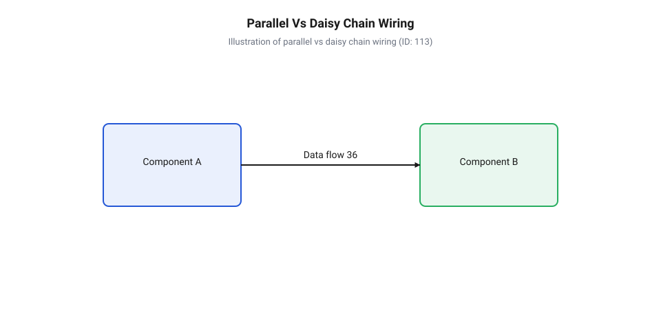
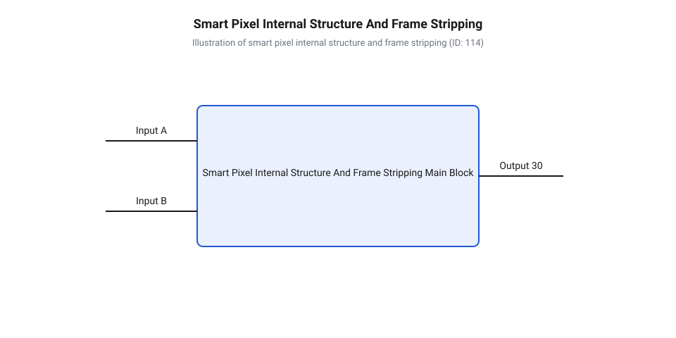
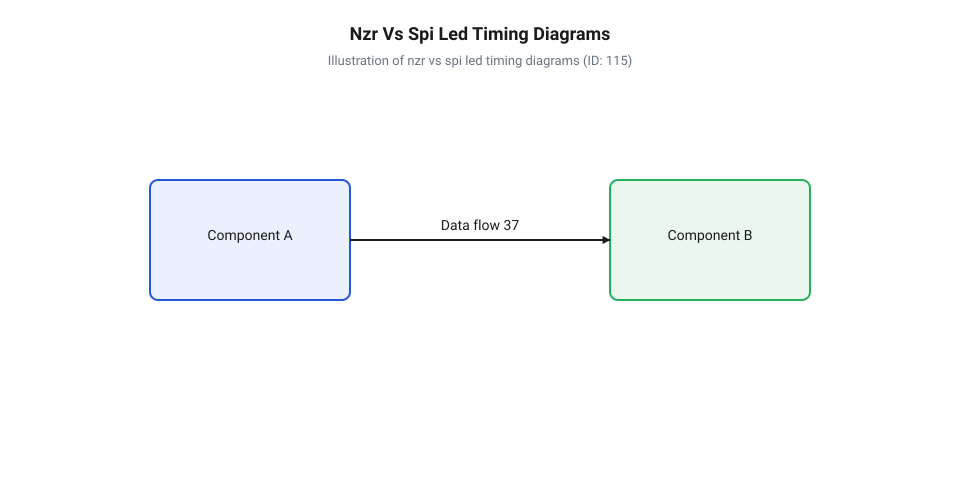
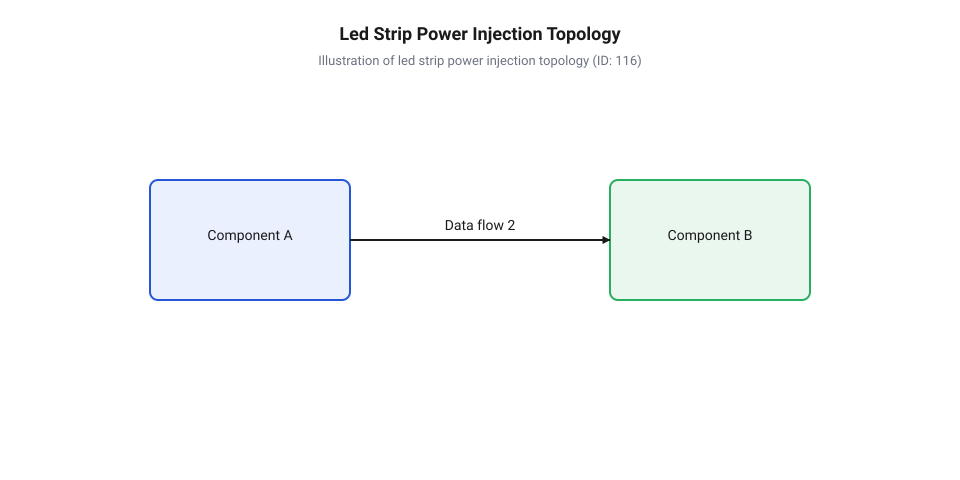
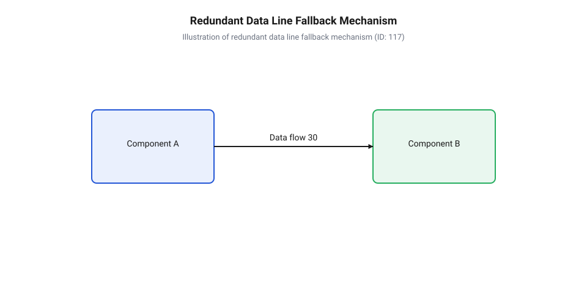

# Родина адресних світлодіодів та світлодіодних стрічок

<preknowlist>
- [KY-016 — RGB-світлодіод](root:cat-hw-actuators/ky-016-rgb) — принципи змішування кольорів RGB та роздільного керування кристалами через спільний анод або катод
- [KY-009 — RGB SMD-модуль](root:cat-hw-actuators/ky-009-rgb-smd) — конструктивне виконання SMD-кристалів та особливості тепловідведення й струмообмеження
- [WS2812B — адресний RGB-світлодіод (5050)](root:cat-hw-actuators/ws2812b-led) — базову будову монолітного розумного пікселя 5050 та базову трипровідну схему підключення VCC, GND, DIN/DOUT
- [Блокувальні конденсатори в лініях живлення LED](root:cat-hw-actuators/decoupling-capacitors-led) — призначення та механізм дії керамічних й електролітичних конденсаторів для згладжування імпульсних кидків струму
</preknowlist>

## Чому паралельне керування світлодіодами обмежене

Потреба самостійно встановлювати колір та яскравість кожного окремого елемента у світлодіодному масиві виникає в найрізноманітніших системах — від динамічного підсвічування приладових панелей та декоративних індикаторів до гнучких екранів і складних світлотехнічних установок. Коли пристрій містить лише один або два світлодіоди, завдання здається елементарним. Проте спроба масштабувати класичний підхід до десятків або сотень світловипромінювачів швидко впирається у фізично нездоланний бар'єр.

Класичний напівпровідниковий індикатор, як-от [RGB-світлодіод KY-016](root:cat-hw-actuators/ky-016-rgb) або поверхневий [RGB SMD-модуль KY-009](root:cat-hw-actuators/ky-009-rgb-smd), є комбінацією трьох незалежних напівпровідникових кристалів у спільному корпусі: червоного, зеленого та синього. Щоб створити потрібний колірний відтінок, через кожен із цих кристалів необхідно пропустити струм чітко розрахованої величини. На практиці це роблять за допомогою @@uk|ШІМ@@ (від @@uk|широтно-імпульсна модуляція@@ / @@en|Pulse-Width Modulation, PWM@@) — швидкого перемикання кристала між повністю увімкненим та вимкненим станами з різним співвідношенням часу увімкненого стану до періоду (@@en|duty cycle@@ — коефіцієнт заповнення). Кожен із трьох випромінювачів вимагає власного керуючого сигналу від мікроконтролера.

Математика прямого фізичного підключення виявляє жорстоке обмеження. Якщо для одного @@en|RGB@@ (від @@en|Red, Green, Blue@@ — червоний, зелений, синій) світлодіода потрібно 3 виводи @@en|GPIO@@ (від @@en|General-Purpose Input/Output@@ — виводи загального призначення) з підтримкою генерації @@uk|ШІМ@@, то для матриці з 10 елементів знадобиться вже 30 виводів. Для панелі з 100 світлодіодів чисельність ліній керування зростає до 300:

```
N_pins = N_leds × 3
       = 100 × 3    [підстановка кількості пікселів N_leds = 100]
       = 300        [загальна кількість необхідних ліній GPIO]
```

Жоден серійний мікроконтролер не має такої кількості виводів @@en|GPIO@@ з апаратною підтримкою @@uk|ШІМ@@. Більше того, фізичне розведення 300 сигнальних провідників уздовж друкованої плати перетворює кабельну трасу на громіздкий джгут, підвищує паразитну ємність та створює потужні електромагнітні завади при високочастотному перемиканні струму.

Апаратною альтернативою тривалий час слугувало пасивне мультиплексування (динамічна індикація), де світлодіоди об'єднувалися у сітку з рядків та стовпчиків. Проте матрична схема має суттєві фізичні вади: у будь-який момент часу світиться лише один рядок, через що усереднена яскравість кожного елемента падає пропорційно кількості рядків. Щоб відновити яскравість, через кристали доводиться імпульсно пропускати пікові струми, що прискорює деградацію напівпровідника. Крім того, мікроконтролер змушений безперервно витрачати обчислювальні ресурси на високій частоті, аби людське око не помічало мерехтіння.

Іншим проміжним розв'язком було використання зовнішніх багатоканальних драйверів та зсувних регістрів. Проте це призводило до потреби монтувати десятки додаткових корпусів мікросхем на друкованій платі. Як описує [еволюція родини адресних світлодіодів](root:cat-hw-actuators/addressable-led-family-overview/hist-addressable-led-evolution.md), справжнім технологічним проривом стало винесення обчислювальної та керуючої логіки безпосередньо у внутрішній простір корпусу кожного світлодіодного кристала.

Єдиним принциповим виходом із цього глухого кута став перехід від паралельного підключення зіркоподібної топології до послідовної каскадної шини (@@en|daisy chain@@ — ланцюгове з'єднання). У такій шині всі елементи з'єднуються послідовно один за одним. Мікроконтролер передає весь потік даних по єдиній сигнальній лінії до першого елемента ланцюга. Перший елемент забирає інформацію, призначену особисто йому, а решту даних автоматично ретранслює далі до другого елемента. Завдяки такому підходу кількість сигнальних ліній між мікроконтролером і масивом із сотень пікселів скорочується всього до одного або двох провідників.


*Порівняльна схема паралельного зіркоподібного підключення світлодіодів та послідовної каскадної шини демонструє скорочення кількості сигнальних ліній GPIO до єдиного провідника.*

## Як розумний піксель обробляє дані

Послідовна каскадна шина вимагає, щоб кожен світлодіод володів власною "інтелектуальною" начинкою, здатною самостійно приймати бітовий потік, відфільтровувати потрібні дані та автономно керувати струмом кристалів. Такий інтегрований компонент дістав назву @@en|smart pixel@@ (від @@en|smart pixel@@ — розумний піксель).

Типовий монолітний [адресний RGB-світлодіод WS2812B](root:cat-hw-actuators/ws2812b-led) у стандартному корпусі @@en|SMD@@ (від @@en|Surface-Mount Device@@ — пристрій поверхневого монтажу) розміром `5.0 × 5.0 мм` (формат 5050) містить усередині чотири окремі кристали: три світловипромінювальні напівпровідникові діоди (червоний, зелений і синій) та мікроскопічну кремнієву інтегральну схему драйвера.

Внутрішня архітектура мікросхеми драйвера смарт-пікселя складається з чотирьох ключових функціональних вузлів:
1. Вхідний каскад відновлення сигналу (@@en|signal shaping circuit@@) — підсилює послаблений фронт прямокутного імпульсу та відновлює його амплітуду за допомогою тригера @@de|Schmitt@@ (від @@de|Schmitt-Trigger@@ — тригер Шмітта), усуваючи спотворення, що виникли під час проходження через попередній провідник. 2. Внутрішній зсувний регістр (@@en|shift register@@) — послідовна логічна комірка пам'яті, що накопичує вхідні біти даних. 3. Засувка-фіксатор даних (@@en|data latch@@) — паралельний регістр зберігання, який утримує значення кольору й ізолює робочі @@uk|ШІМ@@-генератори від процесів зсуву бітів під час оновлення кадру. 4. Триканальний драйвер постійного струму (@@en|constant current driver@@) — силові ключі на базі @@en|MOSFET@@ (від @@en|Metal-Oxide-Semiconductor Field-Effect Transistor@@ — польовий транзистор зі структурою метал-оксид-напівпровідник), які формують стабільний струм через відповідні кристали незалежно від коливань напруги живлення.


*Внутрішня будова смарт-пікселя та механізм каскадного зрізання кадрів при проходженні бітового потоку через ланцюжок.*

Ключова проблема послідовного ланцюжка полягає у фізичній адресації: як кожен розумний піксель дізнається, які саме 24 біти із суцільного потоку призначені саме йому, якщо в чипа немає жодних перемикачів чи унікального апаратного ідентифікатора? Розв'язанням цієї задачі є механізм зрізання кадрів (@@en|frame stripping@@ — каскадне відтинання бітів).

Механізм зрізання кадрів працює за принципом апаратного конвеєра:

1. Передавач (мікроконтролер) формує в оперативній пам'яті колірний буфер для всіх `N` пікселів стрічки. Для кожного пікселя виділяється 24 біти (по 8 бітів на канали Green, Red, Blue). Пакет надсилається в лінію суцільною серією бітів загальною довжиною `N × 24` біти. 2. Коли перший піксель ланцюга отримує перші біти на свій вхід @@en|DIN@@ (від @@en|Data In@@ — вхід даних), його внутрішній зсувний регістр порожній. Внутрішня комутаційна логіка спрямовує вхідний потік виключно у власний 24-бітовий регістр. На цьому етапі вихід @@en|DOUT@@ (від @@en|Data Out@@ — вихід даних) першого пікселя утримується в стані логічного нуля. 3. Щойно перший піксель повністю заповнює свій 24-бітовий регістр (тобто приймає рівно 24 біти), внутрішній селектор даних перемикає свій стан. Усі наступні біти, починаючи з 25-го біта початкової серії, більше не потрапляють у внутрішній регістр першого пікселя, а перенаправляються безпосередньо на вихідний контакт @@en|DOUT@@ через схемотехніку відновлення сигналу. 4. Для другого пікселя ланцюга 25-й біт загальної серії стає найпершим бітом на його власному вході @@en|DIN@@. Другий піксель діє аналогічно: заповнює власні 24 біти та відкриває транзит на свій вихід @@en|DOUT@@ починаючи з 49-го біта. 5. Процес повторюється хвилеподібно вздовж усього ланцюга. Кожен піксель "зрізає" перші 24 біти з потоку, який він бачить на своєму вході, і передає решту далі.

Після того як усі `N` пікселів заповнили свої зсувні регістри, настає фаза відображення. Оскільки під час зсуву бітів колірні значення всередині регістрів постійно змінюються, не можна подавати ці дані на випромінювальні кристали напряму — це спричинило б хаотичне мерехтіння.

Для синхронізації оновлення використовується спеціальний паузовий сигнал @@en|RESET@@ (від @@en|RESET@@ — скидання / пауза фіксації). Коли мікроконтролер припиняє передачу бітів і утримує сигнальну лінію у низькому стані (логічний 0) протягом часу, що перевищує порогове значення `T_reset` (зазвичай від `50 мкс` до `280 мкс`), внутрішній аналоговий таймер таймауту в кожному пікселі спрацьовує.

Отримавши сигнал @@en|RESET@@, кожен смарт-піксель здійснює дві паралельні дії:
1. Переносить накопичений 24-бітовий вміст із зсувного регістра у внутрішню засувку-фіксатор (@@en|data latch@@). Своєю чергою, засувка оновлює коефіцієнт заповнення внутрішніх генераторів @@uk|ШІМ@@, і світлодіод миттєво змінює колір. Усі пікселі стрічки оновлюють свій стан абсолютно одночасно. 2. Скидає свій внутрішній лічильник бітів у початковий стан. Зсувний регістр знову готується приймати нові перші 24 біти наступного кадру.

Часові інтервали передачі та підготовка кадру вимагають чіткого математичного розрахунку. Проаналізуємо часову діаграму для стрічки з `N = 100` пікселів при використанні однопровідного протоколу з частотою `800 кГц` (тривалість одного біта `T_bit = 1.25 мкс`):

```
T_data = N × 24 × T_bit
       = 100 × 24 × 1.25 мкс  [підстановка N=100 та T_bit=1.25 мкс]
       = 3000 мкс            [обчислення часу передачі масиву бітів]
       = 3.0 мс              [переведення в мілісекунди]

T_frame = T_data + T_reset
        = 3.0 мс + 0.3 мс    [підстановка порогової паузи T_reset = 300 мкс]
        = 3.3 мс             [підсумкова тривалість передачі кадру]

FPS = 1 ÷ T_frame
    = 1 ÷ 0.0033 с           [розрахунок максимально можливої частоти кадрів]
    ≈ 303 Гц                 [теоретична гранична частота оновлення]
```

З обчислень видно, що для 100 пікселів максимально можлива частота оновлення становить понад 300 кадрів на секунду. Проте при каскадуванні тисяч елементів тривалість `T_data` лінійно зростає, що створює жорсткі обмеження на максимальний @@en|refresh rate@@ (від @@en|refresh rate@@ — частота оновлення). Глибокий аналіз межі пропускної здатності та порівняння з іншими протоколами розгортають [математичні моделі часових інтервалів та оновлення](root:cat-hw-actuators/addressable-led-family-overview/math-addressable-led-timing-and-refresh-rate.md).

Для побудови фізичних схем підключення ключовим моментом є дотримання специфікацій електричних рівнів та узгодження ліній даних. Як визначає специфікація на [фізичний інтерфейс та підключення](root:cat-hw-actuators/addressable-led-family-overview/api-addressable-led-hardware-pinout-and-wiring.md) та довідник [часових діаграм адресних чипсетів](root:cat-hw-actuators/addressable-led-family-overview/api-addressable-led-protocols-and-timings.md), сигнальний вхід @@en|DIN@@ є високоімпедансним CMOS-входом, а якість та фронти вхідного сигналу безпосередньо впливають на стійкість зчитування бітів зсувним регістром.

## Чим відрізняються асинхронні та синхронні чипсети

Передача кольорових даних на послідовний ланцюг із сотень розумних пікселів потребує швидкості у мільйони бітів на секунду. Коли для обміну використовується єдиний провідник, приймальний мікроконтролер пікселя змушений розпізнавати логічні нулі та одиниці виключно за тривалістю електричних імпульсів. Найменша затримка керуючого мікроконтролера під час обробки @@en|переривання@@ (від лат. interruptio — переривання) чи обслуговування периферії збиває часові інтервали передачі, що викликає спотворення кольорів або хаотичне миготіння усієї світлодіодної стрічки.

Робота популярних однопровідних чипсетів, таких як [світлодіод WS2812B](root:cat-hw-actuators/ws2812b-led), базується на імпульсному кодуванні, яке визначає @@en|асинхронний протокол@@ (від грецьк. α- — без, σύγχρονος — одночасний) у форматі @@en|NRZ@@ (від англ. Non-Return-to-Zero — без повернення до нуля). Кожен біт передається як один високий та один низький рівень напруги суворо визначеної тривалості. Для біта `0` високий рівень утримується приблизно 0.4 мкс, а низький — 0.85 мкс. Для біта `1` тривалість високого стану становить 0.8 мкс, а низького — 0.45 мкс. Оскільки окремого сигналу синхронізації немає, внутрішній генератор кожного пікселя відраховує час від спадного або наростаючого фронту імпульсу. Допустиме відхилення тривалості становить не більше ±150 нс, через що програмне формування сигналу через звичайні GPIO з увімкненими перериваннями стає неможливим.

Щоб звільнити обчислювальне ядро мікроконтролера від постійного очікування у програмних циклах затримки, генерацію часових діаграм перекладають на апаратну периферію. Використання апаратного модуля @@en|DMA@@ (від англ. Direct Memory Access — прямий доступ до пам'яті) у зв'язці з таймерами або інтерфейсом SPI дозволяє потоково вивантажувати заздалегідь згенеровану маску імпульсів із оперативної пам'яті безпосередньо у регістри порту виводу. Побудову такого апаратного рішення висвітлює спеціалізований [програмний драйвер](root:cat-hw-actuators/addressable-led-family-overview/proj-custom-nzr-dma-led-driver.md) для генерації часових діаграм без залучення ЦП.

Еволюція родини адресних світлодіодів пройшла шлях від перших розсипних систем на базі дискретних @@en|зсувних регістрів@@ (від лат. regestrum — список, книга) 74HC595 та окремих драйверів WS2801 до монолітних смарт-пікселів. У ранніх архітектурах плата кожного пікселя містила громіздку обв'язку з декількох мікросхем, що обмежувало щільність монтажу та надійність. Поява монолітної інтеграції в корпусі SMD 5050 об'єднала світловипромінювальні кристали та керуючий @@en|чипсет@@ (від англ. chipset — набір мікросхем) в єдиному корпусі. Подальший розвиток спричинив виникнення завадостійких RGBW-чипсетів із додатковим білим каналом та інтегрованими резервними лініями даних, про що детальніше розповідає [еволюція адресних світлодіодів](root:cat-hw-actuators/addressable-led-family-overview/hist-addressable-led-evolution.md).

Потреба у високій швидкості оновлення та незалежності від затримок керуючого пристрою зумовила появу чипсетів із двопровідною шиною. Додавання виділеного провідника, яким передається @@en|лінія тактування CLK@@ (від нім. Takt — крок, ритм та англ. clock), перетворює шину на @@en|синхронний інтерфейс@@ (від грецьк. σύγχρονος — одночасний). У мікросхемах SK9822 або [двопровідних світлодіодах APA102](root:cat-hw-actuators/apa102-and-sk9822-two-wire-leds) зчитування стану лінії даних DIN відбувається чітко за наростаючим фронтом тактового сигналу CLK. Завдяки цьому швидкість передачі більше не прив'язана до жорсткого фіксованого інтервалу в 800 кГц і може варіюватися від 0 Гц до 20 МГц, а будь-яка затримка мікроконтролера лише призупиняє тактування без псування кадру.


*Часові діаграми асинхронного та синхронного протоколів: в асинхронній шині тривалість фаз імпульсу вимагає суворого дотримання наносекундних інтервалів, тоді як у синхронній шині зчитування біта DIN відбувається за високим рівнем тактового сигналу CLK.*

Часові параметри передачі кадру прямо визначають граничну @@en|частоту оновлення@@ (від лат. frequentia — відвідуваність, щільність) світлодіодної матриці чи стрічки. Для асинхронного протоколу NZR із частотою передачі бітів 800 кГц тривалість одного біта становить `1.25 мкс`. Оскільки для одного RGB-пікселя потрібно передати 24 біти (по 8 біт на кожен із трьох кольорів), час запису одного елемента становить `30 мкс`.

Розрахунок тривалості кадру `T_frame` та граничної частоти оновлення `F_refresh` для каскаду з `N = 1000` пікселів при тривалості паузи скидання `T_reset = 300 мкс`:

```
T_pixel = 24 × 1.25 мкс
        = 30 мкс                  [час передачі 24 біт одного RGB-пікселя]
T_cascade = 1000 × 30 мкс
          = 30 000 мкс = 30 мс    [сумарний час передачі кадру на 1000 пікселів]
T_frame = 30 мс + 0.3 мс
        = 30.3 мс                 [додавання затримки скидання RESET 300 мкс]
F_refresh = 1 / 0.0303 с
          ≈ 33 Гц                 [гранична частота оновлення кадру]
```

Значення 33 Гц є граничним для асинхронної шини з тисячею елементів. Якщо для динамічних світлових ефектів чи динамічної індикації потрібна частота 100–400 Гц, перехід на двопровідний синхронний чипсет із тактовою частотою 10–20 МГц дає змогу скоротити час передачі такого ж кадру до 2–3 мс. Визначити оптимальну пропускну здатність шини під конкретну довжину стрічки допомагають [математичні моделі часових інтервалів](root:cat-hw-actuators/addressable-led-family-overview/math-addressable-led-timing-and-refresh-rate.md) та докладна таблиця часових параметрів у [довіднику часових специфікацій](root:cat-hw-actuators/addressable-led-family-overview/api-addressable-led-protocols-and-timings.md).

При виборі типу шини для конкретного проєкту враховують обчислювальні можливості мікроконтролера та вимоги до топології:
- Асинхронний протокол NZR (WS2812B, SK6812) доцільний у компактних пристроях із дефіцитом виводів GPIO, помірною довжиною ланцюга (до 300–500 пікселів) та наявністю апаратної периферії DMA чи SPI, коли першочерговою є низька вартість елементів. - Синхронний інтерфейс (APA102, SK9822) необхідний при високих вимогах до частоти оновлення, під час керування від одноплатних комп'ютерів із операційними системами загального призначення без систем реального часу, а також при програмній реалізації протоколу без використання апаратних таймерів.

## Як забезпечити стабільне живлення стрічки

Підключення довгомірної адресної стрічки до джерела живлення лише з одного кінця супроводжується характерними збоями: пікселі на дальньому краї починають світитися з червоним відтінком, самовільно блимають або вимикаються при збільшенні яскравості. Фізична причина цього явища полягає у виникненні омічного опору тонких мідних струмопровідних доріжок гнучкої друкованої плати. При проходженні великого струму на цих доріжках виникає значне @@en|омічне падіння напруги@@ (від прізвища фізика Georg Ohm та лат. tensio — напруга), через що потенціал живлення на віддалених ділянках падає нижче критичного порогу роботи драйверів.

Кожен розумний піксель містить три світловипромінювальні кристали, якими керують вбудовані джерела стабільного струму через @@en|ШІМ@@ (від лат. modulatio — розміреність). За умови 100% яскравості білого кольору кожен із трьох кристалів споживає близько 20 мА, що дає сумарний піковий струм біля 60 мА на один 5-вольтний піксель.

Розрахунок пікового струму споживання `I_strip` та максимальної потужності `P_total` для п'ятиметрової стрічки щільністю 60 LED/м (загалом `N = 300` пікселів):

```
I_pixel = 3 × 20 мА
        = 60 мА                   [піковий струм одного RGB-пікселя на повній яскравості]
I_strip = 300 × 60 мА
        = 18 000 мА = 18 А        [загальний піковий струм стрічки на 300 пікселів]
P_total = 18 А × 5 В
        = 90 Вт                   [максимальна споживана потужність]
```

Проходження струму величиною 18 Ампер через вузьку мідну доріжку з опором `0.2–0.5 Ом/м` спричиняє падіння напруги з номінальних 5.0 В на початку стрічки до 2.8–3.2 В на її кінці. Оскільки синій та зелений кристали потребують прямого падіння напруги на рівні 3.0–3.2 В, при зниженні напруги вони гаснуть першими, залишаючи світитися лише червоний кристал із нижчою пороговою напругою (близько 1.8–2.0 В). Деталізований алгоритм обчислень просідання напруги надає [математичний розрахунок струму](root:cat-hw-actuators/addressable-led-family-overview/math-addressable-led-power-and-voltage-drop.md).

Для зменшення струмового навантаження у довгомірних системах застосовують чипсети з підвищеною робочою напругою 12 В або 24 В. При однаковій споживаній потужності підвищення напруги зменшує струм в лінії пропорційно у 2.4 або 4.8 рази, що пропорційно знижує втрати на опорі провідників. У класичних 12-вольтних стрічках на базі WS2811 світлодіоди об'єднують у послідовні групи по 3 штуки на один драйвер, що зменшує роздільну здатність адресації. Сучасні чипсети, такі як [адресні світлодіоди WS2815](root:cat-hw-actuators/ws2813-and-ws2815-redundant-addressable-leds), об'єднують індивідуальну адресацію кожного пікселя SMD 5050 з вбудованим понижувальним регулятором живлення від 12 В.

Ефективним способом боротьби з омічним падінням напруги на 5-вольтних стрічках є @@en|інжекція живлення@@ (від лат. injectio — вприскування). Вона полягає в прокладанні паралельно до стрічки додаткової силової магістралі з мідного кабелю достатнього перерізу (14–16 AWG), від якої напругу підводять безпосередньо до провідників стрічки через кожні 2.5–5 метрів або з обох її кінців.


*Топологія інжекції живлення світлодіодної стрічки: магістральний кабель великого перерізу подає напругу безпосередньо в точки інжекції, компенсуючи омічні втрати в тонких провідниках FPCB.*

Окрім постійного падіння напруги, висока частота ШІМ-модуляції викликає високочастотні імпульсні кидки струму в шині живлення. Для їх згладжування на вході живлення стрічки встановлюють електролітичний @@en|блокувальний конденсатор@@ (від лат. condensare — згущувати) ємністю 470–1000 мкФ на напругу 6.3–16 В, а біля кожного пікселя розміщують керамічний конденсатор на 0.1 мкФ. Практичні рекомендації щодо монтажу фільтрів описують [блокувальні конденсатори](root:cat-hw-actuators/decoupling-capacitors-led) та схемотехнічний [довідник схемотехніки підключення](root:cat-hw-actuators/addressable-led-family-overview/api-addressable-led-hardware-pinout-and-wiring.md).

Для захисту лінії даних від імпульсних завад і високочастотних дзвінків, викликаних довгою трасою, послідовно в лінію DIN перед першим пікселем впаюють @@en|обмежувальний резистор@@ (від лат. resisto — чинити опір) номіналом 330–470 Ом.

Серйозною пасткою при підключенні до 3.3-вольтних мікроконтролерів (ESP32, STM32) є розбіжність логічних рівнів. Порогова напруга високого рівня `V_IH` для 5-вольтних пікселів становить `0.7 × VCC = 3.5 В`. Вихідна напруга мікроконтролера 3.3 В виявляється нижчою за цей поріг, що призводить до втрати кадрів та завад. Для надійного зчитування сигналу застосовують швидкісний @@en|узгоджувач логічних рівнів@@ (від грецьк. logos — слово, розум та англ. level shifter) на базі мікросхем 74AHCT125 або 74HCT245 із живленням від 5 В.

У довгомірних світлодіодних конструкціях вихід з ладу одного пікселя в класичній стрічці WS2812B блокує передачу сигналу DOUT на всі наступні елементи. Для підвищення відмовостійкості розроблено пікселі із двома каналами даних, де передбачена @@en|резервна лінія даних@@ (від лат. reservare — зберігати). У таких чипсетах, як [WS2813 та WS2815](root:cat-hw-actuators/ws2813-and-ws2815-redundant-addressable-leds), кожен піксель має первинний вхід DIN та обхідний вхід BIN, який підключається до виходу DOUT попереднього пікселя. При відмові одного смарт-пікселя наступний автоматично перемикається на резервний канал BIN, зберігаючи працездатність решти стрічки.


*Механізм резервування шини даних у завадостійких світлодіодах: при виході з ладу первинного каналу DIN-DOUT відновлення передачі кадру здійснюється через обхідний канал BIN-BOUT.*

Комплексний підхід до побудови системи живлення, що поєднує грамотний розрахунок перерізу провідників, інжекцію напруги, узгодження логічних рівнів та захисну фільтрацію, гарантує стабільну роботу інсталяції. Практичне втілення такої апаратної схеми розкрито у проєкті [проєктування та монтаж завадостійкої контролерної системи](root:cat-hw-actuators/addressable-led-family-overview/proj-addressable-led-controller-and-power-injection.md).

## Як підвищити завадостійкість шини даних

Використання 3.3-вольтних мікроконтролерів для керування 5-вольтними адресними світлодіодами створює приховану електричну несумісність, яка виявляється в раптовому мерехтінні пікселів або повній втраті зв'язку. Проблема полягає в розбіжності логічних рівнів напруги. Сучасний @@en|microcontroller@@ (від @@en|micro@@ — малий та @@en|controller@@ — управитель) формує на виході високий @@en|logic level@@ (від @@en|logic@@ — логіка та @@en|level@@ — рівень) `V_OH` на рівні 3.3 В. Водночас інтегральні драйвери пікселів, такі як @@en|WS2812B@@, живляться від напруги 5 В і мають вхідні каскади на базі @@en|CMOS@@ (від @@en|Complementary Metal-Oxide-Semiconductor@@ — комплементарна структура метал-оксид-напівпровідник) транзисторів.

Обчислимо мінімально припустимий поріг високого логічного рівня `V_IH` для 5-вольтних адресних чипсетів, виходячи з номінальної напруги живлення `V_CC`.

```
V_IH = 0.7 × V_CC        [порогова напруга CMOS-входу]
     = 0.7 × 5.0 V       [підстановка напруги живлення 5 В]
     = 3.5 V             [мінімальний рівень високого сигналу]
```

Де `V_IH` визначає мінімальну @@en|threshold voltage@@ (від @@en|threshold@@ — поріг та @@en|voltage@@ — напруга) логічної одиниці, а `V_CC` — напругу живлення мікросхеми. З розрахунку видно, що напруга 3.3 В з виводу мікроконтролера виявляється меншою за 3.5 В. Вона потрапляє у зону невизначеності логічних рівнів, через що вхідний компаратор світлодіода зчитує імпульси з помилками, викликаючи збої в декодуванні кадрів.

Для усунення цього розриву в схему вводять апаратний @@en|level shifter@@ (від @@en|level@@ — рівень та @@en|shift@@ — зсув). Поширені двонаправлені конвертери рівнів на польових транзисторах із підтягувальними резисторами, які часто застосовують для повільних шин, не підходять для асинхронних протоколів адресних світлодіодів. Паразитні ємності лінії та високий опір підтяжки створюють значний @@en|rise time@@ (від @@en|rise@@ — підйом та @@en|time@@ — час), спотворюючи часову діаграму імпульсів.

Обчислимо сталу часу `τ` (тау) для транзисторного конвертера рівнів із підтягувальним опором `R` та паразитною ємністю лінії `C`.

```
τ = R × C                [формула сталої часу RC-ланцюга]
  = 10000 Ω × 50 × 10⁻¹² F [підстановка опору 10 кОм та ємності 50 пФ]
  = 500 × 10⁻⁹ s         [розрахунок сталої часу в секундах]
  = 500 ns               [переведення значення у наносекунди]
```

У цьому розрахунку `R` позначено як опір резистора підтяжки, а `C` — сумарну паразитну ємність монтажу та вхідного виводу. Оскільки стала часу 500 нс перевищує тривалість короткого імпульсу передачі логічного нуля `T0H` (близько 350 нс у протоколі @@en|WS2812B@@), фронт сигналу не встигає зрости до рівня спрацьовування компаратора.

Надійне узгодження забезпечують лише швидкісні мікросхеми, такі як @@en|74AHCT125@@ або @@en|74HCT245@@. Серія @@en|TTL@@ (від @@en|Transistor-Transistor Logic@@ — транзисторно-транзисторна логіка) при живленні від 5 В сприймає логічну одиницю вже при напрузі від 2.0 В, а її активний @@en|push-pull@@ (від @@en|push@@ — штовхати та @@en|pull@@ — тягнути) вихідний каскад формує повноцінний 5-вольтний сигнал з гострими фронтами. Використання схем типу @@en|open-drain@@ (від @@en|open@@ — відкритий та @@en|drain@@ — стік) без активної розгортки тут недопустиме.

Окрім амплітуди напруги, довгий кабель між контролером і першим пікселем діє як лінія передачі з власною індуктивністю та ємністю. Швидкі зміни напруги спричиняють ефект @@en|ringing@@ (від @@en|ring@@ — дзвеніти) — високочастотні коливальні сплески на фронтах сигналу, а також наведення @@en|crosstalk@@ (від @@en|cross@@ — перехресний та @@en|talk@@ — розмова) у сусідніх провідниках та стрибки потенціалу землі @@en|ground bounce@@ (від @@en|ground@@ — земля та @@en|bounce@@ — відскок).

Для придушення цих коливань послідовно в лінію даних безпосередньо біля виводу контролера або конвертера рівнів встановлюють демпфувальний резистор опором 33–470 Ом. Він узгоджує вихідний опір драйвера з хвильовим опором лінії та розсіює енергію паразитного резонансу. Одночасно керамічні й електролітичні конденсатори забезпечують [згладжування імпульсних кидків](root:cat-hw-actuators/decoupling-capacitors-led) струму живлення на шині, захищаючи логіку від просідання напруги. Узгоджену розводку провідників та підключення можна звірити з [допоміжним залізничним інтерфейсом](root:cat-hw-actuators/addressable-led-family-overview/api-addressable-led-hardware-pinout-and-wiring.md) для цокольовки.

Навіть при ідеальній електричній лінії залишається уразливість послідовного каскаду: якщо один світлодіод виходить з ладу, передача даних до наступних елементів припиняється. Для критичних застосувань використовують завадостійкі чипсети, в яких реалізовано @@en|backup data line@@ (від @@en|back up@@ — підстраховувати). У чипах @@en|WS2813@@ та @@en|WS2815@@ кожен піксель має два входи даних — основний DIN та резервний BIN.

Всередині світлодіода інтегровано цифровий @@en|multiplexer@@ (від @@en|multiplex@@ — многократний), який приймає основний сигнал із виходу DOUT попереднього пікселя (N-1), а резервний BIN — безпосередньо з виходу позапопереднього елемента (N-2). Якщо елемент N-1 виходить з ладу і його вихід DOUT замовкає, сусідній піксель N автоматично переключається на резервний канал BIN і продовжує отримувати потік даних. Завдяки чіпам із [резервним каналом даних](root:cat-hw-actuators/ws2813-and-ws2815-redundant-addressable-leds) лінія продовжує працювати без візуальних розривів навіть за відмови окремих елементів. Практичні нюанси монтажу таких завадозахищених систем висвітлено при проектуванні [довгомірної адресної світлодіодної](root:cat-hw-actuators/addressable-led-family-overview/proj-addressable-led-controller-and-power-injection.md) траси.

## Як обрати чипсет під вимоги проєкту

Вибір чипсета для світлодіодного проєкту вимагає компромісу між якістю передачі кольору, частотою оновлення кадрів, складністю лінії живлення та загальною надійністю апаратної частини. Неправильно обрана мікросхема може призвести до надмірного споживання струму, мерехтіння відеозапису або неприпустимого падіння напруги уздовж стрічки.

Першим критерієм оцінки є колірна конфігурація кристалів. Класичний приклад [монолітного розумного пікселя](root:cat-hw-actuators/ws2812b-led) @@en|WS2812B@@ має три канали (RGB) з 24-бітною адресацією. Однак створення білого світла шляхом одночасного ввімкнення червоного, зеленого та синього кристалів має низький @@en|Color Rendering Index@@ (від @@en|render@@ — відтворювати та @@en|index@@ — показник) і споживає максимальну потужність. Чипсети @@en|SK6812@@ у виконанні @@en|RGBW@@ (від @@en|Red-Green-Blue-White@@ — червоний-зелений-синій-білий) містять четвертий окремий люмінофорний білий кристал.

Розрахуємо струм споживання `I_total` для стопіксельної стрічки у режимі генерації білого світла при порівнянні RGB та RGBW варіантів.

Обчислення для RGB-стрічки при змішуванні трьох каналів:
```
I_RGB = N × (I_R + I_G + I_B)    [сумування струмів трьох каналів RGB]
      = 100 × (12 mA + 12 mA + 12 mA) [підстановка номінального струму 12 мА на канал]
      = 100 × 36 mA              [струм одного пікселя у режимі білого світла]
      = 3.6 A                    [підсумковий струм споживання RGB-стрічки]
```

Обчислення для RGBW-стрічки з використанням чистого білого каналу W:
```
I_RGBW = N × I_W                 [споживання лише чистого білого каналу W]
       = 100 × 12 mA             [підстановка струму одного білого кристала]
       = 1.2 A                   [підсумковий струм споживання RGBW-стрічки]
```

У наведених формулах `N` позначає кількість пікселів у ланцюзі, а `I_R`, `I_G`, `I_B`, `I_W` — струми відповідних колірних каналів. З результатів видно, що використання спеціалізованого білого кристала зменшує струмове навантаження утричі, знижуючи нагрів та спрощуючи вимоги до блоків живлення.

Другим критичним чинником є протокол передачі даних та пов'язана з ним частота оновлення. Однопровідні асинхронні чипсети (@@en|WS2812B@@, @@en|SK6812@@) фіксують біти за допомогою суворих часових інтервалів на частоті близько 800 кГц. Для їх стабільної роботи без блокування процесора необхідне застосування спеціалізованого [драйвера вихідних сигналів](root:cat-hw-actuators/addressable-led-family-overview/proj-custom-nzr-dma-led-driver.md) з використанням DMA та апаратних таймерів. Водночас для динамічних світлових шоу, зйомки на відеокамеру або пристроїв з інерцією зору асинхронна шина створює @@en|stroboscopic effect@@ (від @@en|strobos@@ — вихор та @@en|skopeo@@ — дивлюся) через відносно низьку внутрішню частоту ШІМ-модуляції (близько 400 Гц).

Двопровідні синхронні чипсети з [окремою лінією тактування](root:cat-hw-actuators/apa102-and-sk9822-two-wire-leds), такі як @@en|APA102@@ та @@en|SK9822@@, повністю усувають часову залежність від переривань контролера. Окрема лінія тактування CLK дозволяє піднімати частоту шини до 20–30 МГц, а внутрішня ШІМ-модуляція пікселів перевищує 19 кГц. Це гарантує відсутність мерехтіння на кадрах високої швидкості та створює величезний @@en|framerate headroom@@ (від @@en|frame@@ — кадр, @@en|rate@@ — частота та @@en|headroom@@ — запас).

Обчислимо ефективне значення струму `I_LED` для колірного каналу світлодіода в @@en|APA102@@ при поєднанні 5-бітного апаратного регулювальника яскравості `Global` та 8-бітного значення ШІМ `PWM`.

```
I_LED = I_max × (Global / 31) × (PWM / 255) [комбіноване регулювання струму та ШІМ]
```

Де `I_max` — максимальний струм каналу (20 мА), `Global` — значення 5-бітного регістру (від 0 до 31), а `PWM` — 8-бітне значення колірної інтенсивності. Така двоступенева схема регулювання запобігає втраті колірної дискретності на низькій яскравості. Більш розширено ці розрахунки зводяться у [програмованих часових специфікаціях](root:cat-hw-actuators/addressable-led-family-overview/api-addressable-led-protocols-and-timings.md) для різних чипсетів, а також узгоджуються з загальним [розрахунком частоти оновлення](root:cat-hw-actuators/addressable-led-family-overview/math-addressable-led-timing-and-refresh-rate.md) кадрів.

Третій критерій — робоча напруга та топологія адресації. П'ятивольтні стрічки вимагають частих точок підключення живлення, оскільки при високому струмі проявляються значні втрати. Для мінімізації втрат додаткові точки [інжекції електричного живлення](root:cat-hw-actuators/ws2812b-power-injection) стають обов'язковими через кожні 1–2 метри траси. У розрахунковому блоці детально описано [падіння високої напруги](root:cat-hw-actuators/addressable-led-family-overview/math-addressable-led-power-and-voltage-drop.md) уздовж провідників. Для довгомірних ліній доцільно обирати 12-вольтні чипсети: @@en|WS2811@@ (адресація сегментами по 3 світлодіоди) або @@en|WS2815@@ (індивідуальна адресація кожного пікселя при живленні 12 В). Для розуміння архітектурних змін корисно ознайомитися з [еволюційним шляхом розвитку](root:cat-hw-actuators/addressable-led-family-overview/hist-addressable-led-evolution.md) від зсувних регістрів до монолітних смарт-пікселів.

Для узагальнення технічних характеристик популярних чипсетів наведено порівняльну таблицю:

| Чипсет | Напруга живлення | Лінії даних | Макс. частота шини | Частота ШІМ | Резервування | Основна сфера застосування |
| :--- | :--- | :--- | :--- | :--- | :--- | :--- |
| **WS2812B** | 5 В | 1 (DIN) | ~800 кГц (NZR) | ~400 Гц | Ні | Короткі декоративні стрічки, індикація |
| **SK6812 RGBW** | 5 В | 1 (DIN) | ~800 кГц (NZR) | ~1.2 кГц | Ні | Інтер'єрне біле та кольорове освітлення |
| **WS2813** | 5 В | 2 (DIN, BIN) | ~800 кГц (NZR) | ~2 кГц | Так (BIN) | Надійні інтер'єрні та рекламні конструкції |
| **WS2815** | 12 В | 2 (DIN, BIN) | ~800 кГц (NZR) | ~2 кГц | Так (BIN) | Довгомірні траси з низьким струмом споживання |
| **APA102** | 5 В | 2 (DAT, CLK) | до 30 МГц (SPI) | ~19 кГц | Ні | POV-дисплеї, зйомка на камеру, динамічна графіка |

Для програмної конфігурації підсистеми керування в коді розробники задають структуру параметрів обраного чипсета:

:::tabs
:::code addressable-led-family-overview-d/c/c/configure-strip.c
:::code addressable-led-family-overview-d/cpp/cpp/chipsettype.cpp
:::