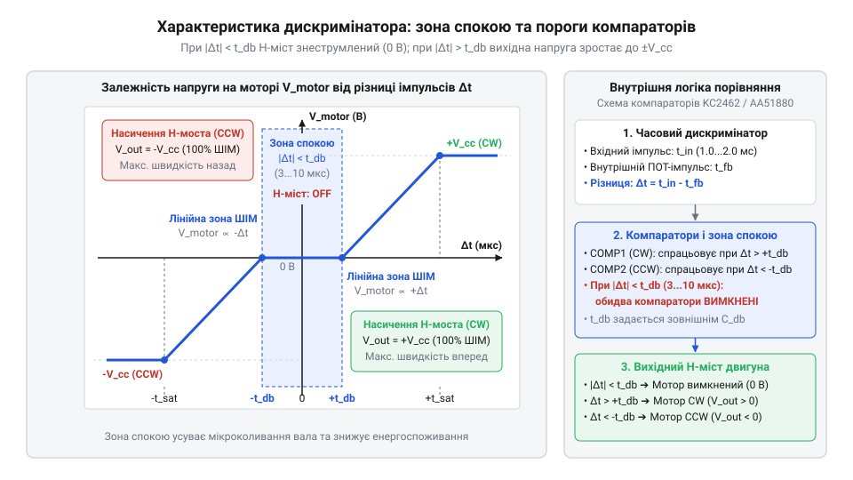
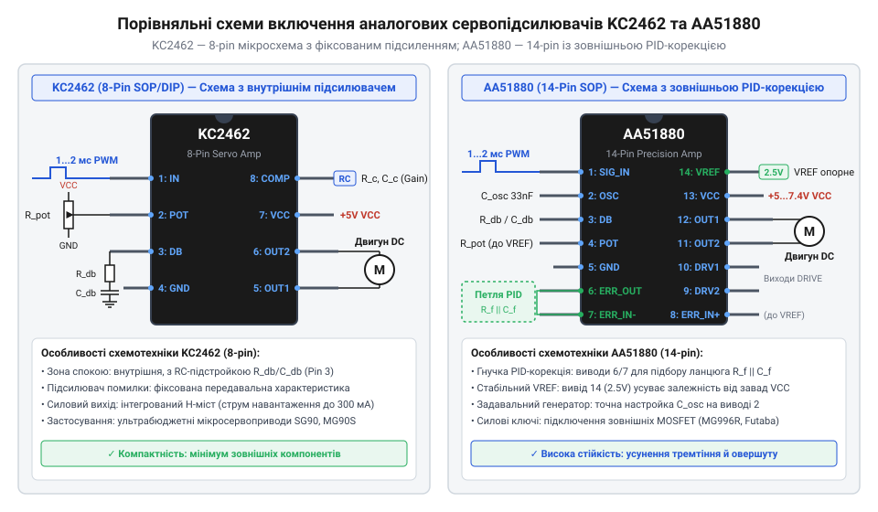
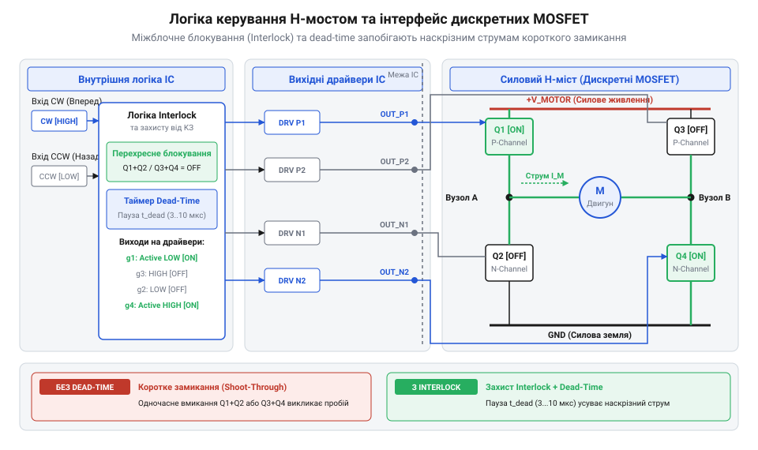
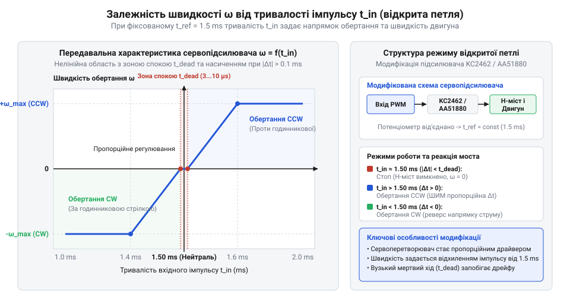

# Інтегральні аналогові сервопідсилювачі KC2462 та AA51880

<preknowlist>
- [Сервоприводи радіокерованих моделей: будова, редуктори та ШІМ-керування](root:cat-hw-actuators/rc-servo-mechanisms-and-control) — загальну кінематичну будову сервопривода, використання потенціометра зворотного зв'язку та параметри вхідного керуючого ШІМ-сигналу (50 Гц, 1...2 мс)
- [Математика потенціометричного зворотного зв'язку сервоприводу](root:cat-hw-actuators/servo-feedback-potentiometer) — лінійну залежність вихідної напруги потенціометра від кута повороту вала та алгоритми зняття сигналу позиції
- [Зона нечутливості та дрижання вала сервоприводів](root:cat-hw-actuators/servo-deadband-and-jitter) — концепцію гістерезису, фізичні причини дрижання вала (dither/jitter) та призначення зони нечутливості регулятора
- [Частота оновлення кадрів ШІМ і цикли позиціонування сервоприводів](root:cat-hw-actuators/servo-pwm-frame-rate) — вплив часового інтервалу повторення кадрів ШІМ на реакцію замкненої аналогової петлі регулювання
</preknowlist>

## Проблема утримання позиції вала сервопривода

Коли виконавчий механізм роботизованої системи або радіокерованої моделі — наприклад, кермовий flap літака чи шарнір роборуки — перебуває під дією зовнішнього механічного навантаження, вал двигуна постійно прагне відхилитися від заданого кута. Механічний момент зсуву передається через плече важеля, яке забезпечують [комплектні серво-роги](root:cat-hw-actuators/servo-horns), на вихідну шестерню та далі через багатоступеневий редуктор на ротор двигуна. Якщо зовнішнє зусилля зростає, сервомеханізм (від лат. *servus* — слуга та грецьк. *mechanē* — пристрій) @@en|servomechanism@@ повинен негайно згенерувати протидіючий обертальний момент, пропорційний величині відхилення. Здавалося б, для розв'язання цього завдання достатньо подати керуючий сигнал широтно-імпульсної модуляції (від лат. *modulatio* — розміреність, від *modus* — міра) @@en|pulse width modulation@@ (@@en|PWM@@) від зовнішнього мікроконтролера і довірити йому коригування позиції. Проте пряме керування силовим двигуном виключно вхідними цифровими кадрами створює серйозну схемотехнічну суперечність.

Зовнішній сигнал керування аналоговими сервоприводами надходить у вигляді періодичних імпульсів із частотою 50 Гц, де тривалість вихідного високоімпульсного стану становить від 1 мс до 2 мс (з нейтральним положенням у 1.5 мс). Для цифрових керуючих систем [частота оновлення кадрів ШІМ](root:cat-hw-actuators/servo-pwm-frame-rate) жорстко задає часовий крок у 20 мс між сусідніми командами. Якщо зовнішня сила зміщує вал сервопривода у проміжку між кадрами — наприклад, на другій мілісекунді циклу, — зовнішній контролер дізнається про відхилення або зможе відреагувати на нього лише в наступному кадрі через 18 мс. Протягом усього цього часу двигун залишається знеструмленим, а вал продовжує відхилятися під дією зовнішнього моменту.

Спроба розв'язати цю проблему шляхом подачі максимальної напруги живлення на мотор одразу після виявлення розсогласування призводить до іншого негативного ефекту. Якщо на мотор подати 100% напруги при малих кутових відхиленнях, висока швидкість обертання разом із інерцією ротора та механічними люфтами, якими володіють [редуктори сервоприводів](root:cat-hw-actuators/servo-gearboxes-and-backlash), спричинить значний проскок цільової позиції. Вал перерегулює потрібний кут, зворотний зв'язок @@en|feedback loop@@ спробує повернути його назад із таким самим максимальним зусиллям, і привід увійде в неперервний [режим постійного дрижання](root:cat-hw-actuators/servo-deadband-and-jitter) (від англ. *jitter* — дрижання) @@en|jitter@@. Це викликає ударні навантаження на зубці шестерень, швидкий перегрів обмоток двигуна та значний шум.

Для забезпечення високої точності позиціонування та миттєвої реакції на зсуви вала без використання дорогих і складних мікропроцесорів, усередині корпусу сервопривода встановлюють автономний аналоговий сервопідсилювач (від лат. *servus* — слуга та англ. *amplifier* — підсилювач) @@en|servo amplifier@@. Історично схемотехніка таких регуляторів пройшла тривалий шлях розвитку від дискретних каскадів на германієвих і кремнієвих транзисторах 1960-х років до спеціалізованих монолітних інтегральних мікросхем. Цей шлях детально описує [історія аналогових сервопідсилювачів](root:cat-hw-actuators/analog-servo-amplifier-ic/hist-analog-servo-ic-evolution.md), де ключовими етапами стали мікросхеми @@en|NE544@@, @@en|M51660L@@ та їхні сучасні китайські й тайванські аналоги @@en|KC2462@@ і @@en|AA51880@@.

Головне завдання аналогового сервопідсилювача полягає у безперервному апаратному порівнянні двох часових величин: тривалості вхідного керуючого імпульсу `t_in` та тривалості внутрішнього імпульсу зворотного зв'язку `t_fb`. Внутрішній імпульс генерується всередині мікросхеми за допомогою резистивно-ємнісного кола, де опором виступає зовнішній потенціометр (від лат. *potentia* — сила та грецьк. *metron* — міра) @@en|potentiometer@@, механічно з'єднаний із вихідним валом сервопривода. Цей потенціометр працює як [давач кута повороту](root:cat-hw-sensors/servo-feedback-potentiometers-and-magnetic-encoders). Коли вал повертається, опір потенціометра змінюється, що пропорційно зсуває тривалість `t_fb`.

У стані рівноваги, коли вал розташований точно у заданому куті, тривалість вхідного керуючого імпульсу збігається з тривалістю імпульсу зворотного зв'язку (`t_in = t_fb`). У цьому випадку аналогова схема формує нульовий рівень сигналу, який описує напруга розсогласування (від укр. *роз-* та *согласувати* — неузгодженість) @@en|error voltage@@ `U_err`, і силова частина утримує двигун вимкненим. Як тільки виникає кутове відхилення вала або змінюється вхідний сигнал керування, з'являється часова різниця `Δt = t_in - t_fb`. Аналоговий сервопідсилювач повинен негайно перетворити цю різницю тривалості в мікросекундах у пропорційну за величиною та полярністю аналогову напругу. Ця напруга подається на [інтегрований H-міст](root:cat-hw-drivers/integrated-h-bridge-motor-drivers) (від англ. *H-bridge* — H-подібний міст) @@en|H-bridge@@, який подає струм відповідного напрямку на колекторний двигун.

У масових аналогових приводах — таких як [Tower Pro SG90](root:cat-hw-actuators/sg90-servo) або [Power HD HD-1370A](root:cat-hw-actuators/hd-1370a-servo) — саме швидкість реакції аналогової петлі зворотного зв'язку визначає утримуючий момент і динаміку позиціонування. Проте для того щоб зрозуміти, як саме різниця імпульсів у декілька мікросекунд перетворюється на плавне регулювання струму через двигун, необхідно детально розібрати внутрішню структуру та принцип роботи аналогового дискримінатора імпульсів.

## Формування напруги розсогласування в дискримінаторі

Серцем будь-якого інтегрального аналогового сервопідсилювача — такого як мікросхеми @@en|KC2462@@ та @@en|AA51880@@ — є аналоговий дискримінатор (від лат. *discriminare* — розрізняти) @@en|pulse discriminator@@. Цей внутрішній апаратний блок призначений для безпосереднього перетворення різниці тривалості двох імпульсів на аналогову величину, що описує напруга розсогласування @@en|error voltage@@.

Коли на вхідний вивід мікросхеми надходить передній фронт вхідного ШІМ-сигналу керування, він запускає внутрішній ждучий мультивібратор (від грецьк. *monos* — один та лат. *vibro* — коливаюсь) @@en|monostable multivibrator@@. Мультивібратор формує еталонний імпульс зворотного зв'язку `t_fb`, тривалість якого визначається параметрами внутрішнього або зовнішнього RC-кола. Оскільки опір цього кола задається потенціометром зворотного зв'язку, кутове положення вала безпосередньо задає часову тривалість імпульсу:

```
t_fb = K_pot × R_pot × C_ref
```

тут `R_pot` — поточний опір потенціометра позиції вала, `C_ref` — опорна ємність задаючого генератора, а `K_pot` — внутрішній коефіцієнт пропорційності компаратора мікросхеми.

Обидва імпульси — вхідний `t_in` та внутрішній `t_fb` — подаються на розрядний та зарядний ключі генератора стабільного струму (зарядного насоса). У момент часу, коли один імпульс уже почався, а інший ще ні (або вже закінчився), формується часовий інтервал розсогласування `Δt = t_in - t_fb`. Протягом цього інтервалу струмовий генератор генерує імпульс струму `I_charge`, який подається на внутрішній або зовнішній накопичувальний конденсатор (від лат. *condensare* — згущувати) @@en|holding capacitor@@ `C_hold`, що працює як аналоговий інтегратор.

Якщо тривалість вхідного імпульсу більша за тривалість імпульсу зворотного зв'язку (`t_in > t_fb`), генератор струму заряджає конденсатор `C_hold`, підвищуючи потенціал на ньому відносно опорного рівня `V_ref`. Якщо ж вхідний імпульс коротший за імпульс зворотного зв'язку (`t_in < t_fb`), струмовий ключ перемикається в режим розряду, знижуючи напругу на конденсаторі `C_hold` нижче `V_ref`. Математична залежність вихідної напруги розсогласування `U_err` від часової різниці імпульсів описується такими виразами:

```
Δt = t_in - t_fb

U_err = V_ref + (I_charge × Δt) / C_hold      [заряд накопичувального конденсатора при t_in > t_fb]
U_err = V_ref - (I_charge × Δt) / C_hold      [розряд накопичувального конденсатора при t_in < t_fb]
```

у цих формулах `Δt` позначено як часову різницю тривалостей імпульсів, `U_err` — вихідну напругу розсогласування, `V_ref` — опорну напругу нейтралі (зазвичай становить половину напруги живлення `V_cc / 2`), `I_charge` — амплітудний струм зарядного насоса дискримінатора, а `C_hold` — ємність накопичувального конденсатора.


*Часова діаграма порівняння тривалостей вхідного імпульсу t_in і внутрішнього імпульсу t_fb з послідовним формуванням напруги розсогласування U_err на накопичувальному конденсаторі.*

Отримана напруга `U_err` пропорційна не лише величині відхилення вала в мікросекундах, а й вказує напрямок зсуву через свій знак відносно `V_ref`. Проте пряме підключення цієї напруги до силових транзисторів без додаткового фільтрування викликало б постійну автоколивальну нестійкість. Оскільки опір потенціометра піддається мікроскопічним шумам та вібраціям, які детально описує [математика потенціометричного зворотного зв'язку](root:cat-hw-actuators/servo-feedback-potentiometer), напруга `U_err` завжди містить незначні пульсації.

Щоб запобігти постійному смиканню двигуна при мікроскопічних відхиленнях, усередині дискримінатора формується зона спокою (зони нечутливості) @@en|deadband@@. Для цього напруга `U_err` подається на двопороговий віконний компаратор (від лат. *comparare* — порівнювати) @@en|comparator@@ із вбудованим гістерезисом (від грецьк. *hysteresis* — відставання) @@en|hysteresis@@. Поріг спрацьовування компаратора налаштовано так, що доки абсолютна часова розбіжність не перевищує критичного значення `t_dead` (зазвичай 3...10 мкс), вихідні ключі H-мосту залишаються повністю закритими:

```
|Δt| ≤ t_dead  ⇒  U_motor = 0 В              [зона нечутливості: H-міст закритий]
|Δt| > t_dead  ⇒  U_motor = f(U_err)         [активна зона: керування силовим мостом]
```

Тут `t_dead` означає напівширину часового вікна зони спокою, а `U_motor` — напругу, що прикладається до обмоток двигуна. Точний аналітичний розрахунок параметрів цього вікна та ємності зовнішніх конденсаторів надає [математика дискримінатора імпульсів](root:cat-hw-actuators/analog-servo-amplifier-ic/math-pulse-discriminator-and-deadband-calculation.md).


*Залежність напруги на виході силового моста від часової різниці імпульсів: у межах зони нечутливості 3...10 мкс двигун знеструмлений, а при виході за межі вікна напруга зростає.*

Практична реалізація дискримінатора має відмінності залежно від вибраного корпусу та призначення сервопідсилювача. У компактних 8-вивідних мікросхемах, що описує [залізний інтерфейс KC2462](root:cat-hw-actuators/analog-servo-amplifier-ic/api-kc2462-hardware-interface.md), більшість резисторів та ємностей налаштування зони спокою інтегровані всередину кристала для мінімізації габаритів плати. Натомість у повнофункціональних 14-вивідних корпусах, які демонструє [схема включення AA51880](root:cat-hw-actuators/analog-servo-amplifier-ic/api-aa51880-hardware-interface.md), розробнику доступні окремі виводи для підключення зовнішніх RC-кіл, що дозволяє гнучко змінювати ширину зони спокою та коефіціент підсилення петлі під конкретний редуктор.

Розуміння роботи дискримінатора дозволяє також виконувати нестандартні апаратні модифікації. Наприклад, якщо замінити потенціометр зворотного зв'язку фіксованим резистивним дільником нейтралі, дискримінатор сприйматиме будь-який вхідний імпульс, відмінний від 1.5 мс, як нескінченну помилку позиціонування. Це лежить в основі [модифікації для постійного обертання](root:cat-hw-actuators/analog-servo-amplifier-ic/proj-servo-continuous-rotation-modification.md), що перетворює стандартний сервопривід на силовий мотор-редуктор для мобільних робоплатформ (детальніше — [сервоприводи постійного обертання](root:cat-hw-actuators/continuous-rotation-servo-mod)). На відміну від суто аналогових дискримінаторів, сучасні безколекторні та цифрові системи позиціонування обчислюють помилку програмно, що детально описують [цифрові сервоконтролери](root:cat-hw-drivers/digital-servo-controllers-microcontrollers).

## Механізм зони спокою та стійкість петлі

Коли вихідний вал сервопривода досягає заданої кутової позиції, опір потенціометра зворотного зв'язку встановлюється у значення, при якому тривалість внутрішнього імпульсу `t_fb` точно дорівнює тривалості вхідного керуючого імпульсу `t_in`. Утім, реальна механічна система ніколи не буває абсолютно нерухомою. Колекторний двигун передає обертальний момент через багатоступеневу передачу, де неминуче присутні [люфти редукторів](root:cat-hw-actuators/servo-gearboxes-and-backlash). Сам потенціометр піддається мікроскопічним вібраціям та температурному дрейфу, через що формуються дрібні [шуми потенціометрів](root:cat-hw-actuators/servo-feedback-potentiometer). Якщо аналоговий дискримінатор реагував би на найменше відхилення тривалості імпульсів Δt → 0, напруга на накопичувальному конденсаторі `U_err` безперервно коливалася б навколо опорного рівня `V_ref`. Це змушувало б силовий каскад перемикати напрямок струму двигуна тисячі разів на секунду, викликаючи швидкий [знос шестерень](root:cat-hw-actuators/servo-gear-shear-and-wear), сильне перегрівання обмоток та високочастотне [дрижання вала сервопривода](root:cat-hw-actuators/servo-deadband-and-jitter) (від англ. *jitter* — дрижання) @@en|jitter@@.

Щоб запобігти неперервній осциляції мотора навколо точки рівноваги, в схемотехніку аналогових сервопідсилювачів впроваджують апаратну зону спокою (від англ. *deadband* — зона нечутливості) @@en|deadband@@. Її призначення полягає в тому, щоб сформувати часове вікно нечутливості Δt_dead (зазвичай у межах 3...10 мкс), усередині якого будь-які дрібні відхилення позиції вала повністю ігноруються силовим блоком.

Формування зони спокою відбувається у внутрішньому двопороговому віконному компараторі (від лат. *comparare* — порівнювати) @@en|window comparator@@, на вхід якого надходить напруга розсогласування `U_err` з накопичувального конденсатора `C_hold`. Віконний компаратор має два незалежні порогові рівні: верхній V_th_hi = V_ref + V_dead та нижній V_th_lo = V_ref - V_dead. Внутрішня порогова напруга зсуву V_dead визначає мінімальну величину відхилення напруги `U_err` від нейтралі `V_ref`, необхідну для активації вихідного каскаду.

Доки абсолютна величина розсогласування не перевищує порогового значення (|U_err - V_ref| ≤ V_dead), обоє вихідних каналів віконного компаратора залишаються в неактивному стані. Вихідні транзистори силового мосту закриті, двигун знеструмлений і перебуває в стані спокою. Тільки після того, як тривалість вхідного імпульсу зміститься відносно імпульсу зворотного зв'язку на величину, більшу за Δt_dead, напруга `U_err` виходить за межі безпечного вікна, і компаратор видає сигнал на увімкнення двигуна.

Зв'язок між напруговим зсувом компаратора V_dead та шириною зони спокою в мікросекундах Δt_dead описується формулою інтегрування струму зарядного насоса дискримінатора I_charge на накопичувальному конденсаторі C_hold:

```
V_dead = (I_charge × Δt_dead) ÷ C_hold
```

Виразивши тривалість зони спокою Δt_dead, отримуємо розрахункове рівняння:

```
Δt_dead = (V_dead × C_hold) ÷ I_charge      [рівняння часового інтервалу нечутливості]
```

Розглянемо практичний приклад розрахунку часової нечутливості для мікросхеми @@en|AA51880@@.

**Обчислення ширини зони спокою аналогового сервопідсилювача**

Умови: струм зарядного насоса дискримінатора `I_charge = 120 µA`, ємність накопичувального конденсатора `C_hold = 47 nF` (0.047 µF), пороговий напруговий зсув віконного компаратора `V_dead = 15 mV` (0.015 V).

```
Δt_dead = (0.015 V × 47 × 10⁻⁹ F) ÷ (120 × 10⁻⁶ A)      [підстановка параметрів елементів у формулу]
        = (0.705 × 10⁻⁹ V·F) ÷ (120 × 10⁻⁶ A)            [обчислення чисельника]
        = 5.875 × 10⁻⁶ s                                [ділення чисельника на струм]
        = 5.88 µs                                       [ширина зони спокою сервопідсилювача]
```

Глибше теоретичне підґрунтя формуванню зони спокою дає [математика аналогового дискримінатора](root:cat-hw-actuators/analog-servo-amplifier-ic/math-pulse-discriminator-and-deadband-calculation.md), де наведено детальний аналіз нелінійної характеристики перетворення.

Ширина зони спокою безпосередньо впливає на точність позиціонування та динамічну стійкість замкненої петлі регулювання @@en|closed-loop stability@@. Якщо зону спокою зробити занадто вузькою (Δt_dead < 2 мкс), підсилювач буде намагатися відпрацювати найдрібніші кутові відхилення. Однак інерція ротора двигуна та пружність матеріалу зубчатих коліс у [сервоприводах серії MG90S](root:cat-hw-actuators/mg90s-servo) призведуть до того, що вал проскочить точку рівноваги. Регулятор перейде в режим безперервних автоколивань (самозбудження). І навпаки, якщо зону спокою занадто розширити (Δt_dead > 15 мкс), привід набуде високої стійкості до шумів, але втратить точність: вал буде люфтити в межах широкого кутового сектора без генерації відновительного моменту.

Для налаштування ширини зони спокою та забезпечення стійкості петлі в мікросхемах @@en|KC2462@@ та @@en|AA51880@@ застосовують зовнішні RC-кола. У [апаратній специфікації KC2462](root:cat-hw-actuators/analog-servo-amplifier-ic/api-kc2462-hardware-interface.md) 8-виводного корпусу SOP-8 корекція здійснюється підбором конденсатора накопичувача та резистора згладжування. У той самий час 14-виводний корпус, детально описаний в [інтерфейсі мікросхеми AA51880](root:cat-hw-actuators/analog-servo-amplifier-ic/api-aa51880-hardware-interface.md), дає змогу винести окремі виводи для операційного підсилювача помилки, що дозволяє гнучко змінювати коефіцієнт підсилення та формувати фазовипереджальну компенсацію (від англ. *phase lead* — випередження фази) @@en|phase lead compensation@@.


*Порівняльна принципова схема включення мікросхем KC2462 (8-pin) та AA51880 (14-pin) з позначенням зовнішніх RC-кіл регулювання.*

Окремим випадком використання механізму зони спокою є створення [модифікованих сервоприводів постійного обертання](root:cat-hw-actuators/analog-servo-amplifier-ic/proj-servo-continuous-rotation-modification.md). Якщо потенціометр зворотного зв'язку від'єднати від вала і зафіксувати його опір на рівні нейтралі `t_fb = 1.5 мс`, то будь-яке відхилення вхідного сигналу `t_in` виведе систему за межі зони спокою Δt_dead. Оскільки вал більше не повертає потенціометр, напруга `U_err` залишатиметься постійно за межами віконного компаратора, і двигун обертатиметься беззупиново. Детальні процедури виставлення нульової точки описано під час [налаштування нейтралі сервоприводів](root:cat-hw-actuators/continuous-servo-potentiometer-tuning).

Для моделювання роботи віконного компаратора та перевірки належності сигналу до зони спокою на мікроконтролері можна використати алгоритм аналізу нечутливості.

:::tabs

:::code analog-servo-amplifier-ic-d/c/esp-idf/evaluate-deadband.c

:::code analog-servo-amplifier-ic-d/cpp/arduino/servodirection.cpp

:::

Після того як віконний компаратор визначає, що розсогласування вийшло за межі зони спокою, підсилювач повинен передати керуючий імпульс на силові ключі, які безпосередньо комутують струм двигуна.

## Управління силовим каскадом та вихідним мостом

Коли напруга розсогласування `U_err` виходить за межі зони спокою, віконний компаратор активує внутрішню керуючу логіку мікросхеми. Проте сигнал із компаратора є низькопотужним і не може безпосередньо живити колекторний двигун. Для того щоб привести вал у рух, необхідно подати струм відповідного напрямку та величини на обмотки мотора. При цьому динамічні [навантаження на шестерні](root:cat-hw-actuators/servo-gear-shear-and-wear) та пускові струми двигуна можуть досягати від сотень міліампер у мікросервоприводах до десятків ампер у потужних робототехнічних актуаторах.

Для комутації струму двигуна в обидвох напрямках використовують топологію H-мосту (від англ. *H-bridge* — H-подібний міст) @@en|H-bridge@@, яка складається з чотирьох силових ключів. Усередині монолітних мікросхем @@en|KC2462@@ та @@en|AA51880@@ інтегровано внутрішні вихідні драйвери (від англ. *driver* — керуючий каскад) @@en|output drivers@@ на комплементарних біполярних або MOSFET-транзисторах.

Керування H-мостом відбувається за мостовою схемою:
1. Якщо тривалість вхідного імпульсу більша за тривалість імпульсу зворотного зв'язку (t_in > t_fb + Δt_dead), логічний каскад відкриває верхній лівий транзистор Q1 (P-канал) та нижній правий транзистор Q4 (N-канал). Струм тече від шини живлення `V_cc` через двигун на землю `GND`, змушуючи мотор обертатися за годинниковою стрілкою. 2. Якщо тривалість вхідного імпульсу менша за тривалість імпульсу зворотного зв'язку (t_in < t_fb - Δt_dead), відкриваються верхній правий транзистор Q3 (P-канал) та нижній лівий транзистор Q2 (N-канал). Напрямок струму в обмотках змінюється на протилежний, і двигун обертається проти годинникової стрілки.

Найкритичнішою апаратною небезпекою при керуванні H-мостом є виникнення наскрізних струмів (від англ. *shoot-through current* — наскрізне перекриття) @@en|shoot-through current@@. Якщо під час зміни напрямку обертання верхній транзистор Q1 і нижній транзистор Q2 в одній вертикальній стійці мосту виявляться відкритими одночасно навіть на декілька наносекунд, виникне пряме коротке замикання між шиною `V_cc` та землею. Це призводить до миттєвого теплового пробою напівпровідникових кристалів мікросхеми.

Щоб повністю виключити можливість короткого замикання, внутрішня логіка мікросхем @@en|KC2462@@ та @@en|AA51880@@ містить блок апаратного блокування та впровадження паузи неперекриття струмів (від англ. *dead-time insertion* — вставка захисного інтервалу) @@en|dead-time insertion@@. Логічний каскад гарантує, що перед відкриттям будь-якої нової пари транзисторів попередня пара повністю закривається, а між сигналами керування витримується пауза в 200...500 нс.

В аналогових мікросхемах керування вихідний струм мотора модулюється за тривалістю всередині кожного 20-мілісекундного кадру ШІМ. Що більша різниця тривалості імпульсів |Δt|, то вищою є напруга `U_err` і то довше вихідні транзистори залишаються у відкритому стані протягом кадру. При малих відхиленнях мотор отримує короткий імпульс живлення, що забезпечує плавний доїзд до нейтралі. При великих кутових зсувах транзистори відкриваються на весь період кадру, віддаючи 100% потужності.

У малопотужних приводах — таких як [Tower Pro SG90](root:cat-hw-actuators/sg90-servo) або [Power HD HD-1370A](root:cat-hw-actuators/hd-1370a-servo) — внутрішні транзистори мікросхеми здатні комутувати струм до 500...800 мА безпосередньо. Проте для високомоментних промислових актуаторів або великомасштабних моделей внутрішньої потужності інтегрального мосту недостатньо.

У таких випадках керуючі виходи мікросхеми @@en|AA51880@@ підключають до зовнішнього силового каскаду на дискретних MOSFET-транзисторах @@en|MOSFET@@ або спеціалізованих драйверах затворів (від англ. *gate driver* — драйвер затвора) @@en|gate driver@@.


*Схема внутрішнього каскаду керування H-мостом та інтерфейсу підключення зовнішніх дискретних MOSFET-транзисторів.*

При побудові зовнішнього потужного H-мосту обов'язково враховують такі схемотехнічні вимоги:
- **Заряд затворів MOSFET.** Для швидкого відкриття потужних польових транзисторів вихідні драйвери сервопідсилювача повинні забезпечувати високий імпульсний струм перезаряду ємності затвора Q_g. - **Захист від зворотної ЕРС.** Оскільки обмотки мотора володіють значною індуктивністю, у момент закриття транзисторів виникає високовольтний сплеск зворотної самоіндукції. Для її безпечного скидання паралельно кожному силовому ключу встановлюють швидкі зворотні діоди Шотткі (від імені нім. фізика В. Шотткі) @@en|Schottky diodes@@. - **Тепловий режим.** Силові MOSFET-транзистори потребують розрахунку охолодження згідно з тим, як це визначає [теплова модель сервоприводів](root:cat-hw-actuators/servo-thermal-protection).

Практичну реалізацію високомоментного сервомеханізму з зовнішнім транзисторним мостом детально подано в [проєкті зовнішнього H-мосту](root:cat-hw-actuators/analog-servo-amplifier-ic/proj-high-power-external-h-bridge-actuator.md).

Альтернативою аналоговим схематичним рішенням у сучасному залізі є [інтегровані транзисторні H-мости](root:cat-hw-drivers/integrated-h-bridge-motor-drivers) та [цифрові контролери сервоприводів](root:cat-hw-drivers/digital-servo-controllers-microcontrollers), де розраховані параметри передаються цифровими шинами. Проте класичні аналогові мікросхеми @@en|KC2462@@ та @@en|AA51880@@ залишаються надійним стандартним рішенням для мільйонів бюджетних робототехнічних систем завдяки своїй автономності, низькій вартості та відсутності потреби у програмному забезпеченні.

Для ілюстрації логіки керування вихідними ключами H-мосту з урахуванням захисного інтервалу (dead-time) наведено програмну модель силового драйвера.

:::tabs

:::code analog-servo-amplifier-ic-d/c/esp-idf/hbridge-set-state.c

:::code analog-servo-amplifier-ic-d/cpp/arduino/hbridgegates.cpp

:::

Розуміння принципу роботи вихідного каскаду та механізму зони спокою підводять до порівняльного аналізу архітектурних і підключувальних відмінностей між мікросхемами KC2462 та AA51880.

## Схемотехнічні особливості мікросхем KC2462 та AA51880

Розробка аналогових сервоприводів завжди ставить перед інженером компроміс між габаритами, вартістю та гнучністю налаштування замкненої системи. У той час як для масових мікросервоприводів потрібна гранично проста обв'язка та мінімальна площа друкованої плати, складніші промислові чи робототехнічні актуатори вимагають точного регулювання коефіцієнта підсилення, корекції фазового зсуву та підключення потужних зовнішніх транзисторів. Детальний аналіз та [історичний розвиток схемотехніки](root:cat-hw-actuators/analog-servo-amplifier-ic/hist-analog-servo-ic-evolution.md) показує переход від дискретних елементів до двох базових концепцій монолітних сервопідсилювачів: надкомпактної 8-вивідної мікросхеми @@en|KC2462@@ та гнучкої 14-вивідної мікросхеми @@en|AA51880@@.

Мікросхема @@en|KC2462@@ у корпусах @@en|SOP-8@@ або @@en|DIP-8@@ оптимізована для побудови малогабаритних аналогових сервоприводів. Внутрішня структура мікросхеми містить ждучий мультивібратор, зарядний насос дискримінатора, віконний компаратор та силові драйвери керування двигуном. Головною особливістю @@en|KC2462@@ є відкрита схемотехніка операційного підсилювача (від англ. *operational amplifier* — операційний підсилювач) @@en|operational amplifier@@ помилки. Внутрішні резистори зворотного зв'язку встановлені безпосередньо на кристалі кремнію, що усуває потребу у зовнішніх виводах для налаштування коефіцієнта підсилення.

Завдяки цьому для повноцінної роботи @@en|KC2462@@ потрібен мінімальний набір зовнішніх компонентів: накопичувальний конденсатор зони спокою `C_hold`, фільтруючі ємності живлення та підтягувальний резистор входу ШІМ. Повна специфікація виводів та [схема включення KC2462](root:cat-hw-actuators/analog-servo-amplifier-ic/api-kc2462-hardware-interface.md) ілюструють, що мікросхема безпосередньо керує малопотужним двигуном постійного струму через внутрішні транзистори H-мосту або через зовнішні низьковольтні паралельні ключі. Таке рішення є стандартом для бюджетних приводів, таких як [мікросерво Tower Pro SG90](root:cat-hw-actuators/sg90-servo) або [сервопривід HD-1370A](root:cat-hw-actuators/hd-1370a-servo). Уся лінійка [9-грамових мікросервоприводів](root:cat-hw-actuators/sg90-mg90-micro-servos-family) базується саме на 8-вивідних аналогових підсилювачах через суворі обмеження за об'ємом корпусів.

На противагу 8-вивідним рішенням, мікросхема @@en|AA51880@@ у корпусах @@en|SOP-14@@ або @@en|DIP-14@@ надає інженеру повний доступ до внутрішніх вузлів регулювання. Головна перевага @@en|AA51880@@ полягає у виведенні окремих виводів інвертуючого входу, неінвертуючого входу та виходу підсилювача помилки. Це дає можливість підключати зовнішні RC-кола та будувати фазовипереджальні компенсатори (від англ. *lead-lag compensation* — фазово-частотна компенсація) @@en|lead-lag compensation@@, які узгоджують динаміку сервопідсилювача з високою інерцією ротора та механічним люфтом редуктора.

Окрім гнучкого налаштування підсилення, [інтерфейс виводів AA51880](root:cat-hw-actuators/analog-servo-amplifier-ic/api-aa51880-hardware-interface.md) містить розширені силові виходи. На відміну від @@en|KC2462@@, де внутрішні вихідні транзистори обмежені струмом 300...500 мА, @@en|AA51880@@ формує роздільні сигнальні рівні керування верхніми й нижніми плечима. Це дозволяє будувати [потужні аналогові актуатори](root:cat-hw-actuators/analog-servo-amplifier-ic/proj-high-power-external-h-bridge-actuator.md) із зовнішнім силовим H-мостом на дискретних @@en|MOSFET@@-транзисторах, здатних комутувати струми в десятки ампер без перегріву самої керуючої мікросхеми. Сервоприводи з підвищеним моментом, такі як приводи [родини Power HD](root:cat-hw-actuators/powerhd-family), часто застосовують саме 14-вивідне схемотехнічне компонування.

| Параметр / Характеристика | Мікросхема KC2462 (SOP-8 / DIP-8) | Мікросхема AA51880 (SOP-14 / DIP-14) |
| :--- | :--- | :--- |
| **Кількість виводів** | 8 ніжок | 14 ніжок |
| **Доступ до підсилювача помилки** | Внутрішній, коефіцієнт підсилення фіксований | Зовнішні виводи входу й виходу OP-AMP |
| **Корекція стійкості петлі** | Обмежена ємністю накопичувача `C_hold` | Повна (зовнішні RC-ланцюги фазової компенсації) |
| **Вихідний силовий каскад** | Вбудований низькопотужний H-міст (до 500 мА) | Драйверні виходи для зовнішніх силових ключів |
| **Габарити та складність плати** | Мінімальні (3...5 зовнішніх елементів) | Середні (8...12 зовнішніх елементів) |
| **Основна галузь застосування** | Мікросервоприводи (SG90, HD-1370A) | Середні та потужні сервоприводи, актуатори |

Вибір між @@en|KC2462@@ та @@en|AA51880@@ визначається вимогами до системи. Якщо задача вимагає мінімальних розмірів і типового моменту на валу, застосовують [інтегровані H-мости мікродрайверів](root:cat-hw-drivers/integrated-h-bridge-motor-drivers) у зв'язці з 8-вивідною мікросхемою. Якщо ж сервомеханізм піддається великим ударним навантаженням чи має суттєву інерцію маси, 14-вивідна мікросхема @@en|AA51880@@ є єдиним способом забезпечити стійкість петлі регулювання без самозбудження.

## Діагностика несправностей та режими модифікації

Експлуатація аналогових сервоприводів у реальних робототехнічних конструкціях супроводжується механічними вібраціями, імпульсними завадами по лініях живлення та зносом контактних поверхонь. Знання внутрішньої будови аналогового дискримінатора та віконного компаратора дозволяє систематично діагностувати й усувати три класичні несправності: дрижання вала (автоколивання), дрейф нейтрального положення та хаотичні стрибки позиції. Крім того, ці ж схемотехнічні принципи лежать в основі адаптації сервопривода для неперервного обертання.

Найбільш поширеною несправністю є високочастотне дрижання вала (від англ. *jitter* — дрижання) @@en|jitter@@, при якому мотор неперервно сіпається навколо заданого кута, сильно нагрівається та споживає підвищений струм. Основними причинами цього явища є:

1. **Занадто вузька зона спокою:** Якщо ємність накопичувального конденсатора `C_hold` зменшилася через старіння або була обрана занадто малою, часовий інтервал нечутливості Δt_dead стає меншим за механічну інерцію системи. Мотор встигає розігнатися, проскочити точку рівноваги та вийти за протилежну межу зони спокою, викличучи реверс струму. 2. **Люфти в передачі:** Знос зубців у [серворедукторах та люфти](root:cat-hw-actuators/servo-gearboxes-and-backlash) створюють затримку між поворотом ротора двигуна та рухом вихідного вала. Потенціометр отримує сигнал зворотного зв'язку із запізненням, що перетворює позиційне регулювання на автоколивальний процес. 3. **Електричні шуми по живленню:** Відсутність керамічних розв'язувальних конденсаторів по лінії `V_CC` призводить до того, що під час увімкнення мотора напруга живлення мікросхеми просідає. Це зміщує опорний рівень `V_ref` усередині компаратора, створюючи хибні сигнали розсогласування.

Діагностика дрижання виконується осцилографом: вимірюють напругу на накопичувальному конденсаторі `C_hold`. Якщо на ній спостерігаються високочастотні пилоподібні коливання, що виходять за межі вікна `V_dead`, першим кроком є збільшення ємності `C_hold` на 20...50% або встановлення паралельного керамічного конденсатора 0.1 мкФ безпосередньо на виводи живлення мікросхеми. Детальний аналіз таких станів наведено в матеріалі про [зону нечутливості та дрижання вала](root:cat-hw-actuators/servo-deadband-and-jitter).

Другою поширеною проблемою є дрейф нейтралі, коли вихідний вал повільно зміщується від початкового кута в міру нагрівання приводу або зміни напруги акумулятора. Цей ефект спричинений температурною нестабільністю внутрішнього ждучого мультивібратора або дрейфом опору резисторів зарядного насоса. Для усунення дрейфу в відповідальних вузлах застосовують резистори з низьким температурним коефіцієнтом (ТКС) та керамічні конденсатори групи NP0/C0G.

Третя несправність пов'язана з фізичним зносом графітового доріжкового шару на [потенціометричних давачах положення](root:cat-hw-sensors/servo-feedback-potentiometers-and-magnetic-encoders). Під час тривалої роботи струмознімач [потенціометра зворотного зв'язку](root:cat-hw-actuators/servo-feedback-potentiometer) стирає графіт, утворюючи мікроскопічні зони розриву контакту. Коли рухомий контакт потрапляє на зношену ділянку, тривалість внутрішнього імпульсу `t_fb` раптово падає до нуля або зростає до максимуму. Дискримінатор сприймає це як величезну помилку позиціонування й посилає 100% напруги на двигун, змушуючи вал з силою вдарятися в механічний упор. Це спричиняє швидкий [абразивний знос шестерень](root:cat-hw-actuators/servo-gear-shear-and-wear) або вихід з ладу силового мосту.

Розуміння нелінійної характеристики аналогового дискримінатора дозволяє виконувати [модифікацію сервопривода для неперервного обертання](root:cat-hw-actuators/analog-servo-amplifier-ic/proj-servo-continuous-rotation-modification.md). Мета модифікації — перетворити сервомеханізм кутового позиціонування на мотор-редуктор з регульованою швидкістю та напрямком обертання.

Для цього здійснюють два кроки:
1. Видаляють механічний обмежувач кута повороту на вихідній шестерні редуктора. 2. Розривають механічний зв'язок між вихідним валом і потенціометром зворотного зв'язку. Потенціометр фіксують у середньому положенні, яке відповідає тривалості імпульсу `t_fb = 1.5 мс`, або замінюють його постійним дільником з двох прецизійних резисторів по 2.2 кОм.

У результаті розриву петлі регулювання (від англ. *open-loop* — розімкнена петля) @@en|open-loop@@ поведінка системи радикально змінюється. Оскільки тривалість внутрішнього імпульсу `t_fb` тепер зафіксована на рівні 1.5 мс, вхідний керуючий ШІМ-сигнал `t_in` більше не зміщує потенціометр. Аналоговий дискримінатор працює за наступним принципом:

- **Зона спокою (`t_in = 1.5 мс ± Δt_dead`):** Різниця тривалостей імпульсів перебуває всередині вікна компаратора. Вихідні транзистори закриті, двигун нерухомий. - **Зона пропорційного керування швидкості (`1.5 мс + Δt_dead < t_in < 1.5 мс + Δt_sat`):** Напруга розсогласування `U_err` виходить за межі `V_dead`, але ще не досягла рівня насичення. Дискримінатор генерує ШІМ-сигнал на силові транзистори, і швидкість обертання мотора пропорційна відхиленню тривалості вхідного імпульсу. - **Зона насичення (`t_in > 1.5 мс + Δt_sat`):** Напруга `U_err` перевищує поріг насичення. Силовий міст відкривається повністю (коефіцієнт заповнення 100%), і мотор обертається з максимально можливою швидкістю.


*Залежність вихідної швидкості та напрямку обертання модифікованого сервопривода від тривалості вхідного імпульсу PWM у режимі відкритої петлі.*

Глибокі математичні розрахунки межі насичення та зони спокою наведені у статті про [математику аналогового дискримінатора](root:cat-hw-actuators/analog-servo-amplifier-ic/math-pulse-discriminator-and-deadband-calculation.md). Практичне застосування таких модифікованих приводів описано в розділі про [сервоприводи постійного обертання](root:cat-hw-actuators/continuous-rotation-servo-mod), а методи точного юстування нульової точки розкрито у матеріалі про [налаштування нейтралі сервоприводів](root:cat-hw-actuators/continuous-servo-potentiometer-tuning).

Для програмного розрахунку еквівалентної швидкості та напрямку обертання модифікованого аналогового сервопідсилювача на мікроконтролері використовують алгоритм пропорційного мапування з урахуванням зони спокою.

:::tabs

:::code analog-servo-amplifier-ic-d/c/esp-idf/compute-continuous-servo-drive.c

:::code analog-servo-amplifier-ic-d/cpp/arduino/continuousservoconfig.cpp

:::