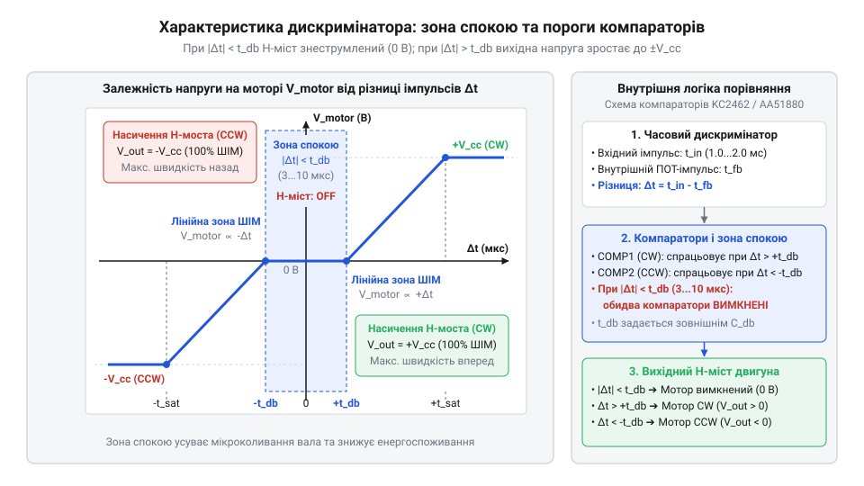
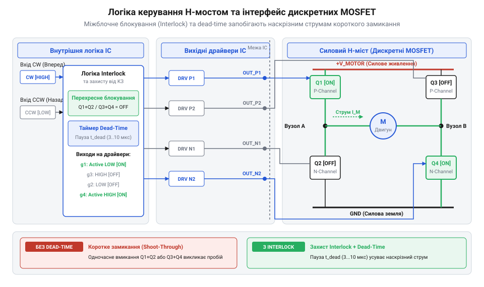
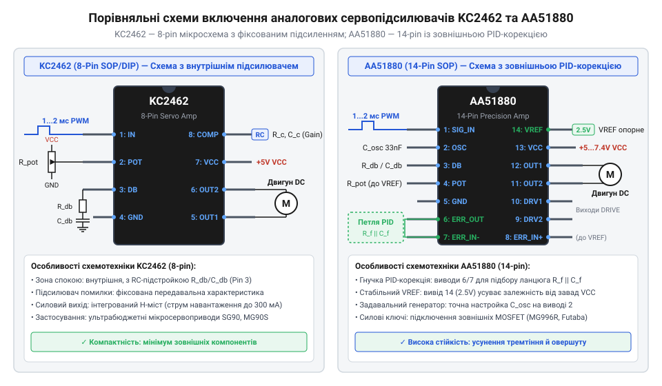

# Інтегральні аналогові сервопідсилювачі KC2462 та AA51880

<preknowlist>
- [Сервоприводи радіокерованих моделей: будова, редуктори та ШІМ-керування](root:cat-hw-actuators/rc-servo-mechanisms-and-control) — загальну кінематичну будову сервопривода, використання потенціометра зворотного зв'язку та параметри вхідного керуючого ШІМ-сигналу
- [Математика потенціометричного зворотного зв'язку сервоприводу](root:cat-hw-actuators/servo-feedback-potentiometer) — лінійну залежність вихідної напруги потенціометра від кута повороту вала та параметри узгодження давача кута
- [Зона нечутливості та дрижання вала сервоприводів](root:cat-hw-actuators/servo-deadband-and-jitter) — концепцію гістерезису, фізичні причини дрижання вала та призначення зони нечутливості регулятора
- [Частота оновлення кадрів ШІМ і цикли позиціонування сервоприводів](root:cat-hw-actuators/servo-pwm-frame-rate) — вплив часового інтервалу повторення кадрів ШІМ на реакцію замкненої аналогової петлі регулювання
</preknowlist>

## Проблема утримання позиції вала сервопривода

Зовнішнє механічне зусилля зміщує вал сервопривода у проміжку між керуючими імпульсами. Вхідний сигнал @@en|PWM@@ оновлюється раз на 20 мілісекунд, як визначають правила [частоти оновлення кадрів](root:cat-hw-actuators/servo-pwm-frame-rate). Якщо привід реагуватиме лише під час активного імпульсу тривалістю 1–2 мілісекунди, 90% часу мотор залишатиметься без живлення, а позиція вала легко збиватиметься.

Пряма подача максимальної напруги живлення при найменшому відхиленні спричиняє перерегулювання, проскок нейтралі та резонансне дрижання.

Для вирішення цієї проблеми в [аналогових сервоприводах](root:cat-hw-actuators/rc-servo-mechanisms-and-control) застосовують автономний аналоговий сервопідсилювач (англ. @@en|servo amplifier@@). Мікросхема безперервно порівнює тривалість вхідного імпульсу із тривалістю внутрішнього опорного імпульсу, формуючи замкнений контур регулювання.

## Формування напруги розсогласування в дискримінаторі

Дискримінатор імпульсів (англ. @@en|pulse discriminator@@, від лат. *discriminare* — розрізняти) порівнює тривалість вхідного ШІМ-сигналу `t_in` із тривалістю `t_fb`, яку генерує внутрішній одновібратор відповідно до опору потенціометра вала. Різниця тривалостей перетворюється зарядним насосом на струмові імпульси, що керують накопичувальним конденсатором (англ. @@en|holding capacitor@@, `C_hold`).


*Часова діаграма роботи аналогового дискримінатора: формування напруги розсогласування U_err на накопичувальному конденсаторі залежно від співвідношення t_in та t_fb.*

На `C_hold` виникає напруга розсогласування (англ. @@en|error voltage@@, `U_err`) відносно опорного рівня `V_ref`:

```
U_err = V_ref + k × (t_in - t_fb)      [потенціал накопичувача залежно від відхилення]
```

Полярність різниці `U_err - V_ref` визначає напрямок обертання вала, а амплітуда пропорційна кутовому відхиленню. Деталі розраховуються у матеріалі про [потенціометричний зворотний зв'язок](root:cat-hw-actuators/servo-feedback-potentiometer).

## Механізм зони спокою та стійкість петлі

Через механічні люфти редуктора та шуми потенціометра різниця `t_in - t_fb` не буває нульовою, викликаючи безупинне дрижання (англ. @@en|jitter@@) вала. Для усунення коливань напругу `U_err` подають на віконний компаратор (англ. @@en|window comparator@@). Його пороги `V_th+` та `V_th-` формують зону спокою (англ. @@en|deadband@@), у межах якої силові виходи заблоковані.


*Характеристика віконного компаратора: зона спокою (deadband) запобігає реакції мотора на мікроскопічні шуми та люфти редуктора.*

Ширина інтервалу нечутливості `t_db` залежить від ємності `C_hold` та струму `I_charge`:

```
t_db = (C_hold × ΔV_th) ÷ I_charge    [часовий поріг зони нечутливості]
```

Стійкість замкненої петлі забезпечує зовнішнє RC-коло фазової компенсації, яке запобігає автоколиванням. Детальніше явище висвітлено в описі [зони нечутливості регулятора](root:cat-hw-actuators/servo-deadband-and-jitter).

## Управління силовим каскадом та вихідним мостом

Вихід напруги розсогласування `U_err` за вікно компаратора активує мостову схему (англ. @@en|H-bridge@@) для керування напрямком струму двигуна.

Щоб запобігти наскрізному струму (англ. @@en|shoot-through current@@) та руйнуванню ключів через одночасне ввімкнення транзисторів однієї стійки, логіка застосовує захисний інтервал (англ. @@en|dead-time insertion@@).


*Схемотехніка силового каскаду: логіка керування плечима H-моста із захисними затримками dead-time.*

Упродовж 20-мілісекундного кадру тривалість живильного імпульсу пропорційна розсогласуванню. У [мікросервоприводах TowerPro SG90](root:cat-hw-actuators/sg90-servo) транзистори моста інтегровані в чип, а в потужніших сервах застосовують зовнішні @@en|MOSFET@@.

## Схемотехнічні особливості мікросхем KC2462 та AA51880

На ринку класичних аналогових сервоприводів найбільшого поширення набули два типи мікросхем сервопідсилювачів: @@en|KC2462@@ та @@en|AA51880@@.

Мікросхема @@en|KC2462@@ виготовляється в компактному 16-вивідному корпусі (SOP-16). Вона керує зовнішнім H-мостом на дискретних транзисторах та містить фіксовані внутрішні резистори підсилення. Це ідеальне рішення для ультрабюджетних мікросерводвигунів із малою площею друкованої плати.

Натомість мікросхема @@en|AA51880@@ виконана у 14-вивідному корпусі (SOP-14 / DIP-14). Вона виводить на зовнішні ніжки виводи операційного підсилювача помилки та логічні виходи керування, що дозволяє підключати зовнішні силові транзистори у сервоприводах з [металевим редуктором MG90S](root:cat-hw-actuators/mg90s-servo).


*Принципові схеми включення: 8-вивідна KC2462 зі вбудованим мостом проти 14-вивідної AA51880 із можливістю гнучкого налаштування зовнішніх RC-кіл.*

Обидві мікросхеми дозволяють реалізувати [модифікації постійного обертання](root:cat-hw-actuators/continuous-rotation-servo-mod) у режимі розімкненої петлі (англ. @@en|open-loop@@). Для цього потенціометр замінюють на фіксований резистивний дільник або від'єднують його від редуктора. У такому режимі дискримінатор сприймає вхідну тривалість `t_in` як команду швидкості й напрямку обертання, а не кутового положення вала.