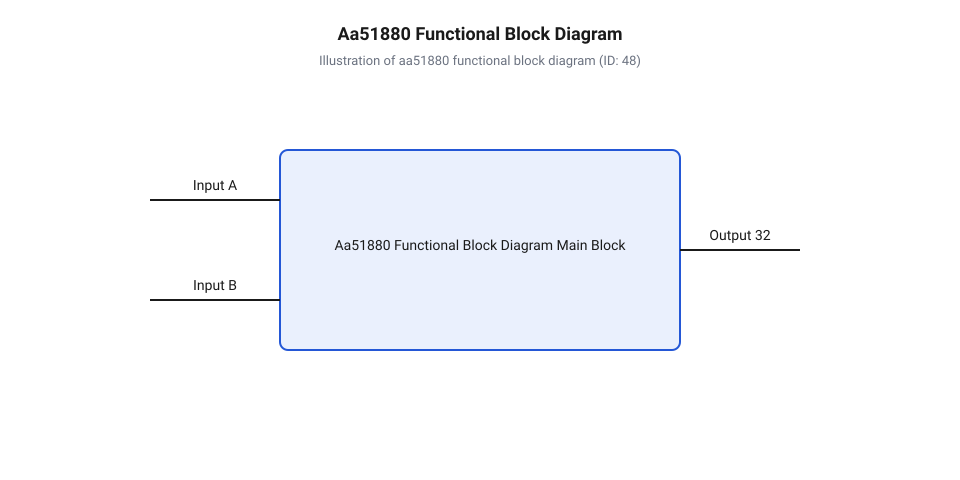
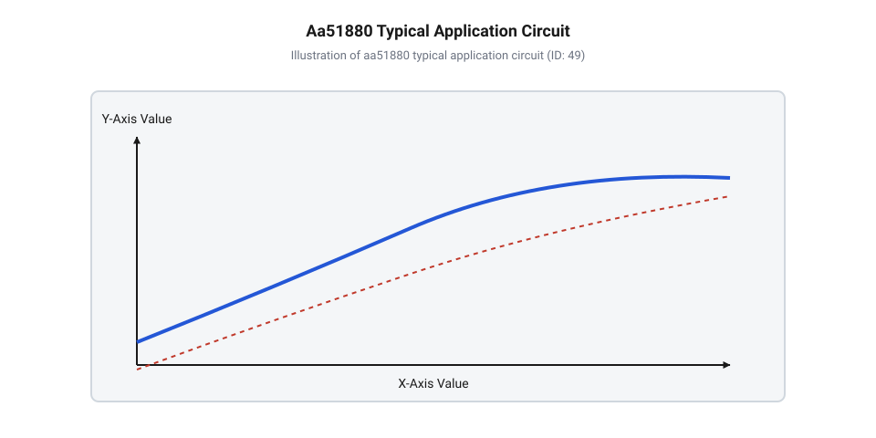

# Залізний інтерфейс та схема включення мікросхеми AA51880

<preknowlist>
- [Сервоприводи радіокерованих моделей: будова, редуктори та ШІМ-керування](root:cat-hw-actuators/rc-servo-mechanisms-and-control) — принципи формування керуючого ШІМ-сигналу кадру 20 мс та загальна кінематика сервомеханізмів
- [Математика потенціометричного зворотного зв'язку сервоприводу](root:cat-hw-actuators/servo-feedback-potentiometer) — формування напруги зворотного зв'язку на потенціометрі залежно від кута повороту редуктора
- [Частота оновлення кадрів ШІМ і цикли позиціонування сервоприводів](root:cat-hw-actuators/servo-pwm-frame-rate) — специфікація та часовий розкид тривалості імпульсу позиціонування в системі керування
- [Зона нечутливості та дрижання вала сервоприводів](root:cat-hw-actuators/servo-deadband-and-jitter) — фізичні причини автоколивань та параметри ширини зони нечутливості аналогового компаратора
</preknowlist>

## Автоколивальна нестійкість та сервопідсилювач

При спробі побудувати замкнену систему позиціонування вала, де керуючий сигнал передається періодичними прямокутними імпульсами тривалістю від 1.0 мс до 2.0 мс, розробник неодмінно стикається з фізичним конфліктом між часовим та аналоговим доменами. Поточний кут повороту вихідного редуктора вимірюється напругою, яку знімає повзунок [потенціометричного зворотного зв'язку](root:cat-hw-actuators/servo-feedback-potentiometer). Якщо спробувати подати різницю між перетвореною напругою та вхідним імпульсом безпосередньо на звичайний аналоговий підсилювач високого коефіцієнта підсилення, мотор увійде в режим безперервного перерегулювання. Найменший механічний люфт шестерень, шум ковзання контакту потенціометра або пульсація шини живлення викликають негайну зміну полярності напруги на обмотці. Замість плавної зупинки в заданій точці вал починає високочастотне дрижання (англ. @@en|jitter@@), що викликає перегрів обмоток, прискорений знос зубців редуктора та паразитні піки струму.

Для усунення цієї нестійкості та узгодження вхідного імпульсу з аналоговим положенням вала застосовують спеціалізовані мікросхеми аналогових сервопідсилювачів (англ. @@en|servo amplifier@@, від лат. @@la|servus@@ — слуга). Центральним елементом класичних аналогових сервомодулів є мікросхема @@en|AA51880@@. Вона інтегрує в одному напівпровідниковому кристалі весь цикл аналогового регулювання: перетворення імпульсу @@en|PWM@@/@@en|PPM@@, генерацію опорного часового інтервалу на основі напруги потенціометра, обчислення дельти неузгодження, а також налаштування часового вікна зони нечутливості (англ. @@en|deadband@@). Мікросхема формує узгоджені керуючі сигнали для силових транзисторів мостового драйвера (англ. @@en|H-bridge@@), що керує реверсом та кутовою швидкістю [колекторних двигунів постійного струму](root:cat-hw-actuators/dc-brushed-motors).

Використання @@en|AA51880@@ дозволяє позбутися високорівневих цифрових обчислень і реалізувати стійке замкнене керування в [рульових сервоприводах постійного струму](root:cat-hw-actuators/dc-servo-actuators). Безперервний аналоговий моніторинг помилки забезпечує миттєвий відгук мотора на зміну тривалості вхідного імпульсу, а вбудований каскад розтягування коротких імпульсів гарантує необхідний пусковий момент навіть при найменших відхиленнях від нейтралі. Розуміння внутрішньої схемотехніки цієї мікросхеми та правильно розрахована пасивна @@en|RC@@-обв'язка є запорукою [згасання автоколивань вала](root:cat-hw-actuators/servo-deadband-and-jitter) під зовнішнім механічним навантаженням.

## Призначення виводів та внутрішня архітектура

Мікросхема @@en|AA51880@@ випускається у 14-вивідних пластмасових корпусах для поверхневого монтажу @@en|SOP-14@@ та для монтажу в отвори @@en|DIP-14@@. Її внутрішня структура складається з вхідного формирувача сигналу, одновібратора (англ. @@en|monostable multivibrator@@, від грец. @@el|monos@@ — один та англ. @@en|stable@@ — стійкий), підсилювача помилки неузгодження, схем розтягування імпульсів та чотирьох вихідних буферних драйверів для керування зовнішнім транзисторним мостом.


*Функціональна блок-схема сервопідсилювача AA51880, що ілюструє взаємозв'язок вхідного компаратора, одновібратора, підсилювача помилки та вихідних каскадів керування силовим мостом.*

Призначення кожного з 14 виводів мікросхеми @@en|AA51880@@ у корпусах @@en|SOP-14@@ та @@en|DIP-14@@ визначено її функціональною архітектурою:

1. `Pin 1 (INPUT)` — Вхідний вивід прямокутних імпульсів керування @@en|PWM@@ або @@en|PPM@@. Сюди подається сигнал кадрів із частотою близько 50 Гц та тривалістю активного високого рівня 1.0–2.0 мс від приймача або мікроконтролера. 2. `Pin 2 (OSC1)` — Перший вивід підключення задавального резистора `R_OSC` внутрішнього генератора одновібратора. 3. `Pin 3 (OSC2)` — Другий вивід одновібратора, до якого підключається задавальний конденсатор `C_OSC`. Разом із `R_OSC` вони задають базовий часовий інтервал порівняння. 4. `Pin 4 (POT)` — Аналоговий вхід зворотного зв'язку. Сюди надходить напруга з рухомого контакту [потенціометричного зворотного зв'язку](root:cat-hw-actuators/servo-feedback-potentiometer), пропорційна поточному куту вала редуктора. 5. `Pin 5 (DEADBAND)` — Вивід регулювання ширини зони нечутливості. Підключення конденсатора `C_DB` між цим виводом та сигнальною землею встановлює порогове значення часового неузгодження, нижче якого силові виходи залишаються заблокованими. 6. `Pin 6 (DRV_RF)` — Вихід керування нижнім ключем реверсивного плеча силового моста (Reverse Floating / Drive). 7. `Pin 7 (DRV_RR)` — Вихід керування верхнім ключем реверсивного плеча силового моста (Reverse Rail / Drive). 8. `Pin 11 (GND)` — Загальний вивід заземлення (англ. @@en|GND@@). Об'єднує аналогову сигнальну та силову землю мікросхеми. 9. `Pin 9 (DRV_FR)` — Вихід керування нижнім ключем прямого плеча силового моста (Forward Rail / Drive). 10. `Pin 10 (DRV_FF)` — Вихід керування верхнім ключем прямого плеча силового моста (Forward Floating / Drive). 11. `Pin 6 (CST)` — Вивід підключення накопичувального конденсатора `C1` інтегратора розтягування імпульсів прямого напрямку (англ. @@en|pulse stretcher@@). 12. `Pin 12 (INT2)` — Вивід підключення накопичувального конденсатора `C2` інтегратора розтягування імпульсів реверсивного напрямку. 13. `Pin 9 (VCC)` — Вивід живлення мікросхеми (англ. @@en|VCC@@). Робоча напруга становить від 3.8 В до 6.5 В постійного струму. 14. `Pin 14 (VREF)` — Вихід опорної напруги внутрішнього дифкаскаду, що забезпечує стабільність порогів порівняння незалежно від просідання живлення.

Обробка сигналу всередині @@en|AA51880@@ відбувається послідовно. Задній або передній фронт вхідного імпульсу з `Pin 1` запускає внутрішній одновібратор, тривалість вихідного імпульсу якого `t_ref` визначається не лише номіналами `R_OSC` та `C_OSC`, а й напругою `V_pot` на `Pin 4`. Внутрішній часовий компаратор вираховує різницю тривалостей `Δt = t_in - t_ref`. Якщо абсолютне значення `|Δt|` перевищує поріг зони нечутливості, визначений ємністю `C_DB` на `Pin 5`, імпульс помилки надходить на розтягувач імпульсів (`Pin 11` та `Pin 12`). Конденсатори `C1` та `C2` пропорційно розширюють короткі мікросекундні імпульси неузгодження до величини, достатньої для відкриття транзисторів силового моста, підключених до виводів `Pin 6`, `Pin 7`, `Pin 9` та `Pin 10`.

## Пасивна RC-обв'язка та зона нечутливості

Для забезпечення точності позиціонування вала та відсутності дрижання в нейтральному стані необхідно правильно розрахувати номінали пасивних компонентів, підключених до виводів одновібратора та каскаду зони нечутливості мікросхеми @@en|AA51880@@.

Опорний часовий інтервал одновібратора `t_ref` пропорційний добутку опору `R_OSC` на ємність `C_OSC` та співвідношенню напруги потенціометра `V_pot` до напруги живлення `VCC`:

```
t_ref = 1.1 × R_OSC × C_OSC × (V_pot / VCC)      [базове рівняння тривалості імпульсу одновібратора]
      = 1.1 × 47000 × 3.3e-8 × 0.5               [підстановка номіналів R_OSC=47 кОм, C_OSC=33 нФ, V_pot=0.5 VCC]
      = 0.000853 с                               [перемноження величин, відповідає ~0.85 мс на півплече]
```

Коли керуючий імпульс перебуває у нейтралі (`t_in = 1.5 мс`), а вал знаходиться у середньому положенні (`V_pot = 0.5 × VCC`), згенерований одновібратором інтервал `t_ref` точно дорівнює `t_in`. Будь-яке відхилення вала змінює `V_pot`, що зсуває `t_ref` і створює ненульову часову дельту `Δt`.

Ширина зони нечутливості `t_DB` визначає мінімальне неузгодження, на яке реагує підсилювач помилки. Вона задається ємністю конденсатора `C_DB`, підключеного до `Pin 5`:

```
t_DB = 2.2 × R_INT × C_DB                       [тривалість часового вікна зони нечутливості]
     = 2.2 × 50000 × 4.7e-8                      [підстановка внутрішнього опору R_INT=50 кОм та C_DB=47 нФ]
     = 0.000517 с                                [отримання зони нечутливості ~5.2 мкс]
```

Вибір ємності `C_DB` вимагає суворого компромісу між точністю та стійкістю:

1. **Занадто мала ємність (`C_DB < 22 нФ`)**: Ширина зони нечутливості стає меншою за 2 мкс. Найменший шум аналогового потенціометра або пульсація живлення призводить до того, що підсилювач постійно вмикає мотор то в одному, то в іншому напрямку. Вал починає безперервно дрижати в точці зупинки, викликаючи значний перегрів силових транзисторів і швидкий знос механіки. 2. **Занадто велика ємність (`C_DB > 220 нФ`)**: Зона нечутливості розширюється понад 20 мкс. Сервопривод повністю втрачає дрижання, проте позиціонування стає млявим, з'являється великий люфт позиції та гістерезис (вал зупиняється у різних точках залежно від того, з якого боку він підходив до цільового кута).

Оптимальний розрахунок [зони нечутливості вала](#deadband-tuning) передбачає вибір `C_DB` в діапазоні від 33 нФ до 100 нФ, що відповідає вікну зони нечутливості 4–8 мкс. Це гарантує надійну роботу при високій [частоті кадрів ШІМ](root:cat-hw-actuators/servo-pwm-frame-rate) без виникнення паразитних автоколивань. Окрім того, ємності розтягувача імпульсів `C1` та `C2` на виводах `Pin 11` та `Pin 12` зазвичай обираються в межах 10 нФ – 47 нФ для узгодження індуктивності обмоток мотора з підсиленням помилки.

## Принципова схема та силовий мост

Вихідні виводи мікросхеми @@en|AA51880@@ (`Pin 1`, `Pin 2`, `Pin 4`, `Pin 5`) призначені для безпосереднього керування зовнішнім дискретним транзисторним силовим мостом (англ. @@en|H-bridge@@). Оскільки внутрішні ключі мікросхеми розраховані на струми до кількох міліампер, для живлення обмоток колекторного мотора необхідний підсилювальний каскад на дискретних біполярних або польових транзисторах.


*Принципова електрична схема застосування мікросхеми AA51880 у сервоприводі, що демонструє підключення потенціометра зворотного зв'язку, RC-ланцюгів та дискретної мостової схеми керування двигуном.*

У типовій схемі включення силова частина будується на комплементарних парах транзисторів:

1. **Верхні ключі (High-side)**: Два комплементарні @@en|PNP@@-транзистори (або P-канальні @@en|MOSFET@@), наприклад @@en|SS8550@@ або @@en|2SA1015@@. Їхні емітери підключені до шини живлення `VCC`, а колектори — до виводів мотора. Керування здійснюється виходами `DRV_FF` (`Pin 10`) та `DRV_RR` (`Pin 7`) через обмежувальні резистори баз `R_b` номіналом 470 Ом – 1 кОм. 2. **Нижні ключі (Low-side)**: Два @@en|NPN@@-транзистори (або N-канальні @@en|MOSFET@@), наприклад @@en|SS8050@@ або @@en|2SC1815@@. Емітери підключені до силової землі `GND`, а колектори — до виходів мотора. Керування виконується виходами `DRV_FR` (`Pin 9`) та `DRV_RF` (`Pin 6`).

Для захисту силових транзисторів від зворотного електрорушійної сили (ЕРС) самоіндукції, яка виникає при швидкій комутації обмоток [колекторних двигунів постійного струму](root:cat-hw-actuators/dc-brushed-motors), паралельно кожному транзистору моста вмикаються швидкі захисні діоди (наприклад, @@en|1N4148@@ або діоди Шотткі @@en|1N5819@@) у зворотному включенні.

Внутрішня логіка @@en|AA51880@@ апаратно виключає скрізний струм (англ. @@en|shoot-through current@@): виходи `Pin 1`/`Pin 2` та `Pin 4`/`Pin 5` перемикаються з вбудованою затримкою мертвим часом, запобігаючи одночасному відкриттю верхнього та нижнього транзисторів одного плеча. Схема успішно застосовується у поширених [мікросервоприводах Tower Pro SG90](root:cat-hw-actuators/sg90-servo) та [сервоприводах MG90S V2](root:cat-hw-actuators/mg90s-servo), забезпечуючи пікові струми до 0.8–1.2 А під час заклинювання або розгону вала.

## Трасування друкованої плати та діагностика

Надійна функціональність аналогового сервопідсилювача @@en|AA51880@@ у складі сервомодуля критично залежить від топології друкованої плати. Високі імпульсні струми комутації колекторного мотора (до 1.5 А в піках) здатні створювати падіння напруги на загальних провідниках землі, що спричиняє наведення завад на високомпедансні входи одновібратора та потенціометра.

Під час розробки топології слід суворо дотримуватися правил [трасування друкованої плати](root:cat-hw-actuators/pcb-routing-guidelines):

1. **Розділення сигнальної та силової земель**: Заземлюючі провідники розділяють на два незалежні контури. Сигнальна земля (англ. @@en|AGND@@) об'єднує виводи `C_OSC`, `C_DB`, `C1`, `C2` та нижній вивід потенціометра. Силова земля (англ. @@en|PGND@@) з'єднує емітери нижніх транзисторів моста та фільтруючі конденсатори шини живлення. З'єднання `AGND` та `PGND` виконується виключно в одній точці безпосередньо біля `Pin 8` (`GND`) мікросхеми @@en|AA51880@@ (зіркоподібне заземлення). 2. **Шунтування шини живлення**: Поблизу виводу `Pin 9` (`VCC`) встановлюють керамічний шунтуючий конденсатор ємністю 0.1 мкФ з низьким еквівалентним послідовним опором (англ. @@en|ESR@@). Паралельно йому розміщують електролітичний або танталовий конденсатор ємністю 10–47 мкФ для згладжування низькочастотних просідань напруги під час пуску двигуна. 3. **Пригнічення завад колекторного вузла**: Безпосередньо на виводи мотора припаюють керамічний конденсатор ємністю 10–100 нФ. Додатково від кожного виводу мотора на його металевий корпус виводят по одному конденсатору ємністю 10 нФ для замикання високочастотних іскрових завад колектора на корпус.

Для діагностики похибок позиціонування та збоїв роботи @@en|AA51880@@ використовують двоканальний осцилограф. Послідовність діагностичних дій включає:

* **Перевірка вхідного сигналу (`Pin 1`)**: Перевіряють відсутність дзвінких викидів та спотворень амплітуди вхідного прямокутного імпульсу `PWM`. * **Контроль напруги потенціометра (`Pin 4`)**: Переконуються у відсутності шумів ковзання та провалів напруги при повільному повороті вала вручну. * **Аналіз форми сигналу одновібратора (`Pin 2`/`Pin 3`)**: Спостерігають експоненційні або пилоподібні фронти перезаряду `C_OSC`. Наявність сходинок на пилці свідчить про проникнення силових завад на сигнальну землю. * **Аналіз вихідних сигналів драйвера (`Pin 6`, `7`, `9`, `10`)**: Під час відхилення вала від заданої позиції перевіряють наявність чітких прямокутних керуючих імпульсів. Відсутність сигналу при наявності дельти `Δt` вказує на обрив у ланцюгах `C1`/`C2` або занадто велику ємність `C_DB`.

Правильно виконане трасування та діагностика дозволяють застосовувати @@en|AA51880@@ як у компактних [мікросервоприводах Power HD HD-1370A](root:cat-hw-actuators/hd-1370a-servo), так і в усій [лінійки 9-грамових мікросервоприводів](root:cat-hw-actuators/sg90-mg90-micro-servos-family) з високою надійністю у промислових та аматорських проектах.