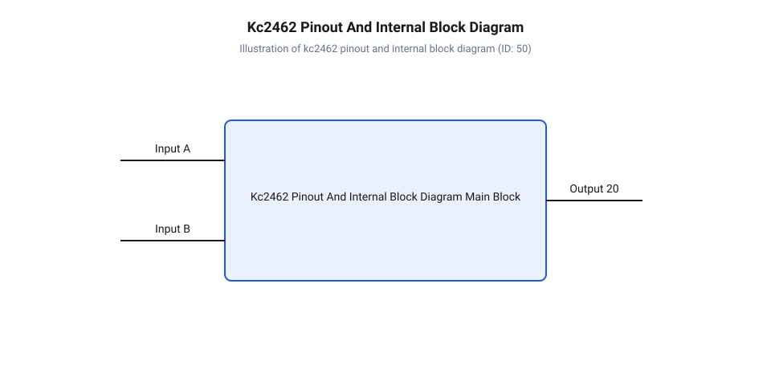
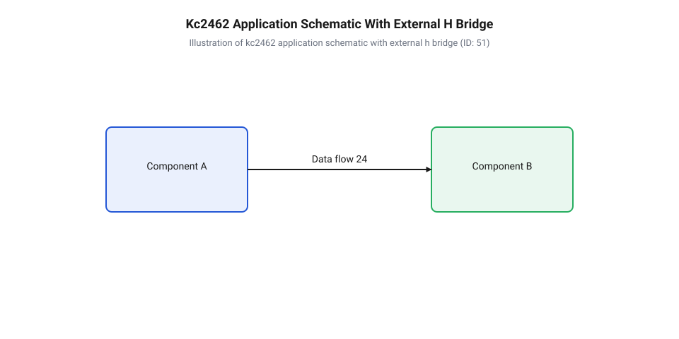

# Залізний інтерфейс та схема включення мікросхеми KC2462

<preknowlist>
- [Сервоприводи радіокерованих моделей: будова, редуктори та ШІМ-керування](root:cat-hw-actuators/rc-servo-mechanisms-and-control) — принципи формування керуючого ШІМ-сигналу з кадром 20 мс та стандартні часові інтервали позиціонування 1000–2000 мкс
- [Математика потенціометричного зворотного зв'язку сервоприводу](root:cat-hw-actuators/servo-feedback-potentiometer) — формування аналогової напруги зворотного зв'язку на дільнику потенціометра залежно від кута повороту редуктора
- [Частота оновлення кадрів ШІМ і цикли позиціонування сервоприводів](root:cat-hw-actuators/servo-pwm-frame-rate) — специфікацію часових розкидів та вплив нестабільності частоти кадрування на роботу різницевого дискримінатора
- [Зона нечутливості та дрижання вала сервоприводів](root:cat-hw-actuators/servo-deadband-and-jitter) — фізичну природу зони нечутливості аналогових компаратора та причини паразитного тремтіння вала під навантаженням
</preknowlist>

## Некерована робота аналогового сервоприводу та самозбудження

Некоректна організація контуру апаратного керування в закритих аналогових системах позиціювання призводить до вибухового зростання струму споживання, неконтрольованого перегріву обмоток колекторного двигуна та паразитного високочастотного коливання вала. У [компактних сервоприводах Tower Pro SG90](root:cat-hw-actuators/sg90-servo) або виробах [родини Power HD](root:cat-hw-actuators/powerhd-family) вхідний сигнал @@en|pulse-width modulation@@ (англ. @@en|pulse-width modulation@@, @@en|PWM@@, від лат. *pulsus* — поштовх та *modulatio* — розмірність) надходить із частотою кадрів близько 50 Гц (період 20 мс) та тривалістю імпульсу від 1000 до 2000 мкс. Спроба комутувати силові кола мотора за допомогою простих дискретних компараторів або непідготовлених операційних підсилювачів зіштовхується з жорсткою реакцією індуктивного навантаження: індукована зворотна епРС створює високовольтні сплески на шині живлення, які викривляють еталонний рівень аналогового опорного сигналу.

Коли вал двигуна досягає заданого кутового положення, будь-яка незначна завада на лінії керування змушує дискретний підсилювач негайно змінювати полярність напруги на моторі. За відсутності сформованої зони нечутливості виникає [явище дрижання вала](root:cat-hw-actuators/servo-deadband-and-jitter), при якому ротор неперервно здійснює мікроколивання навколо точної координати. Такий режим супроводжується механічним акустичним писком, швидким спрацюванням шестерень редуктора та критичним зростанням температури силових транзисторів. При збільшенні зовнішнього механічного моменту на валу контур без апаратного розширення імпульсу помилки втрачає утримувальну здатність, викликаючи спонтанне самозбудження системи та вихід приводу з ладу.

Для усунення цих деструктивних ефектів виникає неминуча потреба у застосуванні спеціалізованого аналогового сервопідсилювача. Спеціалізована мікросхема аналогового сервопідсилювача (англ. @@en|servo amplifier IC@@, від лат. *servus* — слуга та *amplificare* — розширювати) KC2462 вирішує проблему стабілізації замкненого контуру на апаратному рівні. Вона інтегрує вхідний різницевий часовий дискримінатор, внутрішній генератор опорних імпульсів, підсилювач розсогласування з розширювачем імпульсів (англ. @@en|pulse stretcher@@) та силовий H-міст (англ. @@en|H-bridge@@) у єдиному напівпровідниковому кристалі. Це дозволяє перетворити імпульсне розсогласування між вхідним сигналом @@en|PWM@@ та внутрішнім сигналом зворотного зв’язку на пропорційну за тривалістю та полярністю напругу живлення мотора.

## Архітектура мікросхеми KC2462 та цокольовка виводів

Мікросхема KC2462 випускається у стандартних 8-вивідних корпусах для поверхневого монтажу @@en|SOP-8@@ (англ. @@en|small outline package@@) та наскрізного монтажу @@en|DIP-8@@ (англ. @@en|dual in-line package@@). Для забезпечення стійкої роботи в обмеженому об'ємі приводу внутрішні вузли напівпровідникового кристала строго розподілені між виводами корпусу.


*Внутрішня функціональна архітектура та призначення виводів аналогового сервопідсилювача KC2462.*

Розподіл виводів мікросхеми KC2462 виконано наступним чином:

1. **IN (Вивід 1)** — цифровий вхід вхідного керуючого сигналу @@en|PWM@@. Внутрішній тригер Шмітта здійснює фільтрацію завад і формує круті фронти для вхідного різницевого дискримінатора. 2. **RC1 (Вивід 2)** — аналоговий вивід підключення зовнішнього часозадального RC-кола, яке визначає ширину зони нечутливості (англ. @@en|deadband@@) підсилювача. 3. **RC2 (Вивід 3)** — вивід інтегрувального RC-кола розширювача імпульсів (англ. @@en|pulse stretcher@@), що контролює коефіцієнт підсилення контуру позиціювання та тривалість подачі напруги на мотор при малих відхиленнях. 4. **GND (Вивід 4)** — спільний вивід заземлення (англ. @@en|ground@@), через який замикаються струми аналогового ядра та силових вихідних транзисторів. 5. **OUT1 (Вивід 5)** — перший силовий вихід внутрішнього H-моста (англ. @@en|H-bridge@@), призначений для прямого підключення клем колекторного двигуна. **VCC (Вивід 6)** — вивід шини живлення аналогових кіл та силового моста (робочий діапазон напруг від 3.5 В до 7.5 В). 7. **OUT2 (Вивід 7)** — другій силовий вихід внутрішнього H-моста, що працює в протифазі з виводом OUT1. 8. **FB (Вивід 8)** — аналоговий вхід напруги зворотного зв'язку, що знімається з рухомого контакту потенціометра редуктора.

Внутрішньо кристал KC2462 ділиться на три послідовні тракти обробки. Перший тракт — вхідний різницевий дискримінатор імпульсів (англ. @@en|pulse discriminator@@). Він порівнює тривалість вхідного прямокутного імпульсу з виводу IN із тривалістю опорного імпульсу, який генерується внутрішнім одновібратором (англ. @@en|monostable multivibrator@@). Тривалість опорного імпульсу лінійно залежить від потенціалу на виводі FB. Коли вхідний період оновлення імпульсів відповідає стандартній величині, що описує [частота оновлення кадрів ШІМ](root:cat-hw-actuators/servo-pwm-frame-rate), дискримінатор виділяє різницевий інтервал Δt, що відповідає кутовому розсогласуванню вала.

Другий тракт — підсилювач помилки (англ. @@en|error amplifier@@) та часовий розширювач. Оскільки різницевий імпульс Δt при малих відхиленнях може становити лише одиниці мікросекунд, внутрішні силові транзистори не встигли б передати достатню енергію для подолання тертя спокою у редукторах на кшталт тих, якими оснащено [компоненти металевого редуктора MG90S](root:cat-hw-actuators/mg90s-servo). Розширювач імпульсів пропорційно подовжує час активного стану силового каскаду залежно від параметрів RC-кола на виводі RC2.

Третій тракт — внутрішній мостовий вихідний каскад. Він утворений двома парами комплементарних транзисторних ключів, спроможних комутувати струм до 300 мА. Залежно від знака різниці (вхідний імпульс довший або коротший за опорний), логіка мікросхеми відкриває відповідну діагональ моста, подаючи на двигун напругу прямої або зворотної полярності.

## Розрахунок аналогових RC-кіл та зони нечутливості

Стабільність та точність аналогового приводу повністю визначаються параметрами пасивної обв'язки, підключеної до виводів RC1 (Вивід 2) та RC2 (Вивід 3). Часозадальне коло на виводі RC1 формує внутрішнє порогове вікно нечутливості (англ. @@en|deadband@@). Якщо ширина зони нечутливості менша за рівень фазового шуму вхідного сигналу, виникає постійне тремтіння (англ. @@en|jitter@@) вала. Натомість надто широка зона призводить до втрати точності позиціювання та появи люфту.

Ширина зони нечутливості `t_db` обчислюється на основі розрядження ємності `C1` через резистор `R1` до внутрішнього порогу порівняння, який становить половину напруги живлення (коефіцієнт `ln(2) ≈ 0.693`):

```
t_db = R1 × C1 × ln(2)
= 12000 × 100 × 10⁻¹² × 0.693     [застосування порогу розрядження внутрішнього компаратора]
= 8.316 × 10⁻⁶ с                  [перетворення значень у мікросекунди]
= 8.32 мкс                       [розрахована ширина зони нечутливості]
```

Для типових сервоприводів оптимальне значення `t_db` лежить у межах від 4 мкс до 8 мкс. Це дозволяє надійно відфільтрувати [зона нечутливості та дрижання](root:cat-hw-actuators/servo-deadband-and-jitter) вала під зовнішнім навантаженням.

Параметри другого RC-кола на виводі RC2 (`R2` та `C2`) визначають коефіцієнт розширення різницевого імпульсу. Оскільки первинна різниця тривалостей `Δt` між вхідним ШІМ-імпульсом та виходом одновібратора може становити лише частки мікросекунди, її недостатньо для повноцінного відкриття вихідних транзисторів. Розширювач перетворює короткий імпульс `Δt` у силовий імпульс тривалістю `t_out`, розрахований за формулою:

```
t_out = Δt × (1 + (R2 × C2) ÷ τ_0)
= Δt × (1 + (47000 × 4.7 × 10⁻⁹) ÷ 10⁻⁴)    [підстановка номіналів R2=47кОм, C2=4.7нФ та τ_0=100мкс]
= Δt × (1 + 2.209)                          [обчислення відношення сталих часу]
= 3.21 × Δt                                  [коефіцієнт розширення силового імпульсу]
```

Вхід аналогового зворотного зв'язку FB (Вивід 8) підключається до рухомого контакту потенціометра з повним опором від 4.7 кОм до 10 кОм, який жорстко зв’язаний із вихідним валом редуктора. Для забезпечення симетричного відхилення вала на кути ±90° середня точка потенціометра при нейтральному положенні має видавати потенціал `VCC ÷ 2`. Тонке [калібрування нейтралі сервоприводів](root:cat-hw-actuators/continuous-servo-potentiometer-tuning) виконується підбором підстроювальних резисторів у плечах потенціометричного дільника, що детально описує [математика потенціометричного зворотного зв'язку](root:cat-hw-actuators/servo-feedback-potentiometer).

При тривалій роботі під навантаженням мотор та силові ключі нагріваються. Зміна температури середовища викликає дрейф ємності конденсаторів та опору резисторів, що виражається у зміщенні нулевої позиції вала. Щоб звести термодрейф до мінімуму, у кола RC1 та RC2 слід встановлювати металоплівкові резистори з температурним коефіцієнтом опору (ТКО) не гірше ±50 ppm/°C та керамічні конденсатори з діелектриком C0G/NP0. Комплексний аналіз причин теплової нестабільності дає [теплова модель та захист](root:cat-hw-actuators/servo-thermal-protection) сервосистем.

## Принципова схема та підключення зовнішнього H-моста

Внутрішній мостовий каскад мікросхеми KC2462 розрахований на номінальний струм навантаження до 300 мА, що є цілком достатнім для забезпечення роботи у малопотужних [приводах SG92R з вуглеволоконним редуктором](root:cat-hw-actuators/sg92r-servo). Проте при спробі керувати більш потужними моторами з великим струмом заклинювання внутрішній каскад зазнає теплового перевантаження та виходить із ладу.


*Принципова електрична схема підключення KC2462 з зовнішнім силовим мостом на комплементарних транзисторах.*

Для керування високострумовими колекторними моторами виводи OUT1 (Вивід 5) та OUT2 (Вивід 7) мікросхеми KC2462 переводяться у режим логічних драйверів, які керують зовнішнім силовим H-мостом (англ. @@en|H-bridge@@). Силовий міст будується на двох комплементарних парах транзисторів: верхні плечі реалізуються на p-n-p біполярних транзисторах (або P-канальних польових MOSFET), а нижні — на n-p-n транзисторах (або N-канальних MOSFET).

Бази (або затвори) верхніх p-n-p транзисторів підтягуються до шини живлення `VCC` через резистори опором 1 кОм, що гарантує їх надійне закриття за відсутності активного керуючого сигналу. Коли вивід OUT1 переходить у високий стан (VCC), верхній p-n-p транзистор лівого плеча відкривається, подаючи потенціал `VCC` на одну з клем мотора. Одночасно вивід OUT2 переходить у високий стан, відкриваючи нижній n-p-n транзистор правого плеча, який замикає другу клему мотора на землю `GND`. Зміна фази сигналів OUT1 та OUT2 викликає миттєве реверсування напрямку струму через обмотки мотора.

Для захисту зовнішніх силових транзисторів та виходів мікросхеми від індуктивних сплесків зворотної ЕРС паралельно кожному силовому ключу встановлюються швидкі шунтувальні діоди Шотткі (англ. @@en|flyback diode@@, від англ. *flyback* — зворотний хід). Діоди комутуються у зворотній полярності відносно напруги живлення. При розмиканні транзисторів енергія, накопичена в індуктивності обмоток, скидається через діоди назад у шину живлення, запобігаючи лавинному пробою напівпровідникових переходів. Це критично важливо, коли виникають [зсувні навантаження та абразивний знос](root:cat-hw-actuators/servo-gear-shear-and-wear) механічних передач, що призводить до різких стрибків струму мотора. У критично відповідальних вузлах замість дискретного моста застосовують спеціалізовані [інтегральні рішення силових контролерів](root:cat-hw-actuators/bldc-servo-controller).

## Трасування друкованої плати та діагностика самозбудження

Навіть ідеально розрахована принципова схема сервопідсилювача KC2462 буде працювати нестабільно, якщо при формуванні топології друкованої плати (англ. @@en|printed circuit board@@, @@en|PCB@@, від англ. *printed circuit board*) припущено помилок у розподілі силових та сигнальних провідників. Основне джерело апаратних збоїв аналогових серводрайверів — імпульсні наведення від комутації мотора, які проникають у високомодомний тракт вхідного дискримінатора через спільний опір шини заземлення.

Для виключення зв'язку за заземленням трасування плати виконується строго за принципом зіркового заземлення (англ. @@en|star grounding@@). На топології плати формуються два автономні контури: слабкострумова аналогова земля та силова земля моста. Аналогова земля об'єднує вивід GND (Вивід 4) мікросхеми, нижні виводи часозадальних конденсаторів RC1 і RC2, а також холодний вивід потенціометра зворотного зв’язку. Силова земля об'єднує емітери/витоки нижніх транзисторів моста та катоди захисних діодів. Обидві землі з’єднуються в єдиній фізичній точці безпосередньо на від’ємній клемі вхідного роз’єму живлення.

Безпосередньо біля виводів VCC (Вивід 6) та GND (Вивід 4) мікросхеми KC2462 обов'язково встановлюється керамічний блокувальний конденсатор (англ. @@en|bypass capacitor@@) ємністю 0.1 мкФ із низьким еквівалентним послідовним опором (ESR). Паралельно силовій шині живлення мотора додається електролітичний конденсатор ємністю 100–220 мкФ для компенсації падіння напруги під час пускових струмів.

При діагностиці макетних плат інженер може зітовхнутися з трьома основними симптомами несправностей:

1. **Високочастотне тремтіння вала у стані спокою.** Причина полягає у проникненні високочастотних наведень на лінію FB (Вивід 8) або надто вузькій зоні нечутливості. Для усунення тремтіння слід встановити керамічний фільтрувальний конденсатор ємністю 10 нФ безпосередньо між виводами FB та GND, а також збільшити опір резистора `R1` у колі RC1. 2. **Тепловий розгін та перегрів мікросхеми.** Викликаний виникненням наскрізних струмів у внутрішньому чи зовнішньому H-мості під час перемикання фаз. Необхідно перевірити наявність та справність захисних діодів Шотткі, а також збільшити сталу часу `R2 × C2` на виводі RC2. 3. **Дрейф точки позиціювання під навантаженням.** Виникає через просідання напруги живлення аналогового ядра або механічний вигин тяг, що вивчає [кінематика важільних механізмів](root:cat-hw-actuators/servo-pushrod-kinematics). У складних системах, де застосовуються [коаксіальні сервомодулі прямого приводу](root:cat-hw-actuators/coaxial-servo-modules), таке просідання компенсується введенням додаткового стабілізатора LDO для живлення мікросхеми KC2462 окремо від силового моста мотора.

Еволюція від простих релейних схем, якими слугували [дискретні перемикачі в перших RC-системах](root:cat-hw-actuators/rc-escapement-mechanisms), до монолітних серводрайверів KC2462 показує вирішальну роль правильного трасування аналогово-силового залізного інтерфейсу в надійності роботи робототехнічних актюаторів.