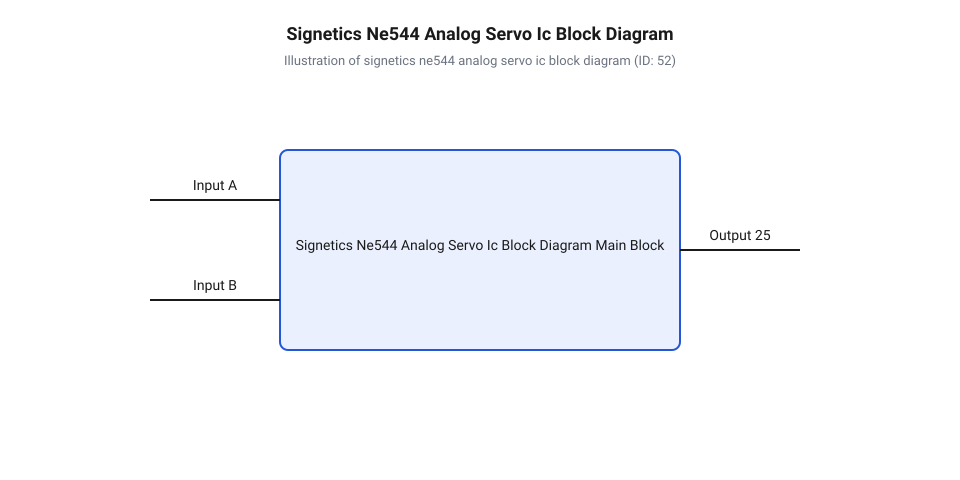
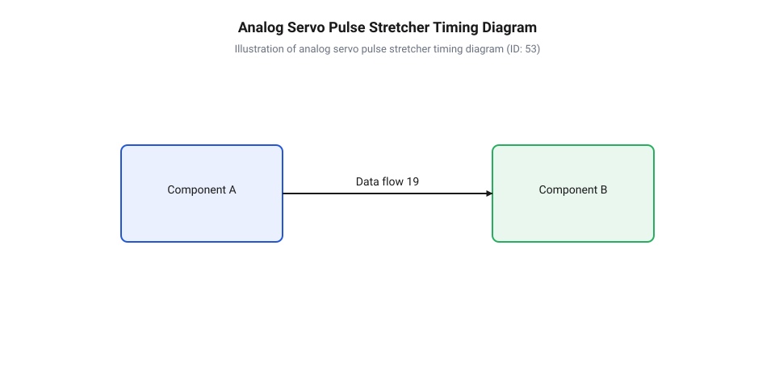

# Еволюція аналогових мікросхем керування сервоприводами

<preknowlist>
- [Дискретні перемикачі (escapements) у перших RC-системах](root:cat-hw-actuators/rc-escapement-mechanisms) — апаратні обмеження дискретних транзисторних схем та механічних перемикачів першого покоління радіокерованих моделей
- [Зона нечутливості та дрижання вала сервоприводів](root:cat-hw-actuators/servo-deadband-and-jitter) — фізичні причини виникнення зони нечутливості, автоколивань та методи схемотехнічного пригнічення дрижання вала
- [Частота оновлення кадрів ШІМ і цикли позиціонування сервоприводів](root:cat-hw-actuators/servo-pwm-frame-rate) — часові параметри стандартного вхідного сигналу PPM із кадровою частотою 50 Гц та тривалістю 1...2 мс
- [Математика потенціометричного зворотного зв'язку сервоприводу](root:cat-hw-actuators/servo-feedback-potentiometer) — принципи перетворення кутового положення вала в пропорційну напругу порівняння через потенціометричний дільник
</preknowlist>

## Нестабільність дискретних схем перших сервоприводів

У 1960-х роках розробники перших пропорційних систем радіокерування зіштовхнулися зі складним схемотехнічним викликом: забезпеченням точного кутового позиціонування вала виконавчого механізму в умовах обмеженого бортового живлення та змінних температур. До появи спеціалізованих інтегральних мікросхем підсилювачі сервоприводів будувалися виключно на окремих компонентах. Типовий дискретний підсилювач містив від 15 до 30 біполярних транзисторів (@@en|BJT@@, англ. @@en|bipolar junction transistor@@, від лат. *bis* — двічі та *polus* — полюс), германієвих або перших кремнієвих діодів, вуглецевих резисторів та об'ємних електролітичних конденсаторів.

Такі [дискретних схем сервоприводів](root:cat-hw-actuators/rc-escapement-mechanisms) володіли трьома критичними фізичними вадами, що обмежували їхнє застосування у точній техніці:

1. Сильний температурний дрейф нейтралі вала:
Напруга база-емітер `V_be` біполярного транзистора має негативний температурний коефіцієнт близько `-2.2` мВ/°C, а коефіцієнт підсилення струму `h_FE` зростає при нагріванні. У дискретному диференціальному каскаді або мостовому компараторі навіть мінімальна технологічна розбіжність параметрів між двома окремими транзисторами викликала значний зсув нульового потенціалу. Коли моторама моделі нагрівалася від ДВЗ або змінювалася температура довкілля, нейтральне положення вала сервоприводу зміщувалося на `5...10` градусів. Моделістам доводилося постійно підлаштовувати тримери на передавачі під час польоту.

2. Нестабільність споживання струму та загроза теплового розгону:
Вихідні мостові каскади на дискретних транзисторах не мали ефективної термокомпенсації струму спокою. При підвищенні температури внутрішній опір транзисторів силового каскаду падав, що призводило до наскрізного струму (одночасного відкриття верхнього та нижнього плечей моста). Це викликало колосальні просадки напруги батареї живлення, паразитно перезавантажувало радіоприймач і нерідко призводило до теплового пробою вихідних транзисторів.

3. Високі габарити, маса та низька вібростійкість:
Плату з десятків дискретних компонентів доводилося робити одношаровою й великою за площею. Великий об'єм і вага підсилювача унеможливлювали створення компактних сервоприводів для малих моделей. Окрім того, численні пайкові з'єднання виводів компонентів швидко руйнувалися від постійної вібрації ДВЗ.

Ці проблеми створили гостру потребу в переході до монолітних напівпровідникових мікросхем. Розміщення диференціального компаратора, кола порівняння та силових ключів на єдиній кремнієвій підкладці гарантувало ідентичну температуру всіх транзисторів (де `ΔV_be ≈ 0` між сусідніми кристалами), ліквідувало температурний дрейф нейтралі та зменшило плату підсилювача в рази.

## Інтеграція замкненого контуру Signetics NE544

Прорив у схемотехніці аналогових сервоприводів відбувся в середині 1970-х років із появою перших спеціалізованих мікросхем (IC, від англ. @@en|integrated circuit@@, від лат. *integratus* — відновлений, поєднаний), серед яких класичним стандартом стала @@en|Signetics NE544@@. Інженерам вдалося об'єднати повний аналоговий замкнений контур керування — від селектора часової розбіжності до силового моста мотора — на єдиному монолітному кристалі в корпусі @@en|DIP@@-14 або @@en|SOP@@-16.

Внутрішня структура @@en|Signetics NE544@@ об'єднує п'ять функціональних блоків:

1. Внутрішній генератор опорного імпульсу (однодвійник, або @@en|one-shot multivibrator@@, від англ. @@en|one-shot@@ — один постріл та лат. *multus* — багато, *vibrat* — дрижати):
При надходженні фронту вхідного сигналу однодвійник генерує внутрішній опорний імпульс тривалістю `t_ref`. Тривалість цього імпульсу задається зовнішнім @@en|RC@@-колом та поточним опором потенціометра зворотного зв'язку, приєднаного до вихідного вала редуктора.

2. Селектор розбіжності тривалостей (часовий компаратор):
Блок порівнює тривалість вхідного керуючого імпульсу `t_in` та внутрішнього опорного імпульсу `t_ref`. Шляхом логічного віднімання формується імпульс помилки, тривалість якого пропорційна відхиленню вала:
```
Δt = t_in - t_ref
```
Полярність відхилення визначає, який саме з двох вихідних каналів напрямку обертання буде активовано.

3. Схема формування зони нечутливості вала (@@en|deadband generator@@):
Щоб запобігти безперервному дрижанню та автоколиванням вала навколо точки рівноваги через шуми й люфти редуктора, схема відсікає імпульси розбіжності, коротші за заданий поріг `t_db` (типово `2...5` мкс). Якщо `|Δt| < t_db`, оновлення струму мотора припиняється, забезпечуючи стабільність [зони нечутливості вала](root:cat-hw-actuators/servo-deadband-and-jitter).

4. Підсилювач помилки та розширювач імпульсів (@@en|pulse stretcher@@):
Оскільки первинний імпульс розбіжності `Δt` може тривати лише кілька мікросекунд, його енергії недостатньо для подолання інерції ротора мотора. Розширювач імпульсів пропорційно збільшує тривалість вихідного імпульсу у `K_s` разів (типово у 10...20 разів), перезаряджаючи внутрішній накопичувальний конденсатор.

5. Інтегрований силовий H-міст (@@en|H-bridge output stage@@, англ. @@en|H-bridge@@, від букви H за формою схеми):
Розширені імпульси керують внутрішнім двонаправленим транзисторним мостом на складних парах Дарлінгтона. Силовий каскад @@en|Signetics NE544@@ забезпечував комутацію струму мотора до `500` мА без застосування зовнішніх транзисторів, включаючи внутрішні захисні діоди для гасіння індуктивних викидів самоіндукції.


*Функціональна блок-схема монолітного аналогового сервопідсилювача Signetics NE544 з відображенням однодвійника, селектора розбіжності тривалостей, підсилювача помилки, зони нечутливості та силового H-bridge.*

## Стандартизація PPM та Mitsubishi M51660L

Масове впровадження імпульсно-позиційної модуляції (@@en|PPM@@, англ. @@en|Pulse-Position Modulation@@, від лат. *pulsus* — поштовх та *positio* — положення) жорстко зафіксувало часові параметри вхідного сигналу керування: тривалість позитивного імпульсу `t_in` від `1.0` мс (крайнє ліве положення) через `1.5` мс (нейтраль) до `2.0` мс (крайнє праве положення) при фіксованій [частоті оновлення кадрів](root:cat-hw-actuators/servo-pwm-frame-rate) `50` Гц (період кадру `T_frame = 20` мс).

Ця стандартизація визначила методику розрахунку зовнішніх @@en|RC@@-ланок аналогових мікросхем. У сервопідсилювачах на базі мікросхеми @@en|Mitsubishi M51660L@@ тривалість внутрішнього опорного імпульсу однодвійника у нейтральному положенні має чітко відповідати `1.5` мс:

```
t_ref = 1.1 × R_total × C_ref
```

Де `C_ref` — зовнішній прецизійний плівковий конденсатор (типово `0.033` мкФ або `0.047` мкФ) із низьким температурним коефіцієнтом ємності, а `R_total` розраховується як сума опорів гілки порівняння:

```
R_total = R_fixed + R_trim + R_pot(θ)      [сумування опорів гілки порівняння]
```

У нейтральному положенні вала (`θ = 0`) опір потенціометра `R_pot(0)` становить рівно половину його повного опору (наприклад, `2.5` кОм для потенціометра `5` кОм). Постійний резистор `R_fixed` та підлаштувальний резистор `R_trim` задають базову точну тривалість `1.5` мс. При повертанні вала на кут `θ` рухомий контакт потенціометра змінює `R_pot(θ)`, корегуючи тривалість `t_ref` до повного збігу з вхідним імпульсом `t_in` за рахунок [потенціометричного зворотного зв'язку](root:cat-hw-actuators/servo-feedback-potentiometer).

Мікросхема @@en|Mitsubishi M51660L@@ удосконалила цю схему, вивівши окремі виводи для незалежного налаштування ширини зони нечутливості (конденсатор `C_dead`) та коефіцієнта розширення імпульсів (конденсатор `C_stretch`):
- Збільшення ємності `C_dead` розширювало зону нечутливості, усуваючи автоколивання мотора у редукторах із люфтами, але знижувало точність позиціонування. - Збільшення ємності `C_stretch` підвищувало тривалість імпульсів живлення мотора при малих відхиленнях, збільшуючи стартовий момент, проте створювало ризик перерегулювання (перельоту) нейтралі.

Проте кадрова частота `50` Гц накладала непереборне фізичне обмеження на аналогові сервомікросхеми. Оскільки оновлення імпульсів мотора відбувалося лише один раз за кадр PPM (кожні `20` мс), між кадрами мотор залишався без струму. При різкому прикладанні зовнішнього навантаження вал міг зміститися протягом цих `20` мс без реакції підсилювача, що визначало низький динамічний момент утримання аналогових систем порівняно із сучасними цифровими серводрайверами.

## Аналогова імпульсна розбіжність проти PID-регулювання

Серед розробників вбудованих систем існує стале уявлення, ніби класичні аналогові мікросхеми сервопідсилювачів виконують повноцінне @@en|PID@@-регулювання (від англ. *Proportional-Integral-Derivative* — пропорційно-інтегрально-диференціальне керування) або плавну амплітудну модуляцію напруги живлення двигуна. На практиці аналогова схемотехніка позбавлена обчислювальних блоків, математичного інтегрування чи оцінки швидкості за похідною. Замість цього аналогова мікросхема порівнює часові інтервали двох фізичних імпульсів безпосередньо у часовій області.

Кожен кадр вхідного сигналу @@en|PPM@@ (від англ. *Pulse-Position Modulation* — імпульсно-позиційна модуляція) з тривалістю вхідного імпульсу 1...2 мс надходить на вхід мікросхеми з [частотою оновлення кадрів](root:cat-hw-actuators/servo-pwm-frame-rate) 50 Гц. Передній фронт вхідного імпульсу запускає внутрішній генератор — однодвійник (від англ. *@@en|one-shot@@ monostable multivibrator*), тривалість імпульсу якого задається зовнішнім @@en|RC@@-ланцюгом і поточним опором [потенціометричного зворотного зв'язку](root:cat-hw-actuators/servo-feedback-potentiometer). Фазовий селектор розбіжності порівнює тривалість вхідного та внутрішнього імпульсів, виділяючи різницю у вигляді імпульсу помилки.

Якщо тривалість різниці імпульсів не перевищує поріг, який визначає межі [зони нечутливості вала](root:cat-hw-actuators/servo-deadband-and-jitter) (від англ. *@@en|deadband@@*), силовий вихід залишається знеструмленим. Це запобігає безперервному дрижанню вала через дрібні шуми потенціометра. Коли ж розбіжність виходить за межі deadband, імпульс помилки надходить на каскад розширювача (від англ. *@@en|pulse stretcher@@*). Оскільки сирий імпульс розбіжності надто короткий для подолання механічної інерції ротора та редуктора, розширювач пропорційно збільшує його тривалість у кілька разів.


*Аналогова часова діаграма селектора розбіжності та розширювача імпульсів керування силовим мостом.*

Для розрахунку підсумкової тривалості силового імпульсу `t_drive` використовують різницю вхідного та опорного імпульсів `Δt`, величину порогу зони нечутливості `t_db` та коефіціент розширення розширювача імпульсів `k_stretch`.

```
t_drive = (Δt - t_db) × k_stretch
        = (15 μs - 5 μs) × 5      [віднімання порогу зони нечутливості]
        = 10 μs × 5               [множення на коефіціент розширення]
        = 50 μs                   [тривалість імпульсу відкривання H-моста]
```

З отриманого значення видно, що розширювач пропорційно збільшує час відкритого стану транзисторів силового ключа, проте амплітуда напруги живлення мотора залишається незмінною.

Розширений імпульс помилки подається безпосередньо на силовий каскад @@en|H-bridge@@ (від англ. *H-bridge* — Н-міст). Силові транзистори працюють виключно у ключевому режимі: вони повністю відкриваються або повністю закриваються. На двигун подаються імпульси струму з повною амплітудою напруги живлення `V_CC`. Принципова відмінність від аналогового регулювання напруги (від англ. *@@en|PAM@@ — Pulse-Amplitude Modulation*) полягає в тому, що кутова швидкість ротора змінюється не через зміну амплітуди напруги, а через шпаруватість надходження імпульсів повної напруги.

Відсутність інтегральної складової (`I`-терму) означає, що аналогова мікросхема не здатна накопичувати помилку позиціонування з часом. Якщо на вал діє статичне зовнішнє навантаження, сервопривід зупиняється з постійним кутовим відхиленням, оскільки для підтримки утримувального моменту потрібна постійна розбіжність імпульсів. Відсутність диференціальної складової (`D`-терму) унеможливлює математичне прогнозування швидкості наближення до нейтралі, тому демпфування автоколивань покладається лише на електромагнітне гальмування проти-РСУ двигуна та механічне тертя в редукторі.

## Аналіз KC2462, AA51880 та межі аналогу

Еволюція побудови сервопідсилювачів привела до створення спеціалізованих монолітних мікросхем, серед яких найпоширенішими стали @@en|KC2462@@ та @@en|AA51880@@. Мікросхема @@en|KC2462@@ являє собою класичний аналоговий контролер для [мікросервоприводів SG90](root:cat-hw-actuators/sg90-servo), який об'єднує на одному кристалі операційні підсилювачі порівняння, генератор пилоподібної напруги та внутрішній селектор імпульсів. Мікросхема @@en|AA51880@@ додає вбудовані драйвери силового ключа із захистом від наскрізних струмів і можливістю зовнішнього вибору порогу зони нечутливості за допомогою додаткового резистивного дільника.

Розрахунок часових параметрів аналогового сервопідсилювача базується на співвідношенні між опором потенціометра зворотного зв'язку та ємністю опорного конденсатора. Тривалість внутрішнього опорного імпульсу `t_ref` визначається через опір внутрішнього потенціометра `R_pot`, ємність опорного конденсатора `C_ref` та внутрішній коефіцієнт калібрування тригера `k_cal`.

```
t_ref = R_pot × C_ref × k_cal
      = 5000 Ω × 0.00000022 F × 1.3863    [підстановка опору та ємності]
      = 0.0011 F·Ω × 1.3863               [обчислення часової константи RC]
      = 1.50 ms                           [тривалість опорного імпульсу нейтралі]
```

Отримане значення показує, що при центральному положенні вала внутрішній генератор формує імпульс тривалістю точно 1.50 мс, що відповідає стандарту нейтралі вхідного сигналу.

Попри високу надійність та низьку собівартість, схемотехніка на базі @@en|KC2462@@ та @@en|AA51880@@ має фундаментальні фізичні обмеження. Головним з них є низька частота квантування силових імпульсів. Оскільки силовий каскад моста отримує енергію лише один раз за період вхідного кадру (кожні 20 мс), сервопривід має низький утримувальний момент біля точної позиції нейтралі. При малих відхиленнях вала імпульс розбіжності надто короткий, щоб передати двигуну достатню енергію для подолання тертя спокою.

Спроба зменшити зону нечутливості шляхом зміни зовнішніх резисторів призводить до того, що сервоприводи з [металевим редуктором MG90S](root:cat-hw-actuators/mg90s-servo) або [вуглеволоконним редуктором SG92R](root:cat-hw-actuators/sg92r-servo) переходять у режим безперервних автоколивань та перегріву. Крім того, біполярна технологія компонентів (від англ. *@@en|BJT@@ — Bipolar Junction Transistor*) спричиняє температурний дрейф внутрішнього генератора струму, через що нейтраль сервоприводу зміщується під час нагрівання корпусу.

Ці обмеження зумовили масовий перехід на цифрові мікроконтролерні серводрайвери та [безколекторні інтегральні сервоконтролери](root:cat-hw-actuators/bldc-servo-controller). Цифрові схеми генерують внутрішню ШІМ з частотою 300...1000 Гц незалежно від частоти кадрів вхідного сигналу, забезпечуючи високу жорсткість утримання вала. Проте класичні аналогові мікросхеми зберігають свою нішу в ультрабюджетних [сервоприводи радіокерованих моделей](root:cat-hw-actuators/rc-servo-mechanisms-and-control), де вирішальними факторами є мінімальна вартість та простота принципової схеми.