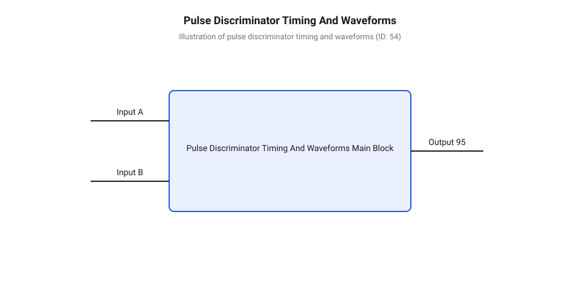
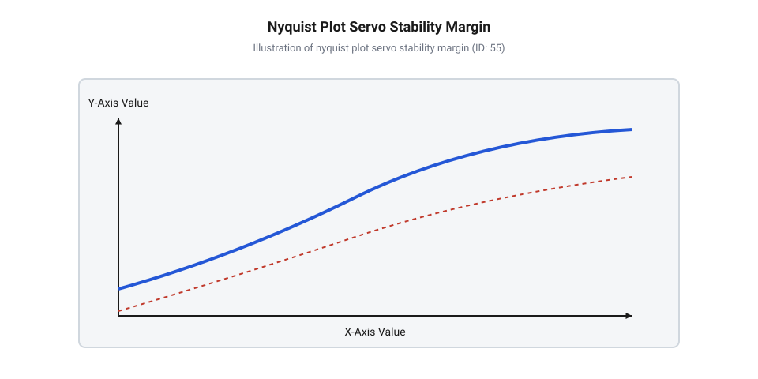

# Математика аналогового дискримінатора імпульсів та розрахунок зони спокою

<preknowlist>
- [Сервоприводи радіокерованих моделей: будова, редуктори та ШІМ-керування](root:cat-hw-actuators/rc-servo-mechanisms-and-control) — базові принципи ШІМ-керування аналоговим сервоприводом, часові інтервали керуючого імпульсу (1–2 мс) та період повторення кадрів
- [Частота оновлення кадрів ШІМ і цикли позиціонування сервоприводів](root:cat-hw-actuators/servo-pwm-frame-rate) — періодичність надходження вхідних сигналів та її вплив на динаміку оновлення напруги на інтегрувальному конденсаторі
- [Математика потенціометричного зворотного зв'язку сервоприводу](root:cat-hw-actuators/servo-feedback-potentiometer) — лінійне перетворення кута повороту вала у напругу зворотного зв'язку та формування пропорційного задавального потенціалу
- [Зона нечутливості та дрижання вала сервоприводів](root:cat-hw-actuators/servo-deadband-and-jitter) — фізичні прояви та механічні наслідки неконтрольованого дрижання позиції вала та автоколивань під навантаженням
</preknowlist>

## Автоколивання вала при нульовій зоні спокою

У спеціалізованих мікросхемах аналогових сервопідсилювачів (англ. @@en|servo amplifier IC@@) точність позиціонування вихідного вала визначається порівнянням часової тривалості вхідного сигналу широтно-імпульсної модуляції (англ. @@en|pulse-width modulation@@, @@en|PWM@@) та внутрішнього опорного імпульсу. Останній формується колом зворотного зв'язку за допомогою потенціометра. Якщо припустити, що аналоговий дискримінатор імпульсів (англ. @@en|pulse discriminator@@) має ідеально лінійну передавальну характеристику з нульовим порогом спрацьовування, система намагатиметься реагувати на нескінченно мале часове розсогласування `ΔT = T_in - T_fb`. В реальних фізичних умовах будь-яке мікроскопічне коливання живлення, високочастотні наводки на лініях керування, температурний дрейф або механічна вібрація ковзного контакту потенціометра створюють флуктуації тривалості сигналів на рівні часток мікросекунди.

За нульової зони нечутливості (англ. @@en|deadband window@@) аналоговий підсилювач сприймає ці шумові флуктуації як дійсне відхилення положення вала. Будь-яке розсогласування `ΔT ≠ 0` негайно перемикає вихідні транзистори силового H-моста (англ. @@en|H-bridge@@), подаючи повну напругу живлення на обмотку електродвигуна постійного струму. Двигун починає прискорений рух, передаючи крутний момент через механічний редуктор. Через інерційність ротора (англ. @@en|rotor inertia@@) та наявність люфтів у зубчастих передачах ротор проскочить точну задану позицію `θ_target`. Це негайно змінює знак розсогласування (`ΔT < 0`), змушуючи дискримінатор змінити полярність струму живлення моста на протилежну.

Вихідний міст починає форсоване електродинамічне гальмування та розгін двигуна в зворотний бік, що знову призводить до перелітання нейтралі. У результаті в замкненому контурі виникають стійкі високочастотні механічні автоколивання — дрижання вала (англ. @@en|hunting@@) або часовий дрижак (англ. @@en|jitter@@). Під час дрижання через обмотки двигуна та силові ключі постійно протікають пікові струми перезаряджання, викликаючи інтенсивне нагрівання силового каскаду, що вимагає застосування спеціалізованих рішень із [тепловим захистом сервоприводів](root:cat-hw-actuators/servo-thermal-protection). Значні динамічні ударні навантаження на зубці редуктора призводять до прискореного [абразивного зносу шестерень](root:cat-hw-actuators/servo-gear-shear-and-wear), що є особливо критичним для компактних актюаторів, побудованих на [мікросервоприводах Tower Pro](root:cat-hw-actuators/sg90-servo).

Фізична та схемотехнічна необхідність розрахунку дискримінатора імпульсів полягає у штучному введенні контрольованої часової зони спокою (англ. @@en|deadband@@) `ΔT_db`. У межах цього часового вікна `|ΔT| < ΔT_db / 2` дискримінатор не формує відмикальних імпульсів для силового H-моста (англ. @@en|H-bridge@@), пригнічуючи чутливість до високочастотних завад і забезпечуючи статичну стійкість вала ціною нормованого порогу нечутливості за кутом повороту. Зв'язок між часовим вікном `ΔT_db` та кутовою зоною нечутливості `Δθ_db` визначається коефіцієнтом передачі [потенціометричного зворотного зв'язку](root:cat-hw-actuators/servo-feedback-potentiometer) `K_pot = d V_fb / d θ` та крутизною перетворення внутрішнього однодвійника `K_mono = d T_fb / d V_fb`, що утворює залежність `Δθ_db = ΔT_db / (K_pot · K_mono)`. Усередині часової зони нечутливості вихідна напруга розсогласування дорівнює нулю (`V_err = 0`), через що силовий міст повністю знеструмлює обмотки електродвигуна і не створює утримувального електромагнітного моменту. Коли на вихідний вал діє зовнішній статичний момент навантаження (англ. *static load torque*, від лат. *staticus* — нерухомий, @@en|static load torque@@) `M_load`, викликаний опором [важільних механізмів та тяг](root:cat-hw-actuators/servo-pushrod-kinematics), вал відхиляється від заданої нейтралі. Щоб дискримінатор згенерував перший силовий імпульс струму для компенсації моменту `M_load`, кутове відхилення має вийти за межу півширини зони нечутливості `Δθ_db / 2`. У результаті реальна кутова похибка утримання вала під навантаженням становить `Δθ_stat = Δθ_db / 2 + M_load / K_stiff`, де `K_stiff` — кутова жорсткість замкненого контуру керування поза зоною спокою. Це формує жорсткий кількісний компроміс: розширення часового вікна `ΔT_db` гарантує пригнічення завад і запобігає виникненню шкідливого дрижання вала (англ. @@en|hunting@@), але пропорційно погіршує кутову точність позиціонування під навантаженням, тоді як надмірне звуження [зони нечутливості сервоприводів](root:cat-hw-actuators/servo-deadband-and-jitter) призводить до втрати запасу стійкості та перетворення будь-якого шуму на високочастотний дрижак (англ. @@en|jitter@@).

## Модель порівняння тривалостей і формувача розсогласування

Для реалізації часового порівняння в аналогових мікросхемах сервопідсилювачів вхідний керуючий ШІМ-імпульс тривалістю `T_in` запускає внутрішній однодвійник (англ. @@en|monostable multivibrator@@). Час автономного стану цього однодвійника `T_mono` задається зовнішнім часозадальним резистором `R_OSC`, конденсатором `C_OSC` та напругою зворотного зв'язку `V_fb`, яка знімається з потенціометра позиціонування вала.

Під час надходження переднього фронту вхідного імпульсу однодвійник розряджає конденсатор `C_OSC` до нуля, після чого починається його заряджання від внутрішнього джерела опорної напруги `V_ref` через резистор `R_OSC`. Диференціальне рівняння заряджання ємності `C_OSC` має вигляд:

```
d V_C(t) / dt + V_C(t) / (R_OSC · C_OSC) = V_ref / (R_OSC · C_OSC)
```

Розв'язок цього диференціального рівняння за початкової умови `V_C(0) = 0` описує експоненціальне зростання напруги на конденсаторі:

```
V_C(t) = V_ref · (1 - exp(-t / (R_OSC · C_OSC)))
```

Перемикання однодвійника в початковий стан відбувається в момент `t = T_mono`, коли напруга `V_C(t)` досягає порогового рівня `V_th`, який визначається потенціометром зворотного зв'язку. Рівняння моменту спрацьовування формується шляхом підстановки порогової напруги:

```
V_ref · (1 - exp(-T_mono / (R_OSC · C_OSC))) = V_th
1 - exp(-T_mono / (R_OSC · C_OSC)) = V_th / V_ref        [поділ на опорну напругу]
exp(-T_mono / (R_OSC · C_OSC)) = 1 - (V_th / V_ref)      [виділення експоненційного члена]
T_mono = -R_OSC · C_OSC · ln(1 - (V_th / V_ref))         [взяття натурального логарифма]
       = R_OSC · C_OSC · ln(V_ref / (V_ref - V_th))      [перетворення логарифмічного виразу]
```

Оскільки напруга `V_th` лінійно залежить від кута повороту вала `θ_shaft` через коефіцієнт передачі потенціометра `V_th = K_pot · θ_shaft`, тривалість внутрішнього імпульсу зворотного зв'язку `T_fb = T_mono` пропорційна поточній позиції приводу. Отримані параметри є основою для аналізу [потенціометричного зворотного зв'язку](root:cat-hw-actuators/servo-feedback-potentiometer).

Далі вхідний імпульс `T_in` та згенерований імпульс `T_fb` надходять на внутрішній порівнювач тривалості імпульсів (англ. @@en|pulse duration comparator@@). Логічна схема дискримінатора виконує віднімання тривалостей і керує двома симетричними генераторами струму (англ. @@en|charge pump@@):

1. Якщо `T_in > T_fb`, на час `ΔT = T_in - T_fb` вмикається генератор витікаючого струму `+I_charge`. 2. Якщо `T_in < T_fb`, на час `|ΔT| = T_fb - T_in` вмикається генератор втікаючого струму `-I_charge`. 3. Якщо `|ΔT| = 0`, обидва джерела струму залишаються в закритому стані.


*Діаграма часових співвідношень між вхідним ШІМ-імпульсом T_in, однодвійником T_fb та вихідними імпульсами розсогласування дискримінатора.*

Згенерований струмовий імпульс амплітудою `I_charge` подається на інтегрувальний каскад з [періодичністю оновлення кадрів](root:cat-hw-actuators/servo-pwm-frame-rate) `f_frame = 1 / T_frame`. Величина заряду `Q_pulse`, який передається за один період ШІМ, становить:

```
Q_pulse = ∫₀^{|ΔT|} I_charge dt
        = I_charge · |ΔT|                                 [інтегрування сталого струму дискримінатора]
```

## Динаміка накопичення заряду та розрахунок нечутливості

Струмові імпульси розсогласування `Q_pulse` подаються на вихідний інтегрувальний конденсатор `C_INT` з паралельно або послідовно підключеним резистором `R_INT`, утворюючи аналоговий фільтр-інтегратор. Диференціальне рівняння накопичення заряду та зміни напруги розсогласування (англ. @@en|error voltage@@) `V_err(t)` на ємності `C_INT` описується виразом:

```
C_INT · (d V_err(t) / dt) + V_err(t) / R_INT = I_out(t)
```

За один кадр керуючого ШІМ-сигналу тривалістю `T_frame` (зазвичай 20 мс) імпульс струму дискримінатора тривалістю `|ΔT|` змінює потенціал на інтегрувальному конденсаторі `C_INT` на дискретну величину `ΔV_err`:

```
ΔV_err = (1 / C_INT) · ∫₀^{|ΔT|} I_charge dt
       = (I_charge · |ΔT|) / C_INT                        [приріст напруги інтегратора за один кадр]
```

Схема керування силового H-моста має внутрішній пороговий напруговий бар'єр `V_th_bridge` (зазвичай заданий падінням напруги на база-емітерних переходах компараторів або внутрішніх резистивних дільниках). Якщо приріст напруги `ΔV_err` за період менший за `V_th_bridge`, силові ключі моста залишаються закритими, і мотор не отримує живлення. Гранична умова спрацьовування визначає половину ширини часової зони нечутливості `ΔT_db / 2`:

```
V_th_bridge = (I_charge · (ΔT_db / 2)) / C_INT
ΔT_db / 2 = (V_th_bridge · C_INT) / I_charge             [вираження напівширини зони нечутливості]
ΔT_db = (2 · V_th_bridge · C_INT) / I_charge              [повний часовий розмах зони спокою]
```

У більшості спеціалізованих мікросхем струм заряду `I_charge` задається через зовнішній резистор задавання струму `R_INT` та внутрішню опорну напругу `V_ref` у вигляді `I_charge = V_ref / R_INT`. Підставляючи це співвідношення, отримуємо остаточну розрахункову формулу часового розмаху зони спокою:

```
ΔT_db = (2 · V_th_bridge · C_INT · R_INT) / V_ref         [остаточна формула через пасивні компоненти]
```

Розрахуємо значення зони нечутливості для типових параметрів обв'язки сервопідсилювача: `C_INT = 100 nF`, `R_INT = 47 kΩ`, `V_ref = 5.0 V`, `V_th_bridge = 40 mV`.

**Обчислення часового розмаху зони нечутливості ΔT_db:**

```
ΔT_db = (2 · 0.040 V · 100 × 10⁻⁹ F · 47 × 10³ Ω) / 5.0 V
      = (80 × 10⁻³ · 4.7 × 10⁻³) / 5.0
      = (3.76 × 10⁻⁴) / 5.0
      = 7.52 × 10⁻⁵ s
      = 75.2 μs                                           [розрахунок зони спокою для пасивного фільтра]
```

Отримане значення `75.2 μs` відповідає кутовому люфту близько 0.7° для стандартного сервоприводу. Зменшення ємності `C_INT` до `10 nF` зменшує зону спокою до `7.52 μs`, що суттєво підвищує точність позиціонування, яку мають сервоприводи з [металевими шестернями редуктора](root:cat-hw-actuators/mg90s-servo), але збільшує ризик виникнення завадочутливості.

Для оцінки динамічної стійкості замкненої системи (англ. @@en|closed-loop system@@) автоматичного керування при виході з зони спокою застосовується критерій стійкості Найквіста (англ. @@en|Nyquist stability criterion@@). Передавальна функція розімкненої системи `L(s)` включає інтегратор дискримінатора `W_int(s)`, електромеханічну постійну часу двигуна `τ_m`, електричну постійну часу обмоток `τ_e` та коефіцієнт зворотного зв'язку `K_pot`:

```
L(s) = (K_servo · (1 + s · R_INT · C_INT)) / (s² · (τ_m · s + 1) · (τ_e · s + 1))
```

Побудова амплітудно-фазової частотної характеристики (годографа Найквіста) `L(i·ω)` дозволяє оцінити запаси стійкості системи.


*Годограф Найквіста замкненої системи керування сервоприводом із позначенням запасу за фазою φ_m та запасу за амплітудою K_m.*

Для відсутності перерегулювання та згасання автоколивань після виходу з зони спокою система повинна мати запас за фазою (англ. @@en|phase margin@@) `φ_m ≥ 45°` на частоті зрізу `ω_c` (де `|L(i·ω_c)| = 1`) та запас за амплітудою (англ. @@en|gain margin@@) `K_m ≥ 6 dB`. За надто малої ємності `C_INT` частота зрізу `ω_c` зсувається у область високих частот, де фазовий зсув від електромеханічної інерції двигуна `τ_m` досягає `-180°`, що призводить до охоплення критичної точки `(-1, i0)` на комплексній площині та виникнення незатухаючих автоколивань вала.

## Оцінка стійкості за критерієм Найквіста

Сформувавши необхідну часову зону спокою, аналоговий сервопідсилювач переходить у режим лінійного відпрацювання неузгодження при відхиленнях тривалостей, що перевищують півширину порогу нечутливості `|ΔT| > ΔT_db / 2`. У цьому динамічному режимі замкнений аналоговий контур керування повинен забезпечувати максимальну швидкість наростання крутного моменту без виникнення перерегулювання (англ. @@en|overshoot@@) або тривалих згасаючих автоколивань при ступенчастій зміні задання. Оскільки інтегрувальний фільтр дискримінатора, індуктивність обмоток електродвигуна постійного струму та механічна інерція ротора вносять фазові затримки, аналоговий сервопідсилювач за неправильного вибору обв'язки може втратити динамічну стійкість.

Для аналітичного дослідження стійкості побудуємо передавальну функцію замкненої системи (англ. @@en|closed-loop system@@) у лінійному режимі відпрацювання розсогласування. Передавальна функція розімкненого контуру `L(s)` складається з трьох послідовно з'єднаних ланок: дискримінатора-інтегратора `W_int(s)`, електромеханічного перетворювача двигуна `W_m(s)` та коефіцієнта передачі потенціометра зворотного зв'язку `K_pot`. Електромеханічна ланка двигуна описується електромеханічною постійною часу (англ. @@en|electromechanical time constant@@) `τ_m = (J · R_a) / (K_e · K_t)`, де `J` — момент інерції ротора, `R_a` — опір обмотки якоря, `K_e` — коефіцієнт протиеРС, `K_t` — крутний коефіцієнт, а також електричною постійною часу (англ. @@en|electrical time constant@@) обмоток `τ_e = L_a / R_a`, де `L_a` — індуктивність якоря. Узагальнений вираз передавальної функції (англ. @@en|transfer function@@) розімкненої системи має вигляд:

```
L(s) = (K_servo · (1 + s · R_INT · C_INT)) / (s² · (τ_m · s + 1) · (τ_e · s + 1))
```

де `K_servo = K_disc · K_m · K_pot` — скрізний коефіцієнт підсилення контуру за напругою та кутом повороту. Присутність множника `s²` у знаменнику відображає наявність двох послідовних інтегрувальних ланок: формування напруги розсогласування на конденсаторі `C_INT` та механічного інтегрування швидкості обертання ротора в кутове переміщення вала. Чисельник містить фазовипереджальну ланку `(1 + s · R_INT · C_INT)`, згенеровану послідовним або паралельним опором `R_INT`, що створює нуль передавальної функції `s_z = -1 / (R_INT · C_INT)` для фазової компенсації. Додаткові механічні затримки та пружні деформації проявляються під час передачі зусилля через [важільні механізми та тяги](root:cat-hw-actuators/servo-pushrod-kinematics) актюатора.

Застосуємо критерій стійкості Найквіста (англ. @@en|Nyquist stability criterion@@) до передавальної функції `L(s)`. Для цього виконаємо заміну комплексної змінної `s = i · ω`, що визначає комплексний коефіцієнт передачі `L(i·ω)`. Амплітудно-фазова частотна характеристика (годограф Найквіста, англ. @@en|Nyquist plot@@) описується виразами модуля `|L(i·ω)|` та фазового зсуву `φ(ω)`:

```
|L(i·ω)| = (K_servo · √(1 + (ω · R_INT · C_INT)²)) / (ω² · √(1 + (ω · τ_m)²) · √(1 + (ω · τ_e)²))
φ(ω) = -180° + arctan(ω · R_INT · C_INT) - arctan(ω · τ_m) - arctan(ω · τ_e)
```

Подвійне інтегрування створює початковий фазовий зсув `-180°` на низьких частотах, що становить потенційну загрозу втрати стійкості. Фазовипереджальна ланка додає позитивний фазовий внесок `Δφ = arctan(ω · R_INT · C_INT)`, піднімаючи годограф у третій квадрант комплексної площини. За критерієм Найквіста замкнена сервосистема є стійкою, якщо амплітудно-фазова характеристика `L(i·ω)` при зміні частоти `ω` від `0` до `∞` не охоплює критичну точку `(-1, i0)`.

Для забезпечення стійкого перехідного процесу без автоколивань розраховують запас за фазою (англ. @@en|phase margin@@) `φ_m` на частоті зрізу `ω_c`, де модуль дорівнює одиниці `|L(i·ω_c)| = 1`:

```
|L(i·ω_c)| = 1                                            [визначення частоти зрізу розімкненої системи]
φ_m = 180° + φ(ω_c)                                       [формула запасу за фазою]
    = arctan(ω_c · R_INT · C_INT) - arctan(ω_c · τ_m) - arctan(ω_c · τ_e)
```

Також обчислюють запас за амплітудою (англ. @@en|gain margin@@) `K_m` на частоті фазового перетину `ω_π`, де загальний фазовий зсув сягає `φ(ω_π) = -180°`:

```
φ(ω_π) = -180°                                            [умова фазового перетину]
K_m = 1 / |L(i·ω_π)|                                      [розрахунок модального запасу підсилення]
K_m_dB = 20 · log₁₀(K_m)                                  [переведення запасу амплітуди в децибели]
```

Для запобігання високочастотному дрижанню (англ. @@en|hunting@@) та досягнення оптимального відпрацювання ступенчастого задання необхідний запас за фазою `φ_m ≥ 45°` (оптимальне значення `50°...60°`) та запас за амплітудою `K_m_dB ≥ 6 dB`. Якщо для зменшення зони спокою обрано надто малу ємність `C_INT`, коефіцієнт підсилення `K_servo` зростає, зсуваючи частоту зрізу `ω_c` у високочастотну область. На високих частотах фазовий зсув від інерції ротора `τ_m` та індуктивності `τ_e` досягає `-180°`, зменшуючи `φ_m` до нуля, що викликає незатухаючі автоколивання при кожній зміні положення вала.

## Оптимізація обв'язки для компенсації дрейфу

Після забезпечення стійкості математичної моделі сервопідсилювача необхідно врахувати реальні деструктивні чинники: температурне відхилення параметрів елементів, флуктуації напруги живлення та технологічний розкид номіналів пасивних компонентів. Ці чинники викликають дрейф нейтралі (англ. @@en|zero drift@@) та неконтрольовані зміни ширини зони спокою (англ. @@en|deadband window@@), що призводить до погіршення точності позиціонування або виникнення спалахів дрижання при зміні зовнішньої температури.

Розглянемо вплив температурного дрейфу на тривалість внутрішнього опорного імпульсу однодвійника `T_mono = R_OSC · C_OSC · ln(V_ref / (V_ref - V_th))`. Температурні зміни опору та ємності характеризуються температурним коефіцієнтом опору (англ. @@en|temperature coefficient of resistance@@, @@en|TCR@@) `α_R = (1 / R) · (d R / d T_temp)` та температурним коефіцієнтом ємності (англ. @@en|temperature coefficient of capacitance@@, @@en|TCC@@) `α_C = (1 / C) · (d C / d T_temp)`. Повна похідна тривалості імпульсу за температурою `T_temp` описується виразом:

```
d T_mono / d T_temp
= C_OSC · ln(V_ref / (V_ref - V_th)) · (d R_OSC / d T_temp) + R_OSC · ln(V_ref / (V_ref - V_th)) · (d C_OSC / d T_temp)
```

Поділивши обидві частини рівняння на `T_mono`, отримуємо відносну температурну нестабільність часового інтервалу:

```
(1 / T_mono) · (d T_mono / d T_temp)
= (1 / R_OSC) · (d R_OSC / d T_temp) + (1 / C_OSC) · (d C_OSC / d T_temp) [диференціювання логарифмічного добутку]
= α_R + α_C                                               [сумарний температурний дрейф тривалості]
```

Застосування недорогих керамічних конденсаторів класу 2 (типу X7R або Y5V) є неприпустимим, оскільки їхній параметр `α_C` у робочому діапазоні температур від `-40 °C` до `+85 °C` викликає зміну ємності від `±15%` до `-82%`. Крім того, кераміка X7R має високий напруговий коефіцієнт ємності, що зменшує фактичну ємність при прикладці постійної напруги. Це призводить до катастрофічного зміщення центральної точки нейтралі та зміни порогу нечутливості. Слід використовувати прецизійні керамічні конденсатори класу 1 з діелектриком C0G/NP0 (англ. @@en|C0G/NP0 dielectric@@), у яких `α_C` не перевищує `±30 ppm/°C` (`±0.003%/°C`), та тонкоплівкові резистори (англ. @@en|thin-film resistor@@) із `α_R ≤ ±10 ppm/°C`.

Другим чинником є пульсації та нестабільність напруги живлення `V_ref`. Для аналізу стійкості використовують коефіцієнт пригнічення пульсацій живлення (англ. @@en|power supply rejection ratio@@, @@en|PSRR@@). Якщо порогова напруга однодвійника `V_th` формується внутрішнім дільником від `V_ref` у вигляді раціометричної архітектури (англ. @@en|ratiometric architecture@@) `V_th = k · V_ref`, то логарифмічний співмножник `ln(V_ref / (V_ref - V_th)) = ln(1 / (1 - k))` стає незалежним від сумарної напруги живлення. Проте струм вихідного генератора `I_charge = V_ref / R_INT` прямо пропорційний `V_ref`. Згадуючи виведену формулу зони нечутливості `ΔT_db = (2 · V_th_bridge · C_INT · R_INT) / V_ref`, бачимо: якщо поріг моста `V_th_bridge` задано фіксованим падінням напруги на p-n переходах (`V_BE ≈ 0.65 V`), зростання `V_ref` зменшує ширину зони спокою `ΔT_db`. При повністю зарядженому акумуляторі зона спокою звужується, що викликає дрижання в [безколекторних інтегральних сервоконтролерах](root:cat-hw-actuators/bldc-servo-controller) або [сервоприводах постійного обертання](root:cat-hw-actuators/continuous-rotation-servo-mod).

Для оцінки найгіршого поєднання технологічних розкидів компонентів застосовують аналіз гіршого випадку (англ. @@en|worst-case analysis@@). Сумарне відносне відхилення часової зони спокою описується рівнянням:

```
ΔT_db_max = ΔT_db_nom · (1 + |δ_C_INT| + |δ_R_INT| + |δ_V_th_bridge| + |δ_V_ref|)
```

За використання пасивних елементів із допуском `10%` сумарна похибка розмаху зони спокою досягає `±35%...40%`, що робить поведінку сервоприводу не передбачуваною. Застосування металоплівкових резисторів з допуском `1%` та конденсаторів C0G/NP0 дозволяє утримати відхилення `ΔT_db` у межах `±3%`, забезпечуючи стабільну зону нечутливості. Прецизійне виставлення нейтральної позиції здійснюють за методологією [налаштування та калібрування нейтралі](root:cat-hw-actuators/continuous-servo-potentiometer-tuning), що гарантує надійну експлуатацію прецизійних [сервоприводів Power HD](root:cat-hw-actuators/hd-1370a-servo) у широких температурних діапазонах.