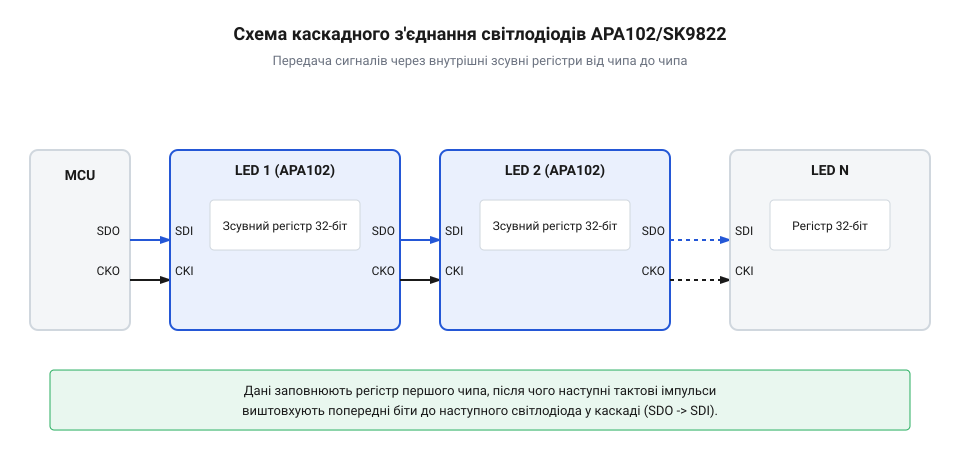
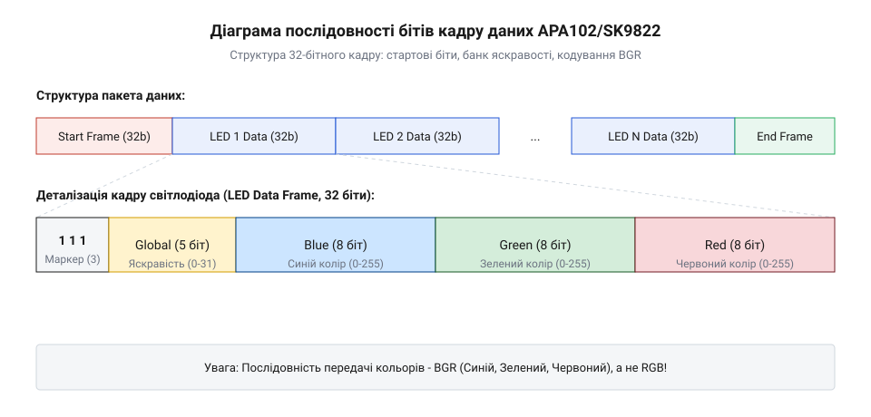
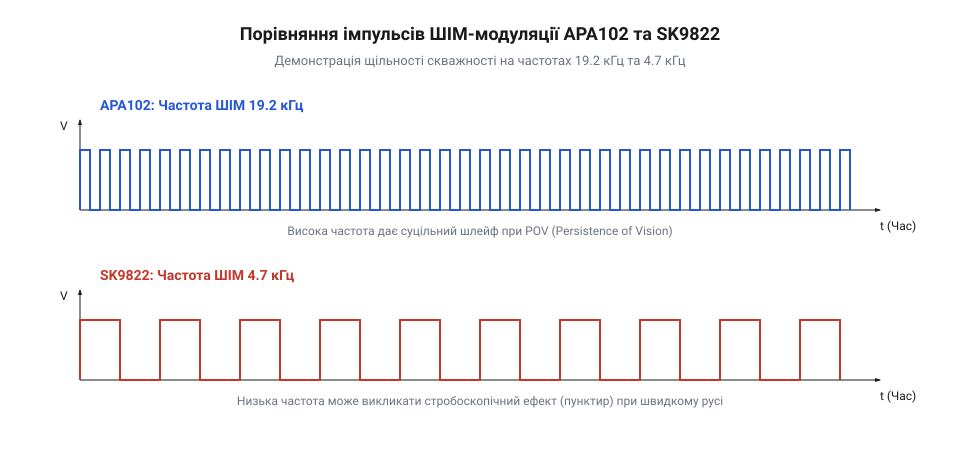
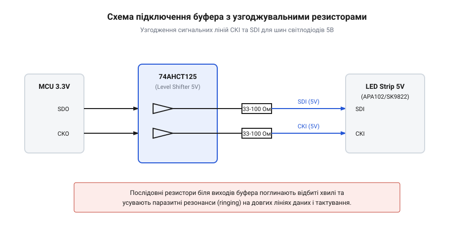

# Двопровідні адресні світлодіоди APA102 та SK9822 з окремою лінією тактування

<preknowlist>
- [WS2812B — адресний RGB-світлодіод (5050)](root:cat-hw-actuators/ws2812b-led) — базові принципи однопровідного керування світлодіодами, структуру RGB-пікселя 5050 та проблему залежності від суворих часових допусків
- [Інжекція живлення світлодіодних стрічок](root:cat-hw-actuators/ws2812b-power-injection) — фізику падіння напруги на довгих струмопровідних доріжках гнучких платок та правила підключення додаткових ліній 5В
- [Блокувальні конденсатори в лініях живлення LED](root:cat-hw-actuators/decoupling-capacitors-led) — роль локальних керамічних конденсаторів для згладжування високочастотних кидків струму під час перемикання ШІМ
- [Родина адресних світлодіодів та світлодіодних стрічок](root:cat-hw-actuators/addressable-led-family-overview) — загальну класифікацію адресних матриць та відмінності між паралельними, послідовними й двопровідними топологіями
</preknowlist>

## Обмеження однопровідних світлодіодів у критичних задачах

Уявіть розробку динамічної світлодіодної установки: високошвидкісного індикатора з інерцією зору (англ. @@en|Persistence of Vision@@, @@en|POV@@, від persistence — тривалість, vision — зір), рекламної світлодіодної панелі для зйомок на відеокамеру або складної інтерактивної системи під керуванням операційної системи реального часу (англ. @@en|Real-Time Operating System@@, @@en|RTOS@@, від real — реальний, time — час, operating — операційна, system — система) з активними бездротовими стеками @@en|Wi-Fi@@ та @@en|Bluetooth@@. Спробувавши побудувати таку систему на популярних [однопровідних адресних світлодіодах WS2812B](root:cat-hw-actuators/ws2812b-led), розробник миттєво стикається з парадоксом: щойно система починає виконувати фонові обчислення або обробляти мережеві пакети, світлодіодна матриця починає довільно мерехтіти, збивати кольори або взагалі «замирати». Причина цього криється у фундаментальному обмеженні часового кодування, де кожен біт інформації прив'язаний до жорстких мікросекундних інтервалів на єдиному сигнальному провіднику.

У протоколі кодування без повернення до нуля (англ. @@en|Non-Return-to-Zero@@, @@en|NRZ@@, від non — не, return — повернення, zero — нуль) передача логічного нуля та одиниці здійснюється висотою та тривалістю одиничного імпульсу напруги на одній лінії даних. Для чипа @@en|WS2812B@@ тривалість логічного нуля становить приблизно `0.4 мкс` високого рівня та `0.85 мкс` низького, тоді як для логічної одиниці — `0.8 мкс` високого та `0.45 мкс` низького рівня. Приймальний контролер усередині кожного світлодіода не має зовнішнього тактового сигналу; він спирається на власну внутрішню `RC`-схему для вимірювання ширини імпульсу. Допустиме відхилення часових інтервалів не перевищує `±150 нс`. Якщо мікроконтролер (англ. @@en|microcontroller@@, @@en|MCU@@) запізнюється з перемиканням стану виводу загального призначення (англ. @@en|General-Purpose Input/Output@@, @@en|GPIO@@, від general — загальний, purpose — призначення, input — вхід, output — вихід) хоча б на кілька десятків наносекунд, внутрішній відновлювач тактової частоти світлодіода помилково інтерпретує логічний нуль як одиницю, або сприймає затягнуту паузу низького рівня (понад `50 мкс`) як команду скидання та фіксації кадру.

Аби забезпечити настільки високу точність таймінгів, програмне забезпечення мікроконтролера змушене повністю блокувати апаратні переривання на час формування пакета даних. Розглянемо стрічку з `500` світлодіодів. Кожен RGB-піксель вимагає `24 біти` кольорової інформації, що дає `12 000 бітів` на один кадр. За тривалості одного біта в `1.25 мкс` повне оновлення стрічки триває:

```
T_frame = N_bits × T_bit
        = 12000 × 1.25 мкс      [підстановка 12000 бітів та тривалості біта]
        = 15000 мкс = 15 мс     [час передачі одного кадру]
```

Протягом усіх `15 мс` мікроконтролер перебуває у глухому циклі з вимкненими перериваннями. Якщо система працює на частоті `60 FPS` (період кадру `16.6 мс`), то `90%` всього часу процесора витрачається на просте витримування затримок у циклі. У цей час мікроконтролер не здатний відповідати на запити @@en|Wi-Fi@@, пропускає імпульси від точних енкодерів двигунів, порушує квантування часу в @@en|RTOS@@ та ризикує викликати перезавантаження за сторожовим таймером (англ. @@en|watchdog timer@@). Спроби використовувати периферійні модулі для синтезу @@en|NRZ@@-сигналу (наприклад, через @@en|DMA@@ з генерацією ШІМ-кодів) вимагають величезних обсягів оперативної пам'яті (англ. @@en|Random-Access Memory@@, @@en|RAM@@) для зберігання розгорнутих буферів імпульсів і залишаються складними схемотехнічними хаками.

Окрім проблем з інкапсуляцією таймінгів на рівні мікроконтролера, однопровідні чипи першого покоління мають ще одне вузьке місце — низьку частоту внутрішньої широтно-імпульсної модуляції (англ. @@en|Pulse-Width Modulation@@, @@en|PWM@@, від pulse — імпульс, width — ширина, modulation — модуляція). У чипах @@en|WS2812B@@ частота генерації ШІМ становить близько `400 Гц` (у новіших ревізіях — до `2 кГц`). Для людського ока при статичному спостереженні така частота здається безперервним світлом. Проте в @@en|POV@@-дисплеях, де світлодіодна лінійка швидко рухається в просторі (наприклад, на колесі велосипеда чи роторі), низька частота ШІМ розриває суцільне зображення на окремі пунктирні точки. Аналогічно, під час зйомки на сучасні відеокамери чи смартфони з високою швидкістю затвора на відео з'являються темні смуги та мерехтіння (англ. @@en|flicker@@).

Історична еволюція двопровідних адресних RGB-світлодіодів стала прямою відповіддю на фундаментальні обмеження однопровідного протоколу @@en|WS2812B@@. Головною архітектурною ідеєю став перехід від синхронізації за тривалістю імпульсу до прямої фізичної синхронізації через розділені лінії даних та тактування (позначувані як @@en|SDI@@ — Serial Data Input та @@en|CKI@@ — Clock Input). Це дало змогу задіяти стандартний апаратний шинний інтерфейс SPI (англ. @@en|Serial Peripheral Interface@@, від serial — послідовний, peripheral — периферійний, interface — міжгрань) і передавати дані з довільною частотою — від кількох кілогерців до десятків мегагерців — повністю звільнивши процесор від блокування переривань. Поява чипа @@en|APA102@@ принесла революційне підвищення частоти внутрішньої ШІМ-модуляції до `19.2 кГц`, що повністю усунуло мерехтіння на відео та у високошвидкісних @@en|POV@@-системах. Пізніші аналоги та клони, зокрема чипи @@en|SK9822@@, хоч і мають дещо нижчу частоту ШІМ (`4.7 кГц`) та відмінності в алгоритмах оновлення регістрів, зберегли головну перевагу — абсолютну незалежність від часових затримок мікроконтролера.

Таким чином, у задачах з високими частотами оновлення кадру, суворими вимогами до відсутності мерехтіння або при використанні багатозадачних операційних систем однопровідні світлодіоди стають головним вузьким місцем архітектури. Для вирішення цих проблем необхідний вихід на синхронний шинний інтерфейс.

## Синхронна двопровідна шина та каскадний зсув

Синхронна двопровідна шина кардинально змінює принцип взаємодії між мікроконтролером та адресною системою. Замість вимірювання часу витримки високого рівня на єдиному провіднику, приймальний чип орієнтується виключно на фронти тактового сигналу лінії @@en|CKI@@ (Clock Input). Логічний стан на лінії даних @@en|SDI@@ (Serial Data Input) зчитується світлодіодом строго в момент переходу тактового сигналу з низького рівня у високий (на зростаючому фронті імпульсу). Якщо мікроконтролер призупиняє передачу на кілька мікросекунд або навіть на кілька секунд через виконання високопріоритетного переривання в @@en|RTOS@@, стан шини просто «заморажується». Жоден світлодіод у ланцюзі не сприйме цю паузу як помилку чи несанкціоновану команду скидання.

Фізично усередині кожного світлодіодного чипа @@en|APA102@@ або @@en|SK9822@@ розміщено 32-бітний зсувний регістр (англ. @@en|shift register@@, від shift — зсувати, register — записувач), вихідні ключі керування струмом та логіку трансляції сигналів на вихідні ніжки @@en|CKO@@ (Clock Output) та @@en|SDO@@ (Serial Data Output). Всі світлодіоди з'єднуються послідовно в каскад: виходи @@en|CKO@@ та @@en|SDO@@ першого чипа підключаються до входів @@en|CKI@@ та @@en|SDI@@ другого, і так далі по всьому ланцюгу.


*Каскадна архітектура двопровідних світлодіодів передає сигнали даних та тактування від чипа до чипа через внутрішній зсувний регістр без втрати часової синхронізації.*

Кожен світлодіод у каскаді працює як апаратний ретранслятор. Коли на вхід першого чипа надходить 32-бітне слово кадру даних, воно спочатку заповнює його власний внутрішній зсувний регістр. Усі наступні тактові імпульси, що надходять на @@en|CKI@@, змушують чип виштовхувати попередньо отримані біти через вихід @@en|SDO@@ на вхід наступного світлодіода, одночасно відновлюючи прямокутну форму тактового сигналу на виході @@en|CKO@@. Завдяки цьому сигнал не дегрудує по довжині стрічки так катастрофічно, як у пасивних шинах, хоча кожен чип додає невеличку апаратну затримку поширення (порядку `15`–`30 нс`).

Найбільша перевага двопровідного інтерфейсу полягає у його повній апаратній сумісності зі стандартними периферійними блоками мікроконтролерів. Лінія тактування @@en|CKI@@ підключається напряму до виводу тактування шини @@en|SPI@@ (позначається як `SCLK` або `SCK`), а лінія даних @@en|SDI@@ — до виводу виходу даних майстра (англ. @@en|Master Out Slave In@@, @@en|MOSI@@, від master — господар, out — вихід, slave — підлеглий, in — вхід). Використання контролера прямого доступу до пам'яті (англ. @@en|Direct Memory Access@@, @@en|DMA@@, від direct — прямий, memory — пам'ять, access — доступ) дозволяє повністю передати процес вивантаження кадру апаратній периферії:

1. Програма готує масив кадрів світлодіодів у буфері оперативної пам'яті @@en|RAM@@. 2. Контролер @@en|DMA@@ автоматично, байт за байтом, пересилає дані з @@en|RAM@@ у передавальний регістр модуля @@en|SPI@@. 3. Модуль @@en|SPI@@ самостійно генерує тактові імпульси на лінії `SCLK` та висуває біти на лінії `MOSI` на апаратно заданій частоті (наприклад, `10 МГц` або `20 МГц`).

Процесор у цей час залишається на `100%` вільним для розрахунку фізики графічних ефектів, обробки сенсорів чи підтримки мережевого стека.

Для ілюстрації апаратної ініціалізації розглянемо приклад налаштування шини @@en|SPI@@ з підключенням @@en|DMA@@ для керування двопровідними світлодіодами:

:::tabs
@tab C (ESP-IDF)
:::code apa102-and-sk9822-two-wire-leds-d/c/esp-idf/init-led-spi-dma.c
@tab C++ (Arduino)
:::code apa102-and-sk9822-two-wire-leds-d/cpp/arduino/twowireleddriver.cpp
:::

При проектуванні реальних пристроїв важливо враховувати розрахунок необхідної кількості завершальних тактових імпульсів та параметрів інжекції струму, детально викладений у [математичному розрахунку пропускної здатності та живлення](root:cat-hw-actuators/apa102-and-sk9822-two-wire-leds/math-apa102-sk9822-timing-and-power-math.md). Фізичні нюанси розводки друкованих плат, узгодження рівнів напруги між `3.3 В` мікроконтролера та `5 В` світлодіодів описує [довідник схемотехніки залізного інтерфейсу](root:cat-hw-actuators/apa102-and-sk9822-two-wire-leds/api-apa102-sk9822-hardware-interface.md), а специфіку побудови кадрових пакетів та використання 5-бітного банку яскравості висвітлює [програмний довідник протоколу](root:cat-hw-actuators/apa102-and-sk9822-two-wire-leds/api-apa102-sk9822-protocol-spec.md). Практичну реалізацію високочастотного розгортання зображення можна переглянути у [проєкті високошвидкісного POV-дисплея](root:cat-hw-actuators/apa102-and-sk9822-two-wire-leds/proj-spi-dma-pov-display-sk9822.md).

Для комплексного розуміння вибору світлодіодів корисно також переглянути [огляд родин адресних RGB-світлодіодів](root:cat-hw-actuators/addressable-led-family-overview) та особливості [інжекції живлення світлодіодних стрічок](root:cat-hw-actuators/ws2812b-power-injection), оскільки [блокувальні конденсатори в лініях живлення](root:cat-hw-actuators/decoupling-capacitors-led) та правильно підібраний [високошвидкісний перетворювач рівнів](root:hw-digital/level-shifter) є критичними умовами стабільної роботи на тактових частотах понад `10 МГц`.

## Формат кадрів та апаратне регулювання струму

Коли мікроконтролер передає колірні дані ланцюгом адресних світлодіодів, кожен вбудований чип має чітко розпізнати початок нового кадру оновлення, виокремити власну ділянку інформації та без спотворень проштовхнути решту даних далі по шині. У двопровідних чипах @@en|APA102@@ та @@en|SK9822@@ цей процес реалізовано через передачу послідовності 32-бітних кадрів фіксованої довжини. На відміну від однопровідного [світлодіода WS2812B](root:cat-hw-actuators/ws2812b-led), де колірні дані обмежені трьома байтами безпосередньо для колірних каналів, двопровідна архітектура розширює структуру пакета додатковими службовими полями керування струмом.

Структура кожного сеансу оновлення світлодіодного масиву починається зі стартового кадру (англ. @@en|Start Frame@@). Він складається з 32 послідовних логічних нулів (`0x00000000`). Коли внутрішній автомат станів драйвера світлодіода отримує 32 нульові біти поспіль, він скидає внутрішній лічильник зсувного регістра у вихідний стан. Це готує перший світлодіод у ланцюзі до прийому власного корисного навантаження.

Після стартового кадру мікроконтролер надсилає послідовність 32-бітних кадрів світлодіодів (англ. @@en|LED Frame@@). Кількість таких кадрів у пакеті відповідає кількості фізичних світлодіодів у ланцюзі. Кожен 32-бітний кадр світлодіода має жорстко визначену бітову структуру:

1. Преамбула кадру (3 біти): біти 31..29 завжди встановлені в логічну одиницю (`111`). У байтовому представленні разом із 5 бітами яскравості перший байт кадру завжди починається з префікса `0xE0` (у двійковому форматі `11100000`). Три старші одиниці слугують унікальним маркером кадру, що дозволяє апаратній логіці чипа відрізнити дійсний кадр світлодіода від стартового кадру чи випадкових завад на лінії. 2. Банк глобальної яскравості (5 бітів, англ. @@en|Global Brightness Control@@): біти 28..24 містять ціле число від 0 (`0b00000`) до 31 (`0b11111`). Цей банк задає опорний аналоговий струм для всіх трьох каналів внутрішнього драйвера. 3. Канал синього кольору B (8 бітів): біти 23..16 визначають інтенсивність синього кристала від 0 до 255. 4. Канал зеленого кольору G (8 бітів): біти 15..8 визначають інтенсивність зеленого кристала від 0 до 255. 5. Канал червоного кольору R (8 бітів): біти 7..0 визначають інтенсивність червоного кристала від 0 до 255.

Важливо враховувати, що послідовність передачі кольорів виконується у форматі @@en|BGR@@ (синій, зелений, червоний), а не в класичному @@en|RGB@@. Передача байтів у неправильному порядку призведе до переплутування колірних каналів під час відтворення.


*Структура 32-бітного кадру керування світлодіодами APA102/SK9822: преамбула із трьох одиниць, 5 біт глобального регулювання струму, 24 біти BGR-колірності та завершальні тактові імпульси.*

Головною архітектурною перевагою чипів @@en|APA102@@ та @@en|SK9822@@ є двоступенева система регулювання вихідного випромінювання. Вона поєднує 5-бітне аналогове керування струмом (англ. @@en|constant current driver@@) та 8-бітну цифрове широтно-імпульсну модуляцію (англ. @@en|Pulse-Width Modulation@@, @@en|PWM@@).

У традиційних світлодіодах з 8-бітною ШІМ зменшення яскравості до низьких значень (наприклад, колірні значення 1, 2 або 3) призводить до суттєвої втрати градацій сірого. Приймаючи лише кілька дискретних станів ШІМ-модуляції, світлодіод починає демонструвати різкі кроки під час плавної зміни кольору, а динамічний діапазон відтворення відтінків стискається. 

Двоступеневий механізм усуває цю проблему: 5-бітне поле глобальної яскравості регулює піковий аналоговий струм генератора струму в діапазоні від ~0.6 мА до 20 мА на канал за 32 лінійні кроки. Потім 8-бітна ШІМ-модуляція комутує цей уже зменшений аналоговий струм із частотою внутрішнього генератора за 256 кроків робочого циклу. 

Загальний динамічний діапазон інтенсивності свічення обчислюється як добуток двох ступенів регулювання:

```
загальний динамічний діапазон = ступені аналогового струму × ступені ШІМ
                              = 32 × 256
                              = 8192 рівнів
```

Завдяки цьому підходу під час встановлення банку глобальної яскравості у значення `1/31` розрядність 8-бітної ШІМ-модуляції зберігається повністю. Це дозволяє здійснювати надзвичайно плавне згасання світла в глибоких тінях без ефекту квантування кольору та без втрати стабільності відтінку.

Після передачі всіх корисних кадрів світлодіодів постає задача фіксації (англ. @@en|latching@@) даних у вихідних регістрах усіх чипів ланцюга. Під час проходження сигналу тактування @@en|CKI@@ через кожен світлодіод внутрішня буферна логіка драйвера додає затримку фази тактового сигналу на половину періоду біта (1/2 такту) відносно лінії даних. 

Через цю накопичувальну затримку (англ. @@en|clock propagation delay@@), коли мікроконтролер завершує відправку останнього байта колірних даних, останні світлодіоди на кінці довгої стрічки ще не отримують достатньої кількості тактових імпульсів для проштовхування останніх бітів зсувного регістра на вихідні засувки (англ. @@en|output latches@@).

Для вирішення цієї проблеми мікроконтролер повинен згенерувати фінальний кадр (англ. @@en|End Frame@@) з додатковими тактовими імпульсами. Мінімально необхідна кількість додаткових тактових бітів розраховується за формулою:

```
додаткові тактові біти = N / 2
```

де `N` — загальна кількість світлодіодів у послідовному ланцюзі. На практиці, щоб не розбивати байтові та 32-бітні межі буферів у пам'яті мікроконтролера, розробники відправляють додаткові нулі (`0x00`) або одиниці (`0xFF`), вирівняні по 32-бітних словах. Заправка 32 додаткових бітів тактування на кожні 64 світлодіоди гарантує повне проштовхування даних до самого кінця ланцюга. Для точного розрахунку додаткових імпульсів фіксації та падіння напруги зверніться до [математичних розрахунків живлення](root:cat-hw-actuators/apa102-and-sk9822-two-wire-leds/math-apa102-sk9822-timing-and-power-math.md).

Детальні параметри часових інтервалів містяться в [технічній специфікації протоколу](root:cat-hw-actuators/apa102-and-sk9822-two-wire-leds/api-apa102-sk9822-protocol-spec.md). Така побудова кадрів відрізняє цей пристрій серед [інших адресних світлодіодів](root:cat-hw-actuators/addressable-led-family-overview).

## Порівняння чипів APA102 та SK9822

Світлодіод @@en|APA102@@ розроблено тайванською компанією @@en|APA Electronic@@ як високошвидкісну альтернативу однопровідним адресним світлодіодам із часовими допусками. Через високу популярність чипа на ринку з'явився його повністю сумісний за призначенням виводів та структурою 32-бітного протоколу аналог — чип @@en|SK9822@@ від компанії @@en|Shenzhen Akiba / Opsco@@. Попри однакову корпусику 5050 SMD та сумісність на рівні програмних буферів, внутрішня кристалічна архітектура цих двох чипів має суттєві відмінності у частоті ШІМ-модуляції та алгоритмах стробування.

Головна відмінність між чипами полягає в частоті внутрішнього генератора ШІМ-модуляції:

1. Чип @@en|APA102@@ працює на частоті ШІМ **19.2 кГц** (19200 Гц).
2. Чип @@en|SK9822@@ працює на частоті ШІМ **4.7 кГц** (4700 Гц).

Ця різниця у майже 4 рази визначає сфери застосування чипів та їхню поведінку у критичних до мерехтіння завданнях.


*Порівняння осцилограм ШІМ-модуляції APA102 (19.2 кГц) та SK9822 (4.7 кГц): висока частота APA102 запобігає артефактам переривання світлового шлейфу під час швидкого руху.*

Перший критичний фактор — це використання в системах із швидким просторовим переміщенням (англ. @@en|Persistence of Vision@@, @@en|POV@@). У POV-дисплеях, світлових жезлах для світлопису (англ. @@en|light painting@@) або світлодіодних насадках на колеса транспортних засобів світлодіодна лінійка швидко рухається у просторі. 

Якщо частота ШІМ-модуляції недостатньо висока, людське око або об'єктив камери фіксує не суцільну світлову смугу, а дискретне пунктирне мерехтіння (стробоскопічний артефакт або «ефект намиста»). Завдяки частоті 19.2 кГц чип @@en|APA102@@ формує монолітний суцільний шлейф світла навіть при лінійній швидкості переміщення понад 50 м/с. Натомість чип @@en|SK9822@@ із частотою 4.7 кГц у високошвидкісних POV-системах дає помітні пунктирні розриви. Практична реалізація подібної системи детально описана в [проєкті POV-дисплея](root:cat-hw-actuators/apa102-and-sk9822-two-wire-leds/proj-spi-dma-pov-display-sk9822.md).

Другий фактор — це відеозйомка та робота з короткою витримкою затвора (англ. @@en|High-Speed Video Recording@@). При зйомці відеокамерами на частотах 60 к/с, 120 к/с або із короткою витримкою (наприклад, 1/1000 секунди) джерела світла з частотою 4.7 кГц (SK9822) утворюють темні смуги на відео через неспівпадіння частоти кадрів камери та робочого циклу ШІМ (ефект скошеного затвора, англ. @@en|rolling shutter@@). Частота 19.2 кГц у чипі @@en|APA102@@ значно перевищує стандартні витримки зйомки, що робить його ідеальним для студійного та сценічного освітлення.

Другою важливою відмінністю є механізм поновлення 5-бітного банку глобальної яскравості та поведінка під час динамічних переходів:

- @@en|APA102@@ застосовує нове значення глобальної яскравості негайно під час поточного циклу ШІМ. Якщо програма дуже часто та асинхронно змінює 5-бітне поле яскравості (наприклад, під час швидкого стробування або звукової анімації), це може викликати короткі мікроартефакти (збій початкової фази ШІМ), що проявляються як поодинокі візуальні сплески. - @@en|SK9822@@ містить подвійну буферизацію регістра яскравості (англ. @@en|double-buffered latch@@). Зміна 5-бітного значення засувляється і підхоплюється строго на початку наступного внутрішнього циклу ШІМ. Це повністю виключає мікрозбої під час швидкої зміни глобальної яскравості й забезпечує ідеально гладку зміну яскравості, хоча додає мінімальну затримку оновлення, рівну одному періоду ШІМ (~212 мкс).

З точки зору енергоспоживання та теплового режиму обидва чипи живляться напругою 5 В та споживають до 60 мА при максимальній яскравості білого кольору (по 20 мА на кожен колірний канал). Однак у режимі спокою (коли колір встановлено в `0x000000`) чип @@en|SK9822@@ демонструє дещо оптимізоване споживання — близько 1 мА проти 1.5 мА у чипа @@en|APA102@@.

Для запобігання викривленню фронтів сигналу на високих частотах використовують [високошвидкісні перетворювачі рівнів](root:hw-digital/level-shifter). Вимоги до схемотехніки розводки зібрані в [довіднику апаратного інтерфейсу](root:cat-hw-actuators/apa102-and-sk9822-two-wire-leds/api-apa102-sk9822-hardware-interface.md).

Підсумовуючи критерії вибору:
- Слід обирати @@en|APA102@@ для високошвидкісних POV-дисплеїв, світлопису, професійних світлових приладів під відеозйомку та проєктів, де кричуще важливою є частота ШІМ 19.2 кГц. - Слід обирати @@en|SK9822@@ для стаціонарної декоративної підсвітки, архітектурного освітлення, бюджетних світлодіодних стрічок та завдань, де потрібна надплавна зміна загальної яскравості без мікроспалахів.

## Забезпечення цілісності високошвидкісних сигнальних ліній

Коли мікроконтролер надсилає дані на світлодіоди @@en|APA102@@ або @@en|SK9822@@ на частотах @@en|SPI@@ у десятки мегагерц, фізика реальних провідників починає проявлятися у вигляді спотворень імпульсів. На високій частоті навіть невелика довжина з'єднувального проводу перетворюється на довгу лінію передачі з власною індуктивністю та ємністю. У результаті розробник стикається з типовою проблемою: програма працює бездоганно на короткому лабораторному макеті, але при підключенні п'ятиметрової стрічки світлодіоди на кінці ланцюга починають хаотично спалахувати, втрачати синхронізацію або довільно змінювати кольори.

Основною причиною початкових збоїв є невідповідність порогових напруг логічних рівнів. Сучасні мікроконтролери (наприклад, на базі @@en|ESP32@@ або @@en|STM32@@) формують вихідні сигнали з амплітудою 3.3 В. Водночас світлодіодні чипи @@en|APA102@@ та @@en|SK9822@@ живляться напругою 5 В і мають вхідні каскади @@en|CMOS@@ (від англ. @@en|Complementary Metal-Oxide-Semiconductor@@ — комплементарна структура метал-оксид-напівпровідник). Для надійного розпізнавання логічної одиниці вхідному каскаду чипа потрібна напруга не нижче 0.7 від напруги живлення `V_CC`:

```
V_IH = 0.7 × V_CC
     = 0.7 × 5.0 В
     = 3.5 В
```

Сигнал рівнем 3.3 В знаходиться нижче безпечного порогу `V_IH = 3.5 В` у гранично невизначеній зоні. Будь-яка незначна завада або падіння напруги перетворює логічну одиницю на логічний нуль, викликаючи пропуск тактових імпульсів на лінії @@en|CKI@@ (англ. @@en|Clock Input@@).

Спроба застосувати пасивні резистивні дільники або двоспрямовані перетворювачі на польових транзисторах (наприклад, @@en|TXS0108E@@) на частотах понад 5–10 МГц зазнає невдачі. Через наявність підтягувальних резисторів і паразитної ємності лінії фронти імпульсів завалюються, а прямокутні сигнальні хвилі перетворюються на пилоподібні.

Для швидкісних двопровідних шин необхідно використовувати активні push-pull буфери (від англ. @@en|push-pull@@ — двотактний вихід) серії @@en|74AHCT125@@ або @@en|74HCT125@@. Чип @@en|74AHCT125@@ живиться від 5 В, але його вхідний поріг розпізнавання високого рівня `V_IH` становить лише 2.0 В. Це дозволяє йому безпомилково сприймати 3.3 В логіку мікроконтролера й видавати на виході потужний сигнал з амплітудою 5 В та тривалістю фронтів менше 5 наносекунд.

Наступним викликом на високошвидкісній шині є явище перевідбиття сигналу (англ. @@en|ringing@@ — дзвін, паразитні коливання) та джитеру (англ. @@en|jitter@@ — тремтіння фази імпульсу). Вихідний опір мікросхеми перетворювача рівнів становить приблизно 10–20 Ом, тоді як хвильовий опір гнучкої друкованої плати світлодіодної стрічки або кабелю живлення лежить у межах 80–120 Ом.

Через неузгодженість імпедансу (англ. @@en|impedance matching@@ — узгодження опорів) швидкий фронт тактового сигналу @@en|CKI@@ відбивається від входу першого світлодіода назад до буфера. Змішуючись із прямим сигналом, відбита хвиля викликає викиди напруги (англ. @@en|overshoot@@) та паразитні коливання. Якщо амплітуда таких коливань перетинає пороговий рівень входу `V_IH`, чип @@en|APA102@@ сприймає один дійсний тактовий імпульс як два або три окремих спалахи. У результаті бітовий зсув у ланцюзі порушується, і всі наступні світлодіоди відображають викривлені кольори.

Щоб погасити паразитні резонанси, безпосередньо біля вихідних ніжок перетворювача рівнів послідовно в лінії @@en|CKI@@ та @@en|SDI@@ (англ. @@en|Serial Data Input@@) впаюють антирезонансні послідовні резистори (англ. @@en|series resistor@@) номіналом від 33 Ом до 100 Ом. Сума вихідного опору драйвера та номіналу резистора має відповідати хвильовому опору лінії. Це поглинає відбиту хвилю й робить фронти сигналів гладкими та стабільними.


*Схема узгодження сигнальних ліній CKI та SDI за допомогою буфера 74AHCT125 та послідовних антирезонансних резисторів для усунення перевідбиттів і джитеру.*

Ще одним джерелом помилок є перехресні наведення (англ. @@en|crosstalk@@ — взаємні наведення між провідниками). Тактова лінія @@en|CKI@@ постійно перемикається з високою частотою, наводячи паразитні струми у сусідню лінію даних @@en|SDI@@ через ємнісний та індуктивний зв'язок між паралельними доріжками стрічки.

Для захисту від наведень сигнальний кабель між мікроконтролером і стрічкою проектують за принципом витої пари (англ. @@en|twisted pair@@), де кожен сигнальний провідник (@@en|CKI@@ та @@en|SDI@@) перевивається з власним провідником спільного заземлення @@en|GND@@. Екран із провідника @@en|GND@@ поглинає електромагнітне випромінювання й фіксує опорний потенціал.

Докладний опис правил побудови витої пари та друкованих плат містить [довідник апаратного інтерфейсу](root:cat-hw-actuators/apa102-and-sk9822-two-wire-leds/api-apa102-sk9822-hardware-interface.md). Також корисним буде розгляд того, як застосовуються [високошвидкісні перетворювачі логічних рівнів](root:hw-digital/level-shifter) у складних багатоканальних системах. Виконання цих вимог дозволяє підвищити частоту тактування @@en|SPI@@ до 15–20 МГц без жодного випадкового спалахування світлодіодів. Для перевірки впливу довжини шини на такти згадайте [математичний розрахунок пропускної здатності](root:cat-hw-actuators/apa102-and-sk9822-two-wire-leds/math-apa102-sk9822-timing-and-power-math.md).

## Розрахунок живлення та інжекція струму

Навіть якщо сигнальні лінії @@en|CKI@@ та @@en|SDI@@ забезпечують ідеальну передачу даних без жодних завад, система може повністю вийти з ладу під час спроби увімкнути яскравий білий колір на довгій світлодіодній стрічці. Замість чистого білого світла на кінці п'ятиметрової стрічки світлодіоди починають світитися тьмяним червоно-помаранчевим відтінком, а мікроконтролер раптово перезавантажується через циклічний скид живлення (англ. @@en|brownout reset@@ — скидання через падіння напруги). Причина полягає у фізичному падінні напруги на струмопровідних доріжках стрічки під час проходження струмів у десятки ампер.

Кожен чип @@en|APA102@@ або @@en|SK9822@@ містить три незалежні кристали (червоний, зелений, синій) та внутрішню логічну мікросхему керування. При максимальній яскравості кожен колірний канал споживає приблизно 20 мА аналогового струму. Разом із власним споживанням мікросхеми (~1–1.5 мА) один світлодіод у режимі повного білого кольору (`0xFFFFFF` при глобальній яскравості `31`) споживає до 60 мА струму:

```
I_peak = N × 0.060 A
```

де `N` — кількість світлодіодів у стрічці. Для масиву зі 300 світлодіодів (наприклад, 5-метрова стрічка щільністю 60 LED/м) сумарний струм та необхідна потужність джерела живлення розраховуються наступним чином:

```
I_total = 300 × 0.060 A
        = 18 A

P_total = I_total × V_CC
        = 18 A × 5.0 В
        = 90 Вт
```

Джерело живлення 5 В повинно мати резерв потужності щонайменше 20–30%, тому для такого ланцюга потрібен блок живлення, розрахований на струм не менше 22–25 А.

Гнучка друкована плата (англ. @@en|Flexible Printed Circuit@@, @@en|FPC@@) світлодіодної стрічки має дуже тонку мідну фольгу. Опір ліній +5В та @@en|GND@@ на один метр стрічки становить близько `R_meter ≈ 0.2–0.4 Ом`. За законом Ома падіння напруги (англ. @@en|voltage drop@@) на всій довжині стрічки при струмі 18 А складає:

```
ΔV = I × R_total
```

При подачі живлення лише з одного початку стрічки напруга в кінці 5-метрової лінії може впасти з 5.0 В до 2.8–3.2 В. Оскільки пряме падіння напруги на кристалі синього та зеленого світлодіодів становить близько `V_F ≈ 3.0–3.2 В`, а для червоного кристала необхідно лише `V_F ≈ 1.8–2.0 В`, синій та зелений канали признижують яскравість першими або повністю вимикаються. Це пояснює характерний червоний зсув кольору в кінці недостатньо заживлених стрічок.

Щоб усунути падіння напруги та зберегти рівномірність кольору по всій довжині, застосовують метод розподіленої інжекції живлення (англ. @@en|power injection@@). Паралельно світлодіодній стрічці прокладають силову шину з товстого мідного провідника (англ. @@en|busbar@@) перерізом 1.5–2.5 мм² (14–16 AWG).

Точки інжекції напруги +5В та заземлення @@en|GND@@ підпаюють до стрічки через однакові інтервали:
1. Для стрічок щільністю 30–60 LED/м — через кожні 2–2.5 метри (з обох кінців та посередині). 2. Для високощільних стрічок 144 LED/м — через кожен 1 метр.

При проведення додаткових ліній заземлення всі провідники @@en|GND@@ повинні з'єднуватися в єдиній точці біля джерела живлення. Це запобігає утворенню замкнених земляних петель (англ. @@en|ground loop@@ — контур заземлення), які утворюють паразитно індуктивні контури й спричиняють збої високошвидкісних сигналів тактування.

Для компенсації імпульсних кидків струму під час різкої зміни зображення (наприклад, при миттєвому спалаху з чорного в білий) у кожній точці підключення живлення встановлюють накопичувальні електролітичні конденсатори ємністю 470–1000 мкФ (на напругу 6.3 В або 10 В) із низьким еквівалентним послідовним опором (англ. @@en|Low-ESR@@).

Крім того, кожен окремий корпус світлодіода @@en|APA102@@ чи @@en|SK9822@@ вимагає наявності блокувального керамічного конденсатора (англ. @@en|decoupling capacitor@@) ємністю 0.1 мкФ (100 нФ), розташованого безпосередньо біля виводів VCC та GND чипа. Цей конденсатор згладжує високочастотні імпульси, що виникають під час внутрішнього комутування ШІМ-модуляції. Щоб розібратися у виборі та розміщенні цих елементів, ознайомтеся з тим, як діють [блокувальні конденсатори в лініях живлення](root:cat-hw-actuators/decoupling-capacitors-led).

Правила розрахунку перерізу силових дротів та схемотехнічні шаблони викладені в матеріалі про [інжекцію живлення світлодіодних стрічок](root:cat-hw-actuators/ws2812b-power-injection). Додаткові практичні рекомендації також описані в розширеному посібнику про [проектування шин та інжекцію живлення](root:hw-power/power-injection-led-strips). 

Для глибокого обчислення струмових навантажень у динамічних режимах зверніться до [математичних розрахунків живлення](root:cat-hw-actuators/apa102-and-sk9822-two-wire-leds/math-apa102-sk9822-timing-and-power-math.md), а для практичного складання системи високої щільності перегляньте [проєкт POV-дисплея](root:cat-hw-actuators/apa102-and-sk9822-two-wire-leds/proj-spi-dma-pov-display-sk9822.md). Зіставити ці рішення з іншими чипами можна через [огляд родин адресних світлодіодів](root:cat-hw-actuators/addressable-led-family-overview).