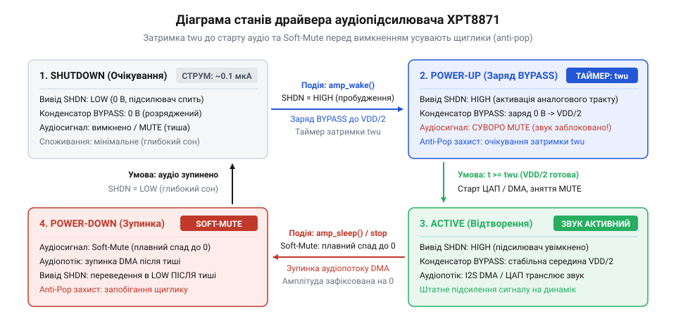
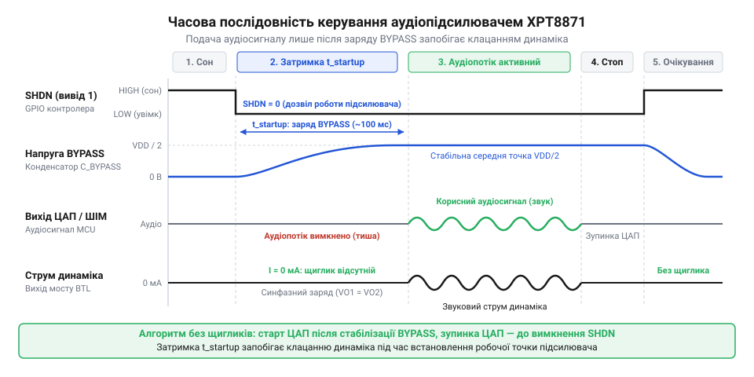

# XPT8871 — моно-підсилювач 5 Вт

<preknowlist>
- [XPT8871 — моно-підсилювач 5 Вт](root:cat-hw-actuators/audio-amp-xpt8871) — призначення виводів, функція SHDN та роль конденсатора BYPASS
</preknowlist>

## Перехідні щиглики та струм спокою: чому підсилювачу потрібен програмний драйвер

Підключення динамічної головки до виходу інтегрального звукового підсилювача здається суто апаратною задачею: подати живлення на мікросхему, спрямувати аналоговий сигнал від джерела звуку на вхідні клеми — і дифузор почне випромінювати хвилі тиску. Проте якщо замкнути живлення або активувати аналоговий тракт водночас із запуском цифрового аудіопотоку, замість чистого звучання кімнату струсоне різкий, неприємний акустичний удар — щиглик перехідного процесу (відомий в інженерній термінології як @@en|pop-and-click@@; від англійського *pop* — ляскіт та *click* — клацання).

Причина цього явища криється у фізиці виходу транзисторного тракту на робочу точку. В аудіопідсилювачах з однополярним живленням `VDD` внутрішні диференційні каскади не можуть працювати відносно нульового потенціалу землі: їм потрібна штучна опорна напруга зміщення, що дорівнює половині напруги живлення `VDD / 2` (середня точка, або віртуальна земля). У мостовій топології навантаження (@@en|Bridge-Tied Load@@, BTL) навантаження під'єднується між виходами двох симетричних підсилювачів. У стані спокою обидва виходи мають утримувати абсолютно однаковий потенціал `VDD / 2`, завдяки чому постійна напруга на виводах котушки [динаміка на 8 Ом](root:cat-hw-actuators/speakers-8ohm) дорівнює нулю:

```text
V_diff = V_out+ - V_out-
       = (VDD / 2) - (VDD / 2)   [симетричний потенціал спокою обох плечей моста]
       = 0 В                     [відсутність постійного струму крізь динамік]
```

Проте під час первинного наростання напруги живлення обидва плечі вихідного моста не здатні вийти на потенціал `VDD / 2` абсолютно одночасно. Різниця швидкостей наростання напруги в операційних підсилювачах або несинхронний заряд розділових ємностей призводить до короткочасного перекосу напруг `ΔV_diff`. Навіть крихітний імпульс амплітудою в сотні мілівольт тривалістю кілька мікросекунд створює ударний стрибок струму крізь звукову котушку:

```text
I_peak = ΔV_diff / R_L           [піковий струм диференційного перехідного процесу]
```

Цей імпульс різко втягує чи виштовхує дифузор, створюючи небезпечний механічний удар, що перевантажує пружний підвіс випромінювача та викликає суб'єктивне відчуття низькоякісної, несправної електроніки.

Друга фундаментальна проблема — марнотратне енергоспоживання в паузах між звуками. Коли підсилювач залишається постійно ввімкненим, його внутрішні генератори струму зміщення, вхідні транзистори та потужні вихідні каскади безперервно споживають струм холостого ходу — струм спокою (@@en|quiescent current@@; від латинського *quiescens* — нерухомий, бездіяльний), що для мікросхеми класу AB становить від 2.5 до 6 мА. Для автономного пристрою, що живиться від літій-іонного акумулятора ємністю 1000 мА·год, безперервний витік 5 мА розрядить батарею менш ніж за 200 годин (трохи більше восьми діб) навіть за повної тиші.

Вихід із цієї дилеми полягає в переведенні підсилювача в глибокий сон щоразу, коли звук не відтворюється, і пробудженні за строго визначеним часовим алгоритмом. Керувати цим процесом має програмний драйвер мікроконтролера, реалізований у вигляді скінченного автомата станів.


*Чотири стани драйвера підсилювача: вихід із режиму сну до відтворення звуку обов'язково проходить крізь фазу попередньої стабілізації внутрішньої середньої точки, що усуває перехідні щиглики в динаміці.*

Програмний автомат драйвера ніколи не подає звуковий сигнал на аналоговий вхід безпосередньо в момент підняття живлення. Він гарантує, що звуковий потік із цифро-аналогового перетворювача (ЦАП) або таймера ШІМ запускається лише тоді, коли внутрішні перехідні процеси повністю завершилися, а напруга на виводах динаміка збалансувалася.

> 🔧 **Навіщо це.** Розуміння фізичної природи перехідних клацань та струму спокою дозволяє спроєктувати надійний програмний драйвер, який береже ресурс акумулятора і захищає звукову котушку динаміка від руйнівних ударних навантажень.

## Електричні параметри та логіка виводу вимкнення SHDN

Для керування режимами енергоспоживання та безпечним запуском аналогового тракту в мікросхемі [XPT8871](root:cat-hw-actuators/audio-amp-xpt8871) передбачено спеціалізований цифровий вхід керування — вивід `SHDN` (від англійського @@en|shutdown@@ — аварійне вимкнення, планова зупинка роботи). Цей пін під'єднується безпосередньо до лінії введення-виведення загального призначення (GPIO) керуючого мікроконтролера.

Усередині кристала лінія `SHDN` керує затворами комутаційних польових транзисторів, які живлять внутрішні стабілізатори струму, опорні джерела та вхідні підсилювальні каскади. Коли на вивід подається низький логічний рівень, підсилювач переходить у режим глибокого апаратного сну (режим очікування, або @@en|standby mode@@). При цьому вихідні транзистори обох плечей моста повністю закриваються, переходять у стан високого імпедансу (Hi-Z), а внутрішній опір дільника середньої точки від'єднується від джерела живлення.

Вивід `SHDN` має специфічні статичні пороги напруги, які необхідно враховувати під час проєктування програмного забезпечення та схемотехнічного узгодження з цифровими виводами процесора:

1. **Поріг високого рівня увімкнення (`V_IH`):** мінімальна напруга, за якої мікросхема гарантовано прокидається та починає процес виходу на робочий режим. Для XPT8871 при напрузі живлення `VDD = 5.0 В` порогове значення становить `V_IH ≥ 1.4 В`. Це надзвичайно важлива перевага: мікроконтролери з 3.3-вольтовою логікою (як-от ESP32, STM32 або RP2040) здатні надійно переводити 5-вольтовий підсилювач у сон прямим логічним сигналом високого рівня (`3.3 В > 1.4 В`) без застосування транзисторних перетворювачів рівнів.
2. **Поріг низького рівня вимкнення (`V_IL`):** максимальна напруга, за якої кристал гарантовано утримується в стані глибокого вимкнення. За документацією поріг становить `V_IL ≤ 0.4 В`. Для переведення підсилювача в робочий режим вивід мікроконтролера має бути підтягнутий до потенціалу землі з залишковою напругою, яка не перевищує 400 мВ.

Різниця в споживанні струму між активним станом і режимом сну колосальна:

```text
I_active   ≈ 3.5 мА = 3500 мкА   [струм спокою без подачі аудіосигналу]
I_shutdown ≤ 0.1 мкА             [залишковий струм витоку в режимі сну]

K_saving   = I_active / I_shutdown
           = 3500 / 0.1
           = 35000               [зниження енергоспоживання у тридцять п'ять тисяч разів]
```

Вхідний струм витоку самого виводу `SHDN` надзвичайно малий і не перевищує `0.1 мкА`. Завдяки цьому вивід GPIO мікроконтролера працює практично на чисто ємнісне навантаження затворів і не навантажує внутрішні буфери процесора.

Для надійного керування лінію GPIO слід конфігурувати в двотактний режим активного виходу (@@en|push-pull output@@; від англійського *push* — штовхати та *pull* — тягнути). Режим відкритого стоку (open-drain) із зовнішнім резистором підтяжки є небажаним: під час переходу з високого рівня на низький тривалість спаду сигналу може збільшитися через паразитну ємність друкованої плати, що створить зону невизначеності на логічному вході мікросхеми.

> 🔧 **Навіщо це.** Низький поріг спрацьовування входу SHDN дозволяє керувати потужним 5-вольтовим підсилювачем безпосередньо з енергоефективних 3.3-вольтових мікроконтролерів, а правильна конфігурація push-pull гарантує миттєве знеструмлення аналогового ядра та зниження струму спокою до часток мікроампера.

## Модель станів програмного драйвера та правила переходів

Апаратний вивід вимкнення надає лише електричний важіль керування підсилювачем [XPT8871](root:cat-hw-actuators/audio-amp-xpt8871), проте сам по собі не захищає тракт від грубих помилок синхронізації вбудованого програмного забезпечення. Якщо функція програвання звуку подасть цифровий аудіопотік у ту саму мілісекунду, коли на лінію вимкнення виставлено високий логічний рівень, слухач почує гучний перехідний щиглик замість перших нот сигналу. Щоб зробити поведінку підсилювача детермінованою та передбачуваною в будь-який момент часу, програмний драйвер будується як формальний скінченний автомат станів (@@en|finite-state machine@@, FSM; від латинського *finitus* — обмежений, визначений).

Життєвий цикл підсилювача розбивається на чотири дискретні стани:

1. **`AMP_STATE_SHUTDOWN` (глибокий апаратний сон):** лінія `SHDN` примусово утримується мікроконтролером у стані високого логічного рівня (`3.3 В` або `5 В`). Внутрішні вузли мікросхеми знеструмлені, вихідні транзистори переведені у високий імпеданс, а споживання струму від шини живлення не перевищує 0.1 мкА. Будь-яка подача аудіосигналу на вхід заблокована.
2. **`AMP_STATE_POWERING_UP` (стабілізація робочої точки):** сигнал `SHDN` переведено у низький логічний рівень (`0 В`). Внутрішній дільник починає заряджати зовнішній конденсатор середньої точки на виводі `BYPASS`. Вихідні каскади вже активні, але напруга віртуальної землі ще не досягла половини напруги живлення `VDD / 2`. У цьому стані будь-який вхідний сигнал суворо блокується на рівні драйвера, а програма відраховує час захисної затримки пробудження `t_wu`.
3. **`AMP_STATE_ACTIVE` (активне відтворення):** внутрішні перехідні процеси завершені, середня точка зарядилася до рівня `VDD / 2`, а диференційний зсув між клемами [динаміка на 8 Ом](root:cat-hw-actuators/speakers-8ohm) дорівнює нулю. Драйвер дозволяє передачу аудіовідліків із цифро-аналогового перетворювача (ЦАП), блоку прямого доступу до пам'яті (DMA) чи апаратного ШІМ.
4. **`AMP_STATE_POWERING_DOWN` (кероване гасіння):** стан виходу з відтворення перед засинанням. Не можна миттєво знімати сигнал живлення з кристала, якщо на виході ЦАП ще присутній залишковий потенціал. Драйвер спочатку програмно глушить цифровий потік (занулює амплітуду або вимикає генерацію ШІМ), очікує кілька мілісекунд для заспокоєння звукової котушки й лише після цього перемикає лінію `SHDN` у низький рівень.

Перелік станів мовою C оформлюється у вигляді типізованого переліку (enum):

```c
typedef enum {
    AMP_STATE_SHUTDOWN = 0,   /* Сон: SHDN=LOW, струм < 0.1 мкА, виходи Hi-Z */
    AMP_STATE_POWERING_UP,    /* Пробудження: SHDN=HIGH, заряд BYPASS, аудіо заборонено */
    AMP_STATE_ACTIVE,         /* Відтворення: середня точка VDD/2 стабільна, звук дозволено */
    AMP_STATE_POWERING_DOWN   /* Зупинка: звук занулено, пауза перед скиданням SHDN */
} amp_state_t;
```

Головне правило автомата станів полягає в непорушності маршруту: прямий перехід зі стану `AMP_STATE_SHUTDOWN` у стан `AMP_STATE_ACTIVE` програмно заборонений. Спроба викликати функцію програвання звуку за умови, що підсилювач спить, повинна або повертати помилку відхилення команди, або автоматично ініціювати проміжний перехід `POWERING_UP` з обов'язковим очікуванням заряду конденсатора.

> 🔧 **Навіщо це.** Формалізація роботи драйвера у вигляді скінченного автомата з чотирма станами унеможливлює помилки розробника: аудіопотік гарантовано блокується доти, доки апаратна середня точка не стабілізується, що надійно захищає динамік від випадкових клацань.

## Конфігурація лінії GPIO: безпечний пуск і захист від плаваючого стану

Програмний автомат станів взаємодіє з апаратним виводом `SHDN` через вивід введення-виведення загального призначення (@@en|General-Purpose Input/Output@@, GPIO; від англійського *general purpose* — загального призначення). Проте фізична поведінка цифрового виводу мікроконтролера під час подачі живлення та апаратного перезавантаження таїть у собі приховані загрози для аналогового тракту.

У момент увімкнення живлення або спрацьовування сигналу скидання (Reset) апаратні регістри мікроконтролера ініціалізуються значеннями за замовчуванням. У переважній більшості сучасних процесорів (як 8-бітних AVR, так і 32-бітних архітектур ARM Cortex-M та ESP32) усі виводи GPIO переводяться в режим входу з високим імпедансом (Hi-Z), а внутрішні підтягувальні резистори вимикаються.

Поки виконується початковий код завантажувача (@@en|bootloader@@), що може тривати від кількох десятків мілісекунд до кількох секунд під час перепрошивки через UART чи USB, лінія `SHDN` залишається «плаваючою» (підвішеною в повітрі). Вона працює як крихітна антена, сприйнятлива до електромагнітних наводок від сусідніх високочастотних трас або паразитних ємнісних витоків. Оскільки вхідний опір виводу `SHDN` перевищує гігаоми, навіть мікроскопічний наведений заряд здатний опустити його потенціал до порогу увімкнення `V_IL = 0.4 В`. Підсилювач хаотично прокидатиметься й засинатиме, створюючи в динаміці дратівливе шипіння, гудіння та хаотичний тріск ще до того, як користувацька програма почне виконуватися.

Щоб запобігти плаваючому потенціалу, апаратна схема обов'язково повинна містити зовнішній стягувальний резистор (@@en|pull-down resistor@@) номіналом від 10 до 100 кОм (типово 47 кОм), увімкнений між виводом `SHDN` і землею `GND`. Цей резистор гарантує, що під час перебування мікроконтролера в стані скидання підсилювач залишається строго в стані глибокого сну.

Друга поширена пастка виникає під час самої ініціалізації виводу в коді. Якщо спочатку перевести пін у режим виходу (Output), а потім викликати функцію запису низького рівня (LOW), виникає короткочасне вікно невизначеності. Якщо у вихідному регістрі апаратного порту випадково опинилася одиниця, на вивід `SHDN` проскочить вузький позитивний імпульс (глитч), який змусить підсилювач різко смикнути дифузор динаміка.

Безпечна послідовність ініціалізації вимагає спершу примусово записати нульовий рівень у вихідний регістр фіксації даних, і лише після цього конфігурувати пін як двотактний активний вихід (push-pull):

:::tabs
```arduino
// Безпечна ініціалізація виводу керування підсилювачем в Arduino
const uint8_t PIN_AMP_SHDN = 4;

void amp_gpio_init(void) {
    // 1. Спочатку заздалегідь записуємо нуль у вихідний регістр
    digitalWrite(PIN_AMP_SHDN, LOW);
    // 2. Тепер перемикаємо режим піна у вихід: глитч неможливий
    pinMode(PIN_AMP_SHDN, OUTPUT);
}
```
:::code api-xpt8871-driver/c/amp-gpio-init.c
:::

Якщо мікроконтролер використовує режим глибокого сну (Deep Sleep), стан звичайних виводів GPIO після засинання ядра скидається в Hi-Z. Для платформ на кшталт ESP32 на лінії керування необхідно активувати функцію збереження стану виводу за допомогою `gpio_hold_en()`, інакше зовнішній резистор підтяжки або наводки можуть передчасно розбудити аналоговий каскад.

> 🔧 **Навіщо це.** Попереднє скидання логічного рівня перед конфігурацією виводу та використання апаратного стягувального резистора усувають короткочасні викиди напруги на виводі SHDN під час увімкнення та прошивки мікроконтролера, забезпечуючи абсолютну тишу в динаміці до старту звукової програми.

## Фізика заряду вузла BYPASS та розрахунок затримки пробудження

Під час переходу лінії `SHDN` з низького рівня у високий мікросхема [XPT8871](root:cat-hw-actuators/audio-amp-xpt8871) не може розпочати підсилення миттєво. Швидкість її переходу в робочий стан визначається внутрішньою фізикою заряду вузла штучної віртуальної землі — середньої точки, виведеної на зовнішній пін `BYPASS`.

Усередині кристала джерело опорного зміщення реалізоване у вигляді резистивного дільника між шиною живлення `VDD` та землею `GND`. Внутрішній опір плечей дільника `R_eq` формує разом із зовнішнім фільтрувальним конденсатором `C_bypass` інтегрувальне RC-коло. У момент підняття сигналу `SHDN` напруга на конденсаторі починає експоненційно зростати від нуля до цільового значення `VDD / 2`:

```text
V_bypass(t) = (VDD / 2) · (1 - e^(-t / τ))
τ           = R_eq · C_bypass            [постійна часу кола заряду середньої точки]
```

Для типової внутрішньої схеми підсилювача еквівалентний зарядний опір становить близько `R_eq ≈ 40 кОм`. Якщо на платі встановлено стандартний керамічний конденсатор `C_bypass = 1.0 мкФ`, постійна часу кола заряду дорівнює:

```text
τ = 40 кОм · 1.0 мкФ
  = 40 · 10³ Ом · 1 · 10⁻⁶ Ф
  = 40 · 10⁻³ с
  = 40 мс                                [постійна часу заряду вузла BYPASS]
```

Щоб напруга віртуальної землі наблизилася до цільового рівня з похибкою менше ніж 5%, перехідний процес має тривати не менше трьох постійних часу `3τ`. Цей інтервал називають часом виходу на режим — часом пробудження (@@en|turn-on time / wake-up time@@, `t_wu`):

```text
t_wu ≈ 3 · τ
     = 3 · 40 мс
     = 120 мс                            [мінімальний час захисної затримки перед стартом звуку]
```

Якщо використати конденсатор меншої ємності `C_bypass = 0.47 мкФ`, час запуску скоротиться до приблизно `55–60 мс`, проте дещо погіршиться придушення низькочастотних завад по шині живлення (коефіцієнт PSRR).

Поки триває цей інтервал заряду, обидва аналогові виходи мостового каскаду прагнуть наздогнати потенціал `V_bypass`. Будь-який звуковий сигнал, поданий на вхід підсилювача до завершення затримки `t_wu`, потрапить на незбалансований вхідний каскад: змінна напруга аудіо накладеться на різкий крутий фронт заряду середньої точки, породжуючи ударну диференційну хвилю струму крізь [динамік на 8 Ом](root:cat-hw-actuators/speakers-8ohm).

Правило програмного драйвера є категоричним: після встановлення високого рівня на виводі `SHDN` програма зобов'язана витримати паузу блокування відтворення тривалістю не менше `t_wu`.


*Часова послідовність станів лінії керування, заряду внутрішньої віртуальної землі та звукового сигналу при усуненні клацань.*

Як показує часова послідовність, цифро-аналоговий перетворювач або таймер генерації звуку залишається заблокованим протягом усього часу наростання напруги `V_bypass`. Завдяки цьому вихідні напруги `V_out+` та `V_out-` наростають синфазно й симетрично, диференційна напруга на навантаженні залишається нульовою, а струм через звукову котушку динаміка відсутній.

> 🔧 **Навіщо це.** Точний розрахунок часу виходу на режим за номіналом ємності конденсатора BYPASS дозволяє закласти мінімально необхідну захисну затримку в коді драйвера, гарантуючи абсолютно чистий старт аудіотракту без затримок і клацань.

## Послідовність зупинки та переходу в енергоощадний сон

Процедура вимкнення підсилювача та переведення його в режим сну вимагає не менш суворої часової дисципліни, ніж пробудження. Поширена помилка розробників-початківців полягає в миттєвому скиданні лінії `SHDN` у низький рівень відразу після завершення аудіофайлу або за командою зупинки відтворення.

Якщо в момент переведення сигналу `SHDN` у високий рівень на виході цифро-аналогового перетворювача (ЦАП) або на вхідних контактах підсилювача була присутня ненульова миттєва напруга звукової хвилі (наприклад, +1.2 В), раптове знеструмлення викличе стрибок потенціалу. Внутрішні ключі мікросхеми перемикають вихідні польові транзистори у високоімпедансний стан Hi-Z за час менше однієї мікросекунди (`t_off < 1 мкс`).

Різкий обрив струму, що протікав крізь індуктивність звукової котушки динаміка, викликає зворотну електрорушійну силу самоіндукції (ЕРС):

```text
V_ind = -L_coil · (dI / dt)              [індуктивний викид на котушці динаміка]
```

Оскільки похідна зміни струму `dI / dt` в момент миттєвого відсікання транзисторів прямує до величезних значень, на котушці виникає короткий високовольтний викид, що змушує дифузор видати гучний щиглик при кожній зупинці звуку.

Щоб усунути це явище, програмний драйвер реалізує строгу чотирикрокову послідовність зупинки (@@en|graceful shutdown@@; від англійського *graceful* — плавний, коректний):

1. **Цифрове занулення (Fade-Out або Mute):** амплітуда вихідних цифрових відліків плавно зменшується до нуля протягом 5–10 мс за допомогою програмного згасання (digital fade-out), або драйвер дочікується переходу звукової хвилі через нуль (@@en|zero-crossing@@).
2. **Зупинка генератора ЦАП або ШІМ:** апаратний периферійний блок переводиться в режим спокою з нульовим постійним зміщенням.
3. **Захисна пауза заспокоєння котушки (`t_settle`):** програма витримує паузу тривалістю 5–10 мс. Цього часу достатньо, щоб механічні коливання підвісу динаміка повністю згасли, а залишкові заряди вхідних розділових конденсаторів урівноважилися.
4. **Скидання лінії SHDN:** керуючий мікроконтролер записує низький логічний рівень у вихідний регістр лінії `SHDN`.

У програмному коді цей алгоритм набуває вигляду послідовного виклику службових функцій:

```c
void amp_stop_playback(void) {
    /* 1. Плавне цифрове зведення амплітуди звуку до нуля */
    audio_stream_fade_out(10 /* тривалість згасання в мс */);

    /* 2. Зупинка апаратного генератора ЦАП або ШІМ */
    dac_output_disable();

    /* 3. Захисна пауза для механічної релаксації дифузора */
    delay_ms(5);

    /* 4. Переведення підсилювача в глибокий апаратний сон */
    gpio_set_level(PIN_AMP_SHDN, 0);
    current_state = AMP_STATE_SHUTDOWN;
}
```

Коли сигнал `SHDN` падає в нуль після заспокоєння динаміка, напруга на конденсаторі `C_bypass` повільно стікає на землю через внутрішні мегаомні опори без жодного диференційного перекосу на навантаженні. Динамік залишається в абсолютному спокої, а споживання енергії від шини живлення падає до десятих часток мікроампера.

> 🔧 **Навіщо це.** Програмне згасання цифрового потоку та коротка релаксаційна пауза перед знеструмленням підсилювача усувають викиди ЕРС самоіндукції в звуковій котушці, усуваючи фінальні щиглики під час зупинки та зміни треків.

## Еталонна реалізація драйвера на C та C++

Надійний драйвер для мікроконтролерних систем повинен не лише гарантувати коректні часові затримки, а й уникати блокування основного потоку виконання програми. Використання жорстких пауз на зразок `delay(120)` є неприпустимим у системах реального часу: поки триває заряд конденсатора, процесор мусить продовжувати опитування кнопок, обробку датчиків або мережеву комунікацію.

З цієї причини архітектура драйвера розділяється на дві складові: апаратний рівень перемикання виводів та неблокуючий диспетчер станів, який фіксує системний час у момент підняття лінії `SHDN` і перевіряє завершення інтервалу пробудження `t_wu` за лічильником системних мілісекунд (або мікросекунд).

Нижче наведено робочі реалізації драйвера [XPT8871](root:cat-hw-actuators/audio-amp-xpt8871) для середовищ Arduino (C++) та ESP-IDF (чистий C):

:::tabs
:::code api-xpt8871-driver/c/xpt8871.c
:::code api-xpt8871-driver/c/xpt8871-init.c
:::

Публічний інтерфейс драйвера чітко розмежовує фази життєвого циклу:
- `init()` конфігурує апаратну лінію з обов'язковим попереднім скиданням у нуль.
- `enable()` переводить апаратний вхід у високий рівень і засікає системний таймер, не блокуючи виконання решти програми.
- `is_ready()` виконує неблокуючу перевірку: якщо час `t_wu` минув, драйвер автоматично переходить у робочий режим `ACTIVE`.
- `play_start()` перевіряє готовність тракту перед запуском потоку даних у ЦАП або ШІМ.
- `play_stop()` знеструмлює підсилювач після завершення звукового сигналу.

> 🔧 **Навіщо це.** Неблокуюча архітектура драйвера дозволяє процесору підтримувати високу чутливість інтерфейсу користувача та паралельно виконувати важкі задачі, поки аналоговий тракт підсилювача у фоновому режимі виходить на робочий режим.

## Типові апаратні пастки та методика осцилографічної діагностики

Навіть ідеально написаний програмний драйвер може зіткнутися з неочікуваними аномаліями звуку або перевитратою енергії, якщо розробник не врахував граничних режимів взаємодії мікроконтролера з аналоговою схемою.

Перша типова пастка — **паразитний струм витоку під час глибокого сну мікроконтролера**. Якщо на платі встановлено підтягувальний резистор до шини живлення або якщо вивід мікроконтролера в режимі сну перемикається в стан з підтяжкою до 3.3 В (Pull-Up), мікросхема підсилювача залишиться активною. Струм спокою аналогового ядра складе від 3 до 5 мА. Для пристрою з акумуляторним живленням це зведе нанівець весь ефект від сну мікроконтролера. Правило залишається незмінним: на лінії `SHDN` допускається виключно стягувальний резистор (Pull-Down) до землі.

Друга пастка — **просідання напруги шини живлення `VDD` (brownout) при старті звуку**. Коли [динамік на 8 Ом](root:cat-hw-actuators/speakers-8ohm) підключається до виходів підсилювача при напрузі живлення `VDD = 5.0 В`, піковий струм споживання в момент гучного звукового сплеску сягає сотень міліампер:

```text
I_peak = VDD / R_L
       = 5.0 В / 8 Ом
       = 0.625 А = 625 мА        [піковий струм навантаження на шину живлення]
```

Якщо доріжка живлення має занадто високий опір, або біля самого виводу живлення підсилювача (пін 6) відсутній блокувальний конденсатор достатньої ємності (електролітичний або танталовий номіналом від 100 до 220 мкФ у парі з керамічним 0.1 мкФ), напруга `VDD` просяде на 0.5–1.0 В. Таке падіння зміщує рівень віртуальної землі `VDD / 2`, викликаючи паразитне самозбудження на низьких частотах (відоме як моторбоатинг, @@en|motorboating@@) або спонтанне перезавантаження процесора від детектора зниження напруги (BOD).

Третя проблема — **ємнісні наводки на довгих лініях керування**. Якщо шлейф від мікроконтролера до підсилювача перевищує 15–20 см і прокладений поруч із швидкісними шинами SPI дисплея чи SD-карти, високочастотні імпульси можуть наводитися на високоімпедансний вхід `SHDN`, викликаючи мікроскопічні переривання звуку.

Для верифікації якості роботи драйвера та відсутності прихованих щигликів використовують двоканальний або чотириканальний цифровий осцилограф за такою методикою:

1. **Підключення щупів:**
   - Канал 1 підключають до лінії керування `SHDN` (діапазон 1 В/под).
   - Канал 2 підключають до виводу середньої точки `BYPASS` (діапазон 1 В/под).
   - Канали 3 та 4 підключають безпосередньо до вихідних клем динаміка `VO+` та `VO-` (або використовують диференційний щуп).
2. **Налаштування синхронізації:** осцилограф переводять у режим одиночного запуску (Single Trigger) за переднім фронтом сигналу на Каналі 1 (`SHDN`).
3. **Режим математичного віднімання:** на осцилографі активують функцію `MATH: CH3 - CH4` з високою чутливістю (50 мВ/под) для фіксації диференційної напруги `V_diff` на котушці динаміка.
4. **Критерій успішного проходження тесту:**
   - Напруга `V_BYPASS` на Каналі 2 повинна плавно зростати за гладкою експонентою до рівня `2.5 В` без просідань і сходинок.
   - Протягом усього інтервалу наростання `t < t_wu` диференційний сигнал `MATH` зобов'язаний залишатися суворо на нулі (допустимі шумові флуктуації не більше `±15 мВ`).
   - Будь-який вузький імпульс або стрибок напруги амплітудою понад `30 мВ` на виході `MATH` до завершення затримки свідчить про передчасний пуск звукового потоку або апаратний перекіс плечей підсилювача.

> 🔧 **Навіщо це.** Осцилографічна діагностика диференційної напруги на навантаженні є об'єктивним еталоном якості: вона дозволяє виявити навіть непомітні на слух мілівольтові перехідні імпульси та гарантує надійність пристрою в серійному виробництві.
