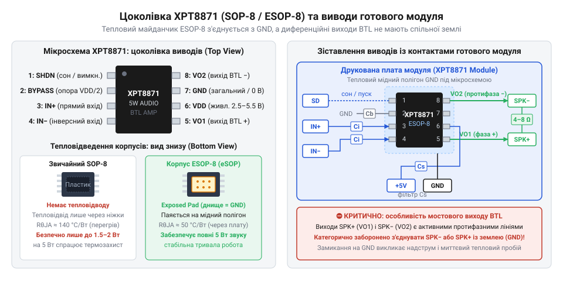
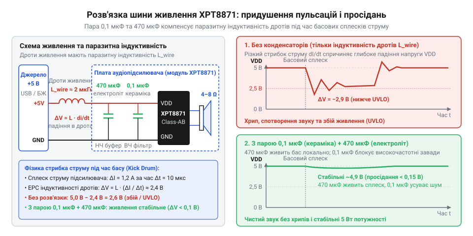
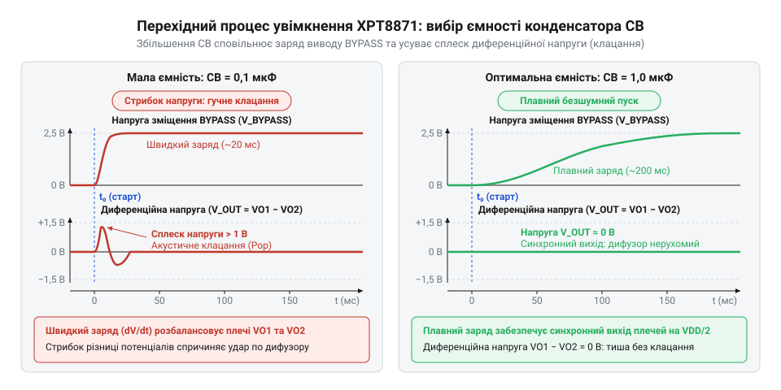
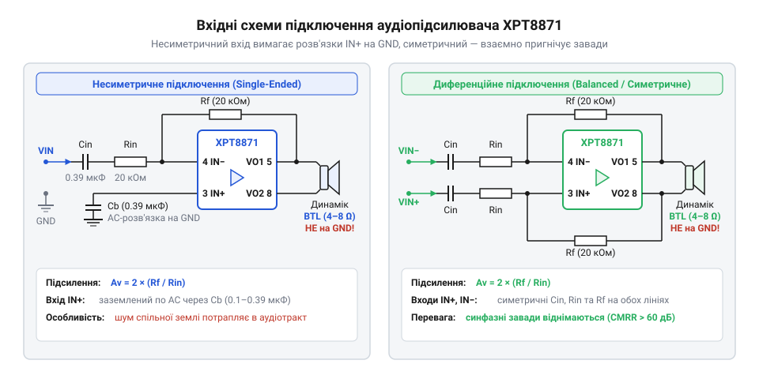
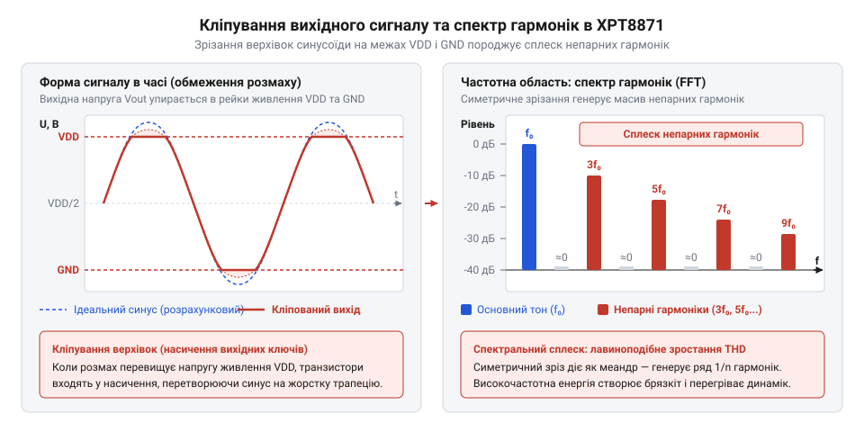
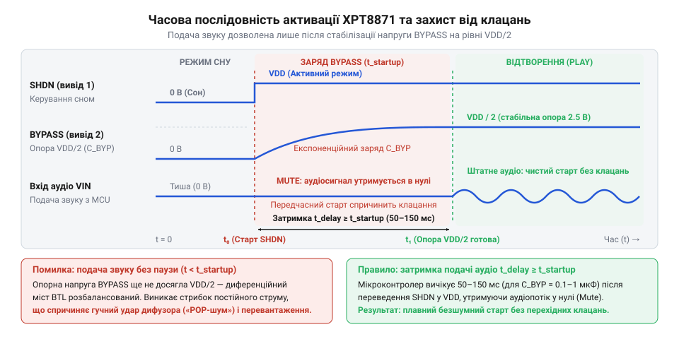
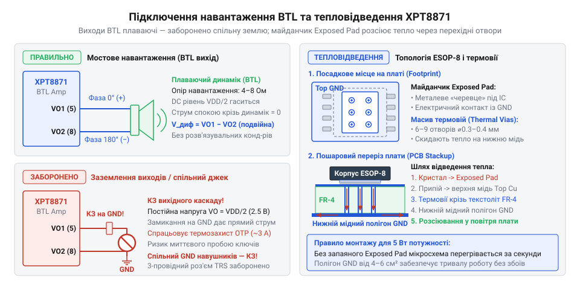

# XPT8871 — моно-підсилювач 5 Вт

<preknowlist>
- [Динаміки 5 Вт / 8 Ом](root:cat-hw-actuators/speakers-8ohm) — номінальний імпеданс котушки, допустима розсіювана потужність та реакція на постійну напругу зміщення
</preknowlist>

## Чому динамік руйнує вивід мікроконтролера та межі однотактного підсилення

Генерація звукових коливань або широтно-імпульсної модуляції (ШІМ) на виводі мікроконтролера — типова задача для систем сповіщення та сигналізації. Коли до цифрового виводу підключають мініатюрний [пасивний зумер](root:cat-hw-actuators/ky-006-buzzer), [активний зумер](root:cat-hw-actuators/ky-012-buzzer) чи окремий [п\'єзоелектричний зумер](root:cat-hw-actuators/buzzer-standalone), схема працює надійно й стабільно. П\'єзоелектричний елемент з точки зору електричного кола є конденсатором (лат. @@en|condenso@@ — згущую) з високим комплексним опором — імпедансом (лат. @@en|impedio@@ — перешкоджаю). У звуковому діапазоні його опір змінному струму становить сотні або тисячі омів, тому вивід процесора навантажується струмом у частки міліампера, що цілком безпечно для кремнієвих ключів.

Аварія стається тоді, коли до цифрового виводу напряму під\'єднують справжній електромагнітний [динамік](root:cat-hw-actuators/speakers-8ohm). Гучномовець влаштований інакше: його дифузор приводить у рух легка мідна звукова котушка, розміщена у вузькому зазорі постійного магніту. Щоб створити відчутний звуковий тиск, котушка мусить мати малу кількість витків і дуже низький активний опір — зазвичай від 4 Ом до 8 Ом.

Якщо подати на низькоомну котушку стандартний логічний рівень напруги 3.3 В або 5 В, закон Ома вимагає струму, який у десятки разів перевищує фізичні можливості кремнієвого кристала.

**Розрахунок струму короткого замикання виводу 3.3 В на котушку динаміка опором 4 Ом:**
`
I_load
= U_out / R_spk                        [закон Ома для ділянки кола]
= 3.3 / 4                              [підстановка напруги виводу 3.3 В та опору 4 Ом]
= 0.825 А                              [струм навантаження становить 825 мА]
`

За логічного рівня 5 В необхідний струм сягає 5 / 4 = 1.25 А. Тим часом вихідний каскад універсального виводу мікроконтролера (GPIO) побудований на мініатюрній комплементарній парі польових транзисторів (англ. @@en|transistor@@, від @@en|transfer@@ — переносити та @@en|resistor@@ — опір) — [двотактному каскаді](root:hw-analog/push-pull-output-stage). Ці крихітні кремнієві перемикачі розраховані лише на комутацію логічних станів і здатні віддавати тривалий струм не більше 10–20 мА (з короткочасним абсолютним максимумом до 25–40 мА). Їхній власний внутрішній опір відкритого каналу (R_ds_on) становить від 20 Ом до 50 Ом.

Пряме замикання виводу через котушку 4 Ом породжує три руйнівні наслідки:
1. **Миттєве просідання напруги.** Внутрішній опір каналу транзистора та опір котушки утворюють резистивний подільник напруги. Замість очікуваних 3.3 В амплітуда на динаміку падає нижче 0.3–0.4 В, тобто звуковий сигнал практично зникає.
2. **Зрив генерації та перезавантаження.** Величезний імпульсний струм просаджує шину живлення кристала. Апаратний супервізор фіксує аварійний спад напруги й викликає скидання процесора (Brown-Out Reset), що призводить до циклічного перезавантаження або повного зриву роботи таймерів ШІМ.
3. **Фізичне вигоряння кремнієвого ключа.** Майже вся енергія джерела живлення падає на мікроскопічному каналі польового транзистора всередині чипа:

**Розрахунок теплової потужності, що розсіюється на вихідному ключі процесора:**
`
P_loss
= I_short² · R_ds_on                   [закон Джоуля-Ленца для розсіювання тепла]
= (0.10)² · 30                         [обмежений струм короткого замикання 100 мА за опору 30 Ом]
= 0.01 · 30                            [піднесення струму до квадрата]
= 0.30 Вт                              [потужність локального нагріву на кристалі]
`

Для окремого силового компонента потужність 0.3 Вт незначна, але на крихітній ділянці інтегральної схеми без радіатора така концентрація тепла спричиняє локальний нагрів понад 200 °C за лічені мілісекунди. Відбувається тепловий пробій напівпровідникової структури, розплавлення внутрішньої металізації та безповоротне руйнування виводу. Якщо ж у кристалі є активний захист за струмом, вихідний каскад входить у жорстке насичення, обрізаючи сигнал до непридатного спотвореного скреготу.

Спроба підсилити сигнал за допомогою одного зовнішнього транзистора чи операційного підсилювача з однополярним живленням 5 В одразу натрапляє на нову перепону: звукова котушка потребує суто змінного струму без постійної складової.

Якщо через динамік пропустити постійний струм, дифузор зміщується з нейтральної позиції до упору й застрягає там. Хід дифузора стає асиметричним, що спричиняє сильне нелінійне спотворення звуку, а постійний струм не виконує акустичної роботи, перетворюючись на чисте тепло:

**Розрахунок марних теплових втрат на котушці динаміка від постійної напруги зміщення 2.5 В:**
`
P_dc
= U_bias² / R_spk                      [потужність постійного струму на навантаженні]
= (2.5)² / 4                           [зміщення половини живлення 2.5 В на опорі котушки 4 Ом]
= 6.25 / 4                             [піднесення напруги до квадрата]
= 1.56 Вт                              [теплова потужність постійного нагріву котушки]
`

Постійний нагрів потужністю 1.56 Вт швидко руйнує лакову ізоляцію проводу та деформує каркас котушки динаміка, виводячи його з ладу.

Щоб однотактний каскад із живленням 0...5 В підсилював звуковий сигнал без спотворень обох півхвиль, вихід підсилювача штучно зміщують на половину напруги живлення: V_bias = VDD / 2 = 2.5 В. А щоб ця постійна напруга не спалила динамік, між виходом підсилювача та гучномовцем встановлюють послідовний розділовий конденсатор C_out.

Розділовий конденсатор разом з активним опором динаміка утворює фільтр високих частот. Нижня частота зрізу цього фільтра визначає межу басових частот, здатних досягти навантаження:

`
f_c = 1 / (2 · π · R_load · C_out)
`

**Розрахунок ємності розділового конденсатора для відтворення частот від 100 Гц на навантаженні 4 Ом:**
`
C_out
= 1 / (2 · π · R_load · f_c)           [вираження ємності через частоту зрізу]
= 1 / (2 · 3.1416 · 4 · 100)          [підстановка R_load = 4 Ом та f_c = 100 Гц]
= 1 / 2513.27                         [множення у знаменнику]
≈ 3.98 · 10⁻⁴ Ф                        [значення ємності у фарадах]
≈ 400 мкФ                              [переведення у мікрофаради]
`

Для передачі нижніх звукових частот від 100 Гц потрібен електролітичний конденсатор номіналом щонайменше 470 мкФ, а для басів від 50 Гц — 1000 мкФ. Цей конденсатор за фізичними розмірами та вагою перевершує сам підсилювач і мікроконтролер разом узяті. Крім того, електролітичні конденсатори мають помітний еквівалентний послідовний опір (ESR), деградують з часом від висихання електроліту та збільшують вартість виробу.

Ба більше: навіть за наявності такого конденсатора однотактна схема на 5 В має мізерний енергетичний вихід. Розмах змінної напруги від піка до піка на виході обмежений напругою живлення мінус падіння напруги насичення (лат. @@en|saturatio@@ — пересичення) вихідних транзисторів (V_sat ≈ 0.3 В на транзистор):

`
V_pp = VDD - 2 · V_sat ≈ 5.0 - 0.6 = 4.4 В
V_peak = V_pp / 2 = 2.2 В
V_rms = V_peak / √2 ≈ 2.2 / 1.414 ≈ 1.55 В
`

**Розрахунок максимальної вихідної потужності однотактного каскаду на навантаженні 4 Ом:**
`
P_max
= V_rms² / R_load                     [закон Джоуля-Ленца для змінного струму]
= (1.55)² / 4                         [підстановка діючої напруги 1.55 В та опору 4 Ом]
= 2.40 / 4                            [піднесення до квадрата]
= 0.60 Вт                             [теоретична межа потужності]
`

На практиці через внутрішній опір підсилювача, опір доріжок і падіння на конденсаторі реальна вихідна потужність не перевищує 0.4–0.5 Вт. Для гучного відтворення в приміщенні чи на відкритому просторі цієї потужності катастрофічно недостатньо.

Виникає практична інженерна потреба: отримати кілька ватів гучного звуку від низької однополярної напруги 5 В, не використовуючи жодних габаритних вихідних конденсаторів.

> 🔧 **Навіщо це.**
> Розуміння різниці між високоомними п\'єзоелементами та низькоомними котушками захищає порти мікроконтролера від миттєвого вигоряння. Знання енергетичних обмежень однотактних каскадів дозволяє відкинути тупикові схемні рішення з громіздкими електролітичними конденсаторами ще на етапі ескізного проєктування аудіотракту.

## Мостовий вихід BTL: чотирикратна потужність без розділового конденсатора

Для вирішення проблеми низької потужності та відмови від габаритних конденсаторів використовують мостове протифазне підключення навантаження — BTL (англ. @@en|Bridge-Tied Load@@, від @@en|bridge@@ — міст, @@en|tie@@ — зв\'язувати, @@en|load@@ — навантаження). Замість того щоб підключати динамік між єдиним виходом підсилювача та землею, його під\'єднують між двома активними виходами, які розгойдують звукову котушку одночасно з обох кінців у дзеркальній протифазі.

Саме така мостова архітектура закладена в основу спеціалізованого монофонічного підсилювача звукової частоти XPT8871. Його кристал містить два потужні лінійні операційні підсилювачі.


*Спрощена структурна схема мостового виходу BTL: протифазні сигнали на VO1 і VO2 зі зміщенням VDD/2 формують подвоєну амплітуду на динаміку без постійної складової.*

Внутрішнє з\'єднання каскадів XPT8871 працює за строгою симетрією:
1. **Перший операційний підсилювач (A1)** приймає вхідний звуковий сигнал від джерела через зовнішній подільник, що задає коефіцієнт підсилення. Робоча точка підсилювача прив\'язана до внутрішньої штучної середньої точки живлення VDD / 2. Вихідний сигнал цього підсилювача надходить на вивід VO1.
2. **Другий операційний підсилювач (A2)** сконфігурований як внутрішній інвертор із фіксованим одиничним коефіцієнтом підсилення Av = -1. Його вхід під\'єднано безпосередньо до виходу першого підсилювача VO1, а опорний потенціал (лат. @@en|potentia@@ — сила, можливість) також встановлено на рівні VDD / 2. Вихідний сигнал другого каскаду надходить на вивід VO2.

Оскільки другий підсилювач дзеркально інвертує напругу першого відносно середньої лінії VDD / 2, сигнали на виводах VO1 і VO2 виявляються точно протифазними (зсунутими за фазою на 180°). Коли напруга на виводі VO1 піднімається вище середньої лінії на величину +v(t), напруга на виводі VO2 дзеркально опускається нижче середньої лінії на ту саму величину -v(t).

Навантаження — звукова котушка динаміка — підключається безпосередньо між клемами VO1 та VO2. Жоден із виводів динаміка не з\'єднується із загальною шиною землі (GND).

У стані спокою, коли звуковий сигнал на вході відсутній, на обох вихідних виводах діє однаковий постійний потенціал половини живлення:
`
VO1_dc = VDD / 2
VO2_dc = VDD / 2
`

Диференційна (лат. @@en|differentia@@ — різниця) постійна напруга безпосередньо на котушці динаміка становить:
`
V_diff_dc = VO1_dc - VO2_dc = (VDD / 2) - (VDD / 2) = 0 В
`

Оскільки різниця постійних потенціалів на кінцях звукової котушки дорівнює нулю, постійний струм через динамік взагалі не тече. Котушка динаміка залишається у стані спокою в центрі магнітного зазору, не нагрівається і не зазнає статичного зсуву. Це повністю усуває необхідність у вихідному розділовому конденсаторі: динамік підключається напряму до вихідних контактів мікросхеми.

Коли на вхід надходить змінний звуковий сигнал, на динамік діє сумарна диференційна напруга протифазних виходів:

**Виведення миттєвої диференційної напруги на навантаженні в мостовій топології BTL:**
`
V_load(t)
= VO1(t) - VO2(t)                     [диференційна напруга між двома протифазними виходами]
= (VDD / 2 + v(t)) - (VDD / 2 - v(t)) [підстановка протифазних напруг виходів]
= VDD / 2 + v(t) - VDD / 2 + v(t)     [розкриття дужок]
= 2 · v(t)                            [зведення подібних доданків]
`

Диференційна напруга на котушці у кожну мить часу вдвічі перевищує напругу окремого виходу. У позитивний напівперіод вивід VO1 наближається до шини живлення VDD - V_sat, тоді як вивід VO2 одночасно притискається до шини землі GND + V_sat = V_sat. Напруга на динаміку становить +(VDD - 2 · V_sat). У негативний напівперіод полярність змінюється на протилежну: VO1 опускається до V_sat, а VO2 піднімається до VDD - V_sat, формуючи на динаміку напругу -(VDD - 2 · V_sat).

Пікова диференційна амплітуда (лат. @@en|amplitudo@@ — простір, величина) змінної напруги на динаміку дорівнює:
`
V_diff_peak = VDD - 2 · V_sat
`

В однотактному каскаді з живленням 5 В максимальна пікова напруга на динаміку становила лише (VDD - 2 · V_sat) / 2 = 2.2 В. У мостовій схемі BTL пікова напруга подвоюється і сягає 4.4 В за тієї самої напруги живлення.

Оскільки потужність електричного струму залежить від квадрата прикладеної напруги, подвоєння амплітуди забезпечує чотирикратне зростання вихідної потужності:

**Виведення співвідношення потужностей між мостовим та однотактним підсилювачем:**
`
P_BTL
= V_diff_rms² / R_load                [закон Джоуля-Ленца для діючої напруги на навантаженні]
= (2 · V_rms_single)² / R_load        [підстановка подвоєного значення діючої напруги BTL]
= (4 · V_rms_single²) / R_load        [піднесення добутку до квадрата]
= 4 · (V_rms_single² / R_load)        [винесення множника за дужки]
= 4 · P_single                        [заміна виразу на потужність однотактного каскаду]
`

**Розрахунок вихідної потужності чистого тону BTL-підсилювача на навантаженні 4 Ом за живлення 5 В:**
`
P_out_BTL
= V_diff_rms² / R_load                [потужність на навантаженні]
= (V_diff_peak / √2)² / R_load        [перехід від пікової амплітуди до діючого значення]
= V_diff_peak² / (2 · R_load)         [піднесення до квадрата і спрощення дробу]
= (4.4)² / (2 · 4)                    [підстановка V_diff_peak = 4.4 В та R_load = 4 Ом]
= 19.36 / 8                           [обчислення чисельника і знаменника]
= 2.42 Вт                             [чиста вихідна потужність без кліпінгу]
`

Якщо підсилювач навантажують сильнішим сигналом, переводячи вихідні транзистори у легкий режим насичення з [коефіцієнтом гармонійних спотворень](root:hw-analog/harmonic-distortion) THD = 10% (коли вершини синусоїди зрізаються і форма наближається до прямокутної), діюча напруга зростає. У цьому режимі XPT8871 видає у 4-омний динамік до 3–5 Вт потужності від стандартного живлення 5 В.

> 🔧 **Навіщо це.**
> Архітектура BTL забезпечує високу звукову потужність у малогабаритних портативних пристроях із живленням 3.3–5 В від батареї або USB, виключаючи з конструкції дорогі та ненадійні вихідні електролітичні конденсатори.

## Цоколівка мікросхеми та виводи готового модуля

Коли теоретична мостова схема втілюється у кремнії, вона стикається з фізичними межами корпусу мікросхеми. Вихідні каскади, що комутують струми в кілька амперів, надчутливі вхідні транзистори та шини живлення мають розміститися на восьми мініатюрних виводах так, щоб сильні електромагнітні перешкоди не проникали у звуковий тракт, а тепло від втрат потужності не руйнувало кристал. Розуміння просторового та електричного призначення кожного контакту захищає підсилювач від самозбудження, теплового пробою та виходу з ладу через неправильну комутацію.

Мікросхему XPT8871 випускають у двох споріднених восьмививідних корпусах: стандартному SOP-8 (@@en|Small Outline Package@@) та модифікованому ESOP-8 (@@en|Enhanced SOP@@). Обидва варіанти мають ідентичне розташування контактів по периметру, розділених на два функціональні блоки: ліворуч (виводи 1–4) зосереджено низькострумові керувальні та аналогові ланцюги, а праворуч (виводи 5–8) — силові виходи та живлення:

* **Вивід 1 — SHDN** (@@en|Shutdown@@, від англ. *shut down* — вимикати, глушити): вхід переведення в режим глибокого сну. Коли підсилювач не відтворює аудіо, безперервна поляризація вихідних каскадів марно розряджає джерело живлення. Подання на цей контакт високого логічного рівня (напруги від 1,4 В до шини VDD) повністю знеструмлює внутрішні джерела струму зміщення та блокує вихідні транзистори, знижуючи споживання мікросхеми до часток мікроампера. Щоб активувати мікросхему для звичайної роботи, на SHDN подають логічну одиницю (напругу шини VDD).
* **Вивід 2 — BYPASS** (від англ. *bypass* — обхід, опорна розв'язка): вивід внутрішньої точки зміщення. Оскільки підсилювач живиться від однополярного джерела, змінний звуковий сигнал мусить симетрично коливатися навколо штучної середньої точки — половини напруги живлення VDD / 2. Внутрішній резистивний подільник формує цей опорний потенціал саме на контакті BYPASS. Підключення до нього зовнішнього конденсатора фільтрує високочастотні завади з лінії живлення й задає швидкість наростання напруги під час увімкнення, що запобігає гучним перехідним клацанням у динаміку.
* **Вивід 3 — IN+** (@@en|Non-inverting input@@, від лат. *invertere* — перевертати): неінвертуючий аналоговий вхід диференційного каскаду. У симетричних схемах сюди надходить пряма фаза звукового сигналу, а в класичному несиметричному ввімкненні вивід заземлюють за змінним струмом через розділовий конденсатор, утримуючи його на постійному потенціалі віртуальної землі.
* **Вивід 4 — IN-** (@@en|Inverting input@@): інвертуючий аналоговий вхід. Саме на нього зазвичай подають звуковий сигнал через послідовний вхідний резистор і конденсатор. Співвідношення зовнішнього опору зворотного зв'язку до опору цього вхідного резистора визначає коефіцієнт підсилення всього пристрою.
* **Вивід 5 — VO1** (@@en|Output 1@@): перший силовий вихід мостового підсилювача. На ньому формується посилена копія аудіосигналу зі зміщенням на постійну напругу VDD / 2.
* **Вивід 6 — VDD** (@@en|Drain supply voltage@@, від англ. *drain* — стік польового транзистора): позитивна шина живлення мікросхеми, на яку подають напругу в діапазоні від 2,0 до 5,5 В.
* **Вивід 7 — GND** (@@en|Ground@@ — спільний провід, земля): спільна точка схеми та від'ємна шина живлення. Через цей вивід стікають як слабкі сигнальні струми, так і сильні імпульси навантаження.
* **Вивід 8 — VO2** (@@en|Output 2@@): другий силовий вихід мостового підсилювача. Внутрішній інвертуючий каскад дзеркально повторює на ньому сигнал із виводу VO1 у протифазі (зі зсувом на 180°). Навантаження — [динамік](root:cat-hw-actuators/speakers-8ohm) — вмикають безпосередньо між контактами VO1 та VO2. Оскільки в стані спокою на обох виводах діє однакова постійна напруга VDD / 2, різниця потенціалів на звуковій котушці дорівнює нулю, що звільняє схему від громіздких вихідних конденсаторів.

Сусідство виводів 6 (VDD) та 7 (GND) — це результат продуманого трасування кремнієвого кристала. Оскільки через силові виходи протікають швидкі перемикальні струми, розрив між виводами живлення й землі має бути мінімальним. Таке розташування дозволяє встановити блокувальний керамічний конденсатор безпосередньо біля виводів мікросхеми, звужуючи площу високочастотної струмової петлі та зводячи до мінімуму паразитне радіовипромінювання.

Головна відмінність між корпусами SOP-8 та ESOP-8 криється на їхньому нижньому боці. У стандартному корпусі SOP-8 усе тепло від внутрішніх втрат (а це до 1,5–2,0 Вт під час роботи на максимальній гучності) може виводитися виключно через вісім тонких металевих ніжок. Термічний опір «кристал — довкілля» (@@en|thermal resistance junction-to-ambient@@, позначається θ_JA, від англ. *junction* — перехід, та *ambient* — довкілля) у такому разі досягає 120–140 °C/Вт. Якщо кристал розсіює лише 1,5 Вт тепла, перегрів кристала відносно кімнатної температури перевищить 180 °C, що неминуче спричинить тепловий пробій або переведе чіп у циклічне теплове вимкнення.

У корпусі ESOP-8 цю проблему вирішено конструктивно: на його дні розташовано масивний металевий майданчик — @@en|Exposed Pad@@ (англ. *exposed* — відкритий, оголений, та *pad* — контактна площадка). Кристал кремнію припаяний безпосередньо до цієї мідної підкладки.

Електрично майданчик Exposed Pad сполучений із кремнієвою підкладкою мікросхеми, яка перебуває під потенціалом виводу GND (вивід 7). Через це відкритий майданчик дозволено припаювати **виключно до полігону землі** друкованої плати. Залишати його нерозпаяним не можна: без контакту з міддю плати кристал перегрівається за лічені секунди гучного звучання. Під майданчиком на платі формують сітку тепловідвідних перехідних отворів (@@en|thermal vias@@), які скидають тепло на внутрішні та зворотні шари міді. Це знижує параметр θ_JA до 40–50 °C/Вт і гарантує безперервну віддачу 5 Вт потужності.


*Призначення виводів мікросхеми XPT8871 у стандартному корпусі SOP-8 та модифікації ESOP-8 з нижнім тепловідвідним майданчиком Exposed Pad, поєднаним із землею GND, і їхнє розміщення на типовому готовому модулі.*

У практичній розробці XPT8871 найчастіше використовують у формі готових мініатюрних модулів. Виробники таких плат виносять контакти мікросхеми на зовнішні штирьові роз'єми або клеми під паяння з власним стандартизованим маркуванням:

1. **Клеми навантаження (SPK+ / SPK- або OUT+ / OUT-):** сполучені безпосередньо з виводами 5 (VO1) та 8 (VO2). Під час їх підключення критично пам'ятати, що жоден із цих двох виходів не є землею: їх категорично заборонено заземлювати чи з'єднувати зі спільним проводом аудіоштекерів.
2. **Лінії живлення (VCC / 5V та GND):** подаються відповідно на вивід 6 (VDD) та вивід 7 (GND) разом із тепловим майданчиком.
3. **Аудіовхід (IN+, IN-, GND або гніздо 3,5 мм):** на модулях уже розпаяні вхідні розділові конденсатори (типово 0,1–1,0 мкФ) та послідовні резистори. Якщо плата розрахована на несиметричний вхід від смартфона чи плеєра, контакт IN+ виробник зазвичай уже заземлив через конденсатор на самій платі, а вхідний сигнал подають між IN- та GND.
4. **Керування сном (SD, SHDN або EN):** на більшості модулів вивід 1 підтягнутий до землі GND за допомогою SMD-резистора опором 10–100 кОм, завдяки чому підсилювач увімкнений відразу після подання живлення. Щоб додати програмне вимкнення звуку, цей контакт з'єднують із виводом GPIO мікроконтролера: встановлення низького рівня примусово присипляє підсилювач.
5. **Підлаштування коефіцієнта підсилення:** деякі плати містять поворотний потенціометр, увімкнений послідовно із вхідним резистором. Він змінює величину вхідного опору й дає змогу вручну послабити чутливість підсилювача, якщо рівень вхідного сигналу завеликий.

> 🔧 **Навіщо це.**
> Зіставлення цоколівки кристала з платою модуля запобігає двом типовим катастрофам під час першого макетування: спаленню вихідного каскаду через випадкове з'єднання контакту SPK- із мінусом живлення під час спроби підключити навушники та миттєвому термоудару, коли плату з мікросхемою ESOP-8 запускають на високій потужності без надійного контакту термального майданчика з охолоджувальним полігоном.

## Електричні межі живлення та локальна розв'язка

Спроба під'єднати аудіопідсилювач до довільного джерела живлення довгими гнучкими дротами без локальних конденсаторів майже завжди завершується фіаско: замість чистого звуку динамік видає хрипкий тріск, починає ритмічно глухо клацати, наче човновий мотор, а мікроконтролер у тій самій системі раптово перезавантажується під час кожного басового удару. Причина полягає в динамічній природі звукового сигналу: струм підсилювача зростає лавиноподібно за лічені мікросекунди, і лінія живлення перетворюється на джерело руйнівних просідань напруги та паразитних коливань.

Мікросхема XPT8871 спроєктована для роботи в діапазоні напруг живлення від 2,0 до 5,5 В. Нижня межа у 2,0 В дозволяє пристрою впевнено працювати від двох розряджених лужних батарейок формату AA/AAA або від однієї літій-іонної ланки (3,0–4,2 В). Верхня межа у 5,5 В узгоджена зі стандартними стабілізованими лініями 5 В від USB-портів чи мережевих адаптерів. Абсолютний максимум напруги живлення становить 6,0 В: перевищення цього порогу спричиняє пробій тонкого підзатворного діелектрика внутрішніх польових транзисторів і незворотно спалює мікросхему.

У режимі спокою за відсутності вхідного аудіосигналу струм споживання (струм спокою, @@en|quiescent current@@, від лат. *quiescere* — спочивати) становить лише 6–8 мА. Коли на вивід SHDN подано високий логічний рівень, споживання струму в стані сну падає нижче 1 мкА (зазвичай 0,1–0,5 мкА). Проте щойно звуковий тракт починає відтворювати потужний бас, характер споживання кардинально змінюється.

У мостовому каскаді BTL обидва виводи динаміка комутуються між шинами живлення та землі протифазно. На максимальній гучності пікова диференційна амплітуда напруги на навантаженні сягає значення живлення за вирахуванням спаду напруги на відкритих ключах моста: спад на кожному транзисторі становить близько 0,2 В, тому сумарні втрати дорівнюють приблизно 0,4 В. Для живлення VDD = 5,0 В та навантаження [динаміка на 4 Ом](root:cat-hw-actuators/speakers-8ohm) миттєвий піковий струм сягає значних величин:

`
I_peak
= (VDD - 2 · V_sat) / R_L      [закон Ома для мостового каскаду]
= (5.0 - 2 · 0.2) / 4          [підстановка значень для 4 Ом при 5 В]
= 4.6 / 4                      [віднімання спаду напруги на ключах]
= 1.15 А                       [піковий струм навантаження]
`

З урахуванням того, що на резонансних частотах і під час різких звукових фронтів реальний імпеданс котушки може опускатися нижче номінального опору (до 3,2–3,5 Ом), короткочасні сплески споживаного струму сягають 1,2–1,5 А. Навіть із навантаженням 8 Ом піковий струм наближається до 0,6 А:

`
I_peak
= (5.0 - 2 · 0.2) / 8          [закон Ома для 8 Ом при 5 В]
= 4.6 / 8                      [пікова амплітуда напруги]
= 0.575 А                      [піковий струм навантаження]
`

Жоден звичайний дріт не є ідеальним провідником: будь-який шлейф чи макетний дріт довжиною 20–30 см має активний опір R_wire ≈ 0,2–0,3 Ом та власну паразитну індуктивність (@@en|parasitic inductance@@, від грец. *parasitos* — нахлібник, та лат. *inductio* — наведення) порядку L_wire ≈ 200–300 нГн (приблизно 1 нГн на кожен міліметр довжини провідника).

Коли ударний інструмент формує сплеск струму ΔI = 1,2 А за час наростання Δt = 2 мкс, на індуктивності підвідного провідника виникає імпульсна електрорушійна сила самоіндукції, яка спрямована проти руху струму:

`
ΔV_L
= L_wire · (ΔI / Δt)           [закон електромагнітної індукції Фарадея]
= (250 · 10⁻⁹) · (1.2 / (2 · 10⁻⁶)) [підстановка параметрів лінії: 250 нГн, 1.2 А за 2 мкс]
= (250 · 10⁻⁹) · (6 · 10⁵)     [швидкість наростання струму в амперах за секунду]
= 0.15 В                       [індуктивне просідання напруги]
`

Разом з омічним спадом напруги на опорі дротів ΔV_R = I · R = 1,2 А · 0,25 Ом = 0,30 В сумарне миттєве просідання шини живлення безпосередньо на виводах чіпа сягає 0,5–0,8 В і більше.

Ці динамічні просідання шини VDD викликають три руйнівні наслідки:

1. **Передчасне насичення й спотворення (кліпінг):** раптове зменшення напруги живлення зменшує динамічний діапазон підсилювача. Верхівки звукової синусоїди зрізаються, перетворюючи чистий звук на спотворене гудіння, перенасичене шкідливими гармоніками.
2. **Паразитний зворотний зв'язок і самозбудження:** опорна напруга зміщення BYPASS = VDD / 2 та внутрішні каскади підсилювача прив'язані до шини VDD. Коли VDD коливається в такт із вихідним сигналом, це коливання через лінію живлення потрапляє назад у вхідний каскад. Виникає додатний зворотний зв'язок, і підсилювач перетворюється на автогенератор. Це явище називають @@en|motorboating@@ (моторний човен): у динаміку з'являється низькочастотне ритмічне торохтіння або різкий вереск.
3. **Збій суміжної цифрової електроніки:** якщо від цієї самої лінії 5 В живиться мікроконтролер, імпульсний провал напруги опускає шину нижче порогу спрацьовування детектора зниження напруги (Brown-out Reset), перезавантажуючи контролер посеред роботи.

Для усунення цього явища застосовують обов'язкову комбіновану локальну розв'язку за допомогою [блокувальних конденсаторів](root:hw-pcb/power-decoupling-capacitors). Жоден тип конденсатора не є ідеальним у всьому частотному спектрі: електролітичні ємності мають завелику власну паразитну індуктивність і не реагують на мікросекундні сплески, тоді як керамічні мають замалу ємність для тривалого утримання заряду. Тому на плату встановлюють два конденсатори паралельно:

* **Високочастотний керамічний конденсатор ємністю 0,1 мкФ (100 нФ):** багатошарова кераміка (MLCC) типу X7R або X5R. Має еквівалентний послідовний опір (@@en|ESR@@ — англ. *Equivalent Series Resistance*) на рівні одиниць міліомів та мінімальну індуктивність. Його єдина роль — фільтрувати мегагерцові завади та шуми комутації. Він має бути запаяний **впритул до контакту 6 (VDD) та контакту 7 (GND)** із найкоротшими та найширшими доріжками (довжина доріжки не більше кількох міліметрів). Кожен зайвий сантиметр провідника між керамічним конденсатором і ніжкою чіпа зводить його захисну дію нанівець.
* **Низькочастотний накопичувальний конденсатор ємністю 100–470 мкФ:** електролітичний або танталовий конденсатор із низьким параметром ESR. Він слугує локальним акумулятором заряду. Під час тривалого басового удару на частотах 50–100 Гц півхвиля звукової хвилі триває 5–10 мс. Індуктивні підвідні дроти не встигають передати необхідний струм від віддаленого джерела, тому всю енергію перші мілісекунди постачає саме цей резервуар, утримуючи напругу VDD від просідання.


*Схема локальної розв'язки живлення та форма напруги VDD під час басового сплеску з конденсаторами та без них.*

Мінімальну необхідну буферну ємність для компенсації просідання напруги під час басового удару розраховують за співвідношенням накопиченого заряду:

`
C_min
= (I_load · Δt) / ΔV_drop      [закон збереження заряду Q = I · t = C · V]
= (1.0 · 0.005) / 0.1          [струм 1 А протягом 5 мс за припустимого просідання 0.1 В]
= 0.005 / 0.1                  [розрахунок відношення заряду до напруги]
= 0.05 Ф                       [теоретична ємність для повної автономності без живлення]
`

Оскільки лінія живлення не вимикається повністю, а лише має затримку струму через індуктивність провідників, реальної локальної ємності 220–470 мкФ цілком достатньо, щоб зменшити динамічне коливання напруги з кількох сотень мілівольт до безпечних десятків мілівольт.

Топологічно струм від джерела живлення повинен спершу надходити на контакти накопичувального конденсатора 100–470 мкФ, потім проходити повз високочастотний керамічний конденсатор 0,1 мкФ і лише після цього входити у вивід 6 (VDD) мікросхеми.

Вимоги до первинного джерела живлення:
* Джерело має стабільно витримувати пікові струми до 1,5–2,0 А без спрацьовування внутрішнього струмового захисту.
* Категорично заборонено живити XPT8871 від вбудованих лінійних стабілізаторів на 3,3 В чи 5 В, встановлених на платах мікроконтролерів (Arduino, ESP32, STM32). Вбудовані мікросхеми стабілізаторів (на зразок AMS1117 чи ME6211) розраховані максимум на 150–500 мА сумарного струму: під час першого ж гучного звуку вони перегріються й підуть у аварійне вимкнення, що спричинить постійні зависання контролера.
* Якщо система живиться від одного спільного мережевого блоку або акумулятора, розведення живлення для підсилювача та для мікроконтролера виконують «зіркою» — окремими незалежними лініями безпосередньо від клем вихідного конденсатора джерела.

> 🔧 **Навіщо це.**
> Розрахунок пікового струму та правильна локальна фільтрація перетворюють макет із тріскотливої іграшки, яка скидає контролер на кожному звуковому сповіщенні, на надійну промислову систему з чистим звуком, стабільною напругою та повною відсутністю перехресних перешкод між цифровим процесором та потужним аналоговим аудіотрактом.

## Опорна напруга BYPASS і придушення перехідних клацань

Однополярне живлення підсилювача звукової частоти не містить від'ємної шини: увесь робочий діапазон напруг зосереджений між нулем і додатною напругою шини VDD. Звуковий сигнал є змінним коливанням, чия форма хвилі симетрично відхиляється вгору та вниз від нульового рівня. Якщо подати такий сигнал у каскад підсилення без зміщення робочої точки, від'ємні напівхвилі зріжуться об нульовий потенціал землі, перетворивши звук на хаотичний шум. Підсилювачу потрібна штучна середина — опорна напруга зміщення (англ. @@en|bias voltage@@, від лат. @@la|obliquus@@ — похилий, косий), відносно якої синусоїда зможе вільно коливатися в обидва боки без перешкод. Цей потенціал мусить становити рівно половину напруги живлення — VDD / 2.

Усередині мікросхеми XPT8871 опорну напругу створює резистивний подільник. Два однакові внутрішні резистори номіналом близько 40–50 кОм з'єднані послідовно між шиною VDD і землею GND. Точка їхнього з'єднання формує віртуальну аналогову землю з потенціалом VDD / 2 та виведена назовні через вивід 2 — BYPASS (англ. @@en|bypass@@ — обхід, манівці). До цієї віртуальної землі всередині кристала прив'язані входи вбудованих операційних підсилювачів.

Пряме підключення подільника до шини живлення створює прямий шлях для проникнення перешкод. Будь-які стрибки струму, шуми імпульсного стабілізатора чи високочастотні пульсації від цифрових ліній мікроконтролера діляться внутрішніми резисторами навпіл і потрапляють прямо на вивід зміщення. Оскільки підсилювач сприймає напругу BYPASS як нульову точку відліку сигналу, коливання на цій лінії безпосередньо проникають у сигнальний тракт і посилюються на динамік у вигляді мережевого гудіння чи писку. Здатність мікросхеми послаблювати завади з лінії живлення описує [коефіцієнт придушення пульсацій живлення](root:hw-analog/psrr-power-supply-rejection-ratio) (англ. @@en|Power Supply Rejection Ratio@@, @@en|PSRR@@, від лат. @@la|rejectio@@ — відкидання). Без додаткового захисту виводу 2 цей коефіцієнт різко погіршується, роблячи відтворення зашумленим.

Для очищення опорної напруги вивід BYPASS шунтують на землю зовнішнім конденсатором CB. Внутрішні резистори подільника мають еквівалентний вихідний опір Тевеніна RB ≈ 20–25 кОм (паралельне з'єднання двох внутрішніх резисторів). Разом із конденсатором CB цей опір утворює фільтр низьких частот першого порядку. Змінні пульсації відводяться крізь низький опір конденсатора на землю, а на вході внутрішніх каскадів підтримується чистий постійний потенціал VDD / 2.

Конденсатор CB також визначає поведінку підсилювача під час подачі живлення або виходу з режиму глибокого сну SHDN. У момент увімкнення напруга на виводі BYPASS дорівнює нулю. Конденсатор починає заряджатися крізь внутрішній опір RB, і опорна напруга зміщення плавно зростає до рівня VDD / 2 за експоненційним законом зі сталою часу:
`
τB = RB · CB
`

Швидкість заряду конденсатора визначає наявність або відсутність звукового удару в момент старту. Якщо встановити надто малий конденсатор CB (наприклад, 10 нФ), напруга на виводі 2 стрибає до VDD / 2 майже миттєво. Внутрішні каскади мостового виходу BTL ніколи не бувають на 100% ідентичними через природний розкид параметрів кремнієвих транзисторів і фазові затримки. За різкого фронту напруги зміщення одне вихідне плече нарощує напругу швидше за інше. Ця асиметрія породжує короткочасний потужний сплеск диференційної напруги між виходами. Котушка [динаміка 5 Вт / 8 Ом](root:cat-hw-actuators/speakers-8ohm) отримує ударний імпульс постійного струму, дифузор різко смикається, і слухач чує гучне неприємне клацання (англ. @@en|pop-and-click@@ — бавовна і клацання).

Збільшення ємності CB розтягує наростання зміщення в часі. Опорна напруга підіймається плавно, обидва вихідні плечі моста встигають синхронно відстежувати її зростання в синфазному режимі, а диференційна напруга між виходами динаміка залишається близькою до нуля, запобігаючи акустичному удару.


*Перехідний процес заряду конденсатора CB: плавне експоненційне наростання опорної напруги VDD/2 усуває диференційний сплеск на динаміку та запобігає акустичному клацанню під час увімкнення.*

Вибір ємності конденсатора CB є компромісом між безшумністю старту та швидкістю переходу підсилювача в робочий стан. Час виходу підсилювача на робочий режим (досягнення 95% кінцевого значення зміщення) становить:
`
t_start ≈ 3 · τB = 3 · RB · CB
`

Надмірне збільшення ємності (наприклад, до 10 мкФ) затягує запуск підсилювача майже до секунди. Якщо мікроконтролер почне подавати аудіосигнал раніше за цей час, перші складові звуку будуть зрізані або спотворені через неготовність опорного рівня.

**Розрахунок затримки готовності звуку для номіналів CB = 0.1 мкФ та CB = 1.0 мкФ при еквівалентному внутрішньому опорі подільника RB = 25 кОм**
`
τB_01
= RB · CB_01                    [визначення сталої часу RC-ланцюга]
= 25000 · 1.0 · 10⁻⁷            [підстановка RB = 25 кОм та CB = 0.1 мкФ]
= 0.0025 с                      [обчислення сталої часу 2.5 мс]

t_start_01
= 3 · τB_01                     [час встановлення 95% опорної напруги]
= 3 · 0.0025                    [підстановка сталої часу]
= 0.0075 с                      [вихід на режим за 7.5 мс]

τB_10
= RB · CB_10                    [визначення сталої часу RC-ланцюга]
= 25000 · 1.0 · 10⁻⁶            [підстановка RB = 25 кОм та CB = 1.0 мкФ]
= 0.025 с                       [обчислення сталої часу 25 мс]

t_start_10
= 3 · τB_10                     [час встановлення 95% опорної напруги]
= 3 · 0.025                     [підстановка сталої часу]
= 0.075 с                       [вихід на режим за 75 мс]
`
Ємність 0.1 мкФ забезпечує майже миттєвий старт за 7.5 мс, але залишає небезпеку помітного клацання на динаміках з високою чутливістю. Ємність 1.0 мкФ повністю усуває перехідні звуки при непомітній для людського слуху паузі запуску в 75 мс.

> 🔧 **Навіщо це.**
> У пристроях з автономним живленням підсилювач переводять у режим сну через контакт SHDN одразу після закінчення фрази чи звукового сигналу для економії заряду акумулятора. Перед наступним відтворенням мікроконтролер переводить SHDN у робочий стан і зобов\'язаний витримати програмну затримку щонайменше 80–100 мс перед подачею звукового потоку. Без цієї затримки динамік відтворить початок треку з хрипінням і тріском через нестабільне зміщення. Для надійного балансу між тишею запуску та мінімальною затримкою використовують керамічний конденсатор ємністю 0.47–1.0 мкФ з діелектриком X7R, розташовуючи його безпосередньо біля виводу 2.

## Підключення аудіовходів IN+ та IN- і налаштування підсилення

Аналоговий звуковий сигнал від джерела надходить у вигляді змінної напруги з амплітудою від сотень мілівольт до кількох вольт. Щоб передати ці коливання на навантаження з максимальною гучністю й без викривлення форми хвилі, вхідний тракт XPT8871 вимагає узгодження за імпедансом, коефіцієнтом передачі та частотною смугою. Мікросхема оснащена [диференційною парою](root:com-medium/differential-signaling-audio) (від лат. @@la|differentia@@ — різниця) входів: неінвертувальним IN+ (вивід 3) та інвертувальним IN- (вивід 4).

Вихідний каскад мікросхеми працює за мостовою схемою (англ. @@en|Bridge-Tied Load@@, BTL, від лат. @@la|pons@@ — міст): перший внутрішній підсилювач генерує сигнал VO1 (вивід 5), а другий інвертує його на 180 градусів і видає на вивід VO2 (вивід 8). Навантаження вмикається між ними, отримуючи подвоєну амплітуду коливань:
`
V_OUT = VO1 - VO2 = VO1 - (-VO1) = 2 · VO1
`
Перший підсилювач охоплений негативним зворотним зв'язком через зовнішній резистор Rf, увімкнений між виходом VO1 та інвертувальним входом IN-. Звуковий сигнал надходить крізь послідовний вхідний резистор Rin. Завдяки протифазній роботі моста загальний коефіцієнт підсилення диференційної напруги визначається відношенням опорів:
`
Av = 2 · (Rf / Rin)
`

Залежно від будови джерела аудіосигналу входи підключають за несиметричною або симетричною диференційною схемою.

Під час підключення несиметричного джерела (англ. @@en|single-ended source@@) — виходу ЦАП мікроконтролера, аудіороз'єму 3.5 мм або лінійного виходу звукової плати — сигнал передається однією лінією відносно спільної землі. Аудіосигнал подають на інвертувальний вхід IN- через розв'язувальний конденсатор Cin та резистор Rin. Неінвертувальний вхід IN+ не можна залишати розімкненим через ризик уловлювання електромагнітних завад. З'єднувати його безпосередньо з землею постійного струму також заборонено, оскільки це закоротить внутрішню опорну напругу VDD / 2. Вхід IN+ заземлюють за змінним струмом: підключають до сигнальної землі через розв'язувальний конденсатор Cin+ та резистор Rin+. Для збереження балансу вхідних струмів і усунення постійного зміщення на виході номінали обирають однаковими: Rin+ = Rin та Cin+ = Cin.

Симетричне диференційне джерело (англ. @@en|differential source@@), характерне для цифро-аналогових кодеків і Bluetooth-модулів зв'язку, формує два протифазні сигнали. Обидва входи мікросхеми вмикають дзеркально: одну сигнальну лінію під'єднують до IN- через пару Cin та Rin, а протифазну лінію — до IN+ через ідентичну пару Cin та Rin. Симетричне підключення забезпечує високе придушення синфазних завад: шум від антен бездротових інтерфейсів і шин живлення наводиться на обидва проводи в однаковій фазі, а диференційний вхід підсилює лише різницю між ними, повністю віднімаючи зовнішню заваду.


*Два варіанти підключення джерела звуку до диференційного входу: несиметричне коло з розв'язкою IN+ на сигнальну землю та симетричне коло з повною розв'язкою обох плечей для придушення синфазних завад.*

Вхідний конденсатор Cin блокує постійну складову напруги джерела й одночасно разом із резистором Rin утворює пасивний фільтр високих частот. Нижня гранична частота зрізу (англ. @@en|cutoff frequency@@) за рівнем -3 дБ дорівнює:
`
fc = 1 / (2 · π · Rin · Cin)
`

Заниження ємності Cin зсуває межу пропускання вгору: за Cin = 10 нФ та Rin = 20 кОм частота c сягає 795 Гц, зрізаючи баси та нижню середину. Звук стає різким і дзвінким. Навпаки, ємність Cin = 0.1 мкФ при Rin = 20 кОм задає зріз на позначці 79.6 Гц. Для мініатюрного [динаміка 5 Вт / 8 Ом](root:cat-hw-actuators/speakers-8ohm) такий зріз є корисним: він відсікає інфразвук, який динамік не здатен перетворити на акустичний тиск, оберігаючи рухому котушку від надмірного механічного зміщення й перегріву.

Узгодження амплітуди джерела з підсиленням захищає каскад від перевантаження за напругою. Максимальний розмах сигналу на динаміку обмежений напругою живлення VDD. Через падіння напруги насичення вихідних транзисторів Vsat ≈ 0.2 В на кожне плече гранична диференційна амплітуда вихідного сигналу становить:
`
V_OUT(peak, max) = VDD - 2 · Vsat = 5.0 - 0.4 = 4.6 В
`

Якщо добуток вхідної амплітуди на підсилення Av · V_IN(peak) перевищує можливості живлення, вихідний сигнал намагається вийти за межі шин VDD і GND. Транзистори входять у насичення, а верхівки синусоїди зрізаються горизонтально. Цей процес зветься [кліпуванням](root:hw-analog/audio-clipping-and-saturation) (англ. @@en|clipping@@, від скандинавського @@non|klippa@@ — обрізати, стригти). Під час кліпування коефіцієнт гармонійних спотворень перевищує 10–30%, звук перетворюється на деренчливий тріск, а зрізана форма сигналу наближається до постійного струму, нагріваючи котушку динаміка без виконання корисної механічної роботи.


*Зрізання верхівок синусоїди на межах напруг VDD і GND та спектральний сплеск непарних гармонік під час кліпування: насичення вихідного каскаду спотворює форму хвилі та породжує сильні непарні гармоніки.*

Щоб уникнути кліпування, коефіцієнт підсилення розраховують під максимальну вихідну амплітуду джерела.

**Розрахунок номіналів Rin та Cin для джерела з амплітудою V_IN(peak) = 1.5 В при живленні VDD = 5.0 В, запасі за виходом V_OUT(peak) = 4.2 В, Rf = 20 кОм та частоті зрізу басів fc = 100 Гц**
`
Av_max
= V_OUT(peak) / V_IN(peak)      [граничний коефіцієнт неспотвореного підсилення]
= 4.2 / 1.5                     [підстановка допустимих напруг]
= 2.8                           [максимально допустимий Av]

Rin_calc
= 2 · Rf / Av_max               [визначення вхідного опору через мостовий Av]
= 2 · 20000 / 2.8               [підстановка Rf = 20 кОм та Av = 2.8]
≈ 14286 Ом                      [мінімальний розрахунковий опір]

Rin
= 15000 Ом                      [вибір стандартного номіналу 15 кОм ряду E24]

Av_real
= 2 · (Rf / Rin)                [фактичний коефіцієнт підсилення]
= 2 · (20000 / 15000)           [підстановка обраного номіналу]
≈ 2.67                          [безпечний коефіцієнт підсилення]

Cin_calc
= 1 / (2 · π · Rin · fc)        [розрахунок ємності для граничної частоти]
= 1 / (2 · 3.1416 · 15000 · 100) [підстановка Rin = 15 кОм та fc = 100 Гц]
≈ 1.06 · 10⁻⁷ Ф                 [розрахункова ємність 106 нФ]

Cin
= 1.0 · 10⁻⁷ Ф                  [вибір стандартного номіналу 100 нФ (0.1 мкФ)]

fc_real
= 1 / (2 · π · Rin · Cin)       [фактична нижня межа частотної смуги]
= 1 / (2 · 3.1416 · 15000 · 1.0 · 10⁻⁷) [підстановка обраних номіналів]
≈ 106.1 Гц                      [підсумкова частота зрізу]
`
Комбінація резистора Rin = 15 кОм і конденсатора Cin = 0.1 мкФ забезпечує максимальну гучність без насичення вихідних каскадів і відсікає непотрібні інфразвукові частоти нижче 106 Гц.

> 🔧 **Навіщо це.**
> У схемах на мікроконтролерах інженери часто залишають підсилення за замовчуванням занадто високим (наприклад, Av = 20 при Rin = 2 кОм та Rf = 20 кОм), а гучність приглушують програмно, ділячи цифровий сигнал у ЦАП. Це знижує ефективну розрядність звуку: зменшення амплітуди цифрового потоку вдесятеро перетворює 16-бітний сигнал на 12-бітний або 10-бітний, через що в моменти тиші з'являється виразний шум дискретизації. Правильне схемотехнічне рішення — підібрати опір Rin так, щоб 100% цифрової шкали ЦАП відповідали максимальній потужності підсилювача на межі кліпування.

## Вивід SHDN: апаратний режим сну та часова послідовність перемикання

Звуковий підсилювач у портативному пристрої більшість часу мовчить: голосовий маяк, квартирний дзвінок чи сигналізація сповіщення активні лічені хвилини на добу. Проте навіть за абсолютної тиші на вході аналогові каскади підсилювача під напругою продовжують пропускати струм. Внутрішні джерела опорного струму, диференційні пари попереднього підсилення та потужні вихідні транзистори споживають неперервний струм спокою (англ. @@en|quiescent current@@, від латинського *quiescens* — спокійний, нерухомий). Для мікросхеми XPT8871 цей струм у робочому стані становить від 6 до 10 мА.

Якщо під'єднати такий підсилювач до літієвого акумулятора ємністю 2000 мА·год без засобів вимикання, мікросхема повністю розрядить батарею приблизно за десять діб абсолютного простою, не випромінивши жодного звуку.

Комутувати загальну шину живлення VDD зовнішнім польовим транзистором незручно: P-канальний MOSFET вимагає обв'язки з резисторів зміщення, займає місце на платі, а стрибкоподібне під'єднання силової напруги 5 В створює зарядний ударний струм у вхідних ємностях, що лунає гучним клацанням у динаміці. Замість зовнішнього розмикання ланцюга мікросхема XPT8871 має вбудований логічний вимикач, керований виводом 1 — @@en|shutdown@@ (англ. *shut down* — вимикати, глушити), позначеним як SHDN.

Логіка керування виводом SHDN інверсна щодо робочого стану. Подача високого логічного рівня (напруга від 1.4 В до шини VDD) відкриває внутрішній ключ, який блокує джерела опорного зміщення та відсікає струм від усіх підсилювальних каскадів кристала. У такому стані струм спокою мікросхеми опускається до 0.1–0.6 мкА. При такому споживанні акумулятор на 2000 мА·год розряджався б понад триста років: струм власного саморозряду хімічного джерела в рази перевищує апетит сплячого підсилювача. Низький логічний рівень на виводі 1 (напруга на рівні землі GND, менше 0.4 В) навпаки повертає мікросхему до штатної роботи.

> 🔧 **Навіщо це.**
> Керування лінією SHDN дає змогу автономному пристрою знизити фонове енергоспоживання звукової підсистеми у понад 10 000 разів — із 8 мА до кількох десятих часток мікроампера. Замість громіздких комутаторів живлення мікроконтролер переводить підсилювач у глибокий сон одним сигналом з GPIO, зберігаючи заряд батареї місяцями.

На готових китайських модулях виробники застосовують різні варіанти обв'язки виводу SHDN:
- Найпоширеніша топологія — резистор підтяжки до землі GND номіналом 10–100 кОм, розпаяний безпосередньо на платі. Якщо керувальний контакт модуля (позначений як `SD`, `SHDN` або `SW`) нікуди не під'єднувати, підсилювач завжди перебуває в увімкненому стані. Для переводу в сон мікроконтролер має примусово подавати на цей пін напругу логічної одиниці.
- На ультрабюджетних версіях плат вивід 1 жорстко закорочено на полігон GND глухою мідною доріжкою без окремого штиря. Щоб отримати програмне керування на такій платі, доріжку перерізають модельним ножем і підпаюють тонкий дріт безпосередньо до ніжки 1 мікросхеми.
- При власному проєктуванні плати доцільно ставити резистор підтяжки 100 кОм до шини VDD. У такій конфігурації підсилювач гарантовано спить у момент увімкнення живлення пристрою й не створює звукових аномалій, поки мікроконтролер ініціалізує свою периферію.

Вхідний поріг перемикання SHDN становить близько 1.4 В, тому підсилювач із живленням VDD = 5 В упевнено керується як п'ятивольтовою логікою, так і сигналами 3.3 В від мікроконтролерів ESP32 або STM32 без додаткових узгоджувачів рівнів.

Миттєве хаотичне перемикання виводу SHDN під час роботи супроводжується сильним паразитичним клацанням дифузора — перехідним шумом (англ. @@en|pop-and-click noise@@, від англ. *pop and click* — виляск і клацання; схемотехнічні тонкощі усунення таких явищ описано в [придушенні аудіоклацань](root:hw-analog/audio-pop-click-suppression)). Причина шуму — заряд конденсатора зміщення на виводі 2 (BYPASS).

У схемі з однополярним живленням 5 В звуковий сигнал має коливатися навколо віртуального нуля VDD / 2 = 2.5 В. Цю опорну напругу формує внутрішній резистивний дільник мікросхеми, а стабілізує зовнішній конденсатор BYPASS ємністю 0.1–1.0 мкФ. Коли вивід SHDN переходить із високого рівня в низький, внутрішній дільник починає заряджати конденсатор BYPASS від 0 В до 2.5 В. Процес триває за експонентою з постійною часу τ = R_внутр · C_bypass (близько 30–40 мс). Якщо звуковий сигнал подати на вхід до моменту стабілізації віртуальної землі, напруга на виходах різко підскочить, викликавши гучний удар по дифузору гучномовця.

Аналогічно, якщо перевести SHDN у високий рівень у момент активного коливання аудіосигналу, миттєве закриття вихідних транзисторів обірве струм у звуковій котушці, викликавши індуктивний сплеск і гучний тріск у [динаміку](root:cat-hw-actuators/speakers-8ohm).

Для гарантованого безшумного увімкнення та вимкнення мікроконтролер реалізує суворий часовий протокол.

Алгоритм пробудження:
1. Зафіксувати вихід генератора звуку (ШІМ або ЦАП) у нульовому стані без коливань.
2. Подати на вивід SHDN низький логічний рівень (активувати мікросхему).
3. Витримати затримку стабілізації 40–50 мс для повного заряду конденсатора на виводі BYPASS.
4. Запустити генерацію звукового сигналу (бажано з програмним наростанням шпаруватості або амплітуди).

Алгоритм переведення в сон:
1. Завершити звукову хвилю, звівши амплітуду коливань до нульового зміщення.
2. Зупинити апаратний таймер генерації звуку на мікроконтролері.
3. Витримати коротку паузу 5–10 мс для повернення вихідних кіл підсилювача до спокою.
4. Подати на вивід SHDN високий логічний рівень, переводячи каскади в глибокий сон.


*Часова послідовність сигналів SHDN, заряду конденсатора BYPASS та подачі звукового тону, що усуває перехідні клацання в динаміці.*

:::tabs
:::code api-xpt8871-hardware/c/setup.c
:::code api-xpt8871-hardware/c/amplifier-init.c
:::

## Мостовий вихід BTL і тепловідведення: табу підключення та охолодження ESOP-8

Коли підсилювач бездоганно керується за живленням, виникає потреба під'єднати гучномовець або зовнішню акустику. Проте саме на вихідних клемах стаються найнебезпечніші монтажні помилки, здатні спалити кристал за долі секунди, а за максимальної гучності постає проблема тепловідведення лінійного каскаду.

Вихідні виводи мікросхеми VO1 (вивід 5) та VO2 (вивід 8) утворюють мостову схему підключення — @@en|bridge-tied load@@ (англ. *bridge-tied load* — навантаження, увімкнене в міст, скорочено BTL). Усередині XPT8871 працюють два потужні операційні підсилювачі. Перший підсилює сигнал у прямій фазі на вивід VO1, а другий дзеркально інвертує його на 180 градусів на вивід VO2. Навантаження під'єднують винятково диференційно — між виводами VO1 і VO2.

У стані спокою обидва виходи утримують постійну напругу половини живлення:

    V_O1,DC = V_O2,DC = V_DD / 2

За живлення 5 В на обох клемах постійно присутній потенціал +2.5 В відносно землі. Проте різниця напруг між клемами динаміка дорівнює:

    2.5 В - 2.5 В = 0 В

Через звукову котушку постійний струм не тече, її дифузор не зміщується з нейтралі, і схемі не потрібен громіздкий розв'язувальний електролітичний конденсатор. У момент подачі звуку виходи гойдаються в протифазі: коли на VO1 напруга зростає до 4.5 В, на VO2 вона синхронно падає до 0.5 В. Розмах змінної напруги на котушці динаміка подвоюється, забезпечуючи вчетверо більшу електричну потужність порівняно з несиметричним увімкненням.

З мостової природи виходу випливає суворе апаратне табу:
Виходи VO1 та VO2 категорично заборонено закорочувати на спільний провід GND, шину живлення VDD або об'єднувати з виходами інших підсилювачів!

Кожен вихід підсилювача є потужним двотактним каскадом із вихідним опором менше 0.2 Ом, який жорстко стабілізує на клемі потенціал 2.5 В. Якщо під'єднати вивід VO1 або VO2 до землі GND, відкритий верхній транзистор каскаду з'єднує шину живлення 5 В напряму із землею. Струм короткого замикання миттєво підскакує вище 2–3 А. За кілька мікросекунд локальний перегрів на площі в частки квадратного міліметра розплавляє внутрішні зварні провідники кристала або пробиває кремнієві переходи.

Найпоширеніша катастрофічна помилка — спроба під'єднати виходи XPT8871 до стандартного триконтактного гнізда для навушників TRS (Jack 3.5 мм). У звичайних навушниках контакт гільзи (Sleeve) є спільним мінусовим проводом для лівого і правого каналів, з'єднаним із системною землею. Якщо під'єднати виходи VO2 двох плат XPT8871 до цього спільного контакту, виводи обох мікросхем виявляться замкненими між собою та посадженими на землю GND. Обидва підсилювачі вигоряють у момент першого ж звукового імпульсу. Мостовий підсилювач вимагає строго ізольованої двопровідної лінії на кожен [динамік](root:cat-hw-actuators/speakers-8ohm).


*Правильне диференційне підключення звукової котушки без контакту із землею та організація тепловідведення від майданчика Exposed Pad у мідні шари плати.*

> 🔧 **Навіщо це.**
> Розуміння схемотехніки BTL критично важливе під час лабораторних вимірювань. Земляний крокодил стандартного щупа осцилографа з'єднаний із шиною заземлення електромережі. Підключення цього крокодила до виводу VO2 підсилювача миттєво створює глухе коротке замикання на землю через мережевий дріт і знищує мікросхему. Досліджувати мостовий вихід можна або спеціальним диференційним щупом, або двома звичайними каналами осцилографа з математичною функцією їхнього віднімання (CH1 - CH2).

Друга небезпека тривалої роботи на високій гучності — теплове руйнування. XPT8871 належить до класичних лінійних підсилювачів класу AB (роботу вихідних каскадів розкрито у статті про [підсилювачі класу AB](root:hw-analog/class-ab-power-amplifier)). У режимі класу AB транзистори працюють в активній зоні, неперервно гасячи на собі надлишок напруги живлення. Коефіцієнт корисної дії підсилювача на синусоїдальному сигналі не перевищує 65–70%, а решта підведеної енергії перетворюється на чисте тепло всередині кристала.

У мостовому каскаді BTL максимальне виділення тепла на підсилювачі припадає не на граничну потужність, а приблизно на 63% від максимальної амплітуди вихідної напруги, де добуток струму через динамік і напруги на відкритих транзисторах сягає піка.

Теоретична максимальна потужність теплових втрат на кристалі визначається формулою:

    P_D,max = (2 · V_DD²) / (π² · R_L)

**Розрахунок максимальної потужності теплових втрат на кристалі за напруги живлення 5 В та опору динаміка 4 Ом:**
```
P_D,max
= (2 · V_DD²) / (π² · R_L)             [теоретичний максимум втрат BTL класу AB]
= (2 · 5.0²) / (3.14159² · 4.0)        [підстановка значень V_DD = 5 В та R_L = 4 Ом]
= (2 · 25.0) / (9.8696 · 4.0)          [піднесення до квадрата]
= 50.0 / 39.4784                       [множення значень у чисельнику та знаменнику]
= 1.2665 Вт                            [обчислення частки]
≈ 1.27 Вт                              [округлення до сотих]
```

Якщо підсилювач працює на граничній гучності в режимі кліпінгу (коли синусоїда перетворюється на трапецію чи прямокутник) або навантажений на низькоомний динамік 3 Ом, потужність теплових втрат зростає до 1.4–1.6 Вт.

Для захисту від руйнування в кристал XPT8871 вбудовано датчик температури переходу T_J. Коли температура кремнію досягає 160 °C, внутрішня схема захисту негайно блокує зміщення вихідних транзисторів і звук вимикається. Знеструмлений кристал починає остигати. Схема має температурний гістерезис близько 15 °C: коли кристал охолоджується до 145 °C, підсилювач знову вмикається.

Якщо причина нагріву не усунута (гучність не зменшена, а радіатор відсутній), підсилювач знову нагрівається за частки секунди й вимикається. У динаміку лунає характерне ритмічне «заїкання» або сухий тріск із частотою кілька герц. Цей акустичний ефект — наочний симптом спрацьовування теплового захисту мікросхеми, яка балансує на межі перегріву.

Чи потрапить підсилювач у циклічний перегрів, залежить винятково від корпусу мікросхеми та конструкції друкованої плати. Теплову стійкість визначає тепловий опір перехід-середовище θ_JA (англ. *thermal resistance junction-to-ambient*, вимірюється в °C/Вт).

Робоча температура кристала розраховується за формулою:

    T_J = T_A + P_D · θ_JA

де T_A — температура повітря навколо пристрою (приймаємо кімнатні 25 °C).

- Звичайний корпус SOP-8 (без нижнього майданчика):
Усі 1.27 Вт тепла можуть виходити лише через 8 тонких ніжок та пластикову смолу корпусу. Тепловий опір такого корпусу становить θ_JA ≈ 130 °C/Вт.

**Розрахунок температури кристала для корпусу SOP-8:**
```
T_J
= T_A + P_D · θ_JA                     [рівняння теплового балансу кристала]
= 25.0 + 1.27 · 130.0                  [підстановка T_A = 25 °C, P_D = 1.27 Вт, θ_JA = 130 °C/Вт]
= 25.0 + 165.1                         [обчислення теплового напору]
= 190.1 °C                             [теоретична температура кристала]
```

Оскільки 190.1 °C значно перевищують граничні 160 °C, звичайна мікросхема в корпусі SOP-8 принципово не здатна працювати на потужності 3–5 Вт. Вона піде в тепловий захист і почне заїкатися вже через кілька секунд гучного звуку. Корпус SOP-8 розрахований щонайбільше на потужність 1–1.5 Вт під час роботи з динаміками 8 Ом.

- Корпус ESOP-8 (Exposed Pad SOP-8):
Цей корпус має знизу відкриту металеву пластину Exposed Pad, що безпосередньо з'єднана з кремнієвим кристалом і виводом GND. Під час монтажу на плату майданчик надійно запаюють припоєм на спеціальну мідну площадку.

Безпосередньо під майданчиком виготовляють сітку теплових перехідних отворів (англ. @@en|thermal vias@@; правила їх проєктування наведено в [теплових отворах друкованих плат](root:hw-pcb/thermal-vias)). Масив із 4–9 отворів діаметром свердла 0.3 мм пронизує плату наскрізь і передає тепло на суцільний полігон землі нижнього шару плати площею щонайменше 400–600 мм² (шар міді 35 мкм).

У такій топології тепловий опір падає до θ_JA ≈ 45 °C/Вт.

**Розрахунок температури кристала для корпусу ESOP-8 з полігоном тепловідведення:**
```
T_J
= T_A + P_D · θ_JA                     [тепловий баланс для ESOP-8 з радіатором-полігоном]
= 25.0 + 1.27 · 45.0                   [підстановка T_A = 25 °C, P_D = 1.27 Вт, θ_JA = 45 °C/Вт]
= 25.0 + 57.15                         [перегрів відносно довкілля]
= 82.15 °C                             [реальна робоча температура переходу]
≈ 82 °C                                [округлення до цілих]
```

Температура 82 °C утримує кристал далеко від порогу аварійного захисту 160 °C. Навіть якщо всередині корпусу пристрою повітря нагріється до 50 °C, кристал прогріється лише до 107 °C. Тільки корпус ESOP-8 із правильним масивом теплових отворів і суцільним мідним полігоном забезпечує стабільну тривалу віддачу паспортних 5 Вт потужності без перегріву та спотворень звуку.

Під час ручного паяння плати з мікросхемою ESOP-8 звичайний паяльник не може дістати до черевця мікросхеми. Монтаж виконують термоповітряним феном із нанесенням паяльної пасти, або прогрівають потужним паяльником нижній шар плати безпосередньо під тепловими отворами, доки припій не заповнить отвори й не змочить металевий майданчик мікросхеми.
