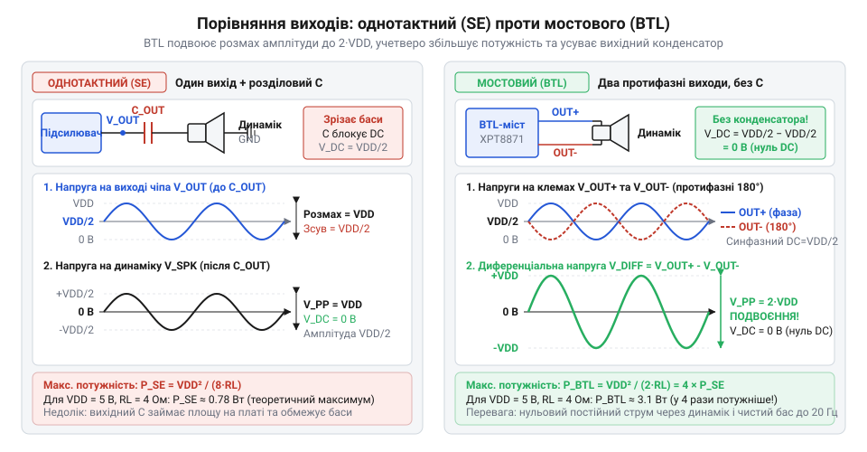
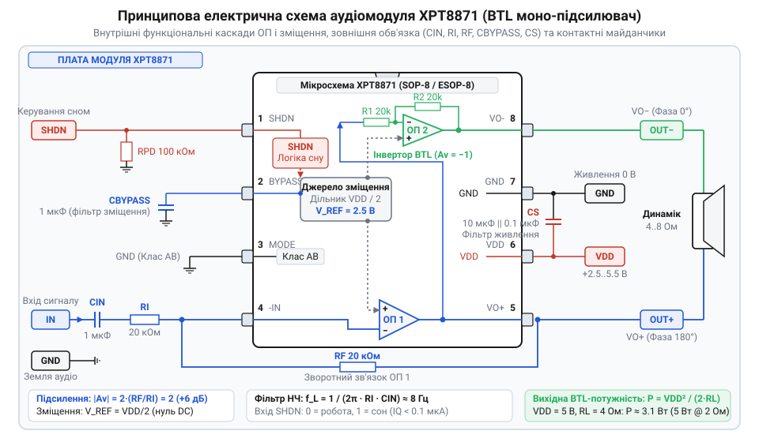
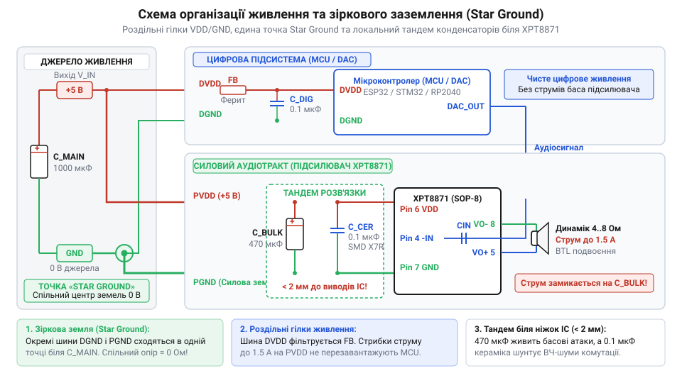
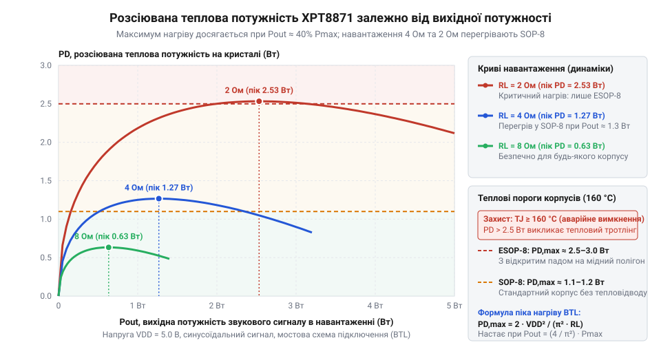
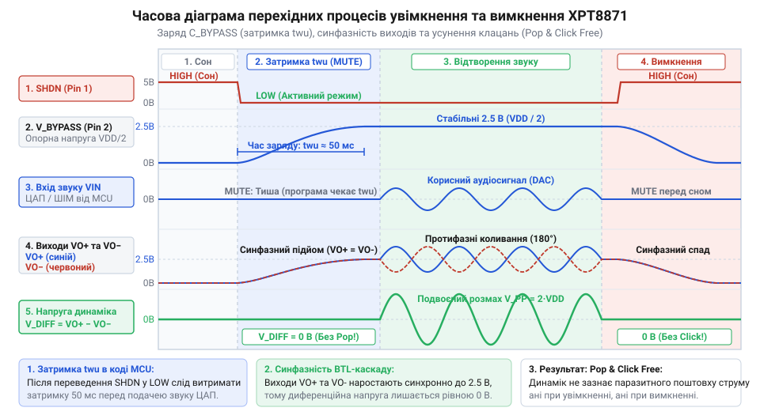
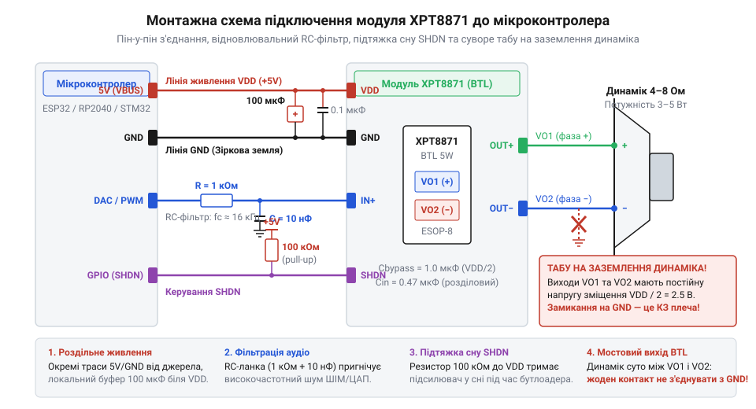
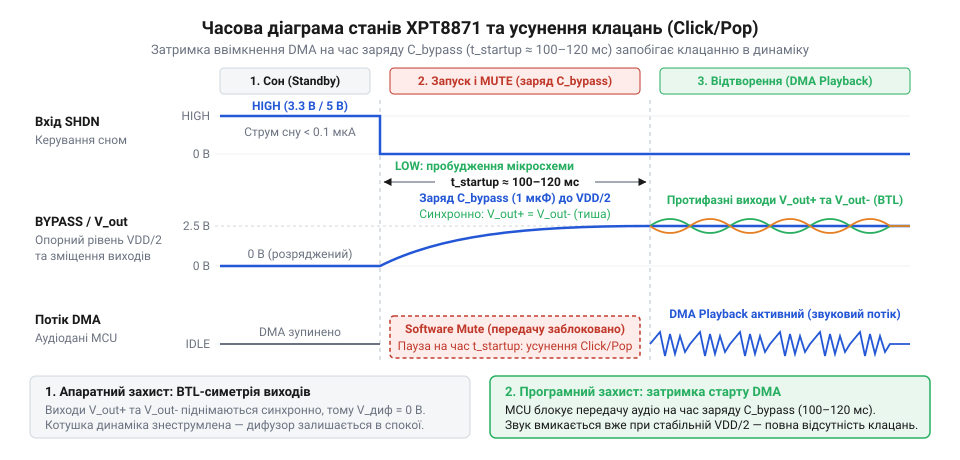
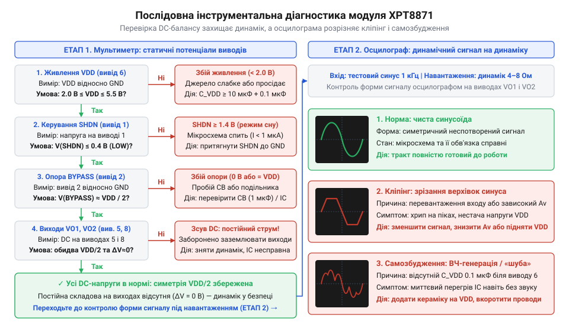

# XPT8871 — моно-підсилювач 5 Вт

<preknowlist>
- [Динаміки 5 Вт / 8 Ом](root:cat-hw-actuators/speakers-8ohm) — Будова та принцип роботи електродинамічного гучномовця, поняття номінального імпедансу котушки (4–8 Ом), допустимої теплової потужності та залежності споживаного струму від низького активного опору навантаження
</preknowlist>

## Чому динамік не можна підключати напряму до мікроконтролера

Спроба вивести звук із мікроконтролера безпосередньо на динамік — одна з найпоширеніших помилок початківців. Логіка здається простою: мікроконтролер уміє генерувати сигнал звукової частоти за допомогою широтно-імпульсної модуляції (ШІМ) або вбудованого цифро-аналогового перетворювача (ЦАП), а динамік створює звукові коливання за допомогою котушки та дифузора. Здавалося б, достатньо з'єднати вивід мікроконтролера з одним контактом динаміка, а другий контакт під'єднати до загальної землі. Проте таке з'єднання майже миттєво призводить до апаратного збою процесора або незворотного вигоряння напівпровідникового кристала.

Причина полягає у фундаментальній невідповідності електричного опору. Звичайний гучномовець має номінальний електричний імпеданс (лат. *impedire* — перешкоджати) котушки лише 4 або 8 Ом ([Будова та характеристики динаміків 8 Ом](root:cat-hw-actuators/speakers-8ohm)). За законом Ома сила електричного струму прямо пропорційна прикладеній напрузі та обернено пропорційна опору навантаження:

    I = U / R

Якщо цифровий вивід мікроконтролера з логічним рівнем живлення 5 В переходить у стан високого логічного рівня, через підключену звукову котушку опором 8 Ом намагається протікати струм:

    I = 5 В / 8 Ом = 0.625 А = 625 мА

Для динаміка з опором 4 Ом цей струм сягає вже 1.25 А. При живленні з напругою 3.3 В струм становить відповідно 412.5 мА та 825 мА.

Вихідний каскад універсального цифрового порту вводу-виводу (GPIO) мікроконтролера складається з пари крихітних комплементарних кремнієвих польових транзисторів. Їхні фізичні розміри розраховані на комутацію інформаційних сигналів із типовим струмом від 10 до 20 мА (і лише в окремих родинах процесорів короткочасно до 25–40 мА). Коли навантаження вимагає струм, що у 30–60 разів перевищує гранично допустимий поріг, виникає ланцюг руйнівних процесів:

1. **Падіння напруги на внутрішньому опорі каналів.** Відкритий польовий транзистор вихідного каскаду GPIO має власний опір каналу від 20 до 80 Ом. Разом із динаміком він утворює звичайний подільник напруги. Більша частина енергії живлення падає не на звуковій котушці, а на внутрішньому транзисторі кристала. Ця енергія перетворюється на тепло на площі у частки квадратного мікрона, викликаючи миттєвий локальний перегрів кремнію, деградацію p-n переходів і тепловий пробій вихідного каскаду.
2. **Просідання шини живлення та циклічне перезавантаження.** Джерело струму напівпровідникової плати не здатне миттєво віддати струм силою сотні міліампер через паразитні опори тонких провідників кристала та обмежену ємність розв'язувальних конденсаторів. Напруга на внутрішній шині живлення VDD мікроконтролера різко просідає нижче мінімального робочого рівня. Щойно напруга падає нижче встановленої межі, спрацьовує вбудована апаратна схема захисту від зниження напруги — детектор просідання живлення (англ. @@en|Brown-Out Reset@@, скорочено *BOR*, від англ. *brownout* — спад напруги; детальніше роботу компаратора живлення описує [Схема моніторингу шини живлення BOR](root:hw-arch/mcu-brownout-reset)). Контролер аварійно скидає регістри та йде на перезавантаження. Після перезапуску програма знову ініціалізує вивід і намагається подати сигнал у динамік, що спричиняє чергове просідання живлення. Пристрій впадає в нескінченний цикл аварійного перезапуску (англ. @@en|bootloop@@), що супроводжується глухими клацаннями або свистом.

Не менш руйнівним цей процес є і для самого динаміка. Гучномовець розрахований на роботу виключно зі змінним струмом, який змушує звукову котушку рухатися вперед і назад від центральної точки рівноваги ([Електродинамічний гучномовець як навантаження аудіопідсилювача](root:cat-hw-actuators/audio-amp-xpt8871/comp-dynamic-speaker.md)). Вихід ЦАП мікроконтролера або згладжений ШІМ-сигнал має однополярний характер: робоча середня точка синусоїдального сигналу зміщена відносно землі на постійну напругу величиною в половину амплітуди живлення (VDD / 2), тобто на 1.65 В або 2.5 В.

Цей постійний потенціал зміщення (англ. @@en|DC offset@@) створює в котушці постійний струм. Оскільки постійний струм не змінює свого напрямку, він не створює звукових хвиль, а лише висуває дифузор у крайнє положення й жорстко блокує його механічний рух. Будь-які корисні коливання сигналу відтворюються з катастрофічним спотворенням (кліпінгом). При цьому вся потужність постійного струму витрачається на розігрів тонкого мідного дроту котушки:

    P_DC = U_DC² / R = (2.5 В)² / 8 Ом = 6.25 / 8 ≈ 0.78 Вт

Для компактного динаміка з номінальною потужністю 0.5–1 Вт безперервне виділення майже 1 Вт тепла на нерухомій котушці призводить до розм'якшення ізоляційного лаку, міжвиткового замикання та спікання дроту.

Спроба розв'язати проблему підсилення струму найпростішим шляхом — додаванням одного біполярного транзистора або польового транзистора (MOSFET) за схемою силового ключа — виявляється безпорадною для аналогового аудіотракту. Однотранзисторні ключі ідеально підходять лише для збудження пасивних чи активних п'єзоелектричних зумерів ([Пасивний зумер KY-006](root:cat-hw-actuators/ky-006-buzzer), [Електромагнітні та п'єзоелектричні випромінювачі](root:cat-hw-actuators/buzzer-standalone)), де мембрану розгойдують дискретними імпульсами максимальної шпаруватості без вимог до якості звуку. Для чистого аналогового сигналу один транзистор може тягнути струм лише в один бік. Щоб відтворити повну звукову хвилю, такий каскад довелося б загнати в лінійний режим із величезним постійним струмом спокою (однотактний клас A), що спричиняє низький коефіцієнт корисної дії (менше 20%) і сильне нагрівання деталей.

Таким чином, для підключення динаміка потрібен спеціалізований монолітний аудіопідсилювач потужності ([Інтегральні аудіопідсилювачі низької напруги](root:cat-hw-actuators/audio-amp-xpt8871/comp-audio-power-amplifier.md)), побудований за двотактною схемою: він живиться від однополярного джерела, віддає в навантаження струми понад 1 А без участі виводів процесора та ізолює звукову котушку від небезпечної постійної складової струму.

## Мостова топологія виходу (BTL) як спосіб отримати потужність до 5 Вт без вихідного конденсатора

Класичний спосіб увімкнення динаміка в підсилювачах з однополярним живленням називається однотактним (англ. @@en|Single-Ended@@, скорочено *SE*). У такій схемі один висновок динаміка під'єднують до виходу підсилювача, а другий — до шини заземлення GND. Оскільки живлення схеми однополярне (наприклад, +5 В), вихідний каскад підсилювача у стані спокою підтримує на своєму виході постійну напругу, що дорівнює половині напруги живлення:

    V_bias = VDD / 2 = 2.5 В

Це зміщення необхідне для того, щоб змінний аудіосигнал міг симетрично відхилятися як угору (до напруги шини живлення VDD), так і вниз (до потенціалу землі). Якщо підключити динамік між таким виходом і землею безпосередньо, постійна напруга 2.5 В викличе протікання постійного струму силою сотні міліампер, що призведе до перегріву та вигоряння звукової котушки.

Щоб відсікти постійну складову в однотактній схемі, послідовно з динаміком обов'язково встановлюють розділовий електролітичний конденсатор (лат. *condensare* — згущувати). Проте в компактних вбудованих пристроях цей підхід створює два нездоланні бар'єри:

1. **Громіздкі габарити розділового конденсатора.** Розділовий конденсатор C_out та опір звукової котушки R_L утворюють фільтр високих частот першого порядку. Нижня частота зрізу цього фільтра, починаючи з якої підсилювач починає завалювати низькі частоти (баси), визначається співвідношенням:

    f_c = 1 / (2 · π · R_L · C_out)

    Для динаміка з низьким опором R_L = 4 Ом, щоб зберегти нижню граничну частоту відтворення звуку хоча б на рівні 100 Гц, необхідна ємність:

    C_out ≥ 1 / (2 · π · 4 Ом · 100 Гц) ≈ 398 мкФ

    На практиці розробнику доводиться встановлювати електролітичний конденсатор номіналом 470 або 1000 мкФ. Цей компонент має висоту до 12 мм і діаметр до 10 мм, важить більше за мікросхему підсилювача, збільшує паразитний послідовний опір (ESR) і поступово втрачає ємність у міру висихання електроліту.
2. **Жорстке обмеження вихідної потужності.** При живленні 5 В амплітуда (лат. *amplitudo* — просторість, величина) змінної напруги на навантаженні в однотактному підсилювачі фізично не може перевищити половину напруги живлення:

    V_pk_SE ≤ VDD / 2 = 2.5 В

    З урахуванням напруги насичення вихідних транзисторів реальний розмах напруги є ще меншим (близько 2.0–2.2 В). Обчислимо максимальну вихідну потужність однотактного каскаду для синусоїдального сигналу:

    P_SE = V_rms² / R_L
         = (V_pk_SE / √2)² / R_L      [зв'язок діючої напруги з піковою]
         = (VDD / (2 · √2))² / R_L    [максимальна однотактна амплітуда VDD / 2]
         = VDD² / (8 · R_L)           [піднесення до квадрата]

    Для живлення VDD = 5 В та динаміка R_L = 8 Ом теоретична потужність становить лише:

    P_SE = 5² / (8 · 8) = 25 / 64 ≈ 0.39 Вт

    На практиці через втрати на вихідних ключах корисна потужність ледь досягає 0.2–0.3 Вт. Для гучного відтворення голосу чи звукових ефектів цього недостатньо.

Виходом із цього глухого кута є мостова топологія виходу (грец. *topos* — місце, *logos* — вчення), відома як BTL (англ. @@en|Bridge-Tied Load@@ — навантаження, увімкнене в міст, від англ. *bridge* — міст, *tie* — зв'язувати, *load* — навантаження; детальніше див. [Мостова архітектура підсилювачів звуку BTL](root:hw-analog/btl-audio-architecture)).

> 🔧 **Навіщо це.** Мостова топологія BTL дозволяє портативній електроніці з низьковольтним однополярним живленням (від 3.3 до 5 В) розвивати високу акустичну потужність до 3–5 Вт без підвищувальних імпульсних перетворювачів напруги та без масивних вихідних конденсаторів. Динамік підключається безпосередньо до вихідних клем мікросхеми, заощаджуючи місце на друкованій платі й забезпечуючи рівномірне відтворення низьких частот без фазових спотворень.

Замість одного вихідного каскаду в мостовій мікросхемі розміщено два окремі підсилювачі потужності. Динамік підключається не між виходом і землею, а між двома виходами підсилювача — виводом VO1 та виводом VO2. Перший підсилювач приймає вхідний аудіосигнал і формує вихідну напругу VO1. Другий підсилювач увімкнений як інвертор (лат. *invertere* — перевертати, обертати) з коефіцієнтом передачі -1. Він бере сигнал із виходу першого підсилювача і видає на клему VO2 абсолютно таку саму за формою напругу, але дзеркально зсунуту за фазою (грец. *phasis* — поява) на 180 градусів.


*Порівняння однотактного виходу з мостовим виходом BTL: в однотактній схемі розмах змінної напруги обмежений половиною шини живлення і вимагає розділового конденсатора, тоді як мостова конфігурація забезпечує подвоєний диференціальний розмах 2·VDD і нульовий постійний зсув на динаміку.*

Така побудова дає два вирішальні фізичні ефекти:

1. **Повна відсутність постійної напруги на навантаженні.** У стані спокою за відсутності корисного аудіосигналу на обох виходах VO1 та VO2 встановлюється однаковий постійний потенціал зміщення половини напруги живлення:

    VO1_bias = VO2_bias = VDD / 2

    Різниця потенціалів між виводами динаміка становить:

    V_diff_bias = VO1_bias - VO2_bias = (VDD / 2) - (VDD / 2) = 0 В

    Оскільки постійна напруга між клемами динаміка дорівнює нулю, постійний струм через звукову котушку не протікає зовсім. Котушка залишається у спокої в центрі магнітного зазору, не нагріваючись і не зазнаючи паразитного механічного зміщення. Потреба у важкому, габаритному та дорогому розділовому конденсаторі повністю зникає — котушка динаміка з'єднується з виходами мікросхеми безпосередньо.
2. **Подвоєння амплітуди змінної напруги та чотирикратний приріст потужності.** Коли на виході першого підсилювача VO1 напруга сягає позитивного піку й наближається до шини живлення (+VDD), напруга на виході другого інвертувального підсилювача VO2 одночасно опускається до мінімуму — потенціалу землі (0 В). Диференціальна (лат. *differentia* — різниця) напруга на динаміку дорівнює:

    V_diff_max = VO1 - VO2 = VDD - 0 = +VDD

    У протилежний півперіод вихід VO1 опускається до 0 В, тоді як вихід VO2 піднімається до +VDD:

    V_diff_min = VO1 - VO2 = 0 - VDD = -VDD

    Повний розмах коливань напруги від піка до піка (англ. @@en|peak-to-peak@@) на клемах гучномовця становить:

    V_pp_BTL = V_diff_max - V_diff_min = (+VDD) - (-VDD) = 2 · VDD

    Амплітудне значення диференціальної змінної напруги на навантаженні тепер дорівнює повній напрузі живлення V_pk_BTL = VDD, що вдвічі більше за максимальну амплітуду однотактного каскаду (VDD / 2).

Оскільки потужність електричного струму пропорційна квадрату напруги, подвоєння амплітуди напруги забезпечує чотирикратний приріст вихідної потужності при незмінній напрузі живлення VDD ([Математичний розрахунок мостової схеми BTL, потужності та підсилення](root:cat-hw-actuators/audio-amp-xpt8871/math-btl-power-and-gain.md)):

    P_BTL = V_rms_BTL² / R_L
          = (V_pk_BTL / √2)² / R_L   [зв'язок діючої напруги з піковою]
          = (VDD / √2)² / R_L        [диференціальна амплітуда V_pk_BTL = VDD]
          = VDD² / (2 · R_L)         [піднесення до квадрата]
          = 4 · (VDD² / (8 · R_L))   [винесення спільного множника]
          = 4 · P_SE                 [чотирикратне зростання потужності]

Обчислимо вихідну потужність у мостовій схемі для напруги живлення VDD = 5 В:

- Для динаміка з імпедансом R_L = 8 Ом:

    P_BTL = 5² / (2 · 8) = 25 / 16 ≈ 1.56 Вт (проти 0.39 Вт у схемі SE)

- Для динаміка з імпедансом R_L = 4 Ом:

    P_BTL = 5² / (2 · 4) = 25 / 8 = 3.125 Вт (проти 0.78 Вт у схемі SE)

- Для низькоомного навантаження R_L = 2 Ом, на роботу з яким розрахована мікросхема XPT8871:

    P_BTL = 5² / (2 · 2) = 25 / 4 = 6.25 Вт

На практиці частина напруги падає на внутрішньому опорі відкритих польових транзисторів вихідного каскаду мікросхеми, тому реальна чиста потужність при коефіцієнті гармонійних спотворень THD = 1% становить близько 2.0–2.5 Вт на навантаженні 4 Ом і досягає 5 Вт на навантаженні 2 Ом при допустимому рівні спотворень THD = 10%.

Мостова топологія вивела портативні аудіопристрої на новий рівень у 1990-х роках, коли компанія National Semiconductor створила серію Boomer із мікросхемами LM4861 та LM4871 у крихітному 8-вивідному корпусі SOIC ([Еволюція низьковольтних BTL-підсилювачів від Boomer до XPT8871](root:cat-hw-actuators/audio-amp-xpt8871/hist-low-voltage-btl-amps.md)). Сучасний підсилювач XPT8871 розвиває цей підхід: завдяки покращеним вихідним транзисторам і корпусу ESOP-8 із металевою тепловідвідною пластиною ([Одноканальні мостові підсилювачі родини 8871/4871](root:cat-hw-actuators/audio-amp-xpt8871)) мікросхема працює в аналоговому класі AB ([Підсилювачі потужності класу AB](root:hw-analog/class-ab-audio-amplifier)), гарантуючи повну відсутність високочастотних електромагнітних завад і здатність тривало віддавати в навантаження струми до 2 А.

> [!CAUTION]
> **Категорична заборона заземлення виводів динаміка в мостовій схемі (BTL)**
> 
> У стандартних аудіороз'ємах (наприклад, mini-jack 3.5 мм для навушників) спільний дріт динаміків завжди з'єднаний із шиною заземлення GND. Через цю звичку розробники іноді намагаються під'єднати «мінусовий» контакт динаміка BTL-підсилювача до спільної землі плати, металевого корпусу або екрана кабелю.
> 
> Робити це категорично заборонено! Вивід VO2 — це активний вихід аналогового підсилювача потужності, на якому в стані спокою присутня постійна напруга VDD / 2 (2.5 В), а під час звучання — потужний змінний сигнал. З'єднання клеми VO2 або VO1 із шиною GND створює пряме коротке замикання верхнього транзистора вихідного каскаду на землю. Крізь кристал миттєво тече руйнівний струм силою кілька ампер, що призводить до негайного теплового пробою напівпровідникової структури та вигоряння мікросхеми. Обидва контакти динаміка мають підключатися виключно до виводів VO1 та VO2 і бути повністю ізольованими від загального проводу схеми.

## Внутрішня структура мікросхеми XPT8871 та принципова схема модуля

Побудова мостового підсилювача звукової частоти на дискретних компонентах вимагає узгоджених пар транзисторів, точних резисторів зворотного зв'язку та стабільного джерела зміщення, що займає значну площу на друкованій платі. Цю задачу вирішує монолітна інтегральна мікросхема (від грецького @@el|monolithos@@ — суцільний камінь та латинського @@la|integrare@@ — поєднувати) XPT8871, яка об'єднує всі активні вузли [мостової топології BTL](root:hw-analog/btl-audio-architecture) в компактному 8-вивідному корпусі SOP-8 або ESOP-8 з відкритим металевим майданчиком @@en|Exposed Pad@@. Мікросхема належить до [сімейства одноканальних мостових підсилювачів 8871/4871](root:cat-hw-actuators/audio-amp-xpt8871), започаткованого класичною [еволюцією низьковольтних підсилювачів Boomer](root:cat-hw-actuators/audio-amp-xpt8871/hist-low-voltage-btl-amps.md), і втілює в кремнії класичний [підсилювач класу AB](root:hw-analog/class-ab-audio-amplifier).

Усередині кристала реалізовано чотири основні функціональні блоки, взаємодія яких забезпечує підсилення сигналу та захист аудіотракту:

1. **Перший операційний підсилювач (ОП1).** Вхідний каскад підсилювача потужності (від латинського @@la|amplificare@@ — збільшувати, розширювати) зібрано за інвертувальною схемою. Його неінвертувальний вхід усередині мікросхеми жорстко під'єднано до внутрішньої лінії опорної напруги зміщення `VDD / 2`. Інвертувальний вхід виведено назовні як вивід `IN-`. Сигнал від джерела подається через вхідний резистор `R_I`, а між виходом `VO1` та входом `IN-` вмикається зовнішній резистор негативного зворотного зв'язку `R_F`. Коефіцієнт підсилення цього каскаду повністю визначається відношенням цих двох опорів.
2. **Другий операційний підсилювач (ОП2).** Служить інвертором з фіксованим одиничним коефіцієнтом передачі -1. Його неінвертувальний вхід також живиться опорною напругою `VDD / 2`. Інвертувальний вхід з'єднано з виходом першого підсилювача `VO1` через два внутрішні тонкоплівкові резистори однакового опору (зазвичай 20 кОм), підігнані лазером на етапі виробництва кристала. Сигнал на виході `VO2` повторює форму сигналу `VO1`, але повернутий за фазою рівно на 180°. Коли напруга на `VO1` зростає відносно віртуальної середньої точки, напруга на `VO2` дзеркально зменшується на таку саму величину.
3. **Джерело опорного зміщення та віртуальна земля (BYPASS).** При однополярному живленні без двополярного джерела робоча точка аудіосигналу має лежати посередині між нулем і напругою живлення, інакше негативна напівхвиля зріжеться на рівні землі. Внутрішній резистивний подільник формує потенціал рівно `VDD / 2` — [штучну середню точку та віртуальну землю](root:hw-analog/op-amp-virtual-ground) (від латинського @@la|virtualis@@ — можливий, потенційний). Щоб пульсації живлення та перешкоди цифрових кіл не проникали на внутрішні входи підсилювача, середня точка виведена на контакт `BYPASS`, куди підключається зовнішній блокувальний конденсатор `C_BYPASS`. Цей самий конденсатор визначає час плавного зростання внутрішньої напруги під час увімкнення, що запобігає появі перехідного акустичного щиглика (@@en|pop@@).
4. **Логіка керування вимкненням (SHDN).** Вузол @@en|shutdown@@ (від англійського @@en|shutdown@@ — зупинка, вимкнення) керує внутрішніми джерелами стабільного струму зміщення. Подання на вивід `SHDN` напруги високого логічного рівня блокує струми зміщення вхідних диференційних пар і вихідних драйверів. Обидва виходи `VO1` та `VO2` переходять у високоімпедансний стан (@@en|Hi-Z@@, від латинського @@la|impedire@@ — перешкоджати), а струм споживання мікросхеми падає нижче 1 мкА. Низький рівень або замикання виводу на землю активує підсилювач.

Цоколівка мікросхеми в стандартному 8-вивідному корпусі SOP-8 та модифікації з тепловідводом ESOP-8 має фіксований функціональний розподіл, детально задокументований у [довіднику апаратних параметрів та цоколівки XPT8871](root:cat-hw-actuators/audio-amp-xpt8871/api-xpt8871-hardware.md):

* **Вивід 1 (`SHDN`)** — вхід переведення підсилювача в енергоощадний режим очікування (активний високий рівень).
* **Вивід 2 (`BYPASS`)** — фільтрація внутрішньої опорної напруги зміщення `VDD / 2`.
* **Вивід 3 (`IN+`)** — прямий (неінвертувальний) вхід першого підсилювача або опорний контакт для симетричного входу.
* **Вивід 4 (`IN-`)** — інвертувальний вхід першого підсилювача для подачі аудіосигналу.
* **Вивід 5 (`VO1`)** — перший вихід мостового каскаду BTL.
* **Вивід 6 (`VDD`)** — шина позитивного живлення з робочим діапазоном від 2.0 до 5.5 В.
* **Вивід 7 (`GND`)** — загальний вивід живлення та сигнальної землі.
* **Вивід 8 (`VO2`)** — другий вихід мостового каскаду BTL, що працює в протифазі до `VO1`.
* **Тепловідвідний майданчик (`Exposed Pad`)** — металева підкладка на нижньому боці корпусу ESOP-8. Електрично з'єднана з підкладкою кристала та контактом `GND`. Її обов'язково розпаюють на мідний полігон друкованої плати для відведення тепла, що генерується вихідними каскадами [монолітних аудіопідсилювачів низької напруги](root:cat-hw-actuators/audio-amp-xpt8871/comp-audio-power-amplifier.md).

Типовий модуль для макетування містить мінімальну пасивну обв'язку, необхідну для автономної роботи мікросхеми:


*Повна принципова електрична схема типового модуля XPT8871: внутрішні операційні підсилювачі ОП1 та ОП2, джерело зміщення BYPASS, вузол вимкнення SHDN та зовнішні пасивні компоненти обв'язки, що задають коефіцієнт підсилення, частотну смугу та стабільність живлення.*

Кожен зовнішній пасивний елемент на схемі модуля виконує суворо визначену функцію:

* **Вхідний розділовий конденсатор `C_IN`** — блокує постійну складову вхідного сигналу від джерела (ЦАП, вивід мікроконтролера чи аудіокодек). Завдяки йому потенціал на виводі `IN-` формується виключно внутрішнім джерелом зміщення і дорівнює `VDD / 2`. Відсутність `C_IN` призвела б до зміщення робочої точки, виникнення постійного струму через динамік і миттєвого входу підсилювача в насичення.
* **Вхідний резистор `R_I`** — визначає активний вхідний опір модуля для змінного аудіосигналу та разом із `R_F` встановлює коефіцієнт передачі напруги першого каскаду.
* **Резистор зворотного зв'язку `R_F`** — забезпечує від'ємний зворотний зв'язок між виходом `VO1` та інвертувальним входом `IN-`, стабілізуючи підсилення та знижуючи нелінійні спотворення тракту.
* **Блокувальний конденсатор `C_BYPASS`** — приєднується між виводом 2 та шиною `GND`. Він фільтрує шуми внутрішнього дільника напруги `VDD / 2`, усуває паразитний свист і забезпечує плавне, повільне наростання напруги зміщення під час подачі живлення.
* **Фільтрувальні конденсатори живлення `C_S`** — паралельне з'єднання керамічного конденсатора ємністю 0.1 мкФ і танталового або електролітичного конденсатора ємністю 10–100 мкФ безпосередньо біля виводів 6 (`VDD`) та 7 (`GND`). Кераміка шунтує високочастотні наведення, а електроліт компенсує миттєві пікові просідання струму до 1.5 А, які споживає вихідний каскад під час гучних ударів звуку.

> 🔧 **Навіщо це.**
> Розуміння ролі окремих елементів обв'язки дозволяє адаптувати дешевий фабричний модуль під конкретне джерело без заміни плати: якщо звук спотворюється через завелику амплітуду ЦАП, достатньо збільшити опір `R_I` чи зменшити `R_F`; якщо динамік видає неприємний удар під час подачі живлення, збільшення ємності `C_BYPASS` подовжує час м'якого заряду опорного вузла й усуває щиглик.

## Розрахунок коефіцієнта підсилення, частотного діапазону та узгодження входу

У мостовій конфігурації BTL навантаження підключається між виходами двох протифазних операційних підсилювачів, тому коефіцієнт підсилення за напругою (від латинського @@la|coefficiens@@ — той, що сприяє) відрізняється від класичного інвертувального каскаду рівно вдвічі.

Перший операційний підсилювач ОП1 інвертує вхідну напругу `V_IN` відносно віртуальної середньої точки `VDD / 2` з коефіцієнтом, який задають резистори `R_I` та `R_F`:

```
V_O1 = - (R_F / R_I) · V_IN
```

Другий операційний підсилювач ОП2 отримує напругу `V_O1` і виконує додаткове інвертування з фіксованим одиничним коефіцієнтом:

```
V_O2 = - V_O1 = + (R_F / R_I) · V_IN
```

Диференціальна напруга `V_OUT(diff)` на клемах підключеного динаміка є різницею потенціалів між цими двома виходами:

```
A_v = V_OUT(diff) / V_IN
    = (V_O1 - V_O2) / V_IN                                    [визначення різниці напруг мостового виходу]
    = (- (R_F / R_I) · V_IN - (R_F / R_I) · V_IN) / V_IN      [підстановка вихідних напруг обох плечей]
    = - 2 · (R_F / R_I)                                       [спрощення та скорочення на амплітуду V_IN]
```

Знак «мінус» відображає лише загальну інверсію початкової фази звукової хвилі. Модуль диференціального коефіцієнта підсилення за напругою `A_v` дорівнює:

```
A_v = 2 · (R_F / R_I)
```

Множник 2 є прямим математичним наслідком мостового ввімкнення навантаження, детально виведеним у [розрахунку потужності й коефіцієнта підсилення BTL](root:cat-hw-actuators/audio-amp-xpt8871/math-btl-power-and-gain.md). У логарифмічних одиницях (децибелах, від латинського @@la|decimus@@ — десятий та прізвища винахідника @@en|Bell@@) коефіцієнт підсилення записується так:

```
A_v[дБ] = 20 · log₁₀(A_v) = 20 · log₁₀(2 · (R_F / R_I))
```

**Розрахунок коефіцієнта підсилення для типового модуля з номіналами R_I = 20 кОм та R_F = 40 кОм:**

```
A_v = 2 · (40 000 / 20 000)                                  [підстановка опорів R_F та R_I в Омах]
    = 2 · 2                                                   [відношення резисторів каскаду ОП1]
    = 4                                                       [лінійний коефіцієнт передачі напруги]

A_v[дБ] = 20 · log₁₀(4)                                       [переведення в логарифмічний масштаб]
        ≈ 20 · 0.60206                                        [значення десяткового логарифма]
        ≈ 12.04 дБ                                            [коефіцієнт підсилення в децибелах]
```

Коефіцієнт передачі `A_v = 4` означає, що амплітуда коливань на клемах динаміка вчетверо перевищує амплітуду сигналу на вході. Якщо на вхід подати синусоїду з амплітудою 1.0 В, диференціальна амплітуда на динаміку сягне 4.0 В. При живленні від `VDD = 5.0 В` це безпечно вкладається в динамічний діапазон підсилювача. Проте якщо встановити завеликий опір `R_F` (наприклад, 100 кОм, що дає `A_v = 10`), розрахована вихідна напруга 10 В вийде далеко за межі шин живлення. Вихідні транзистори наситяться, спричиняючи жорсткий [кліпінг та нелінійні спотворення](root:hw-analog/audio-clipping-and-saturation) (від англійського @@en|clipping@@ — обрізання). Верхівки синусоїди зріжуться в постійну напругу, звук почне різко хрипіти, а підвищений середній струм спричинить перегрів звукової котушки [динаміка на 5 Вт](root:cat-hw-actuators/speakers-8ohm).

Вхідне коло підсилювача визначає також діапазон відтворюваних частот. Вхідний розділовий конденсатор `C_IN` та вхідний резистор `R_I` утворюють пасивний фільтр верхніх частот першого порядку (від латинського @@la|filtrum@@ — повсть, цідилко). Нижня гранична частота зрізу `f_c` за рівнем спаду амплітуди на -3 дБ (що відповідає падінню вихідної потужності вдвічі) обчислюється за формулою:

```
f_c = 1 / (2 · π · R_I · C_IN)
```

Сигнали з частотами нижче `f_c` послаблюються зі швидкістю 20 дБ на декаду (6 дБ на октаву).

**Розрахунок частоти зрізу для значень R_I = 20 кОм та C_IN = 0.22 мкФ:**

```
f_c = 1 / (2 · π · 20 000 · 0.22 · 10⁻⁶)                     [підстановка величин у системних одиницях SI]
    = 1 / (2 · 3.14159 · 0.0044)                              [добуток опору, ємності та множника 2π]
    = 1 / 0.027646                                            [значення знаменника]
    ≈ 36.17 Гц                                                [нижня частота зрізу аудіотракту]
```

Значення `f_c ≈ 36 Гц` повністю перекриває чутний спектр частот. Проте намагання поставити розділовий конденсатор ще більшої ємності (наприклад, 1–10 мкФ) для «максимального басу» веде до двох серйозних проблем:

1. **Акустичне перевантаження малогабаритного дифузора.** Компактні електродинамічні випромінювачі діаметром 40–50 мм фізично не здатні випромінювати хвилі довжиною понад кілька метрів через механічні обмеження підвісу та малий об'єм повітря (це детально пояснює аналіз [будови електродинамічного гучномовця](root:cat-hw-actuators/audio-amp-xpt8871/comp-dynamic-speaker.md)). Подання інфразвуку викликає великий розмах коливань дифузора без створення чутного звуку, вибиває котушку з лінійної зони магнітного зазору та створює паразитні інтермодуляційні спотворення.
2. **Акустичні щиглики при переході в активний стан.** Постійна часу заряду вхідного кола дорівнює `τ = R_I · C_IN`. Чим більша ємність `C_IN`, тим довше триває заряджання до потенціалу `VDD / 2`. Небаланс напруги на диференційних входах під час перехідного процесу транслюється у вихідний сплеск струму через динамік. Грамотне проектування вимагає узгодження часу заряду входу з роботою джерела опорної напруги за правилами [придушення перехідних клацань в аудіотрактах](root:hw-analog/audio-pop-click-suppression). Для компактних мовних динаміків частоту `f_c` доцільно піднімати до 100–150 Гц, обираючи `C_IN = 0.047–0.1 мкФ`.

Схема підключення джерела звуку до XPT8871 обирається залежно від типу аналогового виходу керуючої електроніки:

* **Несиметричне підключення (@@en|single-ended@@).** Застосовується під час зняття звуку з однополярного ЦАП або контакту ШІМ мікроконтролера, оснащеного [відновлювальним фільтром ШІМ-аудіосигналу](root:hw-analog/pwm-audio-reconstruction-filter). Звуковий сигнал подається на вхід `IN-` через коло `C_IN` та `R_I`. Якщо між джерелом і входом каскаду встановлюється [апаратний регулятор гучності на потенціометрі](root:hw-analog/analog-potentiometer-volume-control), вихідний опір дільника додається до `R_I`, що вимагає узгодження імпедансів для збереження розрахованого підсилення та частотної смуги. Прямий вхід `IN+` не можна лишати відкритим: його підключають до землі через ідентичний ланцюг `C_IN2 = C_IN` та `R_I2 = R_I`, або шунтують безпосередньо на вивід `BYPASS`. Це забезпечує симетрію вхідного імпедансу для синфазних перешкод і балансує постійні струми зміщення. Недоліком несиметричної лінії є висока чутливість до пульсацій живлення процесора та перешкод у спільній землі (див. [правила захисту від земляних петель та трасування аудіосигналів](root:hw-pcb/audio-pcb-grounding-and-loops)).
* **Повноцінне диференційне підключення (@@en|fully differential@@).** Використовується при роботі з зовнішніми аудіокодеками або Bluetooth-модулями, як показано у практичній [побудові диференційного аудіотракту](root:cat-hw-actuators/audio-amp-xpt8871/proj-differential-audio-receiver.md). Сигнал подається у вигляді двох взаємно протифазних напруг на входи `IN+` та `IN-` через два однакові RC-ланцюги з точністю резисторів 1%. Головна перевага диференційного тракту — високий коефіцієнт придушення синфазного сигналу (@@en|Common-Mode Rejection Ratio@@, CMRR, де латинське @@la|communis@@ — спільний та @@la|rejicere@@ — відкидати). Електромагнітні завади від радіотракту Wi-Fi чи імпульсних стабілізаторів наводяться на обидва дроти з однаковою амплітудою і фазою, а вхідний каскад підсилювача підсилює лише різницю напруг, повністю віднімаючи наведений шум.

> 🔧 **Навіщо це.**
> Розрахунок номіналів `R_I` та `C_IN` під конкретну акустичну задачу усуває перевантаження підсилювача й надмірний нагрів котушки динаміка інфразвуковими коливаннями. Вибір симетричного підключення дозволяє отримати кришталево чистий звук навіть при розміщенні підсилювача поруч із потужними антенами бездротового зв'язку чи імпульсними перетворювачами напруги.

## Фільтрація живлення, імпульсні струми та захист від проникнення цифрових перешкод

Низькоомний електродинамічний гучномовець є агресивним споживачем електричного струму. Коли підсилювач розгойдує звукову котушку опором 2–4 Ом на повній гучності, піковий струм споживання в мостовій схемі сягає 1,2–1,5 А за частки мілісекунди. Якщо пристрій — мікроконтролер, бездротовий модуль та аудіопідсилювач — живиться від спільної шини 5 В або 3,3 В без спеціальних розв'язувальних кіл, такі імпульси струму (від латинського *impulsus* — поштовх, удар) миттєво руйнують стабільність усієї системи.

Будь-який реальний провідник, доріжка друкованої плати чи з'єднувальний дріт макетної плати має власний опір `R` та розподілену індуктивність (від латинського *inductio* — наведення, збудження) `L`. Стрибок струму `ΔI` за короткий проміжок часу `Δt` викликає на лінії живлення динамічне падіння напруги:

    ΔV = I · R + L · (ΔI / Δt)

Навіть за незначного активного опору доріжки у 0,2 Ом та індуктивності з'єднувальних дротів комутація струму силою 1,5 А породжує імпульсне просідання напруги на 0,3–1,0 В. Якщо напруга живлення мікроконтролера короткочасно падає нижче критичного порогу, спрацьовує апаратний супервізор живлення — схема @@en|Brown-Out Reset@@ (BOR, від англійського *brownout* — часткове падіння напруги в електромережі, та *reset* — скидання). Процесор розцінює це як аварію живлення й миттєво перезавантажується. Виникає замкнене коло: мікроконтролер запускається, ініціалізує виведення аудіосигналу, перший же басовий сплеск викликає стрибок струму до 1,5 А, шина живлення просідає, мікроконтролер скидається, звук обривається, живлення відновлюється, і цикл починається знову. Замість відтворення звуку динамік видає лише ритмічне клацання з частотою перезавантаження процесора.

Зворотна загроза полягає в проникненні цифрових шумів у звуковий тракт. Високочастотне перемикання транзисторів ядра мікроконтролера, робота шин обміну даними та пакетні імпульси передавача Wi-Fi або Bluetooth (струмові сплески до 300–400 мА) генерують у спільній шині живлення високочастотні пульсації (від латинського *pulsus* — удар, поштовх).
Хоча диференційний підсилювач має вбудовану здатність відхиляти коливання напруги живлення — коефіцієнт придушення пульсацій живлення @@en|power supply rejection ratio@@ (PSRR, від латинського *reicere* — відкидати), ця характеристика є частотно-залежною. На низьких частотах (до 200 Гц) PSRR мікросхеми XPT8871 сягає 60 дБ (послаблення завади в 1000 разів), проте на частотах понад 10 кГц ефективність придушення різко падає до 20–30 дБ. Високочастотні перешкоди комутації цифрових виводів та обвідні радіочастотних пакетів безперешкодно проходять крізь внутрішні ланцюги зміщення на виходи динаміка. Користувач чує в гучномовці безперервний високочастотний писк, фонове шипіння або характерне тріскотіння в моменти активності радіоканалу, навіть коли звуковий потік зупинено.

Для захисту звукового тракту від імпульсних просідань і високочастотних шумів застосовують декуплінг (від англійського *decoupling* — роз'єднання, розв'язка). Жоден одиночний конденсатор не здатен розв'язати обидві проблеми одночасно через наявність паразитних параметрів реальних компонентів: еквівалентного послідовного опору (@@en|equivalent series resistance@@, ESR) та еквівалентної послідовної індуктивності (@@en|equivalent series inductance@@, ESL). Ефективний фільтр живлення підсилювача завжди будується як злагоджений тандем двох конденсаторів різного типу, встановлених безпосередньо біля виводів `VDD` і `GND` мікросхеми:

1. Накопичувальний електролітичний або танталовий конденсатор ємністю 100–470 мкФ. Він працює як локальний резервуар електричного заряду. Коли динамік потребує різкого сплеску струму, цей струм віддається обкладками накопичувального конденсатора, минаючи довгі підвідні проводи живлення. Це утримує постійний рівень напруги на шині й усуває просідання напруги мікроконтролера. Однак через рулонну конструкцію електролітичний конденсатор має високий ESR та власну індуктивність виводів, тому він не реагує на високочастотні імпульси.
2. Керамічний конденсатор ємністю 0,1 мкФ (100 нФ) із діелектриком X7R або NP0. Багатошарова монолітна структура кераміки забезпечує мінімальні значення ESR (одиниці міліомів) та індуктивності. Цей конденсатор працює як високочастотний шунт (від англійського *shunt* — відгалуження, обхідний шлях), замикаючи мегагерцові перешкоди від перемикання цифрових кіл на землю в точці їхнього виникнення і не пропускаючи їх у кристал підсилювача.

Навіть за ідеального підбору конденсаторів звук може бути зіпсований паразитною земляною петлею (@@en|ground loop@@, від праслов'янського *petľa* — кільце, замкнений контур). Фізику виникнення паразитного контуру крізь паразитні ємності та спільні опори детально розкрито в статті [земляні петлі та трасування аудіосигналів на платі](root:hw-pcb/audio-pcb-grounding-and-loops).
Якщо земляний провідник підсилювача з'єднаний із землею мікроконтролера послідовно («ланцюжком»), поворотний струм динаміка силою до 1,5 А протікає через спільну ділянку мідної доріжки. Падіння напруги, створене цим струмом на опорі доріжки, додається до вхідного аудіосигналу як хибна різниця потенціалів. Підсилювач багаторазово підсилює власне падіння напруги, що породжує самозбудження схеми — низькочастотне гудіння або характерний дрібний тріск.

Позбутися цієї проблеми дозволяє зіркова топологія (@@en|star ground@@). Силова земля підсилювача, земля мікроконтролера та аналогова земля джерела звуку розводяться незалежними провідниками й фізично з'єднуються лише в одній спільній точці — безпосередньо на мінусовому виводі буферного накопичувального конденсатора або на виході стабілізатора напруги. Аналогічно розділяються й позитивні лінії: лінія живлення підсилювача не повинна живити цифрові мікросхеми.


*Організація роздільних ліній живлення та зіркового заземлення в одній точці захищає мікроконтролер від імпульсних просідань напруги та запобігає проникненню цифрових завад у звуковий тракт.*

В автономних пристроях із живленням від одного літій-іонного акумулятора 1S Li-Ion або LiPo (номінальна напруга 3,7 В, робочий діапазон 3,0–4,2 В) шина живлення є безпосередньо спільною для радіомодуля та підсилювача. Внутрішній опір акумулятора разом із опором ключів плати захисту (BMS) становить 0,1–0,2 Ом. Під час активної роботи радіопередавача сплески струму викликають пульсації батарейної напруги з частотою повторення кадрів бездротового зв'язку.
Для розв'язки в лінію живлення підсилювача встановлюють LC-фільтр: силовий дросель (від німецького *Drossel* — обмежувач, глушник) індуктивністю 2,2–10 мкГн, розрахований на робочий струм не менше 1,5 А з низьким активним опором обмотки (менше 0,1 Ом), та вищезгаданий тандем конденсаторів. Індуктивність чинить опір швидким змінам струму, згладжуючи піки споживання та ізолюючи кристал підсилювача від високочастотного радіочастотного бруду. Практична реалізація такого вузла з LC-фільтрацією та диференційним аудіоприймачем наведена у вставці [proj-differential-audio-receiver](root:cat-hw-actuators/audio-amp-xpt8871/proj-differential-audio-receiver.md).

> 🔧 **Навіщо це.**
> Зіркове розведення провідників і встановлення тандему конденсаторів безпосередньо біля виводів підсилювача усувають неочевидні апаратні збої: циклічні скидання мікроконтролера за схемою Brown-Out Reset під час гучних басових звуків і неприємний високочастотний писк від роботи Wi-Fi або ШІМ-ліній у динаміку.

## Тепловий режим класу AB, розсіювана потужність та узгодження імпедансу динаміка

Аналогова лінійність підсилювача має свою теплову ціну. На відміну від імпульсних підсилювачів класу D, які модулюють сигнал у високочастотну послідовність прямокутних імпульсів із високим коефіцієнтом корисної дії (85–92 %), [підсилювачі потужності класу AB](root:hw-analog/class-ab-audio-amplifier) працюють у неперервному лінійному режимі. Вихідні транзистори мікросхеми діють як керовані активні опори, на яких падає надлишкова напруга живлення, не передана в котушку гучномовця.
Головна перевага класу AB — повна відсутність високочастотного електромагнітного випромінювання (EMI) та чистий аналоговий спектр без громіздких вихідних LC-фільтрів. Зворотний бік цієї чистоти — перетворення всієї непереданої в навантаження енергії на тепло безпосередньо на кремнієвому кристалі:

    PD = PS - Pout

де `PD` — потужність, що розсіюється кристалом у вигляді тепла, `PS` — повна потужність, споживана від джерела живлення, а `Pout` — корисна електрична потужність, виділена на динаміку.

Інтуїтивне припущення, ніби підсилювач гріється найсильніше на граничній гучності, для класу AB є хибним.
У режимі спокою за відсутності звукового сигналу струм спокою мікросхеми XPT8871 становить лише 6–8 мА, а тепловиділення не перевищує `5 В · 7 мА ≈ 35 мВт` — кристал лишається холодним.
У режимі глибокого перевантаження (кліпінгу), коли верхівки синусоїди зрізаються і сигнал наближається до прямокутного, вихідні транзистори більшу частину періоду перебувають у стані насичення (повністю відкриті). Падіння напруги на відкритих транзисторах мінімальне, майже вся напруга живлення прикладена до динаміка, а ефективність передачі енергії наближається до теоретичного максимуму.
Найважчий тепловий режим виникає на середньому рівні гучності. У цьому стані через вихідний каскад протікає значний струм навантаження, але на самих вихідних транзисторах водночас утримується велика різниця потенціалів.

Математично цей ефект для мостового виходу (BTL) описується залежністю від амплітуди вихідної диференціальної напруги `Vp` на динаміку з опором котушки `RL`.
Корисна потужність синусоїдального сигналу на навантаженні становить:

    Pout = Vp² / (2 · RL)

Середній струм, споживаний мостовою схемою від однополярного джерела живлення `VDD` за повний період коливань, дорівнює:

    Isupply_avg = (2 / π) · (Vp / RL)

Відповідно, повна потужність, споживана від джерела живлення, має вигляд:

    PS = VDD · Isupply_avg = (2 · VDD · Vp) / (π · RL)

Різниця між споживаною та корисною потужністю визначає потужність теплових втрат на кристалі:

    PD = [2 · VDD · Vp / (π · RL)] - [Vp² / (2 · RL)]

Щоб знайти амплітуду `Vp`, за якої нагрівання кристала досягає абсолютного максимуму, беруть першу похідну функції втрат `dPD / dVp` і прирівнюють її до нуля:

    dPD / dVp = [2 · VDD / (π · RL)] - [Vp / RL] = 0

Звідси амплітуда вихідної напруги точки максимального нагрівання дорівнює:

    Vp(max_heat) = (2 / π) · VDD ≈ 0.6366 · VDD

Підставивши знайдене значення амплітуди у вираз розсіюваної потужності, отримуємо формулу граничного тепловиділення мікросхеми:

```
PD(max)
= [2 · VDD · (2 · VDD / π) / (π · RL)] - [(2 · VDD / π)² / (2 · RL)]   [підстановка амплітуди пікового нагріву]
= [4 · VDD² / (π² · RL)] - [4 · VDD² / (2 · π² · RL)]                   [розкриття дужок і піднесення до квадрата]
= [4 · VDD² / (π² · RL)] - [2 · VDD² / (π² · RL)]                       [скорочення двійки у знаменнику]
= 2 · VDD² / (π² · RL)                                                  [віднімання однакових доданків]
```

Вихідна потужність, яка віддається в динамік у цій точці, точно дорівнює потужності теплових втрат: `Pout = 2 · VDD² / (π² · RL) = PD(max)`.
Якщо зіставити її з максимальною неспотвореною синусоїдальною потужністю `Pout(max) ≈ VDD² / (2 · RL)`, співвідношення показує точку перегину:

    Pout / Pout(max) = [2 · VDD² / (π² · RL)] / [VDD² / (2 · RL)] = 4 / π² ≈ 0.4053 (40,5 %)

Підсилювач класу AB виділяє максимальну кількість тепла саме тоді, коли вихідна потужність становить близько 40 % від граничної. Детальний математичний аналіз тепловтрат із графіками наведено у вставці [math-class-ab-thermal-dissipation](root:cat-hw-actuators/audio-amp-xpt8871/math-class-ab-thermal-dissipation.md).

Опір звукової котушки динаміка `RL` є головним чинником, що визначає величину теплового удару по кристалу.

**Розрахунок максимального виділення тепла для навантаження 2 Ом при живленні 5 В:**
```
PD(max_2Ω)
= 2 · 5² / (π² · 2)                                                     [підстановка напруги 5 В та опору 2 Ом]
= 50 / (9.8696 · 2)                                                     [обчислення чисельника і константи π²]
= 50 / 19.7392                                                          [перемноження величин у знаменнику]
≈ 2.53 Вт                                                               [гранична теплова потужність на кристалі]
```

**Розрахунок виділення тепла для динаміків 4 Ом та 8 Ом при напрузі 5 В:**
```
PD(max_4Ω)
= 50 / (9.8696 · 4)                                                     [підстановка опору навантаження 4 Ом]
≈ 1.27 Вт                                                               [теплова потужність для 4 Ом]

PD(max_8Ω)
= 50 / (9.8696 · 8)                                                     [підстановка опору навантаження 8 Ом]
≈ 0.63 Вт                                                               [теплова потужність для 8 Ом]
```
При роботі на 2-омний динамік кристал площею в кілька квадратних міліметрів змушений розсіювати понад 2,5 Вт чистої теплової енергії.

Здатність мікросхеми розсіювати це тепло без руйнування визначається тепловим опором (від грецького *therme* — тепло та латинського *resistere* — чинити опір) `θ` у градусах Цельсія на ват (°C/Вт).
Температура p-n переходів кристала (@@en|junction temperature@@) `TJ` понад температуру навколишнього повітря `TA` розраховується за формулою:

    ΔT = TJ - TA = PD · θJA

де `θJA` — сумарний тепловий опір від кристала до навколишнього середовища (@@en|junction-to-ambient@@). Механізм поширення тепла в шарах друкованої плати розглядає стаття [тепловий опір напівпровідників і тепловідведення друкованих плат](root:hw-components/thermal-resistance-and-pcb-cooling).

1. Стандартний корпус SOP-8:
Кристал залитий суцільним епоксидним компаундом, і тепло відводиться виключно через вісім тонких металевих ніжок. Тепловий опір стандартного SOP-8 становить `θJA ≈ 140–160 °C/Вт`.
Якщо підключити динамік 2 Ом (`PD = 2,53 Вт`) за кімнатної температури `TA = 25 °C`:

    ΔT = 2,53 Вт · 150 °C/Вт ≈ 380 °C

Кристал миттєво розігрівся б до критичних температур, проте в XPT8871 інтегровано схему теплового захисту — @@en|thermal shutdown@@ (від англійського *thermal* — тепловий, та *shutdown* — аварійне вимкнення). Коли температура кристала досягає порогу 150 °C, внутрішній термодатчик блокує вихідні каскади. Звук обривається. Після охолодження на величину теплового гістерезису (від грецького *hysteresis* — запізнення, відставання) близько 25 °C (до 125 °C) мікросхема знову вмикається, за секунду перегрівається і знову вимикається — підсилювач починає циклічно «заїкатися».
Навіть для навантаження 4 Ом (`PD = 1,27 Вт`) перегрів у корпусі SOP-8 становить:

    ΔT = 1,27 Вт · 150 °C/Вт ≈ 190 °C
    TJ = 25 + 190 = 215 °C > 150 °C

Стандартний корпус SOP-8 гарантовано перегрівається і вимикається на 4-омному навантаженні за середньої потужності. Його безпечна експлуатація можлива виключно з [динаміками 5 Вт / 8 Ом](root:cat-hw-actuators/speakers-8ohm), де `PD = 0,63 Вт`, а температура кристала `TJ = 25 + 0,63 · 150 ≈ 120 °C` не досягає порогу вимкнення.

2. Корпус ESOP-8 (з відкритою площадкою Exposed Pad):
Модифікація ESOP-8 має на нижньому боці відкритий металевий майданчик (@@en|exposed pad@@), припаяний безпосередньо до підкладки кристала. Тепловий опір кристал-підкладка становить лише `θJC ≈ 10–15 °C/Вт`.
Коли цей майданчик запаюється на мідний полігон (від грецького *polygonos* — багатокутний) друкованої плати площею 4–6 см² із масивом теплових перехідних отворів (thermal vias), сумарний опір `θJA` падає до 40–50 °C/Вт.
У корпусі ESOP-8:
- Навантаження 4 Ом (`PD = 1,27 Вт`): перегрів становить `ΔT = 1,27 · 45 ≈ 57 °C`, тобто `TJ = 25 + 57 = 82 °C` — абсолютно безпечний робочий режим для тривалого безперервного мовлення.
- Навантаження 2 Ом (`PD = 2,53 Вт`): перегрів сягає `ΔT = 2,53 · 45 ≈ 114 °C`, тобто `TJ = 25 + 114 = 139 °C`. Це впритул наближається до порогу захисту 150 °C; у закритому пластиковому корпусі пристрою підсилювач все одно перегріється.


*Теплове навантаження підсилювача класу AB сягає максимуму при середній вихідній потужності близько сорока відсотків, а навантаження два оми виділяє понад два з половиною вати тепла, що викликає термічне вимкнення без спеціального тепловідвідного майданчика ESOP-8.*

Паспортні параметри гучномовця, його електричний імпеданс (від латинського *impedire* — перешкоджати) та резонансні явища описані у вставці [comp-dynamic-speaker](root:cat-hw-actuators/audio-amp-xpt8871/comp-dynamic-speaker.md).
Маркетингова позначка «5 Вт на 2 Ом» у специфікаціях модуля XPT8871 означає короткочасний граничний режим на межі важкого кліпінгу (THD = 10 %). Для проєктування надійного аудіотракту діють чіткі інженерні правила вибору динаміка:

- 8 Ом — найнадійніший варіант для тривалого відтворення, закритих корпусів приладів і простих плат у корпусі SOP-8 без мідного тепловідводу. Забезпечує до 1,5 Вт потужності без помітного нагрівання мікросхеми.
- 4 Ом — збалансований стандарт для портативних колонок і звукових сповіщувачів гучністю до 3 Вт. Вимагає обов'язкового застосування мікросхеми в корпусі ESOP-8 із припаяним термопадом і полігоном охолодження не менше 4 см².
- 2 Ом — екстремальний режим виключно для коротких звукових сигналів (сирени тривоги, секундні тонові гудки), непридатний для тривалої музики через неминуче спрацьовування теплового захисту.

> 🔧 **Навіщо це.**
> Розрахунок теплового режиму та оцінка теплового опору корпусу захищають пристрій від раптового вимикання звуку під час роботи: вибір 8-омного динаміка дозволяє будувати компактні пристрої без додаткових тепловідводів, а для отримання підвищеної гучності на 4 Ом вимагає закладання на платі мідного полігону під термопадом ESOP-8.

## Фізика перехідних щигликів («pop-click») та керування входом вимкнення SHDN

Подача напруги живлення на підсилювач звуку майже завжди супроводжується різким механічним клацанням або глухим басовим ударом у дифузорі — небажаним акустичним дефектом @@en|pop-and-click@@ (від англ. @@en|pop@@ — хлопок, бавовна, та @@en|click@@ — щиглик, клацання). Цей звуковий удар не лише ріже слух користувача, а й створює пряму загрозу для динаміка: потужний імпульс постійного струму через звукову котушку різко виштовхує дифузор за межі лінійного ходу підвісу, що в мініатюрних випромінювачах спричиняє деформацію паперового конуса або обрив гнучких контактних повідців.

У стаціонарному робочому режимі мостова схема виходу (BTL) за своєю природою вільна від постійної напруги на навантаженні. Як розкрито в темі [Мостова архітектура підсилювачів звуку (BTL)](root:hw-analog/btl-audio-architecture), обидва протифазні виходи `VO1` та `VO2` у стані спокою мають однаковий постійний потенціал віртуальної середньої точки `VDD / 2`. Різниця напруг між клемами динаміка дорівнює нулю:

```
V_diff
= VO1 - VO2                  [диференціальна напруга мостового виходу]
= (VDD / 2) - (VDD / 2)      [рівновага плечей моста у стані спокою]
= 0 В                        [відсутність постійного струму крізь динамік]
```

Проблема виникає в перехідний період старту. До подачі живлення всі ємності схеми розряджені до нуля: потенціал виводу `BYPASS` дорівнює 0 В, а на обкладках вхідних розділових конденсаторів `CIN` заряд відсутній. Коли напруга живлення `VDD` стрибком підіймається від 0 до 5 В, внутрішній високоомний дільник мікросхеми починає заряджати зовнішній конденсатор `CBYPASS`, формуючи опорну напругу `VDD / 2`. Одночасно через вхідні резистори `RI` та ланцюги зворотного зв'язку `RF` починають заряджатися вхідні конденсатори `CIN`.

Швидкості наростання цих напруг принципово не збігаються. Постійна часу кола зміщення визначається еквівалентним опором внутрішнього дільника `Rint` (близько 45 кОм) та ємністю `CBYPASS`:

```
τ_BYPASS
= R_int · C_BYPASS           [постійна часу кола віртуальної землі]
= 45000 Ом · 1 · 10⁻⁶ Ф      [типові значення: Rint = 45 кОм, CBYPASS = 1 мкФ]
= 0.045 с = 45 мс            [час релаксації опорної напруги]
```

Водночас постійна часу вхідного каскаду за стандартних номіналів `RI = 20 кОм` та `CIN = 0.39 мкФ` становить лише `τ_IN = 20000 · 0.39 · 10⁻⁶ ≈ 7.8 мс`, тобто коло входу заряджається майже вшестеро швидше за вузол віртуальної землі. Крім того, вихідний каскад мікросхеми складається з двох послідовних підсилювачів: перший підсилює вхідний сигнал відносно потенціалу `BYPASS`, а другий інвертує вихідну напругу першого з одиничним підсиленням. Під час різкого перехідного процесу внутрішній інвертор реагує із затримкою фази. Через цю динамічну асиметрію напруги на виходах `VO1(t)` і `VO2(t)` підіймаються з різною швидкістю, і між ними виникає імпульсна різниця потенціалів `ΔV(t) = VO1(t) - VO2(t)` амплітудою від 0.5 до 1.8 В.

Прикладений до звукової котушки динаміка опором 4 Ом короткочасний імпульс напруги 1.2 В породжує сплеск струму:

```
I_pop
= ΔV_peak / R_L              [закон Ома для динамічного імпульсу навантаження]
= 1.2 В / 4 Ом               [пікова напруга асиметрії та опір котушки]
= 0.3 А = 300 мА             [ударний струм перехідного щиглика]
```

Цей струмовий сплеск і породжує гучний акустичний щиглик. Докладніше фізичні методи усунення перехідних імпульсів описані в матеріалі [Придушення перехідних клацань в аудіотрактах](root:hw-analog/audio-pop-click-suppression).

Щоб віртуальна середня точка досягла стаціонарного значення з точністю до 95 %, перехідний процес заряджання конденсатора `CBYPASS` повинен тривати щонайменше три постійні часу. Цей інтервал визначає мінімально необхідний час блокування підсилювача `twu` (від англ. @@en|wake-up time@@ — час пробудження):

```
twu
= 3 · τ_BYPASS               [вимога стабілізації перехідного процесу на 95 %]
= 3 · R_int · C_BYPASS       [підстановка еквівалентного опору внутрішнього дільника]
= 3 · 45000 Ом · 1 · 10⁻⁶ Ф  [числові значення для типової ємності CBYPASS = 1 мкФ]
≈ 0.135 с = 135 мс           [гарантований інтервал заглушення підсилювача]
```

Для керування вихідними каскадами під час перехідних процесів мікросхема XPT8871 обладнана виводом @@en|shutdown@@ (вивід 1, скорочено `SHDN`, від англ. @@en|shut down@@ — глушити, вимикати). Логіка входу `SHDN` є активною високою:

- Коли на вивід `SHDN` подано напругу логічної одиниці (`VIH ≥ 1.4 В` відносно землі), внутрішні джерела струму зміщення повністю знеструмлюються, а силові польові транзистори обох вихідних плечей переводяться у високоімпедансний стан (Hi-Z). Споживання струму мікросхемою падає до мікропотужного рівня глибокого сну — менше 1 мкА (типово 0.1–0.6 мкА). Обидва виводи динаміка виявляються відключеними від шин живлення, тому будь-які перехідні коливання всередині мікросхеми не доходять до звукової котушки.
- Коли на вивід `SHDN` подано напругу логічного нуля (`VIL ≤ 0.4 В`), внутрішні каскади розблоковуються, і підсилювач переходить у лінійний робочий режим.

> 🔧 **Навіщо це.** Вхід SHDN виконує два завдання: він повністю ізолює динамік від перехідних зарядних струмів під час подачі живлення, запобігаючи руйнівному щиглику pop-click, а також дозволяє мікроконтролеру переводити звуковий тракт у стан сну зі споживанням менше 1 мкА в паузах між сповіщеннями, що критично для автономної роботи від акумулятора.

Безпечна часова діаграма запуску вимагає суворої послідовності дій. Спочатку на лінію `SHDN` подається високий логічний рівень (або він утримується апаратною підтяжкою), після чого вмикається шина живлення `VDD`. Підсилювач утримується в заблокованому стані впродовж часу `twu` (100–150 мс), поки напруга на `CBYPASS` не наблизиться до стабільних 2.5 В. Лише після цього лінія `SHDN` переводиться в низький рівень. Обидва виходи `VO1` і `VO2` плавно й абсолютно синхронно займають рівень `VDD / 2`, диференціальна напруга на динаміку не виникає, і підсилювач вмикається без найменшого акустичного шуму. Тільки після цієї затримки контролер має право запускати генерацію аудіопотоку.


*Часова діаграма перехідних процесів: утримання SHDN у високому рівні протягом інтервалу twu дає напрузі на конденсаторі BYPASS плавно досягти VDD / 2, що повністю запобігає виникненню імпульсного перепаду напруги на клемах динаміка.*

Для надійного керування цим алгоритмом на рівні мікроконтролера застосовують програмні драйвери, побудовані за специфікацією [програмного інтерфейсу драйвера XPT8871](root:cat-hw-actuators/audio-amp-xpt8871/api-xpt8871-driver.md). Приклад нижче реалізує строгі часові інтервали виходу на режим та енергоощадного глушіння.

:::tabs
:::code audio-amp-xpt8871-d/c/xpt8871-init.c
:::code audio-amp-xpt8871-d/cpp/xpt8871amplifier.cpp
:::

Під час вимкнення підсилювача послідовність дій дзеркальна: спочатку контролер програмно зупиняє генерацію аудіосигналу або плавно зводить його амплітуду до нуля, після чого виставляє на лінії `SHDN` високий рівень. Вихідні транзистори миттєво відсікають котушку динаміка, завдяки чому подальше вимкнення живлення `VDD` відбувається в повній тиші.

## Апаратне підключення модуля до мікроконтролера: розводка «пін-у-пін»

Модуль на мікросхемі XPT8871 слугує силовим транслятором між логічними виводами мікроконтролера (ESP32, STM32 або RP2040) та низькоомною котушкою динаміка. Некоректне з'єднання провідників загрожує не лише погіршенням якості звучання, а й апаратним виходом схеми з ладу: струмові перевантаження спричиняють циклічні перезавантаження мікроконтролера, а заземлення виходів моста призводить до термічного пробою силових транзисторів мікросхеми. Цоколівка мікросхеми та контактних майданчиків описана в документі [залізний інтерфейс мікросхеми та модуля XPT8871](root:cat-hw-actuators/audio-amp-xpt8871/api-xpt8871-hardware.md), який доповнює архітектурний опис [одноканальних мостових аудіопідсилювачів родини 8871/4871](root:cat-hw-actuators/audio-amp-xpt8871).

Живлення модуля є найбільш критичною лінією монтажу. При роботі на динамік опором 4 Ом від джерела 5 В піковий струм на максимальній гучності досягає:

```
I_peak
= VDD / R_L                  [піковий струм мостового вихідного каскаду]
= 5 В / 4 Ом                 [напруга шини живлення та номінальний опір навантаження]
= 1.25 А                     [максимальний імпульсний струм споживання]
```

Через це категорично заборонено живити модуль XPT8871 від виходу вбудованого лінійного регулятора напруги 3.3 В мікроконтролера. Вбудовані регулятори LDO на платах розробки зазвичай обмежені струмом 150–500 мА, який майже повністю споживається обчислювальним ядром та модулями бездротового зв'язку. Спроба віддати понад 1 А в динамік викличе різке просідання напруги 3.3 В, локальний перегрів стабілізатора та миттєве спрацьовування апаратної схеми скидання контролера від падіння напруги (Brown-Out Reset).

Модуль необхідно підключати безпосередньо до сильної шини 5 В — від зовнішнього стабілізованого джерела або виводу `5V` (`VBUS`) плати розробника, якщо живлення подається від потужного USB-порту. Безпосередньо біля контактів живлення `VDD` і `GND` модуля обов'язково встановлюється буферний тандем конденсаторів: електролітичний низькоімпедансний конденсатор ємністю 470–1000 мкФ на напругу 10–16 В для компенсації низькочастотних басових просідань струму та керамічний конденсатор ємністю 0.1 мкФ для шунтування високочастотних перешкод. Силовий земляний провід підсилювача підключається до джерела за топологією «зірки», щоб зворотні струми динаміка не протікали спільними доріжками аналогової землі контролера, як цього вимагають правила в темі [Земляні петлі та трасування аудіосигналів на платі](root:hw-pcb/audio-pcb-grounding-and-loops).

Керування режимом очікування здійснюється підключенням виводу `SHDN` модуля до вільного цифрового виводу GPIO мікроконтролера. Обов'язковим елементом схеми є зовнішній підтягувальний резистор @@en|pull-up@@ (від англ. @@en|pull-up@@ — підтягувати догори) номіналом 10–47 кОм між лінією `SHDN` та шиною живлення 3.3 В або 5 В. Під час старту процесора, апаратного скидання або завантаження нової прошивки всі виводи GPIO перебувають у високоімпедансному стані входу (Hi-Z). Без зовнішнього резистора лінія керування залишається підвішеною в повітрі, вловлює цифрові наведення й може випадково увімкнути підсилювач у момент неконтрольованих перехідних процесів на виводах звуку. Резистор підтяжки надійно утримує високий рівень на вході `SHDN`, гарантуючи, що підсилювач залишається повністю знеструмленим доти, доки користувацький код явно не перехопить керування. Оскільки поріг розпізнавання високого рівня `VIH` для XPT8871 становить 1.4 В, логічні рівні 3.3 В від сучасних контролерів повністю сумісні з підсилювачем без додаткових узгоджувачів рівнів.

Підключення джерела звукового сигналу до входу `IN+` модуля залежить від апаратної архітектури контролера:

1. **Апаратний ЦАП (DAC):** якщо мікроконтролер має апаратний цифро-аналоговий перетворювач (наприклад, виводи GPIO25/GPIO26 на ESP32 або PA4/PA5 на STM32), він генерує справжній аналоговий сигнал із постійним зміщенням (близько 1.65 В). Сигнал подається на вхід модуля через послідовний розділовий конденсатор `CIN` номіналом 0.1–1 мкФ. Цей конденсатор відсікає постійну складову ЦАП, дозволяючи внутрішньому дільнику XPT8871 встановити власне зміщення `VDD / 2`.
2. **ШІМ-вивід (PWM):** якщо контролер не має ЦАП (наприклад, RP2040 чи базові моделі мікроконтролерів), звук синтезується за допомогою таймера ШІМ. Подавати прямокутний ШІМ-сигнал безпосередньо на лінійний підсилювач суворо заборонено: як доведено в темі [Підсилювачі потужності класу AB](root:hw-analog/class-ab-audio-amplifier), високочастотні гармоніки прямокутного меандру перевантажують вхідні каскади, спричиняють катастрофічне тепловиділення на силових транзисторах і створюють неприйнятні спотворення. Для відновлення звукової форми застосовують аналоговий відновлювальний фільтр низьких частот — @@en|reconstruction filter@@ (від лат. @@la|re-@@ — знову, @@la|constructio@@ — побудова, та англ. @@en|filter@@). Для голосових сповіщень достатньо двоелементного RC-фільтра першого порядку (`R = 1 кОм`, `C = 10 нФ`):

```
fc
= 1 / (2 · π · R · C)        [частота зрізу пасивного RC-фільтра низьких частот]
= 1 / (2 · π · 1000 · 10⁻⁸)  [підстановка номіналів: R = 1 кОм, C = 10 нФ]
≈ 15915 Гц ≈ 15.9 кГц        [ефективне придушення носійної частоти ШІМ 32–64 кГц]
```

Докладний розрахунок і побудова таких ланцюгів наведені в інструкціях [Відновлювальні фільтри ШІМ-аудіосигналу](root:hw-analog/pwm-audio-reconstruction-filter) та [практичну побудову звукового модуля сповіщень на мікроконтролері](root:cat-hw-actuators/audio-amp-xpt8871/proj-mcu-audio-playback.md). Для якіснішого згладжування східчастих сигналів ЦАП та ШІМ перед подачею на підсилювач застосовують [активні відновлювальні фільтри аудіосигналу на ОП](root:hw-analog/audio-reconstruction-filter-sallen-key) другого порядку за топологією Саллена — Кея. На відміну від простих [пасивних зумерів](root:cat-hw-actuators/ky-006-buzzer), здатних випромінювати лише фіксовану частоту меандру, відфільтрований ШІМ-тракт із підсилювачем дозволяє відтворювати мову та поліфонічні семпли. Якщо ж джерелом сигналу виступає зовнішній модуль із диференційним виходом, обидві лінії з'єднують із входами `IN+` та `IN-` за схемою [диференційного аудіоприймача на XPT8871](root:cat-hw-actuators/audio-amp-xpt8871/proj-differential-audio-receiver.md).

Гучномовець опором 4–8 Ом підключається до клем `VO1` та `VO2` (на платі позначено `OUT+` / `OUT-` або `SPK+` / `SPK-`). Параметри вибору випромінювача розглядаються в описах [Динаміки 5 Вт / 8 Ом](root:cat-hw-actuators/speakers-8ohm) та [електродинамічний гучномовець як навантаження](root:cat-hw-actuators/audio-amp-xpt8871/comp-dynamic-speaker.md).

> ⚠️ **Критичне застереження щодо монтажу виходу BTL.** Жоден із двох виводів динаміка не можна з'єднувати із землею схеми `GND` або шиною живлення `VDD`. Обидва виводи є активними силовими виходами, що перебувають під постійною напругою `VDD / 2`. Заземлення будь-якого виводу динаміка (наприклад, через спробу використати стандартний триконтактний аудіороз'єм зі спільною масою) створює пряме коротке замикання силового вихідного транзистора на землю. Струм у кристалі миттєво перевищує 2 А, що викликає термічне руйнування мікросхеми.


*Монтажна схема з'єднання контактів модуля XPT8871: окреме силове живлення з буферними конденсаторами, апаратна підтяжка входу SHDN до живлення для глушіння під час рестарту та правильне узгодження звукового сигналу.*

Зведена таблиця розводки контактів модуля XPT8871 для підключення до контролера та навантаження:

| Контакт модуля | Тип лінії | Куди підключати | Призначення та вимоги до монтажу |
| :--- | :--- | :--- | :--- |
| `VDD` / `VCC` | Силове живлення | Шина +5 В (зовнішній БЖ або контакт 5V / VBUS) | Напруга від 2.0 до 5.5 В. Струм до 1.5 А. Обов'язковий тандем конденсаторів 470 мкФ (електроліт) та 0.1 мкФ (кераміка) безпосередньо біля контакту. |
| `GND` | Силова земля | Загальна шина 0 В джерела живлення | Окремий товстий провідник до зіркової точки живлення. Не допускати протікання зворотного силового струму через цифрову землю мікроконтролера. |
| `IN+` / `Audio IN` | Аналоговий вхід | Вихід ЦАП (DAC) або вихід фільтра ШІМ (PWM) | Робочий розмах амплітуди до 1.0–1.5 В (RMS). Підключення через вхідний розділовий конденсатор CIN (0.1–1 мкФ) для блокування постійної складової. |
| `IN-` | Опорний вхід | Земля сигналу або другий вивід диференційного ЦАП | На типових одноканальних модулях заземлений через розпаяний конденсатор CIN2. При симетричному джерелі підключається до інверсного аудіовиходу. |
| `SHDN` / `SD` | Цифровий вхід | Виділений вивід GPIO мікроконтролера | Активний високий рівень. Зовнішній резистор підтяжки 10–47 кОм до шини 3.3 В або 5 В гарантує тишу при старті та перепрошивці мікроконтролера. |
| `VO1` / `OUT+` | Силовий вихід | Перша клема звукової котушки динаміка | Прямий напівміст BTL. У спокої напруга VDD / 2. Категорично заборонено з'єднувати із землею або корпусом приладу! |
| `VO2` / `OUT-` | Силовий вихід | Друга клема звукової котушки динаміка | Інверсний напівміст BTL. У спокої напруга VDD / 2. Категорично заборонено з'єднувати із землею або першим виводом! |

> 🔧 **Навіщо це.** Дотримання попінової розводки із розділенням силових та сигнальних струмів, фільтрацією носійної частоти ШІМ та апаратною фіксацією лінії SHDN забезпечує безперебійну роботу системи: усуває високочастотний писк у паузах, унеможливлює циклічні перезавантаження контролера на піках гучності та захищає транзистори підсилювача від фатального короткого замикання.

## Програмний драйвер на C/C++: керування станом, безклацальний запуск та аудіопотік

При одночасному ввімкненні живлення мікроконтролера та аудіопідсилювача виникає апаратна колізія. Виводи мікроконтролера відразу після перезавантаження перебувають у високоімпедансному стані (стан високого опору, @@en|high impedance@@, або @@en|Hi-Z@@). Якщо лінія керування SHDN (з англ. @@en|shutdown@@ — вимкнення, зупинка) підсилювача XPT8871 не зафіксована зовнішнім резистором, вхідний каскад мікросхеми вловлює наведення й може самовільно ввімкнутися в лінійний режим у момент, коли внутрішня віртуальна земля підсилювача ще не сформована.

Усередині мікросхеми XPT8871 вивід `BYPASS` під'єднаний до джерела опорної напруги зміщення (внутрішній резистивний подільник `VDD / 2` з еквівалентним опором плечей близько 40 кОм) і навантажений зовнішнім фільтрувальним конденсатором `C_BYPASS` (типово 0.1–1.0 мкФ). Потенціал на цьому виводі наростає за експоненційним законом заряджання RC-ланцюга:

```
τ = R_div · C_BYPASS
= 20000 · 1.0 · 10⁻⁶      [еквівалентний паралельний опір двох плечей по 40 кОм]
= 0.02 с = 20 мс          [постійна часу наростання напруги зміщення]
```

Щоб робоча точка досягла 99 % від значення `VDD / 2`, потрібно витримати інтервал від `3 · τ` до `5 · τ`, тобто від 60 до 100 мс. Якщо дозволити підсилювачу транслювати сигнал або відкрити вихідні ключі моста до завершення цього процесу, миттєвий перекіс постійної напруги вдарить по звуковій котушці динаміка. Дифузор різко зміститься від положення рівноваги й створить гучне акустичне клацання (щиглик, з англ. @@en|pop-click@@). Фізику цього перехідного процесу розкрито в матеріалі [придушення перехідних клацань в аудіотрактах](root:hw-analog/audio-pop-click-suppression).

Завдання програмного драйвера (з англ. @@en|driver@@, від @@en|drive@@ — приводити в рух, керувати) — синхронізувати в часі роботу цифрової периферії мікроконтролера та вихід підсилювача з режиму енергозбереження.

> 🔧 **Навіщо це.**
> Чітка програмна послідовність подачі сигналів на лінію SHDN виключає різкі удари струму по звуковій котушці динаміка при кожному увімкненні пристрою, захищає мембрану від механічного пошкодження та зменшує струм спокою приладу з 7 мА до менш ніж 1 мкА під час пауз між сповіщеннями.

### Скінченний автомат станів аудіотракту

Надійне програмне керування базується на моделі скінченного автомата (з лат. @@en|automatus@@, від грец. @@el|αὐτόματος@@ — самодійний). Драйвер послідовно проходить такі стани:

1. `XPT8871_STATE_SHUTDOWN`: базовий стан спокою. Лінія SHDN утримується на високому логічному рівні (HIGH, понад 1.5 В). Внутрішні джерела струму мікросхеми вимкнені, вихідні каскади перебувають у Hi-Z, а струм споживання не перевищує 1 мкА.
2. `XPT8871_STATE_WAKING`: ініціалізація пробудження. Пін SHDN переводиться в низький логічний рівень (LOW). Внутрішнє джерело опорної напруги починає плавно заряджати конденсатор `C_BYPASS`. Генерація звукового сигналу з боку ЦАП або ШІМ суворо заблокована.
3. `XPT8871_STATE_READY`: стабілізація завершена. Таймер відрахував необхідний час пробудження `t_wu` (зазвичай 100–150 мс для `C_BYPASS = 1 мкФ`). Напруга на обох виходах VO1 та VO2 вирівнялася на значенні `VDD / 2`.
4. `XPT8871_STATE_PLAYING`: активне відтворення. Запускається передача семплів через прямий доступ до пам'яті (DMA) на апаратний цифро-аналоговий перетворювач або таймер ШІМ із фільтрацією. При виведенні звуку через ШІМ сигнал пропускається через [відновлювальні фільтри ШІМ-аудіосигналу](root:hw-analog/pwm-audio-reconstruction-filter).
5. `XPT8871_STATE_MUTING`: плавне глушіння. Після завершення семплів або при надходженні команди зупинки звук зводиться до нуля програмним цифровим атенюатором, після чого SHDN знову підтягується до HIGH.


*Часова діаграма зміни станів драйвера: аудіопотік через DMA активується лише після заряду конденсатора BYPASS до рівня VDD/2, що виключає перепад постійної напруги та акустичний щиглик у динаміку.*

Особливості взаємодії програмних функцій із фізичними виводами мікросхеми описує [вставка api-xpt8871-driver](root:cat-hw-actuators/audio-amp-xpt8871/api-xpt8871-driver.md).

### Синхронізація аудіопотоку та уникнення блокувань у RTOS

Найпростіша реалізація затримки пробудження через функцію жорсткої паузи на зразок `delay(120)` повністю блокує процесорне ядро. В операційних системах реального часу (RTOS, наприклад FreeRTOS) це неприпустимо: на час паузи зупиняється опитування інтерфейсів, обробка мережевих пакетів та реакція на події користувача.

Щоб запобігти блокуванню, драйвер відокремлює запит на ввімкнення від самого старту передачі аудіопотоку:
- При запиті на виведення звуку вихід цифро-аналогового перетворювача (ЦАП) програмно виставляється на значення віртуальної середини (наприклад, код 2048 для 12-розрядного перетворювача з однополярним діапазоном 0–3.3 В). Це запобігає перепаду напруги на вході в момент розблокування підсилювача.
- Лінія SHDN переводиться в стан LOW.
- Запускається неблокуючий програмний таймер або системний відлік часу (`xTaskGetTickCount()` чи системний мілісекундний лічильник). Потік, що ініціював відтворення, переходить у стан очікування події через семафор або чергу повідомлень (`vTaskDelay()` чи `xTaskNotifyWait()`), передаючи процесорний час іншим задачам.
- Після спрацьовування таймера готовності запускається апаратний контролер DMA, який безперервно передає блоки семплів із подвійного буфера в ЦАП або модуль ШІМ (принципи організації безперервного виведення розглядає [потокова передача аудіоданих через ЦАП і DMA](root:sf-devices/audio-dac-dma-streaming)).

При зупинці відтворення звук не можна обривати миттєво посеред звукової хвилі. Якщо обірвати синусоїду на піку амплітуди, динамік відтворить раптовий перепад напруги як сухий тріск. Драйвер реалізує короткий цифровий спад (@@en|fade-out@@): амплітуда останніх 64–128 семплів множиться на спадний коефіцієнт від 1.0 до 0.0. Лише після виходу вихідного сигналу в нуль генератор семплів вимикається, а лінія SHDN переводиться у стан HIGH.

Апаратні та схемотехнічні аспекти передачі потоку з мікроконтролера розглядає [вставка proj-mcu-audio-playback](root:cat-hw-actuators/audio-amp-xpt8871/proj-mcu-audio-playback.md).

### Програмний драйвер: реалізація на C та C++

Нижче наведено робочий приклад драйвера керування підсилювачем XPT8871. Реалізація на мові C призначена для низькорівневих вбудованих систем і FreeRTOS, а реалізація на C++ надає об'єктний інтерфейс зі скінченним автоматом і неблокуючим керуванням затримками.

:::tabs
:::code audio-amp-xpt8871-d/c/xpt8871-init.c
:::code audio-amp-xpt8871-d/cpp/xpt8871amplifier.cpp
:::

## Граничні випадки, типові помилки монтажу та діагностика несправностей

Під час монтажу та пусконалагодження мостового підсилювача XPT8871 виникають критичні режими, не властиві звичайним однотактним схемам зі спільним заземленням динаміка. Розгляньмо фізику типових апаратних збоїв та методи їх усунення.

> 🔧 **Навіщо це.**
> Розуміння мостової топології та вміння локалізувати помилки монтажу запобігають миттєвому спаленню вихідних транзисторів підсилювача, захищають звукову котушку динаміка від перегорання при кліпінгу та усувають паразитичні електромагнітні коливання, що розряджають акумулятор пристрою.

### Аварійне замикання виходів BTL на землю чи живлення

У традиційних схемах аудіопідсилювачів із розділовим конденсатором один із виводів динаміка з'єднаний із загальною шиною заземлення (GND). Поширена помилка монтажу — підключення одного з вихідних контактів плати XPT8871 (VO1 або VO2) до загальної землі схеми, металевого шасі або під'єднання земляного крокодила щупа осцилографа до виводу динаміка.

У мостовій архітектурі, принцип якої розглядає [мостова архітектура підсилювачів звуку (BTL)](root:hw-analog/btl-audio-architecture), обидва виходи VO1 та VO2 є протифазними активними генераторами. У стані спокою внутрішня схема зміщення виставляє на обох виводах постійний потенціал половини напруги живлення:

```
V_VO1 = V_VO2 = VDD / 2
```

При напрузі живлення `VDD = 5.0 В` обидва виходи перебувають під потенціалом 2.5 В відносно землі GND. Якщо замкнути будь-який із цих виводів накоротко на землю або на шину живлення VDD, на відкритому внутрішньому ключі виникає пряме коротке замикання. Розрахуємо піковий струм через силіцієвий кристал мікросхеми при типовому опорі відкритого каналу транзистора `R_on ≈ 0.6 Ом`:

```
I_sc = (VDD / 2) / R_on
= 2.5 / 0.6               [закон Ома для закороченого плеча напівмоста]
≈ 4.17 А                  [піковий струм через транзистор кристала]
```

Миттєва теплова потужність, яка виділяється всередині корпусу мікросхеми:

```
P_die = (VDD / 2) · I_sc
= 2.5 · 4.17              [добуток напруги зміщення на струм короткого замикання]
≈ 10.4 Вт                 [теплова потужність перегріву]
```

Оскільки тепловий опір стандартного пластикового корпусу SOP-8 становить близько 140 °C/Вт (детальні теплові розрахунки подано у [вставці math-class-ab-thermal-dissipation](root:cat-hw-actuators/audio-amp-xpt8871/math-class-ab-thermal-dissipation.md)), локальна температура транзистора зростає на сотні градусів за частки мілісекунди. Внутрішній контур теплового захисту просто не встигає спрацювати через теплову інерцію корпусу: кремнієвий кристал розплавляється і деградує.

**Правило підключення:** Жоден із виводів динаміка VO1 чи VO2 не можна з'єднувати із землею, шиною живлення або екраном кабелю. Контроль сигналів осцилографом виконується суто диференційним щупом або двома каналами в режимі математичного віднімання сигналів `CH1 - CH2`.

### Кліпінг та гармонійні спотворення від перевантаження входу

Поява сильного брязкоту, хрипу та спотворень на високій гучності свідчить про настання кліпінгу (зрізання верхівок звукової хвилі, з англ. @@en|clipping@@ — обрізання, стрижка).

Диференційний коефіцієнт підсилення модуля визначається опором резисторів зворотного зв'язку `RF` та вхідних резисторів `RI`:

```
Av = 2 · (RF / RI)
```

Математичне обґрунтування цього коефіцієнта наведено у [вставці math-btl-power-and-gain](root:cat-hw-actuators/audio-amp-xpt8871/math-btl-power-and-gain.md).

Максимальний розмах неспотвореної напруги на виході BTL обмежений напругою живлення мікросхеми та напругою насичення вихідних транзисторів `V_sat ≈ 0.35 В`. Гранична пікова амплітуда вихідного сигналу на динаміку дорівнює:

```
V_out(peak, max) = VDD - 2 · V_sat
```

Звідси визначається гранична пікова амплітуда вхідного сигналу, після якої починається зрізання верхівок синусоїди:

```
V_in(peak, max) = (VDD - 2 · V_sat) / Av
```

**Приклад розрахунку порогу кліпінгу:**
Для плати з типовими номіналами `RF = 40 кОм`, `RI = 20 кОм` (`Av = 4`) при напрузі живлення `VDD = 5.0 В`:

```
V_in(peak, max)
= (5.0 - 2 · 0.35) / 4.0   [віднімання спаду напруги на відкритих ключах]
= 4.3 / 4.0                [ділення на коефіцієнт підсилення модуля]
= 1.075 В                  [гранично допустима амплітуда сигналу на вході]
```

Якщо на вхід модуля подати повний аналоговий сигнал від ЦАП мікроконтролера з амплітудою 1.65 В (розмах від 0 до 3.3 В), підсилювач перейде в режим глибокого кліпінгу. Верхівки звукової хвилі зріжуться до горизонтальних прямих. Окрім різкого погіршення чистоти звуку (коефіцієнт гармонік THD перевищує 10 %), такий сигнал містить постійну складову в межах напівхвилі. Це викликає швидке нагрівання звукової котушки динаміка та може призвести до її перегорання. Електричні межі навантаження деталізовано в описі [динаміки 5 Вт / 8 Ом](root:cat-hw-actuators/speakers-8ohm).

Для ліквідації кліпінгу амплітуду сигналу зменшують програмно або замінюють вхідні резистори `RI` на платі модулями більшого опору (наприклад, 33–47 кОм), зменшуючи коефіцієнт `Av` (розрахунок амплітудного динамічного діапазону, схемотехнічні лімітери та програмну компресію сигналу розглядають [методи запобігання та захисту від кліпінгу в аудіопідсилювачах](root:hw-motion/audio-clipping-protection)).

### Високочастотне самозбудження (паразитна генерація)

Підсилювач XPT8871 побудований на базі аналогових каскадів класу AB (їхні властивості розкрито в матеріалі [підсилювачі потужності класу AB](root:hw-analog/class-ab-audio-amplifier)), які мають широку смугу пропускання. Якщо живлення підсилювача розведене тонкими та довгими провідниками, їхня паразитна індуктивність створює коливальний контур. За відсутності керамічного конденсатора безпосередньо біля виводів мікросхеми виникає високочастотне самозбудження (паразитна генерація, від лат. @@en|parasitus@@ — нахлібник та @@en|generatio@@ — народження).

Самозбудження виникає на мегагерцових частотах (від 1 до 15 МГц). На слух цей режим сприймається як тиша або легке шипіння, проте кристал мікросхеми розігрівається до 80–100 °C у стані повного спокою за лічені секунди. Струм споживання від джерела живлення підскакує від паспортних 7 мА до 200–400 мА.

Для придушення самозбудження застосовують такі заходи:
- Керамічний конденсатор ємністю 100 нФ запаюють безпосередньо між виводами 6 (VDD) та 7 (GND) мікросхеми з мінімальною довжиною доріжок.
- Дроти до динаміка обов'язково скручують у виту пару, щоб усунути випромінювання високочастотних полів на вхідні кола підсилювача.
- Трасування друкованої плати виконують за правилами розведення аудіоземель, викладеними в посібнику [земляні петлі та трасування аудіосигналів на платі](root:hw-pcb/audio-pcb-grounding-and-loops).

### Невизначений стан виводу SHDN

Вхід керування SHDN має внутрішню логічну схему з порогом спрацьовування близько 1.4 В (цоколівку виводів зафіксовано у [вставці api-xpt8871-hardware](root:cat-hw-actuators/audio-amp-xpt8871/api-xpt8871-hardware.md)). Якщо вивід залишити у «висячому» стані без зовнішнього підтягування (або коли керуючий GPIO мікроконтролера скинуто в режим входу без підтяжки), на ньому наводиться проміжний потенціал.

Перебуваючи в зоні невизначеності (1.2–1.6 В), внутрішні джерела струму мікросхеми переходять у нестійкий стан. Це спричиняє раптове зростання наскрізних струмів, хаотичні тріски в динаміку та циклічні перезавантаження мікроконтролера через просідання живлення. Надійним рішенням є встановлення зовнішнього підтягувального резистора номіналом 10 кОм між виводом SHDN та лінією живлення VDD, що забезпечує глушіння підсилювача за замовчуванням.

### Систематичний алгоритм інструментальної діагностики

Для швидкої локалізації дефектів використовується послідовний алгоритм діагностики (з грец. @@el|διάγνωσις@@, @@el|diagnosis@@ — розпізнавання, визначення).


*Блок-схема послідовної інструментальної діагностики модуля: покроковий контроль напруг живлення, логічного рівня SHDN, симетрії опорного зміщення BYPASS та форми вихідного сигналу забезпечує швидку локалізацію апаратних несправностей і запобігає виходу з ладу мікросхеми та динаміка.*

Пошук несправностей виконується за такими контрольними точками:

| Симптом відмови | Контрольна точка вимірювання | Очікувана норма | Причина відхилення та спосіб усунення |
| :--- | :--- | :--- | :--- |
| **Повна тиша** (звук відсутній) | Напруга живлення (вивід 6 VDD відносно 7 GND) | 2.0...5.5 В (типово 5.0 В) | Менше 2.0 В або 0 В: обрив лінії, перегорання захисного резистора або спрацьовування захисту блока живлення. |
| | Напруга на виводі керування 1 (SHDN) | < 0.8 В (активний рівень) | Понад 1.5 В: підсилювач заблокований у режимі сну. Перевірити конфігурацію GPIO або помилку в логіці драйвера. |
| | Постійна напруга на виводі 2 (BYPASS) | Рівно `VDD / 2` (2.5 В при живленні 5 В) | 0 В: пробитий конденсатор `C_BYPASS` або вигоріло внутрішнє джерело опорної напруги. Рівно VDD: внутрішній обрив кристала. |
| | Постійна напруга на виводах динаміка VO1 та VO2 | Обидва виводи мають `VDD / 2`; `|VO1 - VO2| < 20 мВ` | Якщо на одному виводі 0 В, а на іншому VDD: пробито вихідний каскад моста. Мікросхему необхідно замінити. |
| | Опір котушки динаміка (вимірювати окремо від плати) | 4.0...8.0 Ом (активний опір) | 0 Ом: міжвиткове замикання котушки. Нескінченність: обрив дроту котушки або контактних гнучких повідців. |
| **Хрип, скрегіт та спотворення** | Просідання напруги VDD осцилографом при подачі звуку | Пульсації не більше 0.2 В | Глибокі просідання нижче 4.2 В: недостатня потужність джерела живлення; необхідно додати електролітичний конденсатор 470–1000 мкФ. |
| | Амплітуда аудіосигналу на вході (вивід 4 IN-) | `V_in(peak) < (VDD - 2·V_sat) / Av` | Амплітуда перевищує допустиму: жорсткий кліпінг. Зменшити гучність ЦАП або збільшити опір вхідного резистора `RI`. |
| | Форма сигналу на клемах динаміка (осцилограф) | Синусоїда без зрізаних верхівок | Пласкі верхівки напівхвиль підтверджують кліпінг. Сходинка на переході через нуль — перекіс постійної напруги зміщення. |
| **Швидкий нагрів у спокої** | Осцилограма виходів VO1/VO2 без вхідного звуку | Стабільна постійна лінія `VDD / 2` без шуму | Наявність коливань амплітудою понад 50 мВ на частотах 1–15 МГц: самозбудження. Запаяти кераміку 100 нФ прямо на виводи 6 і 7. |
| | Чистота друкованої плати навколо виводів 1, 2, 3, 4 | Відсутність слідів флюсу, опір між ніжками > 1 МОм | Залишки невідмитого активного флюсу утворюють струмопровідні містки, порушуючи баланс зворотного зв'язку. Промити ізопропіловим спиртом. |
| **Клацання при старті** | Інтервал між спадом SHDN і першим семплом аудіо | Пауза `t_wu ≥ 100...150 мс` | Якщо передача звуку починається раніше заряду `C_BYPASS`, динамік створює удар. Збільшити паузу пробудження в прошивці. |
