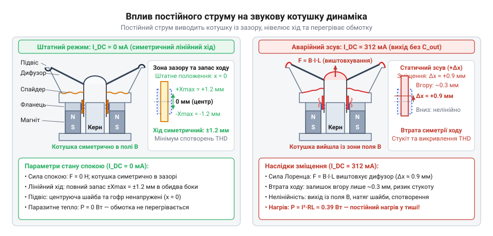
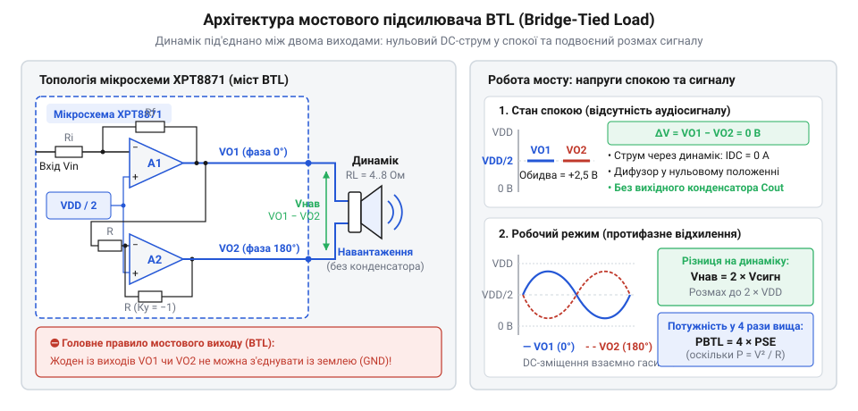
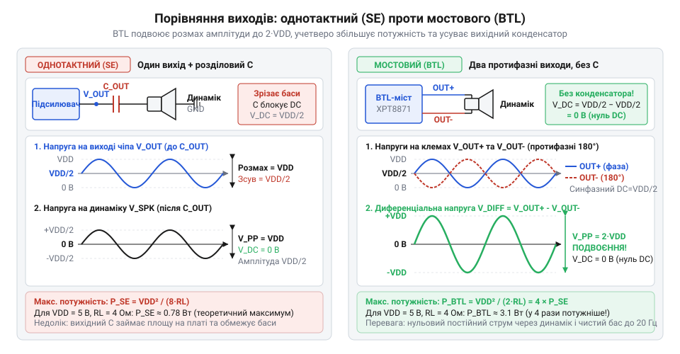
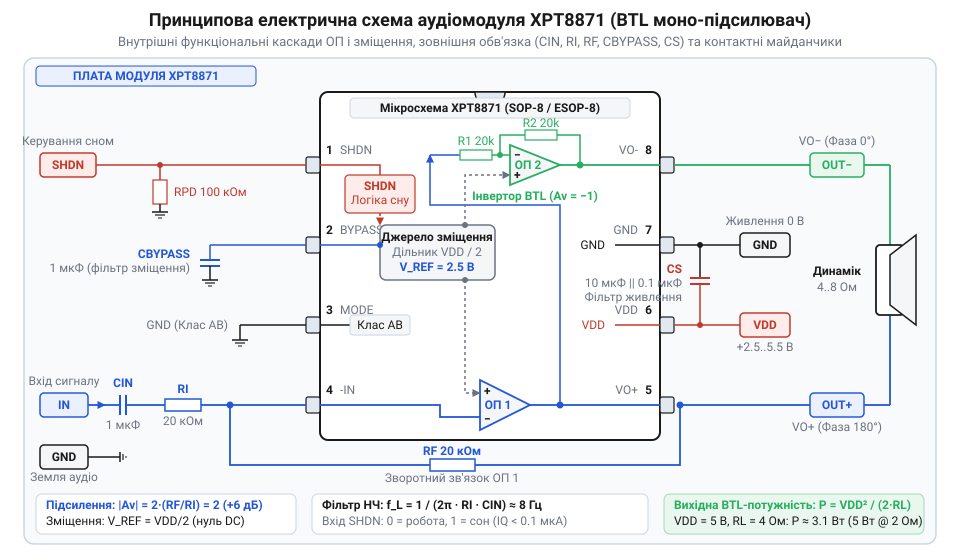
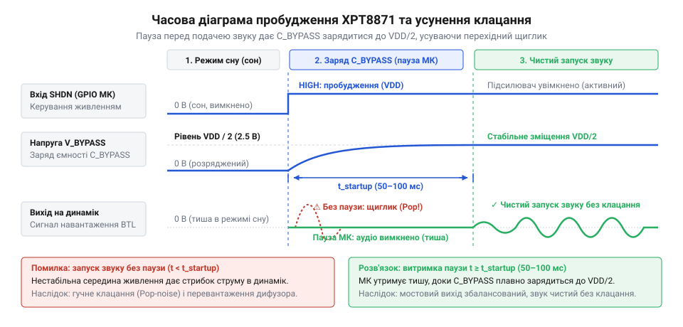
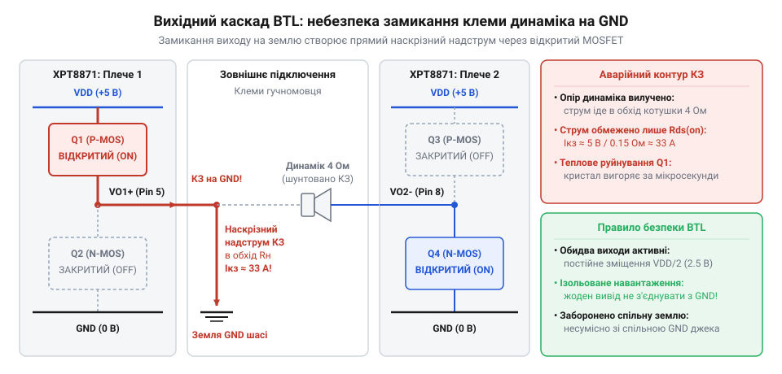

# XPT8871 — моно-підсилювач 5 Вт

<preknowlist>
- [Динаміки 5 Вт / 8 Ом](root:cat-hw-actuators/speakers-8ohm) — Будова та принцип дії електродинамічного гучномовця, низький номінальний імпеданс звукової котушки (4–8 Ом), допустима теплова потужність і неприпустимість протікання постійного струму зміщення
</preknowlist>

## Чому динамік не можна підключати напряму до виводів мікроконтролера

Мініатюрний [п'єзоелектричний зумер](root:cat-hw-actuators/ky-006-buzzer) безпечно живиться від цифрового виводу: ємнісний елемент споживає частки міліампера. Проте для розбірливої мови чи музики потрібен електродинамічний [динамік](root:cat-hw-actuators/speakers-8ohm). Пряме з'єднання з мікроконтролером призводить до апаратної аварії.

Основою динаміка є звукова котушка в полі постійного магніту з активним опором 4–8 Ом. Для найважчого випадку (4 Ом) при напрузі 5 В закон Ома вимагає струм у сотні разів більший за допустимий:

```
I
= U / R              [закон Ома]
= 5 В / 4 Ом         [випадок 4 Ом]
= 1.25 А             [струм навантаження]
```

Водночас вихідний каскад порту (GPIO — @@en|General-Purpose Input/Output@@) на внутрішніх польових транзисторах (MOSFET, від англ. @@en|metal-oxide-semiconductor field-effect transistor@@) розрахований лише на 10–20 мА.

Опір відкритого транзистора порту становить 20–50 Ом. За правилом дільника напруги майже всі 5 В падають на ньому, а не на динаміку. Кілька ватів потужності виділяються на ділянці кремнію в кілька мікрометрів: локальний перегрів викликає миттєвий тепловий пробій кристала.

Якщо кристал витримує перегрів, відмовляє живлення. Стрибок струму до 1.25 А спричиняє глибоке просідання `VDD`. Нижче порога 2.7–3.0 В [детектор просідання живлення](root:hw-arch/brownout) (@@en|Brown-Out Reset@@, BOR — від англ. @@en|brownout@@ — спад напруги та @@en|reset@@ — скидання) перезавантажує процесор. Вивід знеструмлюється, напруга відновлюється, процесор стартує знову й повторно просаджує лінію — настає нескінченне перезавантаження (@@en|bootloop@@ — від англ. @@en|boot@@ — завантаження та @@en|loop@@ — петля).


*Структурна схема вихідного каскаду GPIO мікроконтролера з динаміком: показано падіння напруги на внутрішніх MOSFET кристала, надмірне тепловиділення та просідання шини VDD, що викликає цикл перезавантажень BOR.*

Навіть за достатньої потужності виводу на заваді стає природа звуку. [Однополярний ЦАП чи ШІМ](root:hw-analog/dac-pwm-audio-generation) дає сигнал від 0 до `VDD`. Симетрична звукова хвиля потребує зміщення на середину шкали: `V_bias = VDD / 2` (2.5 В при 5 В). Для котушки це постійний струм:

```
I_DC
= (VDD / 2) / R_L    [струм постійного зміщення]
= 2.5 В / 4 Ом       [випадок 5 В і 4 Ом]
= 0.625 А            [постійний струм через котушку]
```

Постійний струм не створює звуку, але руйнує динамік:
1. Спікання витків: потужність `P = I² · R = 0.625² · 4 ≈ 1.56 Вт` безперервно розігріває котушку в зазорі магніту, розплавляючи ізоляційний лак і закорочуючи витки.
2. Упор дифузора: магнітне поле зміщення виштовхує котушку в крайню точку. Дифузор втрачає запас ходу, що породжує хрип і розриває підвіс.

Однотранзисторний ключ проблему не розв'язує: він однотактний і відхиляє дифузор лише в один бік. Повернення лише завдяки пружності підвісу зрізає половину хвилі, спотворює звук і залишає руйнівний постійний струм через котушку.

> 🔧 **Навіщо це.**
> Для безпечного розгойдування низькоомного динаміка потрібен двотактний каскад підсилювача звукової частоти (@@en|push-pull@@ — від англ. @@en|push@@ — штовхати та @@en|pull@@ — тягнути). Він бере струм від силового живлення в обхід виводів процесора та забезпечує симетричний двополярний рух дифузора без протікання постійного струму.

## Мостова топологія виходу (BTL) як спосіб отримати потужність до 5 Вт без вихідного конденсатора

В однотактній схемі (@@en|Single-Ended@@, SE — від англ. @@en|single@@ — один та @@en|end@@ — кінець) динамік підключають між виходом підсилювача та землею (GND). Через однополярне живлення вихід у стані спокою має постійне зміщення `VDD / 2` (2.5 В при 5 В). Пряме з'єднання з землею викликало б постійний струм і спалило б котушку.

Щоб відсікти постійну складову, послідовно з динаміком ставлять розділовий електролітичний конденсатор (від лат. @@en|condenso@@ — ущільнюю). Через низький опір котушки `R_L` (4–8 Ом) такий фільтр високих частот вимагає величезної ємності: за формулою частоти зрізу `f_c = 1 / (2 · π · R_L · C)` для нижньої межі 80 Гц при 4 Ом потрібно близько 500 мкФ. На практиці ставлять конденсатор на 470–1000 мкФ: він громіздкий, займає більшу частину плати й завалює баси нижче 100 Гц.

Крім того, вихідна потужність однотактної схеми обмежена розмахом напруги живлення `VDD`:

```
P_SE
= VDD² / (8 · R_L)              [теоретична межа однотактного виходу]
= (5 В)² / (8 · 8 Ом)           [розрахунок для 5 В та 8 Ом]
= 25 / 64
≈ 0.39 Вт                       [вихідна потужність SE на 8 Ом]
```

Навіть при навантаженні 4 Ом потужність сягає лише `25 / 32 ≈ 0.78 Вт`, чого недостатньо для впевненого озвучення кімнати.

Обидва обмеження долає мостова топологія виходу (@@en|Bridge-Tied Load@@, BTL — від англ. @@en|bridge@@ — міст, @@en|tied@@ — прив'язаний та @@en|load@@ — навантаження). У ній динамік підключають диференціально між виходами двох активних підсилювачів `OUT+` та `OUT-`, де другий інвертує сигнал першого зі зсувом фази на 180°.


*Архітектура мостового підсилювача BTL: показано з'єднання динаміка між прямим та інвертуючим підсилювачами, напруги VDD/2 у спокої та протифазне відхилення сигналів зі збереженням нульової різниці постійної напруги.*

Це дає дві принципові переваги:

1. Робота без конденсатора:
У стані спокою на обох виводах діє однаковий постійний потенціал зміщення `VDD / 2`. Різниця постійної напруги на клемах динаміка дорівнює нулю (`V_OUT+ - V_OUT- = 0 В`). Постійний струм не тече, дифузор лишається у спокої, а масивний вихідний конденсатор на 470–1000 мкФ стає непотрібним.

2. Чотирикратний приріст потужності:
Плечі працюють у протифазі: коли `OUT+` сягає `VDD`, `OUT-` опускається до 0 В (GND), створюючи на динаміку різницю напруг `+VDD`. У наступній напівхвилі навпаки: `OUT+` падає до 0 В, а `OUT-` зростає до `VDD`, утворюючи різницю `-VDD`. Розмах диференціальної напруги подвоюється до `2 · VDD`. Оскільки потужність пропорційна квадрату напруги, подвоєння розмаху забезпечує чотирикратний приріст:

```
P_BTL
= 4 · P_SE                      [чотирикратний приріст від розмаху 2 · VDD]
= VDD² / (2 · R_L)              [теоретична межа мостового виходу]
= (5 В)² / (2 · 8 Ом)           [розрахунок для 5 В та 8 Ом]
= 25 / 16
≈ 1.56 Вт                       [вихідна потужність BTL на 8 Ом]
```

Для динаміка 4 Ом потужність сягає `25 / 8 ≈ 3.13 Вт`. При підключенні динаміків з опором 2–3 Ом мостовий каскад від стандартного живлення 5 В розвиває корисну потужність аж до 5 Вт.


*Розмах диференціальної напруги на навантаженні в однотактній схемі (SE) та мостовій топології (BTL): протифазна робота плечей подвоює розмах коливань до 2 · VDD і забезпечує чотирикратне зростання вихідної потужності без розділового конденсатора.*

> 🔧 **Навіщо це.**
> Завдяки мостовій топології BTL моно-підсилювач на мікросхемі XPT8871 витискає з низької напруги 5 В максимальну акустичну потужність до 5 Вт і поміщається на мініатюрній платі розміром із поштову марку. Проте обидва виводи `OUT+` та `OUT-` є активними сигнальними виходами: їх категорично заборонено з'єднувати із землею (GND), шиною живлення або виходами інших підсилювачів, оскільки будь-яке таке замикання спричинить миттєве вигорання вихідних транзисторів відповідного плеча.

## Внутрішня будова мікросхеми XPT8871 та схема підключення модуля

Мостовий режим вимагає двох протифазних сигналів на клемах навантаження, тоді як джерело звуку зазвичай формує несиметричний сигнал відносно спільного проводу. Мікросхема XPT8871 вирішує це завдання внутрішньою структурою з двох операційних підсилювачів (ОП, від лат. *operatio* — дія та *amplificare* — збільшувати).

Перший операційний підсилювач (ОП1) — інвертувальний каскад із зовнішнім зворотним зв'язком. Його інвертувальний вхід `IN-` виведено назовні через резистор `R_I`, а вихід `VO1` з'єднано з цим входом через резистор зворотного зв'язку `R_F`. Неінвертувальний вхід зафіксовано на внутрішній віртуальній середній точці `VDD / 2`.

Другий операційний підсилювач (ОП2) працює як ведений інвертор із фіксованим одиничним коефіцієнтом (`Av2 = -1`). Його внутрішні резистори номіналом по 20 кОм інтегровані в кремній і підігнані лазером. ОП2 приймає сигнал з точки `VO1` і дзеркально інвертує його на вихід `VO2` зі зсувом фази на 180°.

Обидва підсилювачі спираються на внутрішнє джерело опорної напруги `VDD / 2` від прецизійного дільника живлення, виведене на контакт `BYPASS` (байпас, від англ. @@en|bypass@@ — паралельне відгалуження, обхід). Логічний блок `SHDN` (від англ. @@en|shutdown@@ — вимкнення, блокування) керує внутрішніми джерелами струму й повністю знеструмлює каскади в режимі сну.

Через протифазну роботу виходів напруга на динаміку подвоюється, а повний коефіцієнт підсилення становить:
```
Av = 2 · (R_F / R_I)
```
Типові номінали на платах модуля — `R_I = 20 кОм` та `R_F = 20 кОм` (базовий `Av = 2`) або `R_F = 47–51 кОм` для слабкого джерела звуку.

Мінімальна пасивна обв'язка модуля стабілізує режими за постійним струмом і придушує завади:

*Принципова схема модуля на мікросхемі XPT8871: розділовий вхідний конденсатор C_IN, ланцюг зворотного зв'язку R_I/R_F, фільтр зміщення C_BYPASS та здвоєний тандем конденсаторів живлення C_S.*

- Вхідний конденсатор `C_IN` (0.47–1.0 мкФ) відсікає постійну складову джерела звуку (зміщення `VDD / 2` однополярного ЦАП). Разом із резистором `R_I` він утворює пасивний фільтр високих частот із частотою зрізу:
```
f_HP = 1 / (2 · π · R_I · C_IN)
```
За `R_I = 20 кОм` та `C_IN = 0.47 мкФ` частота зрізу становить приблизно 17 Гц, вільно пропускаючи звуковий спектр без завалу басів.
- Конденсатор середньої точки `C_BYPASS` (0.1–1.0 мкФ) фільтрує шуми внутрішнього дільника напруги, усуваючи фоновий гул пульсацій живлення в динаміку.
- Тандем (від лат. *tandem* — узгоджена пара) конденсаторів живлення `C_S` поєднує два елементи:
  1. Керамічний конденсатор 0.1 мкФ біля виводів живлення шунтує високочастотні струми з мінімальною паразитною індуктивністю, блокуючи самозбудження каскадів класу AB на мегагерцах.
  2. Електролітичний або танталовий конденсатор 470–1000 мкФ згладжує імпульсні просідання шини під час пікових струмів на низьких частотах.

У піках гучності підсилювач віддає в низькоомний [динамік на 8 Ом](root:cat-hw-actuators/speakers-8ohm) або 4 Ом значний струм:
```
I_peak = VDD / R_L = 5 В / 4 Ом = 1.25 А
```
Через такий піковий струм модуль заборонено живити від бортового LDO-стабілізатора 3.3 В мікроконтролера. Лінійні стабілізатори розраховані лише на 150–300 мА: струм 1.25 А викличе просідання напруги, перегрів LDO та апаратний скид мікроконтролера через Brown-Out Reset під час басових ударів.

Модуль підключають суворо до лінії 5 В за топологією (від грец. *topos* — місце та *logos* — вчення) «зірка». Провідники живлення і землі прокладають товстими лініями безпосередньо від клем джерела, окремо від цифрових кіл. Спільна тонка доріжка землі через високий струм створює паразитні падіння напруги, що наводить у звуковий тракт клацання таймерів і свист шин даних.

Підключення аудіосигналу залежить від виходу мікроконтролера:
- Сигнал апаратного ЦАП подається безпосередньо на вхід `C_IN`, бо він є плавним аналоговим сигналом.
- Сигнал ШІМ (широтно-імпульсна модуляція) є меандром із частотою 32–128 кГц. Лінійний підсилювач класу AB не призначений для прямого меандру: вихідні транзистори працюють у ключовому режимі на високій частоті, спричиняючи миттєвий перегрів кристала, спотворення й писк.
Тому між виводом ШІМ і входом модуля встановлюють згладжувальний [RC-фільтр низьких частот](root:hw-analog/rc-low-pass) (резистор 1–2 кОм та конденсатор 10–22 нФ на землю) із частотою зрізу 8–15 кГц, який пригнічує високочастотну носійну меандру й виділяє звукову обвідну.

> 🔧 **Навіщо це.**
> Силове підключення модуля за схемою «зірка» ізолює аудіотракт від цифрових перемикальних шумів мікроконтролера, а зовнішній RC-фільтр на вході оберігає лінійні каскади класу AB від критичного перегріву високочастотним меандром ШІМ.

## Керування лінією SHDN та правила безпеки мостового виходу

Вхід SHDN (від англ. @@en|shutdown@@ — вимкнення) керує підсилювачем без розмикання силового живлення. Високий логічний рівень (понад 1.4 В) вимикає генератори струму й переводить виходи VO1 та VO2 у стан @@en|Hi-Z@@. Споживання струму падає із 6–10 мА до менш ніж 1 мкА, зберігаючи батарею в паузах.

Під час старту чи скидання мікроконтролера його виводи GPIO перебувають у стані Hi-Z. Непідтягнутий вхід SHDN сприймає завади й може спонтанно ввімкнути підсилювач, вдаривши по динаміку перехідними процесами ЦАП або ШІМ. Зовнішній резистор підтяжки 10–47 кОм до шини VDD глушить мікросхему, доки прошивка не налаштує аудіо й свідомо не подасть стабільний нуль.

Перехід у робочий режим несе ризик щиглика (@@en|pop-and-click@@). За вимкненого підсилювача конденсатор C_BYPASS розряджений. Після ввімкнення внутрішній дільник заряджає його до VDD / 2. Часова асиметрія наростання напруги на VO1 та VO2 створює перекіс на навантаженні, через що дифузор [динаміка на 8 Ом](root:cat-hw-actuators/speakers-8ohm) смикається з клацанням.

Щоб усунути щиглик, витримують апаратну паузу пробудження 	_wu (від англ. @@en|wake-up time@@), визначену колом BYPASS:
`
τ = R_internal · C_BYPASS
`
За R_internal ≈ 45 кОм та C_BYPASS = 1 мкФ повний заряд триває три постійні часу:
`
t_wu ≈ 3 · τ ≈ 3 · (45 кОм · 1.0 мкФ) ≈ 135 мс
`
Алгоритм безпечної комутації:
1. Забезпечити нульовий або середній рівень на виході джерела звуку.
2. Подати низький рівень на SHDN.
3. Витримати затримку 100–150 мс (t_wu), доки зарядиться C_BYPASS і вирівняються плечі.
4. Запустити відтворення звуку.
5. Перед вимкненням зупинити аудіопотік, плавно звести сигнал до нуля, зачекати 5–10 мс і перевести SHDN у високий рівень.


*Часова діаграма перехідного процесу пробудження за лінією SHDN, заряду ємності C_BYPASS та запуску звукового сигналу без клацання.*

Категорично заборонено заземлювати контакти динаміка. На відміну від гнізд навушників зі спільним GND, у схемі BTL обидва виходи VO1 та VO2 є активними силовими плечима зі зміщенням VDD / 2 (2.5 В за живлення 5 В).

Замикання будь-якого з виходів на GND викликає коротке замикання верхнього силового транзистора:
`
I_short
= (VDD / 2) / R_DS(on)                       [струм короткого замикання плеча на землю]
≈ 2.5 В / 0.6 Ом                             [підстановка типового опору відкритого каналу]
≈ 4.17 А                                     [надструм через кремнієвий кристал]
`
Струм понад 4 А виділяє понад 10 Вт тепла на кристалі. Внутрішній захист не встигає спрацювати: вихідні транзистори пробиваються, а провідники випаровуються за частки мілісекунди. Виходи динаміка мають бути повністю ізольовані від землі, шини живлення та корпусу.


*Спрощена принципова схема вихідного каскаду BTL із позначенням наскрізного надструму через відкритий верхній MOSFET під час замикання клеми динаміка на шину заземлення GND.*

Перевантаження вхідним сигналом призводить до кліпінгу. Вихідна напруга обмежена живленням VDD за вирахуванням напруги насичення транзисторів V_sat (близько 0.2 В). Поріг розмаху вхідного сигналу V_in_max без спотворень визначає вираз:
`
V_in_max
= (VDD - 2 · V_sat) / Av                     [поріг початку кліпінгу]
`

**Умова розрахунку порогу кліпінгу:**
VDD = 5.0 В, V_sat = 0.2 В, коефіцієнт підсилення Av = 2 · (20 кОм / 20 кОм) = 2.
`
V_in_max
= (5.0 - 2 · 0.2) / 2                        [підстановка напруги живлення і насичення]
= 4.6 / 2                                    [максимальний розмах на плечі]
= 2.3 В                                      [граничний розмах вхідного сигналу від піку до піку]
`
Граничний розмах вхідного сигналу становить 2.3 В від піку до піку.

Якщо сигнал перевищує 2.3 В, настає [кліпінг](root:hw-analog/audio-clipping) (від англ. @@en|clipping@@ — зрізання). Верхівки звукової хвилі зрізаються в горизонтальні полиці, перетворюючи синусоїду на меандр. Рівень спотворень перевищує поріг THD > 10 % (від англ. @@en|Total Harmonic Distortion@@) з появою різкого хрипу. Постійна напруга на полицях зрізу жене максимальний струм через нерухому котушку динаміка, викликаючи її перегрів, руйнування ізоляції та спікання витків.

> 🔧 **Навіщо це.**
> Дотримання паузи t_wu гарантує запуск звуку без акустичного клацання, а обмеження амплітуди вхідного сигналу нижче порога кліпінгу рятує звукову котушку динаміка від перегріву й термічного руйнування.
