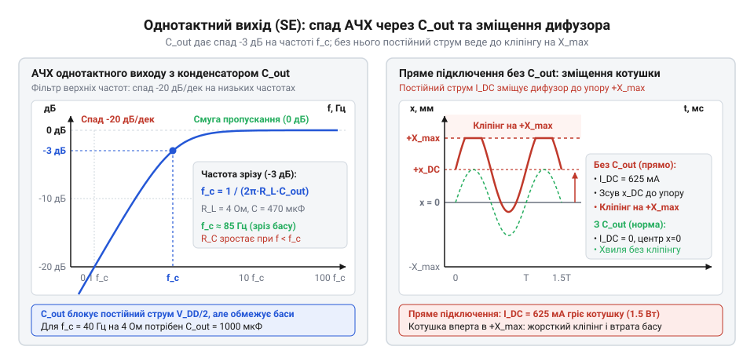
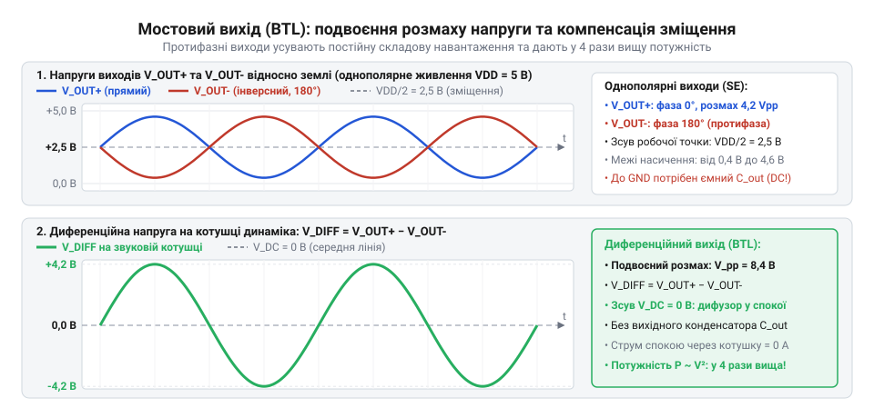
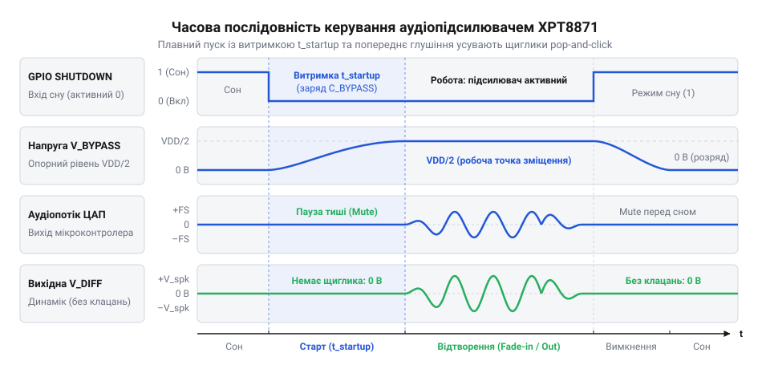

# XPT8871 — моно-підсилювач 5 Вт

<preknowlist>
- [Динаміки 5 Вт / 8 Ом](root:cat-hw-actuators/speakers-8ohm) — Електроакустичний принцип дії динамічної головки, поняття номінального електричного імпедансу котушки (4–8 Ом), чутливість до постійного струму (ризик теплового руйнування та зсуву дифузора за межі лінійного ходу) та зв'язок підведеної електричної потужності з амплітудою звукового тиску.
</preknowlist>

## Захід у проблему: спроба прямого підключення низькоомного електроакустичного випромінювача до джерела звукового сигналу

Мікроконтролер формує звук як коливання електричного потенціалу на виході ЦАП або ШІМ із пасивним низькочастотним RC-фільтром з амплітудою від 0 до 3.3 В чи 5.0 В. Проте людське вухо сприймає коливання тиску повітря, тому для відтворення звуку сигнал спрямовують на [електродинамічну головку](root:cat-hw-actuators/speakers-8ohm) (динамік). Її звукова котушка — це провідник у магнітному полі з дуже низьким повним електричним імпедансом (від лат. @@en|impedire@@ — перешкоджати): типово 4 Ом.

Вихідний каскад універсального мікроконтролера або звичайного операційного підсилювача спроєктовано як сигнальне джерело напруги для високоомних навантажень (понад 10 кОм). Переріз його кремнієвих структур і струмовводів обмежує безпечний довготривалий струм на рівні лише 10–40 мА. Спроба під'єднати низькоомний динамік безпосередньо до такого виводу спричиняє аварійне перевантаження.

З'ясуємо, який струм фізично потрібен динаміку для створення чутної акустичної гучності, наприклад, за електричної потужності 1.0 Вт на навантаженні 4.0 Ом. Середньоквадратична потужність гармонійного звукового сигналу пов'язана з піковим значенням струму `I_peak` і опором навантаження `R_L`:

```
P_out
= I_rms² · R_L                  [потужність через середньоквадратичний струм та опір навантаження]
= (I_peak / √2)² · R_L          [зв'язок середньоквадратичного та пікового значень синусоїди]
= (I_peak² · R_L) / 2           [піднесення до квадрата]
```

Звідси визначимо амплітудне значення струму, яке джерело сигналу зобов'язане віддати в навантаження на піку звукової хвилі:

```
I_peak
= √(2 · P_out / R_L)            [вираження амплітуди струму через потужність та опір]
= √(2 · 1.0 Вт / 4.0 Ом)        [підстановка значень для потужності 1 Вт та динаміка 4 Ом]
= √0.5 А²                       [обчислення підкореневого виразу]
≈ 0.707 А = 707 мА              [добування квадратного кореня]
```

Одночасно амплітуда вихідної напруги на навантаженні має сягати:

```
V_peak
= I_peak · R_L                  [закон Ома для амплітудних значень на активному опорі]
= 0.707 А · 4.0 Ом              [підстановка пікового струму та опору]
≈ 2.83 В                        [обчислення амплітуди напруги]
```

Співвідношення величин демонструє нездоланну прірву: низькоомний випромінювач 4 Ом вимагає пікового струму понад 700 мА, тоді як сигнальний вивід здатен надати лише 10–40 мА — тобто майже у 20–70 разів менше.

Пряме підключення котушки 4 Ом до сигнального виводу призводить до трьох неминучих деструктивних наслідків:

1. **Жорсткий струмовий кліпінг (від англ. @@en|clipping@@ — підрізання) та втрата амплітуди.** Внутрішній опір каналу вихідних ключів порту становить 20–50 Ом і разом з опором динаміка 4 Ом утворює подільник напруги. Майже весь потенціал живлення падає на внутрішньому опорі самого порту, а котушці дістається менш ніж 10–15% амплітуди. Транзистори порту входять у глибоке струмове насичення: синусоїда перетворюється на зрізані трапецієподібні імпульси з коефіцієнтом нелінійних спотворень понад 50%, а звук стає глухим деренчанням.

2. **Теплове руйнування та електричний пробій кристала.** Внутрішні структури мікроконтролера займають мікроскопічну площу без спеціальних тепловідвідних шин. За аварійного струму на транзисторі розсіюється електрична потужність втрат:

```
P_loss
= (V_DD - V_out) · I_out        [потужність, що перетворюється на тепло на регулювальному ключі]
```

Якщо за живлення `V_DD = 5 В` вихід просідає майже до нуля при аварійному струмі 60–80 мА, потужність втрат сягає `P_loss ≈ 5 В · 0.08 А = 0.4 Вт`. Локальна температура кремнію менш ніж за секунду перевищує критичні 150 °C, провокуючи деградацію структури, паразитний тиристорний ефект (@@en|latch-up@@) або незворотний тепловий пробій p-n переходу.

3. **Локальне просідання шини живлення та циклічне перезавантаження.** Раптовий відбір надлишкового струму спричиняє імпульсний спад напруги живлення мікроконтролера нижче порога спрацьовування детектора зниження напруги (@@en|Brown-Out Reset@@, BOR). Мікроконтролер перезавантажується й переводить виводи у високоімпедансний стан. Струм спадає, живлення відновлюється, програма стартує знову й знову намагається збудити динамік — виникає нескінченний цикл аварійних перезапусків.

> 🔧 **Навіщо це.**
> Спроба під'єднати динамік безпосередньо через резистор чи конденсатор робить звук ледь чутним (частки мілівата) або випалює порт. У схемотехніці діє суворий поділ функцій: джерело формує точну напругу сигналу, а силовий інтерфейсний блок бере на себе постачання великого струму.

Фізична неможливість прямого збудження низькоомного навантаження вимагає використання виділеного класу компонентів — **монолітних низьковольтних інтегральних аудіопідсилювачів потужності**. Вони поєднують функції прецизійного перетворювача сигналу та потужного струмового драйвера й оптимізовані під три граничні вимоги:
- **Низьковольтне однополярне живлення:** гарантована робота в діапазоні від 2.5 В до 5.5 В (один літій-іонний акумулятор або цифрові шини 3.3 В чи 5.0 В).
- **Велика струмова спроможність:** здатність комутувати струми амплітудою 1.0–2.0 А в навантаження 4–8 Ом без просідання напруги та виходу з лінійного режиму.
- **Висока інтеграція захистів:** розміщення на єдиному кристалі потужних силових ключів із низьким опором, контурів термозахисту, захисту від короткого замикання та схем заглушення клацань під час подачі живлення.

## Внутрішня трикаскадна топологія монолітного інтегрального підсилювача

Щоб забезпечити лінійне підсилення звукового сигналу за низької однополярної напруги від 2.5 до 5.5 В і водночас комутувати в навантаження амперні струми, кристал монолітного підсилювача будують за класичною трикаскадною топологією підсилювача класу AB (від лат. @@en|classis@@ — розряд, клас).

Кожен із трьох каскадів виконує власну фізичну функцію: перший забезпечує лінійне перетворення вхідної напруги в струм і пригнічує завади, другий створює основне підсилення напруги та гарантує фазову стійкість, а третій віддає потужність у звукову котушку низькоомного навантаження.


*Внутрішня функціональна блок-схема монолітного низьковольтного аудіопідсилювача потужності: трикаскадний підсилювальний тракт із диференційним входом, каскадом підсилення напруги VAS і комплементарним виходом класу AB, доповнений схемами захисту й керування.*

### Вхідний диференційний каскад (каскад взаємної провідності)
Вхідний каскад побудовано на диференційній парі (від лат. @@en|differentia@@ — різниця) біполярних або польових транзисторів зі спільним джерелом струму в емітерах (чи витоках) і навантаженням на активне [струмове дзеркало](root:hw-analog/current-mirror) (@@en|current mirror@@). Симетричні входи `IN+` (неінвертувальний) та `IN-` (інвертувальний) виконують чотири завдання:

1. **Придушення синфазних завад (CMRR, від англ. @@en|Common-Mode Rejection Ratio@@):** Синфазні наведення від цифрових шин або імпульсного живлення приходять на обидва входи синфазно. Дифпара підсилює лише різницю напруг `V_diff = V_in(+) - V_in(-)`, тоді як струмове дзеркало взаємно віднімає синфазні складові струмів. Показник CMRR сягає 60–80 дБ, блокуючи проникнення цифрового шуму в аудіотракт.
2. **Високий вхідний опір:** Слабкострумові бази або затвори вхідних транзисторів мають наноамперні струми витоку. Вхідний опір від сотень кілоомів до одиниць мегаомів запобігає навантаженню на джерело сигналу та зміщенню частот зрізу вхідних фільтрів.
3. **Точка замикання контуру від'ємного зворотного зв'язку (ВЗЗ):** Інвертувальний вхід `IN-` слугує вузлом порівняння, куди через дільник надходить вихідна напруга підсилювача. Контур ВЗЗ автоматично зводить різницю потенціалів між входами практично до нуля (`V_in(+) ≈ V_in(-)`).
4. **Перетворення напруги в струм (каскад взаємної провідності, @@en|transconductance stage@@):** Вхідна пара перетворює різницеву напругу `ΔV_diff` на вихідний струм колекторів або стоків:

```
ΔI_out
= g_m · ΔV_diff                 [перетворення диференційної напруги в струм крутизною каскаду]
```

де `g_m` (від лат. @@en|trans@@ — через та @@en|conductio@@ — проведення) — крутизна взаємної провідності пари. Цей струм безпосередньо керує наступним каскадом.

### Проміжний каскад підсилення напруги (VAS)
Каскад підсилення напруги (@@en|Voltage Amplifier Stage@@, VAS) формує основне підсилення тракту. Він побудований на транзисторі зі спільним емітером (або витоком), навантаженому на внутрішнє джерело струму як високоомне динамічне навантаження.

Оскільки опір джерела струму сягає сотень кілоомів або мегаомів, вхідний струм першого каскаду розвиває на ньому колосальний розмах напруги. Саме VAS задає коефіцієнт підсилення розімкненого контуру (@@en|open-loop gain@@, `A_OL`) на рівні 80–100 дБ (посилення за напругою в 10 000 – 100 000 разів).

Проте високе підсилення несе ризик втрати стійкості: на високих частотах паразитні ємності транзисторів спричиняють фазове запізнення. Якщо на частоті, де підсилення петлі перевищує 0 дБ, зсув фази досягне 180°, від'ємний зворотний зв'язок стане додатним, викликавши самозбудження та миттєвий перегрів кристала.

Щоб унеможливити генерацію, застосовують [міллерівську частотну корекцію](root:hw-analog/opamp-stability) (від прізвища винахідника Дж. Міллера, @@en|Miller compensation@@): між виходом і входом VAS інтегрують конденсатор `C_M` ємністю 5–20 пФ. Завдяки ефекту Міллера ця ємність динамічно масштабується коефіцієнтом підсилення каскаду й викликає розщеплення полюсів (@@en|pole splitting@@). Вона зміщує головний (домінантний) полюс у низькочастотну область (100–500 Гц), забезпечуючи спад підсилення 20 дБ на декаду. Фазовий зсув на частоті одиничного підсилення не перевищує 120–135°, що гарантує запас за фазою 45–60° за будь-яких навантажень.

> 🔧 **Навіщо це.**
> Інтеграція міллерівської ємності безпосередньо в структуру кремнієвого кристала позбавляє розробника потреби монтувати зовнішні фазокоригувальні RC-ланцюжки на друкованій платі. Підсилювач зберігає абсолютну стійкість за будь-якого зовнішнього коефіцієнта підсилення й не збуджується під час коливань температури або роботи на довгу лінію динаміка.

### Двотактний комплементарний вихідний каскад класу AB
Вихідний каскад є силовим буфером струму за двотактною комплементарною (від лат. @@en|complementum@@ — доповнення) топологією: верхній ключ (P-канальний польовий або NPN-біполярний) підтягує вихід до шини `V_DD`, а нижній (N-канальний польовий або PNP-біполярний) — до шини `GND`.

Силові ключі займають до 50–70% площі кристала. Їхній широкий канал гарантує низький опір відкритого стану `R_DS(on)` (десяті частки ома) або малу напругу насичення `V_CE(sat)`. Це дозволяє комутувати струми до 1–2 А майже без падіння напруги на самих ключах, забезпечуючи розмах сигналу на динаміку від рейки до рейки (режим @@en|rail-to-rail@@).

Роботу вихідного каскаду визначає схема зміщення:
- **У чистому класі B** транзистори у спокої замкнені. Щоб відкрити перехід, напруга має подолати поріг `V_BE ≈ 0.6–0.7 В` (або `V_th` для польового ключа). При проходженні сигналу через нуль у діапазоні від -0.7 В до +0.7 В обидва ключі одночасно закриті. Виникає мертва зона зі сходинковими спотвореннями переходу через нуль (@@en|crossover distortion@@), які проявляються як брязкіт і хрип на малій гучності.
- **У класі AB** схема зміщення утримує ключі на межі провідності. Через них навіть у стані повної тиші протікає контрольований струм спокою (@@en|quiescent current@@, `I_Q`) величиною 2–10 мА. Завдяки цьому при переході хвилі через нуль ключі плавно передають струм без розриву характеристики, ліквідуючи спотворення зі збереженням високого ККД (до 65–70%).

Для класу AB небезпечним є явище теплового розгону (@@en|thermal runaway@@): напруга відмикання переходу падає на ~2 мВ/°C з нагріванням. За фіксованого зміщення струм спокою зростав би лавиноподібно аж до теплового руйнування кристала. У монолітному підсилювачі вузол зміщення виготовлено на тій самій кремнієвій підкладці впритул до вихідних ключів: маючи такий самий негативний температурний коефіцієнт, він автоматично знижує напругу зміщення під час нагрівання, надійно стабілізуючи `I_Q` у діапазоні від -40 °C до +85 °C.

### Робоча точка на рівні V_DD / 2 та проблема постійної складової
Підсилювач живиться від однополярного джерела: земля `GND = 0 В` та лінія `V_DD`. Для симетричного підсилення змінного сигналу без зрізання півхвиль вихідний каскад за відсутності сигналу утримує постійну напругу на рівні половини живлення:

```
V_out(DC)
= V_DD / 2                      [симетрична середня точка для максимального розмаху напруги]
```

Цей потенціал задає внутрішнє джерело опорної напруги. Наявність постійної напруги `V_DD / 2` на виході унеможливлює безпосереднє заземлення динаміка. Якщо підключити звукову котушку 4.0 Ом між виходом і землею `GND`, через неї потече неприпустимий постійний струм:

```
I_DC
= V_out(DC) / R_L               [закон Ома для постійного струму через звукову котушку]
= (V_DD / 2) / R_L              [підстановка напруги зміщення]
= (5.0 В / 2) / 4.0 Ом          [числовий приклад для живлення 5 В та динаміка 4 Ом]
= 2.5 В / 4.0 Ом                [обчислення потенціалу середньої точки]
= 0.625 А = 625 мА              [неприпустимий постійний струм через котушку]
```

Постійний струм 625 мА спричинить теплове перегорання звукової котушки та заблокує рухливість дифузора. Тому навантаження підключають або через послідовний роздільний конденсатор великої ємності (однотактне увімкнення, SE), або мостом між двома протифазними виходами (мостове увімкнення, BTL).

### Допоміжні інтегровані модулі (TSD та Shutdown)
Крім основного тракту, кристал містить два допоміжні цифрово-аналогові модулі керування та захисту:
1. **Модуль теплового захисту (TSD, від англ. @@en|Thermal Shutdown@@):** Напівпровідниковий термодатчик безперервно вимірює температуру кристала `T_j`. У разі перегріву понад 150–160 °C (через коротке замикання або перевантаження) схема TSD відмикає вихідні транзистори, переводячи вихід у високоімпедансний стан (Hi-Z). Температурний гістерезис (від грец. ὑστέρησις — відставання, запізнення) величиною 15–25 °C утримує захист активним до охолодження до 125–135 °C, що запобігає деренчанню на межі спрацьовування.
2. **Вузол керування режимом сну (@@en|Shutdown@@):** Цифровий логічний вхід дозволяє зовнішньому мікроконтролеру відмикати внутрішні джерела опорного струму підсилювача. У стані сну струм споживання падає нижче 0.1–1.0 мкА (типово <1 мкА), повністю усуваючи розряд джерела живлення під час простою аудіотракту.

## Однотактна схема підключення навантаження (Single-Ended, SE) та обмеження роздільного конденсатора

В однополярних аудіотрактах із живленням `V_DD` (+5 В) відносно землі `GND` (0 В) звуковий сигнал коливається в обидва боки відносно нуля. За нульового потенціалу виходу підсилювач класу AB передасть лише додатну півхвилю: від'ємна зріжеться у відсічці вихідних транзисторів. Щоб симетрично посилювати обидві півхвилі без спотворень, робочу точку виходу у стані спокою зміщують на половину напруги живлення — до величини `V_out(DC) = V_DD / 2` (+2.5 В при 5 В живлення).

Пряме підключення динаміка між таким виходом і землею неприпустиме через руйнівну дію постійного струму. Звукова котушка низькоомного [динаміка](root:cat-hw-actuators/speakers-8ohm) має суто омічний активний опір `R_L` (зазвичай 4 або 8 Ом). Постійний потенціал `V_DD / 2` створює струм спокою:

```
I_DC = (V_DD / 2) / R_L
     = 2.5 / 4                           [живлення 5 В та опір котушки 4 Ом]
     = 0.625 А                           [постійний струм навантаження]
```

Цей струм безперервно розсіює у вигляді тепла відчутну потужність:

```
P_DC = I_DC² · R_L
     = 0.625² · 4                        [підстановка I_DC = 0.625 А та R_L = 4 Ом]
     = 0.390625 · 4                      [квадрат струму]
     ≈ 1.56 Вт                           [теплова потужність у спокої]
```

Виділення 1.56 Вт тепла у стані тиші швидко обвуглює лакову ізоляцію дроту, спричиняючи міжвиткове замикання. Одночасно постійна магніторушійна сила зміщує котушку з нейтрального положення до механічного упору. Дифузор застрягає в крайній точці, викликаючи удари об фланець магнітної системи та важкі спотворення навіть на мінімальній гучності.

Для блокування постійної складової в несиметричній, або однотактній схемі (англ. @@en|single-ended@@, SE, від *single* — один, та *end* — край; підключення навантаження одним проводом відносно землі) послідовно зі звуковою котушкою динаміка вмикають роздільний конденсатор `C_out` (від лат. *condensare* — згущувати, ущільнювати). Реактивний опір конденсатора обернено пропорційний частоті сигналу:

```
X_C = 1 / (2 · π · f · C_out)
```

Для постійного струму (`f = 0`) опір прямує до нескінченності (`X_C → ∞`). Конденсатор заряджається до `V_DD / 2` і відсікає постійний струм, пропускаючи змінний сигнал у навантаження.

Послідовні `C_out` та `R_L` утворюють пасивний [RC-фільтр високих частот першого порядку](root:hw-analog/rc-high-pass). Його частота зрізу `f_c` (англ. @@en|cutoff frequency@@), де реактивний опір конденсатора дорівнює опору навантаження (`X_C = R_L`), а вихідна потужність спадає вдвічі (-3 дБ), дорівнює:

```
f_c = 1 / (2 · π · R_L · C_out)
```

Щоб отримати необхідну роздільну ємність для заданої нижньої межі частот, вираз перетворюють відносно `C_out`:

**Розрахунок ємності роздільного конденсатора для частоти 100 Гц на навантаженні 4 Ом:**
```
C_out = 1 / (2 · π · R_L · f_c)
      = 1 / (2 · 3.14159 · 4 · 100)      [підстановка R_L = 4 Ом та f_c = 100 Гц]
      = 1 / 2513.27                      [знаменник: 2 · π · 4 · 100]
      ≈ 3.979 · 10⁻⁴ Ф                   [ділення одиниці на знаменник]
      ≈ 398 мкФ                          [переведення фарад у мікрофаради: 3.979 · 10⁻⁴ · 10⁶]
```

Для відтворення басів від 100 Гц на навантаженні 4 Ом потрібна ємність ~398 мкФ — стандартний номінал 470 мкФ (ряд E6). Для нижньої межі 50 чи 20 Гц розрахункове значення сягає 800–2200 мкФ.


*Амплітудно-частотна характеристика однотактного підсилювача з лінією спаду -3 дБ на частоті зрізу та графік нелінійного зміщення дифузора постійним струмом.*

Це створює масогабаритний глухий кут. Ємності понад 100 мкФ при напрузі 10–16 В реалізують рідинними алюмінієвими електролітичними конденсаторами (від грец. *ēlektron* — бурштин, та *lytos* — розчинний). Вивідний електроліт 470 мкФ × 16 В має об'єм 600–900 мм³ (діаметр 8–10 мм, висота 11–12 мм) — це у 20–30 разів більше за монолітну мікросхему підсилювача (~30 мм³ у корпусі SOIC-8 чи MSOP-8). Він диктує товщину плати, має значний внутрішній опір (англ. @@en|equivalent series resistance@@, ESR), висихає з часом і деградує при нагріванні.

Друге обмеження схеми SE — дефіцит вихідної потужності. За фіксації робочої точки на `V_DD / 2` теоретичний максимум амплітуди неспотвореної синусоїди `V_peak` від нуля до піку обмежений половиною живлення:

```
V_peak = V_DD / 2
```

Діюча напруга (середньоквадратична, англ. @@en|root-mean-square@@, RMS) становить:

```
V_rms = V_peak / √2
      = V_DD / (2 · √2)
```

Теоретична гранична потужність навантаження `R_L` за законом Джоуля дорівнює:

```
P_SE = V_rms² / R_L
     = (V_DD / (2 · √2))² / R_L          [підстановка діючої напруги]
     = (V_DD² / 8) / R_L                 [піднесення до квадрата: (2 · √2)² = 8]
     = V_DD² / (8 · R_L)                 [теоретична межа потужності SE]
```

**Розрахунок теоретичної вихідної потужності однотактного каскаду при живленні 5 В на навантаженні 8 Ом:**
```
P_SE = V_DD² / (8 · R_L)
     = 5² / (8 · 8)                      [підстановка V_DD = 5 В та R_L = 8 Ом]
     = 25 / 64                           [обчислення степеня і добутку]
     ≈ 0.39 Вт                           [теоретична вихідна потужність]
```

При живленні 5 В теоретична межа становить 25 / 64 ≈ 0.39 Вт (<0.4 Вт) на 8 Ом та близько 0.78 Вт (25 / 32) на 4 Ом. На практиці через спад напруги насичення біполярних транзисторів або опір відкритих каналів польових ключів розмах сигналу не досягає шин живлення на 0.2–0.4 В (обмеження @@en|rail-to-rail@@, від англ. *rail* — шина живлення). Як наслідок, фактична неспотворена потужність 5-вольтового однотактного підсилювача на 8 Ом становить лише 0.25–0.3 Вт.

Третє обмеження схеми SE — перехідні процеси під час комутації живлення. У знеструмленому стані конденсатор `C_out` розряджений. При подачі живлення вихідний каскад стрибком встановлює потенціал спокою `V_DD / 2`. За законами комутації напруга на ємності не змінюється миттєво, тому весь перепад прикладається безпосередньо до звукової котушки. Піковий струм заряду сягає:

```
I_peak = (V_DD / 2) / R_L
```

Для живлення 5 В і навантаження 4 Ом цей стрибок перевищує 600 мА (`I_peak > 600 мА`). Конденсатор заряджається з постійною часу `τ = R_L · C_out` (~1.88 мс для 4 Ом та 470 мкФ). Короткий імпульс різко зміщує рухому систему динаміка, породжуючи удар — щиглик @@en|pop-and-click@@ (від англ. *pop* — ляскіт, та *click* — клацання) [root:hw-analog/audio-click-pop-suppression]. Стрибок загрожує пошкодженням дифузора, розривом центруючої шайби та обривом виводів звукової котушки.

> 🔧 **Навіщо це.**
> Однотактне увімкнення через роздільний конденсатор зберігають лише в лінійних аудіовиходах та роз'ємах навушників (імпеданс 32–600 Ом). Для навушників ємність знижується до помірних 47–100 мкФ, триконтактне гніздо @@en|TRS jack@@ 3.5 мм використовує спільний дріт землі, а потужності 15–30 мВт цілком достатньо. Для силових динаміків (4–8 Ом) схема SE є глухим кутом через масогабарити конденсатора, мізерну потужність і руйнівні комутаційні удари.

## Мостова топологія ввімкнення (Bridge-Tied Load, BTL) як спосіб подолання обмежень низької напруги

Подолання обмежень низької напруги живлення та громіздких конденсаторів полягає у зміні підключення навантаження: відмові від прив'язки динаміка до шини землі та переході до мостового включення (англ. @@en|bridge-tied load@@, BTL, від *bridge* — міст, *tied* — зв'язаний, та *load* — навантаження).

У топології BTL динамік підключається диференційно (від лат. *differentia* — різниця) між виходами двох протифазних підсилювальних каскадів із коефіцієнтами `+A_v` та `-A_v` (інверсія фази на 180°). Обидва плечі живляться від спільної шини `V_DD` зі зміщенням середньої точки `V_DD / 2`.

У стані спокою (без вхідного сигналу) на обох виходах діє однаковий синфазний (від грец. *syn* — разом, та *phasis* — фаза) постійний потенціал `V_out+ = V_out- = V_DD / 2`. Диференційна постійна напруга на клемах динаміка дорівнює нулю:

```
V_diff_DC = V_out+ - V_out-
          = (V_DD / 2) - (V_DD / 2)
          = 0 В                          [ідеальна взаємна компенсація постійної складової]
```

За нульової різниці постійних потенціалів струм спокою через котушку не тече (`I_DC = 0 А`), що дає три переваги:
- Потреба у вихідному роздільному конденсаторі зникає: динамік увімкнено прямим гальванічним зв'язком (англ. @@en|DC-coupled@@).
- Смуга пропускання розширюється вниз до 0 Гц (до постійного струму), забезпечуючи баси без спаду амплітуди й фазових спотворень ФВЧ.
- Плата позбувається найгабаритнішого компонента: розміри пристрою обмежуються площею мікросхеми та динаміка.

Під час подачі змінного аудіосигналу плечі моста розгойдуються синхронно у протифазі відносно точки `V_DD / 2`. У позитивний півперіод вихід `OUT+` сягає шини `V_DD`, а `OUT-` опускається до `0 В` (різниця `+V_DD`). У негативний півперіод плечі міняються станами (різниця `-V_DD`). Пряме віднімання пікових протифазних рівнів дає подвоєний повний розмах напруги від піку до піку (англ. @@en|peak-to-peak@@):

```
V_pp_BTL = (+V_DD) - (-V_DD)
         = 2 · V_DD                      [віднімання протифазних амплітудних піків]
```

При живленні `V_DD = 5 В` повний розмах сягає 10 В (від -5 В до +5 В) — удвічі більше за межу однотактної схеми SE.


*Порівняльна схемотехніка однотактного (SE) та мостового (BTL) підключення: пряме диференційне ввімкнення компенсує постійну складову VDD/2, усуває роздільний конденсатор і подвоює розмах змінної напруги.*


*Часові осцилограми напруг на обох плечах моста відносно землі та їхньої диференційної різниці на навантаженні з подвоєним розмахом.*

Подвоєння амплітуди забезпечує чотирикратний виграш за потужністю за законом Джоуля. При амплітуді диференційної синусоїди `V_peak_BTL = V_DD` діюча напруга становить `V_rms_BTL = V_DD / √2`. Теоретична межа потужності BTL:

```
P_BTL = V_rms_BTL² / R_L
      = (V_DD / √2)² / R_L               [підстановка діючої напруги мостової схеми]
      = V_DD² / (2 · R_L)                [теоретична межа потужності BTL]
```

Порівняння з однотактною схемою SE демонструє чотирикратну перевагу:

```
P_BTL / P_SE = (V_DD² / (2 · R_L)) / (V_DD² / (8 · R_L))
             = (8 · R_L) / (2 · R_L)      [скорочення однакових множників]
             = 4                          [чотирикратний виграш за потужністю: P_BTL = 4 · P_SE]
```

**Розрахунок теоретичної вихідної потужності BTL при живленні 5 В на навантаженні 8 Ом та 4 Ом:**
```
P_BTL(8 Ом) = 5² / (2 · 8) = 25 / 16 ≈ 1.56 Вт   [чотирикратне зростання відносно 0.39 Вт у SE]
P_BTL(4 Ом) = 5² / (2 · 4) = 25 / 8  = 3.125 Вт  [теоретична гранична потужність на 4 Ом]
```

За живлення 5 В мостова топологія підвищує теоретичну потужність до 1.56 Вт на 8 Ом та 3.125 Вт на 4 Ом. З урахуванням опору відкритих каналів польових ключів монолітний BTL-підсилювач віддає від 1.5 до 2.5 Вт чистого неспотвореного звуку від звичайного USB-порту чи 1S Li-ion акумулятора (3.7–4.2 В) без підвищувальних boost-перетворювачів.

Мостова топологія накладає суворе схемотехнічне обмеження: **жоден із двох виводів динаміка в BTL не можна з'єднувати із землею (GND), шиною живлення (VDD) чи виходами інших каналів**.

Обидва виводи — `OUT+` та `OUT-` — є низькоімпедансними виходами силових каскадів із постійним зміщенням `V_DD / 2`. Заземлення виводу `OUT-` (як у схемах SE або через спільний контакт 3.5-мм гнізда навушників) спричиняє глухе коротке замикання плеча інвертора на землю. Струм через відкритий ключ миттєво сягає кількох ампер (обмежуючись лише опором каналу), що призводить до спрацьовування захисту, аварійного перегріву кристала та незворотного теплового пробою транзисторів. Навантаження в BTL вимагає суто ізольованої двопровідної лінії.

> 🔧 **Навіщо це.**
> Мостове увімкнення навантаження BTL — ключове інженерне рішення портативної аудіотехніки. Воно дозволило усунути з плати найгабаритніший роздільний електролітичний конденсатор, розширити смугу басів до нульової частоти та водночас учетверо збільшити вихідну потужність від звичайних низьковольтних ліній 3.7–5 В без використання високовольтних імпульсних перетворювачів напруги (англ. @@en|boost converters@@). Саме тому монолітні інтегральні аудіопідсилювачі для компактних колонок і голосових систем мікроконтролерів побудовано за топологією BTL.

## Спеціалізований вузол опорної напруги (Bypass/Reference) та заглушення акустичних щигликів (Pop-and-Click)

Під час прямого підключення електроакустичного перетворювача — [динаміка на 8 Ом](root:cat-hw-actuators/speakers-8ohm) — до виходів мостового підсилювача за топологією BTL (англ. @@en|Bridge-Tied Load@@) діє жорстка вимога абсолютної симетрії потенціалів спокою обох плечей моста. Звукова котушка динаміка має низький активний опір постійному струму (типово 3.2–7.2 Ом при номінальному імпедансі 4–8 Ом). Будь-яка постійна різниця напруг між вихідними клемами спричиняє постійний струм, що зміщує дифузор із нейтрального положення, звужує динамічний діапазон і перетворює потужність живлення на нагрівання котушки аж до її теплового руйнування. За однополярного живлення `VDD` обидва виходи (`V_OUT+` і `V_OUT-`) у стані спокою повинні утримувати однаковий потенціал, рівний половині напруги живлення: `VDD / 2`. За ідеальної симетрії постійна напруга на динаміку дорівнює нулю: `V_DIFF = V_OUT+ - V_OUT- = 0 В`.

У мить подачі живлення або під час пробудження з режиму сну вихідні плечі переходять від знеструмленого рівня (`0 В`) до робочої точки `VDD / 2`. Через технологічний розкид характеристик транзисторів і паразитних ємностей плечі моста мають різну швидкість наростання напруги `dV / dt`. Якщо одне плече випереджає інше хоча б на частки мілісекунди, на затискачах динаміка з'являється імпульс диференційної напруги `ΔV(t)`.

Навіть незначний перекіс у `0.5 В` викликає істотний перехідний струм:

```text
I_diff
= ΔV / R_L                      [закон Ома для навантаження]
= 0.5 В / 8 Ом = 62.5 мА        [струмовий сплеск через низькоомну звукову котушку]
```

У радіальному магнітному полі динаміка цей струм створює механічну силу Ампера `F = B · I_diff · l`, яка різко штовхає звукову котушку разом із дифузором. Виникає акустичний удар — щиглик чи ляскіт (англ. @@en|pop-and-click@@; від pop — «ляскіт», click — «щиглик»). Якщо наростання напруги не контролювати, перекіс сягає 1–2 В, а піковий струм перевершує сотні міліамперів. Дифузор здійснює глухий удар (англ. @@en|thump@@), здатний механічно пошкодити підвіс або вибити котушку з магнітного зазору.

Щоб запобігти цьому явищу, підсилювач містить внутрішній вузол опорної напруги зміщення — коло Bypass (англ. @@en|bypass@@ — «шунтування, обхід»), що складається з трьох ключових елементів:

1. **Резистивний подільник напруги живлення**: два узгоджені полікремнієві резистори однакового номіналу `R_int` (типово 50–100 кОм кожен) між шиною `VDD` і землею `GND`. Середня точка подільника формує віртуальну напругу `VDD / 2`. Еквівалентний вихідний опір Тевенена цієї точки становить:

```text
R_eq
= R_int / 2                      [опір Тевеніна двох паралельних однакових плечей]
= 100 кОм / 2 = 50 кОм           [вихідний опір подільника при R_int = 100 кОм]
```

2. **Внутрішній буферний повторювач**: операційний підсилювач із польовим входом надвисокого опору та низьким вихідним опором. Він ізолює подільник від сигнальних трактів, усуваючи просідання опорної точки від вхідних струмів зміщення та взаємне проникнення завад між напівмостами BTL.
3. **Вивід зовнішнього конденсатора `C_BYPASS`**: клема мікросхеми (`BYPASS` або `VREF`), що сполучає середню точку резистивного подільника із зовнішнім конденсатором на землю `GND`.

Конденсатор перетворює опорне коло на фільтр нижніх частот із керованою швидкістю [плавного пуску](root:hw-power/soft-start-circuits) (англ. @@en|soft-start@@). У мить увімкнення конденсатор `C_BYPASS` розряджений (`V_BYPASS(0) = 0 В`), і його заряджання крізь опір подільника описується експоненційним законом:

```text
V_BYPASS(t)
= (VDD / 2) · (1 - e^(-t / τ))  [експоненційний заряд ємності від джерела напруги]

τ
= R_eq · C_BYPASS               [стала часу RC-кола заряду]
= (R_int / 2) · C_BYPASS        [підстановка еквівалентного опору подільника]
```

Буферний повторювач транслює наростаючий потенціал `V_BYPASS(t)` синхронно на обидва плечі моста, тому виходи `V_OUT+` та `V_OUT-` одночасно й плавно підіймаються від `0 В` до `VDD / 2`. Швидкість наростання напруги обмежена похідною експоненти, сягаючи максимуму на початку процесу: `(dV / dt)_max = VDD / (2 · τ)`.

Час виходу на усталений режим спокою `t_start` (досягнення 99% від `VDD / 2`) визначається сталою часу:

```text
t_start
≈ 4.605 · τ                     [час досягнення 99% номінальної напруги: -ln(0.01) · τ]
```

Для типових значень `R_eq = 50 кОм` (`R_int = 100 кОм`) та `C_BYPASS = 1 мкФ`:

```text
τ
= 50000 Ом · 10^-6 Ф = 50 мс    [стала часу заряду кола Bypass]

t_start
≈ 4.605 · 50 мс ≈ 230 мс        [тривалість виходу підсилювача на режим спокою]
```

Плавне наростання напруги впродовж ~230 мс зміщує спектр перехідного процесу в глибоку інфразвукову ділянку (одиниці герців), що лежить далеко за межами чутності (20 Гц – 20 кГц). Навіть за технологічної асиметрії плечей моста швидкість наростання струму стає мізерною, і дифузор зміщується плавно й беззвучно.

Друга критична функція `C_BYPASS` — глибока фільтрація шумів шини живлення. Здатність підсилювача ігнорувати пульсації джерела визначається [коефіцієнтом придушення завад живлення](root:hw-analog/psrr-power-supply-rejection) (англ. @@en|Power Supply Rejection Ratio@@, PSRR, від лат. @@la|ratio@@ — «відношення»):

```text
PSRR
= 20 · lg(ΔVDD / ΔV_OUT)        [коефіцієнт придушення завад живлення, дБ]
```

Шина `VDD` містить високочастотні пульсації перетворювачів (100 кГц – 2 МГц) та імпульси споживання радіомодулів (типова завада GSM/Wi-Fi на частоті 217 Гц). Без конденсатора подільник передавав би половину цих коливань (`ΔVDD / 2`) безпосередньо на входи підсилювача. Підключений `C_BYPASS` утворює разом із внутрішнім опором фільтр нижніх частот із частотою зрізу за рівнем -3 дБ:

```text
f_c
= 1 / (2 · π · R_eq · C_BYPASS) [частота зрізу RC-фільтра низьких частот]
≈ 3.18 Гц                       [розрахунок для R_eq = 50 кОм і C_BYPASS = 1 мкФ]
```

Пульсації вище 3.18 Гц зрізаються зі спадом -20 дБ на декаду. На частоті 217 Гц придушення вузла зміщення сягає понад 36 дБ, що в поєднанні із синфазним придушенням топології BTL забезпечує підсумковий `PSRR > 60–70 дБ`.

Вибір номіналу `C_BYPASS` є інженерним компромісом:
- **Велика ємність (1–2.2 мкФ)**: забезпечує глибоке придушення щигликів, високий PSRR і низький фоновий шум, проте збільшує `t_start` до 200–500 мс. У голосових пристроях із частим пробудженням затримка може зрізати початок звукової фрази.
- **Мала ємність (0.1 мкФ)**: скорочує час пуску до 20–30 мс, але підвищує граничну частоту `f_c` до ~32 Гц, послаблюючи придушення пульсацій живлення та підвищуючи ризик виникнення щиглика.

Для бездоганної роботи часові сталі опорного та вхідного кіл мають бути суворо узгоджені:

```text
τ_bypass ≥ (3 ... 5) · τ_in     [умова запобігання вторинному щиглику]
```

де `τ_in = R_IN · C_IN`. Якщо вхідні роздільні кола заряджаються повільніше за опорну точку, на диференційних входах формується вторинний перекіс напруги, який відтворюється динаміком як повторне клацання після увімкнення.


*Внутрішній резистивний подільник формує штучну середню точку VDD/2, стабілізовану буферним повторювачем і конденсатором C_BYPASS; експоненційне зростання опорної напруги гарантує плавний синфазний вихід обох напівмостів BTL на режим спокою без виникнення диференційного струму через динамік.*

> 🔧 **Навіщо це.**
> Без конденсатора `C_BYPASS` кожна подача живлення супроводжувалася б ударним ляскотом дифузора, що руйнує клейові шви звукової котушки та втомлює слух. Під час налагодження перехідних процесів двоканальним осцилографом контролюють диференційну напругу між виходами: голка понад 20–50 мВ сигналізує про недостатню ємність `C_BYPASS` або порушення співвідношення `τ_bypass / τ_in`. Критичним є й вибір діелектрика: дешева кераміка класів Y5V чи Z5U втрачає до 70% номіналу під постійною напругою зміщення `VDD / 2` та має виражений мікрофонний п'єзоефект, тому у вузлі Bypass застосовують винятково стабільні конденсатори класів X7R, X5R або танталові компоненти.

## Логіка цифрового керування живленням (Shutdown) та робота в мікроспоживаному режимі

Навіть за повної відсутності корисного аудіосигналу ввімкнений підсилювач неперервно споживає від джерела струм спокою (англ. @@en|quiescent current@@, від лат. @@la|quiescens@@ — «той, що перебуває в спокої»):

```text
I_Q ≈ 2 ... 8 мА                [типовий струм спокою підсилювача в активному стані]
```

Він живить внутрішні диференційні каскади, підсилювач напруги (VAS) та струмові дзеркала зміщення вихідних транзисторів класу AB. За напруги `VDD = 5 В` і типового струму `I_Q = 5 мА` статичні втрати становлять:

```text
P_idle
= VDD · I_Q                     [статична потужність розсіювання у стані спокою]
= 5 В · 0.005 А
= 0.025 Вт = 25 мВт             [потужність марного нагрівання кристала]
```

Компактний літій-іонний акумулятор ємністю 500 мА·год за такого навантаження розрядиться в тиші за `500 мА·год / 5 мА = 100 год ≈ 4.1 доби` без жодної секунди корисної роботи. Щоб уникнути паразитного виснаження батареї, підсилювачі оснащують цифровим входом переведення в мікроспоживаний режим — лінією Shutdown (англ. @@en|shutdown@@ — вимкнення, зупинка).

Всередині кристала лінія Shutdown сполучена з пороговим компаратором або тригером Шмітта. Процес переведення мікросхеми в режим сну відбувається каскадно:
1. **Знеструмлення внутрішніх джерел струму**: польові ключі фізично розривають ланцюги живлення струмових дзеркал зміщення. Усі диференційні каскади та підсилювачі напруги повністю знеструмлюються.
2. **Переведення вихідного каскаду в стан Hi-Z**: схеми керування одночасно закривають верхні та нижні силові ключі обох напівмостів. Контакти `V_OUT+` та `V_OUT-` переходять у стан високого імпедансу (англ. @@en|high impedance@@, Hi-Z, від лат. @@la|impedire@@ — «перешкоджати»).
3. **Зниження струму споживання**: після знеструмлення активних структур струм від шини `VDD` падає до рівня паразитних витоків закритих p-n переходів:

```text
I_SD ≈ 0.1 ... 1 мкА            [струм підсилювача в режимі глибокого сну]
```

За такого струму втрати енергії визначаються вже не підсилювачем, а природним хімічним саморозрядом самого акумулятора.

Полярність керування лінією Shutdown залежить від архітектури чипа:
- **Активний високий рівень (Active-High)**: вивід позначається як `SHUTDOWN` або `SD`. Подача логічної одиниці (біля `VDD`) вимикає підсилювач, а низький рівень (`0 В` / `GND`) утримує в роботі.
- **Активний низький рівень (Active-Low)**: позначення `~SHUTDOWN` або `SHDN_N`. Логічний нуль переводить чип у сон, а високий рівень активує його роботу.

КМОН-вхід логіки керування має надвисокий опір. Якщо вивід залишити непідключеним («плаваючий» вивід, англ. @@en|floating pin@@) або якщо мікроконтролер при старті переведе свій GPIO у стан входу без внутрішньої підтяжки, електромагнітні завади наведуть потенціал біля `VDD / 2`. Це викликає наскрізні струми крізь вхідні інвертори, брязкіт компаратора та хаотичний тріск у динаміку. Більшість мікросхем мають слабку внутрішню підтяжку (100 кОм – 1 МОм), проте на практиці лінію надійно фіксують зовнішнім резистором 10–47 кОм до безпечного стану за замовчуванням.

Миттєве вимкнення підсилювача під час звучання різко обриває струм у навантаженні: індуктивність котушки динаміка реагує викидом ЕРС самоіндукції, породжуючи гучний неприємний щиглик. У частині підсилювачів реалізовано вбудований автомат: за сигналом Shutdown чип спершу плавно шунтує вхідний аудіосигнал (режим глушіння — mute, від лат. @@la|mutus@@ — «німий»), чекає спадання амплітуди до нуля й лише тоді знеструмлює силові каскади. Якщо вбудованого автомата немає, безпечну послідовність реалізують алгоритмом керівного мікроконтролера.

**Алгоритм безпечного переведення в сон**:
1. Припинити генерацію звуку: зупинити передачу вибірок на ЦАП або плавно звести шпаруватість аудіо-ШІМ до нуля (затухання, @@en|fade-out@@).
2. Витримати апаратну паузу тиші тривалістю 10–20 мс для згасання струму в котушці та заспокоєння дифузора.
3. Подати активний рівень на лінію Shutdown (перевести вихідний каскад у Hi-Z).

**Алгоритм безшумного пробудження**:
1. Зняти блокуючий рівень із виводу Shutdown.
2. Витримати затримку `t_startup` (50–250 мс залежно від ємності `C_BYPASS`), дозволивши вузлу опорної напруги плавно вивести обидва виходи на рівень `VDD / 2`.
3. Лише після повної стабілізації потенціалів спокою розпочати подачу звукового сигналу з ЦАП чи ШІМ. Подача сигналу до завершення заряду `C_BYPASS` спричинить кліпінг та спотворений пусковий сплеск.

Під час [узгодження логічних рівнів](root:hw-digital/level-shifter) між мікроконтролером із живленням 3.3 В та підсилювачем із живленням 5 В критично перевіряти паспортні пороги входу Shutdown:
- **Чиста КМОН-логіка**: поріг `V_IH(min) = 0.7 · VDD = 3.5 В`. Рівня 3.3 В від мікроконтролера недостатньо для гарантованого розпізнавання одиниці; вимагається перетворювач рівнів або GPIO з відкритим стоком і підтяжкою до 5 В.
- **ТТЛ-сумісний вхід**: пороги `V_IH(min) ≈ 1.4 ... 2.0 В` та `V_IL(max) ≈ 0.4 ... 0.8 В`. Дозволяють пряме підключення до ліній 3.3-вольтового GPIO без додаткових компонентів.


*Часова діаграма сигналів вимкнення та пробудження: затримка подачі аудіопотоку до повної стабілізації VDD/2 на виходах та попереднє глушіння сигналу перед знеструмленням повністю усувають перехідні клацання в динаміку.*

:::tabs
:::code comp-audio-power-amplifier/c/audio-amp-init.c
:::code comp-audio-power-amplifier/cpp/audiopoweramplifier.cpp
:::

> 🔧 **Навіщо це.**
> У бездротових сенсорних вузлах та автономних пристроях мікроконтролер перебуває в режимі глибокого сну до 99% часу. Якщо лінію Shutdown залишити некерованою, струм спокою підсилювача 5 мА розрядить батарею в сотні разів швидше, ніж сам контролер (який у сні споживає лише 2–15 мкА). На практиці вивід Shutdown підключають до GPIO з апаратною фіксацією стану в режимі сну (Hold / Retention GPIO), щоб вихід не перейшов у плаваючий стан при знеструмленні ядра процесора, викликаючи хаотичний шум у динаміку.

## Тепловий баланс, коефіцієнт корисної дії та розрахунок розсіюваної потужності

Лінійний вихідний каскад підсилювача потужності класу AB (від латинського @@la|classis@@ — розряд і поєднання позначень режимів A та B, @@en|class AB@@) формує аналогову вихідну напругу звукової частоти шляхом безперервного регулювання провідності комплементарної пари силових польових або біполярних транзисторів. На відміну від імпульсних каскадів класу D, де ключі перебувають або в повністю закритому, або в глибоко відкритому стані, силові елементи лінійного підсилювача більшу частину періоду сигналу працюють в активній ділянці вольт-амперної характеристики. Кожен транзистор плеча діє як керований активний опір, на якому одночасно падає значна частка напруги джерела живлення і протікає робочий струм динамічної головки [гучномовця](root:cat-hw-actuators/speakers-8ohm). Добуток цього спаду напруги на струм навантаження породжує незворотні джоулеві втрати (від прізвища фізика Джеймса Джоуля, @@en|Joule heating@@), які перетворюються на тепло безпосередньо в активному об'ємі кремнієвого кристала.

Енергетична ефективність перетворення електричної енергії на звук оцінюється коефіцієнтом корисної дії (грецьке @@el|energeia@@ — дія, діяльність; ККД, `η`), що визначається як відношення середньої потужності, переданої в навантаження `P_L`, до повної потужності `P_SUP`, яку підсилювач споживає від шини живлення:
```text
η = P_L / P_SUP
```

У стані спокою, коли звуковий сигнал відсутній, корисна потужність у навантаженні дорівнює нулю (`P_L = 0`). Проте для усунення спотворень типу «сходинка» через вихідні транзистори протікає початковий струм зміщення (струм спокою `I_DDQ`). Уся споживана потужність `P_SUP = VDD · I_DDQ` виділяється на кристалі у вигляді тепла, через що ККД підсилювача в режимі очікування становить рівно 0%.

Коли на вхід надходить синусоїдний сигнал, амплітуда коливань зростає, і ККД починає збільшуватися. Виведемо аналітичну залежність ККД від пікової амплітуди коливань `V_peak` для мостової конфігурації BTL (від англійського @@en|Bridge-Tied Load@@ — навантаження, увімкнене мостом). У цій схемі динамік увімкнений між виходами двох напівмостів, які збуджуються у протифазі, а кожна півхвиля формується почерговим відкриванням діагональних пар транзисторів.

Середня корисна потужність синусоїдного сигналу в активному опорі навантаження `R_L`:
```text
P_L
= (V_peak / √2)² / R_L                             [зв'язок діючого та пікового значень]
= V_peak² / (2 · R_L)                              [середня корисна потужність навантаження]
```

Середній струм `I_SUP(avg)`, що відбирається мостовою схемою від однополярного джерела живлення `VDD` за повний період коливань, дорівнює середньому значенню двох випрямлених напівхвиль струму навантаження:
```text
I_SUP(avg)
= (2 / π) · (V_peak / R_L)                         [середній споживаний струм BTL]
```

Потужність, що відбирається від джерела живлення постійного струму:
```text
P_SUP
= VDD · I_SUP(avg)                                 [визначення потужності постійного струму]
= (2 · VDD · V_peak) / (π · R_L)                   [середня споживана потужність]
```

Співвідношення корисної та споживаної потужностей визначає коефіцієнт корисної дії лінійного мостового каскаду класу AB:
```text
η
= P_L / P_SUP                                      [визначення коефіцієнта корисної дії]
= (π / 4) · (V_peak / VDD)                         [залежність ККД від розмаху вихідної напруги]
```

Якщо знехтувати спадом напруги насичення відкритих силових транзисторів і спрямувати розмах коливань до теоретичного максимуму `V_peak = VDD`, ККД досягає своєї верхньої межі:
```text
η_max
= π / 4                                            [граничний випадок V_peak = VDD]
≈ 78.5%                                            [теоретична межа ККД для класу AB]
```
Решта 21.5% споживаної від джерела енергії навіть за ідеальних умов з повним розмахом сигналу неминуче перетворюється на тепло на кристалі.

Інтуїтивне припущення підказує, що максимальний нагрів мікросхеми має спостерігатися під час найгучнішого відтворення звуку — коли амплітуда коливань максимальна і підсилювач віддає в навантаження найбільший струм. Проте аналіз лінійного регулювання розкриває виражений фізичний парадокс: вихідні транзистори нагріваються найсильніше не на максимальній гучності, а при помірній вихідній потужності, що становить приблизно 40% від граничного рівня.

Причина полягає в протилежному русі двох фізичних факторів: спаду напруги на регулювальних транзисторах і струму через навантаження. Потужність теплових втрат `P_D` (від латинського @@la|dissipatio@@ — розсіювання, @@en|power dissipation@@), яка виділяється безпосередньо в напівпровідниковому кристалі, дорівнює різниці між споживаною та корисною вихідною потужністю:
```text
P_D = P_SUP - P_L
```
Коли амплітуда вихідної напруги наближається до нуля (`V_peak → 0`), струм навантаження мізерний, і сумарне виділення тепла визначається лише невеликим струмом спокою. Коли ж амплітуда досягає шини живлення (`V_peak → VDD`), струм навантаження максимальний, проте силові транзистори майже повністю відкриті, спад напруги на їхніх внутрішніх каналах мінімальний, і переважна частка підведеної енергії передається в котушку динаміка. Але в проміжній робочій точці на транзисторах утримується значний спад напруги за вже досить великого струму в колі.

Розгорнутий аналітичний вираз розсіюваної теплової потужності:
```text
P_D
= P_SUP - P_L                                      [рівняння балансу теплових втрат]
= (2 · VDD · V_peak) / (π · R_L) - V_peak² / (2 · R_L) [підстановка аналітичних функцій]
```

Прирівнювання першої похідної функції розсіюваної потужності до нуля (`d(P_D) / d(V_peak) = 0`) визначає критичну амплітуду вихідної напруги, за якої кристал зазнає найвищого теплового навантаження:
```text
V_peak(worst)
= (2 / π) · VDD                                    [точка найгіршого теплового навантаження]
≈ 0.6366 · VDD                                     [коефіцієнт критичної амплітуди]
```

У цій точці корисна вихідна потужність становить частку `(2 / π)² ≈ 40.5%` від граничної неспотвореної потужності `P_L(max) = VDD² / (2 · R_L)`. Отриманий результат демонструє ключове правило теплового розрахунку: максимальний перегрів монолітного підсилювача настає на рівні гучності близько 40.5% від граничної вихідної потужності.

Підставивши критичну амплітуду `V_peak(worst) = (2 / π) · VDD` у баланс потужностей, отримаємо строгу формулу пікових тепловтрат мостової BTL-схеми:
```text
P_D(max)
= (2 · VDD²) / (π² · R_L)                          [строга аналітична формула пікових тепловтрат]
≈ 0.2026 · VDD² / R_L                              [інженерна формула максимальних тепловтрат]
```

Теплова потужність, згенерована в мікроскопічному об'ємі кремнію, мусить безперервно відводитися в навколишнє середовище, інакше температура зростатиме без обмежень до фізичного руйнування p-n переходів. У стаціонарному стані процес розповсюдження тепла строго описується лінійною моделлю, аналогічною класичному закону Ома для електричного кола (детальніше розглянуто в [моделюванні теплового опору](root:hw-components/thermal-resistance-modeling)). Різниця електричних потенціалів відповідає перепаду температур `ΔT` (°C), електричний струм — тепловому потоку розсіюваної потужності `P_D` (Вт), а електричний опір — тепловому опору `θ` (грецька літера тета, °C/Вт).

Формула рівноважної температури p-n переходів кристала (тепловий закон Ома):
```text
T_J
= T_A + ΔT                                         [рівноважна температура структури]
= T_A + P_D · θ_JA                                 [розрахунок через повний тепловий опір]
```
де:
- `T_J` (від англійського @@en|junction temperature@@, латинське @@la|iunctio@@ — з'єднання) — абсолютна температура p-n переходів кремнієвого кристала, °C;
- `T_A` (від англійського @@en|ambient temperature@@, латинське @@la|ambiens@@ — навколишній) — температура навколишнього повітря всередині корпусу виробу, °C;
- `P_D` — розсіювана теплова потужність підсилювача, Вт;
- `θ_JA` — повний тепловий опір від зони виділення тепла на кристалі до навколишнього повітря (@@en|junction-to-ambient@@), °C/Вт.

Повний тепловий опір `θ_JA` формується послідовним з'єднанням двох ділянок тепловідведення:
```text
θ_JA = θ_JC + θ_CA
```
де:
- `θ_JC` (від англійського @@en|junction-to-case@@) — внутрішній тепловий опір від робочих переходів кристала до зовнішньої поверхні або металевої основи корпусу мікросхеми;
- `θ_CA` (від англійського @@en|case-to-ambient@@) — зовнішній тепловий опір від корпусу до вільного повітря, який визначається площею мідного покриття друкованої плати, товщиною шару фольги та конвекцією.

Порівняємо поведінку двох типів корпусів на практичному розрахунку. Нехай підсилювач живиться від стандартної напруги `VDD = 5.0 В`, навантажений на низькоомний динамік з номінальним опором `R_L = 4.0 Ом`, а температура всередині закритого корпусу становить `T_A = 25 °C`.

**Розрахунок пікової розсіюваної теплової потужності в найгіршому режимі:**
```text
P_D(max)
= 0.2026 · VDD² / R_L                              [інженерна формула максимальних тепловтрат]
= 0.2026 · 5.0² / 4.0                              [підстановка напруги живлення та опору]
= 0.2026 · 25.0 / 4.0                              [обчислення квадрата напруги]
= 0.2026 · 6.25                                    [ділення на опір навантаження]
≈ 1.266 Вт                                         [пікові тепловтрати підсилювача]
```

Для стандартного 8-вивідного пластикового корпусу SOIC-8 (або SOP-8) без нижнього тепловідводу кристал ізольований шаром епоксидної смоли з низькою теплопровідністю, а тепло виходить переважно через тонкі металеві виводи мікросхеми. Типовий паспортний тепловий опір такого пластикового корпусу становить `θ_JA ≈ 140 °C/Вт`.

**Розрахунок рівноважної температури кристала для стандартного корпусу SOIC-8:**
```text
T_J
= T_A + P_D(max) · θ_JA                            [тепловий закон Ома]
= 25 + 1.266 · 140                                 [підстановка параметрів для SOIC-8]
= 25 + 177.24                                      [обчислення перегріву щодо середовища]
≈ 202.2 °C                                         [теоретична рівноважна температура]
```
Фізична межа надійної роботи кремнієвих структур становить 150 °C. Отримане значення 202.2 °C свідчить, що в стандартному пластиковому корпусі без виведеного металевого контакту монолітний підсилювач фізично не здатен працювати на навантаження 4 Ом за напруги 5 В: кристал розжариться вище 200 °C і постійно перебуватиме в аварійному стані або деградує.

Модифікований корпус із відкритим тепловідвідним майданчиком ePad (від англійського @@en|exposed pad@@ — відкритий майданчик, наприклад eSOP-8 або DFN) має відкриту луджену мідну пластину на днищі, з якою безпосередньо спаяна металева основа кристала. Завдяки прямому металевому контакту внутрішній опір `θ_JC` падає до 5–10 °C/Вт, а за умови якісного припаювання до плати повний тепловий опір системи знижується до `θ_JA ≈ 40 °C/Вт`.

**Розрахунок рівноважної температури кристала для корпусу з майданчиком ePad:**
```text
T_J
= T_A + P_D(max) · θ_JA                            [тепловий закон Ома]
= 25 + 1.266 · 40                                  [підстановка параметрів для eSOP-8]
= 25 + 50.64                                       [обчислення перегріву з мідним полігоном]
≈ 75.6 °C                                          [безпечна робоча температура кристала]
```
Зниження теплового опору з 140 до 40 °C/Вт утримує напівпровідникову структуру на безпечному рівні 75.6 °C, залишаючи понад 74 °C температурного запасу до критичного порогу відключення.

Для реалізації потенціалу корпусу з ePad необхідно дотримуватися правил проектування друкованої плати:
1. Площа мідного полігону: металевий майданчик мікросхеми розміром близько 2×3 мм служить лише термічним інтерфейсом і сам по собі не розсіює тепло в повітря. Для розсіювання потужності 1.2–1.5 Вт необхідний суцільний мідний полігон фольги (завтовшки 35 мкм, що відповідає стандарту 1 oz/ft²) площею не менше 10–12 см² (наприклад, полігон розміром 35×35 мм). Полігон електрично сполучають із системною шиною землі `GND`.
2. Матриця перехідних отворів (грецьке @@el|thermē@@ — тепло та латинське @@la|via@@ — шлях; @@en|thermal vias@@): оскільки верхній шар плати зазвичай зайнятий іншими компонентами, тепловий потік необхідно скидати на протилежний бік плати та у внутрішні суцільні шари заземлення. Безпосередньо під майданчиком ePad розміщують матрицю з 4–9 металізованих перехідних отворів (сітка 2×2 або 3×3).
3. Геометрія отворів та захист від витікання припою: оптимальний внутрішній діаметр свердла становить 0.3–0.33 мм за відстані між центрами 1.0–1.2 мм. Отвори більшого діаметра спричиняють витікання розплавленого припою під час паяння в печі оплавлення на зворотний бік плати (ефект ґнота, @@en|solder wicking@@). У результаті під мікросхемою утворюються повітряні каверни, які діють як теплоізолятор і багаторазово збільшують тепловий опір контакту.
4. Заборона термобар'єрів: майданчик ePad категорично заборонено підключати через хрестоподібні вирізи термобар'єрів (@@en|thermal relief@@), які зазвичай застосовують для полегшення ручного паяння. Тонкі мідні перемички термобар'єра створюють високий локальний тепловий опір. З'єднання майданчика з полігоном і перехідними отворами має бути повністю суцільним.

> 🔧 **Навіщо це.**
> Розрахунок теплового балансу усуває ризик прихованого перегріву: підсилювач може стабільно звучати під час короткочасного тесту на лабораторному столі, але неминуче вимикатися або хрипіти після встановлення в закритий герметичний корпус кінцевого виробу. Розрахунок точки максимальних тепловтрат на рівні 40.5% гучності доводить, що тривале прослуховування фонової музики на помірній гучності є значно важчим випробуванням для системи охолодження, ніж короткі пікові сплески максимального звуку. Застосування корпусів із майданчиком ePad у поєднанні з грамотним трасуванням друкованої плати дає змогу відмовитися від громіздких зовнішніх алюмінієвих радіаторів, зберігаючи високу надійність пристрою.

## Внутрішні захисні підсистеми: температурне вимкнення (TSD) та обмеження пікового струму

Кремнієвий кристал монолітного аудіопідсилювача потужності має площу менше ніж 2 мм² за товщини близько 0.25 мм. Через мікроскопічну масу його власна теплоємність незначна: у разі раптового замикання клем динаміка або тривалого перевантаження температура силових p-n переходів здатна зростати зі швидкістю сотень градусів на секунду. Без інтегрованих швидкодіючих засобів апаратного самозахисту локальний тепловий розгін або надмірний струм призводять до вигорання внутрішніх зварних мікропровідників або теплового пробою напівпровідникової структури. Для запобігання фатальним пошкодженням мікросхема містить дві взаємопов'язані апаратні підсистеми: температурне вимкнення (@@en|thermal shutdown@@, TSD) та схему захисту від короткого замикання з обмеженням пікового струму (@@en|current limit@@).

Вбудований вузол контролю температури розміщують на кристалі в безпосередній близькості до найбільш теплонавантажених силових транзисторів вихідного каскаду. В основі його схемотехніки лежить термочутливе джерело, вихідна напруга якого строго пропорційна абсолютній температурі (від англійського @@en|proportional to absolute temperature@@, PTAT; детальніше розібрано в [схемотехніці джерел PTAT та опорної напруги](root:hw-analog/voltage-reference-sources)).

Для реалізації принципу PTAT використовують два біполярні транзистори з різним відношенням площ емітерних переходів `1:N`, через які внутрішнє джерело пропускає однакові стабільні струми. Різниця спадів напруги між їхніми базами та емітерами `ΔV_BE` виводиться з рівняння Шоклі:
```text
ΔV_BE
= V_BE1 - V_BE2                                    [різниця спадів напруг база-емітер]
= (k · T / q) · ln(I_1 / (I_S · 1)) - (k · T / q) · ln(I_2 / (I_S · N)) [рівняння Шоклі]
= (k · T / q) · ln(N)                              [при рівності струмів I_1 = I_2]
```
де:
- `k` — стала Больцмана (`1.3806 · 10⁻²³ Дж/К`);
- `q` — елементарний заряд електрона (`1.6022 · 10⁻¹⁹ Кл`);
- `T` — абсолютна температура структури за шкалою Кельвіна, К;
- `N` — геометричне співвідношення площ емітерних переходів транзисторів на кристалі.

Оскільки величини `k`, `q` та `N` є конструктивними константами, сигнал `ΔV_BE` лінійно зростає зі збільшенням абсолютної температури кремнію `T` з постійним позитивним температурним коефіцієнтом. Отриманий сигнал масштабується і подається на вхід аналогового компаратора (від латинського @@la|comparator@@ — пристрій для порівняння), де зіставляється з термостабільною опорною напругою забороненої зони кремнію (@@en|bandgap reference@@).

Порогова температура аварійного вимкнення `T_OFF` встановлюється виробником на рівні 150–160 °C (типово 155 °C). Щойно температура переходів сягає цього порогу, компаратор перекидає вихідний сигнал і примусово переводить затвори вихідних польових транзисторів у замкнений стан (високоімпедансний стан Hi-Z). Струм через навантаження миттєво обривається, розсіювана потужність падає до рівня струму спокою, і нагрівання кристала негайно припиняється.

Якби компаратор температури мав єдиний фіксований поріг перемикання (наприклад, вимикання при 150 °C і зворотне вмикання при 149.9 °C), мікросхема потрапляла б у небезпечний коливальний режим — високочастотне термодеренчання ключів (@@en|thermal chattering@@).
Фізика цього зриву зумовлена високою локальною швидкістю охолодження: після знеструмлення вихідного каскаду джоулеве нагрівання зникає, і тонкий шар кремнію скидає десяті частки градуса буквально за мікросекунди. Компаратор негайно повертає підсилювач в активний стан. Під дією струму кристал знову розігрівається до 150 °C за наступні кілька мікросекунд, викликаючи повторне спрацьовування захисту.

Частота таких автоколивань сягає від сотень герц до десятків кілогерц. Замість захисту кристал зазнає важких динамічних перевантажень через безперервне перезаряджання ємностей затворів потужних транзисторів. Кожен різкий розрив струму в котушці динамічної головки [гучномовця](root:cat-hw-actuators/speakers-8ohm) генерує індуктивні викиди високої напруги, які загрожують пробоєм напівпровідникових переходів, а сам динамік видає оглушливий високочастотний писк і тріск.

Для усунення паразитної генерації в схему TSD інтегрують внутрішній температурний гістерезис (грецьке @@el|hysterēsis@@ — запізнення, відставання) величиною `ΔT_hys ≈ 15...25 °C`:
```text
ΔT_hys = T_OFF - T_ON
```
Після аварійного відключення за верхнім порогом `T_OFF = 150...160 °C` схема надійно блокує силові каскади доти, доки весь об'єм кристала не охолоне до нижнього порогу `T_ON = 125...135 °C`. Теплоємність друкованої плати та її тепловий опір формують тривалість охолодження від сотень мілісекунд до кількох секунд, забезпечуючи плавний аперіодичний процес повернення в робочий режим без комутаційного деренчання.

Тепловий захист TSD є інерційним механізмом: тепло мусить фізично поширитися від силових транзисторів до сенсора PTAT крізь кристалічну решітку кремнію, що займає десятки мілісекунд. Проте під час прямого замикання вихідних клем динаміка між собою, на шину живлення `VDD` або на спільний провід `GND` повний опір кола падає майже до нуля (`R_L → 0`).

У незахищеному каскаді струм через відкриті ключі обмежується лише їхнім власним опором каналів і може за лічені мікросекунди сягнути 5–10 А. За такої колосальної густини струму тонкі металеві провідники (@@en|bonding wires@@), що з'єднують кристал із ніжками корпусу, перегоряють подібно до плавких запобіжників, або структура зазнає локального теплового пробою задовго до нагрівання всього чіпа до порогу TSD.

Для запобігання надструмам у вихідні каскади інтегрують швидкодіючий контур обмеження пікового струму (@@en|current limiting@@). Схема містить сенсорні транзисторні комірки (@@en|SenseFET@@) — виділену мікроскопічну частку силового транзистора (масштаб площі зазвичай становить 1:500 або 1:1000), струм якої дзеркально повторює основний струм навантаження без внесення додаткового опору в силове коло:
```text
I_SENSE = I_OUT / M
```
де `M` — коефіцієнт поділу площі каналу.

Струм `I_SENSE` створює спад напруги на внутрішньому вимірювальному резисторі. Щойно вихідний струм `I_OUT` перевищує граничний безпечний рівень 1.5–2.5 А (типовий поріг для класу низьковольтних підсилювачів), швидкий аналоговий зворотний зв'язок починає примусово знижувати напругу на затворах силових транзисторів. Ключ виводиться зі стану глибокого насичення в режим генерації стабільного струму, утримуючи максимальний струм навантаження на рівні `I_LIMIT ≈ 1.8...2.2 А`.

Якщо коротке замикання триває довше ніж 50–100 мс, розсіювана потужність `P_D ≈ VDD · I_LIMIT` стрімко розігріває кристал, після чого штатно спрацьовує температурний захист TSD і повністю знеструмлює виходи. Така дворівнева взаємодія струмового та теплового контурів гарантує повну безпеку мікросхеми за будь-яких помилок підключення навантаження.

Під час налагодження та експлуатації аудіосистем інженер може однозначно встановити причину спрацьовування внутрішніх захистів за характером відтворення фонограми та формою сигналів на осцилографі:
1. Спрацьовування теплового захисту (перегрів TSD):
   - Характерний симптом: низькочастотне заїкання або переривчасте пульсування звуку (@@en|thermal stuttering@@).
   - Поведінка системи: після вмикання живлення підсилювач грає абсолютно чисто впродовж кількох секунд (поки кристал гріється від кімнатної температури до 150 °C). Потім звук раптово зникає на 0.5–2 секунди (період охолодження плати до 130 °C), знову з'являється на частку секунди й знову вимикається. Частота цього циклу зазвичай лежить у межах 0.5–2 Гц.
   - Осцилограма: на виходах спостерігаються періодичні пачки чистого аудіосигналу, розділені тривалими паузами нульової напруги у стані Hi-Z. Корпус мікросхеми при цьому гарячий на дотик.
   - Діагностичний висновок: проблема полягає в незадовільному тепловідведенні (неякісна пайка тепловідвідного майданчика ePad, відсутність достатнього мідного полігону або опір динаміка нижче паспортного мінімуму).
2. Спрацьовування струмового захисту (перевантаження або коротке замикання):
   - Характерний симптом: різкий, сухий тріск або сильне хрипіння фонограми винятково на піках низькочастотних сигналів (басові удари, сплески гучності), тоді як середні частоти та тихі звуки відтворюються чисто й без пауз.
   - Поведінка системи: звук не переривається повністю, а «захлинається» на піках амплітуди. За повного замикання навантаження підсилювач глухо клацає або видає слабке шипіння, споживаючи від джерела струм на рівні обмеження.
   - Осцилограма: верхівки синусоїди не просто симетрично зрізаються на рівні шин живлення, як при класичному обмеженні напругою (кліпінгу, @@en|clipping@@), а мають ламану форму зі сходинками, дрібними паразитними зубцями та асиметрією через роботу схеми струмового обмеження.
   - Діагностичний висновок: вихідний струм перевищує апаратну межу 1.5–2.5 А через використання динаміка з надто низьким імпедансом (наприклад, підключення динамічної головки 2 Ом замість рекомендованих 4–8 Ом) або наявність міжвиткового замикання в котушці випромінювача.

> 🔧 **Навіщо це.**
> Розуміння різниці між симптомами TSD та струмового обмеження суттєво прискорює налагодження пристроїв на основі мікроконтролерів. Під час циклічного заїкання звуку розробники часто шукають помилку в програмному забезпеченні: припускають переповнення буфера DMA шини I2S, збій обробника переривань таймера ШІМ або періодичне перезавантаження мікроконтролера сторожовим таймером WDT через просідання живлення. Простий аналіз частоти переривань дає чітку відповідь: періодичне заїкання з частотою 0.5–2 Гц на фоні нагрівання корпусу однозначно вказує на спрацьовування внутрішнього температурного гістерезису TSD, спричиненого недостатньою площею тепловідвідного полігону плати або дефектом пайки ePad.

## Розрахунок аналогової обв'язки: коефіцієнт підсилення, смуга пропускання та фільтрація ШІМ/ЦАП сигналів

Якщо подати сигнал із виходу мікроконтролера безпосередньо на силові каскади звукового підсилювача, система майже миттєво зазнає аварійного спотворення: вихідний каскад або входить у глибоке двостороннє насичення через надмірне підсилення, або втрачає чутний бас через замалу ємність, або розігрівається до спрацьовування захисту від ультразвукової несучої. Монолітний низьковольтний інтегральний аудіопідсилювач потужності не визначає свої робочі характеристики самостійно — його амплітудний масштаб, частотні межі та динамічна стабільність цілком задаються зовнішнім аналоговим пасивним оточенням.

Основою побудови аналогового тракту є мостова конфігурація виходу (@@en|Bridge-Tied Load, BTL@@, від англійського @@en|bridge@@ — міст і @@en|load@@ — навантаження). Усередині мікросхеми розташовано два узгоджені операційні підсилювачі. Перший підсилювач охоплений зовнішнім паралельним негативним зворотним зв'язком за допомогою вхідного резистора `R_i` та резистора зворотного зв'язку `R_f`. Його неінвертувальний вхід внутрішньо під'єднаний до стабілізованого вузла віртуальної середньої точки `V_BYPASS ≈ V_DD / 2`, утворюючи інвертувальний каскад із вихідною напругою:

```
V_out+
= - (R_f / R_i) · V_in                        [інвертувальний каскад із зовнішнім зворотним зв'язком]
```

Другий внутрішній підсилювач є інвертором із фіксованим коефіцієнтом підсилення `A = -1`. Його вхід внутрішньо з'єднаний із виходом першого підсилювача, формуючи протифазний сигнал:

```
V_out-
= - V_out+                                    [протифазний зв'язок виходів мостового каскаду]
= + (R_f / R_i) · V_in                        [підстановка вихідної напруги першого каскаду]
```

Звукова котушка, якою обладнані [динаміки 5 Вт / 8 Ом](root:cat-hw-actuators/speakers-8ohm), під'єднується не до землі, а диференційно між клемами `OUT+` та `OUT-`. Повна напруга навантаження дорівнює різниці потенціалів обох виходів:

```
V_diff
= V_out+ - V_out-                             [диференційна напруга навантаження]
= V_out+ - (- V_out+)                         [підстановка протифазного співвідношення]
= 2 · V_out+                                  [подвоєння амплітуди через симетричний розмах]
= - 2 · (R_f / R_i) · V_in                    [зв'язок із вхідною напругою джерела]
```

Диференційний коефіцієнт (від латинського @@la|coefficiens@@ — той, що сприяє) підсилення за напругою `A_v` для BTL-схеми дорівнює:

```
A_v
= |V_diff / V_in|                             [модуль диференційного коефіцієнта підсилення]
= 2 · (R_f / R_i)                             [подвоєння за рахунок мостової схеми]
```

Коли перший вихід зміщується вгору до шини `V_DD`, другий вихід симетрично спадає до шини `GND`. Різниця напруг між клемами динаміка подвоюється порівняно з одинарним виходом. Оскільки електрична потужність пропорційна квадрату прикладеної напруги (`P = V² / R`), таке подвоєння створює в чотири рази вищу вихідну потужність за тієї самої напруги живлення, ніж класична однотактна схема з роздільним вихідним конденсатором.

Розрахунок компонентів зворотного зв'язку підпорядковується жорстким компромісам:

```
A_v
= 2 · (R_f / R_i)                             [формула диференційного підсилення BTL]
= 2 · (20000 Ом / 10000 Ом)                   [підстановка R_f = 20 кОм та R_i = 10 кОм]
= 4                                           [лінійне підсилення, що відповідає приблизно 12 дБ]
```

Опір вхідного резистора `R_i` задає вхідний імпеданс (від латинського @@la|impedire@@ — перешкоджати) підсилювача з боку джерела сигналу. Вибір `R_i < 5 кОм` надмірно навантажує вихідний каскад джерела або мікроконтролера, спричиняючи нелінійні спотворення та просідання амплітуди. Навпаки, опір `R_i > 50 кОм` (і пропорційно `R_f > 100–200 кОм`) різко підвищує спектральну щільність теплового шуму Джонсона-Найквіста. Крім того, паразитна ємність монтажу друкованої плати паралельно резистору `R_f` (типово 1–3 пФ) спричиняє небажаний спад АЧХ на верхніх звукових частотах і порушує фазову стабільність. Оптимальний діапазон лежить у межах `R_i = 10...30 кОм` та `R_f = 20...60 кОм`.

Вхідний роздільний конденсатор `C_i` (від латинського @@la|condensare@@ — ущільнювати, гуснути) стоїть послідовно перед `R_i`, утворюючи пасивний фільтр (від пізньолатинського @@la|filtrum@@ — повсть) високих частот (ФВЧ) першого порядку. Він пропускає змінний звуковий сигнал і повністю відсікає постійну складову. Частота зрізу (@@en|cutoff frequency@@) по рівню -3 дБ відповідає точці рівності активного опору резистора та реактивного опору конденсатора:

```
f_HP
= 1 / (2 · π · R_i · C_i)                     [частота зрізу RC-ФВЧ першого порядку]
= 1 / (2 · 3.14159 · 20000 Ом · 100 · 10⁻⁹ Ф)  [підстановка номіналів R_i = 20 кОм та C_i = 100 нФ]
≈ 79.6 Гц                                     [нижня частота пропускання по рівню -3 дБ]
```

Для малогабаритних випромінювачів ([динаміки 5 Вт / 8 Ом](root:cat-hw-actuators/speakers-8ohm)) діаметром 30–50 мм власна механічна резонансна частота дифузора становить 150–350 Гц. Спроба відтворити інфразвук 20–50 Гц не створює чутного акустичного тиску через короткий шлях обтікання хвилі навколо малого дифузора, проте змушує звукову котушку коливатися з граничною амплітудою. Вихідний каскад прокачує струми амперного масштабу, що вибиває котушку за межі лінійного магнітного зазору, різко збільшує спотворення та перегріває обмотку без корисного звуку. Вибір частоти `f_HP` у межах 80–120 Гц надійно захищає рухому систему динаміка від механічного руйнування та розвантажує вихідні транзистори підсилювача.

Тип діелектрика вхідного конденсатора `C_i` визначає лінійність тракту:

1. Плівкові конденсатори (поліпропіленові MKP, поліефірні MKT) та кераміка класу NP0/C0G мають лінійну поляризацію, нульовий коефіцієнт напруги та цілковиту відсутність п'єзоефекту, забезпечуючи мінімальні спотворення (THD+N < 0.01%), але відрізняються значними габаритами.
2. Керамічні конденсатори класу II (X7R, X5R) компактні, проте страждають на ефект падіння ємності від постійної напруги зміщення (DC bias). За робочого зміщення 2.5 В конденсатор з номіналом 6.3 В втрачає до 40% ємності. Щоб робоча точка не зсувала `f_HP` вгору, застосовують компоненти з номінальною напругою 16–25 В.
3. Кераміка класу III (Y5V, Z5U) у звуковому тракті неприпустима. Під постійною напругою 2.5 В конденсатор Y5V втрачає до 70–80% ємності, зміщуючи зріз з 80 до 400 Гц, через що звук втрачає низькі частоти. Крім того, ці діелектрики мають виражений п'єзоелектричний ефект (від грецького πιέζειν — тиснути, стискати): механічна вібрація корпусу або звукова хвиля деформує кристалічну ґратку діелектрика, генеруючи напругу завади. Виникає паразитна мікрофонна генерація, що накладається на корисний сигнал разом із високими гармонійними спотвореннями.

Спряження з однополярним цифро-аналоговим перетворювачем (ЦАП, від арабського цифровий і грецького @@el|analogos@@ — відповідний; @@en|Digital-to-Analog Converter, DAC@@) мікроконтролера вимагає усунення постійного зсуву (@@en|DC offset@@). Однополярний ЦАП із живленням 3.3 В у стані спокою видає постійну напругу середини шкали: `V_DAC_DC = V_REF / 2 = 1.65 В`. Водночас внутрішнє коло підсилювача формує власну опорну напругу на виводі Bypass: `V_BYPASS = V_DD / 2 = 2.5 В` (за живлення 5.0 В).

За прямого гальванічного з'єднання різниця постійних напруг `ΔV_DC = 1.65 В - 2.5 В = -0.85 В` підсилюється першим інвертором із коефіцієнтом `A_v1 = - (R_f / R_i) = -2`, зміщуючи робочу точку першого виходу:

```
V_out+_DC
= V_BYPASS - ΔV_DC · (R_f / R_i)              [зміщення робочої точки вихідного каскаду]
= 2.5 В - (-0.85 В) · 2                       [підстановка різниці потенціалів та підсилення]
= 4.2 В                                       [асиметричне зміщення поблизу шини живлення]
```

Потенціал виходу опиняється притиснутим до шини живлення 5 В: для позитивної напівхвилі залишається запас лише 0.8 В замість симетричних 2.5 В. Сигнал зазнає глибокого одностороннього зрізання (кліпінгу), а через обмотку динаміка тече постійний струм розбалансу. Роздільний конденсатор `C_i` має нескінченний опір постійному струму, блокує зміщення 1.65 В від ЦАП та утримує обидва виходи BTL на рівні 2.5 В, гарантуючи повний динамічний діапазон.

Спряження із широтно-імпульсними виходами (ШІМ, від латинського модус — міра; @@en|Pulse-Width Modulation, PWM@@) вимагає обов'язкової фільтрації високочастотної несучої. Подавати прямокутний ШІМ безпосередньо на лінійний підсилювач класу AB неприпустимо з чотирьох причин:

1. Перевантаження за швидкістю наростання (@@en|slew rate@@, `SR`): проміжний каскад підсилення напруги (@@en|Voltage Amplification Stage, VAS@@) містить ємність міллерівської корекції, швидкість перезаряджання якої обмежена струмом диференційного каскаду (`SR = dV / dt = I_tail / C_comp ≈ 1...5 В/мкс`). Крутий фронт ШІМ (5 нс) вимагає швидкості понад 600 В/мкс, через що вхідна диференційна пара входить у стан глибокого перевантаження.
2. Динамічні інтермодуляційні спотворення (@@en|Transient Intermodulation Distortion, TIM@@): під час зриву каскаду VAS розривається петля зворотного зв'язку. Ультразвукові гармоніки несучої взаємодіють на нелінійних характеристиках транзисторів, породжуючи різницеві частоти в звуковому діапазоні (20 Гц — 20 кГц) у вигляді шипіння та свисту.
3. Теплове перевантаження: лінійний вихідний каскад класу AB не розрахований на ключове перемикання на частотах 31.25–62.5 кГц на індуктивне навантаження. Одночасна присутність високої напруги та струму на відкритих транзисторах викликає сильний паразитичний розігрів кристала навіть за відсутності звуку.
4. Електромагнітна емісія (EMI): потужні високочастотні струми перетворюють дроти динаміка на випромінювальну антену, що створює завади радіотрактам і цифровим інтерфейсам.

Для демодуляції сигналу перед конденсатором `C_i` встановлюють пасивний фільтр низьких частот з переліку [пасивних RC-фільтрів](root:hw-analog/rc-low-pass):

```
f_LP
= 1 / (2 · π · R_pwm · C_pwm)                 [частота зрізу відновлювального RC-ФНЧ]
= 1 / (2 · 3.14159 · 1000 Ом · 22 · 10⁻⁹ Ф)    [підстановка R_pwm = 1 кОм та C_pwm = 22 нФ]
≈ 7.23 кГц                                    [смуга пропускання для мовлення та звукових ефектів]
```

Опір `R_pwm` обирають у межах `R_pwm ≤ 0.1 · R_i`, щоб запобігти утворенню паразитного дільника напруги з підсилювачем. На частоті ШІМ 62.5 кГц фільтр послаблює несучу більш ніж на 18 дБ, виділяючи чисту аналогову обвідну та розвантажуючи каскад VAS.

> 🔧 **Навіщо це.**
> Грамотний розрахунок аналогової обв'язки запобігає перетворенню підсилювача потужності на нагрівальний елемент. Вхідний резистор `R_i` та резистор зворотного зв'язку `R_f` нормують коефіцієнт підсилення під амплітуду джерела, усуваючи хрипіння кліпінгу; вхідний конденсатор `C_i` обрізає нечутний інфразвуковий діапазон, який без користі розгойдує і перегріває дифузор малого динаміка, та надійно блокує постійну складову ЦАП; а узгоджувальний RC-ФНЧ зрізає високочастотну несучу ШІМ, унеможливлюючи свист, інтермодуляційний бруд та аварійний перегрів кремнієвого кристала.

## Топологія друкованої плати: розв'язка живлення, розділення земель і контури сильнострумових кіл

Навіть ідеально розрахована принципова схема аудіопідсилювача виявляється повністю непрацездатною за помилкового трасування друкованої плати. Підсилювач починає самозбуджуватися на високих частотах, видавати глухий фон, свистіти або зриватися у низькочастотне клацання («моторний човен»). Фізична першопричина цих явищ полягає в тому, що мідні провідники друкованої плати не є ідеальними еквіпотенціальними лініями: вони мають власний розподілений активний опір та індуктивність. За вихідних струмів амперного масштабу навіть частки ома на спільній ділянці провідника перетворюються на генератор паразитної напруги, яка потрапляє на чутливий вхід.

Це явище має назву паразитного зворотного зв'язку через спільний імпеданс землі (@@en|Common Impedance Coupling@@). Стандартна мідна фольга друкованої плати товщиною 35 мкм (1 oz/ft²) має питомий поверхневий опір близько `ρ_sq ≈ 0.5 мОм/квадрат`. Звичайна доріжка довжиною 25 мм і шириною 0.5 мм містить 50 квадратів і володіє активним опором:

```
R_tr
= ρ_sq · (L / W)                              [активний опір доріжки через число квадратів]
= 0.0005 Ом · (25 мм / 0.5 мм)                [фольга 35 мкм: 0.5 мОм/квадрат при 50 квадратах]
= 0.0005 Ом · 50                              [множення питомого опору на геометрію]
= 0.025 Ом                                    [активний опір земляного провідника: 25 мОм]
```

Крім активного опору, кожен міліметр провідника плати володіє власною паразитною індуктивністю (від латинського @@la|inductio@@ — наведення, спонукання) приблизно `L_tr ≈ 1 нГн/мм`.

Під час відтворення звуку потужністю 3 Вт на навантаженні 4 Ом піковий вихідний струм, який прокачується через силовий каскад, досягає значної амплітуди:

```
I_peak
= √(2 · P / R_load)                           [зв'язок пікового струму із середньою потужністю]
= √(2 · 3 Вт / 4 Ом)                          [підстановка потужності 3 Вт та опору 4 Ом]
= √1.5 А                                      [проміжне значення під коренем]
≈ 1.22 А                                      [піковий струм навантаження через вихідний каскад]
```

Коли цей струм повертається до джерела живлення через земляну доріжку, на її активному та індуктивному опорі виникає падіння напруги:

```
ΔV_gnd
= I_peak · R_tr + L_tr · (dI / dt)            [динамічне падіння напруги на земляному провіднику]
```

Якщо знехтувати індуктивністю на низьких частотах, падіння напруги на ділянці з опором 25 мОм становить:

```
ΔV_gnd
= I_peak · R_tr                               [падіння напруги на активному опорі доріжки]
= 1.22 А · 0.025 Ом                           [підстановка пікового струму 1.22 А та опору 25 мОм]
≈ 0.0305 В                                    [амплітуда паразитного земляного сигналу]
≈ 30.5 мВ                                     [величина падіння напруги в мілівольтах]
```

Якщо чутливість входу підсилювача для досягнення повної потужності становить 250 мВ, паразитна наведена напруга 30.5 мВ досягає понад 12% (-18 дБ) від усього корисного вхідного сигналу! Якщо земляний вивід джерела сигналу або конденсатор фільтрації віртуальної землі `C_BYPASS` під'єднані до тієї самої земляної доріжки, це падіння напруги прикладається безпосередньо до вхідного каскаду. Оскільки наведена напруга пропорційна вихідному струму, формується петля неконтрольованого додатного зворотного зв'язку.

Наслідки виникнення цього зв'язку катастрофічні:
- Мегагерцове самозбудження: підсилювач перетворюється на високочастотний генератор, струм спокою різко зростає, і кристал згорає або вимикається внутрішнім термозахистом без звуку в динаміку.
- Високочастотний свист та писк у звуковому тракті.
- Ефект «моторного човна» (@@en|motorboating@@): низькочастотна релаксаційна автогенерація (1–10 Гц), що звучить як ритмічне глухе торохтіння човнового двигуна. Під час спалаху басового струму падіння напруги на спільній землі зсуває робочу точку вузла Bypass, вимикаючи вхідний каскад. Струм навантаження падає до нуля, напруга на землі відновлюється, підсилювач знову вмикається, спричиняючи новий стрибок струму. Цей цикл нескінченно повторюється з періодом, обумовленим постійною часу перезаряджання конденсатора `C_BYPASS`.

Для повного усунення паразитного зв'язку застосовують жорстке фізичне розділення земляних шин на два ізольовані домени:
1. Аналогова земля (@@en|Analog Ground, AGND@@): слабкострумова сигнальна шина. До неї приєднують нижній вивід вхідного конденсатора/резистора `R_i`, сигнальну землю джерела звуку (ЦАП або ШІМ-фільтра) та фільтрувальний конденсатор віртуальної землі `C_BYPASS`. Струми в цій шині не перевищують десятих часток мікроампера.
2. Силова земля (@@en|Power Ground, PGND@@): сильнострумова шина повернення живлення. До неї приєднують вивід GND самої мікросхеми, впаюваний тепловий майданчик ePad та земляні виводи накопичувальних і блокувальних конденсаторів шини живлення `V_DD`.

З'єднання AGND та PGND між собою виконується за схемою [розведення заземлення «зіркою»](root:hw-pcb/ground-loops) (@@en|star ground@@) строго в одній точці — безпосередньо біля виводу GND мікросхеми та мінусової клеми високочастотного блокувального конденсатора. Таке трасування унеможливлює протікання вихідних силових струмів по сигнальних доріжках вхідного каскаду.

Локальне блокування шини живлення `V_DD` реалізується паралельною парою конденсаторів двох різних класів:

```
C_total = C_bulk || C_hf                      [паралельна комбінація розв'язувальних ємностей]
```

1. Накопичувальний конденсатор низької частоти `C_bulk`: електролітичний (алюмінієвий або твердотільний) чи танталовий конденсатор ємністю 100–470 мкФ із низьким еквівалентним послідовним опором (@@en|Equivalent Series Resistance, ESR@@). Його функція — утримувати напругу шини під час енергоємних басових імпульсів струму (50–200 Гц), компенсуючи активний опір та індуктивність підвідних проводів від основного джерела живлення.
2. Високочастотний блокувальний конденсатор `C_hf`: керамічний конденсатор ємністю 0.1–1.0 мкФ (діелектрик X7R). Він розташовується на відстані не більше 1–2 мм від виводу живлення `V_DD` мікросхеми.

Критичність дистанції 1–2 мм пояснюється високою швидкістю наростання струму в силовому каскаді:

```
V_spike
= L_tr · (dI / dt)                            [індуктивний викид напруги за законом Фарадея]
= 10 · 10⁻⁹ Гн · (1.0 А / 50 · 10⁻⁹ с)        [індуктивність 10 мм доріжки при фронті струму 50 нс]
= 10 · 10⁻⁹ Гн · 2 · 10⁷ А/с                  [швидкість зміни струму комутації вихідних ключів]
= 0.2 В                                       [амплітуда паразитного високочастотного викиду]
```

Якщо керамічний конденсатор віддалити від мікросхеми на 10–15 мм, індуктивність доріжки відріже його шунтувальну здатність на високих частотах. Високочастотні викиди напруги на шині `V_DD` зірвуть фазову стійкість підсилювача, призводячи до мегагерцової генерації.

Трасування силових вихідних ліній до динаміка вимагає мінімізації активного опору та усунення магнітних полів завад. За низьковольтного живлення (3.3–5 В) опір навантаження становить лише 4–8 Ом. Доріжка з опором 0.4 Ом марно розсіює до 10% вихідної потужності у вигляді тепла та знижує фактор електричного демпфування (від німецького @@de|dämpfen@@ — глушити, гасити; @@en|damping factor@@):

```
DF
= R_load / R_source                           [визначення коефіцієнта демпфування навантаження]
```

При падінні `DF` дифузор динаміка після різкої зміни сигналу здійснює залишкові паразитарні коливання, розмиваючи атаку звуку. Тому вихідні траси виконують широкими провідниками (шириною 1.2–2.0 мм) або суцільними мідними полігонами.

У мостовому режимі BTL струми в лініях `OUT+` та `OUT-` у будь-який момент часу строго рівні за величиною та протилежні за напрямком (`I_out+ = - I_out-`). Доріжки `OUT+` та `OUT-` обов'язково прокладають парою — впритул одна до одної з мінімальним технологічним зазором (0.2–0.3 мм). У такому разі протилежно спрямовані магнітні поля силових струмів взаємно компенсуються у просторі, а площа струмового контуру зводиться до нуля. Це мінімізує електромагнітну емісію (@@en|Electromagnetic Interference, EMI@@) та усуває наведення завад на сусідні радіотракти (Bluetooth, Wi-Fi) чи лінії аналогових датчиків.

Охолодження кремнієвого кристала підсилювача забезпечується через спеціальну конструкцію тепловідводу друкованої плати. За вихідної потужності 3 Вт у класі AB кристал виділяє у вигляді тепла від 1.2 до 1.8 Вт потужності. Пластиковий корпус мікросхеми без додаткового тепловідводу має тепловий опір «перехід–середовище» понад 150 °C/Вт і за лічені секунди розігрівається вище порогу спрацьовування внутрішнього термозахисту (150 °C).

Для відведення тепла монолітні силові підсилювачі виготовляють у корпусах із відкритим металевим майданчиком на днищі (@@en|exposed pad, ePad@@), який запаюється безпосередньо на плату. Організація охолодження майданчика ePad вимагає дотримання таких інженерних норм:
1. Матриця металізованих тепловідвідних отворів (@@en|thermal vias@@): безпосередньо під майданчиком ePad розташовують сітку з 4–9 отворів діаметром строго 0.3 мм з кроком 1.0–1.2 мм. Вибір діаметра 0.3 мм є обов'язковим: через більші отвори (0.5–0.8 мм) рідкий припій під час монтажу витікає на зворотний бік плати під дією капілярного ефекту (@@en|solder wicking@@). Це залишає порожнечі під кристалом, погіршує теплопередачу і призводить до локального перегріву.
2. Полігони розсіювання: тепловідвідні отвори повинні з'єднувати контактний майданчик ePad із внутрішніми земляними шарами та обов'язково виходити на зовнішній суцільний мідний полігон площею не менше 5–10 см² на зворотному боці плати. Цей полігон виконує роль планарного радіатора, розсіюючи тепло конвекцією в навколишній простір і утримуючи робочу температуру кристала в безпечних межах 60–80 °C.

> 🔧 **Навіщо це.**
> Топологія плати силового підсилювача є повноцінним схемотехнічним елементом, де кожен міліметр міді має свій опір та індуктивність. Розділення земель AGND і PGND із з'єднанням зіркою ліквідує паразитні контури та усуває низькочастотне гудіння «моторного човна»; локальний керамічний конденсатор впритул до виводу VDD пригнічує індуктивні комутаційні викиди й запобігає самозбудженню; парне диференційне трасування вихідних силових ліній захищає радіотракти від електромагнітних завад; а матриця отворів під ePad забезпечує прямий тепловий контакт із мідним радіатором плати, не дозволяючи підсилювачу глухнути від перегріву на піках гучності.
