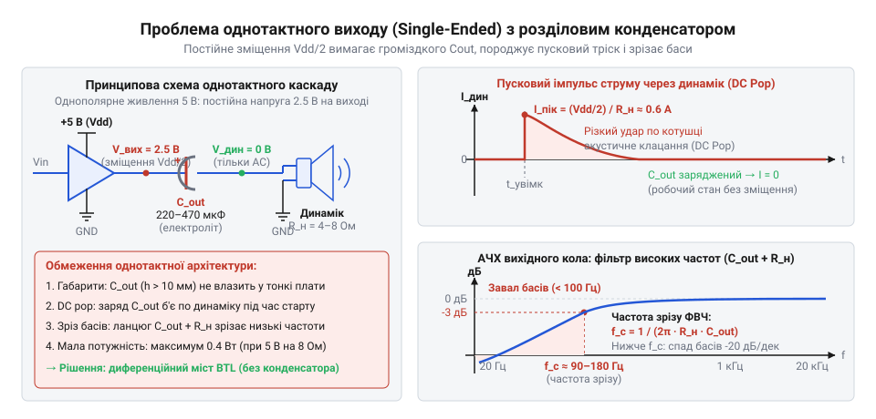
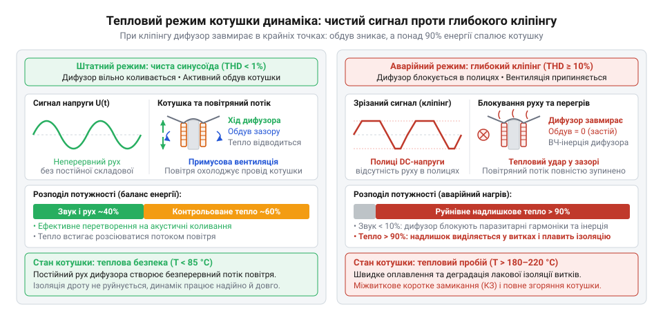
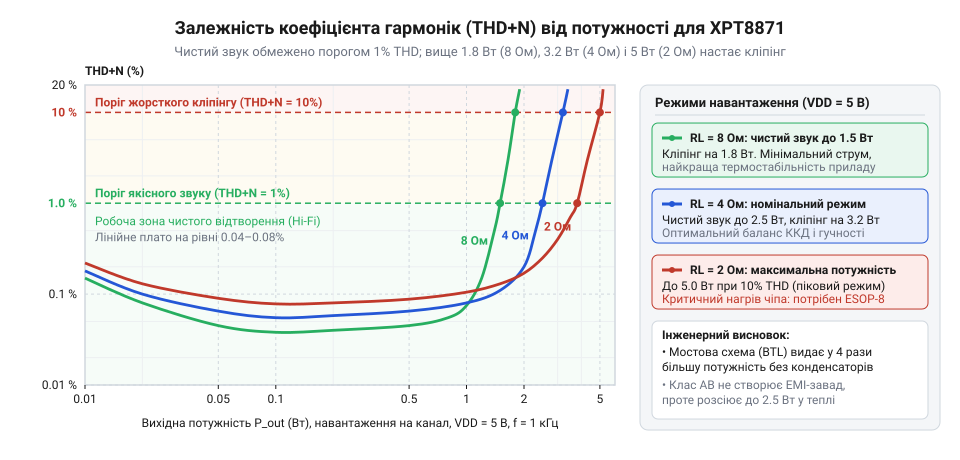

# XPT8871 — моно-підсилювач 5 Вт

<preknowlist>
- [Динаміки 5 Вт / 8 Ом](root:cat-hw-actuators/speakers-8ohm) — Будова електродинамічного гучномовця з рухомою котушкою, необхідність змінного струму для коливань дифузора, неприпустимість протікання постійного струму через загрозу теплового перегорання котушки та поняття номінального електричного імпедансу (4 Ом, 8 Ом), що визначає струм і вихідну потужність за законом Ома.
</preknowlist>

## Проблема портативного звуку: однополярне живлення та глухий кут вихідного конденсатора

На початку 1990-х років портативна електроніка — пейджери, перші мобільні телефони та кишенькові комп'ютери (КПК) — вперлася в обмеження автономного живлення: акумулятори забезпечували лише однополярну напругу 3.3–5 В (один літій-іонний елемент або три нікель-металгідридні банки) зі спільною землею. Традиційне стаціонарне аудіо спиралося на двополярне живлення (наприклад, ±15 В), де нульовий потенціал (від лат. *potentia* — сила, можливість) землі природно відповідав точці спокою: дифузор коливався симетрично в обидва боки без постійного струму через котушку. В однополярних портативних схемах земля стала непереборною нижньою межею.

В однополярній системі напруга не опускається нижче нуля вольтів. Звуковий сигнал знакозмінний: якщо вихід підсилювача в спокої триматиме 0 В, позитивна півхвиля пройде, а негативна зріжеться на рівні землі, спотворивши звук на тріск.

Щоб каскад класичного несиметричного або однотактного підсилювача (англ. @@en|single-ended@@ — буквально «з одним закінченням», від *single* — одиничний, та *end* — край, кінець) коливався симетрично, його робочу точку зміщують на середину напруги живлення `V_DD`:

`V_bias = V_DD / 2`

При живленні 5 В це зміщення дорівнює 2.5 В, при 3.3 В — 1.65 В. Навколо цієї штучної точки й відбувається корисне розгойдування амплітуди (від лат. *amplitudo* — просторість, величина) змінного сигналу.

Але другий вивід обмотки [електродинамічного гучномовця](root:cat-hw-actuators/speakers-8ohm) (від грец. *ēlektron* — бурштин та *dynamis* — сила) під'єднано до заземленої шини (0 В). Пряме з'єднання динаміка з таким виходом створює постійний струм через котушку:

**Розрахунок постійного струму та потужності нагріву котушки динаміка 8 Ом при прямому підключенні до виходу з потенціалом 2.5 В:**
```
I_DC
= V_bias / R_L                   [закон Ома для кола постійного струму]
= 2.5 / 8                        [підстановка напруги зміщення 2.5 В та опору 8 Ом]
= 0.3125 A                       [постійний струм спокою: 312.5 мА]

P_DC
= I_DC² · R_L                    [потужність теплових втрат на активному опорі]
= 0.3125² · 8                    [піднесення струму до квадрата]
= 0.097656 · 8                   [множення]
≈ 0.781 W                        [теплова потужність розсіювання в котушці]
```

Для мініатюрного динаміка на 0.25–0.5 Вт майже 0.8 Вт тепла фатальні: тонка мідна обмотка спікається за секунди. Крім того, дифузор зміщується до упору підвісу, руйнуючи симетрію коливань і породжуючи спотворення, а струм спокою 312.5 мА швидко виснажує акумулятор навіть у тиші.

Щоб відсікти постійне зміщення, але пропустити звук, послідовно з динаміком встановлювали [розділовий конденсатор](root:hw-analog/coupling-capacitor) (від лат. *condensare* — згущувати, ущільнювати; англ. @@en|DC-blocking capacitor@@). Конденсатор розриває коло для постійного струму й заряджається до `V_DD / 2`, утримуючи динамік під нульовим постійним потенціалом.


*В однополярному однотактному підсилювачі вихідне зміщення Vdd / 2 відсікається габаритним електролітичним конденсатором, який зрізає низькі частоти, викликає пускове клацання і звужує амплітуду коливань на динаміку.*

Однак послідовний конденсатор з опором динаміка `R_L` утворює фільтр високих частот першого порядку зі спадом 6 дБ/октаву. Його частота зрізу `f_c` визначається формулою:
```
f_c
= 1 / (2 · π · R_L · C)          [визначення частоти зрізу RC-фільтра першого порядку]
```

Звідси розраховують мінімально необхідну ємність для нижньої робочої частоти:

**Розрахунок ємності розділового конденсатора для збереження смуги пропускання від 90 Гц на навантаженні 8 Ом:**
```
C
= 1 / (2 · π · R_L · f_c)        [вираз для розрахунку розділової ємності]
= 1 / (2 · 3.1416 · 8 · 90)      [підстановка параметрів R_L = 8 Ом та f_c = 90 Гц]
= 1 / 4523.9                     [множення величин у знаменнику]
≈ 0.000221 F                     [значення ємності у фарадах]
= 221 μF                         [переведення у мікрофаради]
```

Для нижньої межі 90 Гц (де зрізається основний тон голосу) потрібна ємність від 220 мкФ, а для 4 Ом або басів від 50–60 Гц вона зростає до 470–1000 мкФ.

Ця фізична залежність поставила інженерів перед потрійним апаратним глухим кутом:

1. **Габарити електролітів**: Ємність 220–470 мкФ у 1990-х роках забезпечували лише алюмінієві електролітичні конденсатори (барильця діаметром 6–8 мм і заввишки 9–11 мм). У корпусах завтовшки 12–15 мм конденсатор диктував товщину приладу й займав на платі більше місця, ніж підсилювач з усією обв'язкою.

2. **Завал басів і фазові спотворення**: Поблизу частоти зрізу реактивний опір конденсатора `X_C = 1 / (2 · π · f · C)` стає сумірним з активним опором динаміка. Частина напруги марно падає на ємності, а фазовий зсув сягає 45°, руйнуючи щільність сигналу й розбірливість мови. Власний опір (ESR) дешевих електролітів додатково погіршував демпфування.

3. **Пусковий удар і клацання (англ. @@en|click-and-pop@@)**: Під час увімкнення вихід підсилювача стрибає від 0 В до `V_DD / 2` (2.5 В). Повністю розряджений конденсатор у першу мить поводиться як коротке замикання, прикладаючи всю напругу зміщення 2.5 В до динаміка:
```
I_pop
= V_bias / R_L                   [початковий струм заряджання розрядженого конденсатора]
= 2.5 / 8                        [підстановка напруги зміщення 2.5 В та опору 8 Ом]
= 0.3125 A                       [піковий струмовий стрибок через динамік]
```
Часова стала заряджання становить:
```
τ
= R_L · C                        [часова стала розрахункового RC-кола]
= 8 · (220 · 10⁻⁶)               [підстановка значень R_L = 8 Ом та C = 220 мкФ]
≈ 0.00176 s                      [тривалість наростання заряду: 1.76 мс]
```
Цей ударний імпульс струму силою 312.5 мА різко викидає дифузор уперед, породжуючи гучне механічне клацання під час кожного ввімкнення або пробудження тракту та зношуючи підвіс.

> 🔧 **Навіщо це.**
> Розуміння фізики однополярного однотактного виходу необхідне не лише під час аналізу вінтажних пристроїв. Навіть у сучасній техніці під час розробки виходу на навушники 3.5 мм інженери постійно зважують компроміс: ставити масивні розділові конденсатори й терпіти пускове клацання, чи застосовувати спеціалізовані мікросхеми зі штучним двополярним живленням від зарядової помпи (архітектури типу @@en|Capless@@ або @@en|DirectDrive@@). Розрахунок частоти зрізу та енергії пускового стрибка дає точний орієнтир для вибору ємності й запобігання пошкодженню динаміків.

Та навіть подолавши проблему габаритів, інженери вперлися в жорстку енергетичну стелю вихідної потужності.

У несиметричному каскаді розмах змінної напруги від піку до піку (англ. @@en|peak-to-peak@@) обмежений шинами живлення: від 0 В знизу до `V_DD` зверху. Оскільки коливання відбуваються навколо середньої точки `V_DD / 2`, теоретична амплітуда не перевищує половини живлення:

`U_peak ≤ V_DD / 2`

У реальних підсилювачах біполярні вихідні транзистори вимагають напруги насичення `V_sat` (типово 0.5 В на плече), зменшуючи доступну амплітуду:
```
U_peak
= (V_DD - 2 · V_sat) / 2         [розмах від середньої точки до порогу насичення транзисторів]
```

Зв'язок між амплітудою вихідної напруги та електричною потужністю змінного струму виводиться через чинну напругу `U_rms = U_peak / √2`:
```
P
= U_rms² / R_L                   [закон Джоуля — Ленца через чинну напругу]
= (U_peak / √2)² / R_L           [вираз чинної напруги через амплітуду синусоїди]
= (U_peak² / 2) / R_L            [піднесення чисельника до квадрата]
= U_peak² / (2 · R_L)            [формула потужності синусоїдного сигналу на навантаженні]
```

Для гіпотетичного підсилювача з ідеальним розмахом без втрат (`V_sat = 0`) це дає граничну теоретичну межу:
```
P_ideal
= (V_DD / 2)² / (2 · R_L)        [підстановка ідеальної амплітуди U_peak = V_DD / 2]
= (V_DD² / 4) / (2 · R_L)        [розкриття квадрата в чисельнику]
= V_DD² / (8 · R_L)              [теоретична межа потужності однотактного каскаду]
```

На практиці спад напруги насичення на транзисторах різко зменшує корисну потужність на реальному навантаженні 8 Ом:

**Порівняльний розрахунок практичної вихідної потужності однотактного каскаду при живленні 5 В та 3.3 В (V_sat = 0.5 В, R_L = 8 Ом):**
```
U_peak_5V
= (5.0 - 2 · 0.5) / 2            [віднімання спадів напруги насичення двох транзисторів]
= 4.0 / 2                        [корисний розмах коливань]
= 2.0 V                          [амплітуда неспотвореної напруги]

P_5V
= 2.0² / (2 · 8)                 [підстановка U_peak = 2.0 В та R_L = 8 Ом]
= 4.0 / 16                       [обчислення квадрата чисельника й знаменника]
= 0.25 W                         [реальна вихідна потужність при 5 В: 250 мВт]

U_peak_3V3
= (3.3 - 2 · 0.5) / 2            [корисний розмах при зниженій напрузі живлення]
= 2.3 / 2                        [обчислення різниці]
= 1.15 V                         [фактична корисна амплітуда]

P_3V3
= 1.15² / (2 · 8)                [підстановка амплітуди 1.15 В та опору 8 Ом]
= 1.3225 / 16                    [обчислення чисельника і знаменника]
≈ 0.083 W                        [реальна вихідна потужність при 3.3 В: 83 мВт]
```

Потужність 0.08–0.25 Вт створювала звуковий тиск лише 68–70 дБ на відстані пів метра: за міського шуму 75–80 дБ сигнал пейджера чи голос у телефоні губилися повністю. Однотактний каскад із розділовим конденсатором зайшов у глухий кут: фізичні обмеження низьковольтного живлення вимагали принципово нової топології підсилювача.

## Інженерний прорив National Semiconductor: лінійка Boomer та міст BTL

У портативній електроніці початку 1990-х років із живленням 3.3–5 В однотактний підсилювач зайшов у глухий кут. Для відсікання постійного струму через [динамік](root:cat-hw-actuators/speakers-8ohm) був потрібен велетенський конденсатор на 220–470 мкФ, більший за плату. Розмах напруги обмежував потужність до 0.2 Вт на 8 Ом, а ставити імпульсний перетворювач (англ. @@en|boost converter@@) було задорого.

У 1992–1994 роках інженери американської компанії National Semiconductor запропонували елегантне схемотехнічне розв'язання, випустивши спеціалізовану лінійку аудіочипів під торговельною маркою @@en|Boomer@@ (від англ. @@en|boom@@ — гучний насичений звук). Її першим комерційним утіленням стала мікросхема LM4861, яку згодом розвинула популярна LM4871.

Суть інженерного стрибка полягала у відмові від прив'язки динаміка до землі та переході до мостового включення навантаження — BTL (англ. @@en|Bridge-Tied Load@@, навантаження, увімкнене в діагональ моста; від лат. @@la|pons@@ — міст). Замість одного підсилювача на кристалі розмістили два ідентичні аналогові операційні каскади, керовані в протифазі.

Перший підсилювач працює як класичний інвертувальний каскад із коефіцієнтом підсилення, що задається зовнішніми резисторами: `A_V1 = - R_f / R_i`. Другий підсилювач інтегрований у кристал із внутрішніми прецизійно підігнаними резисторами зворотного зв'язку фіксованого номіналу, які утворюють інвертор з одиничним коефіцієнтом передачі: `A_V2 = -1`. Його вхід під'єднано безпосередньо до виходу першого підсилювача. [Динамік 8 Ом](root:cat-hw-actuators/speakers-8ohm) підключають диференційно (лат. @@la|differentia@@ — різниця) — між виходами `V_out1` та `V_out2`, без жодного контакту із шиною заземлення.


*Принципова схема мостового каскаду BTL: протифазне керування подвоює розмах змінної напруги на клемах навантаження та забезпечує нульову різницю постійних потенціалів без використання вихідного конденсатора.*

Таке включення дало два одночасні фізичні результати:

По-перше, зникла потреба у вихідному електролітичному конденсаторі. Внутрішній дільник мікросхеми формує для обох підсилювачів однакову віртуальну середню точку `V_dd / 2`. За відсутності звукового сигналу обидва виходи перебувають під ідентичним постійним потенціалом:

```
V_diff_DC
= V_out1_DC - V_out2_DC                  [різниця постійних потенціалів на навантаженні]
= (V_dd / 2) - (V_dd / 2)                [однаковий зсув середньої точки на обох виходах]
= 0 В                                    [нульова постійна напруга між клемами динаміка]
```

Оскільки різниця потенціалів строго дорівнює нулю, постійний струм через котушку не тече: `I_DC = 0 В / R_L = 0 А`. Дифузор лишається у вихідному механічному спокої, котушка не нагрівається, а громіздкий оксидний конденсатор назавжди зник із друкованої плати. Виводи динаміка підпаюються безпосередньо до вихідних ніжок мікросхеми.

По-друге, розмах змінної напруги подвоївся. Коли перший підсилювач зміщує напругу на своєму виході вгору на величину поточної амплітуди `+V_p` відносно середньої точки, другий каскад дзеркально зміщує свій вихід униз на `-V_p`. Результуюча миттєва напруга на виводах динаміка дорівнює різниці вихідних сигналів:

```
V_diff(t)
= V_out1(t) - V_out2(t)                  [миттєва диференційна напруга на навантаженні]
= (V_dd / 2 + V_p(t)) - (V_dd / 2 - V_p(t)) [протифазні коливання плечей моста]
= 2 · V_p(t)                             [подвоєння амплітуди напруги]
```

Оскільки потужність змінного струму пропорційна квадрату напруги, подвоєння амплітуди дало чотирикратний теоретичний приріст вихідної потужності:

```
P_BTL
= (V_diff_rms)² / R_L                    [визначення потужності через діючу напругу]
= ((2 · V_p) / √2)² / R_L                [підстановка амплітуди диференційного сигналу]
= (4 · V_p² / 2) / R_L                   [алгебраїчне піднесення до квадрата]
= 4 · (V_p² / (2 · R_L))                 [винесення спільного множника]
= 4 · P_SE                               [теоретичний зв'язок із потужністю однотактного каскаду]
```

На практиці з урахуванням залишкової напруги насичення на транзисторах отримуємо:

```
P_BTL
= (2 · 1.8 В)² / (2 · 8 Ом)              [подвоєна диференційна амплітуда 3.6 В]
= (3.6 В)² / 16 Ом
= 12.96 / 16
≈ 0.81 Вт                                [реальна вихідна потужність на 8 Ом при 5 В]
```

За стабільного живлення 5.0 В мікросхема LM4861 забезпечувала 1.1 Вт тривалої потужності за коефіцієнта гармонік THD+N не більше 1% на навантаженні 8 Ом. Цей результат було досягнуто у стандартному восьмививідному корпусі для поверхневого монтажу SOIC-8 (англ. @@en|Small Outline Integrated Circuit@@) без застосування підвищувальних перетворювачів.

> 🔧 **Навіщо це.**
> Топологія BTL розв'язала головну суперечність портативного звуку: як отримати понад 1 Вт акустичної потужності від низької напруги без громіздких котушок індуктивності та перетворювачів живлення. Усунення вихідного електролітичного конденсатора заощадило понад 70% площі аудіотракту на платі та зменшило її монтажну висоту до кількох міліметрів, відкривши шлях до створення перших по-справжньому компактних кишенькових приладів.

## Приборкання пускових клацань: керований старт і режим сну для кишенькових приладів

Усунення розділового конденсатора в мостовій топології BTL оголило вразливість диференційних схем: під час подачі живлення або виходу з чергового режиму підсилювач видавав у [динамік](root:cat-hw-actuators/speakers-8ohm) різкий акустичний удар — перехідне клацання (англ. @@en|click-and-pop noise@@).

Опорна напруга віртуальної середньої точки `V_dd / 2` формується внутрішнім подільником напруги й під час увімкнення підіймається від 0 В до робочого рівня. Оскільки вихідні підсилювачі моста зв'язані послідовно (другий каскад інвертує сигнал з виходу першого), через технологічний розкид транзисторів і затримку поширення сигналу вихідні напруги `V_out1` та `V_out2` наростають несинхронно.

Випередження першого каскаду бодай на кілька мікросекунд створює між клемами динаміка різкий диференційний сплеск `ΔV = V_out1(t) - V_out2(t)`. Цей імпульс постійного струму рвучко відхиляє звукову котушку з дифузором, що сприймається вухом як гучний тріск. Для кишенькових телефонів кінця 1990-х років (Nokia, Motorola), які постійно підносять до вуха, такий акустичний удар був неприйнятним.

Водночас автономний телефон вимагав суворої економії заряду. Аудіотракт активний лише під час виклику чи натискання клавіш; решту часу лінійні каскади безперервно спалювали б 6–10 мА струму спокою, швидко розряджаючи батарею. Повне ж від'єднання живлення зовнішнім ключем щоразу спричиняло б гучне клацання. У мікросхемі LM4871 розробники подолали цю суперечність трикомпонентним механізмом: керований плавний пуск (англ. @@en|soft-start@@), вивід конденсатора байпасу `C_B` (англ. @@en|bypass@@ — шунтування) та логічний режим сну (англ. @@en|shutdown@@).


*Часові діаграми перехідного процесу під час увімкнення BTL: без компенсації розбіжність фронтів породжує диференційний імпульс тріску; підключення конденсатора C_B вирівнює наростання опорної напруги, усуваючи удар.*

Внутрішній подільник опорної напруги реалізовано на двох узгоджених резисторах по 50 кОм. За теоремою Тевеніна його еквівалентний опір становить: `R_eq = 50 кОм / 2 = 25 кОм`. До окремого виводу @@en|Bypass@@ підключають зовнішній конденсатор `C_B` (типово 0.39–1.0 мкФ) відносно землі. Разом вони утворюють інтегрувальну RC-ланку, що задає постійну часу встановлення зміщення:

```
τ
= R_eq · C_B                             [постійна часу наростання опорної напруги]
= 25 000 Ом · 1 · 10⁻⁶ Ф                 [еквівалентний опір подільника 25 кОм і ємність 1 мкФ]
= 0.025 с                                [час встановлення 63% цільового потенціалу]
= 25 мс
```

Опорна напруга наростає за плавною експонентою за час `t_start ≈ 3 · τ ≈ 75 мс`. Схема плавного пуску блокує проходження аудіосигналу та симетрично транслює це зміщення на неінвертуючі входи обох підсилювачів. Плечі моста виходять на `V_dd / 2` з однаковою швидкістю (`V_out1(t) ≈ V_out2(t)`), завдяки чому диференційна пускова напруга на котушці динаміка лишається нульовою:

```
V_diff_transient(t)
= V_out1(t) - V_out2(t)                  [диференційна напруга під час запуску]
≈ (V_dd / 2) · (1 - e^(-t / τ)) - (V_dd / 2) · (1 - e^(-t / τ)) [синхронне наростання обох виходів]
= 0 В                                    [відсутність пускового імпульсу струму в динаміку]
```

Окрім усунення клацань, конденсатор `C_B` шунтує середню точку на землю, фільтруючи завади шини живлення та забезпечуючи високий [коефіцієнт придушення пульсацій живлення](root:hw-analog/psrr-audio-amplifiers) (англ. @@en|Power Supply Rejection Ratio@@, PSRR) на рівні 60–65 дБ.

Логічний вхід @@en|Shutdown@@ усунув перевитрату енергії: високий рівень на цьому виводі знеструмлює внутрішні генератори зміщення та вихідні каскади, знижуючи струм спокою до <1 мкА (типово 0.6 мкА) без від'єднання мікросхеми від батареї. Процесор телефона утримував LM4871 у глибокому сні під час очікування й переводив Shutdown у низький рівень лише для виклику чи звуку клавіатури — підсилювач плавно прокидався за мілісекунди без стороннього клацання в [динаміку](root:cat-hw-actuators/speakers-8ohm).

> 🔧 **Навіщо це.**
> Ємність конденсатора `C_B` задає інженерний компроміс між чистотою перехідного процесу та швидкістю пробудження аудіопідсилювача. Збільшення ємності до 1.0–2.2 мкФ надійно усуває клацання `click-and-pop` і максимізує придушення пульсацій живлення, але збільшує час виходу зі сну (`t_start ≈ 3 · R_eq · C_B`). Зменшення ємності до 0.1 мкФ прискорює запуск мікросхеми до 5–10 мс, проте за нестабільного живлення підвищує ризик виникнення ледь чутного клацання.

## Розділ 4: Азійська коммодитизація, вихід на надмасовий ринок і подолання теплового бар'єра: шлях від західного оригіналу до чипів XPT8871 у корпусах ESOP-8 у 2000–2010-х роках

Наприкінці 2000-х років ринок персональної портативної електроніки вимагав компактного, дешевого та водночас гучного звукового тракту для роботи від 3.3–5 В — безпосередньо від одного літій-іонного акумулятора (3.7 В) або лінії живлення USB. Архітектурним стандартом низьковольтного звуку залишалася мостова BTL-схемотехніка американської компанії @@en|National Semiconductor@@ (підсилювач LM4871 лінійки @@en|Boomer@@). Проте західні оригінали коштували понад 1 долар, що було надто дорого для масових пристроїв. Завершення строку дії патентів Boomer відкрило шлях до стрімкої коммодитизації (англ. @@en|commoditization@@ від латинського *commoditas* — товар широкого вжитку, зручність).

Азійські фаблес-компанії налагодили випуск наддешевих функціональних аналогів LM4871 вартістю лише лічені центи: MIX2018 від Mixinwei, LTK5128 від LTKCHIP та беззаперечного лідера надмасового сектору — чипа XPT8871 від компанії @@en|XPTEK@@. Ці мікросхеми зберегли топологію мостового включення без вихідних розділових конденсаторів. Проте разом із масовим виробництвом розробники зіткнулися з новим бар'єром: скромної потужності 1 Вт на стандартних [динаміках 5 Вт / 8 Ом](root:cat-hw-actuators/speakers-8ohm) ринку було замало, портативна техніка вимагала гучності рівня 3–5 Вт.

Оскільки напруга живлення залишалася обмеженою шиною 5 В або літієвим елементом, підвищити амплітуду напруги без громіздкого DC-DC перетворювача було неможливо. Єдиним шляхом збільшення віддачі стало зниження електричного імпедансу (лат. *impedio* — перешкоджаю) навантаження — перехід на динаміки опором 4 Ом і навіть 2 Ом. Проте XPT8871 побудований за схемотехнікою лінійного підсилювача класу AB (лат. *classis* — розряд, категорія). Його вихідні транзистори працюють у лінійному режимі, гасячи різницю між живленням та амплітудою сигналу на динаміку. За реального ККД підсилювача лише 60–65% решта 35–40% споживаної енергії неминуче виділяється у вигляді тепла прямо на кремнієвому кристалі (грец. *krystallos* — прозорий камінь, лід).


*Порівняння чистої синусоїди та кліпінгу: зрізання верхівок сигналу блокує рух дифузора й перетворює підведену енергію на руйнівний нагрів звукової котушки динаміка.*

У стандартному восьмививідному корпусі SOIC-8 (SOP-8) кристал герметично залитий епоксидним компаундом — надійним діелектриком, але вираженим теплоізолятором із теплопровідністю лише 0.6–0.9 Вт/(м·К). Тепловий опір (лат. *resistentia* — опір) перехід-довкілля (@@en|thermal resistance junction-to-ambient@@, `R_θJA`) для стандартного SOIC-8 на звичайній двошаровій платі сягає близько `140 °C/Вт`.

Фізику теплового колапсу стандартного корпусу наочно ілюструє покроковий інженерний розрахунок:

**Розрахунок теплових втрат і перегріву кристала підсилювача при вихідній потужності 2 Вт на навантаженні 4 Ом при живленні 5 В:**

Потужність теплових втрат, що виділяється на кристалі:
```
P_out = 2.0 Вт                     [корисна акустична потужність на динаміку]
η = 0.62                           [типовий ККД лінійного підсилювача класу AB]
P_sup = P_out / η                  [повна електрична потужність від живлення]
      = 2.0 / 0.62
      ≈ 3.23 Вт
P_diss = P_sup - P_out             [потужність теплових втрат на кристалі]
       = 3.23 - 2.0
       = 1.23 Вт
```

Очікувана робоча температура кристала в корпусі SOIC-8 за температури навколишнього повітря `T_A = 25 °C`:
```
R_θJA = 140 °C/Вт                  [тепловий опір звичайного корпусу SOIC-8]
ΔT = P_diss × R_θJA                [температурний перегрів відносно довкілля]
   = 1.23 × 140
   = 172.2 °C
T_J = T_A + ΔT                     [абсолютна температура кремнієвого кристала]
    = 25 + 172.2
    = 197.2 °C
```

Висновок: розрахункова температура кристала `197.2 °C` далеко перевищує поріг спрацьовування аварійного теплового захисту (@@en|Thermal Shutdown@@, TSD, грец. *therme* — тепло), який у мікросхемі налаштований на рівень `150–160 °C`. На практиці підсилювач у корпусі SOIC-8 на такій потужності розжарювався за лічені секунди, аварійно вимикався захистом, вистигав завдяки петлі гістерезису, вмикався знову і миттєво перегрівався повторно. Звук перетворювався на нерозбірливе циклічне заїкання. Корпус SOIC-8 уперся в непереборний бар'єр: він фізично не міг розсіяти понад 1–1.2 Вт тепла.

Інженерним порятунком став перехід на вдосконалений корпус ESOP-8 (@@en|Exposed SOP-8@@). За зовнішніми габаритами тіла та кроком виводів він повністю взаємозамінний зі звичайним SOIC-8, що позбавило потреби змінювати виробничу оснастку. Проте металевий майданчик рамки (англ. @@en|die attach paddle@@), на який монтується кристал, більше не ховається під пластиком, а виходить назовні на нижній площині корпусу у вигляді відкритого металевого черева (@@en|Exposed Pad@@).


*Конструктивне порівняння шляхів розсіювання тепла: стандартний пластиковий корпус SOIC-8 затримує тепло всередині епоксидного компаунду, спричиняючи критичний перегрів кристала вже при 1–1.5 Вт, тоді як корпус ESOP-8 з відкритим металевим черевом скидає тепловий потік безпосередньо в паяний мідний полігон і перехідні отвори друкованої плати, знижуючи тепловий опір утричі та дозволяючи віддавати потужність кількох ватів.*

Під час монтажу відкрите металеве черево ESOP-8 припаюється припоєм безпосередньо до відповідного майданчика на друкованій платі. Безпосередньо під ним виготовляють сітку з 4–9 перехідних тепловідвідних отворів (англ. @@en|thermal vias@@) діаметром 0.3 мм, сполучених із суцільними мідними полігонами (грец. *polygonos* — багатокутний) заземлення зворотного та внутрішніх шарів плати. Завдяки прямому металевому спаю сумарний [тепловий опір друкованих плат](root:hw-pcb/thermal-resistance-pcb) усієї конструкції «кристал — мідь плати — навколишнє повітря» (`R_θJA`) знижується зі `140 °C/Вт` до `40–50 °C/Вт`.

Розрахуємо температурний режим мікросхеми в корпусі ESOP-8 за тих самих умов тепловіддачі `P_diss = 1.23 Вт` та `T_A = 25 °C`:
```
R_θJA_ESOP = 45 °C/Вт              [тепловий опір ESOP-8 із мідним полігоном]
ΔT_ESOP = P_diss × R_θJA_ESOP      [перегрів кристала відносно повітря]
        = 1.23 × 45
        ≈ 55.4 °C
T_J_ESOP = T_A + ΔT_ESOP           [абсолютна температура кристала]
         = 25 + 55.4
         = 80.4 °C
```

Висновок: температура кристала становить лише `80.4 °C`, що забезпечує безпечний запас близько `70 °C` до порогу спрацьовування теплового захисту. Корпус ESOP-8 дозволив безпечно розсіювати до 2.5–3 Вт тепла без зовнішніх радіаторів, перетворивши саму мідь плати на високоефективний теплорозподільник. Саме перехід на корпус ESOP-8 дозволив мікросхемі XPT8871 видавати 3–5 Вт на навантаженнях 4 Ом та 2 Ом і стати незмінним лідером надмасової портативної електроніки.

> 🔧 **Навіщо це.**
> Розуміння конструкції корпусу ESOP-8 життєво необхідне під час самостійного трасування друкованих плат та ручного ремонту пристроїв на базі XPT8871. Центральний металевий майданчик Exposed Pad внутрішньо з'єднаний із кремнієвою підкладкою кристала і має спільний електричний контакт із виводом заземлення GND. Якщо радіоаматор запаяє мікросхему звичайним паяльником по контуру восьми ніжок, залишивши центральне металеве черево неприпаяним, чип миттєво повернеться до теплових параметрів звичайного SOIC-8 з тепловим опором 140 °C/Вт. На гучності понад 1 Вт такий підсилювач кожні кілька секунд вимикатиметься через спрацьовування термозахисту TSD.
>
> Для досягнення паспортної потужності друкована плата під черевом чипа обов'язково повинна містити масив із 4–9 металізованих отворів (vias) діаметром 0.3 мм, підключених до заливки GND площею щонайменше 4–6 см², а монтаж мікросхеми слід виконувати термоповітряним феном або в паяльній печі з використанням паяльної пасти. Для ручного монтажу класичним паяльником під центральним майданчиком проєктують один великий наскрізний отвір діаметром 1.2–1.5 мм, через який черево мікросхеми прогрівають і заливають припоєм зі зворотного боку плати.

## Протистояння топологій у добу мобільного зв'язку: чому лінійний клас AB не канув у лету під натиском імпульсного класу D

Наприкінці 2000-х років ринок портативної електроніки охопила ейфорія, спричинена появою інтегральних [підсилювачів класу D](root:hw-analog/class-d-amplifier) (від англ. @@en|Class D amplifier@@), чиїм символом став [стереочип PAM8403](root:cat-hw-actuators/pam8403-stereo-amp) компанії @@en|Power Analog Microelectronics@@. Головний козир нової топології здавався нищівним: завдяки ключовому режиму вихідних польових транзисторів коефіцієнт корисної дії (ККД) сягав 85–90%. На тлі лінійного класу AB, де теоретична межа ефективності для синусоїди не перевищує 78.5%, а під час відтворення музики чи мовлення рідко сягає навіть 40–50%, імпульсні схеми сприймалися як вирок аналоговій схемотехніці. Здавалося, чипи класу AB на зразок @@en|XPT8871@@ або родини Boomer остаточно кануть у лету, поступившись повністю імпульсним рішенням без радіаторів. Проте очікуваного витіснення не сталося: аналогові мостові підсилювачі зберегли гігантський ринок і досі випускаються мільярдами через фундаментальну фізику імпульсного підсилення та закони поширення радіохвиль.

У класі D звук не передається як безперервна аналогова крива: вхідний сигнал модулюється у високочастотну прямокутну послідовність за допомогою широтно-імпульсної модуляції (ШІМ; модуляція — від лат. @@en|modulatio@@, розміреність; англ. @@en|PWM@@, @@en|pulse-width modulation@@). Несуча частота комутації типового низьковольтного підсилювача становить 250–500 кГц. Щоб мінімізувати нагрівання кристала й не втрачати енергію під час повільного переходу транзисторів між станами, польові ключі перемикаються миттєво: тривалість наростання і спаду фронтів напруги становить лічені наносекунди (від лат. @@en|nanus@@ — карлик; `t_r < 5–10 нс`).

За математичним аналізом Фур'є (від імені французького математика Жана-Батіста Жозефа Фур'є, фр. @@en|Jean-Baptiste Joseph Fourier@@), прямокутний імпульс зі швидкими фронтами комутації та колосальними швидкостями `dV/dt` і `dI/dt` має широкий спектр (від лат. @@en|spectrum@@ — видіння, образ). Прямокутний меандр розкладається на нескінченний ряд непарних гармонік (від грец. @@en|harmonikos@@ — співзвучний), чия інтенсивність спадає дуже повільно. У результаті вихід класу D випромінює шум від сотень кілогерців до сотень мегагерців. Доріжки друкованої плати та дроти до котушки [динаміка](root:cat-hw-actuators/speakers-8ohm) перетворюються на ефективні випромінювальні антени, що створюють потужні електромагнітні завади (від англ. @@en|EMI@@, @@en|electromagnetic interference@@; інтерференція — від лат. @@en|inter@@ — взаємно та @@en|ferio@@ — вдаряю).

У компактних приладах звуковий підсилювач змушений сусідити з чутливими антенами на відстані кількох міліметрів. Випромінювані гармоніки класу D спричиняють десенсибілізацію радіотракту або «десенс» (від англ. @@en|desense@@ / @@en|desensitization@@ — притуплення чутливості):
- У класичному FM-діапазоні (64–108 МГц) гармоніки комутації 250–500 кГц лягають із кроком 0.5 МГц прямо на сітку радіомовних каналів, глушачи слабкі станції свистом і шумом.
- У високочастотних трактах [стільникового зв'язку GSM](root:hw-analog/gsm-audio-buzz)/LTE, модулях GPS, Bluetooth і Wi-Fi (2.4 ГГц) широкосмуговий імпульсний шум різко піднімає шумовий поріг (англ. @@en|noise floor@@). Приймач перестає розрізняти слабкі пакети даних, дальність Bluetooth падає з десяти метрів до кількох кроків, а стільниковий модем втрачає зв'язок із базовою станцією.

Боротьба з електромагнітними завадами вимагає значних апаратних жертв. Задля електромагнітної сумісності (від англ. @@en|EMC@@, @@en|electromagnetic compatibility@@) вихідні лінії класу D оснащують LC-фільтрами другого порядку або феритовими намистинами (англ. @@en|ferrite beads@@; ферит — від лат. @@en|ferrum@@ — залізо) з високочастотними конденсаторами. Котушки індуктивності дорогі, громіздкі й мають опір постійному струму (англ. @@en|DCR@@, @@en|DC resistance@@), де частка збереженої енергії розсіюється теплом. Плати доводиться робити чотиришаровими з суцільними полігонами заземлення, а звуковий каскад накривати металевими екранами (англ. @@en|shielding cans@@). У бюджетній електроніці ці заходи збільшують собівартість специфікації компонентів (англ. @@en|BOM@@, @@en|bill of materials@@) і габарити пристрою, нівелюючи вигоду від високого ККД мікросхеми.

На противагу цьому, мостовий підсилювач класу AB на зразок XPT8871 суто лінійний. Його транзистори проводять струм плавно, і напруга на навантаженні повторює звуковий спектр (від 20 Гц до 20 кГц) без імпульсної модуляції чи фронтів комутації. У радіочастотній області спектр класу AB чистий і містить лише мізерний тепловий шум. Це дозволяє розводити плату на найдешевшому двосторонньому текстоліті та монтувати мікросхему впритул до антени Bluetooth чи тюнера без індуктивностей або екранів: уся обв'язка зводиться до двох-трьох керамічних конденсаторів та резисторів.


*Спектральний склад випромінювання та схемна реалізація вихідних кіл: лінійний режим підсилювача класу AB унеможливлює появу радіочастотних завад поблизу приймальної антени, тоді як імпульсна комутація класу D створює гребінку високочастотних гармонік і потребує встановлення додаткових індуктивно-ємнісних фільтрів.*

> 🔧 **Навіщо це.**
> В інженерному проєктуванні вибір між класом AB та класом D не зводиться до сліпої гонитви за високим коефіцієнтом корисної дії. Якщо прилад містить радіочастотний тракт — приймач FM, модуль Bluetooth, антену Wi-Fi або навігацію GPS, — імпульсний підсилювач класу D вимагає встановлення індуктивностей, екранів та багатошарового трасування для захисту ефіру від завад, що здорожчує конструкцію і збільшує габарити друкованої плати. Застосування лінійного мікросхемного підсилювача класу AB, такого як XPT8871, дає змогу розташувати звуковий каскад безпосередньо біля чутливої антени без жодної фільтрації, зберігши мінімальну собівартість та чистий радіоприйом ціною помірного нагрівання корпусу.

У технічній документації до XPT8871 виробники заявляють потужність «5 Вт». Проте для інженера ця цифра є маркетинговою ілюзією, що маскує фізичні межі лінійної напівпровідникової топології. Межею якісного звучання слугує сумарний коефіцієнт нелінійних спотворень із шумом — THD+N (від англ. @@en|THD+N@@, @@en|Total Harmonic Distortion plus Noise@@; спотворення — від лат. @@en|distorsio@@, викривлення; нелінійність — від лат. @@en|linearis@@, лінійний), що виражає співвідношення потужності новоутворених гармонік і шуму до основного сигналу.

Розглянемо фізичні обмеження BTL-виходу за типового живлення `V_DD = 5.0 В`. Оскільки динамік увімкнено між двома протифазними каскадами, теоретичний розмах напруги на навантаженні від піка до піка становить `2 · V_DD = 10 В`, а максимальна амплітуда — `V_out(peak) = 5.0 В`. Проте на вихідних ключах падає спад напруги насичення `V_sat ≈ 0.4 В` на кожне плече, через що максимальна неспотворена синусоїдальна амплітуда обмежена значенням `V_out(peak) = V_DD - 2 · V_sat ≈ 4.2 В`. Її діюче значення (англ. @@en|RMS@@, @@en|root mean square@@):

```
V_out(RMS)
= (V_DD - 2 · V_sat) / √2      [діюча напруга синусоїди зі спадом на транзисторах]
= 4.2 / 1.414                  [підстановка V_DD = 5.0 В та V_sat ≈ 0.4 В]
≈ 2.97 В                       [діюче значення неспотвореної напруги на навантаженні]
```

Звідси за законом Джоуля — Ленца чиста вихідна потужність (THD+N < 1%) становить:

```
P_out(clean)
= V_out(RMS)² / R_L            [закон Джоуля — Ленца для потужності змінного струму]
= 2.97² / R_L                  [підстановка діючої неспотвореної напруги 2.97 В]
≈ 1.1 Вт                       [чиста потужність на 8 Ом: 8.82 / 8.0, THD+N < 1%]
≈ 2.2 Вт                       [чиста потужність на 4 Ом: 8.82 / 4.0, THD+N < 1%]
```

Для низькоомного навантаження 2 Ом вихідний струм перевищує 1.5–2 А, і через омічний опір кремнію та виводів чиста потужність стабілізується на рівні 2.5–2.7 Вт.

Звідки ж беруться паспортні «5 Вт»? Вони виникають лише тоді, коли вхідний сигнал штучно заганяють за лінійну межу. Намагаючись видати амплітуду понад 4.2 В, підсилювач упирається у власні шини живлення. Вихідні каскади насичуються, і верхівки синусоїди різко обрізаються — настає кліпінг (від англ. @@en|clipping@@ — обтинання). На графіку залежності THD+N від вихідної потужності утворюється характерне «коліно кліпінгу» (англ. @@en|clipping knee@@): після пологої зони чистого сигналу (THD < 0.1–0.5% до 2–2.5 Вт) спотворення стрімко злітають угору.

При подальшому перевантаженні зрізана хвиля перетворюється на прямокутний меандр, де діюча напруга збігається з амплітудною (`V_RMS = V_peak`):

```
P_out(square)
= V_peak² / R_L                [для прямокутного меандру діюча напруга дорівнює амплітудній]
= 3.16² / 2.0                  [підстановка амплітуди з урахуванням просідання під навантаженням 2 Ом]
= 5.0 Вт                       [маркетингова потужність при катастрофічному кліпінгу: THD+N = 10%]
```

Саме так народжуються заповітні «5 Вт на 2 Ом при 5 В живлення»: ціною деформації звукової хвилі в прямокутник, коли THD+N сягає неприйнятних 10%, а звук перетворюється на виснажливе гарчання.

Окрім акустичного спотворення, тривалий кліпінг несе пряму загрозу фізичного руйнування котушки гучномовця. Згідно з теоремою Фур'є, прямокутний меандр містить нескінченний ряд непарних гармонік вищих порядків (3-тя, 5-та, 7-ма тощо). Масивний дифузор динаміка через власну інерцію не здатний коливатися з такими частотами: він залишається нерухомим, проти-ЕРС не виникає, а конвективне продування повітря крізь отвори магнітної системи припиняється. Уся потужність високочастотних гармонік розсіюється у вигляді тепла на тонкому мідному проводі котушки. Температура обмотки стрімко піднімається вище 150 °C, ізоляційний термостійкий лак руйнується, виникає міжвиткове замикання, і динамік безповоротно згоряє.


*Залежність сумарного коефіцієнта нелінійних спотворень із шумом від вихідної потужності: після пологої зони чистого сигналу амплітуда досягає шин живлення, породжуючи різкий перегин кривої та насичення звукового тракту вищими гармоніками.*

У підсумку технічний паспорт XPT8871 фіксує два різні режими: граничні 5 Вт як точку термічного виживання кристала на межі кліпінгу та реальну акустичну потужність 1–2.2 Вт чистого звуку для навантаження 4–8 Ом. Саме ці чесні два вати лінійної потужності без жодної електромагнітної завади в мініатюрному корпусі @@en|ESOP-8@@ із тепловідвідною пластиною стали тією інженерною золотою серединою, яка забезпечила мостовому класу AB довголіття в епоху бездротових комунікацій.

## Розвінчання маркетингового міфу про «5 ватів від 5 вольт»: графіки спотворень, реальна фізика потужності та правила вибору компонентів

Маркування «5W Audio Amplifier» на мініатюрних китайських модулях з мікросхемою XPT8871 стало класичним джерелом інженерної омани для розробників-початківців. Плата розміром з поштову марку обіцяє повноцінне п'ятиватне звучання від порту USB або однієї Li-ion батареї: під'єднати живлення 5 В, подати звук від мікроконтролера й озвучити кімнату чистим звуком без громіздких радіаторів. Проте на практиці щойно регулятор гучності викручують на максимум, підсилювач захлинається хрипом і тріском, а мініатюрний корпус розігрівається до температури, здатної розплавити припій або спричинити термічний опік.

Ця розбіжність між рекламою та реальністю криється в специфічних умовах вимірювання, зазначених у паспорті XPT8871 дрібним шрифтом. Заявлені 5 Вт вихідної потужності вимагають суворого збігу трьох граничних умов:
- напруга живлення становить рівно `5.0 В` без найменшого просідання;
- опір навантаження дорівнює критично низьким `2.0 Ом`;
- коефіцієнт нелінійних спотворень із шумом @@en|Total Harmonic Distortion plus Noise@@ (THD+N, від лат. *distorsio* — викривлення, перекручення) сягає колосальних `10%`.

Рівень спотворень `10%` означає, що десята частина всієї енергії вихідного сигналу припадає на паразитні вищі гармоніки замість корисного звуку. Синусоїдальний сигнал тут зникає: підсилювач намагається видати амплітуду, вищу за напругу живлення, і зрізає верхівки хвиль об власні шини живлення. Це явище називають амплітудним обмеженням або кліпінгом (@@en|clipping@@, від англ. *clip* — обтинати, зрізати; детальніше фізику процесу розглядає [амплітудне обмеження та кліпінг](root:hw-analog/amplifier-clipping)). Плавна хвиля перетворюється на зрізану трапецію, близьку за формою до прямокутного меандру. Людський слух надзвичайно чутливий до такого бруду: поріг `1%` уже вловлюється вухом, рівень `3–5%` сприймається як неприємне бряжчання, а при `10%` мова втрачає розбірливість, і звук перетворюється на суцільний скрегіт. Паспортний режим «5 Вт при 10% THD» — це не робоча точка для акустичного тракту, а граничний стендовий краш-тест на витривалість кремнієвого кристала.

Справжня якісна робота підсилювача оцінюється стандартом неспотвореної потужності при `THD+N < 1%`. У вихідному каскаді мостового підсилювача (@@en|Bridge-Tied Load@@, BTL) навантаження ввімкнене між двома протифазними виходами, тому диференціальна напруга на ньому в ідеалі сягала б повної напруги живлення `V_DD = 5.0 В`.

Проте вихідні транзистори класу AB мають власний внутрішній опір і потребують залишкової напруги для збереження керованості — спаду напруги насичення (від лат. *saturatio* — насичення) `V_sat`. У мостовій схемі струм тече від шини живлення крізь верхній ключ одного плеча, через динамік і далі крізь нижній ключ протифазного плеча в землю. Отже, послідовно з динаміком одночасно працюють два відкритих напівпровідникових переходи.

При робочих струмах `0.5–1.2 А` спад на кожному ключі становить `V_sat ≈ 0.4–0.5 В`, тобто на двох відкритих ключах безповоротно втрачається `2 · V_sat ≈ 0.8–1.0 В`. Максимальний розмах неспотвореної синусоїдальної напруги на клемах динаміка зменшується до:
`V_peak = V_DD - 2 · V_sat ≈ 5.0 - 0.9 = 4.1 В`.

Діюча потужність чистої синусоїди обчислюється через пікову амплітуду з урахуванням втрат на ключах:

```
P_RMS
= (V_RMS)² / R_L                  [закон Джоуля — Ленца]
= (V_peak / √2)² / R_L            [зв'язок діючого й пікового значень синусоїди]
= (V_DD - 2 · V_sat)² / (2 · R_L) [піднесення до квадрата та врахування спаду 2 · V_sat]
```

Підставимо параметри схеми при живленні `V_DD = 5.0 В` для типових навантажень.

**Для динаміка з імпедансом 4 Ом:**
При струмі навантаження близько `1 А` сумарний спад напруги на ключах становить приблизно `2 · V_sat = 0.9 В` (`V_sat = 0.45 В`):

```
P_4Ω
= (5.0 - 2 · 0.45)² / (2 · 4)     [підстановка значень: V_DD = 5.0 В, V_sat = 0.45 В, R_L = 4 Ом]
= (4.1)² / 8                      [віднімання спаду напруги на ключах]
= 16.81 / 8                       [піднесення амплітуди до квадрата]
≈ 2.10 Вт                         [ділення на подвоєний опір навантаження]
```

Фізична стеля чистої потужності при живленні 5 В на навантаженні 4 Ом не перевищує `2.1–2.2 Вт`.

**Для динаміка з імпедансом 8 Ом:**
Оскільки опір вищий, робочий струм падає вдвічі, що зменшує спад напруги на відкритих транзисторах до `V_sat ≈ 0.38 В` (`2 · V_sat ≈ 0.76 В`):

```
P_8Ω
= (5.0 - 2 · 0.38)² / (2 · 8)     [підстановка значень: V_DD = 5.0 В, V_sat = 0.38 В, R_L = 8 Ом]
= (4.24)² / 16                    [віднімання спаду напруги на ключах]
= 17.98 / 16                      [піднесення амплітуди до квадрата]
≈ 1.12 Вт                         [ділення на подвоєний опір навантаження]
```

Для якісного динаміка 8 Ом чистий акустичний поріг становить близько `1.1–1.2 Вт`.

**Для динаміка з імпедансом 2 Ом:**
На екстремальному навантаженні 2 Ом піковий струм наближається до `2 А`. Через опір переходів і мікропровідників спад напруги зростає до `2 · V_sat ≈ 1.2 В` (`V_sat ≈ 0.60 В`). Максимальна амплітуда чистої синусоїди стискається до `V_peak ≈ 3.8 В`, що дає неспотворену потужність не більше `P ≈ (3.8)² / (2 · 2) = 14.44 / 4 ≈ 3.6 Вт`.

Звідки ж беруться паспортні 5 Вт? Їх отримують лише тоді, коли амплітуду вхідного сигналу завищують, заганяючи підсилювач у глибокий кліпінг. Коли синусоїда зрізається до прямокутника, діюче значення напруги меандру стає рівним амплітудному (`V_RMS → V_peak`), а не `V_peak / √2`. Потужність прямокутного сигналу вдвічі перевищує потужність синусоїди тієї самої амплітуди: `P_sq = (V_peak)² / R_L`. Зрізання верхівок хвилі до трапеції якраз і додає ті відсутні вати, які фіксує вимірювач, але вони складаються виключно з гармонійного бруду та тепла.

Щоб бачити справжні можливості мікросхеми, слід орієнтуватися на графік залежності спотворень від потужності: `THD+N vs Output Power` (детальніше принципи вимірювання цих кривих висвітлює стаття [вимірювання спотворень: THD і THD+N в аудіотрактах](root:hw-analog/harmonic-distortion)). Ця крива має характерну коритоподібну форму з трьома ділянками:
1. *Поличка шуму на мікропотужностях (< 50 мВт):* нелінійні спотворення транзисторів мізерні, але через малу амплітуду корисного сигналу відносний внесок власного теплового шуму мікросхеми помітний — графік починається зі значень `0.2–0.5%` і спадає вниз зі зростанням потужності.
2. *Широке дно лінійної зони (0.1–2.0 Вт):* робоча область підсилювача класу AB, де THD стабільно тримається на рівні `0.05–0.1%`, забезпечуючи прозоре й точне звучання.
3. *Вертикальне «коліно» кліпінгу:* щойно амплітуда досягає фізичної межі `V_DD - 2 · V_sat`, графік різко ламається і майже вертикально злітає вгору. Відрізок від чистого порогу `1%` до аварійних `10%` долається за мінімального приросту вхідного сигналу — менше ніж на `1–1.5 дБ`.


*Залежність THD+N від вихідної потужності підсилювача при навантаженнях 2, 4 та 8 Ом: широке лінійне плато на рівні 0.05–0.1% різко переходить у вертикальне коліно кліпінгу, тому паспортні 5 Вт відповідають неприйнятному рівню спотворень 10%.*

Спроба використовувати запас ходу ручки гучності вище точки перегину — це груба помилка: кліпінг не додає динамічного діапазону тихим звукам, а безповоротно плющить піки сигналу, перетворюючи звук на монотонне гучне виття.

Наслідки роботи в зоні кліпінгу руйнівні як для випромінювача, так і для самого підсилювача.
У трапецієподібному сигналі енергія вищих гармонік зростає в десятки разів, а на пласких зрізаних верхівках до навантаження прикладається практично постійна напруга. Для котушки електродинамічного [динаміка](root:cat-hw-actuators/speakers-8ohm) це найнебезпечніший стан:
- дифузор виштовхується в крайнє положення й завмирає на час дії зрізаної вершини трапеції;
- оскільки коливання дифузора припиняються, вентиляційне продування повітря крізь магнітний зазор зупиняється;
- звукова котушка позбавляється природного охолодження, тоді як крізь неї продовжує безупинно текти граничний струм;
- лакова ізоляція витків розігрівається понад 150 °C, обвуглюється і стається міжвиткове замикання, після чого котушка заклинює в зазорі магніту або згоряє.

Не меншої небезпеки зазнає й мікросхема. Реальний ККД лінійного класу AB у мостовій схемі становить `55–65%`, а решта енергії живлення безпосередньо перетворюється на тепло. При спробі витиснути 5 Вт потужності в навантаження 2 Ом кремнієвий кристал повинен розсіяти `3.5–4.0 Вт` теплової енергії.

Для порівняння, стандартний корпус SOIC-8 з тепловим опором `θ_JA ≈ 150 °C/Вт` від виділення навіть `2 Вт` тепла розігрівся б на `ΔT = 2 · 150 = 300 °C` і згорів. Саме тому XPT8871 випускають у корпусі ESOP-8 з металевим тепловідвідним майданчиком @@en|Exposed Pad@@ (`θ_JC ≈ 15–20 °C/Вт`). Щоб відвести тепло, під ним на платі потрібен широкий мідний полігон із масивом перехідних отворів. Без належного тепловідведення кристал швидко досягає порогу аварійного термозахисту (@@en|Thermal Shutdown@@, TSD, близько `150–160 °C`), і підсилювач починає циклічно вимикатися, наповнюючи звук ритмічним заїканням.

Щоб побудувати надійний акустичний вузол на мікросхемі XPT8871, дотримуються правил узгодження імпедансу, напруги та живлення:
1. **Вибір імпедансу динаміка:**
   - Навантаження `2 Ом` при напрузі 5 В неприпустиме для неперервного звуку — його застосовують лише для коротких системних біпів тривалістю в кілька сотень мілісекунд (наприклад, клацань інтерфейсу або сигналів тривоги).
   - Навантаження `4 Ом` — оптимум для максимальної гучності при стаціонарному живленні `5.0 В` (чисті `2 Вт` без ризику кліпінгу) за умови надійного запаювання теплового майданчика ESOP-8 на плату.
   - Навантаження `8 Ом` — найкращий інженерний вибір для портативних систем: забезпечуючи чисті `1.1–1.2 Вт`, воно споживає вдвічі менший струм, зменшує тепловідведення підсилювача до комфортних `0.6–0.8 Вт` і мінімізує спотворення.
2. **Врахування батарейного живлення (Li-ion):**
   - Номінальна напруга акумулятора становить `3.7 В` (зі спадом до `3.3 В` під час розряджання). На навантаженні 4 Ом це дає чисту потужність лише `P_bat ≈ 1.13 Вт` при `3.7 В` та `0.84 Вт` при `3.3 В`. Жоден підсилювач без внутрішнього boost-перетворювача підвищення напруги фізично не здатен подолати цю стелю: отримати 5 Вт чистого звуку від однієї літієвої банки неможливо.
3. **Фільтрація та запас за струмом:**
   - Піковий струм через динамік 4 Ом при потужності 2 Вт сягає `I_peak = 4.1 В / 4 Ом ≈ 1.02 А`. Порт USB 2.0 розрахований лише на `500 мА`, тому пряме живлення від порту спричинить спрацьовування захисту або перезавантаження керуючого мікроконтролера.
   - Біля виводу живлення мікросхеми обов'язково встановлюють електролітичний конденсатор ємністю `220–470 мкФ` (для компенсації басових піків струму) паралельно з керамічним `0.1–1.0 мкФ` (для придушення високочастотних завад).

> 🔧 **Навіщо це.**
> Розуміння реальної фізики низьковольтного підсилення позбавляє інженера двох найпоширеніших системних помилок: проєктування джерела живлення «впритул» за рекламними цифрами та спроби компенсувати нестачу гучності програмним підсиленням цифрового сигналу. Якщо цифровий потік перевантажує аналоговий вхід, підсилювач не стає гучнішим — він миттєво зривається в глибокий кліпінг. Замість чистого звуку прилад починає хрипіти, викликає циклічні перезавантаження керівного мікроконтролера через стрибки струму по спільній шині живлення `5 В` і перегріває звукову котушку динаміка. Професійний розрахунок аудіотракту завжди ведуть від неспотвореної потужності при `THD+N < 1%`, віднімаючи від напруги живлення щонайменше `1 В` на внутрішній опір ключів, а опір динаміка обирають під реальні теплові характеристики друкованої плати.
