# XPT8871 — моно-підсилювач 5 Вт

<preknowlist>
- [Динаміки 5 Вт / 8 Ом](root:cat-hw-actuators/speakers-8ohm) — номінальний активний опір котушки динаміка (4 Ом або 8 Ом), зв'язок електричної потужності з акустичним випромінюванням та неприпустимість протікання постійного струму через звукову котушку (ризик теплового руйнування та зміщення дифузора).
</preknowlist>

## Фізичне обмеження однотактного виходу при живленні 5 В

Коли портативний пристрій, мікроконтролерний модуль або аудіоплеєр живиться від стандартної шини USB чи літієвого акумулятора через стабілізатор, у розпорядженні розробника є фіксована однополярна напруга живлення `V_DD = 5 В` відносно спільного проводу (землі, `GND = 0 В`). Головне завдання аудіотракту — перетворити електричний сигнал на коливання повітря через підключений випромінювач, яким зазвичай слугує електродинамічний [динамік на 8 Ом](root:cat-hw-actuators/speakers-8ohm). Звукова котушка динаміка вимагає змінного струму: дифузор має коливатися як уперед, так і назад відносно положення механічної рівноваги.

У найпростішій однотактній схемі (@@en|Single-Ended@@, SE) один контакт динаміка з'єднують безпосередньо зі спільною землею схеми (`0 В`), а другий підключають до виходу підсилювального каскаду. Оскільки живлення схеми є однополярним, миттєва вихідна напруга підсилювача `v_out(t)` фізично не може опуститися нижче за нульовий потенціал землі або піднятися вище за напругу живлення:

```
0 В ≤ v_out(t) ≤ V_DD
```

Звуковий сигнал є симетричним змінним коливанням. Щоби підсилювач міг відтворювати як додатні, так і від'ємні напівперіоди звукової хвилі без передчасного зрізання верхівок сигналу (кліпінгу), вихідну напругу каскаду в стані спокою встановлюють рівно посередині між шинами живлення. Цей потенціал (лат. @@la|potentia@@ — можливість, сила) називають робочою точкою або постійним зміщенням спокою:

```
V_bias
= V_DD / 2                       [вибір симетричної робочої точки між шинами живлення]
= 5 / 2                          [підстановка значення напруги живлення V_DD = 5 В]
= 2.5 В                          [постійна напруга спокою на виході підсилювача]
```

Коли на вхід підсилювача надходить гармонійний аудіосигнал, вихідна напруга коливається навколо точки `2.5 В`. Вгору вона може зрости щонайбільше до `5 В` (приріст `+2.5 В`), а вниз — опуститися щонайбільше до `0 В` (спад `-2.5 В`). Таким чином, максимальна неспотворена пікова амплітуда (лат. @@la|amplitudo@@ — величина, просторість) вихідної напруги для однотактного виходу жорстко обмежена половиною напруги живлення:

```
V_peak
= V_DD / 2                       [максимальне симетричне відхилення від точки спокою]
= 2.5 В                          [гранична амплітуда напруги при живленні 5 В]
```

Повний розмах вихідної напруги від піку до піку (@@en|peak-to-peak@@) становить `V_pp = V_DD = 5 В`. Розрахуємо електричну потужність, яку такий вихід здатен віддати в навантаження з активним опором звукової котушки `R_L = 8 Ом`. На вершині додатної півхвилі миттєва пікова потужність сягає:

```
P_inst_max
= V_peak² / R_L                  [закон Джоуля-Ленца для амплітудного піку]
= (2.5)² / 8                     [підстановка значень V_peak = 2.5 В та R_L = 8 Ом]
= 6.25 / 8                       [обчислення квадрата амплітуди]
≈ 0.781 Вт                       [максимальна миттєва потужність на піку хвилі]
```

Проте звуковий сигнал безперервно змінюється в часі. Справжня енергетична здатність підсилювача визначається не миттєвим сплеском, а середньою синусоїдальною потужністю за повний період коливань через діюче (@@en|root mean square@@, RMS) значення змінної напруги `V_rms = V_peak / √2 ≈ 2.5 / 1.4142 ≈ 1.768 В`:

```
P_rms
= V_rms² / R_L                   [середня потужність гармонійного коливання]
= (V_peak / √2)² / R_L           [зв'язок діючої напруги з амплітудою]
= V_peak² / (2 · R_L)            [зведення кореня до квадрата]
= (2.5)² / (2 · 8)               [підстановка значень V_peak = 2.5 В та R_L = 8 Ом]
= 6.25 / 16                      [спрощення знаменника]
≈ 0.391 Вт                       [гранична середня неспотворена потужність]
```

Значення `0.39 Вт` — це теоретична математична стеля для ідеального однотактного каскаду на навантаженні 8 Ом при живленні 5 В (в реальних мікросхемах через внутрішній опір транзисторів ця цифра опускається нижче ніж 0.3 Вт). Для кімнатного прослуховування, мовленнєвих підказок у шумі або музичного супроводу потужність менше ніж пів вата виявляється занадто малою: звук виходить тихим і невиразним.

Ситуація ускладнюється наявністю постійної складової напруги. Якщо вивід динаміка під'єднати до виходу підсилювача безпосередньо, постійний потенціал спокою `V_bias = 2.5 В` викличе постійний струм через котушку, другий кінець якої сидить на землі:

```
I_DC
= V_bias / R_L                   [закон Ома для постійного струму через звукову котушку]
= 2.5 / 8                        [підстановка потенціалу спокою 2.5 В та опору 8 Ом]
= 0.3125 А                       [постійний струм зміщення (312.5 мА)]
```

Цей струм безперервно виділяє на котушці статичну теплову потужність:

```
P_DC
= I_DC² · R_L                    [закон Джоуля-Ленца для статичного нагріву]
= (0.3125)² · 8                  [підстановка постійного струму та опору котушки]
≈ 0.781 Вт                       [статична потужність розсіювання на опорі котушки]
```

Потужність марного нагріву `0.78 Вт` удвічі перевищує корисну акустичну потужність `0.39 Вт`! Для мініатюрного динаміка постійний струм понад 300 мА є фатальним: тонкий дріт котушки швидко перегрівається, ізоляційний лак обвуглюється, що спричиняє міжвиткове замикання. Крім того, постійний струм створює незмінну силу Ампера, яка зміщує котушку разом із дифузором далеко від центрального нейтрального положення. Дифузор втрачає симетрію ходу, механічна підвіска динаміка входить у нелінійну область, і звук набуває важких нелінійних спотворень навіть на помірній гучності.


*Схематичний розріз конструкції динаміка з магнітною системою: положення звукової котушки у зазорі в стані спокою при нульовому струмі та статичний зсув дифузора під дією постійного струму 312 мА; читач бачить вихід котушки з однорідного магнітного поля та втрату лінійного ходу.*

Щоби прибрати постійне зміщення (@@en|DC offset@@), послідовно з динаміком встановлюють роздільний конденсатор (лат. @@la|condensare@@ — згущувати) `C_out`, як показано на схемі:

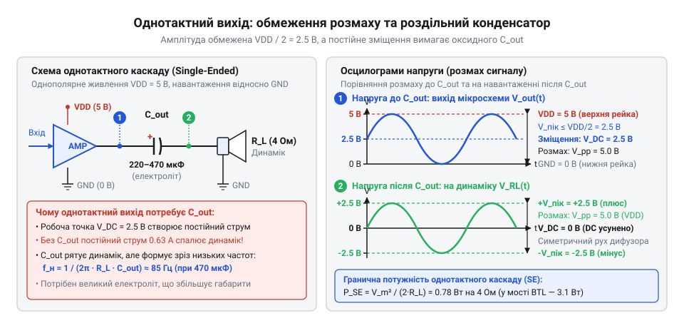
*Однотактний вихідний каскад із роздільним конденсатором C_out та осцилограма вихідної напруги: робоча точка спокою 2.5 В обмежує корисну амплітуду до 2.5 В, а відсікання постійної складової вимагає громіздкого конденсатора великої ємності.*

Роздільний конденсатор не пропускає постійний струм, захищаючи котушку від перегріву й механічного перекосу. Проте послідовно з'єднані конденсатор `C_out` та опір динаміка `R_L` утворюють класичний [фільтр високих частот](root:hw-analog/rc-high-pass) першого порядку. Нижня частота зрізу цього фільтра по рівню -3 дБ описується формулою:

```
f_c = 1 / (2 · π · R_L · C_out)  [нижня гранична частота зрізу RC-кола]
```

Виразимо необхідну роздільну ємність через бажану нижню частоту звукового тракту:

```
C_out = 1 / (2 · π · R_L · f_c)  [розрахунок ємності для забезпечення частоти зрізу]
```

Якщо ми прагнемо передати помірний бас і вибираємо нижню граничну частоту `f_c = 90 Гц` для динаміка з опором `R_L = 8 Ом`, отримаємо:

```
C_out
= 1 / (2 · 3.1416 · 8 · 90)      [підстановка параметрів навантаження й частоти зрізу]
= 1 / 4523.9                     [обчислення знаменника]
≈ 221 · 10⁻⁶ Ф                   [розрахункова величина ємності 221 мкФ]
≈ 220 мкФ                        [номінал стандартного ряду E6]
```

Для розширення смуги вниз до `f_c = 42 Гц` знадобиться конденсатор уже на 470 мкФ. Проте номінали 220–470 мкФ на напругу від 6.3 В доступні лише як [електролітичні конденсатори](root:hw-components/electrolytic-cap), чиї розміри на платі значно перевищують сам підсилювач. Спроба зекономити місце й поставити меншу ємність зрізає баси, а заряджання конденсатора при вмиканні живлення створює неприємне клацання (@@en|pop-and-click@@).

> 🔧 **Навіщо це.**
> Розрахунок амплітуди й роздільного конденсатора показує інженеру межі однотактного підходу: при шині 5 В неможливо отримати від динаміка 8 Ом більше ніж 0.39 Вт середньої потужності без підвищення напруги, а боротьба з постійним зміщенням неминуче веде до габаритного електролітичного конденсатора 220–470 мкФ. Будь-яка спроба зменшити габарити призводить до завалу басів і перекосу тембру. Тому для низьковольтних пристроїв необхідна інша архітектура, яка забезпечить високу гучність і повністю усуне вихідний конденсатор.

## Топологія мостового увімкнення BTL та взаємна компенсація зміщення

Щоби подолати обмеження однотактного каскаду без застосування громіздких імпульсних перетворювачів напруги, у низьковольтній аудіотехніці використовують мостове підключення навантаження (@@en|Bridge-Tied Load@@, BTL). Сама назва «топологія» (грец. @@el|τόπος@@ — місце + @@el|λόγος@@ — вчення) вказує на зміну способу геометричного та електричного з'єднання компонентів.

Принцип BTL полягає в тому, що жоден із двох виводів динаміка не з'єднується зі спільною землею схеми. Динамік вмикається як міст між виходами двох незалежних підсилювачів потужності, які працюють синхронно, але зсунуті за фазою рівно на 180° (π радіан) — тобто в чистій протифазі. Сигнал навантаження стає суто диференціальним (лат. @@la|differentia@@ — різниця, відмінність).

Позначимо напруги на двох плечах моста як `v_out+(t)` (прямий вихід) та `v_out-(t)` (інвертований вихід). Обидва підсилювачі живляться від одного однополярного джерела `V_DD = 5 В`. Для симетричного підсилення робочі точки спокою обох підсилювачів налаштовують на однаковий рівень половини напруги живлення:

```
V_bias+ = V_bias- = V_DD / 2 = 2.5 В
```

Нехай корисний аудіосигнал є синусоїдою з амплітудою коливання `V_peak` навколо робочої точки. Тоді миттєві напруги на виходах описуються рівняннями:

```
v_out+(t) = V_DD / 2 + V_peak · sin(ωt)     [напруга на прямому виході плеча моста]
v_out-(t) = V_DD / 2 - V_peak · sin(ωt)     [напруга на інвертованому протифазному виході]
```

Оскільки динамік підключений між цими виходами, результуюча миттєва напруга на його звуковій котушці `v_load(t)` дорівнює різниці потенціалів між клемами `OUT+` та `OUT-`:

```
v_load(t)
= v_out+(t) - v_out-(t)                                             [визначення напруги на мостовому навантаженні]
= (V_DD / 2 + V_peak · sin(ωt)) - (V_DD / 2 - V_peak · sin(ωt))     [підстановка формул протифазних напруг]
= (V_DD / 2 - V_DD / 2) + (V_peak · sin(ωt) - (-V_peak · sin(ωt)))   [розкриття дужок і згрупування постійної та змінної частин]
= 0 + (V_peak · sin(ωt) + V_peak · sin(ωt))                         [взаємне знищення зміщень спокою]
= 2 · V_peak · sin(ωt)                                              [подвоєна результуюча амплітуда змінного сигналу]
```

Це виведення наочно розкриває два фундаментальні закони мостової топології: взаємну компенсацію постійного зміщення та подвоєння амплітуди коливань.

### Взаємна компенсація постійного зміщення

У стані спокою (за відсутності вхідного аудіосигналу або під час пауз у мовленні) обидва виходи перебувають під абсолютно однаковим потенціалом половини напруги живлення. Знайдемо постійну складову напруги, прикладену до динаміка:

```
V_load_DC
= V_bias+ - V_bias-             [постійна різниця потенціалів на звуковій котушці]
= (V_DD / 2) - (V_DD / 2)       [підстановка потенціалів спокою обох плечей моста]
= 0 В                           [тотожне обнулення постійного зміщення на навантаженні]
```

Оскільки обидва підсилювачі виготовлені на одному кремнієвому кристалі в межах однієї мікросхеми, їхні опорні напруги `V_bias` ідеально узгоджені. Різниця постійних потенціалів між виводами динаміка тотожно дорівнює нулю. Відповідно, постійний струм через звукову котушку в стані спокою також дорівнює нулю:

```
I_load_DC = 0 В / R_L = 0 А
```

Це математичне обнулення повністю усуває загрозу теплового перегріву котушки постійним струмом та виключає статичний зсув дифузора з нейтрального положення. Найголовніший наслідок для схемотехніки: **послідовний роздільний конденсатор більше взагалі не потрібен**. Динамік підключають безпосередньо до виходів підсилювача суто гальванічним зв'язком. З плати назавжди зникає громіздкий електролітичний конденсатор ємністю 220–470 мкФ, що зменшує площу аудіовузла в кілька разів і повністю усуває завал амплітудно-частотної характеристики на низьких частотах (нижня частотна межа вихідного кола стає рівною 0 Гц).

### Подвоєння розмаху вихідної напруги

Коли аудіосигнал досягає додатного максимуму (`sin(ωt) = +1`), прямий вихід підіймається до граничного значення однополярного живлення `v_out+ = V_DD = 5 В`. У той самий момент інвертований вихід опускається до нульового потенціалу `v_out- = 0 В`. Напруга на динаміку сягає:

```
v_load_max = 5 В - 0 В = +5 В
```

Через пів періоду коливання, коли сигнал змінює знак на протилежний (`sin(ωt) = -1`), ситуація дзеркально перевертається: прямий вихід падає до нуля `v_out+ = 0 В`, а інвертований вихід злітає до максимуму `v_out- = 5 В`. Тепер напруга на динаміку становить:

```
v_load_min = 0 В - 5 В = -5 В
```

Знайдемо повний розмах напруги на навантаженні від піку до піку (@@en|peak-to-peak@@):

```
V_load_pp
= v_load_max - v_load_min       [визначення повного розмаху напруги на навантаженні]
= (+V_DD) - (-V_DD)             [підстановка пікових значень диференціального сигналу]
= 2 · V_DD                      [подвоєння напруги відносно шини однополярного живлення]
```

Для шини `V_DD = 5 В` отримуємо повний розмах коливань:

```
V_load_pp = 2 · 5 В = 10 В
```

При однополярному живленні 5 В однотактна схема забезпечувала амплітуду коливань лише 2.5 В із розмахом 5 В. У мостовій топології амплітуда диференціального коливання становить `V_load_peak = V_DD = 5 В`, а розмах сягає повних 10 В! Динамік бачить повноцінну двополярну змінну напругу від -5 В до +5 В, попри те, що вся система живиться від єдиного однополярного джерела +5 В без жодної від'ємної шини живлення.

Графічно цей процес проілюстровано на часових діаграмах:

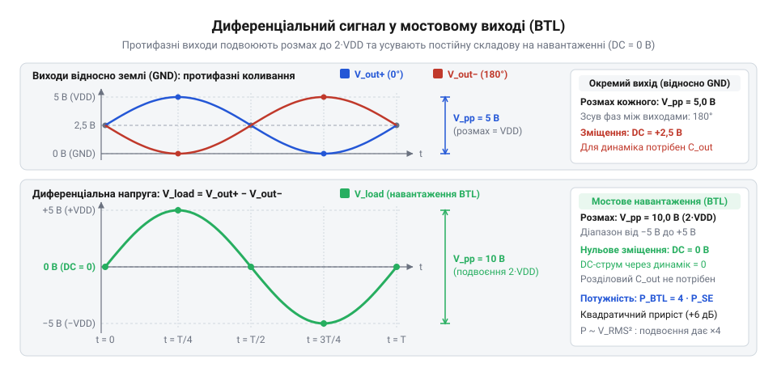
*Часові діаграми протифазних виходів V_out+ і V_out- та результуюча диференціальна синусоїда навантаження: однаковий потенціал спокою 2.5 В забезпечує нульове постійне зміщення, а протифазний рух подвоює піковий розмах коливань динаміка до 2·VDD.*

Додатковою перевагою диференціальної симетрії BTL є високий коефіцієнт придушення пульсацій шини живлення ([PSRR](root:hw-analog/power-supply-rejection-ratio), @@en|Power Supply Rejection Ratio@@). Будь-який шум або пульсації напруги живлення однаково потрапляють на обидва вихідні каскади як синфазна завада. Оскільки динамік увімкнений між виходами й реагує суто на різницю потенціалів, цей синфазний шум однаково діє на обидва плечі моста й взаємно віднімається на звуковій котушці, забезпечуючи високу чистоту звуку без додаткових стабілізаторів.

> 🔧 **Навіщо це.**
> Топологія BTL є стандартом де-факто для всієї портативної та вбудованої аудіоелектроніки. Вона дозволяє розробнику отримати розмах напруги 10 В від скромної шини 5 В без підвищувальних DC-DC конвертерів, які створюють електромагнітні завади й знижують ККД. Одночасно вона назавжди позбавляє пристрій габаритного вихідного конденсатора, дозволяючи змонтувати потужний підсилювач на крихітній ділянці друкованої плати зі збереженням глибокого басу аж до найнижчих частот.

## Математичне виведення чотирикратного виграшу за піковою потужністю в мостовій схемі

У портативній електроніці напруга живлення зазвичай жорстко обмежена шиною мікроконтролера чи акумулятора: 3.3 В або 5 В. Якщо підсилювач живиться від 5 В без підвищувального перетворювача (@@en|boost converter@@), амплітуда коливання обмежена напругою джерела. Для збільшення гучності є два шляхи: зменшувати активний опір котушки [динаміка](root:cat-hw-actuators/speakers-8ohm) або змінювати спосіб підключення навантаження. Перехід від однотактної схеми до мостової топології (@@en|Bridge-Tied Load@@, BTL — навантаження, увімкнене мостом) подвоює розмах прикладеної напруги. Завдяки фізичній природі перетворення електричної енергії це дає не двократний, а чотирикратний виграш за піковою потужністю.

Щоб простежити цей зв'язок, розглянемо несиметричне однотактне підключення (@@en|single-ended@@, SE). В однотактній схемі з однополярним живленням `VDD` один вивід навантаження з опором `RL` з'єднано зі спільною шиною («землею», 0 В) через розділовий конденсатор, а другий вивід підключено до виходу підсилювача. Щоб сигнал міг коливатися симетрично без зрізання напівхвиль, каскад у спокої утримує половину напруги живлення: `VDD / 2`. Вихідна напруга фізично змінюється лише в межах від `0 В` до `VDD`. Відповідно, пікова амплітуда напруги (лат. @@la|amplitudo@@ — розмах, величина) становить:

```text
V_peak_SE
= VDD / 2
```

Швидкість перетворення електричної енергії на теплову описується [законом Джоуля-Ленца](root:ph-electromagnetism/joule-heating) (названим на честь англійського фізика Джеймса Джоуля, @@en|Joule's law@@, та балтійського німецького фізика Гайнріха Ленца). Для опору `RL` пікова потужність `P_peak_SE` досягається в момент максимального відхилення сигналу від спокою:

```text
P_peak_SE
= (V_peak_SE)² / RL        [закон Джоуля-Ленца для пікової напруги]
= (VDD / 2)² / RL          [підстановка максимальної амплітуди однотактного виходу]
= VDD² / (4 · RL)          [піднесення до квадрата і зведення дробу]
```

У мостовій топології BTL динамік увімкнено інакше: жоден із його виводів не під'єднується до шини землі. Навантаження розташоване між виходами двох окремих підсилювачів, які збуджуються одним і тим самим звуковим сигналом, але працюють у протифазі зі зсувом 180°. Коли перший вихід (`OUT+`) сягає шини `VDD`, другий вихід (`OUT-`) дзеркально опускається до `0 В`. У наступний напівперіод полярність змінюється на протилежну.

Різниця потенціалів між цими виводами утворює диференціальну напругу: `v_diff(t) = v_out+(t) - v_out-(t)`. У момент амплітудного піка ця напруга сягає граничного розмаху:

```text
V_peak_BTL
= v_out+_max - v_out-_min   [різниця потенціалів на клемах динаміка]
= VDD - 0 В                 [потенціали плечей моста у момент максимуму]
= VDD                       [максимальна амплітуда диференціальної напруги]
= 2 · (VDD / 2)             [винесення множника 2]
= 2 · V_peak_SE             [подвоєння амплітуди порівняно з SE]
```

Підставивши подвоєну амплітуду `V_peak_BTL = 2 · V_peak_SE` у формулу закону Джоуля-Ленца, отримуємо вираз пікової потужності BTL:

```text
P_peak_BTL
= (V_peak_BTL)² / RL        [закон Джоуля-Ленца для мостової схеми]
= (2 · V_peak_SE)² / RL     [підстановка подвоєної амплітуди напруги]
= 4 · [ (V_peak_SE)² / RL ] [піднесення до квадрата і винесення множника 4]
= 4 · P_peak_SE             [доведення чотирикратного виграшу]
```

Через напругу живлення `VDD` цей зв'язок є тотожним: `P_peak_BTL = VDD² / RL = 4 · [VDD² / (4 · RL)] = 4 · P_peak_SE`.

Фізична причина чотирикратного зростання полягає в одночасному подвоєнні двох величин — напруги та струму. За законом Ома струм через котушку навантаження лінійно пропорційний прикладеній напрузі: `i(t) = v(t) / RL`. Коли диференціальна напруга подвоюється, струм через навантаження також зростає вдвічі:

```text
I_peak_BTL
= V_peak_BTL / RL           [закон Ома для пікової диференціальної напруги]
= (2 · V_peak_SE) / RL      [підстановка подвоєної амплітуди BTL]
= 2 · I_peak_SE             [подвоєння пікового струму через навантаження]
```

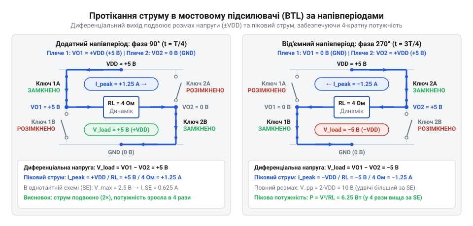
*Схематичні напрямки протікання пікового струму через навантаження у прямому та інверсному напівперіодах мостової схеми BTL; читач бачить, чому піковий струм подвоюється відносно однотактної схеми.*

Оскільки електрична потужність є добутком миттєвої напруги на струм (`P = V · I`), подвоєння обох співмножників дає квадратичне зростання:

```text
P_peak_BTL
= V_peak_BTL · I_peak_BTL               [потужність як добуток напруги та струму]
= (2 · V_peak_SE) · (2 · I_peak_SE)     [підстановка подвоєних величин]
= 4 · P_peak_SE                         [квадратичний приріст пікової потужності]
```

Кожен доданий вольт розмаху напруги проштовхує крізь котушку динаміка додаткові ампери струму, забезпечуючи квадратичну залежність потужності від напруги: `P ∝ V²`.

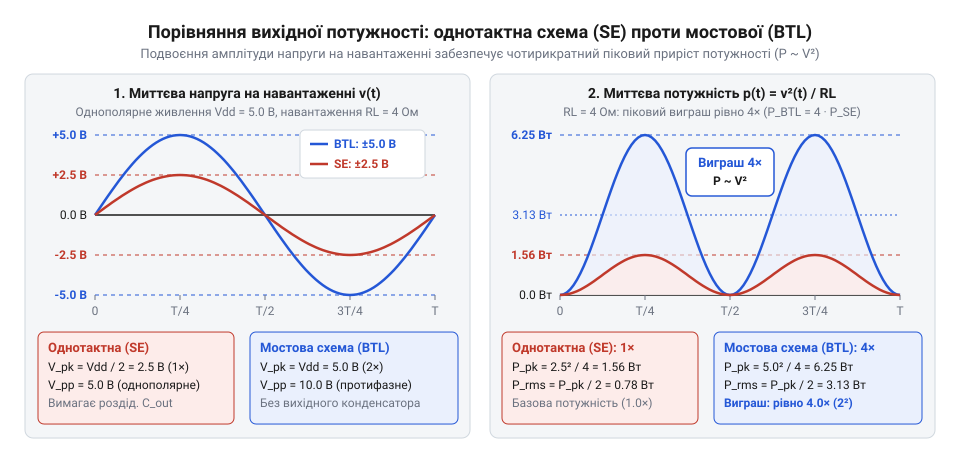
*Порівняння кривих миттєвої потужності p(t) в однотактній схемі та схемі BTL на однаковому активному навантаженні RL: подвоєння амплітуди напруги викликає подвоєння струму та формує чотирикратне зростання пікової потужності.*

Чотирикратне збільшення потужності висуває підвищені вимоги до системи живлення підсилювача. Піковий струм, який споживається від шини `VDD`, сягає:

```text
I_peak_BTL
= VDD / RL
```

При напрузі живлення `VDD = 5 В` та опорі динаміка `RL = 4 Ом` піковий струм через ключі моста досягає `5 / 4 = 1.25 А` (проти `0.625 А` в однотактній схемі). Якщо джерело живлення має високий внутрішній опір, або провідники друкованої плати надто тонкі й мають паразитну індуктивність, такий імпульсний струм спричинить різке динамічне просідання напруги на шині `VDD`. Це не лише спотворює форму вихідного сигналу, а й може викликати апаратне перезавантаження сусіднього мікроконтролера через спрацьовування захисту від зниження напруги (@@en|Brown-Out Reset@@, BOR).

> 🔧 **Навіщо це.**
> Чотирикратний виграш мостової BTL-топології дозволяє отримати гучний та насичений звук безпосередньо від низьковольтної лінії 5 В (живлення від порту USB або одного Li-ion акумулятора). Інженеру не потрібно додавати на плату громіздкий та дорогий імпульсний підвищувальний перетворювач (DC-DC boost converter), який створює електромагнітні завади для радіотракту й мікроконтролера. Водночас розуміння подвоєного пікового струму вимагає обов'язкового встановлення якісного керамічного блокувального конденсатора ємністю від 10 мкФ до 100 мкФ із низьким еквівалентним послідовним опором (ESR) безпосередньо біля виводів живлення мікросхеми підсилювача.

## Розрахунок діючої напруги та середньої синусоїдальної потужності

Пікова потужність визначає миттєвий максимум навантаження, але реальний звуковий сигнал не є постійною напругою на рівні піка: співвідношення між амплітудним піком та діючим рівнем визначається [крест-фактором сигналу](root:com-signal/audio-crest-factor). Акустичний тиск, суб'єктивна гучність відтворення та нагрівання звукової котушки [динаміка](root:cat-hw-actuators/speakers-8ohm) визначаються середньою за часом енергією коливань. Тому для оцінки теплового режиму та реальної акустичної віддачі аудіотракту використовують поняття діючої напруги та середньої синусоїдальної потужності.

Діюче або середньоквадратичне значення змінної напруги (@@en|Root Mean Square@@, RMS; від англ. @@en|root@@ — корінь, @@en|mean@@ — середнє, @@en|square@@ — квадрат) — це фізичний еквівалент напруги постійного струму, яка на тому самому активному опорі виділяє за період коливання точно таку саму кількість тепла, як і розглянутий змінний сигнал.

Математично середньоквадратичне значення напруги `V_rms` для довільного періодичного сигналу `v(t)` з періодом `T` визначається через визначений інтеграл:

```text
V_rms
= √( (1 / T) · ∫₀ᵀ v²(t) dt )     [визначення діючого значення за період T]
```

Для гармонійного синусоїдального сигналу (грец. @@el|harmonikos@@ — співзвучний, злагоджений) кругової частоти `ω = 2 · π / T` з піковою амплітудою `V_peak` миттєва напруга описується функцією `v(t) = V_peak · sin(ωt)`. Обчислимо середній квадрат напруги під знаком кореня:

```text
(V_rms)²
= (1 / T) · ∫₀ᵀ [V_peak · sin(ωt)]² dt          [піднесення синусоїдального сигналу до квадрата]
= (V_peak² / (2 · T)) · ∫₀ᵀ [1 - cos(2ωt)] dt   [пониження степеня sin²(ωt)]
= (V_peak² / (2 · T)) · [ T - 0 ]               [інтегрування за період]
= V_peak² / 2                                   [скорочення періоду T]
```

Інтеграл косинуса подвійної частоти `cos(2ωt)` (новолат. @@la|cosinus@@, від @@la|complementi sinus@@ — синус доповнення) за період `T` дорівнює нулю: за два повні цикли коливань його площі взаємно анулюються: `∫₀ᵀ cos(2ωt) dt = 0`.

Добудемо квадратний корінь з обох частин рівняння для отримання кінцевої діючої напруги гармонійного сигналу:

```text
V_rms
= √(V_peak² / 2)             [добування квадратного кореня]
= V_peak / √2                [зв'язок діючого значення з піковою амплітудою]
≈ 0.7071 · V_peak            [числове наближення коефіцієнта 1 / √2]
```

Геометричний зміст ділення на 2 демонструє графік `sin²(ωt)`: функція пульсує навколо лінії `1/2`. Площі верхівок над рівнем `V_peak² / 2` точно дорівнюють площам западин під ним. При їх перенесенні утворюється прямокутник висотою `V_peak² / 2` та основою `T`. Площа під кривою за період дорівнює площі цього прямокутника, тому середнє значення квадрата синусоїди дорівнює половині пікового максимуму.

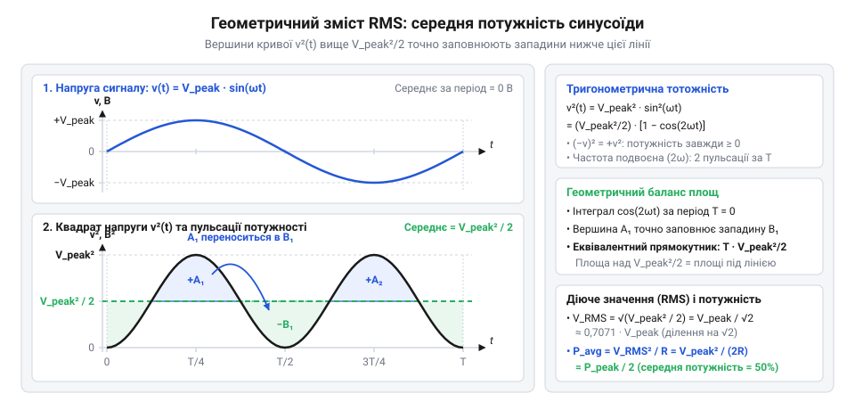
*Графік синусоїдальної напруги v(t) та квадрата напруги v²(t): площа під кривою v²(t) за період T строго дорівнює площі прямокутника висотою V_peak² / 2, що наочно пояснює походження множника 1/2 у середній синусоїдальній потужності.*

Для мостової топології BTL пікова диференціальна амплітуда дорівнює повній напрузі живлення: `V_peak_BTL = VDD`. Підставляючи це значення у формулу середньоквадратичного значення, отримуємо діючу напругу мостового каскаду:

```text
V_rms_BTL
= VDD / √2
```

Середня синусоїдальна потужність (яку в інженерній практиці та технічних описах аудіомікросхем називають потужністю RMS) на активному опорі навантаження `RL` обчислюється через діючу напругу за законом Джоуля-Ленца:

```text
P_rms_BTL
= (V_rms_BTL)² / RL          [закон Джоуля-Ленца через діюче значення напруги]
= (VDD / √2)² / RL           [підстановка діючої напруги мостової схеми]
= (VDD² / 2) / RL            [піднесення чисельника до квадрата]
= VDD² / (2 · RL)            [теоретична синусоїдальна потужність мостової схеми]
```

Для однотактної схеми SE з амплітудою `V_peak_SE = VDD / 2` діюча напруга становить `V_rms_SE = (VDD / 2) / √2 = VDD / (2 · √2)`. Відповідна середня синусоїдальна потужність дорівнює:

```text
P_rms_SE
= (V_rms_SE)² / RL           [закон Джоуля-Ленца для однотактної схеми]
= (VDD / (2 · √2))² / RL     [підстановка діючої напруги однотактного каскаду]
= (VDD² / 8) / RL            [піднесення знаменника 2 · √2 до квадрата: (2 · √2)² = 4 · 2 = 8]
= VDD² / (8 · RL)            [середня синусоїдальна потужність однотактної схеми]
```

Співвідношення потужностей знову підтверджує чотирикратний виграш:

```text
P_rms_BTL / P_rms_SE
= [ VDD² / (2 · RL) ] / [ VDD² / (8 · RL) ]
= 8 / 2
= 4
```

Чотирикратний виграш мостової конфігурації залишається математичним інваріантом (лат. @@la|invarians@@ — незмінний) як для миттєвих амплітудних піків, так і для середньої синусоїдальної потужності.

Обчислимо практичні значення неспотвореної синусоїдальної потужності для стандартної напруги живлення `VDD = 5 В` при роботі на динаміки з різним номінальним активним опором:

**Навантаження 8 Ом (`RL = 8 Ом`):**
Для стандартного компактного динаміка з активним опором котушки 8 Ом:

```text
P_rms_BTL
= 5² / (2 · 8)
= 25 / 16
= 1.5625 Вт
```

В однотактній схемі те саме навантаження отримало б лише: `P_rms_SE = 25 / (8 · 8) = 25 / 64 ≈ 0.3906 Вт`. Вихідна потужність зростає від ледь помітних 0.39 Вт до впевнених 1.56 Вт.

**Навантаження 4 Ом (`RL = 4 Ом`):**
Для поширених динаміків з опором 4 Ом:

```text
P_rms_BTL
= 5² / (2 · 4)
= 25 / 8
= 3.125 Вт
```

В однотактній конфігурації вихідна потужність обмежилася б скромним значенням `P_rms_SE = 25 / (8 · 4) = 25 / 32 ≈ 0.78125 Вт`.

**Навантаження 2 Ом (`RL = 2 Ом`):**
Мікросхема монофонічного підсилювача XPT8871 вирізняється потужним вихідним каскадом, який офіційно підтримує роботу на наднизький опір 2 Ом (наприклад, два паралельно з'єднані динаміки по 4 Ом). Теоретична потужність складає:

```text
P_rms_BTL
= 5² / (2 · 2)
= 25 / 4
= 6.25 Вт
```

Для порівняння, однотактна схема забезпечила б лише `P_rms_SE = 25 / (8 · 2) = 25 / 16 = 1.5625 Вт`.

Значення 6.25 Вт є теоретичною верхньою межею неспотвореної синусоїдальної потужності для будь-якого підсилювача з мостовим виходом при напрузі живлення 5 В. У реальних кремнієвих кристалах вихідні польові транзистори мають залишковий активний опір відкритого каналу, на якому під час проходження струму падає частина напруги живлення. Крім того, заявлені в паспорті XPT8871 максимальні 5 Вт вихідної потужності досягаються за умов істотного кліпінгу верхівок синусоїди, коли рівень гармонійних спотворень (THD) сягає близько 10%.

Формула `P_rms = VDD² / (2 · RL)` слугує абсолютним фізичним критерієм при проектуванні звукових пристроїв: жоден підсилювач без вбудованого імпульсного перетворювача напруги не здатний видати в динамік чисту синусоїдальну потужність, більшу за це теоретичне значення.

> 🔧 **Навіщо це.**
> Розрахунок діючої RMS-напруги та середньої потужності за формулою `VDD² / (2 · RL)` дозволяє інженеру правильно оцінити тепловий баланс звукового вузла та запобігти руйнуванню компонентів. Акустична гучність і теплове нагрівання котушки пропорційні саме середній потужності, а не короткочасним пікам. Знаючи точне значення середньої потужності, розробник обирає динамік із належним запасом паспортної потужності (наприклад, динамік на 3–5 Вт для тракту з виходом 1.5–3 Вт RMS), що запобігає перегріванню звукової котушки та деградації магнітної системи під час тривалої безперервної роботи.

## Вплив опору відкритих транзисторів, падіння напруги та аналітика настання кліпінгу

Теоретичний розрахунок мостового підсилювача розглядає вихідні транзистори як бездоганні ключі з нульовим опором, що здатні комутувати навантаження безпосередньо до шин живлення `VDD` та `GND`. За такого ідеального припущення напруга живлення `5 В` на навантаженні `4 Ом` мала б забезпечувати `3.125 Вт` чистої синусоїдальної потужності. Проте в технічній документації інтегрального підсилювача XPT8871 виникає виразний парадокс: титульний аркуш декларує вихідну потужність `5 Вт`, тоді як вимірювання неспотвореного сигналу з коефіцієнтом нелінійних спотворень менше ніж 1% фіксують лише `2.1–2.4 Вт`. Причина цієї розбіжності полягає у фізичній будові силового напівпровідникового каскаду: реальні транзистори мають залишковий внутрішній опір, який відбирає частину напруги живлення ще до того, як хвиля дістанеться навантаження.

Вихідний каскад мікросхеми утворений двома напівмостами на комплементарних парах силових польових транзисторів MOSFET. У повністю відкритому стані канал транзистора не є надпровідником — він має кінцевий [опір відкритого каналу](root:hw-components/rds-on) (англ. @@en|drain-to-source on-resistance@@, `R_ds(on)`), який для біполярних транзисторів описується спорідненим параметром — напругою насичення (від лат. *saturatio* — насичення; англ. @@en|saturation voltage@@, `V_sat`).

Коли диференціальний вихід підсилювача формує одну з напівхвиль звукового коливання, струм навантаження `I_load` протікає замкненим контуром: від шини живлення `VDD` через верхній ключ першого напівмоста, через [звукову котушку динаміка](root:cat-hw-actuators/speakers-8ohm) з активним опором `RL`, і далі крізь нижній ключ другого напівмоста до шини `GND`. У цей момент струм долає опір двох послідовно ввімкнених ключів:
- на верхньому ключі (P-канальний транзистор) виникає омічне падіння потенціалу відносно позитивної шини `VDD`;
- на нижньому ключі (N-канальний транзистор) виникає омічне зростання потенціалу відносно нульової шини `GND`.

Падіння напруги на кожному з провідних ключів підпорядковується закону Ома:
```text
V_drop
= I_load · R_ds(on)             [закон Ома для омічного опору відкритого каналу]
```

Оскільки вихідний струм одночасно проходить крізь верхній ключ одного напівмоста та нижній ключ другого, потенціали виходів обмежені рівнями `VDD - V_drop` та `V_drop`. Оскільки обидва виходи працюють у протифазі, реальна диференціальна амплітуда `V_peak_real` на навантаженні зазнає подвійних втрат:
```text
V_peak_real
= (VDD - V_drop) - V_drop                     [протифазна різниця граничних потенціалів напівмостів]
= VDD - 2 · V_drop                            [зведення подібних доданків]
```

Падіння напруги `V_drop` безпосередньо залежить від сили струму в піку сигналу `I_load_peak = V_peak_real / RL`. Підставивши це співвідношення у вираз амплітуди, знаходимо замкнену формулу реального розмаху з урахуванням опору навантаження:
```text
V_peak_real
= VDD - 2 · (V_peak_real / RL) · R_ds(on)    [підстановка пікового струму за законом Ома]
= VDD / (1 + 2 · R_ds(on) / RL)              [розв'язання лінійного рівняння щодо V_peak_real]
```

Середньоквадратична (діюча, англ. @@en|root mean square@@, RMS) напруга гармонійного сигналу пов'язана з піковою амплітудою через коефіцієнт форми `√2`. Тому реальна чиста потужність неспотвореної синусоїди на навантаженні становить:
```text
P_rms_real
= (V_rms_real)² / RL                         [закон Джоуля-Ленца для діючої напруги]
= (V_peak_real / √2)² / RL                   [зв'язок діючого та амплітудного значень синусоїди]
= (V_peak_real)² / (2 · RL)                  [алгебраїчне піднесення до квадрата]
= (VDD - 2 · V_drop)² / (2 · RL)             [підстановка реальної диференціальної амплітуди]
```

**Покроковий розрахунок неспотвореної потужності при VDD = 5 В, RL = 4 Ом та R_ds(on) = 0.35 Ом:**
```text
V_peak_real
= 5.0 / (1 + 2 · 0.35 / 4.0)                 [пряма підстановка напруги живлення та опорів у формулу розмаху]
= 5.0 / (1 + 0.70 / 4.0)                     [подвоєння опору каналів моста]
= 5.0 / (1 + 0.175)                          [обчислення відношення опору втрат до навантаження]
= 5.0 / 1.175                                [сумування в знаменнику]
≈ 4.255 В                                    [реальна диференціальна амплітуда на навантаженні]

P_rms_real
= (4.255)² / (2 · 4.0)                       [підстановка амплітуди 4.255 В та опору 4 Ом]
= 18.105 / 8.0                               [квадрат амплітуди на подвоєний опір навантаження]
≈ 2.26 Вт                                    [гранична чиста потужність при THD < 1%]
```

Порівняння з ідеальною моделлю без втрат у транзисторах демонструє масштаби недобору енергії:
```text
P_rms_ideal
= 5.0² / (2 · 4.0)                           [теоретична формула за відсутності падіння напруги]
= 25.0 / 8.0                                 [квадрат напруги живлення на подвоєний опір]
= 3.125 Вт                                   [ідеальна синусоїдальна потужність]

ΔP
= P_rms_ideal - P_rms_real                   [втрачена потужність]
= 3.125 - 2.263                              [віднімання значень]
≈ 0.86 Вт                                    [потужність, що розсіюється у вигляді тепла на кристалі]
```

Втрата майже `27%` теоретичної потужності осідає безпосередньо всередині кремнієвого кристала мікросхеми, перетворюючись на тепло. Через це неспотворена синусоїдальна потужність мостового підсилювача при живленні `5 В` на навантаженні `4 Ом` фізично обмежена рівнем приблизно `2.3 Вт`.

Якщо збільшувати амплітуду вхідного сигналу далі, коефіцієнт підсилення вимагатиме від вихідного каскаду розмаху, що перевищує фізично доступну межу `V_peak_real`. Оскільки вихідний потенціал не може піднятися вище за `VDD - V_drop` або опуститися нижче за `V_drop`, вершини синусоїди впираються в ці напівпровідникові рівні насичення. Транзистори входять у режим глибокого насичення, і подальше зростання вихідної напруги припиняється: верхівки гармонійної хвилі пласко зрізаються об шини живлення.

Це явище має назву кліпінг (від англ. @@en|clipping@@ — обтинання, зрізання верхівок).

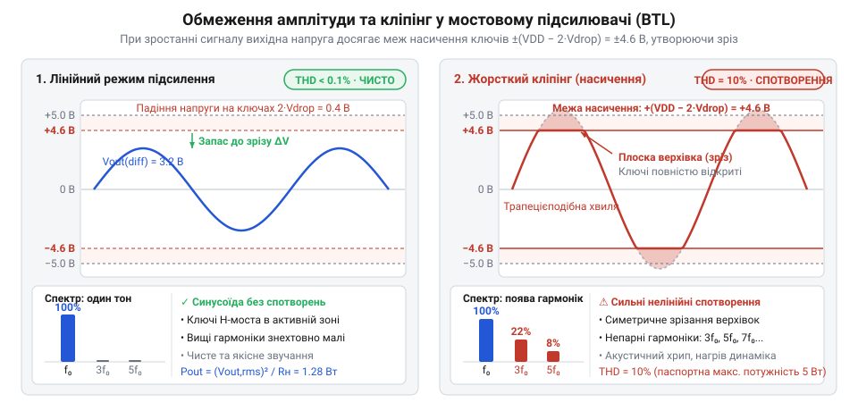
*Осцилограма вихідного диференціального сигналу при збільшенні вхідної амплітуди: синусоїда досягає рівнів насичення ключів (VDD - 2·V_drop) і зрізається; читач бачить перетворення синусоїди на трапецію (кліпінг) і формування гармонік при THD = 10%.*

Настання кліпінгу докорінно змінює спектральний склад сигналу. Доки амплітуда синусоїди не досягає рівня насичення, вихідний сигнал з високою точністю повторює вхідний, а [коефіцієнт нелінійних спотворень](root:hw-analog/harmonic-distortion) (від грец. ἁρμονία — співзвуччя; англ. @@en|total harmonic distortion@@, `THD+N`, деталізований у [теорії гармонійних спотворень](root:hw-analog/harmonic-distortion)) утримується на рівні десятих часток відсотка (`0.1–0.5%`).

Математично зрізання вершин створює гострі злами на кривій, де похідна напруги за часом `dv/dt` зазнає розриву. Розклад такої трапецієподібної періодичної функції в ряд Фур'є породжує цілий спектр паразитних високочастотних складових — непарних вищих гармонік (`3·f₀`, `5·f₀`, `7·f₀`, ...). Через це в момент дотику верхівок синусоїди до рівнів насичення величина `THD+N` не зростає плавно, а зазнає стрибкоподібного перелому від `< 1%` одразу до `10%` і вище лише при незначному додаванні вхідної амплітуди.

Якщо амплітуду форсувати далі вглиб обмеження, зрізані ділянки розширюються на весь напівперіод: трапеція вироджується в меандр (від грец. Μαίανδρος — звивиста річка; симетричний прямокутний сигнал, англ. @@en|square wave@@).

Для прямокутного сигналу модуль напруги залишається незмінним протягом усього періоду (`|v(t)| = V_peak_real`), тому діюче (RMS) значення напруги перестає ділитися на `√2` і дорівнює амплітудному: `V_rms = V_peak_real`. Оскільки коефіцієнт форми становить `1`, електрична потужність у навантаженні різко зростає:
```text
P_square
= (V_peak_real)² / RL                         [закон Джоуля-Ленца для прямокутної напруги при V_rms = V_peak]
= (4.255)² / 4.0                              [підстановка реальної амплітуди 4.255 В на 4 Ом]
= 18.105 / 4.0                                [квадрат амплітуди на опір навантаження]
≈ 4.53 Вт                                     [потужність меандру при номінальному живленні 5.0 В]
```

Якщо напруга живлення дещо вища за номінал (наприклад, `5.2–5.5 В`, що є типовим для стабілізованих мережевих адаптерів та стандартних портів USB), потужність перевантаженого прямокутного сигналу сягає рівно `5.0 Вт`.

Саме цим механізмом пояснюється зазначена в паспорті XPT8871 потужність «5 Вт при THD = 10%». Виробник наводить паспортні 5 Вт не для чистого акустичного звуку, а для режиму жорсткого кліпінгу, коли підсилювач перетворюється на ключовий генератор спотвореного прямокутного сигналу.

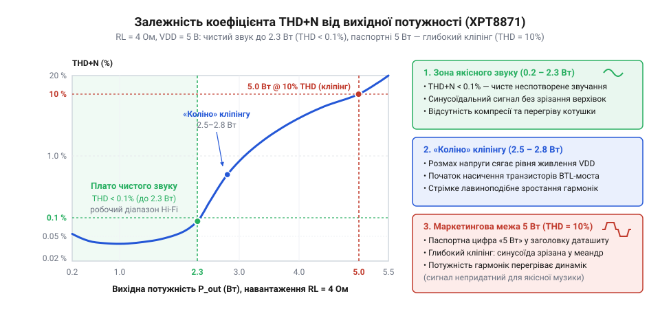
*Графік залежності THD+N від вихідної потужності підсилювача XPT8871; читач бачить плато чистих спотворень до 2.3 Вт та різкий підйом до 10% при переході в кліпінг.*

Експлуатація підсилювача в зоні кліпінгу несе пряму загрозу теплового руйнування [котушки динаміка](root:cat-hw-actuators/speakers-8ohm):
1. **Зупинка конвективного охолодження.** Під час відтворення чистого неспотвореного сигналу дифузор динаміка безперервно коливається, працюючи як помпа, що охолоджує звукову котушку конвективними потоками повітря. Під час кліпінгу верхівка сигналу є горизонтальною прямою (`dv/dt = 0`), тому дифузор на частки мілісекунди завмирає в крайньому положенні. Конвективне охолодження припиняється саме в момент протікання максимального струму.
2. **Паразитний нагрів від вищих гармонік.** Енергія вищих гармонік ряду Фур'є (`3·f₀`, `5·f₀` тощо) через механічну інерцію рухомої системи дифузора не може трансформуватися в акустичні коливання повітря. Уся ця паразитна електрична потужність безпосередньо розсіюється на активному опорі мідного проводу звукової котушки у вигляді тепла `I² · RL`.
3. **Падіння пік-фактора до нуля.** Якщо реальний музичний або мовний сигнал має високий пік-фактор (піки в 5–10 разів перевищують середній рівень, даючи провідникам час охолонути між спалахами гучності), то зрізаний меандр змушує динамік витримувати граничні `4.5–5 Вт` неперервно.

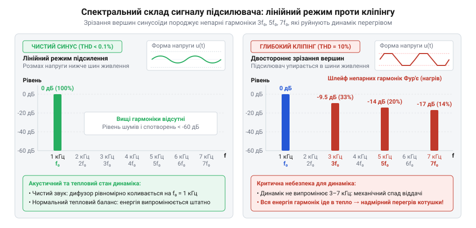
*Спектрограма вихідного сигналу до та після настання кліпінгу; читач бачить виникнення інтенсивних непарних гармонік третього, п'ятого та сьомого порядків, які нагрівають котушку динаміка.*

У результаті температура проводу звукової котушки стрімко перевищує критичну межу в `130–150 °C`, ізоляційний термостійкий лак обвуглюється, виникає міжвиткове замикання, і динамік безповоротно згоряє.

> 🔧 **Навіщо це.**
> Розрахунок реального розмаху напруги та аналітика порогу кліпінгу захищають інженера від двох критичних помилок конструювання:
> 1. **Ілюзії щодо вихідної гучності.** Не можна розраховувати аудіотракт із припущенням, що від джерела 5 В підсилювач віддасть 5 Вт чистого звуку. Для якісного звуковідтворення з THD < 1% верхня межа XPT8871 становить близько 2.3 Вт на 4 Ом. Коефіцієнт підсилення тракту необхідно налаштовувати так, щоб максимальний розмах сигналу з мікроконтролера чи ЦАП не перевищував корисного діапазону `VDD - 2·V_drop`.
> 2. **Недорозрахунку джерела живлення та тепловідводу.** При віддачі неспотвореної потужності 2.3 Вт підсилювач споживає від шини живлення понад 3.1 Вт через внутрішній опір ключів (близько 0.86 Вт розсіюється у вигляді тепла всередині мікросхеми). Джерело живлення зобов'язане гарантувати піковий струм понад 1 А без просідання напруги, інакше спад на шині `VDD` викличе передчасний кліпінг на значно меншій гучності. Натомість в охоронних сигналізаціях чи аварійних сиренах (наприклад, з [окремим зумером](root:cat-hw-actuators/buzzer-standalone)), де чистота тембру не має значення, режим навмисного помірного кліпінгу дозволяє витиснути з мініатюрного корпусу всі паспортні 4–5 Вт максимальної акустичної сили.

## Математична модель коефіцієнта підсилення за напругою (Gain) мостового каскаду XPT8871

Джерела аналогового аудіосигналу — апаратні цифро-аналогові перетворювачі (ЦАП) мікроконтролерів чи кодеки — видають коливання звукової частоти зі строго обмеженим розмахом: амплітуда ЦАП зазвичай становить 0.5–1.0 В (або `2.0 V_pp`). Якщо спрямувати його на силові ключі без попереднього підсилення напруги, розмах на динаміку складе малу частку `VDD`, даючи лічені мілівати замість паспортної потужності. Навпаки, надмірне підсилення викличе кліпінг — зрізання верхівок синусоїди об шини живлення та жорсткі нелінійні спотворення. Для максимальної неспотвореної вихідної потужності необхідно точно узгодити динамічний діапазон джерела сигналу з напругою живлення підсилювача.

> 🔧 **Навіщо це.**
> Розрахунок коефіцієнта підсилення за напругою дозволяє обрати номінали зовнішніх резисторів так, щоб при максимальній гучності джерела підсилювач видавав повну неспотворену потужність без кліпінгу та зайвого теплового шуму.

Для роботи в мостовому режимі (англ. @@en|Bridge-Tied Load@@, BTL — навантаження, увімкнене мостом) мікросхема XPT8871 містить два внутрішні операційні підсилювачі (ОП). Перший підсилювач є класичним інвертуючим каскадом із регульованим коефіцієнтом передачі через зовнішні резистори. Другий підсилювач є інвертором з фіксованим коефіцієнтом 1:1, реалізованим на узгоджених внутрішніх резисторах однакового номіналу.


*Структурна топологія двох операційних підсилювачів XPT8871 із зовнішніми резисторами Rin, Rf та формуванням протифазних вихідних напруг.*

Вхідний звуковий сигнал `v_in(t)` надходить на інвертуючий вхід першого операційного підсилювача через зовнішній резистор `Rin`. Між інвертуючим входом і виходом цього ж ОП увімкнено зовнішній резистор негативного зворотного зв'язку `Rf` (англ. @@en|feedback resistor@@). Неінвертуючий вхід з'єднано з внутрішнім джерелом опорної напруги зміщення `V_bias = VDD / 2` (віртуальна середня точка).

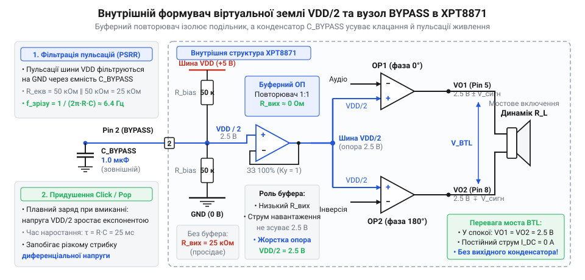
*Схема внутрішнього формувача опорної напруги зміщення VDD/2 з буферним повторювачем та блокувальним конденсатором на виводі BYPASS: внутрішній дільник і буфер стабілізують робочу точку віртуальної землі.*

Завдяки негативному зворотному зв'язку потенціал інвертуючого входу підтримується рівним `V_bias`. Оскільки високий вхідний опір ОП не споживає струму, за першим законом Кірхгофа весь вхідний струм через `Rin` перетікає в резистор зворотного зв'язку `Rf`. Звідси вихідна напруга першого підсилювача `v_out-(t)` (вивід `VO1` мікросхеми) становить:

```
v_out-(t)
= - i_in(t) · Rf                               [падіння напруги на Rf у протифазі]
= - [v_in(t) / Rin] · Rf                       [струм i_in(t) за першим законом Кірхгофа та законом Ома]
= - (Rf / Rin) · v_in(t)                       [вихідна напруга першого інвертуючого каскаду]
```

Знак мінус означає переворот фази на 180° відносно середньої точки: коли вхідний сигнал зростає, напруга на виході першого підсилювача симетрично спадає.

Другий операційний підсилювач є інтегрованим повторним інвертором зі строго фіксованим коефіцієнтом передачі -1. Його внутрішні резистори зворотного зв'язку `R1 = R2 = 10 кОм` виготовлені на кристалі з лазерним підганянням. Каскад приймає напругу `v_out-(t)` відносно середньої точки `VDD / 2` і формує на виводі `VO2` дзеркальну напругу `v_out+(t)`:

```
v_out+(t)
= - (R2 / R1) · v_out-(t)                      [інвертування сигналу першого каскаду]
= - 1 · [ - (Rf / Rin) · v_in(t) ]             [підстановка v_out-(t) при узгоджених R1 = R2 = 10 кОм]
= + (Rf / Rin) · v_in(t)                       [дзеркальна протифазна напруга у фазі з входом]
```

Вихідна напруга другого каскаду `v_out+(t)` є дзеркальною, протифазною копією виходу першого каскаду `v_out-(t)` і збігається за фазою із вхідним сигналом `v_in(t)`.

Динамік під'єднується безпосередньо між виходами `VO2` та `VO1` без підключення до шини землі. Диференціальна напруга `v_diff(t)` на навантаженні є різницею потенціалів обох плечей мосту:

```
v_diff(t)
= v_out+(t) - v_out-(t)                        [означення диференціальної напруги на навантаженні]
= [ + (Rf / Rin) · v_in(t) ] - [ - (Rf / Rin) · v_in(t) ] [підстановка значень напруг обох виходів]
= 2 · (Rf / Rin) · v_in(t)                     [подвоєння амплітуди через віднімання протифазних сигналів]
```

Сумарний коефіцієнт підсилення за напругою BTL-схеми `Av` (від англ. @@en|voltage gain@@, лат. @@la|amplificare@@ — збільшувати) визначається відношенням напруги на навантаженні до напруги на вході:

```
Av
= v_diff(t) / v_in(t)                          [означення коефіцієнта підсилення за напругою]
= [2 · (Rf / Rin) · v_in(t)] / v_in(t)         [підстановка отриманого виразу v_diff(t)]
= 2 · (Rf / Rin)                               [скорочення миттєвої вхідної напруги v_in(t)]
```

Множник 2 виникає саме через протифазну роботу мосту: коли потенціал одного виводу динаміка піднімається вгору, потенціал протилежного виводу опускається вниз на таку саму величину.

В аудіотехніці рівні сигналів та підсилення оцінюють у логарифмічній шкалі децибелів (дБ), що відповідає сприйняттю звуку слухом. Для коефіцієнта підсилення за напругою перехід у децибели скорочується безпосередньо до кінцевого співвідношення:

```
Av_dB
= 20 · lg(Av)                                  [переведення коефіцієнта підсилення напруги в децибели]
= 20 · lg[2 · (Rf / Rin)]                      [підстановка аналітичного значення Av]
≈ 6.02 + 20 · lg(Rf / Rin)                     [розклад логарифма добутку з урахуванням 20 · lg(2) ≈ 6.02]
```

Доданок `+6.02 дБ` є прямим математичним виразом подвоєння вихідної амплітуди мостовою парою підсилювачів порівняно з одинарним інвертуючим каскадом — це бонус мостової схеми.

При виборі конкретних номіналів резисторів `Rin` та `Rf` враховують взаємно суперечливі вимоги:

1. **Вимоги до `Rin`**: цей резистор задає вхідний опір усього підсилювального вузла. Номінал не повинен бути меншим за 10 кОм (типово обирають 15–30 кОм, базовий — `20 кОм`), щоб не перевантажувати вихідний каскад ЦАП мікроконтролера. Занижений `Rin` спричиняє спад амплітуди на виході джерела та зростання нелінійних спотворень. Крім того, малий опір `Rin` вимагатиме надмірно великої ємності вхідного конденсатора `Cin` для збереження низької частоти зрізу.
2. **Вимоги до `Rf`**: номінал цього опору визначає коефіцієнт підсилення та рівень [теплового шуму Джонсона — Найквіста](root:hw-analog/resistor-noise). За формулою Найквіста середньоквадратична напруга шуму пропорційна кореню опору: `V_noise = √(4 · k · T · Rf · Δf)`, де `k` — стала Больцмана, `T` — абсолютна температура, а `Δf` — смуга частот. Номінал `Rf` не варто обирати вище 80–100 кОм, інакше шум стане чутним у динаміку за відсутності сигналу, а високоомний інвертуючий вхід перетвориться на антену для наведень від цифрових ліній мікроконтролера.

Практичний діапазон номіналів для XPT8871: `Rin = 15...30 кОм` (базове значення `20 кОм`), а `Rf` обирають у межах `20...80 кОм`.

**Покроковий інженерний розрахунок під джерело сигналу:**
Нехай живлення підсилювача становить `VDD = 5.0 В`. З урахуванням залишкового падіння напруги на відкритих силових транзисторах вихідного каскаду `V_sat ≈ 0.4 В`, максимальний диференціальний розмах неспотвореного сигналу становить:

```
V_diff_max
= 2 · (VDD - V_sat)                            [диференціальний розмах напруги від піка до піка]
= 2 · (5.0 - 0.4)                              [підстановка живлення 5 В та падіння V_sat = 0.4 В]
= 9.2 В                                        [максимальний розмах V_diff_max (9.2 V_pp)]
```

Джерелом аудіосигналу є ЦАП мікроконтролера з вихідним розмахом `V_in_pp = 2.0 В` (пікова амплітуда 1.0 В).
Розраховуємо потрібний коефіцієнт підсилення `Av`:

```
Av
= V_diff_max / V_in_pp                         [необхідний коефіцієнт для повного розмаху]
= 9.2 / 2.0                                    [підстановка амплітудних значень]
= 4.6                                          [розрахунковий коефіцієнт передачі]
```

Знаходимо необхідне відношення резисторів:

```
Rf / Rin
= Av / 2                                       [виведення з формули Av = 2 · (Rf / Rin)]
= 4.6 / 2                                      [підстановка розрахованого коефіцієнта Av = 4.6]
= 2.3                                          [необхідне співвідношення опорів]
```

Обираємо стандартний номінал з ряду E24: `Rin = 20 кОм`.
Обчислюємо опір зворотного зв'язку:

```
Rf
= 2.3 · Rin                                    [вираження опору Rf через Rin]
= 2.3 · 20 кОм                                 [підстановка базового значення Rin = 20 кОм]
= 46 кОм                                       [розрахунковий номінал Rf]
```

Найближчий стандартний номінал ряду E24 становить `Rf = 39 кОм` (або `47 кОм`). Вибір `Rf = 39 кОм` дає підсилення `Av = 2 · (39 / 20) = 3.9`, забезпечуючи 15% запасу від кліпінгу на піках гучності.

Коефіцієнт підсилення в децибелах для пари `Rin = 20 кОм` та `Rf = 39 кОм`:

```
Av_dB
= 20 · lg(3.9)                                 [обчислення підсилення в децибелах]
≈ 20 · 0.5911                                  [десятковий логарифм числа 3.9]
≈ 11.82 дБ                                     [підсумковий коефіцієнт підсилення]
```

## Частотна характеристика вхідного фільтра високих частот (RC HPF) та узгодження з динаміком

Аналогові аудіовиходи з однополярним живленням (вихід ЦАП або ШІМ-вивід мікроконтролера) формують змінний звуковий сигнал поверх постійної напруги зміщення (англ. @@en|DC offset@@, лат. @@la|directus@@ — прямий). Для ЦАП із живленням 3.3 В постійна складова зазвичай становить половину шкали: `V_offset = 3.3 В / 2 = 1.65 В`. Якщо з'єднати таке джерело з резистором `Rin` напряму, ця напруга надійде на інвертуючий вхід підсилювача. Оскільки опорна напруга внутрішньої середньої точки підсилювача становить `VDD / 2 = 2.5 В` (при живленні 5 В), на вході каскаду виникає постійна різниця потенціалів:

```
ΔV_DC = V_offset - VDD / 2 = 1.65 В - 2.5 В = -0.85 В
```

Перший каскад підсилює цю постійну різницю в `Rf / Rin` разів. Вихідний каскад миттєво перекошується до однієї з рейок живлення, корисний сигнал зазнає сильного одностороннього кліпінгу, а звукова котушка динаміка безупинно нагрівається постійним струмом зі зміщенням дифузора з нейтрального положення (докладніше див. root:cat-hw-actuators/speakers-8ohm).

> 🔧 **Навіщо це.**
> Вхідний конденсатор відсікає постійну складову джерела та придушує інфразвукові коливання, запобігаючи односторонньому кліпінгу підсилювача та руйнівному перевантаженню звукової котушки динаміка нечутними низькими частотами.

Щоб заблокувати постійний струм, послідовно із вхідним резистором `Rin` встановлюють розділовий конденсатор `Cin` (англ. @@en|coupling capacitor@@, лат. @@la|copula@@ — зв'язок).

Послідовне коло з `Cin` та `Rin` утворює пасивний фільтр високих частот (ФВЧ, англ. @@en|High-Pass Filter@@, HPF) першого порядку. Комплексний опір конденсатора становить `Z_C = 1 / (j · ω · Cin)`, де `j` — уявна одиниця (`j² = -1`), а `ω = 2 · π · f` — кутова частота (рад/с).

Для постійного струму (`f = 0 Гц`, `ω = 0`) реактивний опір прямує до нескінченності: `|Z_C| → ∞`. Конденсатор діє як розрив кола для постійної напруги, надійно ізолюючи внутрішню схему підсилювача від зміщення джерела.

Для змінних складових звуку комплексний коефіцієнт передачі `K(j·ω)` з урахуванням віртуальної середньої точки визначається рівнянням дільника напруги:

```
K(j·ω)
= Rin / (Rin + Z_C)                           [формула дільника напруги послідовного RC-кола]
= Rin / [ Rin + 1 / (j · ω · Cin) ]           [підстановка комплексного імпедансу конденсатора]
= (Rin · j · ω · Cin) / [ Rin · j · ω · Cin + 1 ] [множення чисельника та знаменника на j·ω·Cin]
= (j · ω · Rin · Cin) / (1 + j · ω · Rin · Cin) [канонічна передавальна функція ФВЧ першого порядку]
```

Модуль коефіцієнта передачі `|K(j·ω)|` задає амплітудно-частотну характеристику (АЧХ) кола, яку відображають на [діаграмах Боде](root:hw-analog/bode-plot):

```
|K(j·ω)|
= |j · ω · Rin · Cin| / |1 + j · ω · Rin · Cin| [модуль частки комплексних виразів]
= (ω · Rin · Cin) / √[1 + (ω · Rin · Cin)²]     [модуль чисельника й знаменника]
```

Нижня частота зрізу `f_c` (англ. @@en|cutoff frequency@@) визначається фізичною умовою: це частота, на якій реактивний ємнісний опір конденсатора дорівнює активному опору резистора:

```
X_C = Rin                                     [умова рівності реактивного та активного опорів]
1 / (2 · π · f_c · Cin) = Rin                 [підстановка формули ємнісного опору конденсатора]
2 · π · f_c · Cin · Rin = 1                   [перехресне множення знаменника]
f_c = 1 / (2 · π · Rin · Cin)                 [аналітична формула нижньої частоти зрізу]
```

Підставимо умову `ω_c · Rin · Cin = 1` у формулу модуля коефіцієнта передачі:

```
|K(j·ω_c)|
= 1 / √(1 + 1²)                               [підстановка умови частоти зрізу]
= 1 / √2                                      [спрощення значення знаменника]
≈ 0.7071                                      [значення модуля амплітуди на частоті зрізу]
```

Зміна амплітуди та вихідної потужності на частоті зрізу становлять:

```
ΔK_dB
= 20 · lg(1 / √2)                             [переведення спаду амплітуди в децибели]
= -20 · lg(√2)                                [винесення знака мінус]
= -10 · lg(2)                                 [винесення степеня 1/2 з аргументу логарифма]
≈ -3.01 дБ                                    [рівень завалу частотної характеристики]

P(f_c) / P_mid
= (|K(j·ω_c)|)²                               [пропорційність потужності квадрату напруги P ~ V²]
= (1 / √2)² = 0.5                             [зменшення вихідної потужності рівно вдвічі]
```

На частоті зрізу `f_c` амплітуда сигналу падає в `√2` разів (-3.01 дБ), а потужність на динаміку зменшується рівно вдвічі. Нижче `f_c` коефіцієнт передачі спадає з постійною крутизною 20 дБ на декаду (тобто 6 дБ на октаву).


*Логарифмічна амплітудно-частотна характеристика (діаграма Боде) вхідного RC-фільтра та її узгодження з резонансною частотою динаміка fs.*

**Інженерне узгодження частоти зрізу з характеристиками динаміка:**
Якщо в Hi-Fi системах смугу розширюють до `f_c ≤ 20 Гц`, то для компактних динаміків потужністю 3–5 Вт це неприпустимо: випромінювачі діаметром 40–50 мм мають власний механічний резонанс рухомої системи `f_s` у межах 150–300 Гц (докладніше див. root:cat-hw-actuators/speakers-8ohm) і нижче цієї межі фізично не створюють відчутного звукового тиску через завал віддачі на 12–18 дБ/октаву.

Пропускання нечутних частот нижче `f_s` до підсилювача спричиняє три руйнівні наслідки:
1. **Механічне перевантаження дифузора**: на частотах нижче `f_s` хід рухомої системи різко зростає через відсутність акустичного навантаження. Амплітуда перевищує межу лінійного ходу магнітного зазору (`X_max`), котушка б'є об магнітопровід, викликаючи хрип, деренчання та ризик обриву контактів.
2. **Паразитне споживання струму**: вихідний каскад марно витрачає максимальний струм на розгойдування котушки коливаннями, нечутними для людини.
3. **Передчасний кліпінг на середніх частотах**: інфразвук великої амплітуди вичерпує розмах напруги `VDD`, вганяючи підсилювач у передчасний кліпінг на голосових частотах.

Тому частоту зрізу вхідного фільтра `f_c` узгоджують із резонансною частотою динаміка, обираючи її в діапазоні 120–180 Гц.

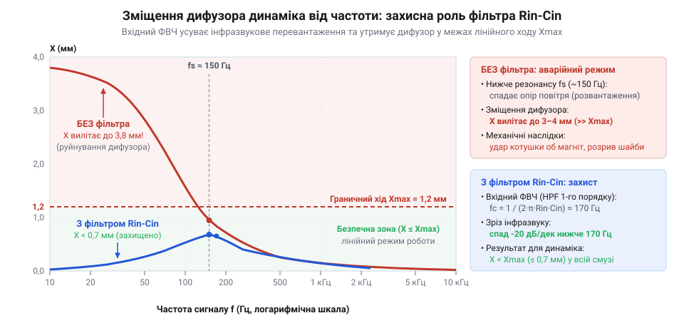
*Графік амплітуди зміщення дифузора динаміка від частоти звукового сигналу з позначенням зони лінійного ходу Xmax та зони небезпечного інфразвукового перевантаження нижче резонансу fs: вхідний фільтр відсікає інфразвуковий діапазон, рятуючи підвіс і котушку від руйнівних механічних перевантажень.*

**Практичний розрахунок номіналу `Cin`:**
При вхідному опорі `Rin = 20 кОм` та частоті механічного резонансу динаміка `f_s ≈ 170 Гц` обираємо цільову частоту зрізу фільтра `f_c = 150 Гц`. Розраховуємо необхідну ємність конденсатора:

```
Cin
= 1 / (2 · π · Rin · f_c)                     [виведення ємності з формули частоти зрізу]
= 1 / (2 · 3.14159 · 20000 Ом · 150 Гц)       [підстановка Rin та цільової частоти fc]
= 1 / 18849556                                [результат множення в знаменнику]
≈ 53 нФ                                       [переведення розрахункової ємності в нанофаради]
```

Обираємо найближчий стандартний номінал керамічного конденсатора з ряду E12: `Cin = 47 нФ` (0.047 мкФ).
Обчислюємо фактичну частоту зрізу з обраним стандартизованим номіналом:

```
f_c_fact
= 1 / (2 · π · 20000 · 47 · 10⁻⁹)             [підстановка стандартного значення Cin = 47 нФ]
= 1 / (5.906 · 10⁻³)                          [обчислення знаменника]
≈ 169.3 Гц                                    [фактична нижня частота зрізу аудіотракту]
```

Отримана нижня частота зрізу 169.3 Гц точно узгоджується з робочим діапазоном 5-ватного динаміка. Вона блокує постійну напругу зміщення, відсікає руйнівний інфразвук і захищає звукову котушку від виходу з магнітного зазору, гарантуючи чистоту звучання в робочому діапазоні.


*Повна розрахункова принципова схема аудіовузла на базі XPT8871 із узгодженими номіналами зовнішніх компонентів.*

## Повний інженерний синтез каскаду: покроковий наскрізний розрахунок обв'язки XPT8871

Побудова аналогового аудіовузла вимагає узгодження суперечливих фізичних вимог: джерело сигналу має обмежену навантажувальну здатність за струмом, напруга живлення встановлює непорушну межу розмаху, а механічні властивості дифузора динаміка вимагають жорсткої фільтрації невідтворюваних частот. Зміна номіналу бодай одного резистора або конденсатора одночасно зсуває коефіцієнт підсилення, нижню межу пропускання, амплітуду струмів і теплове навантаження мікросхеми. Щоб спроєктувати надійний каскад без здогадок і підбору деталей навпомацки, розрахунок ведуть як замкнений наскрізний алгоритм — від параметрів джерела та гучномовця до теплового балансу кристала.

Розглянемо класичну інженерну задачу, типову для портативних пристроїв та приладових панелей:
1. Живлення каскаду здійснюється від однополярної шини `VDD = 5.0 В` (стандартне живлення USB або стабілізований перетворювач).
2. Джерелом аудіосигналу слугує вбудований цифро-аналоговий перетворювач (ЦАП, @@en|DAC@@, від латинського *digitus* — палець та грецького *analogos* — співвідносний) мікроконтролера ESP32. Вихідний буфер ЦАП формує синусоїдальний сигнал із розмахом від піку до піку `V_in_pp = 2.0 В`, який симетрично коливається навколо постійного зміщення середини шкали `1.65 В` (від 0.65 В до 2.65 В). Пікова амплітуда змінної складової відносно віртуального нуля становить `V_in_peak = V_in_pp / 2 = 1.0 В`.
3. Навантаженням є малогабаритний динамічний гучномовець [динамік 4 Ом](root:cat-hw-actuators/speakers-8ohm) з номінальним активним опором звукової котушки `RL = 4 Ом` та нижньою паспортною межею ефективного акустичного відтворення `f_c = 150 Гц`.

### Крок 1. Граничний коефіцієнт підсилення та запобігання кліпінгу

Якщо підсилювач намагається видати на клемах динаміка напругу, більшу за різницю між шинами живлення, вихідні транзистори повністю відкриваються і входять у стан насичення. Верхівки синусоїди зрізаються, перетворюючи плавний сигнал на пласку трапецію. Це явище називають кліпінгом (від англійського @@en|clipping@@ — зрізання, підрізування). Кліпінг різко генерує спектр високочастотних гармонік, спотворює звук неприємним деренчанням і перевантажує котушку динаміка надлишковою потужністю.

Вихідні польові ключі інтегрального моста XPT8871 у відкритому стані мають залишковий опір каналу. Під час протікання вихідного струму на транзисторах верхнього та нижнього плечей неминуче виникає падіння напруги `V_drop ≈ 0.4 В` на кожне плече відносно шин `VDD` та `GND`. Відповідно, потенціал виводу `VO+` не може піднятися вище `VDD - 0.4 В = 4.6 В` і опуститися нижче `GND + 0.4 В = 0.4 В`. Оскільки мостова схема BTL (@@en|Bridge-Tied Load@@, від англійського *bridge* — міст та *load* — навантаження) керує навантаженням диференціально у протифазі, реальний граничний піковий розмах між виводами `VO+` та `VO-` дорівнює подвоєній різниці без урахування падіння на ключах:

```
V_diff_peak_real
= VDD - 2 · V_drop                      [падіння напруги на ключах верхнього та нижнього плеча]
= 5.0 В - 2 · 0.4 В                     [підстановка напруги живлення 5 В і залишку 0.4 В на ключ]
= 5.0 В - 0.8 В                         [віднімання сумарного падіння на плечах моста]
= 4.2 В                                 [максимальна неспотворена пікова амплітуда навантаження]
```

Знаючи пікову амплітуду джерела `V_in_peak = 1.0 В`, визначаємо максимально допустимий коефіцієнт підсилення за напругою `Av_max`, за якого підсилювач залишається в зоні лінійного підсилення без зрізання верхівок синусоїди:

```
Av_max
= V_diff_peak_real / V_in_peak          [гранична умова підсилення без входу у відсічку]
= 4.2 В / 1.0 В                         [відношення пікових розмахів виходу і входу]
= 4.2                                   [максимальний безрозмірний коефіцієнт підсилення]
```

Переведемо отримане значення в децибели (від латинського *decimus* — десятий та прізвища винахідника Белла), щоб оцінити динамічний діапазон:

```
Av_max_dB
= 20 · lg(Av_max)                       [переведення відношення напруг у логарифмічний масштаб]
= 20 · lg(4.2)                          [підстановка граничного коефіцієнта підсилення]
≈ 20 · 0.6232                           [обчислення десяткового логарифма]
≈ 12.46 дБ                              [максимальне підсилення в логарифмічній шкалі, округлено 12.5 дБ]
```

Будь-який коефіцієнт підсилення, вищий за 4.2 (12.5 дБ), за повної амплітуди ЦАП неминуче зажене вихідний каскад у глибокий кліпінг.

> 🔧 **Навіщо це.** Розрахунок граничного підсилення `Av_max` узгоджує чутливість підсилювача з максимальною амплітудою конкретного джерела звуку. Це гарантує, що при встановленні цифрової гучності на 100% підсилювач віддасть граничну паспортну потужність без хрипу, паразитних гармонік та ризику спалити динамік постійною складовою зрізаної синусоїди.

### Крок 2. Синтез резистивної матриці зворотного зв'язку

Диференціальний коефіцієнт підсилення мостового каскаду XPT8871 визначається відношенням номіналів зовнішнього резистора зворотного зв'язку `Rf` (@@en|feedback resistor@@) та вхідного резистора `Rin`:

```
Av
= 2 · (Rf / Rin)                        [формула підсилення інвертуючого BTL-каскаду]
```

Синтез схеми починають із вибору вхідного резистора `Rin`. Резистор `Rin` задає вхідний імпеданс підсилювача (від латинського *impedire* — перешкоджати) і навантажує вихідний буфер вбудованого ЦАП ESP32. Якщо обрати `Rin` занадто малим (наприклад, 1–5 кОм), вихідний каскад ЦАП перевантажиться струмом, що спричинить зростання спотворень і просідання сигналу ще до підсилювача. Якщо ж обрати `Rin` занадто великим (понад 50–100 кОм), зросте власний тепловий шум опору (шум Джонсона-Найквіста) і підвищиться чутливість входу до електромагнітних завад від сусідніх цифрових ліній. Оптимальним інженерним компромісом для мікроконтролерів є `Rin = 20 кОм`.

Для гарантованого захисту від кліпінгу закладаємо цільовий коефіцієнт підсилення з невеликим запасом на технологічний розкид номіналів: обираємо `Av_target = 4.0` замість граничного 4.2. Обчислюємо теоретичний опір `Rf`:

```
Rf_calc
= (Av_target / 2) · Rin                 [виведення опору зворотного зв'язку з формули підсилення]
= (4.0 / 2) · 20 кОм                    [підстановка цільового підсилення та обраного Rin]
= 2.0 · 20 кОм                          [спрощення множника моста]
= 40 кОм                                [розрахунковий номінал резистора зворотного зв'язку]
```

Резистори випускаються за стандартизованими рядами номіналів. У поширеному ряді E24 номіналу 40 кОм немає: найближчими є номінали 39 кОм та 43 кОм. 
- Якщо встановити `Rf = 43 кОм`, отримаємо `Av = 2 · (43 / 20) = 4.3`. Це перевищує розраховану безпечну межу `Av_max = 4.2` і викликає кліпінг на максимальній гучності.
- Якщо встановити `Rf = 39 кОм`, отримуємо фактичний коефіцієнт підсилення:

```
Av_real
= 2 · (Rf_std / Rin)                    [фактичне підсилення зі стандартним резистором]
= 2 · (39 кОм / 20 кОм)                 [підстановка найближчого меншого номіналу ряду E24]
= 2 · 1.95                              [ділення опорів]
= 3.9                                   [фактичний коефіцієнт підсилення каскаду]
```

Перевіримо отримане значення в децибелах і розрахуємо фактичну амплітуду на клемах динаміка:

```
Av_real_dB
= 20 · lg(Av_real)                      [переведення в децибели]
= 20 · lg(3.9)                          [підстановка фактичного підсилення]
≈ 20 · 0.5911                           [обчислення логарифма]
≈ 11.82 дБ                              [фактичний коефіцієнт у логарифмічній шкалі, округлено 11.8 дБ]
```

```
V_diff_peak
= Av_real · V_in_peak                   [вихідна пікова амплітуда при повній шкалі ЦАП]
= 3.9 · 1.0 В                           [підстановка фактичного підсилення та амплітуди входу]
= 3.9 В                                 [фактичний піковий розмах диференціальної напруги]
```

Фактичний розмах 3.9 В менший за межу насичення ключів 4.2 В. Утворюється захисний динамічний запас:

```
V_margin
= V_diff_peak_real - V_diff_peak        [запас напруги до настання кліпінгу]
= 4.2 В - 3.9 В                         [різниця граничного та фактичного розмахів]
= 0.3 В                                 [гарантований запас стійкості від перевантаження за піками]
```

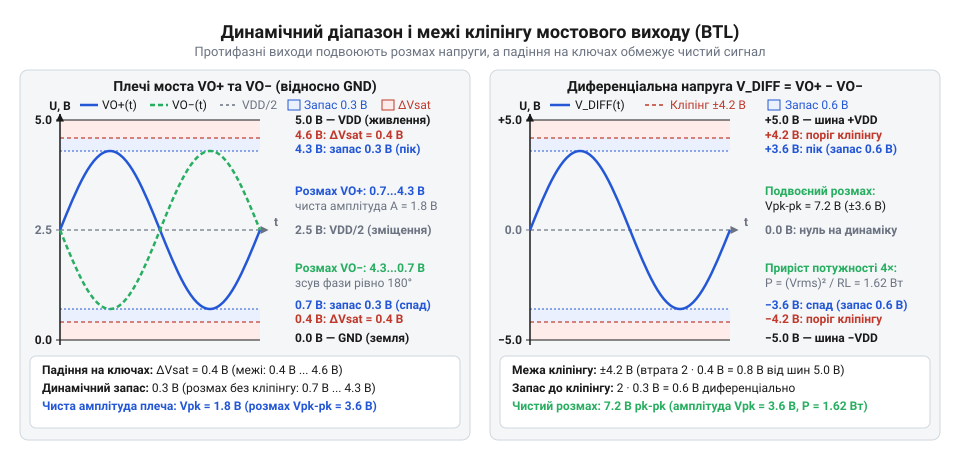
*Часова діаграма протифазних вихідних напруг моста: залишкове падіння 0.4 В на ключах обмежує лінійний розмах до 4.2 В, а вибір коефіцієнта підсилення 3.9 формує захисний динамічний запас 0.3 В для запобігання кліпінгу.*

> 🔧 **Навіщо це.** Запас у 0.3 В компенсує можливі відхилення напруги живлення під навантаженням та 1%-й або 5%-й виробничий допуск резисторів. Підсилювач залишається лінійним за будь-яких температурних коливань і розкиду партій деталей.

### Крок 3. Розрахунок вхідного роздільного конденсатора

Вбудований ЦАП ESP32 працює з постійним зсувом `1.65 В`. Водночас внутрішня схема XPT8871 формує власну опорну віртуальну землю на рівні `VDD / 2 = 5.0 В / 2 = 2.5 В` (вивід BYPASS). Якщо з'єднати вхід підсилювача з виходом ЦАП безпосередньо, різниця потенціалів `2.5 В - 1.65 В = 0.85 В` створить постійний струм через резистор `Rin`. Цей струм змістить робочу точку вхідного каскаду, спричинить передчасне одностороннє зрізання сигналу і викличе протікання постійного струму крізь динамік, що виштовхне дифузор з рівноважного стану.

Для гальванічного розділення постійних потенціалів послідовно з резистором `Rin` встановлюють роздільний конденсатор `Cin`. Разом вони утворюють пасивний фільтр високих частот (ФВЧ, від латинського *filtrum* — повсть для проціджування) першого порядку. Частоту зрізу `f_c` за рівнем -3 дБ (де потужність сигналу спадає вдвічі) обчислюють за формулою:

```
f_c
= 1 / (2 · π · Rin · Cin)               [формула частоти зрізу RC-ланцюга першого порядку]
```

Динамік має нижню межу ефективного акустичного відтворення `150 Гц`. Прирівняємо частоту зрізу фільтра до цієї границі (`f_c = 150 Гц`) і знайдемо необхідну ємність `Cin`:

```
Cin_calc
= 1 / (2 · π · Rin · f_c)               [виведення ємності з формули частоти зрізу]
= 1 / (2 · 3.1416 · 20000 Ом · 150 Гц)  [підстановка констант, опору 20 кОм і частоти 150 Гц]
= 1 / 18849556                          [перемноження величин у знаменнику]
≈ 5.305 · 10⁻⁸ Ф                        [розрахункова ємність у фарадах]
≈ 53.05 нФ                              [розрахункова ємність у нанофарадах]
```

Оцінимо стандартні номінали конденсаторів із ряду E24: найближчими доступними значеннями є `47 нФ` та `68 нФ`. Розрахуємо фактичну частоту зрізу для кожного варіанта:

```
f_c(47 нФ)
= 1 / (2 · π · Rin · Cin_std1)          [частота зрізу для ємності 47 нФ]
= 1 / (2 · 3.1416 · 20000 Ом · 47 · 10⁻⁹ Ф) [підстановка номіналу 47 нФ]
= 1 / 0.005906                          [обчислення знаменника]
≈ 169.3 Гц                              [частота зрізу, округлено 169 Гц]
```

```
f_c(68 нФ)
= 1 / (2 · π · Rin · Cin_std2)          [частота зрізу для ємності 68 нФ]
= 1 / (2 · 3.1416 · 20000 Ом · 68 · 10⁻⁹ Ф) [підстановка номіналу 68 нФ]
= 1 / 0.008545                          [обчислення знаменника]
≈ 117.0 Гц                              [частота зрізу, округлено 117 Гц]
```

Аналіз інженерного компромісу:
- Варіант `68 нФ` зміщує смугу вниз до 117 Гц. Малогабаритний динамік діаметром 30–40 мм фізично не здатний ефективно випромінювати хвилі довжиною понад 2 метри через малу площу дифузора та акустичне коротке замикання. Коливання на частотах 117–140 Гц призведуть до надмірного механічного ходу рухомої системи: звукова котушка битиметься об магнітопровід, спотворюючи звук і створюючи ризик обриву гнучких виводів.
- Варіант `47 нФ` піднімає зріз до 169 Гц. Цей спад слугує природним апаратним сабсонік-фільтром (підфільтром інфразвукових коливань). Він зрізає частоти, які динамік все одно не відтворить, але звільняє підсилювач від марної витрати струму та механічно захищає підвіс котушки.

Обираємо номінал `Cin = 47 нФ`. Рекомендований тип діелектрика — кераміка класу X7R або плівковий поліефірний конденсатор для запобігання п'єзоелектричному ефекту й нелінійним спотворенням на низьких частотах.

> 🔧 **Навіщо це.** Вхідний конденсатор одночасно блокує постійний струм зсуву від ЦАП і відсікає механічно небезпечний для малогабаритного дифузора інфразвуковий бас, підвищуючи загальну розбірливість мови та вокалу.

### Крок 4. Розрахунок електричної потужності, струмів навантаження та фільтрації живлення

Визначимо вихідну електричну потужність, яку підсилювач віддає в динамік без кліпінгу. Спочатку обчислимо діючу середньоквадратичну напругу (RMS, @@en|Root Mean Square@@) вихідного гармонійного сигналу:

```
V_rms
= V_diff_peak / √2                      [зв'язок пікового і діючого значень синусоїди]
= 3.9 В / 1.4142                        [підстановка амплітуди без кліпінгу]
≈ 2.7577 В                              [діюча напруга на навантаженні, округлено 2.76 В]
```

Розрахуємо середньоквадратичну синусоїдальну потужність, яка виділяється на активному опорі звукової котушки `RL = 4 Ом` за законом Джоуля-Ленца:

```
P_rms
= V_rms² / RL                           [формула теплової електричної потужності]
= (2.7577 В)² / 4 Ом                    [підстановка діючої напруги та опору динаміка]
= 7.605 В² / 4 Ом                       [квадрат діючої напруги на виході моста]
≈ 1.901 Вт                              [неспотворена вихідна потужність, округлено 1.9 Вт]
```

Отримуємо чисту неспотворену потужність `1.9 Вт`. Якщо підвищити підсилення і загнати сигнал у кліпінг (режим меандру з THD = 10%), потужність формально зросте до 3–3.5 Вт, проте звук стане спотвореним. Значення 1.9 Вт є чесною інженерною межею якісного звуку при живленні 5.0 В на навантаженні 4 Ом.

Визначимо піковий вихідний струм `I_peak`, що протікає через ключі моста та звукову котушку на верхівці синусоїди:

```
I_peak
= V_diff_peak / RL                      [закон Ома для пікових значень]
= 3.9 В / 4 Ом                          [відношення пікової диференціальної напруги до опору]
= 0.975 А                               [піковий струм навантаження, близько 1.0 А]
```

Струм 0.975 А мікросхема споживає імпульсно з шини живлення. При відтворенні найнижчої робочої частоти `f = 150 Гц` тривалість одного напівперіоду струму становить:

```
t_half
= 1 / (2 · f)                           [тривалість однієї напівхвилі сигналу]
= 1 / (2 · 150 Гц)                      [підстановка частоти 150 Гц]
= 1 / 300 с                             [обчислення частки секунди]
≈ 0.00333 с                             [тривалість напівперіоду, тобто 3.33 мс]
```

Середній струм споживання за час напівперіоду синусоїди становить `I_supply_avg = (2 / π) · I_peak ≈ 0.6366 · 0.975 А ≈ 0.621 А`. Протягом цих 3.33 мс підсилювач відбирає від шини живлення суттєвий електричний заряд. Якщо джерело живлення віддалене (наприклад, довгі дроти кабелю USB мають паразитний опір і власну індуктивність), опір підвідних ліній призведе до різкого падіння напруги живлення під час басового удару.

Встановимо інженерну вимогу: динамічне просідання напруги шини живлення не повинно перевищувати `ΔVDD = 50 мВ` (0.05 В), інакше просідання модулюватиме звук і викличе ранній кліпінг. Визначимо заряд `ΔQ`, що переноситься струмом за напівперіод, і розрахуємо мінімальну ємність накопичувального конденсатора `C_vdd`, яка утримує цей імпульс:

```
ΔQ
= I_supply_avg · t_half                 [заряд, що відбирається з шини за низькочастотний сплеск]
= 0.621 А · 0.00333 с                   [підстановка середнього струму та часу напівперіоду]
≈ 0.002068 Кл                           [заряд імпульсу в кулонах, близько 2.07 мКл]
```

```
C_vdd_req
= ΔQ / ΔVDD                             [ємність для утримання просідання напруги в заданих межах]
= 0.002068 Кл / 0.05 В                  [відношення імпульсного заряду до допустимого спаду 50 мВ]
≈ 0.04136 Ф                             [ємність за умови повної відсутності підживлення від джерела]
```

Отримане теоретичне значення 41 000 мкФ потрібне лише у випадку, якщо джерело живлення взагалі вимкнене і каскад живиться виключно від батареї конденсаторів. У реальному пристрої зовнішній стабілізатор або блок живлення постійно поповнює заряд, але має кінцевий час перехідної реакції (зазвичай 10–50 мікросекунд) та опір дротових доріжок.

Тому локальний блокувальний конденсатор живлення обирають з урахуванням компенсації паразитної індуктивності та опору друкованих провідників:
- Встановлюють електролітичний або танталовий конденсатор номіналом `C_vdd = 220–470 мкФ` з низьким еквівалентним послідовним опором (ESR, @@en|Equivalent Series Resistance@@, [ESR конденсаторів](root:hw-components/capacitor-esr-impedance) < 0.1 Ом). Він працює локальним резервуаром енергії під час низькочастотних басових імпульсів.
- Паралельно йому, впритул до виводів VDD і GND мікросхеми (відстань не більше 2 мм), встановлюють багатошаровий керамічний конденсатор ємністю `0.1 мкФ` (тип X7R). Керамічний конденсатор має мінімальну власну індуктивність (ESL, @@en|Equivalent Series Inductance@@) і фільтрує високочастотний комутаційний дзвін, запобігаючи паразитному самозбудженню вихідного каскаду.

Для компенсації індуктивного зростання опору звукової котушки динаміка на ультразвукових частотах та збереження стабільності підсилювача паралельно навантаженню застосовують [ланцюг Цобеля-Буше](root:hw-analog/zobel-network-audio).

> 🔧 **Навіщо це.** Тандем із конденсаторів 220–470 мкФ і 0.1 мкФ надійно «цементує» шину живлення біля кристала. Це запобігає перезавантаженню чутливого мікроконтролера ESP32 від спільних просідань живлення при різких гучних звуках і блокує паразитний зворотний зв'язок крізь шину живлення.

### Крок 5. Тепловий баланс і оцінка розсіюваної потужності

Підсилювач XPT8871 побудований на вихідних каскадах лінійного класу AB. Частина споживаної від джерела енергії передається в динамік як корисний звук, а решта виділяється на внутрішньому опорі вихідних транзисторів у вигляді тепла.

При роботі на чистому синусоїдальному сигналі коефіцієнт корисної дії (ККД, грецька літера `η`) каскаду класу AB становить близько 60–65%. Середня споживана потужність від однополярного джерела живлення `VDD = 5.0 В` для симетричного мостового каскаду BTL описується аналітичним співвідношенням:

```
P_supply
= (4 / π) · (VDD · V_diff_peak) / (2 · RL) [середня потужність споживання моста класу AB]
= (2 / π) · (VDD · V_diff_peak) / RL    [спрощення дробу]
= (2 / 3.1416) · (5.0 В · 3.9 В) / 4 Ом [підстановка параметрів схеми]
= 0.6366 · 19.5 В² / 4 Ом               [добуток амплітуди на напругу живлення]
= 0.6366 · 4.875 Вт                     [ділення на опір навантаження]
≈ 3.103 Вт                              [повна потужність споживання від шини 5 В, округлено 3.1 Вт]
```

За законом збереження енергії різниця між споживаною потужністю та корисною електричною потужністю в навантаженні перетворюється на теплову потужність розсіювання на кристалі `P_diss` (від латинського *dissipatio* — розсіювання):

```
P_diss
= P_supply - P_rms                      [теплові втрати як різниця споживання і віддачі]
= 3.10 Вт - 1.90 Вт                     [віднімання потужності звуку]
= 1.20 Вт                               [потужність теплових втрат на кристалі мікросхеми]
```

Мікросхема XPT8871 випускається в мініатюрному корпусі ESOP-8 (@@en|Exposed Small Outline Package@@, від латинського *exponere* — виставляти назовні). На черевці мікросхеми розташований відкритий металевий тепловідвідний майданчик (@@en|Exposed Thermal Pad@@). Якщо майданчик припаяний до мідного полігону заземлення друкованої плати площею 5–10 см² з масивом перехідних теплових отворів ([розрахунок теплових полігонів](root:hw-pcb/thermal-vias)), тепловий опір переходу кристал-середовище становить `RθJA ≈ 45 °C/Вт` (грецька літера `θ` позначає температуру).

Обчислимо динамічний перегрів кристала `ΔT` над температурою навколишнього середовища:

```
ΔT
= P_diss · RθJA                         [перегрів структури за тепловим законом Ома]
= 1.20 Вт · 45 °C/Вт                    [підстановка тепловтрат та теплового опору плати]
= 54.0 °C                               [підвищення температури напівпровідникового кристала]
```

Розрахуємо підсумкову робочу температуру кристала `T_j` (@@en|junction temperature@@) при нормальній кімнатній температурі всередині приладу `T_amb = +25 °C`:

```
T_j
= T_amb + ΔT                            [абсолютна робоча температура p-n переходів]
= 25 °C + 54 °C                         [додавання температури повітря та перегріву]
= 79 °C                                 [робоча температура кристала при тривалому максимальному синусі]
```

Мікросхема має вбудований вузол теплового аварійного захисту (@@en|thermal shutdown@@), поріг спрацьовування якого становить `T_sd = +150 °C`. Порівняємо робочу температуру з аварійним порогом:

```
T_margin
= T_sd - T_j                            [запас теплової стійкості]
= 150 °C - 79 °C                        [різниця порогу захисту та робочої температури]
= 71 °C                                 [тепловий запас до спрацьовування аварійного відключення]
```

Навіть якщо прилад працює в закритому пластиковому корпусі без примусової вентиляції під прямим сонцем, де температура повітря сягає `+50 °C`, кристал нагріється лише до `50 °C + 54 °C = 104 °C`. Це все одно залишає майже 46 °C безпечного запасу до відключення. Схема надійно працює без зовнішніх алюмінієвих радіаторів, використовуючи лише мідь друкованої плати.

> 🔧 **Навіщо це.** Тепловий розрахунок підтверджує надійність пристрою при тривалому безперервному відтворенні звуку на максимальній гучності. Він гарантує, що підсилювач не піде в раптове циклічне вимкнення через перегрів і не пошкодить прилеглі компоненти на платі.

### Зведена специфікація синтезованого аудіовузла

У результаті виконання покрокового алгоритму отримано вичерпний перелік зовнішніх компонентів обв'язки XPT8871 для підключення до ЦАП ESP32 та динаміка 4 Ом:

| Компонент | Розраховане значення | Стандартний номінал | Тип компонента / Призначення |
| :--- | :--- | :--- | :--- |
| **`Rin`** | 20 кОм | **20 кОм** (ряд E24, 1%) | Металоплівковий резистор 0805, безпечне навантаження буфера ЦАП |
| **`Rf`** | 40 кОм | **39 кОм** (ряд E24, 1%) | Металоплівковий резистор 0805, підсилення Av = 3.9 (11.8 дБ) |
| **`Cin`** | 53.05 нФ | **47 нФ** (ряд E24, 10–16 В) | Кераміка X7R або плівка, ФВЧ зі зрізом 169 Гц (сабсонік) |
| **`C_vdd` (електроліт)** | > 220 мкФ | **330–470 мкФ** (10–16 В) | Низькоімпедансний (Low ESR < 0.1 Ом) танталовий або алюмінієвий конденсатор |
| **`C_vdd` (кераміка)** | 0.1 мкФ | **0.1 мкФ / 100 нФ** (50 В, X7R) | Кераміка 0603/0805 впритул до виводів 6 і 7, придушення ВЧ перешкод |
| **`C_bypass`** | 1.0 мкФ | **1.0 мкФ** (16 В, X7R) | Кераміка 0805 на виводі BYPASS для плавної фільтрації зміщення VDD/2 |

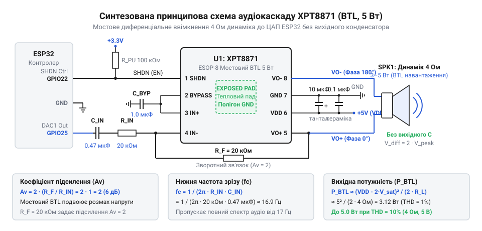
*Повна принципова електрична схема синтезованого аудіокаскаду XPT8871: розраховані номінали деталей обв'язки забезпечують неспотворену потужність 1.9 Вт на навантаженні 4 Ом, частоту зрізу ФВЧ 169 Гц та надійне узгодження з виходом ЦАП ESP32.*

Синтезований каскад забезпечує чисту вихідну синусоїдальну потужність 1.9 Вт на навантаженні 4 Ом із повною відсутністю кліпінгу, стабільну роботу джерела сигналу без перевантаження за струмом, захист дифузора динаміка від руйнівного інфразвуку та робочу температуру кристала нижче 80 °C.
