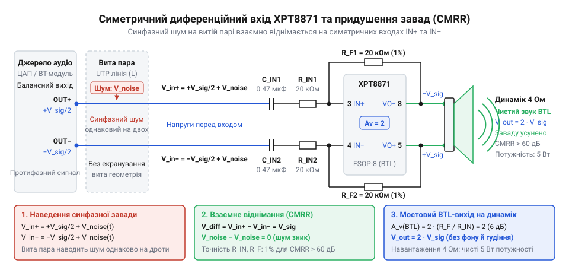
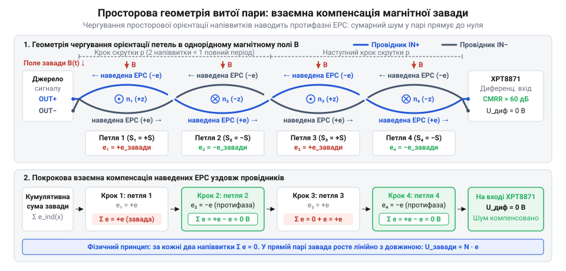
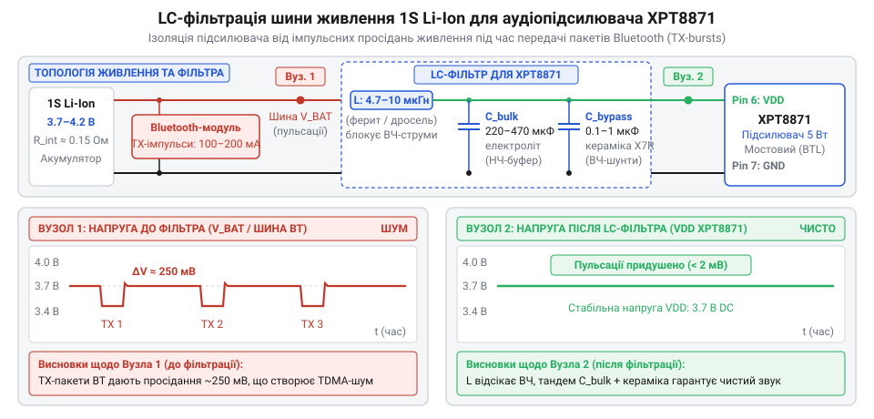
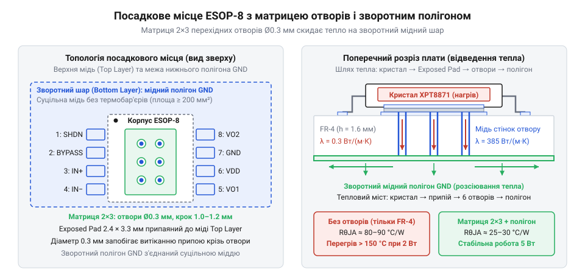

# XPT8871 — моно-підсилювач 5 Вт

<preknowlist>
- [Динаміки 5 Вт / 8 Ом](root:cat-hw-actuators/speakers-8ohm) — номінальний активний опір звукової котушки (4 Ом або 8 Ом), зв'язок між струмом, напругою та потужністю й теплові межі котушки.
</preknowlist>

## Інженерна проблема виносного активного гучномовця

Коли динамік стоїть поруч із платою керування на коротких доріжках довжиною в пару сантиметрів, звук залишається чистим навіть за найпростішої схеми підключення. Проте щойно звуковий випромінювач виносять в окремий корпус на відстань одного або трьох метрів, підсилювач починає поводитися непередбачувано. З динаміка лунає не лише корисний сигнал: щойно поруч активується радіомодуль зв'язку, аудіотракт наповнюється сумішшю різкого дзижчання, клацань і високого писку. Рівень цього фонового шуму часто не зменшується навіть тоді, коли програмну гучність викручують у нуль.

Причина полягає в способі передачі сигналу, який за звичкою обирають у простих схемах. У несиметричній лінії (від грец. *symmetria* — співрозмірність; @@en|single-ended@@) корисний сигнал передається по одному сигнальному провіднику відносно спільного земляного проводу GND. Земляний провід одночасно виконує дві несумісні ролі: він слугує нульовим опорним рівнем напруги для чутливого входу підсилювача і водночас замикає силове коло живлення цифрових мікросхем та радіопередавачів.

У реальному пристрої поруч із звуковим трактом майже завжди працюють бездротові інтерфейси — Bluetooth, Wi-Fi або стільникові модеми GSM/LTE. Жоден із них не випромінює радіохвилі неперервним рівним потоком. Бездротовий зв'язок працює імпульсними пачками з часовим розподілом каналів (TDMA, від англ. @@en|Time Division Multiple Access@@ — множинний доступ із часовим розподілом). Наприклад, GSM-модем виходить у радіоефір короткими сплесками з базовою частотою 217 Гц. Радіотракт Bluetooth передає пакети у фіксованих слотах тривалістю 625 мікросекунд, що створює імпульсну сітку з частотою слідування близько 1.6 кГц. Модулі Wi-Fi генерують періодичні маякові пакети з інтервалом близько 100 мс і пачки пакетів під час активного трафіку.

Коли кабель довжиною в кілька метрів прокладено крізь зону випромінювання цих антен, він перетворюється на приймальну антену. Високочастотна електромагнітна хвиля наводить у проводі високочастотні струми. Людське вухо і [динамік](root:cat-hw-actuators/speakers-8ohm) фізично не здатні відтворити коливання в гігагерцовому діапазоні, проте вхідні каскади мікросхем містять напівпровідникові p-n переходи: захисні ESD-діоди від статичної електрики та внутрішні переходи вхідних транзисторів. Завдяки нелінійній вольт-амперній характеристиці цих переходів високочастотний радіосигнал детектується — відбувається випрямлення радіочастотної хвилі з виділенням її низькочастотної огинаючої. У результаті радіопачки перетворюються на реальну змінну напругу звукового діапазону з частотами 217 Гц та 1.6 кГц, яка потрапляє на вхід підсилювача й підсилюється звуковою котушкою як гучний тріск і дзижчання.

Паралельно розгортається другий руйнівний процес — утворення [паразитної земляної петлі](root:hw-pcb/ground-loops) через спільний опір шини заземлення (@@en|ground loop@@). Будь-який провідник має власний електричний опір (імпеданс, від лат. *impedire* — перешкоджати) та розподілену індуктивність. Коли бездротовий модуль або процесор переходить у режим передачі, його вихідний каскад миттєво збільшує споживання струму на сотні міліампер. Цей імпульсний зворотний струм повертається до джерела живлення тим самим земляним проводом, до якого прив'язаний опорний вивід аудіовходу підсилювача. За законом Ома імпульсний струм викликає на розподіленому опорі землі миттєве падіння напруги:

```
V_noise(t)
= I_digital(t) · R_gnd                         [закон Ома для падіння напруги на опорі землі]
```

Оскільки несиметричний підсилювач вимірює напругу суворо між сигнальним проводом і власним локальним виводом GND, падіння потенціалу на земляній жилі додається безпосередньо до корисного сигналу:

```
V_in(t)
= V_audio(t) - V_noise(t)                     [відхилення вхідної напруги відносно зміщеного потенціалу землі]
= V_audio(t) - I_digital(t) · R_gnd           [підстановка імпульсної завади живлення]
```

Навіть якщо опір земляної жили становить усього 0.2 Ом, стрибок струму передавача в 300 мА породжує сплеск амплітудою 60 мВ. За стандартного рівня лінійного аудіосигналу 300–500 мВ завада сягає понад 10–20% від гучності фонограми. Звук стає брудним, а в паузах чути виразні клацання та пульсації цифрової активності.

Спроба розв'язати проблему традиційним металевим екраном кабелю натрапляє на фізичні межі. Екран із мідного обплетення ефективно блокує лише електричне (ємнісне) поле, замикаючи його силові лінії на землю. Проте змінне магнітне поле вільно проникає крізь немагнітні метали та індукує електрорушійну силу в замкненому контурі між сигнальним проводом і землею. Якщо заземлити екран з обох кінців кабелю, утворюється масивний замкнений контур, через який починають циркулювати зрівнювальні цифрові струми, ще сильніше спотворюючи потенціал землі підсилювача. Якщо ж заземлити екран лише з одного боку, він захистить лінію від електростатичного наведення, але ніяк не усуне падіння напруги від імпульсних струмів на спільному земляному провіднику всередині кабелю.

Звичайне екранування не здатне вирівняти потенціали або захистити несиметричну лінію від струмів спільного опору. Щоб отримати бездоганно чистий звук на виносному динаміку, необхідно фундаментально відокремити інформаційний канал від потенціалу землі живлення. Потрібен спосіб передачі, за якого корисний сигнал вимірюється не відносно брудної силової шини GND, а як автономна різниця між двома рівноправними сигнальними лініями.

> 🔧 **Навіщо це.**
> Розуміння природи наведень захищає від марних витрат на дорогі екрановані кабелі там, де проблема криється у топології повернення струмів. Якщо шум породжений падінням напруги на спільній землі або детектуванням пачок TDMA, жоден товстий мідний екран не усуне писк у динаміку, доки сигнальний контур прив'язаний до загального проводу GND.

## Принцип роботи симетричного диференційного приймача на XPT8871

Коли сигнал не можна прив'язувати до нестабільної землі, його передають у формі різниці потенціалів між двома ізольованими провідниками. Такий спосіб передачі називають [диференційним](root:com-medium/audio-differential-signaling) (від лат. *differentia* — різниця, відмінність; @@en|differential signaling@@). Джерело формує в кабелі дві протифазні копії аудіосигналу: коли на одній лінії напруга зростає на величину корисного сигналу, на другій вона на таку ж величину спадає.

Якщо лінія прокладена через простір з електромагнітними завадами, зовнішнє поле діє на обидва близько розташовані провідники одночасно. Воно наводить у них електричні коливання з однаковою амплітудою і однаковою фазою. Таку паразитну напругу називають синфазною (від грец. *syn* — разом та *phasis* — поява, стан; @@en|common-mode voltage@@, `V_cm`). На приймальному кінці лінії напруга на кожному з двох проводів складається з корисної половини протифазного сигналу та однакової для обох синфазної завади:

```
V_in+ = V_cm + V_diff / 2                      [напруга на прямому вході лінії]
V_in- = V_cm - V_diff / 2                      [напруга на інверсному вході лінії]
```

Якщо на виході лінії встановити приймач, який віднімає напругу одного проводу від іншого, синфазна завада зникає з чистою математичною точністю:

```
V_in+ - V_in-
= (V_cm + V_diff / 2) - (V_cm - V_diff / 2)    [віднімання сигналів двох ліній]
= V_cm - V_cm + V_diff / 2 + V_diff / 2        [розкриття дужок і групування членів]
= V_diff                                       [взаємне знищення синфазної завади]
```

Корисний різницевий сигнал подвоюється, а зовнішній шум, яким би потужним він не був, повністю анулюється, бо він присутній на обох лініях однаково.

Саме цей принцип апаратного віднімання закладено в основу мостового аудіопідсилювача XPT8871. Мікросхема виконана за топологією мостового навантаження (@@en|bridge-tied load@@, BTL) і має повністю диференційну вхідну структуру. На відміну від звичайних побутових підсилювачів із єдиним сигнальним входом, XPT8871 оснащена парою рівноправних входів: неінвертуючим `IN+` (вивід 3) та інвертуючим `IN-` (вивід 4).

Внутрішня схемотехніка мікросхеми містить два узгоджені операційні підсилювачі. Вони приймають різницевий сигнал із входів і формують два протифазні вихідні сигнали на виводах `VO1` (вивід 5) та `VO2` (вивід 8). Між цими виводами безпосередньо вмикається звукова котушка [динаміка на 4 або 8 Ом](root:cat-hw-actuators/speakers-8ohm). Оскільки динамік під'єднано мостом між двома активними виходами без з'єднання з землею, вихідна напруга на його клемах є суворо різницевою:

```
V_speaker
= VO1 - VO2                                    [напруга на звуковій котушці у мостовому ввімкненні]
= A_diff · (V_in+ - V_in-)                     [пропорційність різниці вхідних напруг із коефіцієнтом підсилення]
```


*Принципова схема підключення XPT8871 за диференційною топологією: синфазна завада наводиться однаково на обидва провідники скрученої лінії та взаємно знищується внутрішнім каскадом віднімання підсилювача.*

Здатність підсилювача ігнорувати зовнішній шум кількісно оцінюють коефіцієнтом придушення синфазного сигналу (CMRR, від англ. @@en|Common-Mode Rejection Ratio@@). У реальній мікросхемі через технологічний розкид параметрів внутрішніх транзисторів і зовнішніх пасивних компонентів придушення не є нескінченним: невелика частка синфазної завади все ж просочується на вихід із власним коефіцієнтом підсилення `A_cm`. Повний вихідний відгук підсилювача описується рівнянням:

```
V_out
= A_diff · V_diff + A_cm · V_cm                [загальний вихідний сигнал реального підсилювача]
```

Коефіцієнт CMRR показує, у скільки разів підсилювач сильніше підсилює корисний диференційний сигнал, ніж паразитну синфазну заваду:

```
CMRR
= A_diff / |A_cm|                              [лінійне відношення коефіцієнтів підсилення]
```

В інженерній практиці цей параметр завжди виражають у децибелах:

```
CMRR_дБ
= 20 · lg(A_diff / |A_cm|)                     [логарифмічна міра придушення завади]
```

Для мікросхеми XPT8871 паспортне значення CMRR у діапазоні звукових частот становить типово від 60 до 65 дБ. Подивимося, як це виглядає в реальних цифрах.

**Оцінка залишку радіозавади з амплітудою 200 мВ за коефіцієнта підсилення A_diff = 2 та CMRR = 60 дБ**
Приймаємо диференційний коефіцієнт підсилення схеми `A_diff = 2`, що задається співвідношенням зовнішніх резисторів зворотного зв'язку, а наведену на кабель заваду від роботи передавача рівною `V_cm = 200 мВ`.
Покроковий розрахунок:
```
CMRR
= 10^(60 / 20)                                 [переведення логарифмічного показника 60 дБ у лінійний масштаб]
= 10³
= 1000                                         [кратність переважання диференційного підсилення над синфазним]

A_cm
= A_diff / CMRR                                [визначення паразитного коефіцієнта передачі синфазної напруги]
= 2 / 1000
= 0.002                                        [коефіцієнт проникнення синфазної завади на вихід]

V_out_noise
= A_cm · V_cm                                  [амплітуда завади на клемах динаміка]
= 0.002 · 200 мВ
= 0.4 мВ                                       [залишкова напруга шуму]
```
Потужна завада амплітудою 200 мВ, яка в несиметричному тракті повністю заглушила б звук, на виході диференційного каскаду XPT8871 стискається до мізерних 0.4 мВ. Залишок шуму опиняється нижче порога чутності людського вуха.

Щоб математика віднімання спрацювала на практиці, електромагнітна завада зобов'язана наводитися на обидва провідники з абсолютно однаковою амплітудою і фазою. Якщо покласти два проводи паралельно, один із них неминуче опиниться ближче до джерела випромінювання (антени або силової доріжки), ніж інший. Різниця відстаней призведе до різниці наведених напруг: `V_noise1 ≠ V_noise2`. Ця різниця перетвориться на паразитний різницевий сигнал, який підсилювач сприйме як корисний звук і передасть у динамік.

Для забезпечення бездоганної геометричної симетрії провідники скручують між собою з рівномірним постійним кроком повивки, утворюючи виту пару (від англ. @@en|twisted pair@@). Завдяки скручуванню провідники через кожні кілька сантиметрів міняються місцями в просторі. Кожна пара суміжних напіввитків утворює дві послідовні рамки, що мають однакову площу, але протилежну орієнтацію в просторі. Згідно з законом електромагнітної індукції Фарадея, магнітний потік наводить у першій напівпетлі ЕРС певної полярності, а в сусідній напівпетлі — точно таку ж за величиною ЕРС зворотної полярності. Оскільки витки з'єднані послідовно, наведені ЕРС взаємно компенсуються: їхня сума вздовж усього кабелю прямує до нуля. Одночасно усереднюються і паразитні мікроємності кожного дроту відносно навколишніх металевих предметів і плат, гарантуючи рівність ємнісних струмів витоку.


*Механізм магнітної компенсації у витій парі: протилежна просторова орієнтація суміжних напіввитків збуджує зустрічні ЕРС індукції, завдяки чому сумарна завада вздовж лінії прямує до нуля.*

Завершальна фундаментальна перевага диференційного приймача — повний розрив сигнального тракту зі спільною землею живлення GND. На схемі ввімкнення XPT8871 сигнальні провідники `IN+` та `IN-` не торкаються землі ані в кабелі, ані на платі підсилювача. Вони підключаються до мікросхеми через керамічні розділові конденсатори `C_in`. Постійна напруга зміщення формується всередині підсилювача від стабілізованого джерела опорної напруги `V_DD / 2` через вивід `BYPASS` (вивід 2), на якому встановлено згладжувальний конденсатор. Сигнальний струм циркулює суворо між двома лініями витої пари, ніколи не стікаючи в силову шину заземлення. Навіть якщо земляний дріт кабелю живлення перевантажений імпульсними зворотними струмами передавача і на ньому виникають сплески в сотні мілівольт, входи `IN+` та `IN-` плавають разом із загальним потенціалом як єдине ціле. Для внутрішнього каскаду XPT8871 це коливання є звичайним синфазним зміщенням `V_cm`, яке надійно відсікається високим CMRR мікросхеми.

> 🔧 **Навіщо це.**
> Застосування симетричного входу на XPT8871 перетворює дешевий кабель витої пари (наприклад, пару з недорогого комп'ютерного кабелю UTP Cat 5e) на надійну лінію передачі звуку студійної чистоти. Відпадає потреба у важких екранованих проводах, гальванічних ізоляторах на аудіотрансформаторах або складних цифрових оптичних лініях: захист від завад забезпечується елементарною геометрією лінії та апаратним відніманням усередині підсилювача.

## Схемотехнічна реалізація та розрахунок пасивних компонентів симетричного підсилювача

Диференційний аудіотракт забезпечує передачу сигналу двома сигнальними лініями `IN+` та `IN-` у протифазі (диференційний, від латинського *differentia* — різниця, відмінність). Коли на клемі прямого входу напруга відносно умовної середньої точки зростає на `+ΔV`, на інверсному вході вона дзеркально зменшується на `-ΔV`. Корисний звуковий сигнал визначається виключно різницею потенціалів між цими двома провідниками:

```text
V_diff = V_in+ - V_in- = (+ΔV) - (-ΔV) = 2 · ΔV
```

Будь-яка зовнішня завада — електромагнітна хвиля сусіднього радіомодуля, перемикання цифрових шин або ємнісна наводка — діє на обидва близько розташовані провідники одночасно. Вона наводить у них електричні потенціали однакової величини та однакового напрямку. Ця складова називається синфазною (від грецьких *syn* — разом та *phasis* — фаза, поява) і дорівнює півсумі потенціалів:

```text
V_cm = (V_in+ + V_in-) / 2
```

Вхідний каскад [мостового підсилювача (BTL)](root:hw-analog/btl-audio-power-amplifier) XPT8871 побудований за симетричною топологією: він підсилює різницю між входами та відкидає напругу, присутню на обох входах одночасно. Здатність мікросхеми виділяти корисний сигнал на тлі шуму виражається через [коефіцієнт придушення синфазного сигналу (CMRR)](root:com-medium/cmrr-in-differential-audio) (@@en|Common-Mode Rejection Ratio@@, CMRR, децибел — від латинського *decimus* — десятий та прізвища винахідника Белла):

```text
CMRR = 20 · log10(|A_diff / A_cm|)
```

Власна кремнієва структура операційних підсилювачів XPT8871 демонструє високе внутрішнє придушення синфазних завад — типово понад 65–70 дБ у звуковому діапазоні (послаблення паразитного сигналу у 1800–3100 разів). Проте сам по собі чіп не може захистити тракт: реальний показник CMRR готового пристрою визначається симетрією зовнішніх пасивних ланцюгів обв'язки — роздільних конденсаторів `C_in1`, `C_in2` та вхідних резисторів `R_in1`, `R_in2`.

Кожне плече диференційного входу утворює комплексний вхідний імпеданс (від латинського *impedire* — перешкоджати): `Z_in(ω) = R_in + 1 / (j · ω · C_in)`. Якщо внаслідок виробничого розкиду номіналів імпеданс прямого плеча `Z_in1` відрізняється від імпедансу інверсного плеча `Z_in2` хоча б на частку відсотка, виникає явище [синфазно-диференційної конверсії](root:com-medium/common-mode-to-differential-conversion) (@@en|common-mode to differential conversion@@). Синфазна завада `V_cm`, проходячи через неоднакові подільники напруги, перетворюється на паразитну диференційну напругу:

```text
V_diff_noise = V_cm · ((Z_in1 - Z_in2) / Z_avg) ≈ V_cm · (ΔZ / Z)
```

Внутрішній каскад підсилювача не має фізичної можливості відокремити цю наведену напругу від справжньої аудіоінформації і підсилює її з повним диференційним коефіцієнтом `A_diff`. При використанні пасивних компонентів зі стандартним для масової електроніки технологічним допуском 5% граничне теоретичне придушення синфазної завади різко падає:

```text
CMRR_passive
= 20 · log10(1 / |ΔZ / Z|)                 [руйнування придушення завад через асиметрію вхідних кіл]
= 20 · log10(1 / 0.05)                     [підстановка відносного технологічного допуску 5%]
= 20 · log10(20)                           [обчислення відношення напруг]
≈ 26.02 дБ                                 [максимально досяжний CMRR реального тракту]
```

Похибка всього у 5% знецінює кремнієву архітектуру підсилювача: придушення шуму деградує з 70 дБ до 26 дБ (із 3000 разів до 20 разів). Радіочастотний тріск пакетів передачі Bluetooth, цифровий шум шин обміну та перепади струмів живлення безперешкодно потрапляють у звуковий канал і транслюються звуковою котушкою динаміка.

Для збереження реального показника CMRR системи на рівні не гірше 55–60 дБ до вибору пасивних компонентів висуваються жорсткі інженерні критерії:

1. Резистори `R_in1` та `R_in2`: використовуються виключно металоплівкові прецизійні резистори з виробничим допуском ±1% або краще (±0.1% у вимірювальних або студійних трактах). Їхній температурний коефіцієнт опору (@@en|Temperature Coefficient of Resistance@@, TCR) не повинен перевищувати ±50 ppm/°C. Звичайні товстоплівкові резистори з TCR ±200 ppm/°C під час нагрівання плати вихідними транзисторами розбалансовують міст просто під час відтворення гучних фрагментів фонограми.
2. Конденсатори `C_in1` та `C_in2`: використання керамічних конденсаторів загального призначення з діелектриками класу 2 і 3 (X7R, X5R, Y5V) категорично неприпустиме. Сегнетоелектрична кераміка на основі титанату барію володіє трьома критичними дефектами:
   - П'єзоефект (@@en|piezoelectric effect@@, від грецького *piezein* — стискати): механічні акустичні коливання від динаміка деформують плату, і конденсатор працює як мікрофон, генеруючи паразитну напругу;
   - Діелектричне поглинання (@@en|dielectric absorption@@): ефект залишкової поляризації молекул діелектрика спотворює фазу складного аудіосигналу;
   - Нелінійне падіння ємності від прикладеної постійної напруги зміщення (DC bias): конденсатори під різним потенціалом зміщення миттєво втрачають номінальну ємність на 20–50%, що катастрофічно розбалансовує пару.
   У сигнальні входи встановлюють керамічні конденсатори ультрастабільного класу C0G (NP0) з допуском 1–2% або прецизійні плівкові конденсатори (поліпропіленові PP чи поліефірні PET).

Роздільні конденсатори `C_in1` та `C_in2` спільно з вхідними резисторами `R_in1` та `R_in2` утворюють симетричний пасивний фільтр високих частот (ФВЧ) першого порядку. Його призначення — заблокувати постійну складову (DC offset) від джерела звуку та відсікти інфразвукові коливання, які перевантажують звукову котушку динаміка без створення корисного звуку. Формула нижньої граничної частоти зрізу за рівнем -3 дБ має вигляд:

```text
fc = 1 / (2 · π · Rin · Cin)
```

При роботі з малогабаритним виносним випромінювачем на базі [динаміків 5 Вт / 8 Ом](root:cat-hw-actuators/speakers-8ohm) частоти нижче 60–80 Гц дифузор практично не відтворює через акустичне коротке замикання в малому об'ємі. Проте частоту електричного зрізу ланцюга обирають суттєво нижчою — у діапазоні 15–25 Гц. Це необхідно для того, щоб на нижній робочій частоті динаміка (70–100 Гц) фазовий зсув ФВЧ не перевищував 5–10°, зберігаючи чіткість атаки низькочастотних імпульсів.

Обираємо стандартні прецизійні номінали `R_in1 = R_in2 = 20 кОм` та `C_in1 = C_in2 = 0.47 мкФ`:

```text
fc
= 1 / (2 · π · Rin · Cin)                   [нижня гранична частота ФВЧ першого порядку за рівнем -3 дБ]
= 1 / (2 · 3.14159 · 20000 Ом · 0.47 · 10⁻⁶ Ф) [підстановка обраних номіналів вхідного кола]
= 1 / 0.05906
≈ 16.93 Гц                                  [нижня частотна межа пропускання аудіотракту]
```

Отримане значення 16.93 Гц гарантує повністю рівну амплітудно-частотну характеристику в усьому чутному діапазоні частот.

Диференційний коефіцієнт підсилення XPT8871 у мостовому режимі визначається співвідношенням резисторів зворотного зв'язку `R_f` та вхідних резисторів `R_in`. Внутрішня архітектура містить перший інвертуючий підсилювач із коефіцієнтом передачі `A1 = - Rf / Rin` та другий підсилювач, який працює інвертором з фіксованим одиничним підсиленням `A2 = -1` відносно виходу першого. Навантаження підключається між виходами `VO+` та `VO-`, тому вихідна напруга на клемах звукової котушки подвоюється:

```text
V_out = VO+ - VO- = V_out1 - (-V_out1) = 2 · V_out1
```

Відповідно, результуючий диференційний коефіцієнт підсилення тракту за напругою становить:

```text
Av = 2 · (Rf / Rin)
```

У мікросхемі XPT8871 резистори зворотного зв'язку інтегровані в кристал і мають номінал `Rf = 20 кОм` (або виведені для зовнішнього задання залежно від ревізії). При обраному вхідному опорі `R_in = 20 кОм`:

```text
Av
= 2 · (Rf / Rin)                            [диференційне підсилення мостового BTL-каскаду]
= 2 · (20000 Ом / 20000 Ом)                 [відношення опорів зворотного зв'язку та вхідного резистора]
= 2 · 1
= 2                                         [коефіцієнт підсилення за напругою (+6.02 дБ)]
```

Підсилення `Av = 2` узгоджує лінійний вихід типового диференційного ЦАП або Bluetooth-модуля (розмах 0.775–1.0 В RMS) з робочим динамічним діапазоном підсилювача при живленні від літієвої батареї (3.7–4.2 В), не вводячи вихідні каскади в стан передчасного обмеження амплітуди (кліпінгу).

> 🔧 **Навіщо це.**
> Прецизійний допуск компонентів 1% та вибір діелектрика C0G або плівки — єдиний спосіб втримати високий CMRR диференційного приймача на практиці. Помилка у номіналах пасивних компонентів навіть на кілька відсотків руйнує просторову симетрію, через що підсилювач починає сприймати електромагнітне випромінювання сусіднього процесора як корисний звук.

Для керування режимами активності та збереження заряду батареї використовується вивід блокування SHDN (@@en|Shutdown@@, пін 1). Логічний нуль (GND) на цьому виводі переводить мікросхему в режим мікроспоживання зі струмом спокою менше 0.5 мкА, а високий рівень напруги активує вихідні мостові ключі.

Під час увімкнення підсилювача виникає ризик появи неприємного гучного клацання або ляску в динаміку (@@en|click-and-pop@@). Причина цього явища полягає в перехідному процесі формування штучної середньої точки. Однополярне живлення вимагає створення внутрішнього опорного потенціалу `VDD / 2`, який виводиться на пін 2 (BYPASS) і шунтується зовнішнім блокувальним конденсатором `C_BYPASS`. Внутрішній імпеданс дільника становить близько `R_byp ≈ 40 кОм`. Постійна часу заряду вузла зміщення становить:

```text
τ_byp
= R_byp · C_byp                             [постійна часу заряду опорного дільника VDD / 2]
= 40000 Ом · 1.0 · 10⁻⁶ Ф                   [внутрішній імпеданс дільника та ємність на виводі BYPASS]
= 0.040 с = 40 мс                           [час досягнення 63% стаціонарного потенціалу зміщення]
```

Якщо перевести пін SHDN у високий логічний рівень миттєво під час подачі живлення, коли потенціал на конденсаторі `C_BYPASS` ще близький до нуля, вихідні напівмости підсилювача почнуть вмикатися в незбалансованому режимі. Через технологічний розкид параметрів кремнієвих транзисторів один напівміст відкриється на частки мілісекунди раніше за інший. Крізь котушку динаміка протече імпульс постійного струму, що спричинить різкий удар дифузора об магнітну систему.

Для безклацального переходу в робочий режим затримка активації виводу SHDN повинна перевищувати час встановлення напруги на виводі BYPASS у 3–4 рази (`t_delay > 3 · τ_byp ≈ 120–160 мс`). При автономній роботі без мікроконтролера вивід SHDN підтягують до шини живлення через інтегруючий RC-ланцюг, що складається з резистора `R_shdn = 100 кОм` та конденсатора `C_shdn = 0.47 мкФ`:

```text
τ_shdn
= R_shdn · C_shdn                           [постійна часу кола плавного старту SHDN]
= 100000 Ом · 0.47 · 10⁻⁶ Ф                 [зовнішній резистор підтяжки та конденсатор затримки]
= 0.047 с = 47 мс                           [постійна часу наростання напруги керування]
```

Оскільки поріг перемикання виводу SHDN становить приблизно `1.4 В` (близько 35% від повної напруги батареї 4.0 В), підсилювач активується приблизно через `t = τ_shdn · ln(1 / (1 - 0.35)) ≈ 20 мс` від моменту подачі логічного сигналу, що за наявності попередньо зарядженого вузла живлення гарантує плавний і абсолютно безшумний запуск. При цифровому керуванні лінію SHDN підключають до виводу GPIO керуючого мікроконтролера або виводу MUTE модуля зв'язку, формуючи програмну затримку в 150–200 мс після подачі стабільного живлення.

## Організація автономного живлення від одного літієвого акумулятора та LC-фільтрація

Живлення портативного підсилювача від одного літій-іонного або літій-полімерного осередку (1S Li-Ion/LiPo) вирізняється широким динамічним діапазоном напруги: від `4.2 В` при повному заряді до `3.0–3.2 В` у точці глибокого розряду, з номінальним робочим плато на рівні `3.7 В`. Акумуляторний осередок володіє внутрішнім омічним та електрохімічним опором (@@en|Equivalent Series Resistance@@, ESR, `R_bat`). У нового якісного елемента формату 18650 внутрішній опір становить 30–60 мОм, проте в міру циклічного старіння або при охолодженні нижче 0 °C він зростає до 120–200 мОм.

Сумарний послідовний опір кола живлення збільшується за рахунок додаткових компонентів:
- відкритий канал польових транзисторів вбудованої плати захисту (BMS): 30–50 мОм;
- з'єднувальні дроти, пружинні клеми батарейного відсіку або контакти роз'єму JST-PH: 30–60 мОм;
- опір контактних переходів та доріжок плати: 20–30 мОм.

У результаті сумарний активний опір батарейного контуру досягає величини `R_loop ≈ 0.20–0.35 Ом`.

Низькочастотні звукові коливання (удари бас-бочки, партії бас-гітари на частотах 40–100 Гц) супроводжуються тривалими імпульсами споживання струму (півперіод коливання 50 Гц триває 10 мс). Мостовий підсилювач XPT8871 при напрузі батареї 4.0 В на навантаженні [динаміка 5 Вт / 8 Ом](root:cat-hw-actuators/speakers-8ohm) з котушкою 4 Ом вимагає пікового струму:

```text
I_peak ≈ (VDD - 2 · V_sat) / R_load ≈ (4.0 В - 0.8 В) / 4 Ом ≈ 0.8–1.0 А
```

З урахуванням власного струму споживання мікросхеми та коефіцієнта корисної дії підсилювача сумарний піковий струм, що відбирається від шини живлення під час насичених басових фрагментів, сягає `1.2–1.5 А`. Протікання такого струму крізь активний опір батарейного кола спричиняє миттєве динамічне просідання напруги на клемах живлення підсилювача:

```text
ΔV_drop
= I_peak · R_loop                           [закон Ома для динамічного просідання батарейної шини]
= 1.5 А · 0.28 Ом                           [піковий струм навантаження та повний опір кола живлення]
= 0.42 В                                    [величина динамічного просідання напруги живлення]
```

Якщо акумулятор розряджений до 3.6 В, напруга на шині VDD у момент басового удару провалюється до 3.18 В. Це спричиняє два критичні дефекти функціонування:
1. Максимальна теоретична вихідна потужність звукового сигналу пропорційна квадрату напруги живлення (`P_max ≈ VDD² / (2 · R_load)`). Падіння напруги на 0.42 В призводить до втрати понад 22% вихідної звукової потужності, спричиняючи жорсткий кліпінг і хрипіння динаміка на піках гучності.
2. Синхронне просідання напруги поширюється на спільну шину живлення сусіднього Bluetooth-трансивера. Якщо напруга провалюється нижче мінімального порогу роботи його вбудованого стабілізатора (LDO, 3.0–3.1 В), цифровий радіомодуль аварійно перезавантажується, обриваючи бездротове з'єднання.

Другою серйозною загрозою є зворотний вплив радіочастотного модуля зв'язку. Bluetooth-трансивер випромінює цифрові пакети в діапазоні 2.4 ГГц короткими пачками (@@en|RF burst@@, радіочастотний сплеск). У моменти передачі пакетів струм споживання модуля імпульсно зростає на 30–50 мА за частки мікросекунди. Частота повторення цих пакетів лежить безпосередньо в чутному звуковому діапазоні (характерні гармоніки 100 Гц, 217 Гц, 1 кГц). Крім того, випромінювана антеною електромагнітна хвиля наводиться на металеві провідники плати.

Коефіцієнт придушення пульсацій живлення (@@en|Power Supply Rejection Ratio@@, PSRR) підсилювача XPT8871 високий на низьких частотах (близько 60 дБ на 100 Гц), але стрімко спадає зі зростанням частоти. На частотах понад 20–50 кГц контури внутрішнього зворотного зв'язку мікросхеми вже не здатні компенсувати флуктуації напруги. Радіочастотні імпульси детектуються нелінійними p-n переходами кремнієвого кристала, породжуючи в динаміці характерне високочастотне зудіння і тріск («дзижчання стільникового зв'язку»).

Для повної розв'язки батарейної шини та захисту звукового тракту від радіочастотних імпульсів у ланцюг живлення встановлюється [пасивний низькочастотний LC-фільтр](root:hw-analog/power-rail-lc-filtering) (дросель — від німецького *drosseln* — душити, глушити).


*Схема LC-фільтрації шини живлення 1S Li-Ion із формою напруги до і після фільтра під час імпульсного радіовипромінювання Bluetooth-модуля: високочастотні імпульсні сплески амплітудою 350 мВ згладжуються до залишкових пульсацій менше 15 мВ.*

Пасивний фільтр складається з послідовного силового дроселя `L` та шунтуючої батареї конденсаторів, розташованих безпосередньо біля виводу 6 (VDD) мікросхеми XPT8871. Ємнісна ланка фільтра виконує два завдання: утримання заряду на басах та високочастотна фільтрація. Жоден тип конденсатора не здатен вирішити обидва завдання одночасно, тому застосовується комбінація трьох паралельних елементів:

1. Накопичувальний конденсатор великої ємності `C_bulk`: танталовий конденсатор (корпус D чи E) або твердотільний алюмінієво-полімерний SMD-конденсатор ємністю `100–220 мкФ` з ультранизьким еквівалентним послідовним опором (ESR < 50–80 мОм). Його завдання — віддавати накопичену енергію локально в моменти басових ударів тривалістю до 10 мс, запобігаючи глибокому просіданню напруги на мікросхемі.
2. Середньочастотний керамічний конденсатор `C_mid`: багатошарова кераміка (MLCC) ємністю `10 мкФ` (діелектрик X5R або X7R, типорозмір 0805 на робочу напругу не менше 10 В для запобігання падінню ємності від постійної напруги). Він шунтує пульсації в діапазоні від 10 кГц до 1 МГц, де танталові конденсатори втрачають ефективність через власну індуктивність виводів.
3. Високочастотний блокувальний конденсатор `C_hf`: прецизійний керамічний конденсатор ємністю `0.1 мкФ` (100 нФ, діелектрик C0G або X7R, мініатюрний типорозмір 0402). Його монтують на відстані не більше 1.5 мм від виводу живлення мікросхеми. Завдяки мінімальній паразитній індуктивності виводів (менше 0.4 нГн) він замикає на землю гігагерцові наведення Bluetooth.

Сумарна ємність фільтра становить: `C_total ≈ 100 мкФ + 10 мкФ + 0.1 мкФ = 110.1 мкФ`.

Номінал силового дроселя `L` обирається так, щоб власна частота зрізу LC-контуру лежала значно нижче частоти імпульсних наведень Bluetooth (сотні герц – десятки кілогерц), але не створювала резонансного викиду в діапазоні відтворення басових частот. Обираємо екранований силовий дросель з номіналом `L = 4.7 мкГн`. Розрахуємо власну резонансну частоту пасивного фільтра:

```text
f0
= 1 / (2 · π · √(L · C))                    [власна резонансна частота LC-контуру другого порядку]
= 1 / (2 · 3.14159 · √(4.7 · 10⁻⁶ Гн · 110.1 · 10⁻⁶ Ф)) [підстановка номіналів силового дроселя та конденсаторів]
= 1 / (2 · 3.14159 · √(5.175 · 10⁻¹⁰))
= 1 / (2 · 3.14159 · 2.275 · 10⁻⁵)
= 1 / (1.429 · 10⁻⁴)
≈ 6996 Гц ≈ 7.0 кГц                         [частота зрізу пасивного фільтра живлення]
```

Вище частоти зрізу 7.0 кГц пасивний фільтр другого порядку забезпечує придушення завад зі швидкістю 40 дБ на декаду. На частоті повторення радіопакетів 100 кГц придушення становить понад 45 дБ, а на частотах Bluetooth (мегагерци та гігагерци) високочастотні струми практично повністю блокуються реактивним опором дроселя та замикаються конденсатором `C_hf`.

При виборі дроселя критичним параметром є його активний опір постійному струму (@@en|DC resistance@@, DCR). Котушка індуктивності намотана тонким мідним дротом, опір якого безпосередньо включається послідовно в шину живлення підсилювача. Тут виникає інженерний компроміс: чим більша індуктивність дроселя, тим краща якість фільтрації (нижча частота `f0`), але тим більше витків має котушка і тим вищий її активний опір DCR.

Якщо встановити малогабаритний сигнальний феритовий дросель типорозміру 0805 з опором `DCR = 1.8 Ом`, то під час басового піку струм `1.5 А` викличе на ньому падіння напруги:

```text
ΔV = 1.5 А · 1.8 Ом = 2.7 В
```

Напруга на мікросхемі просяде до 1 В, що викличе миттєве глушіння звуку або аварійне перезавантаження чіпа. Тому в аудіотрактах дозволено застосовувати виключно спеціалізовані силові SMD-індуктори з феритовим екрануванням, які мають струм насичення (@@en|saturation current@@) `I_sat ≥ 2.5–3.0 А` та опір постійному струму `DCR ≤ 0.05–0.08 Ом` (50–80 мОм).

Розрахуємо втрату напруги на якісному силовому дроселі з `DCR = 0.06 Ом`:

```text
ΔV_DCR
= I_peak · DCR                              [спад напруги на активному омічному опорі дроселя]
= 1.5 А · 0.06 Ом                           [піковий струм навантаження та DCR якісного силового індуктора]
= 0.09 В                                    [втрата напруги на піках гучності]
```

Спад напруги всього на 0.09 В забирає менше 5% потужності, що абсолютно непомітно на слух, проте гарантує чисте живлення без радіоперешкод. Власний опір DCR дроселя спільно з ESR танталового конденсатора забезпечують природне демпфування коливального контуру, запобігаючи виникненню небезпечних перенапруг при стрибках струму споживання.

> 🔧 **Навіщо це.**
> LC-фільтр живлення працює в обидва боки: він блокує проникнення високочастотного радіописку Bluetooth-модуля в аудіотракт підсилювача і водночас не дозволяє потужним басовим ударам звукової котушки перезавантажувати мікроконтролер. Вибір силового дроселя з ультранизьким DCR менше 0.08 Ом зберігає звукову динаміку без втрати вихідної потужності.

## Топологія та трасування друкованої плати для корпусу ESOP-8

Проєктування друкованої плати для інтегрального підсилювача XPT8871 вимагає суворого врахування законів взаємодії змішаних сигналів: на одному кристалі площею кілька квадратних міліметрів сусідять чутливі вхідні каскади з мікровольтовими рівнями та потужні вихідні ключі, що комутують струми понад 1 А з наносекундними фронтами наростання `dI/dt`. Топологія (від грецьких *topos* — місце та *logos* — вчення) друкованих провідників є повноправним елементом електричної схеми: будь-яка неврахована паразитна індуктивність або спільна земляна ділянка призводять до високочастотного самозбудження, втрати придушення синфазних завад або аварійного перегріву мікросхеми.

Диференційний інтерфейс входів зберігає здатність придушувати завади лише за умови абсолютної симетрії друкованих провідників. Лінії сигналів `IN+` та `IN-` трасуються як симетрична зв'язана диференційна пара (@@en|differential pair@@):

1. Сувора геометрична ідентичність: обидві сигнальні доріжки ведуться паралельно, з однаковою шириною провідника (типово 0.20–0.25 мм на мідній фользі 35 мкм). Довжина обох провідників від джерела аудіосигналу до виводів мікросхеми вирівнюється з точністю до `0.5 мм`. На звукових частотах така похибка довжини не створює фазового зсуву, проте на частотах радіовипромінювання Bluetooth (2.4 ГГц) найменша різниця в довжині ліній порушує симетрію фази наведених струмів, перетворюючи синфазну заваду на диференційний чутний шум.
2. Мінімальний зазор між лініями пари: відстань між провідниками `IN+` та `IN-` має становити 0.20–0.25 мм. Тісний електромагнітний зв'язок гарантує, що будь-яка зовнішня паразитна наводка перетинає обидва провідники з однаковим магнітним потоком, наводячи суворо синфазний сигнал, який підсилювач успішно відкидає.
3. Топологія розміщення пасивних компонентів: роздільні конденсатори `C_in1`, `C_in2` та вхідні резистори `R_in1`, `R_in2` розміщуються дзеркально-симетрично безпосередньо біля виводів мікросхеми. Вузол між виходом резистора та ніжкою підсилювача є високоомною точкою (віртуальною землею вхідного ОП), схильною до збору ємнісних наведень. Довжина доріжки від резистора до виводу мікросхеми не повинна перевищувати 2–3 мм.

Найбільш критичною ланкою трасування аудіопідсилювачів є організація контуру заземлення. У пристрої діють два принципово різні типи струмів:
- Аналогова сигнальна земля (AGND, @@en|Analog Ground@@): опорний потенціал конденсатора середньої точки `C_BYPASS`, земляні виводи вхідних ланцюгів та екранні обплетення кабелів, якими протікають виключно мікроамперні струми зміщення.
- Силова земля (PGND, @@en|Power Ground@@): шлях повернення струму навантаження від вихідних MOSFET-ключів чіпа (вивід 7 та підкладка Exposed Pad) і земляні контури фільтруючих конденсаторів живлення `C_bulk`, `C_mid`, `C_hf`, де амплітуда струмів сягає 1.5 А.

Мідний провідник друкованої плати має кінцевий активний опір (близько 10–15 мОм на типову трасу) та розподілену індуктивність (близько 1 нГн на кожен міліметр довжини). Якщо силовий струм динаміка пропустити через спільну з аналоговими входами доріжку, на ній за законом Ома та законом електромагнітної індукції виникає падіння напруги:

```text
V_noise = I · R + L · (dI / dt)
```

Ці стрибки напруги амплітудою 15–30 мВ потрапляють безпосередньо на високочутливий вхідний каскад, створюючи паразитний позитивний зворотний зв'язок. Результатом стає низькочастотне самозбудження («моторний гул»), генерація на ультразвукових частотах зі споживанням величезного струму від батареї або сильне шипіння в паузах.

Для повного усунення зв'язку через землю застосовується топологія зіркоподібного заземлення (@@en|star ground@@):
- Сигнальна земля AGND та силова земля PGND трасуються повністю ізольованими топологічними провідниками на верхньому шарі плати.
- Обидві землі з'єднуються виключно в одній фізичній точці — безпосередньо на мінусовому виводі накопичувального конденсатора `C_bulk` або на мінусовій контактній площадці підключення батареї.
- На двошаровій друкованій платі весь нижній шар виділяється під суцільний нерозривний земляний полігон (GND plane) (полігон — від грецьких *polys* — численний та *gonia* — кут), який з'єднується з точкою зірки. Суцільний шар міді мінімізує паразитну індуктивність зворотного шляху струмів та екранує сигнальні доріжки від радіочастотних полів.

Підсилювач XPT8871 постачається у високоефективному корпусі ESOP-8 (@@en|Exposed Pad SOP-8@@), головною відмінністю якого від стандартного пластикового корпусу SOP-8 є наявність відкритого металевого майданчика на нижній площині (@@en|Exposed Thermal Pad@@). Цей металевий контакт безпосередньо припаяний до кремнієвої підкладки кристала і має внутрішній електричний контакт із шиною GND.

При роботі на 4-омний [динамік 5 Вт / 8 Ом](root:cat-hw-actuators/speakers-8ohm) з максимальною вихідною потужністю до 3.5 Вт у мостовому режимі або класі AB на вихідних ключах чіпа розсіюється теплова потужність:

```text
P_diss ≈ 1.2–1.5 Вт
```

Стандартний пластиковий корпус SOP-8 без відкритого майданчика має величезний тепловий опір кристал-довкілля: `θ_JA ≈ 150–170 °C/Вт`. Без спеціального тепловідводу кристал розігрівся б вище температури навколишнього середовища на:

```text
ΔT = P_diss · θ_JA = 1.5 Вт · 160 °C/Вт = 240 °C
```

Це викликає моментальний перегрів мікросхеми вище 150 °C та безперервне спрацьовування внутрішньої схеми термозахисту (Thermal Shutdown), яка блокує звук кожні кілька секунд. Корпус ESOP-8 вирішує цю проблему: його власний внутрішній тепловий опір від кристала до металевого майданчика становить всього `θ_JC ≈ 12–15 °C/Вт`.

Проте сам по собі металевий майданчик розміром 2.4 × 3.0 мм (площа близько 7.2 мм²) не може розсіяти тепло в повітря безпосередньо. Він розрахований на запаювання на мідні шари плати, які відіграють роль зовнішнього планарного радіатора. Для реалізації ефективного відведення тепла застосовується [матриця металізованих перехідних отворів](root:hw-pcb/thermal-vias) (@@en|thermal vias@@, термічний — від грецького *therme* — тепло):

1. Посадкове місце під корпусом чіпа проєктується у вигляді мідного прямокутника розміром 2.4 × 3.0 мм, відкритого від паяльної маски для нанесення паяльної пасти.
2. Безпосередньо всередині майданчика формується матриця з 6 металізованих перехідних отворів (сітка 2 × 3 отвори). Внутрішній діаметр отвору (діаметр свердління) повинен становити строго `0.3 мм`, а зовнішній мідний поясок — `0.6 мм`. Використання отворів більшого діаметра (0.5 мм і більше) є неприпустимим: під час пайки оплавленням паяльної пасти рідкий припій за рахунок капілярних сил витікає крізь широкі отвори на зворотний бік плати. Під кристалом утворюється повітряна каверна (пустота), через яку чіп втрачає тепловий контакт і перегрівається. Діаметр 0.3 мм утримує припій всередині завдяки силам поверхневого натягу, формуючи ідеальне спаяне з'єднання.
3. На зворотному боці друкованої плати перехідні отвори виходять на суцільний мідний полігон площею не менше `5–6 см²` (товщина фольги 35 мкм / 1 oz).


*Посадкове місце мікросхеми ESOP-8 із матрицею перехідних отворів 2×3 діаметром 0.3 мм та мідним полігоном зворотного шару: капілярний натяг утримує припій під відкритим майданчиком, скидаючи тепло на нижній шар плати та знижуючи сумарний тепловий опір до 52 °C/Вт.*

Масив із 6 металізованих отворів діаметром 0.3 мм з товщиною мідного покриття стінок 20–25 мкм має сумарний тепловий опір: `θ_vias ≈ 10–12 °C/Вт`. Мідний полігон зворотного шару площею 5 см² забезпечує відведення тепла в повітря з тепловим опором: `θ_copper ≈ 25–28 °C/Вт`.

Розрахуємо результуючий тепловий опір охолодження підсилювача:

```text
θ_JA_total
= θ_JC + θ_vias + θ_copper                  [тепловий опір послідовного ланцюга тепловідведення]
= 14 °C/Вт + 11 °C/Вт + 27 °C/Вт            [опір кристал-майданчик, 6 отворів 0.3 мм та мідний шар 5 см²]
= 52 °C/Вт                                  [результуючий тепловий опір кристал-довкілля]
```

При максимальній розсіюваній потужності 1.5 Вт перевищення температури кристала над навколишнім середовищем становить:

```text
ΔT_junction
= P_diss · θ_JA_total                       [розрахунок перегріву p-n переходів вихідного каскаду]
= 1.5 Вт · 52 °C/Вт                         [підстановка максимальної теплової потужності розсіювання]
= 78 °C                                     [температурне перевищення кристала над навколишнім середовищем]
```

При температурі повітря всередині закритого корпусу пристрою +30 °C робоча температура кристала стабілізується на рівні `108 °C`. Це забезпечує надійний запас у 42 °C до порогу спрацьовування захисту (+150 °C), що гарантує стабільне багатогодинне відтворення музики на піковій гучності без термічних відключень та передчасного старіння кремнієвої структури.

> 🔧 **Навіщо це.**
> Корпус ESOP-8 не здатний розсіювати тепло через крихітний пластиковий корпус. Припаювання відкритого майданчика Exposed Pad до матриці перехідних отворів діаметром 0.3 мм перетворює мідь друкованої плати на безшумний та безкоштовний радіатор, захищаючи підсилювач від аварійного спрацьовування термозахисту на басах.
