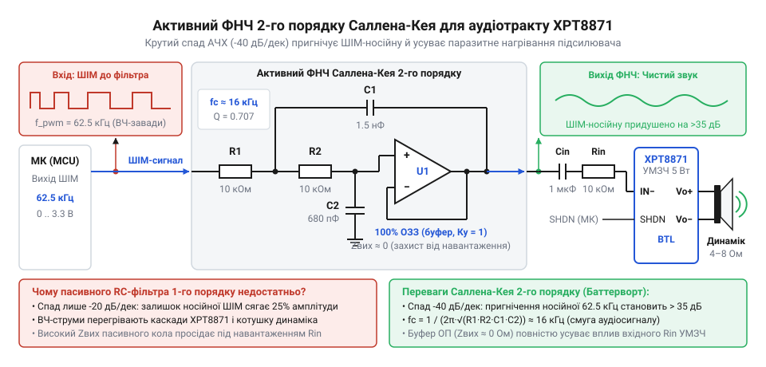
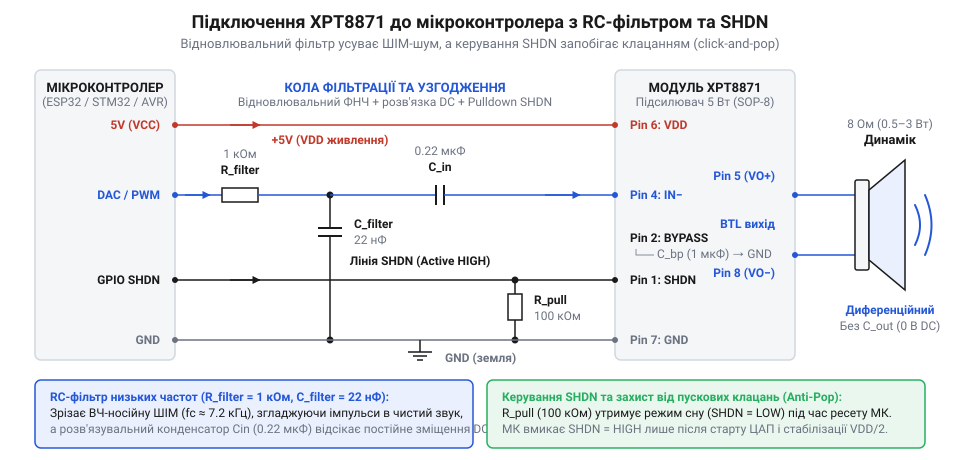
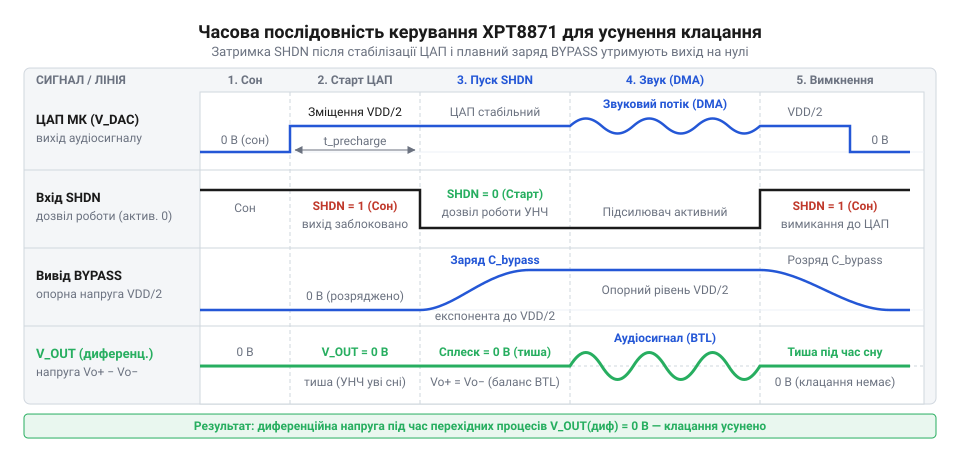
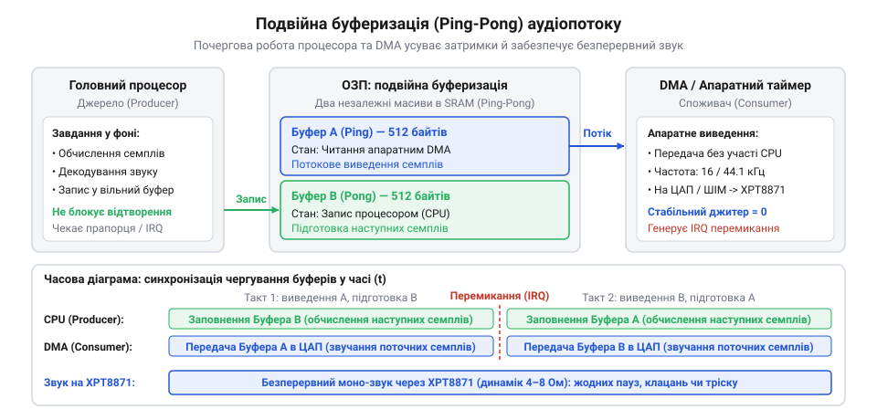
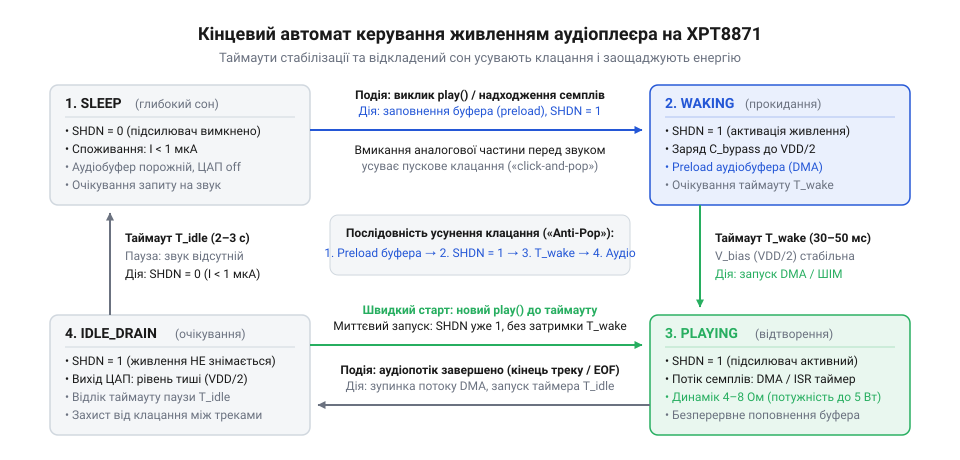

# XPT8871 — моно-підсилювач 5 Вт

<preknowlist>
- [Динаміки 5 Вт / 8 Ом](root:cat-hw-actuators/speakers-8ohm) — номінальний імпеданс котушки, підключення без постійного струму та перетворення електричних коливань у звук.
</preknowlist>

## Постановка інженерної задачі: звукові сповіщення без зовнішнього кодека

У вбудованих системах керування — від медичних інфузоматів і промислових панелей до систем контролю доступу й джерел безперебійного живлення — голосові та звукові сповіщення є критичним каналом передачі інформації оператору. Коротке мовне повідомлення на кшталт «Низький тиск у магістралі» або «Акумулятор розряджено» сприймається людиною миттєво, не вимагаючи фокусування погляду на графічному дисплеї чи розшифрування світлодіодної індикації. Проте реалізація якісного звукового тракту у серійному приладі завжди впирається в жорсткі обмеження собівартості компонентів (BOM, @@en|bill of materials@@), дефіцит площі друкованої плати та доступні обчислювальні ресурси мікроконтролера.

Класичний шлях побудови аудіосистеми передбачає використання спеціалізованого апаратного аудіокодека (англ. *codec*, від *coder/decoder* — кодувальник/декодувальник), що взаємодіє з процесором через синхронну послідовну шину @@en|I2S@@ (англ. *Inter-IC Sound*). Така архітектура забезпечує високу якість дискретизації, але вимагає від мікроконтролера трьох-чотирьох виділених ліній тактування й даних (BCLK, WCLK/LRCLK, SDATA, а часто й високочастотної опорної лінії MCLK), наявності відповідного периферійного контролера на кристалі та встановлення дорогої зовнішньої мікросхеми. Для складного мультимедійного плеєра це виправдано, проте для інженерного блоку сповіщень, де потрібно вивести кілька десятків коротких фраз або мелодійних тонів, зовнішній I2S-кодек є невиправданим надлишком.

Найтиповішим спрощенням здається використання п'єзоелектричних випромінювачів, таких як [пасивний зумер KY-006](root:cat-hw-actuators/ky-006-buzzer), [активний зумер KY-012](root:cat-hw-actuators/ky-012-buzzer) або [автономний п'єзоелектричний зумер](root:cat-hw-actuators/buzzer-standalone). Однак п'єзокерамічний елемент має виражений механічний резонанс (лат. *resono* — лунаю у відповідь) у дуже вузькій смузі частот (зазвичай 2.5–4.5 кГц) із надзвичайно високою добротністю. За межами резонансного піка ефективність випромінювання стрімко падає. Спектр людської мови зосереджений в інтервалі від 300 до 3400 Гц, тому будь-яка спроба відтворити голос через п'єзоелемент перетворює слова на сухий, нерозбірливий металевий скрегіт.

Для розбірливого відтворення мови необхідний мініатюрний електродинамічний гучномовець — наприклад, широкосмуговий [динамік з імпедансом 8 Ом](root:cat-hw-actuators/speakers-8ohm) (лат. *impedio* — перешкоджати) та номінальною потужністю від 0.5 до 3 Вт. Проте наївна спроба під'єднати такий динамік напряму до виводів мікроконтролера або через примітивний ключ призводить до серії апаратних збоїв.

### Пастки прямого та однотактного підключення динаміка

Розглянемо, що відбувається, коли розробник підключає звукову котушку 8 Ом безпосередньо між цифровим виводом загального призначення (GPIO) мікроконтролера та землею. При стандартній напрузі логічного рівня 3.3 В вихідний каскад піна намагається відкрити верхній P-канальний польовий транзистор. За законом Ома піковий струм через динамік мав би сягнути:

```text
I_peak
= V_dd / R_spk        [закон Ома для ділянки кола]
= 3.3 В / 8 Ом
= 0.4125 А = 412.5 мА
```

Гранично допустимий вихідний струм буфера GPIO типового сучасного мікроконтролера (STM32, ESP32 чи AVR) становить лише 8–25 мА, а сумарний струм через усі виводи живлення кристала обмежений величиною 100–150 мА. Внутрішній опір каналу відкритого транзистора порту (R_on) становить близько 20–35 Ом і утворює з котушкою динаміка резистивний дільник напруги:

```text
V_spk_actual
= V_dd · (R_spk / (R_spk + R_on))  [дільник напруги між буфером МК та котушкою]
= 3.3 В · (8 Ом / (8 Ом + 25 Ом))  [підстановка R_spk = 8 Ом, R_on = 25 Ом]
= 3.3 В · (8 / 33)
≈ 0.80 В                           [реальна амплітуда напруги на клемах динаміка]
```

У результаті понад 75% енергії виділяється всередині кристала мікроконтролера у вигляді тепла. Гучність звучання залишається мізерною, внутрішні шини живлення мікроконтролера зазнають глибокого імпульсного осідання, що призводить до перезавантаження ядра через спрацьовування схеми скидання при зниженні напруги (@@en|brown-out reset@@), а кремнієвий вихідний буфер порту необоротно деградує або пробивається від перегріву.

Спроба виправити ситуацію додаванням одного біполярного або польового транзистора (однотактний підсилювач класу A) породжує іншу важку проблему: постійний струм спокою через динамік. Якщо котушка динаміка увімкнена в коло колектора або стоку транзистора, керованого аналоговим сигналом чи ШІМ, для відтворення обох півхвиль аудіосигналу робочу точку транзистора необхідно виставити на середину робочого діапазону. При напрузі живлення 5 В через динамік безперервно протікає постійна складова струму:

```text
I_dc
= V_supply / (2 · R_spk)       [постійний струм спокою робочої точки класу A]
= 5 В / (2 · 8 Ом)
= 0.3125 А = 312.5 мА
```

Постійна теплова потужність, що розсіюється на звуковій котушці малого динаміка, становить:

```text
P_heat
= I_dc² · R_spk                [потужність теплових втрат на активному опорі]
= (0.3125 А)² · 8 Ом
≈ 0.781 Вт
```

Такий струм спричиняє швидкий перегрів і термічне руйнування ізоляційного лаку тонкого мідного дроту котушки. Крім того, постійний струм створює потужне статичне магнітне поле, яке втягує або виштовхує дифузор у крайнє механічне положення. Еластичний підвіс дифузора втрачає запас ходу в один бік, через що звукова хвиля зазнає сильного нелінійного кліпінгу. Коефіцієнт гармонійних спотворень (@@en|total harmonic distortion@@, THD; грец. *harmonikos* — суголосний) у такій схемі перевищує 30–40%, перетворюючи будь-яке голосове сповіщення на нерозбірливу хрипоту.

### Архітектура та переваги мостового підсилювача XPT8871

Вирішенням сформульованих проблем є застосування доступного інтегрального монофонічного підсилювача низької частоти XPT8871. Ця мікросхема працює від однополярної напруги живлення від 2.5 до 5.5 В (типово 5 В) і розвиває вихідну потужність до 5 Вт на навантаженні 2 Ом або 1.5–2 Вт на стандартному навантаженні 8 Ом. Головною архітектурною особливістю XPT8871 є реалізація мостового навантаження — [мостова топологія BTL](root:hw-analog/btl-amplifier-topology) (@@en|bridge-tied load@@).

> 🔧 **Навіщо це.**
> У портативних пристроях із живленням 5 В звичайна напівмостова схема фізично не здатна видати в динамік 8 Ом більше ніж 0.3 Вт потужності без підвищення напруги до 12–24 В або встановлення габаритного вихідного електролітичного конденсатора ємністю 470–1000 мкФ. Мостова топологія BTL у мікросхемі XPT8871 учетверо збільшує вихідну потужність і повністю прибирає постійний струм через динамік без жодних додаткових зовнішніх деталей.

Усередині XPT8871 містяться два потужні вихідні підсилювачі. Перший підсилювач є інвертуючим і приймає вхідний сигнал, а другий підсилювач інвертує вихідний сигнал першого з коефіцієнтом підсилення -1. Клеми динаміка під'єднуються безпосередньо між двома виходами підсилювачів (Vo+ та Vo-), не маючи контакту із загальною шиною живлення (землею).

У стані спокою внутрішня опорна схема зміщує виходи обох підсилювачів точно до половини напруги живлення (Vdd / 2). Різниця постійних потенціалів між виводами динаміка становить:

```text
V_diff_dc
= Vo+ - Vo-                    [диференційна напруга між клемами навантаження]
= (Vdd / 2) - (Vdd / 2)
= 0 В                          [відсутність постійної складової на навантаженні]
```

Оскільки різниця потенціалів дорівнює нулю, постійний струм через звукову котушку повністю відсутній, підвіс дифузора перебуває в ідеальній нейтральній точці, а котушка не нагрівається.

Коли на вхід надходить змінний аудіосигнал, вихід Vo+ відхиляється в бік напруги Vdd, а вихід Vo- одночасно відхиляється на таку саму величину в бік землі. Повний диференційний розмах змінної напруги на динаміці сягає подвоєної амплітуди напівмоста:

```text
V_diff_peak
= 2 · (Vdd - 2 · V_sat)        [розмах диференційної напруги з урахуванням насичення ключів]
```

Порівняємо діючу вихідну потужність напівмостової схеми з розділовим конденсатором (Single-Ended, SE) та мостової схеми BTL на синусоїдальному сигналі:

```text
P_SE
= (V_peak / √2)² / R_spk       [потужність навантаження з одним плечем]
= V_peak² / (2 · R_spk)

P_BTL
= (2 · V_peak / √2)² / R_spk   [потужність мостової схеми з подвоєною амплітудою]
= 4 · (V_peak² / (2 · R_spk))
= 4 · P_SE                     [чотирикратне збільшення теоретичної потужності]
```

При напрузі живлення Vdd = 5 В амплітуда вихідної напруги одного підсилювача за вирахуванням падіння на транзисторах становить близько 2.1 В. У напівмостовій схемі вихідна потужність на 8-омному динаміку не перевищить `(2.1² / 16) ≈ 0.27 Вт`. У схемі BTL потужність досягає `4 · 0.27 Вт ≈ 1.1–1.3 Вт` за нормальних нелінійних спотворень (THD < 1%) і до 1.5 Вт при максимальному навантаженні, забезпечуючи гучне й виразне звучання у галасливих приміщеннях.

### Природа пускового клацання та високочастотних завад ШІМ

Попри високі параметри мостового каскаду, просте під'єднання аудіовиходу мікроконтролера до входу підсилювача XPT8871 виявляє дві суттєві фізичні проблеми: акустичний удар («click-and-pop») і перевантаження тракту високочастотними завадами.

Акустичний пусковий удар (@@en|click-and-pop@@) виникає через незбалансовані перехідні процеси встановлення робочої точки підсилювача. Для функціонування внутрішніх диференційних каскадів XPT8871 потрібна стабільна віртуальна земля з потенціалом Vdd / 2. Цей потенціал формується внутрішнім резистивним дільником і згладжується зовнішнім конденсатором на виводі BYPASS. У момент увімкнення живлення конденсатор BYPASS повністю розряджений і заряджається за експоненційним законом:

```text
V_byp(t)
= (Vdd / 2) · (1 - e^(-t / τ_byp)) [крива заряду фільтрувального конденсатора BYPASS]
```

Якщо підсилювач активний під час наростання цієї напруги, будь-яка асиметрія динамічного опору двох вихідних плечей або незбалансований струм заряду призводить до виникнення короткого, але потужного імпульсу напруги на динаміці. Дифузор різко зміщується, спричиняючи гучне неприємне клацання.

Аналогічний удар виникає з боку мікроконтролера. Коли вбудований цифро-аналоговий перетворювач (ЦАП, англ. @@en|DAC@@) активується, його вихідна напруга стрибком зростає від 0 В до рівня спокою тиші (Vdd / 2). Оскільки між ЦАП і підсилювачем встановлено розв'язувальний конденсатор Cin, цей перепад напруги dV/dt формує імпульс струму перезаряду:

```text
i_inrush(t)
= Cin · (dV / dt)              [струм перезаряду розв'язувального конденсатора]
```

Цей струм протікає через вхідний опір підсилювача, підсилюється мостовим каскадом і викликає різкий удар дифузора гучномовця.

Друга проблема виникає у разі використання замість ЦАП широтно-імпульсної модуляції (ШІМ, англ. @@en|PWM@@, лат. *modulatio* — мірність). Прямокутний сигнал ШІМ із частотою перемикання 31.25–125 кГц складається з низькочастотної інформаційної обвідної та потужної високочастотної носійної хвилі з крутими фронтами, швидкість наростання яких (dV/dt) сягає десятків вольт за мікросекунду.

Якщо подати такий невідфільтрований сигнал на лінійний аналоговий вхід XPT8871, вхідний операційний підсилювач зазнає динамічного перевантаження за швидкістю наростання (@@en|slew rate limiting@@). На внутрішніх p-n переходах мікросхеми виникає паразитна демодуляція, високі гармоніки носійної частоти проникають у контур зворотного зв'язку, підсилювач перегрівається на холостому ході, а в динаміку з'являється постійний ультразвуковий або чутний фоновий писк.

### Інженерні вимоги до ланцюга узгодження

Щоб побудувати надійний звуковий модуль без використання зовнішніх кодеків, необхідно виконати комплекс вимог до апаратного та програмного узгодження:

1. **Фільтрація низьких частот (ФНЧ):** відновлення аналогового сигналу з потоку ШІМ та заглушення гармонік носійної частоти на рівні щонайменше -18...-24 дБ або згладжування кроків квантування вбудованого ЦАП.
2. **Гальванічне розділення (Cin):** усунення постійного струму між виходом мікроконтролера та входом підсилювача для незалежної стабілізації внутрішніх робочих точок.
3. **Апаратне керування живленням (лінія SHDN):** гарантоване утримання підсилювача у знеструмленому стані (споживання струму менше 1 мкА) під час апаратного скидання та завантаження мікроконтролера за допомогою резистивної підтяжки.
4. **Часова послідовність запуску:** алгоритмічна витримка часового інтервалу заряду опорних ємностей перед початком модуляції сигналу, що забезпечує бездоганне [придушення перехідних клацань](root:hw-analog/audio-pop-suppression-techniques) (anti-pop).

---

## Схемотехнічне узгодження мікроконтролера з підсилювачем XPT8871

Створення чистого звукового тракту починається з вибору джерела сигналу мікроконтролера та узгодження його електричних параметрів із чутливим входом підсилювача XPT8871.

### Вибір джерела сигналу: апаратний ЦАП чи таймерний ШІМ

Сучасні мікроконтролери надають два основні механізми генерації звуку без зовнішніх мікросхем:

* **Вбудований цифро-аналоговий перетворювач (ЦАП):** присутній у багатьох контролерах родин STM32 (наприклад, лінії STM32F4, F7, G4), ESP32 та SAMD. ЦАП безпосередньо формує аналогову напругу на виводі (наприклад, канал 1 ЦАП на пін PA4 у мікроконтролері STM32F401/F411/F405). Програмна зміна значень регістру перетворювача генерує східчастий аудіосигнал. Перевагою ЦАП є мінімальний рівень позасмугових завад: фільтрації потребують лише високочастотні дзеркальні гармоніки частоти дискретизації, а для роботи достатньо простого розв'язувального конденсатора Cin і легкого RC-ланцюга.
* **Високочастотний ШІМ (PWM):** універсальний метод, доступний на будь-якому найдешевшому мікроконтролері (наприклад, базові серії STM32F0, STM32G0, AVR ATmega328P, RP2040). Звук кодується шпаруватістю імпульсів цифрового таймера. Головна перевага — нульова додаткова вартість периферії. Проте ШІМ вимагає суворого дотримання двох умов: частота носійної f_pwm повинна бути у 4–8 разів вищою за максимальну частоту звукового спектра (зазвичай f_pwm обирають у діапазоні 62.5–125 кГц), а між мікроконтролером і підсилювачем обов'язково встановлюється аналоговий [відновлювальний фільтр низьких частот](root:hw-analog/pwm-audio-reconstruction-filter) (@@en|reconstruction filter@@).

### Розрахунок відновлювального пасивного RC-фільтра

Для виділення корисного сигналу звукового діапазону та пригнічення імпульсів носійної частоти ШІМ застосовується пасивний фільтр низьких частот (ФНЧ) першого порядку, побудований на послідовному резисторі R_f та шунтувальному конденсаторі C_f, увімкненому на землю.

Частота зрізу фільтра f_c (англ. *cutoff frequency*, частота, на якій потужність сигналу зменшується вдвічі, тобто на -3 дБ) визначається фундаментальним співвідношенням:

```text
f_c = 1 / (2 · π · R_f · C_f)
```

Для передачі розбірливої людської мови достатньо смуги пропускання до 4–8 кГц (стандарт вузькосмугової телефонії охоплює 300–3400 Гц, а широкосмугове мовлення HD-Voice — до 7 кГц). Якщо частота дискретизації аудіопотоку становить f_s = 16 кГц, теорема відліків Найквіста — Шеннона обмежує теоретичний спектр частотою f_s / 2 = 8 кГц. Тому доцільно обрати частоту зрізу фільтра f_c в околі 7.0–7.5 кГц.

Під час вибору номіналу резистора R_f діють два протилежні інженерні обмеження:

1. **Обмеження зверху:** вхідний опір мікросхеми XPT8871 визначається резистором Rin на платі модуля (зазвичай Rin = 10 кОм або 20 кОм). Якщо обрати R_f занадто великим (наприклад, 47 кОм), виникне дільник напруги `Rin / (R_f + Rin)`, який суттєво послабить корисний аудіосигнал. Щоб втрати амплітуди не перевищували 5% (-0.4 дБ), опір R_f має задовольняти умову:
   `R_f ≤ 0.05 · Rin`.
   При Rin = 20 кОм максимальне значення R_f становить 1 кОм.
2. **Обмеження знизу:** коли вивід мікроконтролера перемикає логічні рівні ШІМ із частотою 62.5–125 кГц, конденсатор C_f перезаряджається струмом, амплітуда якого дорівнює:
   `I_charge = V_io / R_f`.
   Якщо встановити R_f = 100 Ом при V_io = 3.3 В, імпульсний струм сягне 33 мА, що спричинить перегрів вихідного буфера мікроконтролера. За номіналу R_f = 1 кОм піковий струм становить лише 3.3 мА, що є абсолютно безпечним для тривалої безперервної роботи будь-якого виводу GPIO.

**Розрахунок номіналів компонентів ФНЧ:**
Обираємо резистор R_f = 1 кОм (1000 Ом) та стандартний керамічний конденсатор ємністю C_f = 22 нФ (діелектрик X7R, ряд номіналів E12).

```text
f_c
= 1 / (2 · π · R_f · C_f)                     [формула частоти зрізу RC-ланцюга першого порядку]
= 1 / (2 · 3.14159 · 1000 Ом · 22·10⁻⁹ Ф)     [підстановка номіналів R_f = 1 кОм, C_f = 22 нФ]
= 1 / (1.3823·10⁻⁴)
≈ 7234 Гц                                     [розрахункова частота зрізу на рівні -3 дБ]
```

Отримана частота зрізу 7.23 кГц ідеально узгоджується зі смугою дискретизації 16 кГц. Розрахуємо коефіцієнт передачі A(f) та величину пригнічення носійної частоти ШІМ для двох типових частот таймера: 62.5 кГц та 125 кГц.

Для частоти носійної f_pwm = 62.5 кГц:

```text
A(62.5 кГц)
= 1 / √(1 + (f_pwm / f_c)²)                   [амплітудно-частотна характеристика ФНЧ]
= 1 / √(1 + (62500 / 7234)²)
= 1 / √(1 + (8.64)²)
= 1 / √(1 + 74.65)
= 1 / √75.65
≈ 0.115                                       [коефіцієнт ослаблення за напругою]

Att_dB
= 20 · log10(0.115)                           [логарифмічне пригнічення в децибелах]
≈ -18.8 дБ                                    [ослаблення носійної в 8.7 раза]
```

Для частоти носійної f_pwm = 125 кГц:

```text
A(125 кГц)
= 1 / √(1 + (125000 / 7234)²)
= 1 / √(1 + (17.28)²)
= 1 / √299.6
≈ 0.0578

Att_dB
= 20 · log10(0.0578)
≈ -24.8 дБ                                    [ослаблення носійної в 17.3 раза]
```

Пасивний фільтр 1-го порядку з R_f = 1 кОм та C_f = 22 нФ послаблює амплітуду високочастотних імпульсів ШІМ на 18.8–24.8 дБ, перетворюючи різкі цифрові фронти на гладку аналогову криву та повністю усуваючи теплові й динамічні перевантаження вхідного каскаду XPT8871.


*Принципова електрична схема активного ФНЧ другого порядку за топологією Саллена-Кея: активна фільтрація забезпечує крутий спад характеристики зі швидкістю 40 дБ на декаду для глибокого пригнічення високочастотної носійної ШІМ без втрати амплітуди звукового сигналу.*

### Розрахунок вхідного розділового конденсатора Cin

Між виходом фільтра низьких частот і входом підсилювача обов'язково встановлюється розділовий конденсатор Cin (@@en|DC-blocking capacitor@@).

Необхідність Cin зумовлена розбіжністю рівнів постійної напруги зміщення. Вихідний сигнал ЦАП або середня напруга фільтрованого 50% ШІМ мікроконтролера зміщені відносно землі на величину `V_mcu_bias = V_io / 2` (наприклад, 1.65 В при живленні мікроконтролера 3.3 В). Водночас аналоговий вхід мікросхеми XPT8871 зміщений внутрішнім джерелом до половини своєї напруги живлення: `V_amp_bias = Vdd_amp / 2 = 2.5 В` (при живленні 5 В).

Якщо з'єднати вихід МК із входом XPT8871 напряму без конденсатора Cin, різниця напруг 2.5 В - 1.65 В = 0.85 В викличе протікання постійного струму через вхідний резистор Rin (20 кОм):
`I_bias = 0.85 В / 20 кОм = 42.5 мкА`.
Цей струм змістить робочу точку вхідного операційного підсилювача XPT8871. У результаті одне з плечей вихідного мосту BTL входитиме в кліпінг значно раніше за інше, максимальна неспотворена потужність впаде вдвічі, а на клемах динаміка з'явиться постійна напруга зміщення, яка перегріватиме звукову котушку.

Конденсатор Cin разом із вхідним опором підсилювача Rin утворює пасивний фільтр верхніх частот (ФВЧ) першого порядку, нижня частота зрізу якого f_HPF дорівнює:

```text
f_HPF = 1 / (2 · π · Rin · Cin)
```

Малогабаритні динаміки діаметром 40–50 мм мають власну резонансну частоту підвісу в діапазоні 200–350 Гц і фізично не здатні випромінювати акустичні коливання з частотою нижче 100–120 Гц. Подача суббасових компонентів лише безцільно витрачає струм підсилювача та викликає надлишковий хід дифузора. Тому нижню межу зрізу ФВЧ доцільно обрати на рівні f_HPF ≈ 80 Гц.

**Розрахунок ємності Cin:**
При типовому опорі модуля Rin = 20 кОм (20 000 Ом) та частоті f_HPF = 80 Гц:

```text
Cin
= 1 / (2 · π · Rin · f_HPF)                  [формула розрахунку ємності ФВЧ]
= 1 / (2 · 3.14159 · 20000 Ом · 80 Гц)        [підстановка параметрів Rin = 20 кОм, f_HPF = 80 Гц]
= 1 / (1.0053·10⁷)
≈ 9.95·10⁻⁸ Ф ≈ 100 нФ = 0.1 мкФ             [найближчий стандартний номінал керамічного конденсатора]
```

Обираємо керамічний конденсатор Cin ємністю 0.1 мкФ (100 нФ) із температурним діелектриком X7R. Розрахуємо постійну часу заряду вхідного ланцюга τ_in:

```text
τ_in
= Rin · Cin                    [постійна часу кола заряду розділового конденсатора]
= 20000 Ом · 100·10⁻⁹ Ф
= 0.002 с = 2 мс
```

Повний час встановлення напруги на конденсаторі Cin (інтервал 5·τ_in) становить лише 10 мс. Це принциповий інженерний момент: якщо розробник помилково встановить оксидний електролітичний конденсатор ємністю 10 мкФ «із запасом по басах», постійна часу τ_in зросте до 200 мс, а повний заряд триватиме понад 1 секунду. Протягом усього цього часу звуковий тракт залишатиметься нестабільним, і будь-яка спроба увімкнути підсилювач супроводжуватиметься гучним клацанням.

### Керування лінією SHDN та апаратна підтяжка

Вивід 1 мікросхеми XPT8871 позначається як SHDN (@@en|Shutdown@@ — вимкнення). Логіка керування виводом є прямою:

* **Логічна '1' (HIGH, напруга > 1.4 В):** підсилювач активний, вихідні каскади BTL увімкнені.
* **Логічний '0' (LOW, напруга < 0.4 В):** підсилювач переведений у глибокий режим сну. Вихідні транзистори BTL переходять у високоімпедансний стан (Hi-Z), а струм споживання всієї мікросхеми опускається нижче 1 мкА (типово 0.1 мкА).

> 🔧 **Навіщо це.**
> Під час увімкнення живлення або перезавантаження мікроконтролера всі його виводи GPIO на кілька мілісекунд переходять у високоімпедансний стан (Hi-Z). Якщо лінія SHDN не має апаратної підтяжки до землі, наведений потенціал увімкне підсилювач у випадковий момент, коли вихід ЦАП ще не стабілізований, викликавши гучне «клацання з динаміка» ще до старту прошивки. Зовнішній резистор 10 кОм на GND гарантує тишу за будь-яких умов запуску системи.

Щоб запобігти мимовільній активації підсилювача під час перезавантаження ядра, прошивання через налагоджувальний інтерфейс або апаратного скидання, вивід SHDN з'єднується із землею через зовнішній підтягувальний резистор R_pd номіналом 10–47 кОм (оптимально 10 кОм). Це гарантує, що підсилювач залишатиметься надійно заблокованим на апаратному рівні аж до моменту, коли мікроконтролер завершить конфігурацію периферії та свідомо виставить на цифровому виході логічну одиницю.

В ініціалізації мікроконтролера пін лінії SHDN конфігурується у режимі виходу Push-Pull із додатковою апаратною підтяжкою до землі для повної безпеки:

:::code proj-mcu-audio-playback/c/main.c 48-69

### Принципова електрична схема підключення

Повна принципова електрична схема підключення модуля XPT8871 до мікроконтролера з відновлювальним RC-фільтром та диференційним гучномовцем представлена нижче:


*Принципова електрична схема узгодження мікроконтролера з аудіопідсилювачем XPT8871: показано ланцюг відновлювального ФНЧ, вхідний розділовий конденсатор, апаратну підтяжку входу вимкнення до землі та мостове диференційне навантаження.*

Схема містить такі функціональні вузли:

1. **Коло живлення підсилювача:** на вивід 6 (VDD) подається напруга 5 В від джерела живлення плати. Безпосередньо біля виводів 6 та 7 (GND) встановлено два паралельні конденсатори: керамічний C1 ємністю 0.1 мкФ (пригнічує високочастотні комутаційні завади) та електролітичний C2 ємністю 100 мкФ (забезпечує запас енергії для відтворення низькочастотних звукових сплесків струму в динаміку до 0.5 А).
2. **Внутрішній опорний вузол:** до виводу 2 (BYPASS) під'єднано керамічний конденсатор C3 ємністю 1.0 мкФ на землю. Він фільтрує внутрішню напругу Vdd / 2, забезпечуючи високий коефіцієнт пригнічення пульсацій шини живлення (PSRR, @@en|power supply rejection ratio@@).
3. **Вхідний узгоджувальний тракт:** сигнал ЦАП (вивід PA4) або ШІМ надходить на відновлювальний фільтр низьких частот, утворений резистором R1 (1 кОм) та конденсатором C4 (22 нФ). Далі сигнал проходить крізь розділовий конденсатор C5 (0.1 мкФ) і внутрішній резистор модуля R_in (20 кОм) на інвертуючий аудіовхід (вивід 4, IN-). Неінвертуючий вхід IN+ (вивід 3) всередині мікросхеми підключений до напруги BYPASS.
4. **Вузол керування живленням:** цифровий вивід мікроконтролера PB0 з'єднаний із виводом 1 (SHDN). Резистор R2 (10 кОм) фіксує потенціал землі під час скидання мікроконтролера.
5. **Вихідне навантаження BTL:** клеми динаміка 8 Ом під'єднуються безпосередньо до виводів 5 (Vo+) та 8 (Vo-) без жодних додаткових конденсаторів чи дроселів.

### Часова послідовність усунення перехідних клацань

Схемотехнічна обв'язка працює ефективно лише за умови дотримання суворої часової послідовності перемикання станів мікроконтролера. Навіть ідеальна схема видасть гучний пусковий удар, якщо програмно підняти рівень SHDN одночасно з початком генерації звуку.

Для гарантованого усунення пускового клацання (anti-pop) застосовується спеціальний алгоритм послідовної комутації сигналів:


*Часова послідовність керування аудіотрактом для усунення клацань: етапи Pre-bias, затримки стабілізації BYPASS, подачі звуку та Ramp-Down забезпечують нульову диференційну напругу на динаміці під час перехідних процесів, що повністю пригнічує акустичні удари.*

Часова діаграма демонструє п'ять послідовних фаз роботи аудіотракту:

1. **Фаза спокою (Sleep):** підсилювач знеструмлений (SHDN = LOW). Конденсатор виводу BYPASS розряджений (0 В). Диференційна напруга на динаміці дорівнює нулю. Струм споживання схеми становить менше 1 мкА. У динаміку панує абсолютна тиша — немає навіть слабкого фонового шипіння чи цифрових наведень від шин I2C/SPI.
2. **Фаза попередньої ініціалізації (Pre-bias):** при виникненні події сповіщення мікроконтролер спочатку готує аналогове джерело. У регістр ЦАП записується константа тиші `XPT8871_SAMPLE_BIAS = 128` (для 8-бітного ЦАП це рівно V_io / 2, тобто 1.65 В). Якщо використовується ШІМ — запускається таймер зі стабільною 50% шпаруватістю. На виході ФНЧ встановлюється постійна напруга, а розділовий конденсатор Cin починає заряджатися. Лінія SHDN у цей момент **все ще утримується в нулі (LOW)**!
3. **Фаза стабілізації опорної напруги (Wakeup delay):** мікроконтролер переводить вивід SHDN у високий логічний рівень (HIGH). Внутрішнє джерело мікросхеми починає заряджати зовнішній конденсатор на виводі BYPASS. Цей процес триває від 30 до 60 мс залежно від ємності конденсатора C_byp. Протягом усього інтервалу стабілізації (`XPT8871_WAKEUP_DELAY_MS = 50U` мс у драйвері C або `stabilizationDelayMs = 60` мс у C++) мікроконтролер **суворо утримує на вході постійне значення 128**. Оскільки змінна складова сигналу дорівнює нулю, а виходи мосту BTL піднімаються до Vdd / 2 симетрично, диференційна напруга на динаміці залишається точно рівною 0 В. Дифузор не робить жодного ривка — пускове клацання ліквідовано на 100%.
4. **Фаза активного потокового відтворення (Playback):** після завершення таймауту стабілізації кінцевий автомат переходить у стан генерації звуку. Апаратний таймер дискретизації (TIM6 на частоті 16 кГц) або контролер DMA починає почергово зчитувати PCM-семпли з буфера та записувати їх у ЦАП. Диференційна напруга на виходах Vo+ та Vo- модулюється відповідно до форми звукової хвилі, і динамік чисто відтворює сповіщення.
5. **Фаза спорожнення та автозасинання (Idle timeout):** коли останній байт звукового файла виведено, драйвер не вимикає підсилювач миттєво. Якщо обірвати живлення підсилювача під час коливання дифузора, динамік видасть гучне клацання на вимкненні. Замість цього ЦАП повертається до стабільного рівня тиші 128, а драйвер запускає таймаут бездіяльності (`XPT8871_IDLE_TIMEOUT_MS = 100U` мс у C або `autoSleepDelayMs = 500` мс у C++). Якщо за цей час у чергу надходить нове аудіоповідомлення, відтворення починається миттєво без повторного циклу стабілізації BYPASS. Якщо ж пауза триває довше таймауту, мікроконтролер скидає лінію SHDN у LOW. Оскільки диференційна напруга вже дорівнювала нулю, відключення підсилювача відбувається безшумно, і модуль повертається в енергоощадний сон.

У C-драйвері ця логіка закладена безпосередньо в обробник ініціалізації та запису семплів:

:::code proj-mcu-audio-playback/c/xpt8871.c 40-52
:::code proj-mcu-audio-playback/c/xpt8871.c 81-96

А переходи станів кінцевого автомата відстежуються під час кожного переривання таймера дискретизації:

:::code proj-mcu-audio-playback/c/xpt8871.h 30-46
:::code proj-mcu-audio-playback/c/xpt8871.c 152-165

У C++ реалізації для додаткового усунення можливих мікросплесків на початку аудіофайлу використовується лінійне програмне наростання (soft fade-in) та згасання (soft fade-out) на 32 вибірки:

:::code proj-mcu-audio-playback/cpp/Xpt8871Player.hpp 23-30
:::code proj-mcu-audio-playback/cpp/Xpt8871Player.cpp 192-208

Поєднання правильно розрахованого відновлювального RC-фільтра, розділового конденсатора Cin, резистивної підтяжки входу вимкнення та суворого алгоритму витримки часових інтервалів дозволяє створити надійний і кришталево чистий звуковий тракт на базі мікроконтролера та XPT8871 без застосування дорогих зовнішніх I2S-кодеків.

## Часова діаграма та алгоритм повного усунення пускових клацань (click-and-pop suppression)

Аудіопідсилювач XPT8871 побудовано за мостовою схемою (@@en|Bridge-Tied Load@@, BTL — мостове підключення навантаження), де виводи звукової котушки [динаміка 5 Вт / 8 Ом](root:cat-hw-actuators/speakers-8ohm) під'єднуються безпосередньо між двома протифазними вихідними каскадами мікросхеми без використання громіздкого вихідного розділового електролітичного конденсатора. За однополярного живлення (наприклад, 5 В) у стані спокою на обох виходах формується однакова постійна напруга віртуальної землі, рівна половині напруги живлення: Vdd / 2 = 2.5 В. Оскільки різниця потенціалів між клемами динаміка дорівнює нулю (2.5 В - 2.5 В = 0 В), постійний струм крізь котушку не протікає.

Проте спроба просто подати аудіосигнал або активувати вихід мікроконтролера викликає різке, неприємне й гучне акустичне клацання — ефект @@en|click-and-pop@@ (від англійських слів @@en|click@@ — клацання та @@en|pop@@ — ляскіт). Фізична причина цього явища криється в перехідних процесах заряду двох критичних ємностей схеми: вхідного розділового конденсатора Cin та конденсатора на виводі опорної напруги зміщення BYPASS (Cbyp).

Коли мікроконтролер запускає внутрішній цифро-аналоговий перетворювач ([генерація звуку через ЦАП](root:hw-analog/dac-audio-generation)) або вмикає таймер широтно-імпульсної модуляції (ШІМ), напруга на виводі МК миттєво зростає від 0 В до робочої точки зміщення Vdd / 2 (наприклад, 1.65 В або 2.5 В). Струм перезаряду вхідного конденсатора описується диференційним рівнянням:

```
i(t) = C · (du / dt)
```

Через практично миттєвий фронт наростання напруги похідна du/dt набуває величезних значень. У вхідний тракт підсилювача впорскується короткочасний сплеск струму амплітудою в кілька міліампер. Диференційний каскад підсилює цей струм і передає його на потужні вихідні польові транзистори [мостового аудіопідсилювача BTL](root:hw-analog/btl-audio-amplifiers). На звукову котушку динаміка надходить ударний імпульс струму, дифузор різко зміщується з нейтрального положення, створюючи ударну звукову хвилю.

Другий чинник — заряд фільтрувального конденсатора Cbyp ємністю 1 мкФ на виводі 2 мікросхеми XPT8871. Внутрішній резистивний дільник формує опорну напругу Vdd / 2 для неінвертуючого входу внутрішнього операційного підсилювача. Доки напруга на виводі BYPASS наростає, внутрішні диференційні каскади перебувають у глибокому розбалансі. Якщо в цей проміжок часу вихідні ключі підсилювача увімкнені, динамік відтворює цей перехідний процес як низькочастотний ляскіт або тріск.

Для абсолютного усунення цих паразитних акустичних звуків застосовують [схеми придушення перехідних клацань звуку](root:hw-analog/anti-pop-circuits) та строгий детермінований часовий протокол послідовної комутації ліній живлення, зміщення й керування.

### Фізичний розрахунок стабілізації перехідного процесу

Час заспокоєння перехідного процесу (@@en|settling time@@ — час стабілізації, від латинського @@la|sedere@@ — осідати, заспокоюватися) визначається сталими часу двох незалежних RC-ланок:

1. Вхідне коло зміщення: стала часу вхідного кола τ_in = Rin · Cin. За типових значень вхідного резистора Rin = 20 кОм та розділового конденсатора Cin = 0.1 мкФ (100 нФ) стала часу становить:

```
τ_in = 20000 Ом · 0.1 × 10⁻⁶ Ф = 2.0 × 10⁻³ с = 2.0 мс
```

Для завершення перехідного процесу з точністю понад 99.3% напруга повинна витримуватися протягом щонайменше п'яти сталих часу:

```
t_settle_in = 5 · τ_in
            = 5 · 2.0 мс       [правило перехідного процесу 5τ]
            = 10.0 мс          [мінімальний час заряду Cin]
```

2. Коло внутрішньої віртуальної землі (BYPASS): вивід 2 мікросхеми підключено до внутрішнього подільника напруги з еквівалентним вихідним опором близько 40–50 кОм і зовнішнього керамічного конденсатора Cbyp = 1.0 мкФ. Стала часу кола зміщення:

```
τ_byp = 50000 Ом · 1.0 × 10⁻⁶ Ф = 50 × 10⁻³ с = 50.0 мс
```

Отже, щоб внутрішні підсилювальні каскади повністю вийшли на симетричний режим роботи без перекосу плечей моста, необхідна затримка не менше ніж 40–60 мс після подачі команди пробудження на лінію SHDN.

### Алгоритм безпечної ініціалізації звукового тракту (Turn-On Sequence)

Послідовність увімкнення розбивається на чіткі апаратні фази, що унеможливлюють потрапляння будь-якого стрибка напруги в динамік:

1. **Фаза початкового блокування**: лінія SHDN (Shutdown, вивід 1 XPT8871) примусово утримується мікроконтролером у стані логічного нуля (GND). Вихідні транзистори підсилювача повністю замкнені у стані високого імпедансу (Hi-Z). Струм споживання мікросхеми падає нижче 1 мкА. Динамік фізично знеструмлений, будь-які перешкоди на вході не доходять до виходу.
2. **Фаза попереднього заряду входу**: апаратний ЦАП мікроконтролера вмикається і його вихідне значення плавно встановлюється на код постійного зміщення (для 8-бітного перетворювача це значення 128, що відповідає Vdd / 2). У разі використання ШІМ запускається генерація несного меандру з шпаруватістю строго 50%. На зовнішній обкладці конденсатора Cin з'являється потенціал віртуальної землі.
3. **Пауза стабілізації вхідного струму**: програма витримує фіксовану паузу від 10 до 20 мс, не змінюючи стану лінії SHDN. За цей час струм заряду Cin спадає практично до нуля, а постійна напруга на обох боках розділового конденсатора повністю вирівнюється.
4. **Активація вихідних каскадів**: пін SHDN переводиться у високий логічний рівень 1 (VDD). Внутрішня схема підсилювача запускає плавний заряд виводу BYPASS.
5. **Витримка стабілізації BYPASS**: програма очікує ще 40–50 мс перед тим, як надіслати перший звуковий семпл. Внутрішній міст BTL виходить у робочу точку 2.5 В без найменшого перекосу між клемами.
6. **Трансляція звуку**: лише після проходження всіх 50–60 мс стабілізації аудіопотік починає надходити у ЦАП або ШІМ-регістр.

```
                    Вхідний ЦАП / ШІМ (Vdd/2)
                         ─────────────┌───────────────────────── Аудіосемпли
Напруга ЦАП (В)          0 В          │ Vdd/2                   (модуляція)
─────────────────────────┴────────────┴──────────────────────────────────────> Час

                         SHDN = LOW   │  SHDN = HIGH
Лінія SHDN               (Hi-Z вихід) │  (активація)
──────────────────────────────────────┌──────────────────────────────────────> Час
                                      │
Напруга BYPASS                        │         ▲ Стабілізація Vdd/2
(внутрішнє зміщення)     0 В          │        ╱
──────────────────────────────────────┴───────╱──────────────────────────────> Час
                                      │◄─────►│
                                       t_settle (40..60 мс)
```

### Алгоритм коректного вимкнення звукового тракту (Turn-Off Sequence)

Вимкнення звуку вимагає суворо дзеркального порядку дій. Поширена помилка — одночасне зняття напруги з ЦАП та скидання SHDN або вимкнення ЦАП до переведення підсилювача в сон:

1. **Фаза зведення сигналу (Soft Ramp-Down)**: виведення останніх вибірок аудіосигналу не обривають на випадковій амплітуді, а плавно зводять до центрального значення зміщення 128 (віртуальна земля) протягом кількох десятків семплів (1–2 мс). Це прибирає різкий акустичний обрив звукової хвилі.
2. **Блокування вихідного моста**: лінія SHDN скидається у логічний нуль (GND). Вихідні польові транзистори XPT8871 миттєво від'єднують навантаження та переходять у режим відсічки (Hi-Z). Динамік ізольовано від будь-яких перехідних процесів.
3. **Пауза закриття каскадів**: мікроконтролер витримує паузу 2–5 мс для гарантованого завершення комутації внутрішніх ключів підсилювача.
4. **Знеструмлення джерела сигналу**: зупиняється таймер ШІМ або вимикається периферія ЦАП. Стрибок напруги на виході МК від Vdd / 2 до 0 В тепер повністю поглинається замкненими входами сплячої мікросхеми й не потрапляє у звуковий випромінювач.

> 🔧 **Навіщо це.**
> Дотримання цієї мікросекундної та мілісекундної дисципліни перетворює аматорський звуковий модуль на комерційний прилад: прилад вмикається, говорить і засинає без жодного паразитного клацання, пострілу чи фонового шуму в паузах, що критично для медичних приладів, автомобільних інтерфейсів та побутової електроніки.

### Реалізація протоколу в C-драйвері

У драйвері на мові C початкова конфігурація апаратури у функції `xpt8871_init` гарантує, що лінія SHDN скинута в нуль до активації аналогової периферії:

:::code proj-mcu-audio-playback/c/xpt8871.c 40-52

Коли користувач передає перші вибірки через `xpt8871_write`, драйвер перевіряє стан мікросхеми. Якщо підсилювач перебував у сні, лінія SHDN переводиться у високий рівень, встановлюється лічильник затримки `wakeup_ticks_remaining`, а автомат переходить у стан `XPT8871_STATE_WAKING`:

:::code proj-mcu-audio-playback/c/xpt8871.c 81-96

Під час фази `XPT8871_STATE_WAKING` обробник таймерних переривань частоти дискретизації `xpt8871_timer_isr` не бере дані з аудіобуфера, а примусово утримує значення ЦАП на рівні віртуального нуля `XPT8871_SAMPLE_BIAS` (код 128), зменшуючи лічильник тиків до повної стабілізації напруги BYPASS:

:::code proj-mcu-audio-playback/c/xpt8871.c 152-164

### Реалізація протоколу в C++-обгортці

У класі C++ часова послідовність реалізована через внутрішній таймер системного часу `getMillis()`. При переході зі стану `State::Idle` викликається метод `wakeUp()`, де лінія SHDN піднімається у високий рівень, а таймер фіксує мітку часу:

:::code proj-mcu-audio-playback/cpp/Xpt8871Player.cpp 82-88

Диспетчерський метод `update()` контролює витримку інтервалу `config_.stabilizationDelayMs` (за замовчуванням 60 мс). Доки цей час не спливе, виклик `startPlayback()` блокується:

:::code proj-mcu-audio-playback/cpp/Xpt8871Player.cpp 49-55

Додатково для усунення крайових клацань на початку й наприкінці кожного звукового кліпу застосовується програмне лінійне масштабування — софт-рамп (@@en|soft fade@@) на 32 семпли:

:::code proj-mcu-audio-playback/cpp/Xpt8871Player.cpp 192-209

---

## Архітектура програмного драйвера та механізм подвійної буферизації (Double Buffering) для неблокувального відтворення

Звуковий потік вимагає суворо детермінованого періоду видачі кожної вибірки в часі. При стандартній для голосових і тональних сповіщень частоті дискретизації 16 кГц часовий квант між двома послідовними семплами становить:

```
T_sample = 1 / F_s
         = 1 / 16000 с
         = 6.25 × 10⁻⁵ с
         = 62.5 мкс
```

Якщо мікроконтролер спробує видавати семпли у блокувальному коді (наприклад, через функцію затримки на 62.5 мкс у циклі `while`), центральний процесор буде на 100% заблокований і не зможе виконувати жодних інших задач: опитування сенсорів, обробку мережевих пакетів чи реакцію на кнопки. Якщо ж оновлювати ЦАП із головного циклу без жорсткої прив'язки до апаратного тактування, виникає фазове тремтіння періоду видачі — джитер (@@en|jitter@@, від англійського @@en|jitter@@ — тремтіння, нервовість). Джитер спотворює фазу відновленого сигналу й створює паразитні інтермодуляційні гармоніки.

Найнебезпечніша ситуація — спустошення буфера (@@en|buffer underrun@@ — вичерпання вибірок). Якщо головна програма затримується на час, довший за 62.5 мкс (наприклад, записуючи сектор у Flash-пам'ять або обробляючи переривання зв'язку), аналоговий вихід не отримує чергового значення, що сприймається слухом як різкий тріск, клацання або скрегіт.

Розв'язанням цієї проблеми є рознесення процесів у часі за архітектурою «постачальник — споживач» (@@en|Producer-Consumer@@) за допомогою [подвійної буферизації та DMA в мікроконтролерах](root:hw-arch/dma-double-buffering) або кільцевого буфера без блокувань (@@en|lock-free ring buffer@@).

### Формати зберігання та представлення аудіоданих

У вбудованих системах застосовують формат лінійної імпульсно-кодової модуляції (@@en|Pulse-Code Modulation@@, PCM — імпульсно-кодова модуляція):

1. **8-бітний беззнаковий монофонічний PCM (`uint8_t`)**: амплітуда кодується числами від 0 до 255. Робоча точка тиші (віртуальний нуль) відповідає рівню 128 (Vdd / 2). Одна секунда аудіопотоку з частотою 16 кГц займає рівно 16 000 байтів оперативної пам'яті або Flash-пам'яті програм. Цей формат є оптимальним для виведення на 8-бітні ЦАП або 8-бітні ШІМ-модулятори, оскільки не вимагає масштабування й додаткових обчислень.
2. **16-бітний знаковий монофонічний PCM (`int16_t`)**: амплітуда коливається в діапазоні від -32768 до +32767 навколо нуля (0). Цей формат забезпечує динамічний діапазон близько 96 дБ проти 48 дБ у 8-бітного звуку. Для видачі на однополярний ЦАП кожну вибірку необхідно програмно зміщувати на +32768 та масштабувати відповідно до розрядності перетворювача.

### Принцип подвійної буферизації (Ping-Pong Buffering)

Подвійна буферизація розділяє пам'ять відтворення на дві незалежні ділянки однакового розміру: Буфер 0 і Буфер 1.

```
                    ┌─────────────────┐
                    │    Буфер 0      │ <─── Апаратний канал читає (DMA / TIM-ISR)
                    │  (трансляція)   │
                    └─────────────────┘
                             ▲
                    Миттєве перемикання (нульова пауза)
                             ▼
                    ┌─────────────────┐
                    │    Буфер 1      │ <─── Процесор наповнює (головний потік)
                    │  (заповнення)   │
                    └─────────────────┘
```

Робота відбувається за строгою фазовою черговістю:

1. **Фаза трансляції Буфера 0**: апаратний периферійний канал (прямий доступ до пам'яті DMA або таймерне переривання з вибіркою за розкладом) зчитує вибірки з Буфера 0 і завантажує їх у регістр ЦАП зі швидкістю Fs. У цей самий час головний потік мікроконтролера заповнює Буфер 1 наступною партією семплів (розпаковує, синтезує або читає з носія).
2. **Точка перемикання**: коли Буфер 0 повністю передано, апаратний блок генерує подію завершення (переривання DMA Transfer-Complete або прапорець вичерпання). Ролі буферів миттєво змінюються за один машинний цикл зміною покажчика: Буфер 1 стає активним для трансляції, а Буфер 0 стає доступним для наповнення процесором.
3. Завдяки тому, що час заповнення буфера процесором t_fill значно менший за час його апаратного звучання t_play = N / Fs, ризик виникнення underrun зводиться до нуля, а процесор залишається вільним для інших задач протягом понад 95% свого часу.


*Подвійна буферизація ping-pong у звуковому тракті: поки периферійний канал DMA або таймера вичитує активний буфер у ЦАП, процесор наповнює резервний буфер наступними семплами без затримок і без блокування ядра.*

### Реалізація кільцевого буфера без блокувань у C-драйвері

У драйвері на мові C використано кільцевий буфер розміром 512 елементів із логікою одного виробника й одного споживача (Single Producer, Single Consumer, SPSC). Оскільки розмір буфера обрано ступенем двійки (2⁹ = 512), операція взяття модуля замінюється побітовим «І» з маскою `XPT8871_BUFFER_MASK` (0x01FF):

:::code proj-mcu-audio-playback/c/xpt8871.h 26-32
:::code proj-mcu-audio-playback/c/xpt8871.h 56-61

Головний потік виступає постачальником (Producer). Функція `xpt8871_write` копіює масив байтів у буфер, оновлюючи покажчик запису `head`:

:::code proj-mcu-audio-playback/c/xpt8871.c 66-78

Апаратний таймер TIM6 виступає споживачем (Consumer). Переривання налаштовано строго на частоту 16 кГц:

```
F_timer = F_APB1 / ((Prescaler + 1) · (Period + 1))
        = 84000000 / ((0 + 1) · (5249 + 1))
        = 84000000 / 5250
        = 16000 Гц
```

:::code proj-mcu-audio-playback/c/main.c 95-107

Кожні 62.5 мкс обробник переривання викликає `xpt8871_timer_isr`, яка витягує один байт із буфера за покажчиком `tail` і записує його у вихідний регістр ЦАП:

:::code proj-mcu-audio-playback/c/xpt8871.c 166-183

Завдяки розділенню змінних `head` і `tail`, які змінюються різними контекстами (головний потік і переривання відповідно), робота буфера повністю потокобезпечна й не потребує блокування переривань.

Демонстрація в `main.c` показує, що поки звук генерується й транслюється через переривання, головний цикл безперешкодно виконує інші дії — наприклад, блимає індикаторним світлодіодом із затримками `HAL_Delay()`:

:::code proj-mcu-audio-playback/c/main.c 137-168

### Реалізація подвійної буферизації в C++-драйвері

У класі `Xpt8871Player` подвійна буферизація реалізована як два статичні масиви по 128 семплів кожен (`pingPongBuffers_[2]`), що при частоті 16 кГц забезпечує 8 мілісекунд неперервного звучання на один буфер:

:::code proj-mcu-audio-playback/cpp/Xpt8871Player.hpp 14-22
:::code proj-mcu-audio-playback/cpp/Xpt8871Player.hpp 101-111

Метод `processPlayingState()` керує чергуванням буферів. Якщо апаратний DMA звільнився, програвач миттєво перезапускає передачу підготовленого альтернативного буфера `nextBuffer`, а раніше відтворений буфер `prevBuffer` тут же заповнює наступними даними з черги сповіщень:

:::code proj-mcu-audio-playback/cpp/Xpt8871Player.cpp 120-145

Функція `fillBuffer()` послідовно вибирає семпли з черги `queue_`, підтримуючи плавний перехід між різними звуковими фрагментами та заповнюючи залишок буфера чистим нульовим сигналом тиші, якщо звук закінчився:

:::code proj-mcu-audio-playback/cpp/Xpt8871Player.cpp 147-190

> 🔧 **Навіщо це.**
> Подвійна буферизація усуває залежність генерації звуку від випадкових затримок у виконанні коду мікроконтролера. Навіть якщо головний процесор зайнятий важкими математичними розрахунками, обміном через шину CAN чи записом на SD-карту, аудіотракт отримує рівномірні порції семплів без джитеру та викривлень частоти.

---

## Енергозбереження та автоматичне керування режимом очікування: динамічний перехід у глибокий сон XPT8871 під час пауз у звучанні

Звуковий модуль більшу частину часу експлуатації перебуває у стані очікування події (голосове сповіщення триває кілька секунд, тоді як пауза між подіями може вимірюватися годинами або днями). Якщо підсилювач XPT8871 залишається постійно увімкненим (лінія SHDN = HIGH), його струм спокою (@@en|quiescent current@@ — струм холостого ходу, від латинського @@la|quiescere@@ — спочивати) становить від 6 до 10 мА.

Для пристроїв із батарейним живленням це неприпустимо велика втрата енергії. Розглянемо енергетичний баланс портативного приладу з типовим акумулятором 18650 ємністю 2000 мА·год при напрузі 3.7 В:

```
t_life_idle = C_batt / I_quiescent
            = 2000 мА·год / 8 мА
            = 250 годин ≈ 10 діб
```

Прилад повністю розрядить акумулятор усього за десять діб простою, навіть якщо за цей час не прозвучить жодного сповіщення. Крім того, активний підсилювач за відсутності корисного сигналу вловлює електромагнітні наведення від ліній тактування процесора, радіомодулів та імпульсних джерел живлення, створюючи в динаміку постійне слабке, але помітне шипіння.

Переведення лінії SHDN у рівень логічного нуля перемикає мікросхему в режим глибокого сну (@@en|shutdown mode@@). При цьому всі внутрішні джерела струму зміщення та вихідні каскади повністю знеструмлюються, а споживання підсилювача падає до рекордних:

```
I_shutdown < 1.0 мкА (типово 0.1 .. 0.5 мкА)
```

За струму 0.5 мкА саморозряд хімічного акумулятора перевищує струм споживання підсилювача, а теоретичний час автономної роботи перевищує 400 років. Динамік при цьому абсолютно німий — жодного фонового шуму немає.

### Автомат станів (FSM) та часовий гістерезис

Прямолінійне вимкнення підсилювача негайно після вичерпання останнього семпла створює серйозну проблему: більшість звукових сповіщень складаються з окремих слів, тонів або коротких пауз між нотами (тривалістю 20–100 мс). Якщо вимикати підсилювач у кожній такій мікропаузі, то перед кожним наступним словом система буде змушена повторно витримувати 50-мілісекундну затримку пробудження для заряду виводу BYPASS. Це призведе до «ковтання» перших складів слів, спотворення ритму мелодій та надмірного зносу перехідних кіл.

Для вирішення цієї проблеми застосовують кінцевий автомат станів (@@en|Finite State Machine@@, FSM) із часовим гістерезисом тиші.

```
       ┌───────────────────────────────┐
       │             SLEEP             │ ◄─────────────────────────┐
       │  (SHDN = LOW, струм < 1 мкА)  │                           │
       └───────────────────────────────┘                           │
                       │                                           │
          Нові семпли  │ SHDN = HIGH,                              │
          у черзі      │ старт таймера заряду BYPASS               │
                       ▼                                           │
       ┌───────────────────────────────┐                           │
       │            WAKING             │                           │
       │ (очікування t_settle 50 мс)   │                           │
       └───────────────────────────────┘                           │
                       │                                           │
          Час заряду   │ Буфер готовий,                            │
          сплив        │ увімкнення видачі звуку                   │
                       ▼                                           │
       ┌───────────────────────────────┐                           │ Таймаут тиші сплив
       │            PLAYING            │                           │ (SHDN = LOW,
       │  (потокове відтворення звуку) │                           │  перехід у глибокий сон)
       └───────────────────────────────┘                           │
                       │                                           │
          Буфер        │ Старт відліку                             │
          спорожнів    │ таймауту тиші (100..500 мс)               │
                       ▼                                           │
       ┌───────────────────────────────┐                           │
       │          IDLE_DRAIN           │ ──────────────────────────┘
       │ (утримання Vdd/2 на гарячому) │
       └───────────────────────────────┘
                       │
          Нові семпли  │ Миттєве повернення
          до таймауту  │ без затримки BYPASS
                       └───────────────────────────► PLAYING
```

Автомат має чотири детерміновані стани:

1. **`SLEEP` / `Idle`**: SHDN = LOW. Підсилювач вимкнено, вихід знеструмлено, струм споживання менше 1 мкА.
2. **`WAKING` / `PoweringUp`**: надходження перших вибірок у буфер. Пін SHDN переводиться у HIGH, вмикається відлік таймера заспокоєння BYPASS (50 мс). Вихід ЦАП утримує напругу тиші 128 (Vdd / 2).
3. **`PLAYING`**: підсилювач стабілізувався, відбувається безперервне потокове відтворення семплів через переривання або DMA.
4. **`IDLE_DRAIN` / `StandbyPending`**: вибірки в буфері закінчилися, але підсилювач залишається увімкненим (SHDN = HIGH). Запускається лічильник таймауту тиші (за замовчуванням 100–500 мс). Вихід ЦАП зафіксовано на рівні зміщення 128. Якщо протягом цього вікна надійде наступний звук, система миттєво переходить назад у `PLAYING` без 50-мілісекундної затримки. Якщо таймаут повністю вичерпано — автомат переводить SHDN у LOW і переходить у `SLEEP`.


*Граф переходів автомата керування живленням XPT8871: часовий гістерезис у стані IDLE_DRAIN запобігає повторним затримкам пробудження між короткими звуковими фрагментами, а автоматичний перехід у SLEEP після таймауту усуває фоновий шум і знижує струм споживання нижче 1 мкА.*

### Реалізація енергозберігаючого автомата в C

У C-драйвері стани автомата визначені в переліку `xpt8871_state_t`:

:::code proj-mcu-audio-playback/c/xpt8871.h 39-45

Обробник таймера `xpt8871_timer_isr` повністю бере на себе супровід станів `PLAYING` та `IDLE_DRAIN`. Коли буфер спорожнів, стан автоматично перемикається на `XPT8871_STATE_IDLE_DRAIN`, а при спливанні таймауту лінія SHDN скидається у нуль:

:::code proj-mcu-audio-playback/c/xpt8871.c 166-206

У головному циклі програми стан підсилювача можна перевірити через функцію `xpt8871_is_playing`. Поки буфер грає або спливає таймаут простою, мікроконтролер продовжує фонову роботу, а після засинання підсилювача може самостійно переходити у глибокий сон ядра (Stop або Standby mode):

:::code proj-mcu-audio-playback/c/main.c 190-209

### Реалізація автомата очікування в C++

У C++ реалізації стани інкапсульовані в класі `Xpt8871Player`. Метод `update()` виконує диспетчеризацію часових інтервалів:

:::code proj-mcu-audio-playback/cpp/Xpt8871Player.cpp 41-67

Якщо нове сповіщення надходить у чергу через метод `enqueue()`, коли система перебуває у стані `StandbyPending`, підсилювач негайно починає відтворення без повторного проходження фази стабілізації, забезпечуючи нульову латентність:

:::code proj-mcu-audio-playback/cpp/Xpt8871Player.cpp 24-37

Коли ж об'єкт плеєра знищується під час виходу з області видимості, деструктор гарантує виклик `powerDown()`, унеможливлюючи витік струму (концепція RAII — @@en|Resource Acquisition Is Initialization@@):

:::code proj-mcu-audio-playback/cpp/Xpt8871Player.cpp 9-12

> 🔧 **Навіщо це.**
> Автоматичний перехід у глибокий сон під час пауз збільшує час автономної роботи батарейних звукових модулів у 10–50 разів і повністю прибирає паразитне шипіння підсилювача в динаміку, коли пристрій очікує наступної команди.
