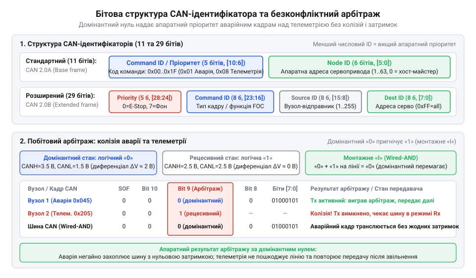
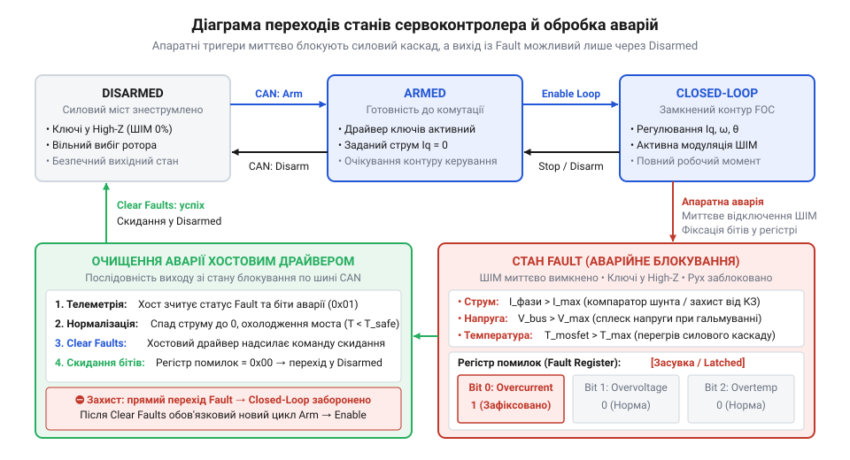

# Програмний протокол зв'язку, система команд і карта регістрів телеметрії сервоконтролера по шині CAN

<preknowlist>
- [Tower Pro SG90 — мікросерво 9g](root:cat-hw-actuators/sg90-servo) — принципи позиціонування привода імпульсним сигналом ШІМ, односторонній характер зв'язку без контролю виконання та обмеження радіального підключення сигнальних ліній
- [MG90S V2 — мікросерво з металевим редуктором](root:cat-hw-actuators/mg90s-servo) — динамічна поведінка сервопривода під навантаженням, стрибки споживання струму при зміні напрямку руху та небезпека механічного заклинювання редуктора, що вимагає струмового захисту
- [Сервоприводи постійного обертання](root:cat-hw-actuators/continuous-rotation-servo-mod) — різниця між завданням абсолютного кутового положення вала та режимом безперервного обертання з регулюванням швидкості
</preknowlist>

## Пастка сліпого керування та шина CAN

Керування приводами через односпрямовані імпульсні сигнали, типові для [базових мікросервоприводів](root:cat-hw-actuators/sg90-servo), створює ілюзію простоти, доки система обмежена однією віссю. Щойно кількість ступенів вільності зростає, індивідуальні кабелі перетворюються на громіздкий джгут. У рухомих шарнірах маніпуляторів дроти швидко перетираються від постійного згинання, а імпульсні завади від перемикання силових транзисторів інвертора спотворюють логічні рівні сигналів керування.

Головна небезпека такого підходу полягає у сліпому керуванні. Керуючий хост лише транслює уставки в один бік і не знає фактичного стану виконавчого механізму. Якщо ротор натрапляє на упор, що нерідко трапляється при [заклинюванні редуктора](root:cat-hw-actuators/mg90s-servo), струм через обмотки стрибає до максимуму. Не маючи інформації про аварію, хост продовжує вимагати руху, що спричиняє перегрів обмоток і вигорання вихідного каскаду драйвера.

Розв'язком стає перехід на диференційну шину @@en|CAN@@ (від англ. @@en|Controller Area Network@@ — мережа контролерів), де всі приводи під'єднані паралельно до єдиної витої пари. Диференційний сигнал усуває синфазні завади від силових кіл, а фізична топологія шлейфу спрощує кабельне розведення в рухомих зчленуваннях, як пояснює [побудова сервомережі CAN](root:com-devices/can-bus). Пакетний протокол перетворює керування на повноцінний двосторонній діалог: сервоконтролер не лише приймає уставки, але й безперервно передає хосту @@el|телеметрію@@ (від грец. *tele* — далеко та *metron* — вимірювання) — фактичний струм, кутове положення, швидкість, напругу живлення й температуру силових ключів.


*Порівняння радіального джгута проводів для односпрямованого керування ШІМ без зворотного зв'язку та послідовного шлейфу шини CAN із двостороннім обміном телеметрією: диференційна шина усуває сліпе керування та суттєво спрощує кабельне розведення у рухомих зчленуваннях.*

## Структура CAN-ідентифікатора та адресація вузлів

Спільне фізичне середовище вимагає чіткого розмежування отримувачів і призначень повідомлень. Якщо транслювати дані у спільну лінію суцільним потоком, кожен мікроконтролер мережі змушений витрачати обчислювальні ресурси на програмний розбір чужих пакетів. Регулярні телеметричні кадри від багатьох вузлів неминуче блокували б передачу термінових команд керування.

У шині @@en|CAN@@ цю проблему вирішує арбітражний ідентифікатор на початку кожного кадру. Замість передачі адреси всередині корисного навантаження, протокол виносить службові координати безпосередньо в заголовок арбітражу (@@la|арбітраж@@, від лат. *arbiter* — суддя). Поле 11-бітного (стандартного) або 29-бітного (розширеного) ідентифікатора поділяють на два бітові сегменти: код операції (@@en|Command ID@@) та адресу привода (@@en|Node ID@@). Наприклад, в 11-бітному форматі 5 старших бітів зазвичай виділяють під @@en|Command ID@@ (до 32 типів повідомлень), а 6 молодших — під @@en|Node ID@@ (до 64 унікальних приводів у мережі).


*Розподіл бітів арбітражного ідентифікатора на код команди та адресу вузла, де молодші числові значення гарантують найвищий пріоритет на шині.*

Така структура забезпечує дві критичні переваги:

1. **Апаратна фільтрація.** Вбудований периферійний модуль @@en|CAN@@ сервоконтролера зіставляє поле @@en|Node ID@@ із налаштованими апаратними фільтрами. Повідомлення для інших приводів відсікаються кремнієм без пробудження центрального процесора.
2. **Безконфліктний пріоритет.** На шині нульовий стан є домінантним і перекриває рецесивну одиницю. Коли два приводи транслюють кадри одночасно, вузол, що надсилає одиницю в бітовому розряді, де інший передає нуль, миттєво виявляє невідповідність, програє @@la|арбітраж@@ і перемикається на прийом. Кадр із меншим числовим значенням ідентифікатора проходить шину без затримок і колізій.

Тому критичні аварійні пакети та команди зупинки кодують молодшими значеннями @@en|Command ID@@: це гарантує, що аварійний сигнал негайно отримає шину, перервавши передачу фонової телеметрії.

## Формати команд і режими керування рухом

Коли керуючий хост надсилає сервоприводу лише цільову координату без динамічних обмежень, внутрішній регулятор намагається подолати неузгодженість із граничним зусиллям. Ротор рушає з різким ривком, що призводить до ударів у механіці, кидка струму та можливого зриву синхронізму безколекторного мотора. До того ж різні вузли вимагають відмінних законів руху: ланкам маніпулятора потрібне плавне переміщення без перерегулювання, колесам платформи — стабільна швидкість, а захвату деталей — дозоване зусилля без прив'язки до кута.

Щоб розв'язати ці задачі, 8-байтне корисне навантаження (@@en|payload@@, від англ. @@en|pay@@ — платити та @@en|load@@ — вантаж, корисна частина пакета без службових заголовків) кадру @@en|CAN@@ структурують під окремі режими керування:

1. **Позиціонування за трапецеїдальним профілем.** Кадр містить 32-бітне цільове положення (кут ротора), 16-бітне обмеження швидкості та 16-бітне граничне прискорення. За цими межами внутрішній генератор траєкторії будує плавний трифазний рух: лінійний розгін, рух зі сталою швидкістю та передбачуване гальмування в цільовій точці без ударів. Із різниці між початковим і цільовим положенням контролер обчислює необхідне кутове переміщення ротора `Δθ`. За прийнятими обмеженнями швидкості `ω_max` та прискорення `α_max` генератор траєкторії розраховує часові та просторові межі фаз руху. Час прискорення до максимальної швидкості становить `t_acc = ω_max / α_max`. Шлях гальмування ротора до повної зупинки за симетричного сповільнення дорівнює площі під спадною ділянкою графіка швидкості: `Δθ_dec = (ω_max · t_acc) / 2 = ω_max² / (2 · α_max)`. Оскільки на розгін витрачається така сама кутова відстань, сумарне переміщення для зміни швидкості дорівнює `2 · Δθ_dec`. Якщо повне переміщення перевищує цю величину (`Δθ > 2 · Δθ_dec`), привід виходить на плато максимальної швидкості, а час руху зі сталою швидкістю становить `t_flat = (Δθ − 2 · Δθ_dec) / ω_max`. Такий попередній розрахунок усуває ударні навантаження на редуктор і дозволяє контролеру вчасно почати сповільнення, щоб зупинити ротор точно в цільовій точці без перерегулювання. Ціною плавності є безперервне обчислювальне навантаження на мікроконтролер для інтегрування траєкторії на кожному такті контуру та збільшення загальної тривалості переміщення порівняно з різким стрибком напруги на фазах. Крім того, розрахунок ламається на коротких переміщеннях: якщо цільовий кут менший за сумарний шлях розгону та гальмування (`Δθ < 2 · Δθ_dec`), ротор фізично не встигає досягти швидкості `ω_max`. У такому разі фаза руху зі сталою швидкістю зникає (`t_flat = 0`), трапеція вироджується у трикутний профіль, а генератор траєкторії мусить обмежити пікову швидкість рівнем `ω_peak = √(Δθ · α_max)` зі скороченим часом прискорення `t_acc = √(Δθ / α_max)`, інакше через надмірний розгін привод проскочить ціль із механічним ударом.
2. **Стабілізація кутової швидкості.** Необхідна для тривалого обертання, аналогічно до того, як працюють [сервоприводи постійного обертання](root:cat-hw-actuators/continuous-rotation-servo-mod). Пакет передає 32-бітну швидкість уставки та 16-бітний темп наростання прискорення, утримуючи оберти незалежно від опору на валу.
3. **Пряме завдання моменту.** Хост надсилає 16-бітне значення струму квадратурної осі `I_q`, який у математичній моделі [векторного керування](root:hw-motion/foc-control) лінійно пов'язаний з електромагнітним моментом ротора. Контури положення й швидкості відключаються, дозволяючи приводу працювати керованою пружиною або безпечно утримувати предмет із фіксованим зусиллям.
4. **Динамічне гальмування та вільний вибіг.** Для зупинки діють окремі однобайтні команди: динамічне гальмування замикає всі нижні або верхні силові ключі, закорочуючи обмотки (індукована проти-ЕРС створює швидкий опір обертанню без споживання енергії від джерела); вільний вибіг повністю розмикає транзистори інвертора, знеструмлюючи фази та дозволяючи ротору вільно обертатися зовнішньою силою.

## Карта регістрів телеметрії та зворотний зв'язок

Керуючому хосту потрібні актуальні показники приводів для узгодження спільних рухів. Якщо опитувати вузли за схемою «запит–відповідь», на кожен параметр доведеться слати окремий запитувальний кадр. Службові транзакції захаращують спільну лінію, утворюють черги передачі, а покази різних шарнірів надходять із затримками, що руйнує фазову синхронізацію багатоосьової траєкторії.

Розв'язком стає регулярна циклічна @@el|телеметрія@@: контролер самостійно публікує кадри стану в шину з фіксованим періодом (1–5 мс для швидких контурів або 50–100 мс для повільних теплових процесів). Щоб укласти зріз параметрів у стандартизовані 8 байтів корисного навантаження, дані розподіляють за картою регістрів:

| Байти | Параметр | Тип даних | Квант масштабування |
|---|---|---|---|
| 0–1 | Кутове положення ротора | 16-бітне зі знаком | 0.01° |
| 2–3 | Кутова швидкість | 16-бітне зі знаком | 1 об/хв |
| 4–5 | Струм моменту `I_q` | 16-бітне зі знаком | 0.01 А |
| 6 | Напруга шини DC | 8-бітне беззнакове | 0.2 В |
| 7 | Температура ключів інвертора | 8-бітне зі знаком | 1 °C |

Багатобайтні поля записують за правилом молодшого байта наперед — @@en|little-endian@@ (від англ. @@en|little@@ — малий та @@en|end@@ — край, кінець; порядок, де молодший байт передує старшому). Якщо хостовий процесор має зворотний порядок байтів (@@en|big-endian@@), він мусить переставити байти місцями перед обробкою, інакше прийняте число спотвориться. Спроба прочитати таке поле прямим приведенням вказівника на буфер корисного навантаження (наприклад, `*(int16_t*)&data[4]`) є ненадійною: вона порушує правило строгих псевдонімів (англ. @@en|strict aliasing@@, від англ. @@en|strict@@ — строгий та лат. @@la|alias@@ — інакше) стандартів C та C++, а на процесорах без апаратної підтримки незіставленого доступу до пам'яті (зокрема в ядрах ARM Cortex-M0) читання 16-бітного числа за незіставленою адресою викликає апаратне переривання збою процесора. До того ж пряме приведення вказівника спирається на порядок байтів хоста й дає збій при зміні платформи. Безпечне та платформонезалежне розпакування виконують вручну побітовими операціями зсуву вліво `<<` та побітового «АБО» `|`. Для відновлення 16-бітного значення молодший байт залишають у незмінній позиції, а старший байт зсувають на 8 розрядів уліво та поєднують із молодшим. У мові C для розпакування струму з байтів 4 і 5 буфера `data` вираз записують як `int16_t N = (int16_t)((uint16_t)data[4] | ((uint16_t)data[5] << 8));`, а в мові C++ застосовують явні типізовані перетворення `int16_t N = static_cast<int16_t>(static_cast<uint16_t>(data[4]) | (static_cast<uint16_t>(data[5]) << 8));`. Головна пастка ручного зсуву криється у знаковому розширенні (англ. @@en|sign extension@@, від лат. @@la|signum@@ — знак та @@la|extendere@@ — розтягувати): якщо вхідний буфер оголошено через знаковий тип `char` або `int8_t`, під час операції зсуву компілятор автоматично підтягує операнд до 32-бітного знакового цілого `int`. Якщо старший байт містить одиничний знаковий біт (значення від `0x80` до `0xFF`), процесор розмножує одиниці на всі 24 старші розряди (`0xFFFFFFxx`), і побітове «АБО» безповоротно псує числове значення. Щоб запобігти цьому, кожен байт перед зсувом обов'язково приводять до беззнакового типу `uint8_t` або відсікають зайві розряди бітовою маскою `data[i] & 0xFF`. Ручне розбирання вимагає кількох додаткових операцій в арифметико-логічному пристрої, проте оптимізувальний компілятор згортає ці побітові інструкції в одну машинну команду завантаження з регістра, повертаючи коректний знаковий код `N` без жодного ризику апаратних збоїв.

Для відновлення фізичного значення хостовий драйвер множить цілочисельний код `N` на відповідний коефіцієнт масштабування. Наприклад, фактичний струм моменту `I_q` обчислюють із прийнятого 16-бітного коду:

```
I_q = N · k_I
    = 340 · 0.01 А           [підстановка цілого коду та кванта струму]
    = 3.40 А                 [фактичний струм квадратурної осі]
```

Цілочисельна упаковка позбавляє лінію зв'язку від пересилання повільних чисел із рухомою комою, забезпечуючи хост вичерпними даними для замкненого контуру керування.

## Діагностика аварій та відновлення після збоїв

Коли ротор заклинює, напруга живлення просідає або силові транзистори інвертора перегріваються, вбудований захист сервоконтролера миттєво знеструмлює фази й блокує роботу. Якщо керуючий хост не розпізнає аварію та продовжує надсилати уставки руху, після відновлення зв'язку мотор спробує наздогнати накопичену цільову координату. Цей стрибок спричиняє нищівний механічний удар або вигорання ключів.

Поведінкою привода керує @@el|автомат@@ станів (від грец. *automatos* — самодіючий):


*Автомат станів сервоконтролера: апаратний збій вимикає силові ключі в стані Fault, а відновлення вимагає команди Clear Faults.*

Після подачі живлення привід перебуває у знеструмленому стані @@en|Disarmed@@. За командою увімкнення вузол переходить у стан готовності @@en|Armed@@ і замикає контур регулювання @@en|Closed-Loop@@. Будь-яка апаратна аномалія миттєво скидає контролер у блокування @@en|Fault@@, де транзистори інвертора негайно розмикаються.

Контролер транслює високопріоритетний кадр сповіщення по шині @@en|CAN@@ із бітовими прапорцями регістру помилок:
- біт 0 — надструм фаз через заклинювання вала;
- біт 1 — перенапруга шини живлення під час гальмування;
- біт 2 — критичне просідання вхідної напруги;
- біт 3 — перегрів ключів інвертора;
- біт 4 — збій або втрата зв'язку з енкодером.

Прийнявши аварійний кадр, [хостовий драйвер](root:cat-hw-actuators/bldc-servo-controller/api-bldc-servo-driver-cpp.md) негайно зупиняє решту осей маніпулятора для збереження кінематики. Для безпечного відновлення хост спершу зрівнює цільову координату з фактичною й лише тоді надсилає команду @@en|Clear Faults@@. Після очищення помилок привід повертається у стан @@en|Disarmed@@ і готовий до повторного пуску без ривків.
