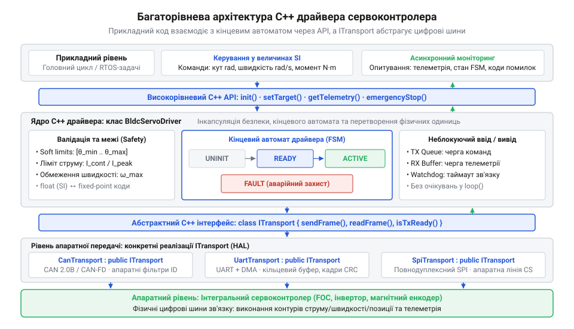
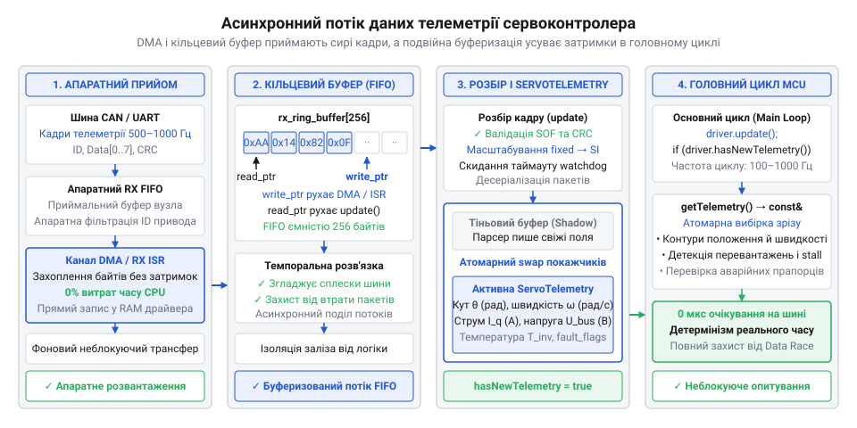
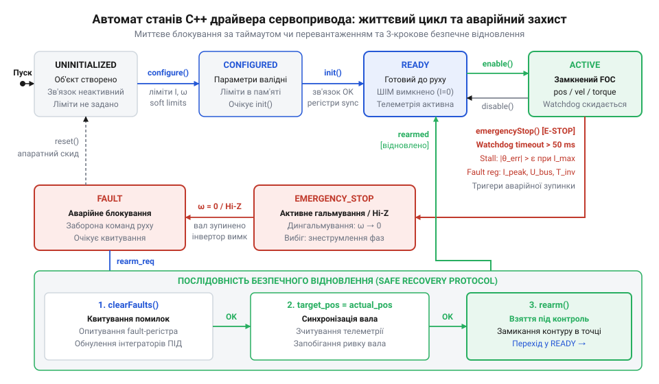

# Програмний C++ драйвер керування інтегральним сервоконтролером для вбудованих платформ

<preknowlist>
- [Tower Pro SG90 — мікросерво 9g](root:cat-hw-actuators/sg90-servo) — базові принципи одностороннього ШІМ-керування сервоприводами без зворотного зв'язку та обмеження такого підходу для прецизійних задач
- [MG90S V2 — мікросерво з металевим редуктором](root:cat-hw-actuators/mg90s-servo) — механічна поведінка сервопривода під навантаженням, ризики механічного заклинювання вала та наслідки відсутності контролю струму й моменту
</preknowlist>

## Пастки наївного керування та архітектура драйвера

Пряме надсилання сирих байтів цифровою шиною до сервоконтролера (лат. @@la|servus@@ — слуга та англ. @@en|controller@@ — управитель) безпосередньо з головного циклу програми здається найпростішим рішенням, проте швидко призводить до аварії. Блокуюче очікування квитанції від привода паралізує мікроконтролер на мілісекунди, зриваючи детермінізм задач реального часу. Якщо через електромагнітну заваду на лінії втрачається хоча б один байт, опитування зависає назавжди. До того ж відправка неперевірених числових кодів без контролю фізичних меж розганяє вал до удару, що ламає [металевий редуктор привода](root:cat-hw-actuators/mg90s-servo) або зрізає [шліци змінного серворога](root:cat-hw-actuators/servo-horns) об механічні упори.

Надійне керування потребує об'єктно-орієнтованого драйвера (англ. @@en|driver@@, від *drive* — керувати), де низькорівневий зв'язок відокремлено від кінематики й захисту. Взаємодія з шиною інкапсулюється за інтерфейсом `ITransport` — це рівень апаратної абстракції (англ. @@en|Hardware Abstraction Layer@@, HAL; від лат. @@la|abstractio@@ — відокремлення), завдяки якому той самий клас керує приводом через UART, SPI чи CAN без зміни коду логіки. Усі операції позбавлені блокуючих затримок: драйвер лише буферизує кадри та перевіряє статус апаратних буферів. Захист забезпечує внутрішній кінцевий автомат (грец. @@el|αὐτόματος@@ — самодіючий) зі станами `UNINITIALIZED`, `READY`, `ACTIVE` та `FAULT`. Він блокує будь-які команди руху до повної конфігурації, а в разі таймауту (англ. @@en|timeout@@) шини чи апаратного збою негайно знеструмлює фази.


*Схема багаторівневої архітектури C++ драйвера: високорівневий API ізолює прикладний код, а інтерфейс ITransport абстрагує цифрові шини зв'язку для перенесення логіки між апаратними платформами.*

## Ініціалізація драйвера та конфігурація обмежень

Перед подачею напруги на фази екземпляр драйвера має отримати вичерпні параметри безпеки. Їх визначає конфігураційна структура `ServoConfig`, де величини задаються виключно в одиницях SI: радіанах, радіанах за секунду й амперах. Вона задає тривалий і граничний піковий струм для запобігання перегріву інвертора, ліміти кутової швидкості й прискорення для захисту від ударних навантажень, а також програмні межі (англ. @@en|soft limits@@) кутового ходу вала. На відміну від некерованих [моделей аналогових мікросервоприводів](root:cat-hw-actuators/sg90-servo), цифровий контролер вимикає подачу моменту ще до контакту з механічним упором.

Конфігурація застосовується методом `init(const ServoConfig& config)`. Спочатку драйвер перевіряє передані значення на фізичну узгодженість: нижня межа кута має бути строго меншою за верхню, а піковий струм — не меншим за тривалий. Після валідації параметри записуються в апаратні регістри сервоконтролера. Тут постає проблема узгодження типів: публічний API драйвера приймає зручні [числа з плаваючою комою](root:sf-devices/integer-scaling-fixed-point) (англ. @@en|floating-point@@) `float`, тоді як внутрішні регістри працюють із цілими величинами у форматі фіксованої точки (англ. @@en|fixed-point@@, від лат. @@la|fixus@@ — закріплений). Цілочисельний 16-бітний знаковий код регістра `R_θ` визначають із неперервного кута вала `θ` у радіанах через квантування (англ. @@en|quantization@@, від лат. @@la|quantus@@ — скільки) з масштабним коефіцієнтом `K_θ`, який відображає симетричний діапазон від `-π` до `+π` на межі типу `int16_t` від `-32768` до `+32767` з наступним математичним округленням `round`:

```
R_θ
= round(θ · K_θ)                         [масштабування кута на цілочисельну шкалу]
= round(θ · (2¹⁵ / π))                   [коефіцієнт для 16-бітного знакового діапазону]
= round(θ · (32768 / π))                 [обчислення степеня двійки 2¹⁵]
≈ round(θ · 10430.378)                  [десяткове наближення масштабного множника]
```

Вираз базується на рівномірній дискретизації кола, де крок квантування `Δθ = π / 32768 ≈ 9.587 · 10⁻⁵ рад` (приблизно `0.0055°`) визначає фізичну дискретність кутового положення й перевершує точність більшості магнітних енкодерів.

**Розрахунок 16-бітного коду регістра для кутового положення вала θ = 0.7854 рад (45°):**
```
R_θ
= round(0.7854 · (32768 / 3.141593))     [підстановка кута θ = 0.7854 рад та константи π]
= round(0.7854 · 10430.378)              [обчислення масштабного коефіцієнта]
= round(8192.019)                        [множення кута на коефіцієнт]
= 8192                                   [округлення до найближчого цілого]
```

Отриманий код `8192` (шістнадцяткове `0x2000`) становить рівно чверть від позитивної півшкали 32768 градацій. Проте лінійне відображення вимагає суворого контролю крайових станів: якщо заданий кут виходить за фізичний діапазон `[-π, π]`, пряме цілочисельне приведення викликає арифметичне переповнення 16-бітного знакового типу, через що кут `+3.2 рад` обернеться на код `-32159` і спровокує аварійний розворот ротора у протилежний бік. До того ж проміжне множення `(θ · 32768)` не можна виконувати у 16-бітній арифметиці через ризик миттєвого переповнення розрядної сітки до моменту ділення. Тому драйвер насичує значення за конфігураційними межами, проводить масштабування у розрядності `float` або `int32_t` і лише після фінального округлення записує результат у цільовий регістр. Отримавши підтвердження успішного запису регістрів шиною зв'язку, автомат переводить драйвер зі стану `UNINITIALIZED` у стан `READY`.

## Керування положенням, швидкістю та крутним моментом

Публічний інтерфейс драйвера надає три базові методи руху в узгоджених одиницях SI: кутове позиціонування вала `setPosition(float radians)`, стабілізацію швидкості `setVelocity(float rad_per_sec)` та пряме регулювання крутного моменту (англ. @@en|torque@@, від лат. @@la|torquere@@ — скручувати) `setTorque(float newton_meters)`. На відміну від спрощених модифікацій, як-от [сервоприводи постійного обертання](root:cat-hw-actuators/continuous-rotation-servo-mod), цифровий контролер замкненого циклу самостійно регулює фазний струм для точної підтримки швидкості. Проте пряме надсилання числових команд у регістри небезпечне: вихід за фізичні межі спричиняє апаратну аварію. Щоб уникнути збою, драйвер виконує попереднє програмне відсікання (англ. @@en|clamping@@, від *clamp* — затискач): значення цільового кута обмежується збереженими межами `min_angle` та `max_angle`, а швидкість і момент — допустимими порогами `max_velocity` та `max_torque`.

Окремий виклик — зміна режиму руху на льоту. Якщо вал обертається з високою швидкістю, а програма раптово викликає `setPosition()` для фіксації точки, контур позиціонування спробує зупинити ротор миттєво. Це породжує граничний стрибок фазного струму та ударний імпульс, здатний зрізати зуби редуктора. Для захисту драйвер виконує безривковий перехід (англ. @@en|bumpless transfer@@): перед перемиканням він зчитує поточну кінематику вала й підхоплює реальну швидкість як початкову умову для внутрішнього генератора траєкторії. Проте лінійного сповільнення зі сталим прискоренням недостатньо: стрибкоподібна зміна прискорення на початку й наприкінці гальмування породжує теоретично нескінченний ривок (англ. @@en|jerk@@, від англ. *jerk* — різкий поштовх) — похідну кутового прискорення за часом `j = dα/dt`. Оскільки крутний момент (@@en|torque@@) мотора прямо пропорційний прискоренню, миттєвий стрибок прискорення змушує інвертор різко нарощувати фазний струм, що збуджує пружні вібрації ротора та спричиняє удари в зазорах зубчастих передач. Щоб усунути динамічні удари, драйвер формує S-подібний профіль швидкості (англ. @@en|S-curve profile@@, за схожістю форми кривої швидкості з літерою S), який обмежує темп зміни прискорення фіксованим лімітом ривка `j_max`. Під час підхоплення кінематики генератор фіксує початковий кут `θ_0`, фактичну кутову швидкість `ω_0` та прискорення `α_0 = 0`, розбиваючи інтервал сповільнення на три фази з обмеженим ривком. На першій фазі прискорення лінійно зменшується від `0` до граничного гальмівного рівня `-α_max` зі сталим ривком `-j_max` упродовж часу `t_j = α_max / j_max`, завдяки чому швидкість спадає за плавною параболою `ω(t) = ω_0 − 0.5 · j_max · t²`. Якщо початкова швидкість достатньо велика для досягнення максимального сповільнення (`|ω_0| ≥ α_max² / j_max`), рух переходить у другу фазу — гальмування зі сталим прискоренням `-α_max` тривалістю `t_a = (|ω_0| − α_max · t_j) / α_max`. На третій фазі прискорення лінійно повертається від `-α_max` до `0` з додатним ривком `+j_max` за такий самий час `t_j`, утворюючи симетричну параболу швидкості з нульовим прискоренням у момент зупинки ротора. У цифровому контурі керування драйвер чисельно інтегрує ривок на кожному кроці планувальника з періодом `Δt`: `α[k] = α[k-1] + j[k] · Δt`, `ω[k] = ω[k-1] + α[k] · Δt` та `θ[k] = θ[k-1] + ω[k] · Δt`. За такої кривої повний кутовий шлях ротора до зупинки становить `Δθ_stop = (ω_0² / (2 · α_max)) + (ω_0 · α_max / (2 · j_max))`. Плавність S-профілю має свою ціну: порівняно з трапецеїдальним гальмуванням фази зміни прискорення збільшують гальмівний шлях `Δθ_stop` на величину `(ω_0 · t_j) / 2` та подовжують час зупинки на інтервал `t_j`. Крім того, аналітичний розрахунок фаз траєкторії для довільної швидкості `ω_0` вимагає значних обчислювальних ресурсів процесора на операції з плаваючою комою (@@en|floating-point@@) `float` та постійних перевірок умов на кожному такті контуру. Алгоритм ламається у випадках, коли цільове положення `θ_target` задане занадто близько до координати підхоплення: якщо кутова відстань менша за гальмівний шлях (`|θ_target − θ_0| < Δθ_stop`), ротор фізично не може зупинитися у вказаній точці без порушення встановлених лімітів. У такій ситуації виникає неминуче перерегулювання (англ. @@en|overshoot@@, від *shoot* — летіти та *over* — понад): ротор проскакує ціль, плавно гальмує за нею й повертається назад реверсним рухом. Якщо ж у зоні перельоту розташований механічний упор або діє програмна межа (@@en|soft limits@@), генератор вимушений аварійно скидати швидкість із перевищенням ліміту ривка, що повертає ризик механічного пошкодження редуктора. Також розрахунок дає збій на малих швидкостях (`|ω_0| < α_max² / j_max`), коли привід не встигає розвинути граничне сповільнення: фаза постійного гальмування зникає (`t_a = 0`), а пікове прискорення доводиться перераховувати як `α_peak = √(j_max · |ω_0|)` зі скороченим часом `t_j = √(|ω_0| / j_max)`, інакше рівняння часових інтервалів стають від'ємними й призводять до збою генератора траєкторії.

## Неблокуюче опитування та асинхронна телеметрія привода

Контуру керування потрібен безперервний зворотний зв'язок: поточний кут, кутова швидкість, фазний струм, напруга живлення та температура силових ключів. Опитувати ці параметри синхронно неприпустимо — очікування відповіді шини блокує процесор. Тому прийом телеметрії (грец. @@el|τῆλε@@ — далеко та @@el|μέτρον@@ — вимірювання) виносять в асинхронний режим: кожен вхідний байт захоплюється апаратним перериванням або каналом прямого доступу до пам'яті (англ. @@en|Direct Memory Access@@, DMA) і без участі центрального процесора потрапляє у [кільцевий буфер](root:sf-devices/circular-ring-buffer) (англ. @@en|ring buffer@@) драйвера.

Головний цикл періодично викликає неблокуючий метод `update()`. Він вичитує накопичені байти, перевіряє контрольні суми й розпаковує валідні кадри. Щоб запобігти перегонам даних (англ. @@en|data race@@), коли переривання оновлює байти під час їх зчитування алгоритмом керування, драйвер застосовує подвійну буферизацію (англ. @@en|double buffering@@). Метод `update()` записує свіжі значення у тіньовий буфер, після чого атомарно перемикає активний покажчик на структуру `ServoTelemetry` та зводить прапорець `hasNewTelemetry()`. Завдяки цьому прикладний код отримує узгоджений зріз стану привода за фіксований час без затримок на шині.


*Схема неблокуючої обробки телеметрії: апаратний транспорт наповнює кільцевий буфер, а метод опитування розбирає кадри в подвійний буфер без затримок основного циклу.*

## Діагностика збоїв зв'язку та перевантажень

Обрив сигнальної лінії під час швидкісного руху перетворює сервопривід на некеровану загрозу: без нагляду він продовжує обертатися за останньою командою. Для захисту драйвер веде програмний сторожовий таймер зв'язку (англ. @@en|watchdog timer@@, від *watch* — вартувати та *dog* — собака): під час кожного виклику `update()` фіксується мітка часу надходження валідного пакета. Якщо інтервал мовчання перевищує заданий поріг (наприклад, 50 мс), таймер генерує помилку `ERR_TIMEOUT` і переводить привід у захисний режим.

Не менш небезпечним є механічне заклинювання вала (англ. @@en|stall@@, від англ. *stall* — зупиняти). На відміну від [малогабаритних аналогових серв](root:cat-hw-actuators/hd-1370a-servo), де упор спалює обмотки, цифровий драйвер реалізує алгоритмічне виявлення блокування (англ. @@en|stall detection@@). Під час руху обчислюється похибка стеження (англ. @@en|tracking error@@, від *track* — стежити та лат. @@la|error@@ — помилка) — різниця між цільовим і фактичним кутом вала з телеметрії. Якщо похибка перевищує ліміт за максимального фазного струму протягом заданого часу, фіксується зупинка ротора.

Паралельно драйвер опитує апаратний регістр помилок (англ. @@en|fault register@@) контролера. У ньому бітовими прапорцями зафіксовано аварійні стани силового каскаду: фазне перевантаження по струму (англ. @@en|overcurrent@@), перегрів інвертора, блокування за низької напруги живлення (англ. @@en|Under-Voltage Lock-Out@@, UVLO) та сплеск напруги через рекуперативне гальмування (лат. @@la|recuperatio@@ — повернення) сповільнюваного ротора. Будь-який із цих прапорців негайно зупиняє роботу привода.

## Аварійна зупинка та безпечне відновлення

У разі критичного збою драйвер викликає аварійну зупинку (англ. @@en|emergency stop@@, E-STOP; від лат. @@la|emergere@@ — зринати). Залежно від кінематики розробник обирає одну з двох поведінок: [активне динамічне гальмування](root:hw-motion/halmuvannia-motora) (грец. @@el|δύναμις@@ — сила; англ. @@en|dynamic braking@@) або вільний вибіг. При динамічному гальмуванні інвертор зустрічним струмом швидко зводить швидкість до нуля за фіксований час, зупиняючи вал перед перешкодою. Якщо ж ударне уповільнення загрожує механіці, силові ключі переходять у стан високого імпедансу (англ. @@en|high-impedance state@@, Hi-Z / @@en|coast@@) — фази знеструмлюються, і вал зупиняється вільним вибігом під дією тертя.

Після аварійного вимкнення кінцевий автомат переходить у стан `FAULT`. У ньому діє повна заборона нових команд руху (`setPosition`, `setVelocity`, `setTorque`), доки оператор чи програма явно не виконає квитування (нім. @@de|quittieren@@ — підтверджувати отримання) помилок `clearFaults()` та повторне взяття під контроль (англ. @@en|rearm@@) `rearm()`.

Алгоритм відновлення виконується послідовно: драйвер перевіряє зняття апаратних прапорців аварії в контролері та обнуляє внутрішні інтегратори похибки. Щоби запобігти небезпечному ривку механізму, заданий кут примусово прирівнюється до поточної координати вала з телеметрії: `target_position = actual_position`. Контур позиціонування замикається безпосередньо в точці фактичної зупинки, забезпечуючи плавний перезапуск.


*Кінцевий автомат драйвера: аварійне блокування при збоях зв'язку чи перевантаженнях і покрокове відновлення з синхронізацією координати вала.*
