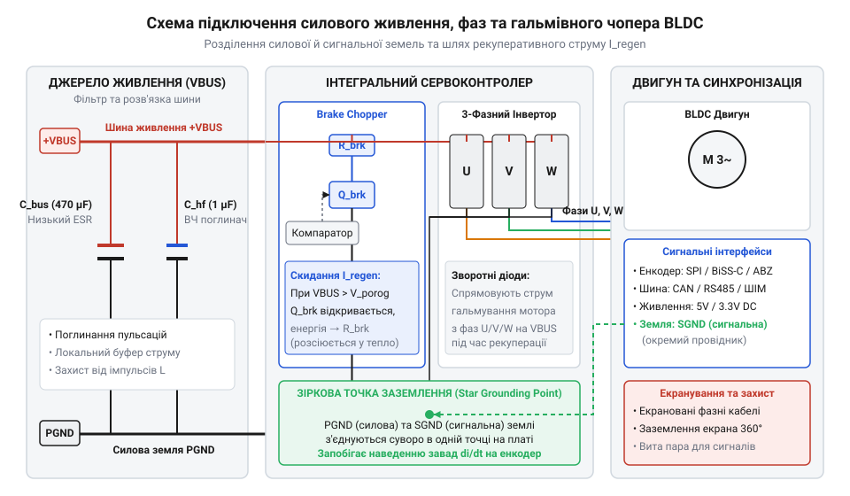
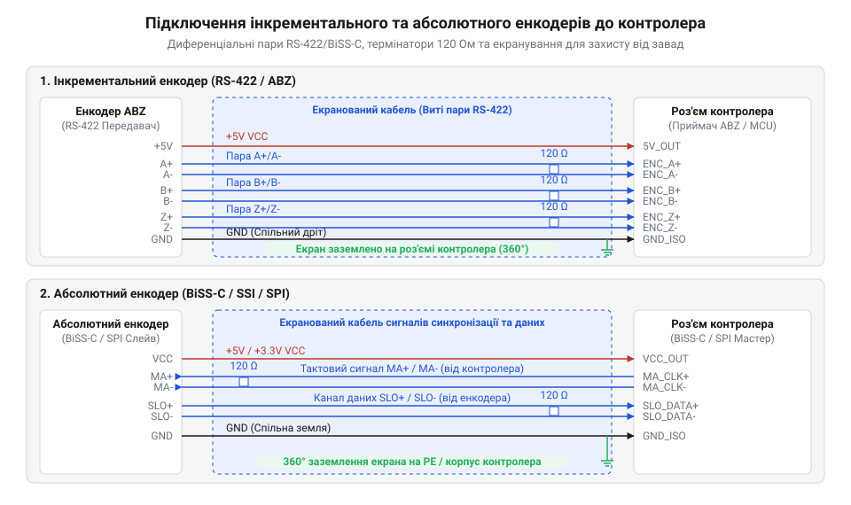

# Апаратні інтерфейси та схема підключення BLDC-сервоконтролера

<preknowlist>
- [Сервоприводи радіокерованих моделей: будова, редуктори та ШІМ-керування](root:cat-hw-actuators/rc-servo-mechanisms-and-control) — Принципи керування імпульсною шириною (ШІМ) та базові поняття контуру зворотного зв'язку за положенням.
</preknowlist>

## Небезпеки прямого підключення потужного серводвигуна

На відміну від дрібних [моделей сервоприводів радіокерованих](root:cat-hw-actuators/rc-servo-mechanisms-and-control) чи стандартних [компактних мікросервоприводів SG90](root:cat-hw-actuators/sg90-servo), де силова й керувальна частини розміщені на одній маленькій платі й живляться від спільного низьковольтного джерела, промислові та робототехнічні @@en|BLDC@@ (англ. *Brushless Direct Current*, від *brushless* — безщітковий та *direct current* — постійний струм) сервоприводи оперують потужностями від сотень ват до кількох кіловат. Пряме з'єднання обмоток такого двигуна з керувальною платою мікроконтролера без жорсткого схемотехнічного та фізичного розмежування майже миттєво призводить до апаратної катастрофи: пробою цифрових входів, збоїв тактування та фізичного вигоряння керувальних мікросхем.

Головна причина руйнування полягає у високочастотному перемиканні силових ключів @@en|inverter@@ (лат. *invertere* — повертати, перевертати). Силовий каскад трифазного інвертора будується на потужних транзисторах @@en|MOSFET@@ (англ. *Metal-Oxide-Semiconductor Field-Effect Transistor*, від *metal* — метал, *oxide* — оксид, *semiconductor* — напівпровідник, *field-effect* — польовий, *transistor* — транзистор), які комутують струм у фазах `U`, `V`, `W` з частотою від 20 до 50 кГц. Під час кожного перемикання швидкість зміни струму `dI ÷ dt` досягає сотень ампер за мікросекунду. Навіть найменша паразитна індуктивність `L_trace` друкованих доріжок або з'єднувальних проводів (на рівні кількох наногенрі) викликає високочастотні сплески напруги `V_spike`:

```
V_spike = L_trace × (dI ÷ dt)      [закон електромагнітної індукції]
```

Ці сплески напруги через спільну лінію заземлення `GND` потрапляють на чутливі сигнальні кола мікроконтролера. Виникає так званий стрибок потенціалу землі @@en|ground bounce@@ (англ. *ground bounce* — відскок землі). Оскільки робоча напруга сучасних процесорів становить 3.3 В, амплітуда завади в 1–2 В на спільній шині `GND` сприймається цифровими входами як хибний логічний рівень, що руйнує синхронізацію шин даних та викликає програмний збій.

Друге джерело небезпеки — рекуперативна енергія. Під час швидкого гальмування чи реверсу двигун переходить у режим генератора. Кінетичне обертання ротора та механічного навантаження перетворюється на електричний струм, який через оборотність силових ключів @@en|MOSFET@@ накачується назад у силову шину живлення @@en|VBUS@@ (англ. *voltage bus*, від *voltage* — напруга та *bus* — шина). Якщо це коло не має спеціальних пристроїв поглинання енергії, напруга `VBUS` стрімко зростає, перевищуючи гранично допустимі значення лінійних регуляторів та пробиваючи затвори силових транзисторів.

Саме тому апаратна архітектура BLDC-сервоконтролера вимагає безкомпромісного розділення на два контури: високострумовий силовий контур (силова шина живлення `VBUS`/`GND`, фази `U`, `V`, `W`) та низьковольтний сигнальний контур (енкодери, шини зв'язку, інтерфейси керування).

## Силові термінали живлення та фазних обмоток

Силовий блок контролера відповідає за передачу високих струмів від джерела живлення до фазних обмоток двигуна та безпечне розсіювання рекуперативної енергії. Схема з'єднання силового контуру містить термінали силової шини `VBUS` і `GND`, три фазні виходи `U`, `V`, `W` та спеціальні виводи для підключення баластного гальмівного резистора @@en|Brake Chopper@@ (англ. *brake* — гальмо, *chopper* — переривач).

Під час інтенсивного сповільнення масивного механізму зворотна ЕРС двигуна викликає підйом напруги на шині `VBUS`. Для захисту конденсаторів та транзисторів інвертора контролер відстежує рівень напруги й при досягненні критичного порогу відкриває силовий ключ переривача, спрямовуючи рекуперативний струм через гальмівний резистор `R_brake`. Опір цього резистора та його пікову потужність розраховують на основі максимально припустимої напруги шини `V_max` та граничного струму гальмування `I_brake`:

```
R_brake = V_max ÷ I_brake                [закон Ома для кола гальмування]
P_peak = (V_max × V_max) ÷ R_brake       [розрахунок пікової теплової потужності]
```

У цих виразах `V_max` позначає максимальну напругу силової шини в вольтах, `I_brake` — максимально допустимий струм гальмування в амперах, `R_brake` — необхідний опір гальмівного резистора в омах, а `P_peak` — пікову потужність у ватах, яку резистор короткочасно розсіює у вигляді тепла. Для детального ознайомлення зі схемотехнікою кіл поглинання рекуперативної енергії та вибором силових резисторів перегляньте статтю про [схемотехніку та розрахунок баластних ключів Brake Chopper](root:hw-power/brake-chopper-circuits).

Для мінімізації випромінювання високочастотних завад силові провідники фаз `U`, `V`, `W` скручують у щільний джгут. Це зменшує площу контуру струму та паразитної індуктивності. Провідники силової шини `VBUS` та `GND` також прокладають паралельно або у вигляді крученої пари. Переріз проводів вибирають із розрахунку щільності струму не більше 5–8 А/мм² для запобігання перегріву.

Безпосередньо біля силових транзисторів @@en|MOSFET@@ на друкованій платі розміщують батарею згладжувальних конденсаторів. Вони поєднують низькоімпедансні керамічні конденсатори (для фільтрації високочастотних пульсацій перемикання PWM) та об'ємні електролітичні конденсатори з низьким еквівалентним послідовним опором @@en|low-ESR@@ (англ. *low Equivalent Series Resistance*), що поглинають локальні кидки струму.


*Електрична схема з'єднання силового живлення VBUS/GND, трьох фазних терміналів двигуна U/V/W та ключа Brake Chopper із балластним резистором і згладжувальними конденсаторами.*

Правильне схемотехнічне розведення силового контуру забезпечує стабільність напруги живлення та створює захищений базис для підключення низьковольтних датчиків положення.

## Інтерфейси зворотного зв'язку та енкодерів

Для точного керування моментом та швидкістю за допомогою векторних алгоритмів контролеру необхідна достовірна інформація про кутове положення ротора в кожен момент часу. Цю функцію виконують датчики зворотного зв'язку: інкрементальні та абсолютні енкодери @@en|encoder@@ (англ. *encoder*, від *code* — шифр, код), а також датчики Холла. Для поглибленого вивчення алгоритмів регулювання вектором струму статора та математичних перетворень Кларк — Парка дивіться матеріал про [польовоорієнтоване керування (FOC) BLDC-двигунами](root:hw-motion/foc-control).

Інкрементальні енкодери формують два квадратні сигнали `A` і `B`, зміщені на 90 електричних градусів, та імпульс index-мітки `Z` для визначення нульового положення. Абсолютні енкодери передають точний цифровий код кута через швидкісні послідовні інтерфейси @@en|SPI@@ (англ. *Serial Peripheral Interface*, від *serial* — послідовний, *peripheral* — периферійний, *interface* — інтерфейс) або @@en|BiSS-C@@ (англ. *Bidirectional Serial Synchronous interface*). Для базової комутації без високоточного позиціонування застосовують 3 дискретні датчики Холла, розташовані під кутом 120 градусів.

Оскільки сигнальні лінії енкодерів прокладають поруч із силовими кабелями двигуна, вони зазнають потужного впливу імпульсних наводок. Для забезпечення завадостійкості застосовують диференціальну передачу сигналів за стандартом @@en|RS422@@ / @@en|RS485@@ (англ. *Recommended Standard 485*). Замість одного провідника відносно землі сигнал передається парою провідників `A+` та `A-` у вигляді диференціальної пари @@en|differential pair@@ (англ. *differential pair* — диференціальна пара). Приймач контролера обчислює різницю напруг між провідниками, взаємно компенсуючи синфазну заваду `V_noise`:

```
V_diff = (V_pos + V_noise) - (V_neg + V_noise)
       = V_pos - V_neg                   [пригнічення синфазної завади]
```

Для підключення датчиків Холла з відкритим колектором на платі контролера встановлюють підтягувальні резистори @@en|pull-up resistor@@ (англ. *pull-up resistor*, від *pull up* — підтягувати та *resistor* — резистор) до шини 3.3 В або 5 В. Вхідні кола цифрових ліній додатково захищають апаратними RC-фільтрами низьких частот для зрізання високочастотних піків.

Кабелі зворотного зв'язку обов'язково мають бути екранованими з крученими парами. Екран з'єднують із землею @@en|GND@@ строго в одній точці — з боку сервоконтролера. Двостороннє заземлення екрана створює замкнену земляну петлю @@en|ground loop@@ (англ. *ground loop*, від *ground* — земля та *loop* — петля), у якій через комутаційні поля силового кабелю виникають вихрові струми, що наводять завади прямо в сигнальні жили.


*Структурна схема підключення інкрементального енкодера ABZ через диференціальні шини RS422 та абсолютного енкодера за інтерфейсами SPI і BiSS-C.*

Захищений контур зворотного зв'язку гарантує точне обчислення вектора струму статора та створює основу для надійної інтеграції контролера у зовнішню мережу керування.

## Командні шини та сигнальні інтерфейси керування

Зовнішнє керування сервоконтролером здійснюється через цифрові послідовні шини або аналогово-імпульсні інтерфейси. В промисловій автоматиці та робототехніці основними стандартами є шина @@en|CAN bus@@ (англ. *Controller Area Network*, від *controller* — контролер, *area network* — локальна мережа) та інтерфейс @@en|RS485@@, тоді як у простих ЧПК-системах застосовують імпульсні сигнали @@en|Step-Dir@@ (англ. *step* — крок, *direction* — напрямок) або ШІМ-команди.

Мережа @@en|CAN bus@@ використовує диференціальну пару ліній `CAN_H` та `CAN_L`. Для відсутності відбиттів сигналів від кінців лінії зв'язку та забезпечення узгодження імпедансу на обох фізичних крайніх вузлах мережі обов'язково встановлюють термінальні резистори з опором `R_term = 120 Ом`. Відсутність термінації призводить до викривлення фронтів імпульсів і масових помилок кадрування кадру даних.

Критичною вимогою для командних шин у багатовузлових системах є гальванічна розв'язка. Сигнальні трансівери @@en|CAN bus@@ та @@en|RS485@@ відокремлюють від мікроконтролера за допомогою цифрових оптичних або магнітних ізоляторів. Це унеможливлює проходження високовольтних вирівнювальних струмів між заземленнями різних контролерів при зміщенні потенціалу землі @@en|ground bounce@@.

Для прийому сигналів @@en|Step-Dir@@ в умовах цехових завад застосовують швидкісні оптопари або диференціальні приймачі `RS422`. Це дозволяє подавати керувальні імпульси напругою 5 В або 24 В безпосередньо з виходів програмованих логічних контролерів (ПЛК) без ризику пошкодження 3.3-вольтового ядра сервоконтролера.

Надійна фізична організація командних шин гарантує безперебійну передачу завдань позиції та швидкості навіть при інтенсивній роботі сусідніх потужних приводів.

## Аварійні режими та системи захисту контролера

Незважаючи на фільтрацію завад та узгодження ліній, у реальній експлуатації виникають граничні та аварійні режими: просідання або кидки напруги `VBUS`, обрив фазного провідника, втрата зв'язку з енкодером чи зависання командної шини. Для запобігання механічним руйнуванням сервоконтролер оснащується багаторівневою системою захисту.

Фундаментом безпеки є апаратний функціонал Safe Torque Off @@en|STO@@ (англ. *Safe Torque Off*, від *safe* — безпечний, *torque* — крутний момент, *off* — вимкнено). Це двоканальна схема, яка фізично блокує подачу живлення на драйвери затворів силових транзисторів @@en|MOSFET@@. На відміну від програмної зупинки, @@en|STO@@ працює повністю на залізному рівні: при розмиканні хоча б одного з двох незалежних сигнальних кіл `STO1` або `STO2` силова частина знеструмлюється гарантовано, навіть якщо центральний мікроконтролер повністю завис. Для поглибленого вивчення архітектури та сертифікації двоканальних схем апаратного вимкнення моменту читайте матеріал про [апаратні системи безпеки Safe Torque Off (STO)](root:hw-motion/safe-torque-off-drive-safety-functions).

При виявленні програмних збоїв (перевищення струму, втрата пакетів шини) контролер реалізує один із двох режимів аварійної зупинки:
1. Перехід фаз у високоімпедансний стан (Hi-Z) — усі ключі інвертора розмикаються, і двигун зупиняється за інерцією. 2. Динамічне гальмування — нижні ключі всіх трьох фаз `U`, `V`, `W` замикаються на `GND`. Зворотна ЕРС обмоток викликає циркуляцію струму всередині двигуна, перетворюючи кінетичну енергію на тепло в фазних обмотках і швидко зупиняючи ротор без викиду напруги у шину `VBUS`.

Нижче наведено приклад обробки апаратного переривання захисту та конфігурації реєстра безпеки для мікроконтролера в середовищах C та C++:

:::tabs
@tab C (ESP-IDF)
:::code api-bldc-servo-hardware-interface/c/esp-idf/sto-isr-handler.c
@tab C++ (Arduino)
:::code api-bldc-servo-hardware-interface/cpp/arduino/safetycontroller.cpp
:::

Поєднання апаратного Safe Torque Off та грамотно налаштованої програмної логіки обробки помилок утворює завершену та безпечну систему апаратної інтеграції BLDC-сервоконтролера.