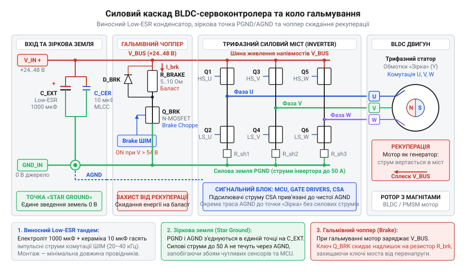
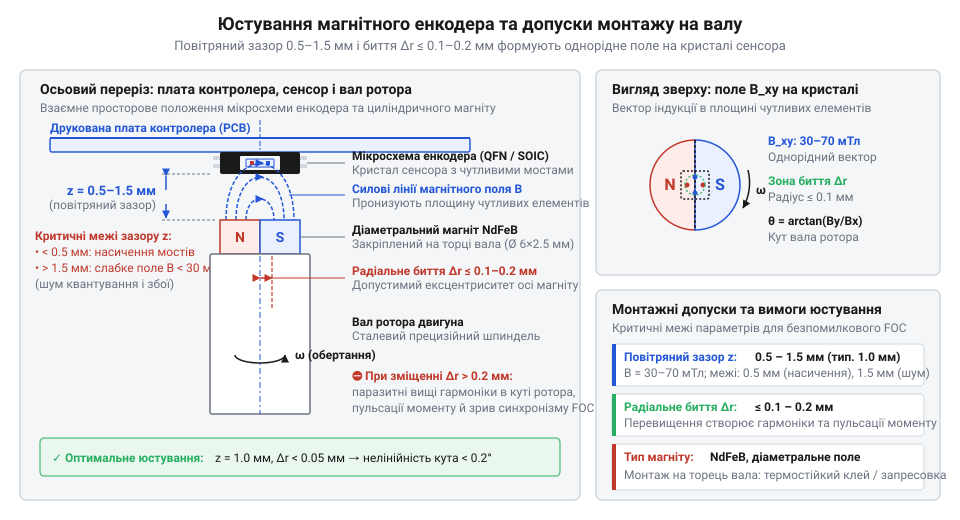

# Залізний інтерфейс, електрична розпіновка та схема підключення інтегрального сервоконтролера

<preknowlist>
- [Tower Pro SG90 — мікросерво 9g](root:cat-hw-actuators/sg90-servo) — класичний трипровідний інтерфейс керування (живлення, спільна земля, імпульсний ШІМ 50 Гц) та його електричні обмеження за струмом і відсутністю зворотного зв'язку
</preknowlist>

## Пастки апаратного підключення інтегрального сервоконтролера

Компактний інтегральний безколекторний привід зовні нагадує [хобійне мікросерво](root:cat-hw-actuators/sg90-servo), проте під'єднання тонкими проводами безпосередньо до джерела живлення веде до аварії під час першого ж тесту. Помилка полягає у змішуванні силових і логічних кіл: усі мінусові дроти зводять в один вузол, плату живлять через довгий шлейф і не ставлять гальмівний баласт.

Коли маніпулятор різко гальмує або реверсує, кінетична енергія перетворює мотор на генератор. Струм рекуперації викидається назад у шину через зворотні діоди інвертора. Імпульсний блок живлення не вміє поглинати зворотний струм, тож напруга стрибає вдвічі й випалює польові транзистори (англ. @@en|MOSFET@@, від @@en|metal-oxide-semiconductor@@ та @@en|field-effect transistor@@).

Під час різкого розгону струм на індуктивності дротів просаджує напругу, викликаючи циклічний перезапуск процесора за зниженням живлення (англ. @@en|Brown-out@@ Reset). Водночас комутаційні струми фаз у десятки ампер створюють спад напруги на спільному мінусі. Цей шум спотворює покази кутового датчика й зриває зв'язок [фізичного рівня шини CAN](root:com-devices/can-bus).

Інтегральний привід поєднує комутацію великої потужності з мікроконтролерною логікою на одній платі. Це вимагає роздільного заземлення, зовнішньої накопичувальної фільтрації та скидання енергії гальмування.

## Шина живлення, фільтрація та поділ земель

Силове живлення подають на клеми `VCC` (або `VIN`) та силову землю `PGND`. Робочий діапазон становить 12–48 В постійного струму за струмів 10–20 А та піках до 40–60 А. Внутрішня схема містить [блокування при зниженні напруги](root:hw-power/uvlo) (англ. @@en|Undervoltage Lockout@@, скорочено @@en|UVLO@@, від англ. @@en|under-@@ — під, @@en|voltage@@ — напруга та @@en|lockout@@ — блокування), яке вимикає ключі нижче 10 В і рятує їх від перегріву в лінійному режимі. Верхній робочий поріг — 54 В, а абсолютний максимум — 60 В.

При комутації фаз струм наростає зі швидкістю `di / dt` у десятки ампер за мікросекунду. Паразитна індуктивність дротів `L` викликає сплески напруги:

```
ΔU
= L · (di / dt)                          [ЕРС самоіндукції на підвідних дротах]
```

За `L = 1 мкГн` та `di / dt = 20 А/мкс` сплеск `ΔU` сягає 20 В. Штатна кераміка на платі має лише кілька мікрофарад і не здатна утримати цей імпульс.

Тому на вході живлення ставлять [конденсатори з низьким ESR](root:hw-components/capacitor-esr-impedance) (англ. @@en|Equivalent Series Resistance@@, скорочено @@en|Low-ESR@@, від лат. @@la|resistere@@ — чинити опір). Це електролітичні чи полімерні накопичувачі на 470–2200 мкФ з опором менше 20–30 мОм, запаяні не далі 20–30 мм від клем контролера. Вони беруть на себе локальний імпульсний струм і гасять коливання. Проте саме це імпульсне навантаження стає головною причиною зносу й перегріву: під час комутації фаз інвертора на частотах ШІМ 20–40 кГц крізь ємність безперервно циркулює високочастотний струм пульсацій (англ. @@en|ripple current@@, від лат. @@la|pulsus@@ — поштовх, удар). Протікаючи крізь еквівалентний послідовний опір `R_ESR`, цей змінний струм розсіює всередині корпусу теплову потужність `P = I_ripple² · R_ESR`. Якщо встановити звичайний електролітичний конденсатор загального призначення, його допустимий струм пульсацій на десятках кілогерців виявиться замалим (зазвичай лише 1–2 А), тоді як реальні комутаційні піки інвертора сягають десятків ампер. Від сильного перегріву рідкий електроліт закипає й поступово випаровується крізь гумовий ущільнювач. Висихання електроліту веде до стрімкого зростання `R_ESR`, що провокує лавиноподібний тепловий розгін (англ. @@en|thermal runaway@@): тиск пари всередині гільзи зростає, спричиняючи здуття алюмінієвого корпусу або вибивання захисної насічки клапана. Здеградований конденсатор втрачає ємність і перестає поглинати сплески `ΔU`, після чого перший же комутаційний викид напруги пробиває силові ключі інвертора. Тому сервоконтролери потребують спеціалізованих високочастотних @@en|Low-ESR@@ конденсаторів із допустимим струмом пульсацій, що перекриває робочі струми приводу, або твердотільних алюмінієво-полімерних елементів, у яких провідний полімер замінює рідкий електроліт і принципово не здатний скипіти чи висохнути.

Для захисту логіки ділять землі. Струми інвертора йдуть через `PGND`, а контролер, сенсор кута й аналогова частина спираються на чисту сигнальну землю `AGND`. Їх з'єднують строго в одній точці — на мінусовій ніжці Low-ESR конденсатора за схемою «зірка», виключаючи протікання силових струмів через чутливі доріжки.

## Трифазні виходи та баластний гальмівний резистор

Силові клеми `U`, `V`, `W` комутують фази мотора. Струми високої частоти вимагають мінімального опору та індуктивності, тому провідники роблять короткими й строго однакової довжини: асиметрія породжує перекіс струмів і шум, а зміна місцями двох будь-яких фаз реверсує базовий напрямок обертання.


*Принципова схема комутації фаз U, V, W, точки зіркового заземлення та чопера розсіювання рекуперації на баласт.*

При різкому сповільненні вала магніти ротора наводять в обмотках проти-ЕРС. Інвертор переходить у генераторний режим: струм рекуперації через зворотні діоди @@en|MOSFET@@ тече назад у шину живлення. Односпрямований блок живлення не здатний прийняти зворотний струм, тому напруга лавиноподібно зростає.

Для захисту ключів використовують [гальмівний чопер](root:hw-power/dynamic-braking-chopper) (англ. @@en|brake chopper@@, від @@en|chop@@ — рубати) — польовий транзистор, який автоматично відкривається при перевищенні порогу напруги (понад 54 В для 48-вольтової системи) і скидає струм на зовнішній баластний резистор. Керує цим ключем швидкодійний аналоговий компаратор (від лат. @@la|comparare@@ — порівнювати), що зіставляє напругу шини живлення з опорним рівнем. Проте простий компаратор з єдиним порогом спрацьовування тут непридатний: щойно напруга сягає 54 В і ключ відкривається, крізь баласт починає текти імпульсний струм у десятки ампер. Через активний опір підвідних ліній та еквівалентний послідовний опір @@en|Low-ESR@@ конденсаторів напруга шини миттєво просідає назад на частки вольта, опускаючись нижче 54 В. Компаратор одразу вимикає транзистор, але без баластного навантаження неперервний струм рекуперації двигуна знову миттєво підкидає напругу вище порогу. Швидке повторення цього циклу породжує високочастотний дзвін (англ. @@en|ringing@@) — хаотичні автоколивання ключа на сотнях кілогерців. У такому режимі різко зростають динамічні втрати перемикання, що спричиняє стрімкий перегрів і тепловий пробій кристала @@en|MOSFET@@, а круті фронти `di / dt` випромінюють потужні електромагнітні завади в чутливі сигнальні кола. Щоб запобігти дзвону, схему компаратора охоплюють позитивним зворотним зв'язком, реалізуючи гістерезис (від грец. @@grc|hysteresis@@ — відставання). Вона розділяє керування на два пороги: верхній поріг увімкнення `U_brake = 54 В` та нижній поріг вимкнення `U_off = 51–52 В`. Ключ відкривається при досягненні верхнього рівня й залишається повністю відкритим доти, доки баластний резистор не розрядить ємність шини нижче нижньої межі. Гістерезисне вікно у 2–3 В усуває високочастотний брязкіт і перетворює розряд на стабільні контрольовані імпульси, гарантуючи розсіювання енергії на зовнішньому радіаторі баласту, а не на транзисторі; водночас надто вузьке вікно (менше за рівень пульсацій інвертора) повертає дзвін, а зашироке — призводить до зайвих коливань напруги живлення всієї системи під час гальмування.

Опір баласту `R_brake` знаходять за напругою відкриття ключа `U_brake` та допустимим піковим струмом чопера `I_max_chopper`:

```
R_brake
= U_brake / I_max_chopper            [закон Ома для кола розряду]
```

Для порогу `U_brake = 54 В` і струму `I_max_chopper = 10 А` опір дорівнює `5.4 Ом`. Резистор обирають на потужність 50–200 Вт і виносять на радіаторі подалі від плати, щоб тепло не перегрівало електроніку.

## Інтерфейси керування, термінування CAN та E-STOP

Для зв'язку контролер використовує диференційну шину CAN (лінії `CANH` і `CANL`), послідовні інтерфейси UART або RS-485, а також дискретні імпульсні входи Step-Dir (англ. @@en|Step-Dir@@, від @@en|step@@ — крок та @@en|direction@@ — напрямок) і ШІМ з рівнями 3.3 В (толерантні до 5 В). Імпульсний вхід дозволяє задавати швидкість подібно до [хобійного сервопривода](root:cat-hw-actuators/sg90-servo).

Шина CAN вимагає строго лінійної топології. На обох протилежних кінцях лінії між `CANH` і `CANL` встановлюють термінальні резистори (від лат. @@la|terminus@@ — межа, кінець) по 120 Ом. Їхнє паралельне з'єднання забезпечує сумарний опір шини 60 Ом, що узгоджує хвильовий опір лінії, поглинає відбиті електромагнітні хвилі й захищає пакети від спотворень.

Для безаварійної зупинки слугує [апаратний вхід аварійної зупинки](root:hw-motion/safe-torque-off-drive-safety-functions) `E-STOP` (або `Enable`). Зупиняти привід програмно через CAN небезпечно: підвисання чи затримка в черзі буфера роблять реакцію повільною. Лінія `E-STOP` діє в обхід процесора, апаратно вимикаючи живлення драйверів затворів інвертора (англ. @@en|hardware gate kill@@).

Коло роблять нормально-замкненим (англ. @@en|fail-safe active-low@@) з підтяжкою до 3.3 В або 5 В. Обрив дроту, знеструмлення чи натискання кнопки безпеки знімає сигнал. Драйвери миттєво переводять виходи інвертора у високоімпедансний стан (англ. @@en|high impedance@@, скорочено @@en|Hi-Z@@, від лат. @@la|impedire@@ — перешкоджати), відключаючи фази й пускаючи ротор у безпечний вільний вибіг.

## Юстування інтегрованого магнітного сенсора вала

Для [векторного керування струмом](root:hw-motion/foc-control) (англ. @@en|Field-Oriented Control@@, скорочено @@en|FOC@@) контролер вимагає точного кута повороту ротора в реальному часі. Безконтактний зворотний зв'язок реалізує мікросхема [кутового магнітного енкодера](root:hw-sensing/hall-magnetic-encoders) (англ. @@en|encoder@@, від @@en|encode@@ — кодувати) на базі елементів Холла або магніторезистивного ефекту (@@en|AMR@@ чи @@en|TMR@@), запаяна на звороті плати строго по осі обертання. Вона зчитує поле постійного циліндричного магніту з діаметральним намагнічуванням (від грец. @@grc|διάμετρος@@ — поперечник), закріпленого на торці вала двигуна.


*Монтажне розміщення магнітного енкодера та діаметрального магніту: повітряний зазор 0.5–1.5 мм і радіальне биття до 0.1–0.2 мм забезпечують неспотворене синусоїдальне поле.*

Вимірювання критично залежить від механічних допусків. Номінальний повітряний зазор між торцем магніту й корпусом мікросхеми становить 0.5–1.5 мм. Зазор менше 0.5 мм викликає магнітне насичення чутливих мостів сенсора, що спотворює синусоїду вимірюваного сигналу. Зазор понад 1.5–2.0 мм послаблює магнітну індукцію нижче робочого порогу (типово 30–70 мТл), різко підвищує шум квантування та спричиняє збої внутрішнього компаратора.

Не менш важливою є співвісність. Радіальний ексцентриситет (від лат. @@la|ex@@ — поза та @@la|centrum@@ — центр) і биття осі магніту відносно центру кристала не повинні перевищувати 0.1–0.2 мм. Зсув вносить у розрахунок кута паразитні вищі гармоніки. В алгоритмі @@en|FOC@@ кутова похибка зсуває вектор струму відносно магнітного поля ротора, через що падає корисний момент, різко зростає струм холостого ходу, мотор починає гудіти та зривається із синхронізму під навантаженням.

## Діагностика апаратних збоїв та граничні режими

Під час пікових динамічних навантажень виявляються приховані апаратні дефекти монтажу. Діагностику проводять за допомогою осцилографа й мультиметра, контролюючи поведінку кіл живлення, фаз і шин зв'язку.

| Симптом | Електрична першопричина | Дія з усунення |
| :--- | :--- | :--- |
| Спонтанний перезапуск процесора під час різкого розгону | Просідання напруги нижче порогу @@en|UVLO@@ через надмірний опір дротів або деградацію @@en|Low-ESR@@ конденсаторів | Скоротити кабелі живлення, збільшити їхній переріз і замінити буферну ємність |
| Спрацьовування @@en|OVLO@@ (англ. @@en|Overvoltage Lockout@@) або пробій ключів при гальмуванні | Обрив у колі гальмівного баласту або пробій транзистора чопера під час рекуперації | Перевірити цілісність баластного резистора та працездатність ключа скидання |
| Помилки кадру CRC, перехід вузла CAN у стан @@en|Error Passive@@ чи @@en|Bus-Off@@ | Електромагнітні наводки від комутації фаз через відсутність екрана чи перекіс термінування | Заземлити екран витої пари на клему `PGND`, перевірити еквівалентний опір лінії 60 Ом |
| Пульсації струму фаз, ривки вала, відсічка @@en|Overcurrent Trip@@ (від @@en|trip@@ — вибивання) | Зміщення магніту сенсора через вібрацію чи тепловий люфт вала двигуна | Відновити співвісність 0.1 мм, зафіксувати магніт термостійким клеєм і перекалібрувати кут |

Для запобігання незворотному руйнуванню параметри приводу тримають у межах гранично допустимих значень (англ. @@en|Absolute Maximum Ratings@@, від лат. @@la|absolutus@@ — безумовний): напруга живлення до 60 В, піковий струм фаз до 60 А, потужність розсіювання баласту до 200 Вт, температура кристалів до 125 °C, а індукція на сенсорі — у межах 30–70 мТл.
