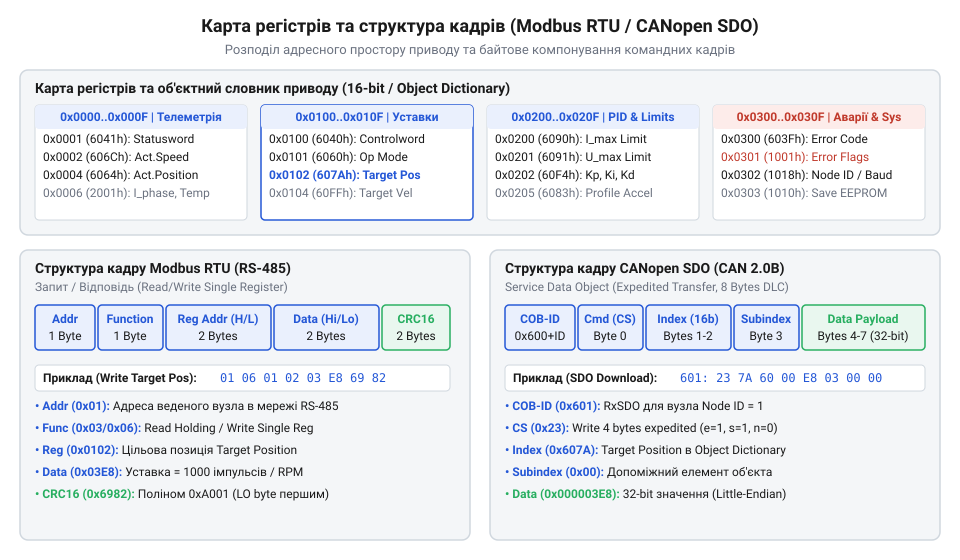
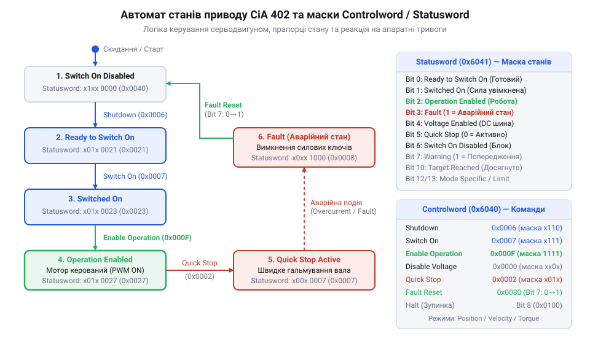

# Протокол керування, карта регістрів та телеметрія BLDC-сервоконтролера

<preknowlist>
- [Сервоприводи радіокерованих моделей: будова, редуктори та ШІМ-керування](root:cat-hw-actuators/rc-servo-mechanisms-and-control) — базові принципи побудови сервоприводів, поняття контуру зворотного зв'язку за положенням та відмінності між аналоговими й цифровими сигналами керування.
</preknowlist>

## Небезпека прямих команд без карти регістрів

В автономній робототехніці та промислових приводах безколекторні мотори прямого або редукторного приводу оперують значними механічними потужностями та струмами у десятки ампер. На відміну від ситуації, де застосовуються [базові радіокеровані сервоприводи](root:cat-hw-actuators/rc-servo-mechanisms-and-control) з простим керуванням аналоговим @@en|ШІМ@@-сигналом (широтно-імпульсна модуляція, від англ. @@en|Pulse-Width Modulation@@), силовий безколекторний сервоконтролер керує трьома фазами обмоток з високою частотою перемикання силових ключів.

Спроба подавати на такий контролер неспрямований або нестандартизований потік послідовних команд «напролом» — наприклад, пряме коригування коефіцієнта заповнення @@en|ШІМ@@ без узгодженого накопичувального регістру — негайно призводить до аварійних ситуацій. При втраті або затримці бодай одного каду в послідовному каналі зв'язку силовий блок втрачає синхронізацію з ротором. Це спричиняє стрибкоподібне зростання фазового струму (@@en|inrush current@@), жорсткі механічні удари в редукторі, пропущені кроки та швидкий вихід з ладу силових транзисторів @@en|MOSFET@@ (від англ. @@en|Metal-Oxide-Semiconductor Field-Effect Transistor@@ — польовий транзистор зі структурою метал-оксид-напівпровідник).

Головна небезпека нерегульованої передачі полягає у відсутності інкапсуляції станів та апаратних обмежень всередині приводу. Коли керівна система надсилає нове значення швидкості чи позиції як сирий потік байтів, вона не має гарантії, що сервопривод знаходиться у готовому до руху стані, що силові ключі ввімкнені, а контур струму відкалібрований. Будь-яка завада на лінії зв'язку перетворюється на хаотичну зміну керуючого сигналу.

Щоб запобігти руйнуванню механіки та електроніки, між зовнішнім контролером (@@en|PLC@@ чи мікроконтролером) і внутрішнім алгоритмом силового моста будується жорстка детермінована пам'ять — @@en|карта регістрів@@ (від англ. @@en|Register Map@@). Замість неконтрольованого виконання вхідного потоку байтів, сервоконтролер зберігає всі параметри, цільові уставки та прапори стану у фіксованих комірках пам'яті. Передачу даних підпорядковують шинному @@en|протоколу обміну@@, який гарантує перевірку цілісності кожного кадру за допомогою контрольних сум та впорядковане читання й запис лише в дозволені ділянки пам'яті.

## Структура карти регістрів та протокольний кадр

Стандартизована карта регістрів BLDC-сервоконтролера ділить увесь адресний простір на три чіткі функціональні зони:
1. **Конфігураційні регістри** — містять енергонезалежні параметри приводу: кількість полюсів мотора, роздільну здатність енкодера, граничні струми, максимальні напруги та коефіцієнти @@en|PID-регуляторів@@ (пропорційно-інтегрально-диференціальний регулятор, від англ. @@en|Proportional-Integral-Derivative@@). Запис сюди здійснюється зазвичай на етапі пусконалагодження або ініціалізації. 2. **Командні регістри** — комірки оперативної пам'яті для оперативної зміни стану приводу та задання траєкторії руху: слово керування @@en|Controlword@@, цільова позиція, цільова швидкість, цільовий момент і селектор активного режиму роботи. 3. **Телеметричні регістри** — комірки лише для зчитування, куди внутрішній мікроконтролер приводу безперервно записує поточний фізичний стан: слово стану @@en|Statusword@@, фактичну позицію енкодера, поточну кутову швидкість, фазові струми, напругу шини живлення та температуру силового модуля.

Для звернення до цієї карти в промислової та мобільної робототехніки найчастіше застосовують два протоколи: @@en|Modbus RTU@@ (від англ. @@en|Modbus Remote Terminal Unit@@ — віддалений термінальний пристрій) через інтерфейс RS-485 та @@en|CANopen@@ (від англ. @@en|Controller Area Network@@ — мережа контролерів) стандарту CiA 301/402.

*Розподіл адресного простору регістрів сервоконтролера та порівняльна структура кадрів протоколів Modbus RTU і CANopen SDO/PDO.*

У протоколі @@en|Modbus RTU@@ кожен кадр містить адресу веденого пристрою (@@en|Slave Address@@), код функції (наприклад, `0x03` для читання або `0x06`/`0x10` для запису), початкову адресу регістру, дані та двохбайтну контрольну суму @@en|CRC16@@ (від англ. @@en|Cyclic Redundancy Check@@ — циклічний надлишковий код). Приймальний вузол перевіряє @@en|CRC16@@, і якщо виявлено спотворення хоча б одного біта, кадр повністю відкидається.

У протоколі @@en|CANopen@@ карта регістрів реалізована через @@en|словник об'єктів@@ (від англ. @@en|Object Dictionary@@), де кожен параметр має 16-бітний індекс та 8-бітний субіндекс. Передача здійснюється за допомогою двох типів повідомлень:
- @@en|SDO@@ (від англ. @@en|Service Data Object@@ — сервісний об'єкт даних): використовується для асинхронного читання та запису конфігураційних регістрів із підтвердженням від приводу. - @@en|PDO@@ (від англ. @@en|Process Data Object@@ — об'єкт технологічних даних): забезпечує високошвидкісну циклічну передачу команд та телеметрії в реальному часі без накладних витрат на адресацію й підтвердження.

Нижче наведено приклад реалізації пакування кадру запису регістру в протоколі @@en|Modbus RTU@@ мовами C та C++:

:::tabs
:::code api-bldc-servo-software-protocol/c/esp-idf/modbus-crc16.c
:::code api-bldc-servo-software-protocol/cpp/stm32/modbusframepacker.cpp
:::

## Режими роботи приводу та командні регістри

Вибір режиму керування визначає, який саме контур регулювання є замкненим усередині сервоконтролера і як мікроконтролер приводу інтерпретує значення командних регістрів. Згідно зі стандартом @@en|CiA 402@@ (стандарт профілю приводів у мережах CANopen), привід підтримує три основних режими роботи, які обираються записом відповідного коду у командний регістр `Modes of Operation` (індекс `0x6060`):

1. **Profile Position Mode (Код 1)** — режим профілювання позиції. Контролер отримує цільову координату енкодера у регістр `Target Position` (`0x607A`). Внутрішній генератор траєкторії автоматично розраховує трапецієподібний або S-подібний профіль швидкості з урахуванням регістрів максимальної швидкості `Profile Velocity` (`0x6081`) та прискорення `Profile Acceleration` (`0x6083`). 2. **Profile Velocity Mode (Код 3)** — режим профілювання швидкості. Контур позиції вимикається. Привід підтримує задану кутову швидкість із регістру `Target Velocity` (`0x60FF`), плавно прискорюючись згідно з налаштованим градієнтом прискорення. 3. **Torque Mode / Current Mode (Код 4)** — режим прямого регулювання моменту (фазового струму). Контури позиції та швидкості розмикаються. Контролер подає струм на обмотки відповідно до заданого значення в регістрі `Target Torque` (`0x6071`), що дозволяє реалізовувати прямий силовий зв'язок (наприклад, у зчіпках робота чи активній підвісці).

Для керування станом приводу в усіх режимах використовується 16-бітний командний регістр @@en|Controlword@@ (індекс `0x6040`). Зміна окремих бітів у цьому регістрі викликає переходи у скінченному автоматі станів сервоконтролера. Для детального вивчення повної діаграми переходів станів та стандартизованих об'єктів керування рухом дивіться матеріал про [профіль приводу CiA 402 та скінченний автомат станів](root:com-devices/cia402-drive-profile).

Основні біти регістру @@en|Controlword@@:
- `Bit 0` (`Switch On`): дозвіл подачі живлення на сипові кола. - `Bit 1` (`Enable Voltage`): активація внутрішнього перетворювача напруги. - `Bit 2` (`Quick Stop`): команда екстреного гальмування при активному низькому рівні. - `Bit 3` (`Enable Operation`): дозвіл роботи сипових ключах MOSFET та подачі струму на мотори. - `Bit 4` (`New Setpoint`): у режимі позиціонування підтверджує прийому нової цільової точки. - `Bit 5` (`Change Setpoint Immediately`): негайне перемикання на нове значення позиції без чекання завершення попереднього маневру. - `Bit 6` (`Absolute / Relative`): прапор задання позиції (0 — абсолютна координата, 1 — відносне зміщення).

Нижче показано приклад C та C++ коду для перемикання режиму роботи приводу на профілювання позиції та запуску руху:

:::tabs
:::code api-bldc-servo-software-protocol/c/esp-idf/configure-position-movement.c
:::code api-bldc-servo-software-protocol/cpp/stm32/drivemode.cpp
:::

## Параметри PID-регуляторів та ліміти захисту

Стабільність, точність та динамічний відгук безколекторного сервоприводу визначаються якістю налаштування його внутрішніх контурів зворотного зв'язку. У сучасних BLDC-контролерах застосовується каскадна схема з трьох послідовних @@en|PID-регуляторів@@:

1. **Внутрішній контур струму (моменту)** — найшвидший контур (частота оновлення 10–20 кГц). Він регулює фазові струми мотора за допомогою векторного керування. Параметри регістрів:
   - `0x2001`: Proportional Gain Current (`Kp_q`, `Kp_d`)
   - `0x2002`: Integral Gain Current (`Ki_q`, `Ki_d`)
2. **Середній контур швидкості** — регулює частоту обертання ротора (частота оновлення 1–5 кГц). Параметри регістрів:
   - `0x60F9` Sub 1: Velocity Loop Proportional Gain (`Kp_v`)
   - `0x60F9` Sub 2: Velocity Loop Integral Gain (`Ki_v`)
3. **Зовнішній контур позиції** — розраховує необхідну швидкість для досягнення цільової координати (частота оновлення 1 кГц). Параметри регістрів:
   - `0x60FB` Sub 1: Position Loop Proportional Gain (`Kp_p`)
   - `0x60FB` Sub 2: Position Loop Derivative Gain (`Kd_p`)

Окрім коефіцієнтів підсилення, критично важливе значення мають **регістри апаратного обмеження**. Вони формують «захисний кокон» навколо механічної та електричної частини приводу:
- `0x6073` (`Max Current`) — гранично допустимий фазовий струм мотора у міліамперах або десятих частках від номінального. При досягненні цього ліміту контролер обмежує вихідну напругу, запобігаючи розмагнічуванню ротора та вигоранню обмоток. - `0x6072` (`Max Torque`) — максимальний крутний момент, який дозволено розвивати приводу для захисту зубчастої передачі від зрізання зубів. - `0x2015` (`Overvoltage Threshold`) — поріг спрацьовування захисту від перенапруги на шині живлення. При генеративному гальмуванні мотор повертає енергію в шину; якщо напруга перевищує цей регістр, вмикається гальмівний баластний резистор або привід іде в аварію. - `0x2016` (`Undervoltage Threshold`) — поріг мінімальної напруги, нижче якого силові ключі вимикаються для захисту акумулятора від глибокого розряду.

Некоректне значення коефіцієнтів PID може викликати високочастотний автоколивальний процес (зуммерний гул мотора) або значний перерегульований ривок, який здатний вивести з ладу редуктор чи підшипникові вузли. Захисні регістри лімітів діють незалежно від бажань зовні і завжди мають вищий пріоритет над записаними цільовими уставками. Для поглибленого розуміння математичного апарату перетворень Кларк і Парка та принципу прямого регулювання моменту фаз перегляньте статтю про [векторне керування (FOC) безколекторними моторами](root:hw-motion/foc-control).

## Потік телеметрії та зчитування стану

Під час виконання руху внутрішній мікроконтролер сервоприводу вимірює фізичні величини з високою дискретністю та записує їх у телеметричні регістри карти. Зчитування цього потоку дозволяє зовнішній системі аналізувати стан приводу в режимі реального часу.

До базового масиву телеметричних регістрів належать:
- `0x6064` (`Position Actual Value`): 32-бітне ціле число зі знаком, що відображає поточну позицію валу в імпульсах енкодера (counts). - `0x606C` (`Velocity Actual Value`): 32-бітне ціле число зі знаком, поточна кутова швидкість (об/хв або counts/s). - `0x6077` (`Torque Actual Value`): 16-бітне ціле число зі знаком, поточний момент або фазовий струм у проміле від номінального. - `0x2010` (`DC Bus Voltage`): 16-бітне ціле число без знаку, напруга шини живлення в мілівольтах (мВ). - `0x2011` / `0x2012` (`Phase A/B Current`): миттєві фазові струми мотора в міліамперах (мА). - `0x2020` (`Power Stage Temperature`): 16-бітне ціле число зі знаком, температура силових ключових транзисторів у десятих частках градуса Цельсія (0.1 °C).

Організація зчитування даних залежить від обраного шинного протоколу:
- У протоколі @@en|Modbus RTU@@ застосовують модель опитування (@@en|Polling@@). Майстер-контролер регулярно надсилає кадри читання групи регістрів (код функції `0x03`). Частота оновлення обмежена швидкістю шини RS-485 і становить зазвичай від 20 до 100 Гц. - У протоколі @@en|CANopen@@ застосовують механізм циклічних каскадів @@en|PDO@@. Привід самостійно транслює в шину кадри телеметрії (наприклад, `TPDO1` зі словом стану та позицією, `TPDO2` зі швидкістю та струмом) без очікування запитів від управляючої системи. Це знижує накладні витрати шини до нуля і дає змогу отримувати телеметрію з частотою до 1 кГц.

Нижче наведено приклад коду для розбору телеметричного каду та конвертації сирих регістрових значень у фізичні одиниці SI:

:::tabs
:::code api-bldc-servo-software-protocol/c/esp-idf/parse-telemetry-packet.c
:::code api-bldc-servo-software-protocol/cpp/stm32/physicaltelemetry.cpp
:::

## Декодування статусів та обробка аварій

Надійність роботи сервосистеми забезпечується постійним аналізом 16-бітного статусного регістру @@en|Statusword@@ (індекс `0x6041`) та регістру апаратних тривог `Fault Code` або `Error Register` (`0x1001` / `0x603F`). 

Слово стану @@en|Statusword@@ відображає поточний фазовий стан внутрішнього скінченного автомата приводу стандарту CiA 402:

*Скінченний автомат станів CiA 402 та маска бітів Statusword для розпізнавання апаратних тривог.*

Ключові біти регістру @@en|Statusword@@:
- `Bit 0` (`Ready to Switch On`): привід завершив внутрішню самодіагностику і готовий до подачі живлення. - `Bit 1` (`Switched On`): силове живлення підведено до силового каскаду. - `Bit 2` (`Operation Enabled`): привід активний, мости MOSFET згенерирували поле, мотор утримує або рухає вал. - `Bit 3` (`Fault`): прапор критичної помилки. Якщо цей біт дорівнює `1`, силові ключі негайно розмикаються, а привід переходить у стан аварійного вимкнення. - `Bit 7` (`Warning`): попереджувальний біт (наприклад, температура MOSFET наблизилася до граничної, але ще не перевищила її). - `Bit 10` (`Target Reached`): підтвердження досягнення цільової позиції або швидкості.

При виникненні прапора `Fault` (`Bit 3 = 1`) управляюча система повинна прочитати регістр апаратних тривог (`Error Register`), який розкриває причинний фактор аварії за допомогою бітової маски:
- `Bit 0` (`Overcurrent`): перевищення максимуму фазового струму (коротке замикання або заклинювання механіки). - `Bit 1` (`Overvoltage`): перенапруга на шині живлення через інтенсивне рекуперативне гальмування. - `Bit 2` (`Undervoltage`): просідання напруги джерела живлення під навантаженням. - `Bit 3` (`Overtemperature`): перегрів силових ключів MOSFET понад 85 °C. - `Bit 4` (`Encoder Error`): збій зчитування датчика положення (втрата сигналів A/B або HALL-датчиків). - `Bit 5` (`Following Error`): неузгодженість між заданою траєкторією та фактичною позицією перевищила допустимий допуск.

**Алгоритм реакції та виходу з аварійного стану:**
1. Управляюча система фіксує біт `Fault` у регістрі @@en|Statusword@@ та припиняє відправку нових цільових уставок руху. 2. Зчитується регістр тривог для виявлення джерела збою. 3. Причину аварії усувають (наприклад, знімають механічне блокування валу або чекають охолодження MOSFET). 4. У регістр @@en|Controlword@@ надсилається біт `Fault Reset` (перехід `Bit 7` з 0 у 1), що скидає аварійний прапор і повертає скінченний автомат у стан `Switch On Disabled`. 5. Послідовно надсилаються команди ініціалізації для відновлення режиму `Operation Enabled`.

Нижче наведено приклад обробника аварійних статусів та функції скидання помилки мовами C та C++:

:::tabs
:::code api-bldc-servo-software-protocol/c/esp-idf/check-drive-fault.c
:::code api-bldc-servo-software-protocol/cpp/stm32/drivestatus.cpp
:::