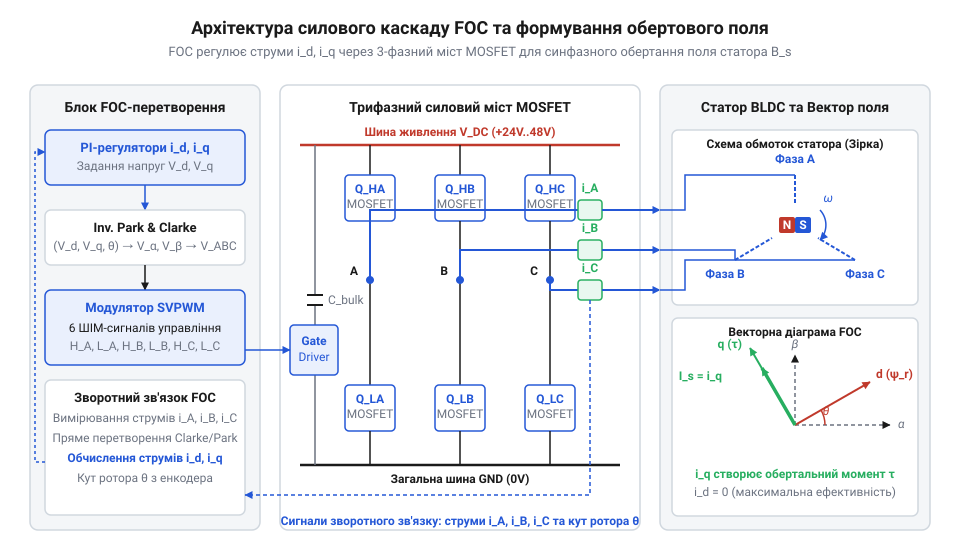
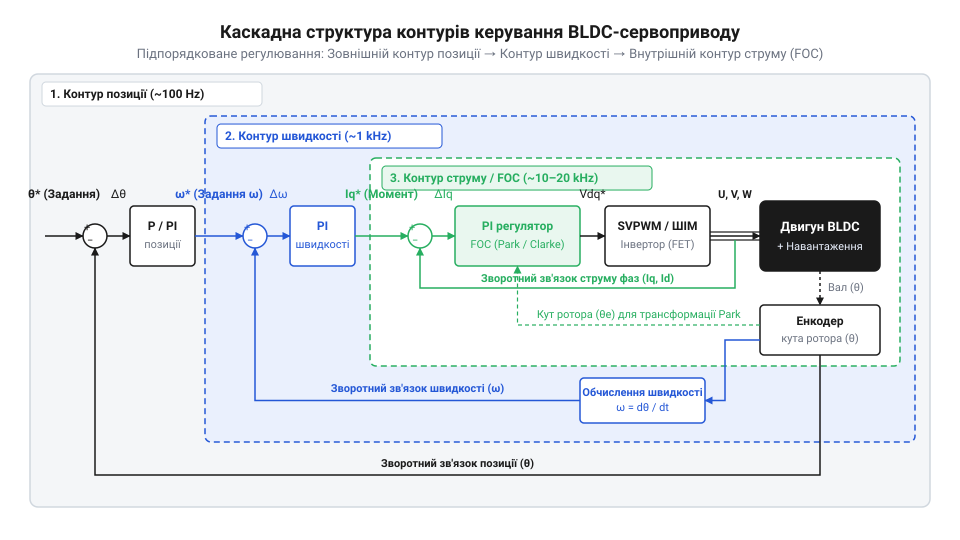
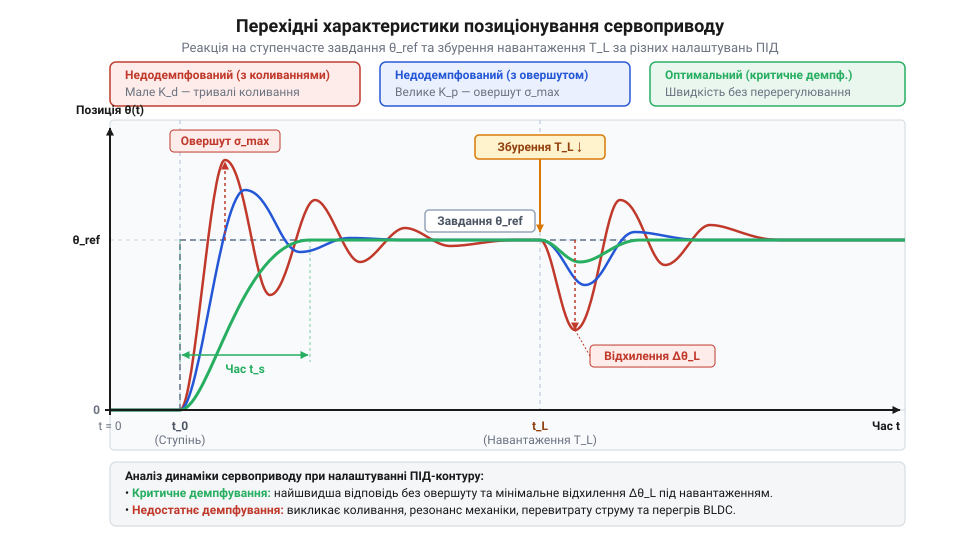
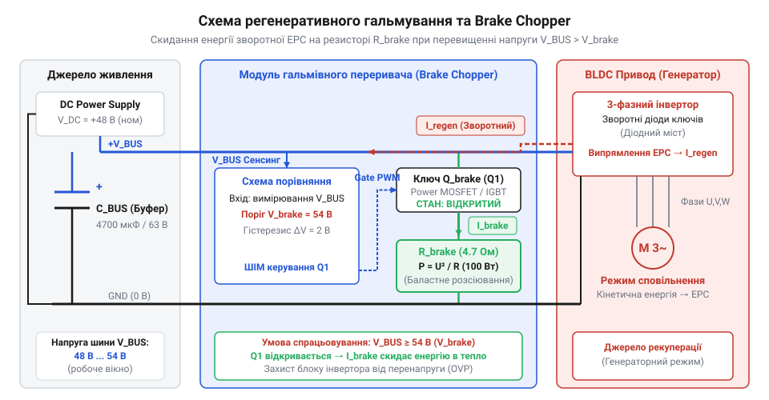
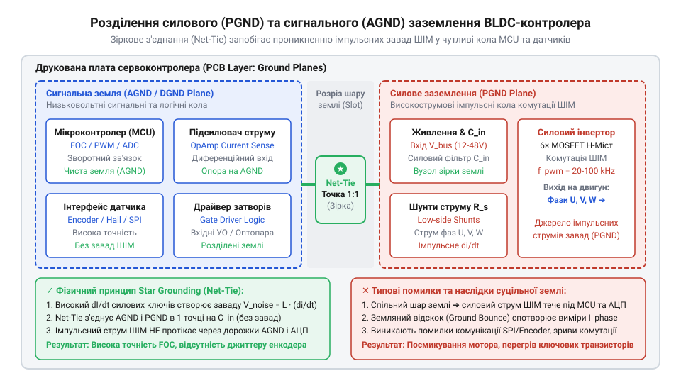
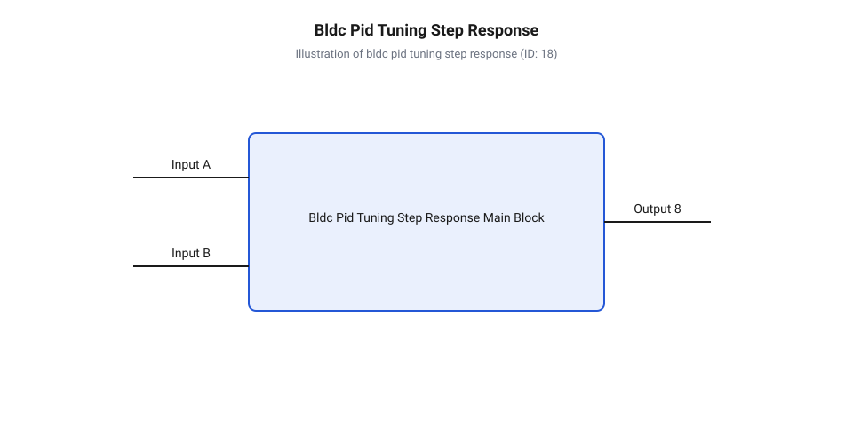

# Безколекторні інтегральні сервоконтролери

<preknowlist>
- [Сервоприводи радіокерованих моделей: будова, редуктори та ШІМ-керування](root:cat-hw-actuators/rc-servo-mechanisms-and-control) — базові принципи побудови замкненого контуру позиціонування, роботу редуктора та стандартне ШІМ-керування сервоприводами
</preknowlist>

## Обмеження колекторних приводів у точній динаміці

У високодинамічних робототехнічних суглобах, маніпуляторах та підвісах оптичних систем перед сервоприводом стоїть жорстка вимога: утримувати задане кутове положення з точністю до часток градуса під дією змінних зовнішніх навантажень, миттєво відпрацьовуючи зміну траєкторії без перерегулювання та мікровібрацій. На практиці спроба застосувати класичні колекторні серводвигуни постійного струму (від англ. @@en|direct current@@ — постійний струм, @@en|DC@@) у таких умовах швидко впирається в принципові фізичні обмеження їхньої конструкції.

Головне джерело проблем колекторного двигуна полягає у наявності механічного колекторно-щіткового вузла. Щітки фізично ковзають по мідних ламелях ротора, перемикаючи напрямок струму в обмотках під час обертання. Цей механічний контакт викликає неперервний знос, іскріння та утворення струмопровідного пилу. Проте для точної динаміки набагато критичнішим є явище пульсації обертального моменту (від англ. @@en|torque ripple@@ — пульсація моменту). У момент, коли щітка переходить з однієї ламелі на іншу, відбувається дискретний стрибок векторного напрямку магнітного поля ротора. Внаслідок цього створюваний момент не є стабільним, а коливається у часі з частотою, пропорційною швидкості обертання та кількості секцій колектора.

Ці мікропульсації моменту безпосередньо передаються на вихідний вал. Недоліки, властиві [стандартним аматорським сервоприводам](root:cat-hw-actuators/rc-servo-mechanisms-and-control), не дозволяють компенсувати такі обурення лише за рахунок обраного контуру зворотного зв'язку. Навіть у [версіях із металевим редуктором](root:cat-hw-actuators/mg90s-servo) виникає додатковий люфт та пружна деформація зупчастих передач, що в поєднанні з пульсаціями моменту викликає автоколивання (паразитний @@en|hunting@@) навколо точки зупинки. Намагання підвищити пропорційний коефіцієнт підсилення регулятора для підвищення статичної жорсткості призводить до втрати стійкості системи та високочастотного тремтіння суглоба.

Другим критичним бар'єром є теплова інерція та динамічні характеристики ротора. У колекторному двигуні обмотки якоря розташовані безпосередньо на рухомому роторі. Під час проходження високих струмів під навантаженням тепло виділяється всередині замкненого об'єму двигуна і може відводитися лише через повітряний зазор та вал. Це спричиняє швидкий перегрів якоря, деградацію ізоляції та ризик розмагнічування постійних магнітів статора. Крім того, важкий мідно-залізний якорь має високий власний момент інерції, що різко обмежує максимальне кутове прискорення приводу.

Нарешті, зворотною стороною високого передавального числа редукторів, якими змушені комплектувати колекторні мотори для отримання достатнього моменту, є низька динамічна жорсткість приводу. Зовнішній удар чи раптове зусилля на суглоб не можуть бути миттєво відпрацьовані контуром керування через високу механічну інерцію та електричну сталу часу обмоток. Історично розробники намагалися компенсувати ці недоліки електронною комутацією. Детальніше еволюційний шлях від шестикрокової комутації до векторного керування розкрито в [огляді еволюції алгоритмів](root:cat-hw-actuators/bldc-servo-controller/hist-bldc-servo-evolution.md), де показано неминучість відмови від механічного колектора.

Таким чином, для забезпечення безкомпромісної плавності ходу, високого ККД, нульового люфту та високої динамічної жорсткості необхідний принципово інший підхід — перенесення силових обмоток на нерухомий статор, використання легкого ротора з потужними постійними магнітами та перехід до безколекторних моторів із цифровим векторним керуванням.

## Архітектура силового каскаду та векторного керування

Перехід до безколекторного двигуна постійного струму (від англ. @@en|brushless direct current@@ — безколекторний постійного струму, @@en|BLDC@@) докорінно змінює фізику формування обертального моменту. У @@en|BLDC@@-моторі обмотки трьох фаз розташовані на нерухомому статорі, а ротор містить постійні магніти. Як показано в [матеріалі про будову моторів](root:hw-motion/bldc-motor), статорні обмотки створюють у повітряному зазорі результуючий вектор магнітного поля, за яким слідує ротор. Оскільки механічного колектора більше немає, завдання комутації струмів у трьох фазах повністю покладається на силовий інвертор та цифровий сервоконтролер.

Силовий каскад сервоконтролера є трифазним містком (від англ. @@en|inverter@@ — силовий перетворювач), побудованим на шести силових польових транзисторах типу @@en|MOSFET@@ (від англ. @@en|metal-oxide-semiconductor field-effect transistor@@) або сучасних нітрид-галієвих ключах @@en|GaN@@ (від англ. @@en|gallium nitride@@). Транзистори згруповано у три паралельні стійки (напівмости), кожна з яких керує однією зі статорних фаз `U`, `V`, `W`. Керування воротами транзисторів здійснюється спеціалізованими драйверами затворів (від англ. @@en|gate driver@@ — керуючий каскад), які формують високочастотні широтні імпульси (від англ. @@en|pulse-width modulation@@ — широтно-імпульсна модуляція, @@en|PWM@@) та обов'язково вводять захисний паузовий інтервал (від англ. @@en|dead time@@ — мертвий час силового ключа), щоб запобігти наскрізному короткому замиканню силової шини живлення. Фізичну інтеграцію ключів детальніше розглянуто у [профільному огляді драйверів](root:hw-motion/three-phase-bridge-gate-drivers-and-inverters), де описано заходи боротьби з паразитною індуктивністю.


*Принципова схема силового трифазного інвертора та інтегрованого блоку векторного керування FOC.*

Для досягнення максимального ККД та абсолютної плавності обертання контролер застосовує орієнтоване на поле векторне керування (від англ. @@en|field-oriented control@@, @@en|FOC@@). Фізична сутність @@en|FOC@@ полягає у тому, щоб неперервно підтримувати кут між вектором магнітного поля статора та вектором магнітного поля ротора рівним точно 90 електричним градусам. Саме за такого кута Амперова сила є максимальною, а весь споживаний струм перетворюється на корисний обертальний момент без даремного радіального стискання підшипників.

Звичайне трапецеїдальне перемикання фаз за датчиками Холла створює вектор поля статора, що стрибає на 60 градусів кожні шість кроків, викликаючи пульсацію моменту амплітудою до 13.4%. На противагу цьому, @@en|FOC@@ формує чисто синусоїдальні струми у фазах статора. Для цього поточний кут ротора `θₑ` неперервно зчитується з [високоточних магнітних енкодерів](root:hw-sensing/absolute-encoder-gray-code), що забезпечують роздільну здатність у 14–19 біт на один оберт.

Математичне ядро @@en|FOC@@ базується на двох послідовних координатних перетвореннях — Кларк та Парка (від англ. @@en|Clarke transformation@@ та @@en|Park transformation@@). Сервоконтролер вимірює миттєві фазові струми `I_a` та `I_b` за допомогою вимірювальних шунтів (третій струм обчислюється як `I_c = -I_a - I_b`).

Спочатку перетворення Кларк переводить трифазну систему координат `a, b, c` (із вісями під кутом 120 градусів) у двофазну стаціонарну ортогональну систему `α, β` (із вісями під кутом 90 градусів):

```
I_α = I_a
I_β = (I_a + 2 × I_b) ÷ √3
```

Після цього перетворення Парка повертає стаціонарну систему `α, β` на електричний кут ротора `θₑ`, переходячи в обертову систему координат `d, q`, що рухається синхронно з магнітним полем ротора:

```
I_d = I_α × cos(θₑ) + I_β × sin(θₑ)
I_q = -I_α × sin(θₑ) + I_β × cos(θₑ)
```

Фізичний зміст отриманих величин `I_d` та `I_q` є фундаментальним для векторного керування:
1. Складова `I_d` (від англ. @@en|direct axis@@ — поздовжня вісь) спрямована вздовж магнітних полюсів ротора. Вона створює радіальне магнітне поле, яке намагається притягнути або відштовхнути ротор вздовж радіуса, не створюючи жодного корисного обертального моменту. У стандартному режимі контролер примусово регулює `I_d = 0`. 2. Складова `I_q` (від англ. @@en|quadrature axis@@ — поперечна вісь) спрямована строго перпендикулярно до магнітів ротора (під кутом 90 градусів). Вона створює чисто тангенціальну силу і є прямо пропорційною електромагнітному моменту `T_e`:

```
T_e = 1.5 × p × λ_m × I_q
```

де `p` — кількість пар полюсів ротора, а `λ_m` — зчеплений магнітний потік постійних магнітів ротора.

Завдяки цьому складному математичному апарату контролер розділяє трифазний векторний привод на дві незалежні лінійні величини, перетворюючи @@en|BLDC@@-двигун за простотою керування на ідеальний двигун постійного струму з незалежним збудженням. Детальніше строге математичне виведення наведено в [матеріалі про векторні перетворення](root:cat-hw-actuators/bldc-servo-controller/math-foc-transformations-cascades.md), де деталізовано також зворотні матриці.

Отримані значення `I_d` та `I_q` надходять на два незалежні пропорційно-інтегральні (ПІ) регулятори струму. На виході ПІ-регуляторів формуються потрібні напруги `U_d` та `U_q`, які за допомогою зворотного перетворення Парка переводяться назад у стаціонарні напруги `U_α` та `U_β`. Нарешті, блок просторово-векторної широтно-імпульсної модуляції (від англ. @@en|space vector pulse width modulation@@, @@en|SVPWM@@) обчислює тривалості відкриття шести @@en|MOSFET@@-ключів силового мосту. Алгоритм @@en|SVPWM@@ детальніше описано у [розділі про векторну модуляцію](root:hw-analog/space-vector-pulse-width-modulation-svpwm), яка визначає оптимальне використання напруги шини живлення.

Нижче наведено практичну реалізацію базового алгоритму @@en|FOC@@-обчислення струмового контуру для вбудованих мікроконтролерів сервоприводів.

:::tabs
@tab C
:::code bldc-servo-controller-d/c/pi-update.c
@tab C++
:::code bldc-servo-controller-d/cpp/picontroller.cpp
:::

Завдяки неперервному виконанню цього обчислювального циклу з частотою від 10 до 40 кГц, інтегральний сервоконтролер усуває пульсації моменту, підтримує максимальний момент на одиницю струму (від англ. @@en|maximum torque per ampere@@, @@en|MTPA@@) та забезпечує виняткову плавність руху навіть при обертанні зі швидкістю у частки оберту за секунду.

## Зворотний зв'язок та каскадне регулювання

Для перетворення розрахованих у попередньому розділі векторних струмів `I_d` та `I_q` на реальний механічний рух контролеру необхідне безперервне та прецизійне знання поточного положення ротора. Якщо у класичному колекторному двигуні перемикання фаз здійснюється механічно за допомогою ламелей, то у безколекторному приводі будь-яка розсинхронізація між електричним кутом статорного поля `θₑ` та механічним кутом ротора `θ_m` призводить до миттєвого падіння обертального моменту або навіть до повного зриву комутації. Роль «електронного колектора» виконують [високороздільні абсолютні енкодери](root:hw-sensing/absolute-encoder-gray-code) (від англійського *encode* — кодувати, @@en|rotary encoder@@ — датчик кутового переміщення, @@en|encoder@@), які вимірюють кут з точністю до часток кутової мінути.

У сучасних серводвигунах застосовують магнітні енкодери на основі ефекту Холла або датчиків анізотропного магнітоопору (від англ. @@en|anisotropic magnetoresistance@@, @@en|AMR@@), а також високоточні оптичні енкодери зі скляними дисками. Електричний кут `θₑ` розраховується через механічний кут `θ_m` та кількість пар полюсів ротора `p`:

```
θₑ = p × θ_m
```

Висока роздільна здатність енкодера (від 14 до 19 біт на оберт, тобто від 16384 до 524288 імпульсів) є критичною не лише для визначення позиції, а й для цифрового обчислення швидкості шляхом диференціювання кута за часом без виникнення високочастотного шуму (паразитного @@en|jitter@@ — тремтіння сигналу).

Отримавши точний сигнал зворотного зв'язку, сервоконтролер будує ієрархічну систему керування — трьохзамкнений каскад (від італійського *cascata* — водоспад, що спадає ступенями, @@en|cascaded control loop@@ — послідовно вкладені контури регулювання). У цій системі кожен зовнішній контур формує завдання для внутрішнього, забезпечуючи послідовний контроль струму, швидкості та позиції.


*Функціональна блок-схема трьохзамкненого каскадного регулятора з контурами струму, швидкості та позиції.*

Ієрархія контурів побудована за принципом чіткого розділення частотного діапазону (від англ. @@en|bandwidth@@ — смуга пропускання):
1. **Внутрішній контур струму (моменту)**. Виконується найчастіше — з частотою модуляції ШІМ (від 10 до 40 кГц, період оновлення 25–100 мкс). Він приймає завдання по струму `I_q_target` та регулює реальні фазові струми за допомогою ПІ-алгоритму. Його смуга пропускання є найширшою і сягає 1500–2500 Гц. 2. **Проміжний контур швидкості**. Виконується з помірною частотою (1–5 кГц). Він порівнює задану кутову швидкість `ω_target` із виміряною `ω_measured`. Виходом цього контуру є сформоване значення цільового моменту (струму `I_q_target`). Смуга пропускання контуру швидкості становить 100–200 Гц. 3. **Зовнішній контур позиції**. Виконується з частотою 500–1000 Гц. Він обчислює неузгодженість між заданим кутом `θ_target` та поточним `θ_measured` і формує завдання по швидкості `ω_target`. Смуга пропускання є найвужчою — від 20 до 50 Гц.

Правило ієрархії вимагає, щоб кожна внутрішня ланка була щонайменше у 5–10 разів швидшою за зовнішню. Якби контур позиції намагався відреагувати з тією ж частотою, що й контур струму, механічна інерція ротора спричинила б зсув фази, викликаючи самозбудження та руйнівну вібрацію приводу. Детальний матричний вивід рівнянь стану для каскадних систем міститься у [математичному описі FOC-перетворень](root:cat-hw-actuators/bldc-servo-controller/math-foc-transformations-cascades.md).

Саме завдяки каскадній структурі BLDC-сервопривод володіє винятковою динамічною жорсткістю та здатністю утримувати вал під навантаженням (від англ. @@en|holding torque@@ — утримувальний момент). Розглянемо фізичний механізм: коли до нерухомого вала раптово прикладається зовнішній збурювальний момент `T_ext`, вал відхиляється на мікроскопічний кут `Δθ`. Контур позиції негайно формує сплеск цільової швидкості `ω_target = K_p_p × Δθ`. Контур швидкості миттєво бачить, що фактична швидкість дорівнює нулю, і видає максимальне завдання по струму `I_q_target`. За лічені мікросекунди контур струму накачує у статорні обмотки струм, який створює відновлювальний момент `T_e`, тотожний за величиною і протилежний за напрямком до `T_ext`.

Взаємодія з вищим рівнем автоматизації та передача телеметрії про струми й позиції здійснюється через промислові шини. Карта регістрів та телеметричні параметри описані у [програмному інтерфейсі сервоконтролера](root:cat-hw-actuators/bldc-servo-controller/api-bldc-servo-software-protocol.md), а специфіку побудови мережевих профілів руху викладено в [огляді CiA 402](root:com-devices/canopen-cia402-drive-motion-control-profile).

Якість роботи каскаду регулювання визначається якістю налаштування коефіцієнтів ПІД-регуляторів (від англ. @@en|proportional-integral-derivative controller@@, @@en|PID@@). Реакція приводу на стрибок заданої позиції суттєво залежить від балансу між пропорційним підсиленням та коефіцієнтом демпфування.


*Часові графіки перехідного процесу позиціонування сервоприводу для трьох випадків налаштування ПІД-коефіцієнтів: недодемпфованого з овершутом, недодемпфованого з коливаннями та оптимального з критичним демпфуванням.*

При занадто високих коефіцієнтах пропорційного підсилення `K_p` виникає недодемпфований режим із високим перерегулюванням (від англ. @@en|overshoot@@ — величина проскоку цілі) та довготривалими затухаючими коливаннями. Натомість надмірне інтегральне підсилення `K_i` без алгоритмів обмеження насичення (від англ. @@en|anti-windup@@ — захист від накопичення помилки в інтеграторі) призводить до автоколивань. Оптимальним є стан критичного демпфування, коли позиція виходить на заданий рівень за найкоротший час без жодного проскоку. Практичну інтеграцію такого регулятора розглянуто на прикладі розробки [роботизованого суглоба](root:cat-hw-actuators/bldc-servo-controller/proj-robotic-articulated-joint.md).

Нижче наведено практичну реалізацію трьохзамкненого каскаду регулювання з обмеженням струму та захистом від інтегрального насичення.

:::tabs
@tab C
:::code bldc-servo-controller-d/c/cascade-update.c

@tab C++
:::code bldc-servo-controller-d/cpp/cascadecontroller.cpp
:::

## Захист від регенерації та тепловий баланс

Під час активного уповільнення, гальмування чи реверсу роботизованого суглоба кінетична енергія ротора та підключеного механічного навантаження `E_kin` має кудись подітися:

```
E_kin = 0.5 × J × ω²
```

де `J` — загальний момент інерції, а `ω` — кутова швидкість. У цей момент BLDC-двигун переходить у генераторний режим. Створена роторними магнітами зворотна електрорушійна сила (від англ. @@en|back electromotive force@@ — зворотна ЕРС, @@en|back EMF@@) перевищує миттєву напругу силової шини. Через вбудовані зворотні діоди MOSFET-транзисторів або шляхом активного синхронного випрямлення регенеративний струм спрямовується назад у лінію постійного струму (від англ. @@en|direct current bus@@ — DC-шина живлення, @@en|DC bus@@).

Оскільки більшість імпульсних джерел живлення є однонаправленими й не здатні поглинати зворотний струм, повернутий електричний заряд накопичується на конденсаторах шини. Це викликає стрімкий стрибок напруги `ΔU`:

```
ΔU = √((U_0)² + (2 × E_regen) ÷ C_bus) - U_0
```

де `U_0` — початкова напруга шини, `E_regen` — повернута енергія гальмування з урахуванням ККД, а `C_bus` — ємність конденсаторного буфера. Якщо сплеск напруги перевищить граничне значення пробою силових транзисторів `V_DS_max`, вихідний каскад інвертора миттєво виходить з ладу.

Для захисту силової частини застосовується спеціалізована схема гасіння регенеративної енергії — гальмівний переривач (від англ. @@en|brake chopper@@ — ключ гальмівного резистора) у поєднанні з конденсаторною батареєю.


*Принципова схема ланцюга регенеративного гальмування з силовою шиною, конденсаторною батареєю, ключем Brake Chopper та розсіювальним резистором.*

Принцип дії гальмівного переривача полягає в неперервному моніторингу напруги DC-шини компаратором контролера. Коли напруга зростає вище безпечного порогу `U_brake` (наприклад, 56 В для 48-вольтової системи), компаратор відкриває потужний силовий транзистор `Q_chopper`, який підключає паралельно шині високопотужний керамічний або дротовий гальмівний резистор `R_brake`. Регенеративна енергія скидається у вигляді тепла:

```
P_brake = (U_bus)² ÷ R_brake
```

Щойно напруга падає нижче гістерезисного порогу, ключ закривається. Конденсаторна батарея шини при цьому відіграє роль високочастотного буфера: вона поглинає короткі піки струму під час «мертвого часу» перемикання ключів. Для мінімізації власного нагріву конденсатори повинні мати низький еквівалентний послідовний опір (від англ. @@en|equivalent series resistance@@, @@en|ESR@@). Розрахунок параметрів гальмівного резистора та ємності шини наведено у [математичному розділі енергетики гальмування](root:cat-hw-actuators/bldc-servo-controller/math-regenerative-braking-thermal.md). У малогабаритних пристроях, таких як [безредукторний підвіс камери](root:cat-hw-actuators/bldc-servo-controller/proj-camera-gimbal-stabilizer), замість громіздких резисторів застосовують обмежувачі напруги та оптимізований розподіл ємностей.

Крім зовнішніх гальмівних сплесків, силовий інвертор піддається постійному внутрішньому нагріву. Загальні теплові втрати в транзисторах складаються з трьох основних компонентів:
1. **Втрати провідності (статичні)**. Викликані виділенням тепла на відкритому каналі ключа `R_ds(on)`:

```
P_cond = 3 × (I_rms)² × R_ds(on)
```

Оскільки `R_ds(on)` зростає при підвищенні температури кристала, статичні втрати мають позитивний температурний коефіцієнт. 2. **Втрати перемикання (динамічні)**. Виникають під час фронтів відкриття та закриття транзисторів, коли через ключ одночасно протікає струм і прикладена напруга:

```
P_sw = 1.5 × U_bus × I_rms × (t_rise + t_fall) × f_pwm
```

вони прямо пропорційні частоті ШІМ `f_pwm`.
3. **Втрати у драйверах та зворотних діодах**.

Загальна теплова потужність `P_total = P_cond + P_sw` повинна ефективно відводитися через друковану плату та радіатор. Температура кристала транзистора `T_j` розраховується через сумарний термічний опір (від англ. @@en|thermal resistance@@ — термічний опір, @@en|R_th@@):

```
T_j = T_amb + P_total × (R_th_jc + R_th_cs + R_th_sa)
```

де `T_amb` — температура довкілля, `R_th_jc` — опір «кристал-корпус», `R_th_cs` — опір «корпус-радіатор», а `R_th_sa` — опір «радіатор-середовище». Питання компонування друкованої плати та підключення радіаторів викладено в [довіднику апаратних інтерфейсів](root:cat-hw-actuators/bldc-servo-controller/api-bldc-servo-hardware-interface.md), а топологічні особливості драйверів розкрито у [розділі про трифазні інвертори](root:hw-motion/three-phase-bridge-gate-drivers-and-inverters).

Для запобігання фатальним аваріям інтегральний сервоконтролер оснащується апаратно-програмною системою діагностики, яка в режимі реального часу відстежує такі критичні стани:
- **Перенапруга (@@en|overvoltage@@)**: напруга DC-шини перевищила максимальний безпечний поріг. - **Знижена напруга (@@en|undervoltage@@)**: напруга шини або джерела живлення драйверів затворів впала нижче норми, що загрожує переходом MOSFET у лінійний режим. - **Перегрів (@@en|overtemperature@@)**: температурний датчик (NTC-резистор) на силовому модулі зафіксував перевищення порогу (зазвичай 105–125 °C). - **Зрив комутації / Блокування ротора (@@en|stall@@)**: струм досяг максимуму, але енкодер не фіксує руху, або виявлено обрив однієї з фаз. - **Помилка енкодера (@@en|encoder error@@)**: збій контрольної суми або втрата сигналу в цифровому інтерфейсі зворотного зв'язку.

При виникненні будь-якої з цих аварій контролер негайно переводить усі 6 силових ключів у високоімпедансний стан (від англ. @@en|high-impedance state@@ — вимкнений стан ключів), відключаючи мотор від шини та видаючи код помилки в мережу.

Нижче наведено приклад обробки гальмівного переривача та моніторингу аварійних станів уриванням таймера ШІМ.

:::tabs
@tab C
:::code bldc-servo-controller-d/c/safety-monitor-update.c

@tab C++
:::code bldc-servo-controller-d/cpp/safetymonitor.cpp
:::

## Критерії добору та системна інтеграція

Спроба застосувати довільний планарний модуль керування в динамічному робототехнічному суглобі або високоточному оптичному підвісі найчастіше призводить до аварійних вимкнень, перегріву або втрати позиції під навантаженням. Інтегральний безколекторний сервоконтролер (від лат. *servus* — слуга, та англ. *controller* — управитель; @@en|servo controller@@) — це складна мехатрона система, де силова електроніка, вимірювальні тракти та цифрове обчислювальне ядро працюють у вузьких межах стійкості. Порівняно з тим, як влаштовані [стандартні сервоприводи радіокерованих моделей](root:cat-hw-actuators/rc-servo-mechanisms-and-control), де аналоговий або простий ШІМ-контур керує колекторним мотором через потенціометр, безколекторний серводвигун потребує суворого обґрунтування кожного системного параметра — від електричної міцності силового каскаду до геометричної топології друкованої плати.

Вибір контролера починають із зіставлення енергетичних критеріїв навантаження з межами силового інвертора. Робоча напруга силової шини DC (`V_bus`) повинна обиратися з розрахунковим запасом не менше 20–30% понад номінальну ЕРС мотора. Це необхідно для компенсації динамічних сплесків напруги під час інтенсивного гальмування та забезпечення необхідного запасу напруги для швидкого наростання струму в фазних індуктивностях. Піковий струм силового каскаду (`I_peak`) визначає максимальний момент прискорюваного ротора, тоді як тривалий неперервний струм (`I_cont`) обмежений тепловідведенням ключових транзисторів. При цьому характер механічної задачі кардинально змінює пріоритети добору:
- Для безредукторних підвісів оптичних систем і відеокамер критичними є мінімальні пульсації моменту та безшумність роботи. У таких системах використовують мотори з високим опором обмоток (10–20 Ом) і контролери з низькою силовою потужністю, але з високою дискретністю модуляції, що розкрито в [безредукторному підвісі камери](root:cat-hw-actuators/bldc-servo-controller/proj-camera-gimbal-stabilizer.md). - Для силових суглобів роботизованих маніпуляторів вимагаються фазні струми в десятки ампер при низькому активному опорі фаз (одиниці міліом). Тут контролер повинен мати потужні [трифазні силові інвертори](root:hw-motion/three-phase-bridge-gate-drivers-and-inverters) на базі @@en|MOSFET@@ або @@en|GaN@@ ключів, здатні витримувати високі теплові навантаження та швидко комутувати струми, як описано в проєкті [проєктування роботизованого суглоба](root:cat-hw-actuators/bldc-servo-controller/proj-robotic-articulated-joint.md).

Другим критерієм є вибір інтерфейсів зворотного зв'язку та шин зв'язку. Щоб векторне керування функціонувало без пульсацій, контролер повинен отримувати точні дані про кутове положення ротора без часових затримок. Оцінити розмаїття та [типи абсолютних енкодерів](root:hw-sensing/absolute-encoder-gray-code) важливо на етапі проєктування: оптичні дискретні диски надають найвищу точність, тоді як магнітні енкодери (від англ. *encode* — кодувати; @@en|encoder@@) стійкі до пилу та вібрацій. Передача кутових даних між сенсором та мікроконтролером вимагає високошвидкісних цифрових протоколів (@@en|SPI@@, @@en|BiSS-C@@, @@en|SSI@@). Частота оновлення позиції всередині контролера сягає 10–50 кГц, оскільки саме на цій частоті перераховуються векторні рівняння FOC. Зовнішнє ж керування від головного контролера роботизованої системи відбувається через промислові шини @@en|CAN@@, @@en|CAN FD@@ або @@en|RS-485@@ (@@en|Modbus RTU@@), де стандартом де-факто є [профіль руху CiA 402](root:com-devices/canopen-cia402-drive-motion-control-profile). Для розробки програмного забезпечення верхнього рівня детальний опис команд і телеметрії викладено у вставці [програмний протокол контролера](root:cat-hw-actuators/bldc-servo-controller/api-bldc-servo-software-protocol.md). Зрозуміти шлях від простих шестикрокових комутацій до цифрових шин допоможе опис [історії розвитку алгоритмів комутації](root:cat-hw-actuators/bldc-servo-controller/hist-bldc-servo-evolution.md).

Третім аспектом є топологія друкованої плати (від англ. *Printed Circuit Board*; @@en|PCB layout@@). Найпоширенішою причиною збоїв контролера є проникнення імпульсних завад від комутації силових транзисторів у високочутливі аналогові кола вимірювання струму та цифрові лінії енкодера.


*Топологія друкованої плати BLDC-сервоконтролера з ізоляцією сигнальних кіл від сильного перемикального шуму силового інвертора.*

Для усунення імпульсних завад на друкованій платі застосовують суворе фізичне розділення силових і сигнальних зон:
1. **Зіркове заземлення (@@en|star grounding@@):** Силова земля силового інвертора (`PGND`), через яку протікають імпульсні струми у десятки ампер, з'єднується з сигнальною землею мікроконтролера (`AGND`/`DGND`) лише в одній точці — безпосередньо біля вимірювальних шунтів (від англ. *shunt* — відхилятися; @@en|current shunt@@). Це виключає проходження силових зворотних струмів через чутливі заземлення цифрового ядра. 2. **Диференційне вимірювання (@@en|Kelvin sensing@@):** Сигнали з низькоомних струмових шунтів знімаються диференційними парами провідників рівної довжини, проведеними паралельно на внутрішніх шарах плати, що мінімізує наведену індуктивну заваду від високочастотної ШІМ. 3. **Блокувальні ємності з низьким @@en|ESR@@:** Керамічні конденсатори високої ємності монтуються максимально близько до верхніх і нижніх ключів кожного півмоста, мінімізуючи площу силової струмової петлі та паразитну індуктивність провідників.

Повний перелік конструктивних вимог, схема підключення силових роз'ємів та рекомендації щодо екранування викладені у довіднику [схема апаратного підключення](root:cat-hw-actuators/bldc-servo-controller/api-bldc-servo-hardware-interface.md).

## Налаштування контурів та діагностика збоїв

Навіть ідеально зібраний та розведений апаратно BLDC-сервоконтролер не здатен забезпечити плавного та точного руху без правильно виконаного пусконалагодження. Подача живильної напруги на неодкалібровану систему може призвести до миттєвого зриву комутації, неконтрольованого розгону ротора або виходу силових ключів з ладу через струмове перевантаження.

Процес вводу в експлуатацію виконують у суворо визначеній послідовності — від первинного фізичного фазування до замкнення зовнішніх контурів керування:
1. **Калібрування нульового зсуву енкодера (@@en|encoder offset calibration@@):** Векторне керування вимагає точного знання кута між магнітним ротором та електричними осями статора. Для цього контролер подає постійний струм обмеженої величини у фазу A (з поверненням через фази B та C), що примусово орієнтує ротор у фіксоване кутове положення. Отримане значення з абсолютного енкодера приймають за нульовий зсув (`@@en|encoder offset@@`) та записують в енергонезалежну пам'яті. Далі перевіряють збіг напрямку обертання: якщо при збільшенні заданого кута FOC механічний кут енкодера зменшується, фази B і C міняють місцями. 2. **Налаштування контуру струму (`I_q`, `I_d`):** Контур струму є внутрішнім і найшвидшим у каскаді, з типовою смугою пропускання від 1 до 2 кГц. Коефіцієнт пропорційного посилення `K_p_curr` та коефіцієнт інтегрування `K_i_curr` розраховують виходячи з електричної індуктивності `L` та активного опору `R` обмоток мотора. Для запобігання явищу інтегрального насичення (від англ. *anti-windup*; @@en|anti-windup@@) під час стрибків навантаження в алгоритм обов'язково вводять обмеження суми помилок. Математичні зв'язки та формула розрахунку коефіцієнтів детально розібрані в [математичному апараті каскадів](root:cat-hw-actuators/bldc-servo-controller/math-foc-transformations-cascades.md). 3. **Налаштування контуру швидкості:** Проміжний контур із смугою пропускання 100–200 Гц регулює частоту обертання на основі похідної від позиції енкодера. Налаштування ПІД-параметрів виконують із урахуванням момента інерції механічного навантаження. Метою є досягнення демпфування (від нім. *Dämpfung* — глушіння; @@de|Dämpfung@@ / @@en|critical damping@@), за якого перерегулювання (від англ. *overshoot*; @@en|overshoot@@) відсутнє, а час встановлення швидкості є мінімальним. 4. **Налаштування контуру позиції:** Зовнішній контур керування позицією працює на частоті 10–30 Гц. Для досягнення максимальної жорсткості без високочастотних автоколивань використовують P-пропорційну ланку, доповнену прямим зв'язком по швидкості та прискоренню (від англ. *feedforward*; @@en|feedforward@@). Це дозволяє приводу відпрацьовувати складні траєкторії з нульовою часовою затримкою.


*Вплив налаштування коефіцієнтів каскадного ПІД-регулятора на відгук позиції: від недодемпфованого коливального стану до критичного демпфування.*

Нижче наведено приклад програмної обробки ініціалізації та перевірки безпечних меж роботи сервоконтролера:

:::tabs
:::code bldc-servo-controller-d/c/esp-idf/bldc-verify-safety.c
:::code bldc-servo-controller-d/cpp/arduino/servosafetymonitor.cpp
:::

У процесі експлуатації сервоприводу можуть виникати апаратні та програмні збої, які вимагають швидкої діагностики:
- **Зрив комутації (@@en|commutation loss@@):** Виникає через механічне зсунення магніту енкодера, втрату пакетів по шині @@en|BiSS-C@@/@@en|SPI@@ або електромагнітні завади. Вектор струму `I_q` при цьому прикладається під кутом, відмінним від 90° до магнітних полюсів ротора. Мотор втрачає обертальний момент, починає сильно вібрувати та споживати максимальний струм. Аварійна система повинна негайно переводити силові ключі в високоімпледансний стан (від англ. *high impedance*; @@en|high-impedance state@@). - **Перенапруга шини живлення (@@en|overvoltage@@):** При різкому гальмуванні високоелементного ротора кінетична енергія перетворюється на електричну та повертається в шину DC через зворотні діоди MOSFET. Якщо накопичувальна ємність конденсаторного банку недостатня, напруга зростає вище допустимої межі. Для відведення надлишкової енергії в тепло використовують схему @@en|brake chopper@@, розрахунок якої наведено у вставці [розрахунок енергетики регенеративного гальмування](root:cat-hw-actuators/bldc-servo-controller/math-regenerative-braking-thermal.md). - **Шумові завади шини зв'язку (@@en|bus jitter@@):** Відсутність узгоджувальних термінуючих резисторів 120 Ом на лініях @@en|CAN@@ або @@en|RS-485@@ призводит до відбиття сигналів та втрати командних кадрів. Це проявляється як періодичні посмикування приводу (від англ. *jitter* — тремтіти; @@en|jitter@@) або вихід у захист за таймаутом зв'язку.