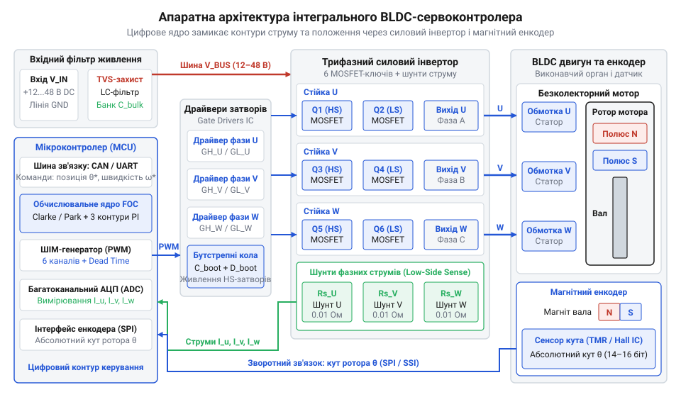
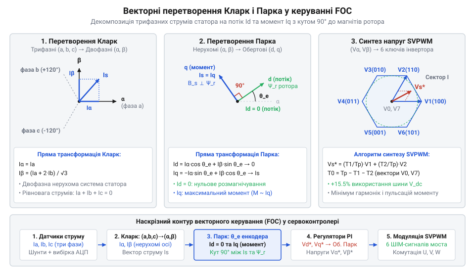
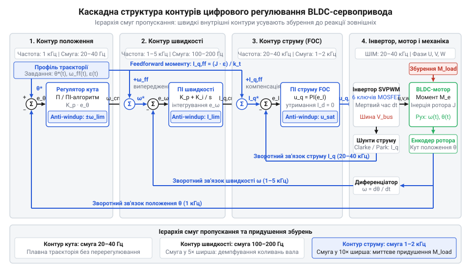
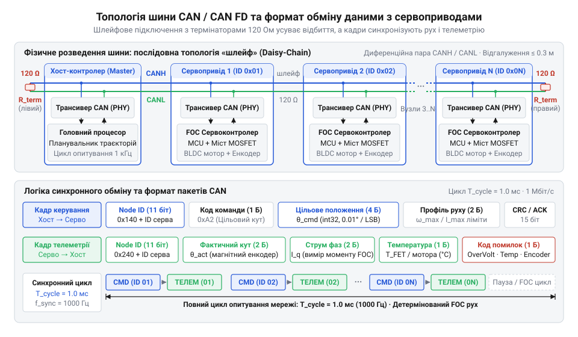
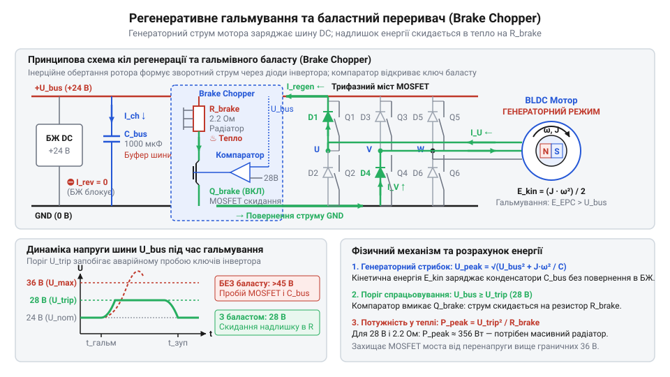

# Безколекторні інтегральні сервоконтролери

<preknowlist>
- [Tower Pro SG90 — мікросерво 9g](root:cat-hw-actuators/sg90-servo) — будова класичного позиційного сервопривода: колекторний двигун постійного струму, редуктор із високим передавальним числом, зворотний зв'язок за потенціометром та імпульсне керування кутом (ШІМ 1–2 мс)
- [Серво-роги (запасні)](root:cat-hw-actuators/servo-horns) — способи механічного сполучення вихідного вала привода з навантаженням, передача обертального моменту та виникнення ударних механічних напружень
</preknowlist>

## Межі класичних серв у динамічній робототехніці

У динамічних суглобах [хобійні сервоприводи](root:cat-hw-actuators/sg90-servo) ламаються: під навантаженням без обертання зникає проти-ЕРС, і пусковий струм спалює колектор. Реверси стирають потенціометр, створюючи завади. Висока редукція множить зведений момент інерції ротора й позбавляє привод зворотної прозорості (англ. @@en|backdrivability@@) — удари зрізають зубці шестерень. Модельні регулятори швидкості (англ. @@en|ESC@@) не підходять через пульсації моменту та відсутність утримання в статиці. Розв'язком стає [квазіпрямий привод](root:hw-motion/backdrivability-and-quasi-direct-drive) із векторним керуванням.

## Апаратна будова інтегрального сервоконтролера

Щоб усунути довгі фазні дроти й завади, плату монтують на тильному щиті статора. Силовий міст містить шість N-канальних транзисторів @@en|MOSFET@@ із драйверами затворів і бутстрепним живленням. Фазні струми вимірюють низькоомні шунти в нижніх плечах напівмостів. Індуктивні викиди напруги гасить батарея конденсаторів із низьким @@en|ESR@@, а кут ротора зчитує магнітний енкодер над діаметральним магнітом вала.

*Розміщення силового моста, шунтів та енкодера на статорі усуває завади.*

## Векторне керування FOC та електронна комутація

Векторне керування @@en|FOC@@ орієнтує магнітне поле статора під кутом 90° до магнітів ротора, усуваючи пульсації моменту й вібрації шестикрокової комутації. [Перетворення Кларк і Парка](root:hw-motion/foc-control) зводять фазні струми в обертову систему ротора: поздовжній `Id` тримають на нулі проти нагріву, а поперечний `Iq` лінійно формує крутний момент. Напруги на ключах синтезує просторово-векторна модуляція (англ. @@en|SVPWM@@) із повним використанням напруги шини.

*Проекція трифазних струмів на осі ротора дає плавне керування моментом.*

## Каскадні цифрові контури регулювання

Керування рухом будує [каскад трьох контурів](root:hw-motion/cascaded-motion-control-loops): внутрішній струму (20–40 кГц) утримує `Id = 0` та відпрацьовує момент через `Iq`, проміжний швидкості (1–5 кГц) задає струм, а зовнішній положення (0.5–1 кГц) відстежує координату вала. Смуга пропускання контурів обов'язково спадає зсередини назовні, щоб уникнути фазового відставання та самозбудження. Алгоритм @@en|anti-windup@@ усуває перерегулювання при насиченні ШІМ, а пряме випередження (англ. @@en|feedforward@@) компенсує інерцію навантаження.

*Спадання смуги пропускання від контуру струму до контуру положення усуває самозбудження.*

## Цифрові шини зв'язку та зворотна телеметрія

Замість вразливого до завад ШІМ багатоосьові системи застосовують [диференційну шину CAN](root:com-devices/can-bus) або @@en|CAN FD@@, сполучену шлейфом із кінцевими термінаторами 120 Ом. Побітовий арбітраж за ідентифікатором усуває колізії без затримок і координатора. Шина перемикає режими моменту, швидкості чи положення та транслює циклічну телеметрію струму, кута й температури. При обриві зв'язку сторожовий таймер (англ. @@en|watchdog@@ — сторожовий пес) безпечно знеструмлює вал.

*Шлейф із термінаторами забезпечує арбітраж і зворотну телеметрію.*

## Калібрування привода та аварійний захист

Первинний пуск визначає опір та індуктивність фаз під контури струму, пари полюсів і зміщення енкодера щодо електричного нуля ротора.
При гальмуванні викид напруги регенерації скидає на баластний резистор [гальмівний переривач](root:hw-power/dynamic-braking-chopper) (англ. @@en|brake chopper@@). Статичне утримання ваги перегріває одну пару ключів, вимагаючи термозниження струму. Проверт магніту енкодера викликає розгін через хибний зворотний зв'язок — привод блокує аварійна засувка (англ. @@en|fault latch@@).

*Гальмівний переривач скидає надлишок кінетичної енергії на резистор.*
