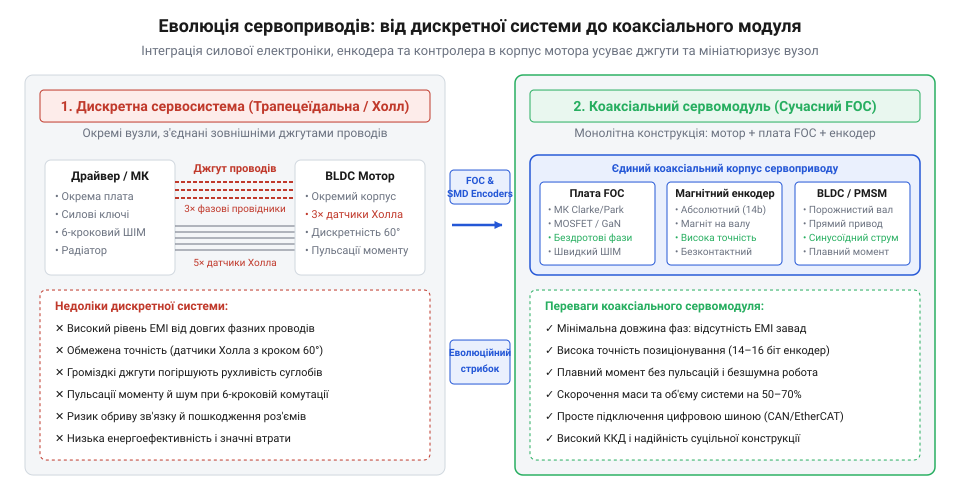
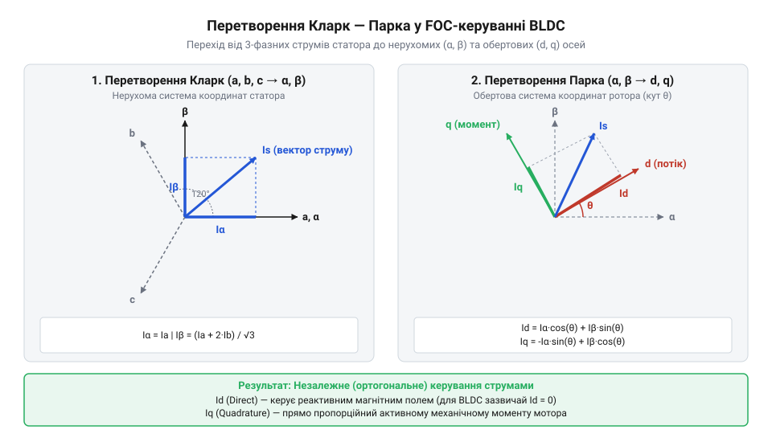
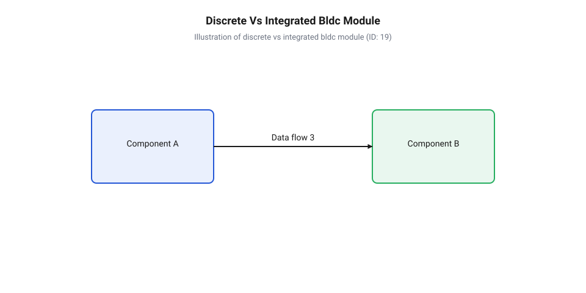

# Еволюція алгоритмів комутації та інтеграції BLDC-сервоконтролерів

<preknowlist>
- [Сервоприводи радіокерованих моделей: будова, редуктори та ШІМ-керування](root:cat-hw-actuators/rc-servo-mechanisms-and-control) — базовий принцип будови класичного сервоприводу, зворотний зв'язок за потенціометром та обмеження стандартного ШІМ-сигналу
</preknowlist>

## Тупик колекторних моторів та трапецеїдальної комутації

Перші високоточні виконавчі механізми в робототехніці та моделюванні спиралися на класичні колекторні двигуни постійного струму (від англійського @@en|brushed DC motor@@). У таких двигунах механічний вузол зі щіток та колекторних пластин фізично перемикає напрямок струму в обмотках ротора під час обертання. У простих пристроях, як-от [сервоприводах радіокерованих моделей](root:cat-hw-actuators/rc-servo-mechanisms-and-control) або популярному [мікросерво Tower Pro SG90](root:cat-hw-actuators/sg90-servo), ця конструкція була дешевою у виробництві, проте швидко демонструвала свої фізичні обмеження. Постійне механічне тертя призводило до швидкого зносу графітових чи мідних щіток, іскріння створювало сильні радіозавади, а сама конструкція мала низьку ефективність тепловідведення, оскільки обмотки, які гріються під навантаженням, розташовані на обертовому роторі всередині корпусу.

Щоб позбутися механічного зносу, у 1962 році американські інженери Т. Вілсон (T. G. Wilson) та П. Трікі (P. H. Trickey) запропонували замінити механічний колектор напівпровідниковими транзисторними ключами. Це дало початок безколекторним двигунам постійного струму (від англійського @@en|brushless DC motor@@, або @@en|BLDC@@). Для визначення моменту перемикання транзисторних плечей на статорі почали встановлювати три дискретні датчики Холла (від англійського @@en|Hall effect sensor@@), розміщені через 120 електричних градусів.

Драйвер перших BLDC-приводів реалізовував 6-крокову трапецеїдальну комутацію (від латинського @@la|commutatio@@ — «зміна», «обмін»). У кожен момент часу струм протікав лише через дві з трьох фаз двигуна, а третя залишалася знеструмленою. Кожні 60 електричних градусів, коли ротор досягав позиції чергового датчика Холла, електронний блок дискретно перемикав силові транзистори.

Головна вада скалярної 6-крокової комутації полягає в дискретності зміщення магнітного поля статора. Замість плавного обертання вектор магнітного потоку статора стрибкоподібно повертається на 60°, що створює високі пульсації моменту (від англійського @@en|torque ripple@@), які сягають 15–30% від номінального значення. У робототехнічних суглобах це проявляється акустичним тріском, гудінням та структурними вібраціями. На низьких обертах та в режимі утримування позиції під навантаженням ротор постійно коливається навколо точки перемикання фаз, оскільки скалярна схема принципово не здатна підтримувати постійний кут 90° між магнітними полями статора й ротора.

Крім суто алгоритмічних обмежень, ранні BLDC-системи мали розрізнену апаратну топологію. Мотор, окрема плата драйвера, масивні джгути фазних кабелів та сигнальні дроти датчиків Холла створювали громіздку конструкцію, непридатну для компактних робототехнічних кінцівок.


*Компонувально-просторова схема еволюції сервоприводу від дискретної системи (мотор, кабелі, окрема плата драйвера, датчики Холла) до монолітного коаксіального сервомодуля.*

## Перехід до аналогової синусоїдальної ШІМ-комутації

Усвідомлення непридатності трапецеїдальних стрибків для плавного руху змусило розробників у 1970-х та 1980-х роках звернутися до синусоїдальної широтно-імпульсної модуляції (від англійського @@en|sinusoidal PWM@@, або @@en|SPWM@@).

Замість прямокутних імпульсів напруги, що жорстко вмикали й вимикали фази кожні 60°, силові інвертори почали формувати на трьох обмотках статора трифазну синусоїдальну напругу, зсунуту на 120° між фазами. Це дозволило створити безперервно обертове магнітне поле статора. Акустичний шум та пульсації моменту під час стаціонарного обертання на середніх обертах істотно знизилися.

Проте синусоїдальна ШІМ залишалася керуванням за напругою (V/f). Алгоритм подавав на обмотки розраховану синусоїду напруги, припускаючи, що струм у фазах точно повторюватиме її форму. У реальному двигуні обмотки мають індуктивність (L), а обертання ротора наводить у статорі зворотну електрорушійну силу — протиелектрорушійну силу (від англійського @@en|back-EMF@@).

Зростання швидкості обертання призводить до того, що динаміка фазного струму обмежується різницею між прикладеною напругою та проти-ЕРС:

```
dI / dt = (V_phase - E_back) / L    [динаміка фазного струму статора]
```

Через індуктивний опір обмоток виникає фазовий зсув (від англійського @@en|phase shift@@) — вектор струму (від англійського @@en|current vector@@) починає відставати від вектора напруги. Оскільки обертальний момент прямо пропорційний векторному добутку магнітного потоку ротора та струму статора, відхилення кута між ними від оптимальних 90° викликає різке падіння динамічного моменту на високих швидкостях, зниження ККД та надмірне нагрівання обмоток.

Стало зрозуміло: керування напругою є непридатним для динамічних приводів з частими змінами навантаження. Для забезпечення максимального моменту контролер повинен регулювати не напругу, а безпосередньо фазні струми статора в реальному часі.

## Цифровий прорив FOC та перетворення Кларк — Парка

Теоретичні основи прямого векторного регулювання фазних струмів сформулювали німецькі інженери Карл Гассе (Karl Hasse, 1969 рік) та Фелікс Блашке (Felix Blaschke, Siemens, 1971 рік) під назвою векторне керування (від англійського @@en|Field-Oriented Control@@, або @@en|FOC@@). Проте реалізувати FOC в апаратурі тривалий час заважала потреба виконувати складні тригонометричні розрахунки тисячі разів на секунду. Лише поява наприкінці 1990-х та на початку 2000-х років доступних цифрових сигнальних процесорів (DSP) та мікроконтролерів із підтримкою математичних обчислень у реальному часі зробила FOC стандартом промислової та робототехнічної сервопривідної техніки.

Математична суть FOC полягає у перетворенні складної трифазної системи змінного струму обертового статора на еквівалентну просту модель двигуна постійного струму.

Першим кроком є перетворення Кларк (від англійського @@en|Clarke transform@@), розроблене американською інженеркою Едіт Кларк (Edith Clarke) у 1926 році. Воно перераховує виміряні миттєві трифазні струми статора (`I_a`, `I_b`, `I_c`), зсунуті в просторі на 120°, у двофазну ортогональну нерухому систему координат (`I_α`, `I_β`):

```
I_α = I_a
I_β = (I_a + 2 × I_b) / √3          [перетворення Кларк для нерухомих осей]
```

Вісь `I_α` збігається з віссю фази A, а вісь `I_β` спрямована перпендикулярно до неї у площині статора.

Другим кроком є перетворення Парка (від англійського @@en|Park transform@@), сформульоване американським інженером Робертом Парком (Robert H. Park) у 1929 році. Воно повертає нерухому систему координат (`I_α`, `I_β`) на поточний електричний кут ротора `θ` в обертову систему координат, прив'язану до магнітного поля ротора:

```
I_d = I_α × cos(θ) + I_β × sin(θ)   [проекція струму на поздовжню вісь ротора d]
I_q = -I_α × sin(θ) + I_β × cos(θ)  [проекція струму на поперечну вісь ротора q]
```


*Геометричне перетворення трифазних струмів статора (Ia, Ib, Ic) у двофазну нерухому систему (Ialpha, Ibeta) та подальший поворот в обертову систему координат ротора (Id, Iq).*

Отримані компоненти мають чіткий фізичний зміст:
- Складова `I_d` (direct) спрямована вздовж магнітного поля ротора і відповідає за намагнічування. У моторах із постійними магнітами вона не створює корисного обертального моменту, тому FOC підтримує її значення рівним нулю (`I_d = 0`). - Складова `I_q` (quadrature) спрямована строго перпендикулярно (під кутом 90°) до магнітного поля ротора. Вона повністю відповідає за створення електромагнітного моменту.

Завдяки розділенню керування струмами `I_d` та `I_q` стає незалежним. Два пропорційно-інтегральних (ПІ) регулятори струму працюють на високій частоті (10–20 кГц), формуючи вихідні напруги `V_d` та `V_q`. За допомогою зворотних перетворень Парка й Кларк ці напруги переводяться назад у трифазну систему статора та синтезуються інвертором через просторово-векторну модуляцію (від англійського @@en|Space Vector PWM@@, або @@en|SVPWM@@). Детальніший математичний апарат та алгоритм формування векторів напруги висвітлено у статті про [просторово-векторну широтно-імпульсну модуляцію (SVPWM)](root:hw-motion/svpwm).

Впровадження FOC спростувало важливі технологічні міфи:
1. Міф про те, що FOC — це лише програмна опція драйвера. Насправді FOC є фізично зумовленим закритим контуром регулювання векторів фазних струмів, який вимагає високошвидкісних аналого-цифрових перетворювачів для точного вимірювання струмів у фазах. 2. Міф про те, що дискретні датчики Холла здатні забезпечити прецизійну роботу в режимі утримування моменту. Дискретні датчики дають оновлення кута лише кожні 60 електричних градусів, що унеможливлює розрахунок перетворення Парка на низьких обертах. Для FOC необхідний високороздільний зворотний зв'язок — абсолютні магнітні або оптичні енкодери (12–14 біт). Докладніше про принципи побудови 12–14 бітних сенсорів та використання AMR-ефекту для зворотного зв'язку FOC читайте у матеріалі про [прецизійні магнітні абсолютні енкодери](root:hw-sensing/magnetic-absolute-encoders).

Поєднання FOC-контролерів, високоефективних магнітних енкодерів та інтегрованих напівмостових силових MOSFET-інверторів створило основу сучасних монолітних коаксіальних сервомодулів. Вони забезпечують нульові пульсації моменту, абсолютну плавність ходу й максимальну динаміку робототехнічних суглобів.

## Мініатюризація силових інверторів і магнітних енкодерів

Наприкінці 1980-х років теоретичні засади @@en|векторного керування@@ вже були сформовані, проте їхня практична реалізація впиралася в апаратний бар'єр. Силові ключі на базі дискретних @@en|силових транзисторів@@ (англ. *power transistor*, від лат. *transferre* — переносити та *resistere* — чинити опір) вимагали окремих плашок драйверів, масивних радіаторів та громіздких шаф керування. Від цієї шафи до кожного мотора тягнувся важкий екранований джгут із трьох фазних дротів високого струму та багатожильної лінії зворотного зв'язку від @@en|резольвера@@ (англ. *resolver*, від лат. *resolvere* — розв'язувати) або оптичного енкодера. У багатоланкових робототехнічних маніпуляторах такі джгути створювали високий механічний опір згинанню, збільшували масу суглобів і наводили потужні електромагнітні завади. Довгі фазні кабелі мали високі @@en|паразитні індуктивності@@ (англ. *parasitic inductances*, від грецьк. *parasitos* — утриманець та лат. *inductio* — наведення), що викликало небезпечні сплески напруги під час високочастотного перемикання ключів.

Технологічний прорив відбувся впродовж 2000-х та 2010-х років завдяки двох паралельним напрямам мікроелектроніки. З одного боку, виробники напівпровідників об'єднали силові MOSFET-транзистори та драйвери затворів у монолітні корпуси та інтегровані @@en|напівмостові інвертори@@ (англ. *half-bridge inverter*, від лат. *invertere* — повертати). Зменшення опору відкритого каналу та оптимізація заряду затвора дозволили перемикати струми в десятки ампер на частотах 20–50 кГц без використання громіздких систем охолодження.

З іншого боку, відбулася революція в сенсорах кута ротора. Крихкі оптичні диски зі скляними штрихами та громіздкі аналогові @@en|резольвери@@ поступилися місцем датчикам нового типу. З появою чіпів серії AS5040 та їхніх наступників від компанії ams AG розповсюдження здобув прецизійний @@en|магнітний енкодер@@ (англ. *magnetic encoder*, від грецьк. *magnetis* — магніт та лат. *codex* — кодекс). Невелика матриця елементів, що використовують @@en|датчик Холла@@, разом із вбудованим обчислювачем CORDIC розміщується в корпусі площею в кілька квадратних міліметрів. Діаметрично намагнічений мікромагніт на торці вала мотора дозволяє зчитувати абсолютний кут ротора з роздільною здатністю від 12 до 14 біт, що відповідає точності вимірювання до 0.02°. Про фізичні принципи зчитування магнітного поля та застосування CORDIC-обчислювачів для визначення кута ротора дізнайтеся з матеріалу про [магнітні абсолютні енкодери](root:hw-sensing/hall-magnetic-encoders).


*Еволюційний перехід від громіздких шаф із фазними кабелями до монолітного сервомодуля із вбудованим силовим інвертором та магнітним енкодером.*

Поєднання компактного інвертора, мікроконтролера та магнітного енкодера на єдиній круговій друкованій платі прямо на торці статора усунуло потребу в зовнішніх фазних кабелях. Відстань між силовими ключами та обмотками мотора скоротилася з метрів до міліметрів, що майже повністю ліквідувало @@en|паразитні індуктивності@@ й випромінювання завад. На зміну класичним рознесеним системам, де [традиційні аналогові сервоприводи](root:cat-hw-actuators/rc-servo-mechanisms-and-control) вимагали зовнішніх блоків регулювання, прийшов монолітний @@en|коаксіальний сервомодуль@@ (англ. *coaxial servo module*, від лат. *co-* — спільно, *axis* — вісь та *modulus* — міра).

## Ера інтегрованих сервомодулів та розвінчання міфів

Конструктивна інтеграція силової електроніки та безконтактних сенсорів створила основу для сучасних коаксіальних BLDC-сервомодулів. У такому пристрої безкорпусний безколекторний мотор, низьколюфтовий хвильовий або планетарний редуктор, @@en|магнітний енкодер@@ та обчислювальне ядро FOC об'єднані в єдиному алюмінієвому корпусі. Використання концепції, де застосовується @@en|прямий привод@@ (англ. *direct drive*, від англ. *direct* — прямий та *drive* — привод) або квазіпрямий привод з низьким передавальним відношенням, дозволило створити сервоприводи з високою зворотною прозорістю. Подібні модулі здатні вимірювати та регулювати зовнішній крутний момент через фазні струми без використання крихких тензометричних датчиків. Детальніше про будову та принципи роботи інтегрованих безколекторних приводів з хвильовим редуктором дивіться у статті про [коаксіальні сервомодулі прямого приводу](root:cat-hw-actuators/coaxial-servo-modules).

Широке впровадження цієї технології супроводжувалося виникненням декількох стійких технічних міфів, які часто спотворюють розуміння принципів роботи сервоприводів.

Перший поширений міф стверджує, що @@en|векторне керування@@ є лише додатковою програмною опцією чи функцією прошивки мікроконтролера, яку можна ввімкнути на будь-якому обладнанні. У дійсності FOC — це жорстко пов'язаний фізико-апаратний @@en|контур регулювання струму@@ (англ. *current control loop*, від лат. *currere* — бігти та фр. *contrerolle* — контроль). Для його функціонування необхідна спеціалізована схемотехніка: прецизійні шунти у фазах, диференційні операційні підсилювачі, а також високошвидкісні аналого-цифрові перетворювачі, апаратно синхроновані з генератором ШІМ. Без точного вимірювання миттєвих фазних струмів та урахування компенсації затримки, яку створює @@en|мертвий час@@ (англ. *dead time*, від давньоангл. *dēad* — мертвий та *tīma* — час) силових ключів, математичні алгоритми нездатні утримувати оптимальний кут між векторами магнітних полів.

Другий міф полягає в тому, що дискретні 6-крокові датчики Холла здатні забезпечити прецизійне позиціонування та плавне утримування моменту на нульовій швидкості. Три @@en|датчики Холла@@ з дискретними виходами фіксують положення ротора лише шість разів за один електричний оберт, тобто з кроком у 60° електричних. Це викликає грубе @@en|квантування позиції@@ (англ. *position quantization*, від лат. *quantus* — скільки). На стаціонарному валу контролер не володіє інформацією про реальне відхилення ротора в межах цього сектора, що призводить до низькочастотного тремтіння та високих пульсацій моменту. Плавне утримування статичного навантаження можливе тільки за наявності безперервного зворотного зв'язку від енкодера високої роздільної здатності.

| Параметр / Режим | Трапецеїдальна (6-крокова) | Синусоїдальна ШІМ | Векторне керування (FOC) |
| :--- | :--- | :--- | :--- |
| **Датчик положення** | 3 × дискретні @@en|датчики Холла@@ | @@en|магнітний енкодер@@ або резольвер | Абсолютний @@en|магнітний енкодер@@ (≥12 біт) |
| **Пульсації моменту** | Високі (до 15–20% на комутаціях) | Помірні на середніх швидкостях | Мінімальні (наближені до нуля) |
| **Плавність на 0 RPM** | Відсутня (крокове тремтіння) | Низька (зсув фази струму) | Ідеальне утримування моменту |
| **Складність апаратури** | Мінімальна (прості ключі) | Середня (трифазний ШІМ) | Висока (АЦП, шунти, DSP-ядро) |
| **Основна область** | Вентилятори, насоси, дрони | Прості приводи постійної швидкості | Робототехнічні суглоби, @@en|підвіс камери@@ |

Критична оцінка цих компромісів визначає вибір архітектури під конкретне завдання. Якщо для простих механізмів підходять дешеві [сервомотори з металевим редуктором](root:cat-hw-actuators/mg90s-servo), то високоточний @@en|підвіс камери@@ (англ. *camera gimbal*, від англ. *gimbal*, від давньофр. *gemel* — близнюк) вимагає суто FOC-керування на прямому приводі для усунення мікровібрацій. Робототехнічні кінцівки та сервосуглоби крокуючих роботів базуються на інтегрованих модулях FOC із квазіпрямим приводом, забезпечуючи високу динаміку керування струмом та стійкість до зовнішніх ударних навантажень.