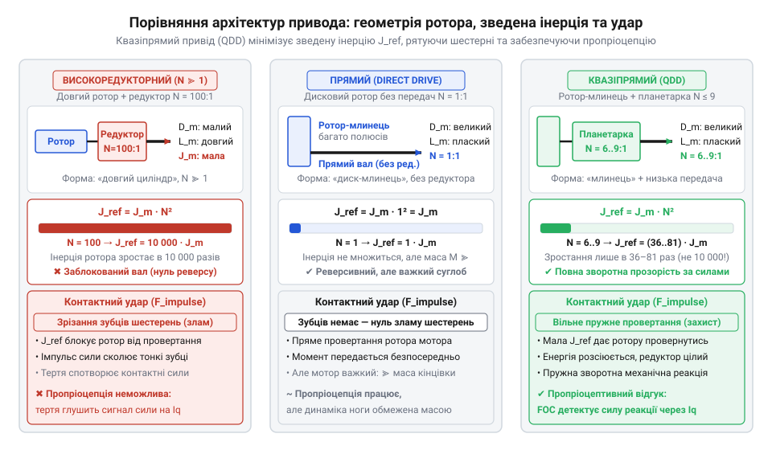
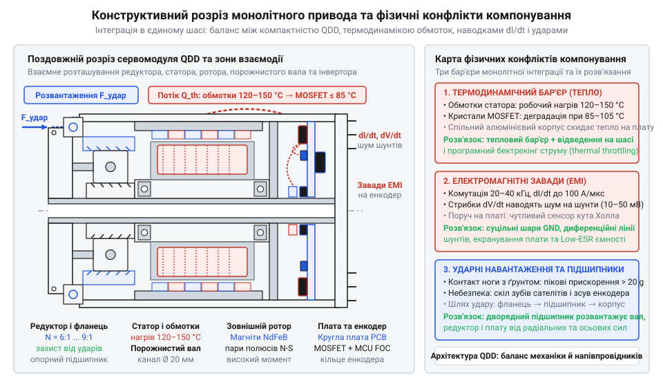

# Еволюція безколекторних сервоприводів: від радіокерованих хобі-серв і гімбалів до інтегрованих робототехнічних приводів

<preknowlist>
- [Tower Pro SG90 — мікросерво 9g](root:cat-hw-actuators/sg90-servo) — Базова будова та принцип функціонування класичного аматорського сервопривода: використання колекторного двигуна постійного струму, багатоступеневого редуктора з високим передавальним числом, резистивного потенціометра зворотного зв'язку та позиційного керування за допомогою імпульсів ШІМ частотою 50 Гц.
</preknowlist>

## Криза хобі-серв у динамічній робототехніці

На зламі 2000–2010-х років творці крокуючих роботів та швидкісних маніпуляторів масово застосовували готові модельні [аматорські сервоприводи](root:cat-hw-actuators/sg90-servo) (від лат. *servus* — слуга). Готові вузли з мотором, редуктором і контролером здавалися універсальними та дешевими будівельними блоками. Проте спроба вийти за межі повільного авіамодельного позиціювання спричинила лавину апаратних відмов: приводи розбивалися під час перших же контактів ніг із поверхнею або згоряли під звичайним статичним навантаженням.

Головною вадою виявилася кінематика редуктора. Щоб розвинути робочий момент за допомогою мініатюрного двигуна, у хобі-сервах ставили багатоступеневі передачі з редукцією `1:200 ... 1:300`. Таке передавальне число позбавляло привід зворотної механічної прозорості (англ. @@en|backdrivability@@, від *back* — назад і *drive* — рухати) — здатності провертатися від зусилля на вихідному валу. Коли нога робота б'є об ґрунт, кінетична енергія удару мусить або провернути якір мотора у зворотному напрямку, або розсіятися в матеріалі шестерень. Зведена інерція ротора зростає пропорційно квадрату передавального числа, перетворюючи двигун на нерухому стіну. Редуктор миттєво клинить, і ударна хвиля сколює зубці навіть у вузлах із [металевим редуктором](root:cat-hw-actuators/mg90s-servo).

Електрична та вимірювальна частини також зайшли в глухий кут. У фазі утримання позиції мотор зупиняється. Без обертання зникає проти-ЕРС, і струм обмоток обмежується лише їхнім активним опором: без апаратного вимірювання струму котушки миттєво перегріваються, а щітки колектора згоряють за лічені хвилини. Контактний потенціометр від вібрацій швидко протирався, спричиняючи шуми та хаотичне тремтіння вала (англ. @@en|jitter@@, від *jitter* — тремтіти). На додачу, сліпе позиційне керування імпульсами 50 Гц не давало змоги відчувати опір чи пом'якшувати удар. Для динамічного руху знадобився принципово інший клас приводів — безконтактний, реверсивний і керований за моментом.

## Гімбальна революція та синусоїдальна комутація

Стрімкий розвиток безпілотної аерозйомки на початку 2010-х років вимагав бездоганної тривісної стабілізації важких камер на підвісах — гімбалах (англ. @@en|gimbal@@, від давньофр. *gemel* — близнюк). Механічний люфт і повільний відгук редуктора в [класичних сервоприводах](root:cat-hw-actuators/sg90-servo) розмивали зображення від найменшої вібрації дрона. Розробники — насамперед у відкритому проєкті @@en|BaseCam SimpleBGC@@ Олексія Москаленка — повністю відкинули шестерні на користь прямого приводу (англ. @@en|direct drive@@, від лат. *directus* — прямий). Камеру посадили безпосередньо на вал безколекторного двигуна із зовнішнім ротором (англ. @@en|outrunner@@, від *out* — назовні та *run* — обертатися), чий широкий діаметр і велика кількість полюсів створювали достатній крутний момент без редукції.

Але спроба керувати цими моторами через стандартні модельні регулятори швидкості (англ. @@en|ESC@@) зазнала краху. Традиційна шестикрокова трапецеїдальна комутація (від лат. *commutatio* — зміна) за сигналами датчиків Холла перемикала напругу фаз дискретними стрибками кожні 60 електричних градусів. Вектор магнітного поля статора рухався ривками, породжуючи грубі пульсації моменту (англ. @@en|torque ripple@@, від *ripple* — брижі). Для авіамодельного пропелера ця нерівномірність згладжувалася його власною інерцією, проте на чутливій оптичній осі викликала високочастотні мікровібрації, що спотворювали кадри «ефектом желе».

Виходом став перехід до безредукторного синусоїдального збудження фазних напруг у парі з безконтактними магнітними енкодерами високої роздільності (на кшталт AS5048 та AS5600). Плавне обертання вектора поля усунуло ривки, забезпечивши мікрорадіанну плавність стабілізації. Однак це раннє синусоїдальне керування мало принципову межу: воно регулювало лише амплітуду напруги у відкритому контурі, не контролюючи реальний фазний струм. Під час різких поривів вітру чи швидких прискорень кут між полем ротора й струмом статора збивався, крутний момент падав, а система втрачала утримання горизонту.

## Демократизація векторного керування та відкриті проєкти

Синусоїдальне збудження фаз напругою усунуло вібрації, проте виявилося безпорадним перед динамічним навантаженням. Коли зовнішня сила збурює ротор, індуктивність обмоток і проти-ЕРС розривають зв'язок між прикладеною напругою та фазним струмом. Двигун гріється, а крутний момент непередбачувано просідає. Щоб динамічно контролювати силу, потрібно регулювати не напругу, а вектор струму. Промисловість давно використовувала векторне керування (англ. @@en|FOC@@, від *field-oriented control* — керування за орієнтацією поля), але тригонометричні обчислення в реальному часі вимагали дорогих процесорів, недоступних у масовій робототехніці.

Бар'єр зламала поява в середині 2010-х років доступних 32-бітних мікроконтролерів лінійки @@en|STM32F4@@ на ядрі @@en|ARM Cortex-M4@@ з апаратним співпроцесором (англ. @@en|FPU@@, від *floating-point unit* — блок обчислень із рухомою комою). Вони обчислювали тригонометрію за мікросекунди, що спричинило бум відкритих проєктів: Оскар Вайґль (Oskar Weigl) створив платформу @@en|ODrive@@, Беньямін Веддер (Benjamin Vedder) розвинув @@en|VESC@@, а згодом з'явилася бібліотека @@en|SimpleFOC@@. Прецизійні алгоритми вийшли з корпоративних лабораторій у вільний інженерний простір.

Фізичною основою @@en|FOC@@ стало вимірювання миттєвих фазних струмів через резистивні шунти (від англ. *shunt* — відгалужувати) в інверторі. Координатні перетворення Кларк і Парка перераховують три змінні струми статора в рухому систему ротора, розділяючи їх на два незалежні канали: струм поля `Id`, спрямований уздовж магнітів, та струм моменту `Iq`, розташований під кутом 90 електричних градусів. Контролер обнуляє `Id`, усуваючи марний нагрів, і регулює `Iq`, забезпечуючи миттєвий лінійний відгук сили на валу. Без апаратних шунтів чисте керування моментом неможливе: напруга задає лише потенціал, тоді як силу створює винятково струм.

## Прорив MIT Cheetah та квазіпрямий привід

Векторне керування дало точний контроль сили, але оголило дилему динамічних суглобів. Прямий привід вимагав занадто важких двигунів для створення потрібного моменту відштовхування. Натомість промислові редуктори з високою передачею через тертя втрачали реверсивність, спотворювали контактні сили та кришилися від ударів ноги об ґрунт.

Розв'язок знайшла Лабораторія біоміметичної робототехніки Массачусетського технологічного інституту (@@en|MIT@@) у проєкті чотириногого робота @@en|MIT Cheetah@@ під керівництвом Санбе Кіма (Sangbae Kim) за участі Бена Катца (Ben Katz). Вони створили парадигму квазіпрямого приводу (англ. @@en|QDD@@, від *quasi-direct drive* — майже прямий привід): дисковий двигун великого діаметра з багатьма полюсними парами об'єднали з легким планетарним редуктором низького передавального числа `N` від `6:1` до `9:1`.

Зведена до суглоба інерція ротора `J_ref` визначається власною інерцією мотора `J_m` та передавальним числом `N`:

```
J_ref = J_m · N²                     [масштабування інерції через редуктор]
```

Квадратична залежність означає, що при малому `N` опір ротора зростає лише в 36–81 раз, зберігаючи реверсивність. Під час удару ноги об ґрунт мотор вільно провертається назад, розсіюючи енергію та рятуючи шестерні. Мізерне тертя зберегло зворотну механічну прозорість (@@en|backdrivability@@) і дало пропріоцептивне відчуття сили (від лат. *proprius* — власний і *capio* — сприймати): виміряний струм моменту `Iq` точно відтворює реакцію опори без крихких зовнішніх датчиків, уможлививши стабільний біг і стрибки.


*Кінематика й динаміка трьох архітектур: низька редукція приводу @@en|QDD@@ мінімізує зведену інерцію, забезпечуючи пружність під час удару та пропріоцептивний відгук сили через струм.*

## Монолітна інтеграція вузлів на корпусі привода

Практичне застосування квазіпрямих приводів оголило новий виклик: система з окремого двигуна, зовнішнього редуктора, енкодера та винесеного силового блока перетворювалася на крихке сплетіння проводів. Швидкі згинання кінцівок робота ламали мідні жили, а паразитна індуктивність джгутів фазних кабелів спричиняла викиди напруги на ключах. Виходом стало створення інтегрованих сервомодулів (англ. @@en|smart actuator@@, від *smart* — тямущий та лат. *actuare* — приводити в дію): статор безколекторного двигуна, планетарну передачу, порожнистий вал, силову плату інвертора на @@en|MOSFET@@, високоточний магнітний енкодер і мікроконтролер упакували в єдине шасі з живленням і цифровою шиною (англ. @@en|CAN@@, від *Controller Area Network* — мережа контролерів) або @@en|CAN FD@@.

Проте стиснення всіх підсистем в один корпус створило три фізичні конфлікти:

Електромагнітні завади (англ. @@en|EMI@@, від *electromagnetic interference* — електромагнітна завада). Силові ключі інвертора комутують десятки ампер за наносекунди: різкі стрибки `dV/dt` та `dI/dt` наводять паразитні струми в колах вимірювальних шунтів і сенсора кута, розташованих у кількох міліметрах від мостів. Захист вимагає екранування друкованої плати (англ. @@en|PCB@@, від *printed circuit board* — друкована плата), мінімізації площі комутаційних контурів і диференційного передавання сигналів.

Ударні вібрації. Контакт ноги з опорою породжує імпульсні прискорення в десятки `g`. Аби вібрації не руйнували паяні з'єднання, плату заливають демпфувальним компаундом, а консольні та осьові навантаження замикають на опорні підшипники шасі, розвантажуючи вал мотора й сенсор.

Термодинамічний бар'єр. Обмотки статора під піковим струмом розігріваються до 120–150 °C, тоді як напівпровідникові кристали деградують за 85–105 °C. Інженери розділяють модуль на термоізольовані зони: шасі розсіює тепло котушок назовні, а вбудовані термістори обмежують струм за перших ознак перегріву.


*Будова інтегрованого сервомодуля: просторове поєднання механіки та електроніки в одному шасі вимагає захисту сенсорів від комутаційних завад, розсіювання тепла обмоток і розвантаження плати від ударів.*

## Розвінчання міфів та інженерні компроміси

Комерційний успіх чотириногих платформ породив міф, ніби концепцію квазіпрямого приводу винайшли комерційні бренди на кшталт @@en|Unitree@@ чи @@en|DJI@@. Насправді архітектуру @@en|QDD@@, закон масштабування інерції ротора та конструкцію інтегрованого модуля розробили й відкрито опублікували вчені Лабораторії біоміметичної робототехніки Массачусетського технологічного інституту (проєкт @@en|MIT Cheetah@@, Бен Катц / Ben Katz). Індустрія лише адаптувала готові відкриті креслення для серійного виробництва.

Інша поширена омана — уявлення, ніби звичайний безколекторний авіамотор і регулятор швидкості можна перетворити на точний сервопривід простою заміною прошивки. Справжнє векторне керування (@@en|FOC@@) принципово неможливе без апаратної частини: швидкісних аналого-цифрових перетворювачів (англ. @@en|ADC@@, від *analog-to-digital converter* — аналого-цифровий перетворювач) і прецизійних фазних шунтів. Без вимірювання струмів контролер регулює лише напругу, перетворюючи двигун на шумний кроковий мотор із непередбачуваним моментом і ризиком миттєвого перегріву.

Стереотипом є й абсолютна безальтернативність монолітної інтеграції. Розміщення електроніки на статорі знижує ремонтопридатність: вигорання єдиного транзистора перетворює дорогий привід на брухт. До того ж спільний тепловий бюджет звужує тривалу потужність. Через це в аерокосмічній техніці та важких маніпуляторах інвертори виносять в окремі охолоджувані блоки.

Архітектуру привода обирають під завдання. Для навчальних макетів із фіксованими кутами досі достатньо [аматорських сервоприводів](root:cat-hw-actuators/sg90-servo). Підвіси камер вимагають прямого гімбального приводу заради нульового люфту й плавності. Стрибаючим роботам необхідний @@en|QDD@@ завдяки пружності та прозорості за моментом. Натомість для промислових роботів-маніпуляторів обирають високомоментні редукторні приводи з циклоїдними або хвильовими передачами, де жорсткість утримання навантаження важливіша за реверсивність.
