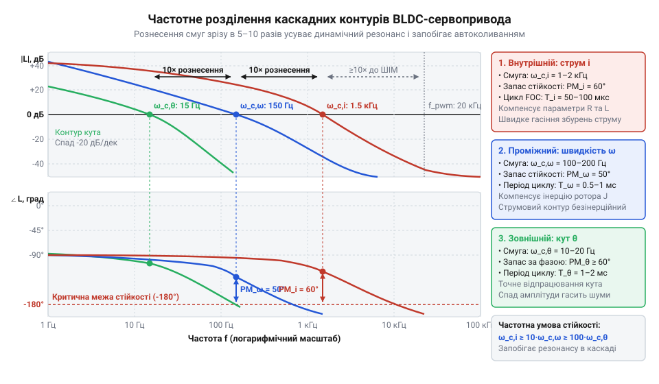
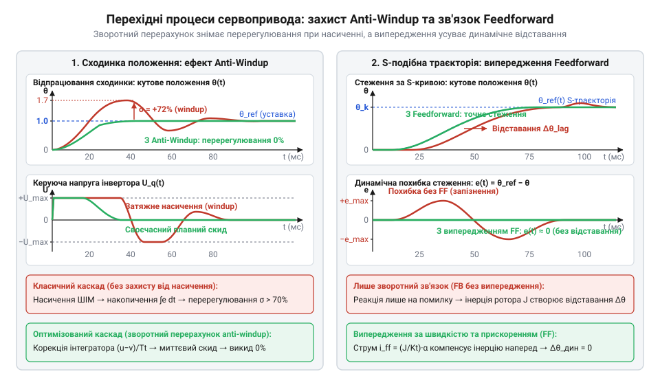

# Розрахунок каскадних контурів регулювання струму, швидкості й положення та синтез коефіцієнтів під інерцію механіки

<preknowlist>
- [Tower Pro SG90 — мікросерво 9g](root:cat-hw-actuators/sg90-servo) — будова класичного одноконтурного позиційного привода з потенціометром зворотного зв'язку, відсутність окремого регулювання швидкості й струму та причини втрати керованості при спробі позиціонування великих інерційних мас
- [Серво-роги (запасні)](root:cat-hw-actuators/servo-horns) — способи механічного закріплення важеля на валу сервопривода, виникнення радіального плеча навантаження та формування приведеного до вала моменту інерції механіки
</preknowlist>

## Пастка одноконтурного керування та ієрархія каскаду

Спроба керувати положенням суглоба робота з інерційним важелем через єдиний @@en|ПІД-регулятор@@ (від англ. *proportional-integral-derivative*), що напряму задає шпаруватість @@en|ШІМ@@ напруги силового @@en|інвертора@@ (від лат. *invertere* — перевертати), швидко закінчується аварією. Під вагою важеля вал просідає. Збільшення коефіцієнтів підсилення для виправлення похибки спричиняє різкий акустичний писк, мотор впадає в автоколивання, а драйвер вимикається за перевантаженням струму. Зменшення ж коефіцієнтів робить привід млявим: виникає величезне відставання від траєкторії, а гальмування закінчується ударом об упор.

Збій спричинений несумірністю часових масштабів:
- Електрична постійна часу обмоток статора `T_e = L / R` (де `L` — індуктивність, `R` — активний опір) становить частки мілісекунди: струм наростає майже миттєво.
- Механічна реакція ротора з інерційним навантаженням на [серво-розі](root:cat-hw-actuators/servo-horns) триває сотні мілісекунд.

Коли один контур намагається зрушити непорушну масу, регулятор положення видає граничну напругу. Струм у нерухомих обмотках злітає до аварійних значень раніше, ніж механіка рушить з місця та згенерує проти-ЕРС. У петлі виникає критичний фазовий зсув, запас стійкості вичерпується, і система зривається в автоколивання.

Щоб замкнути керування стійко, процеси з різною швидкодією розносять на три вкладені рівні — @@en|каскадне керування@@ (від італ. *cascata* — водоспад, ступінчастий спад):
- **Внутрішній контур струму** керує електромагнітним моментом безпосередньо в обмотках і захищає силові ключі від перевантаження.
- **Проміжний контур швидкості** обчислює необхідний крутний момент для подолання інерції та в'язкого тертя й задає цільовий струм.
- **Зовнішній контур положення** зводить похибку кута вала до завдання швидкості для проміжного рівня.

Підпорядкування контурів дозволяє кожному зовнішньому рівню сприймати внутрішній як швидкий і передбачуваний виконавчий орган.

## Синтез ПІ-регулятора внутрішнього контуру струму

Для швидкого дозування електромагнітного моменту силовий інвертор формує струм у фазах статора. У синхронних осях [векторного керування](root:hw-motion/foc-control) фазне коло моделюють послідовним активним опором `R` та індуктивністю `L`. Прикладена фазна напруга `u(t)` створює струм `i(t)` за диференціальним рівнянням кола `u(t) = L·(di(t)/dt) + R·i(t)`. У просторі перетворення Лапласа обмотка є аперіодичною ланкою `W_e(s) = 1/(L·s + R) = (1/R)/(T_e·s + 1)`, де `T_e = L/R` — стала часу кола.

Цифровий мікроконтролер вимірює струми й оновлює шпаруватість @@en|ШІМ@@ з періодом `T_pwm`. Сумарна апаратна затримка контуру `T_d ≈ 1.5·T_pwm` утворюється з двох фізичних складових: одного повного такту оновлення регістрів ШІМ у мікроконтролері та пів періоду запізнення фіксатора нульового порядку. Оцифрувавши фазні струми на початку періоду, процесор обчислює керування в перериванні й записує нову шпаруватість у тіньові буфери таймера. В активні регістри порівняння ці дані завантажуються апаратно лише на межі наступного такту, щоб не спотворювати поточний імпульс ШІМ, — це дає рівно один повний період чистого запізнення `1.0·T_pwm`. Другу частину затримки створює апаратне утримання вихідної напруги ключами інвертора протягом усього наступного такту модуляції. Для неперервного струму статора такий фіксатор нульового порядку еквівалентний запізненню на середину інтервалу `0.5·T_pwm`. Разом вони утворюють сумарне запізнення `T_d = 1.0·T_pwm + 0.5·T_pwm = 1.5·T_pwm`, фазовий зсув від якого зменшує запас стійкості на високих частотах. Щоб замкнений контур не коливався, повільний полюс обмотки компенсують нулем ПІ-регулятора за методом @@la|модульного оптимуму@@ (від лат. *modulus* — міра та *optimum* — найкраще). Постійну часу інтегрування обирають рівною сталій часу кола: `T_i = T_e = L/R`.

Передавальну функцію розімкненого контуру `W_ol(s)` дістають перемноженням ланок регулятора, обмотки статора та еквівалентної затримки `W_d(s) ≈ 1/(T_d·s + 1)`:

```
W_ol(s)
= [K_p·(T_i·s + 1)/(T_i·s)] · [1/(R·(T_e·s + 1))] · [1/(T_d·s + 1)]   [множення ланок]
= [K_p/(R·T_i·s)] · [1/(T_d·s + 1)]                                    [полюс: T_i = T_e]
= [K_p/(L·s)] · [1/(T_d·s + 1)]                                        [T_i = L/R]
```

Компенсація перетворює контур на інтегратор із запізненням, усуваючи фазовий зсув від індуктивності статора.

На частоті зрізу контуру струму `ω_c,i` модуль розімкненої системи дорівнює одиниці `|W_ol(j·ω_c,i)| ≈ K_p/(L·ω_c,i) = 1`, звідки отримують коефіцієнти `K_p = ω_c,i·L` та `K_i = K_p/T_i = ω_c,i·R`. Запас за фазою `γ = 90° - ω_c,i·T_d` за вимоги `γ ≥ 60°` обмежує смугу пропускання контуру значенням `ω_c,i ≤ 1/(3·T_pwm)`.

Замкнений контур струму згортають в еквівалентну ланку першого порядку `W_cl,i(s) ≈ 1/(T_eq,i·s + 1)` зі сталою часу `T_eq,i ≈ 1/ω_c,i`. Регулятори ортогональних осей `I_d` та `I_q` дістають однакові коефіцієнти, забезпечуючи швидке наростання крутного моменту без перерегулювання.

## Розрахунок контуру швидкості під інерцію механіки

Внутрішній контур струму діє як кероване джерело крутного моменту з малою затримкою `T_eq,i`. Проте між електромагнітним зусиллям і частотою обертання вала стоїть механічна підсистема. Рух ротора з масою, закріпленою на [серво-розі](root:cat-hw-actuators/servo-horns), описує рівняння динаміки `J_total · (dω/dt) + B · ω = Kt · Iq - τ_L`, де `J_total` — сумарний приведений момент інерції ротора й вузла, `B` — коефіцієнт в'язкого тертя, `Kt` — константа моменту двигуна, `Iq` — квадратурний струм статора, а `τ_L` — збурювальний момент навантаження.

Якщо регулятор швидкості зробити суто пропорційним з коефіцієнтом `K_p,ω`, постійний момент навантаження `τ_L` залишає неусувну статичну похибку `e_ω = τ_L / (Kt · K_p,ω + B)`. Спроба прибрати її надмірним збільшенням підсилення підсилює шуми датчиків і викликає гудіння. Додавання інтегратора обнуляє статичну похибку, проте сам об'єкт за малого тертя діє як інтегруюча ланка `1 / (J_total · s)`. Два послідовні інтегратори дають фазовий зсув -180°, породжуючи затяжний низькочастотний коливальний процес.

Щоб максимізувати запас стійкості між полюсом інтегрування та затримкою струму, передавальну функцію розімкненого контуру швидкості `W_ol,ω(s)` будують перемноженням ланок:

```
W_ol,ω(s)
= [K_p,ω·(T_i,ω·s + 1)/(T_i,ω·s)] · [1/(T_eq,i·s + 1)] · [Kt/(J_total·s)]   [множення ланок]
= [K_p,ω·Kt / (J_total·T_i,ω·s²)] · [(T_i,ω·s + 1)/(T_eq,i·s + 1)]          [групування інтеграторів]
```

Параметри ПІ-регулятора налаштовують за критерієм @@la|симетричного оптимуму@@ (від грец. *symmetria* — співмірність та лат. *optimum* — найкраще). Подвійний інтегратор `1 / s²` у передавальній функції розімкненого контуру створює постійний фазовий зсув `-180°`, тому без додаткового фазового випередження система перебуває на межі стійкості. Нуль регулятора на частоті `ω_z = 1 / T_i,ω` підіймає фазу додаванням `+arctan(ω · T_i,ω)`, натомість паразитна затримка контуру струму з полюсом на частоті `ω_p = 1 / T_eq,i` завалює її назад додаванням `-arctan(ω · T_eq,i)`. У результаті запас за фазою `γ(ω) = arctan(ω · T_i,ω) - arctan(ω · T_eq,i)` утворює між `ω_z` та `ω_p` опуклий купол. Прирівнявши похідну `dγ/dω` до нуля, знаходять частоту максимального запасу за фазою: `ω_max = 1 / √(T_i,ω · T_eq,i) = √(ω_z · ω_p)`. Вона є строгим середнім геометричним між частотами нуля регулятора та полюса затримки струму. На логарифмічній шкалі частот величина `log(ω_max) = (log(ω_z) + log(ω_p)) / 2` лежить точно посередині між ними, а сама логарифмічна фазова характеристика симетрична відносно цього піка: відхилення частоти вгору чи вниз в однакове число разів викликає тотожний спад запасу стійкості. Частоту зрізу обирають саме цим середнім геометричним `ω_c,ω = ω_max = 1 / (a · T_eq,i)`, тому що запас стійкості замкненої системи визначається виключно в точці одиничного підсилення розімкненого контуру `|W_ol,ω(j·ω_c,ω)| = 1`: суміщення частоти зрізу з вершиною купола дає найбільший можливий запас за фазою для обраного рознесення ланок. Прийнявши кратність частотного рознесення `a = ω_c,ω / ω_z = ω_p / ω_c,ω`, сталу часу інтегрування задають як `T_i,ω = a² · T_eq,i`. При коефіцієнті `a = 2.4..3` запас за фазою на частоті зрізу досягає `γ = 2·arctan(a) - 90° ≈ 45°..60°`. Оскільки на частоті зрізу дріб `|(T_i,ω · j·ω_c,ω + 1) / (T_eq,i · j·ω_c,ω + 1)|` дорівнює `a` і повністю скорочується зі знаменником інтегратора `T_i,ω · ω_c,ω = a`, з умови одиничного підсилення `|W_ol,ω(j·ω_c,ω)| = 1` дістають коефіцієнти `K_p,ω = (ω_c,ω · J_total) / Kt` та `K_i,ω = K_p,ω / T_i,ω`.

Стійкість замкненого контуру чутлива до зміни інерції. Якщо навантаження зростає (`J_actual > J_total`), частота зрізу зміщується ліворуч: розгін стає повільнішим, але запас за фазою збільшується, зберігаючи стабільність. Якщо ж навантаження скинути (`J_actual < J_total`), завищене значення `K_p,ω` зсуває зріз у зону затримки струму, фазовий запас падає нижче 30°, і виникає вібрація. Контур зберігає стійкість у діапазоні `0.5·J_total ≤ J_actual ≤ 3·J_total`.

## Налаштування контуру положення та частотне рознесення

Коли швидкість вала стабілізовано, залишається привести його в точне кутове положення `θ`. Кут пов'язаний зі швидкістю чистою кінематикою `θ(t) = ∫ ω(t) dt`, що є ідеальною інтегруючою ланкою `1 / s` у самій механіці. Додавання інтегратора в регулятор положення утворює два послідовні інтегрування в петлі: фазовий зсув сягає -180°, провокуючи автоколивання вала й перерегулювання. Оскільки інтегратор контуру швидкості вже обнуляє статичну похибку від збурень, регулятор кута проектують суто пропорційним (П-регулятор) із підсиленням `K_p,θ`.

Швидкісний контур подають аперіодичною ланкою зі сталою часу `T_eq,ω ≈ 1 / ω_c,ω`, де `ω_c,ω` — частота зрізу контуру швидкості. Розімкнена система має вигляд `W_ol,θ(s) = K_p,θ / (s · (T_eq,ω · s + 1))`. Замикаючи її одиничним зв'язком, дістають передавальну функцію замкненого контуру положення `W_cl,θ(s)`:

```
W_cl,θ(s)
= W_ol,θ(s) / (1 + W_ol,θ(s))                       [одиничний зворотний зв'язок]
= (K_p,θ / T_eq,ω) / (s² + (1/T_eq,ω)·s + K_p,θ/T_eq,ω) [нормалізація знаменника]
```

Знаменник порівнюють із ланкою другого порядку `s² + 2·ζ·ω_n·s + ω_n²`, де `ω_n` — власна частота, а `ζ` — @@de|коефіцієнт демпфування@@ (від нім. *Dämpfung* — гасіння). Прирівнюючи коефіцієнти при `s`: `2·ζ·ω_n = ω_c,ω` та `ω_n² = K_p,θ · ω_c,ω`. Звідси `ω_n = ω_c,ω / (2·ζ)`, що визначає підсилення:

```
K_p,θ
= (ω_c,ω / (2·ζ))² / ω_c,ω                           [підстановка власної частоти]
= ω_c,ω / (4·ζ²)                                     [розрахункова формула]
```

Для виключення перерегулювання обирають `ζ ≥ 0.707` (межа Баттерворта), що обмежує підсилення значенням `K_p,θ ≤ 0.5·ω_c,ω` (при критичному затуханні `ζ = 1` маємо `K_p,θ = 0.25·ω_c,ω`).

Щоб зовнішній контур сприймав внутрішні ланки як @@la|квазістаціонарні@@ (від лат. *quasi* — майже та *stationarius* — нерухомий), смуги зрізу розносять у 5–10 разів: `ω_c,θ ≪ ω_c,ω ≪ ω_c,i`. За такого рознесення перехідні процеси контуру швидкості встигають повністю згаснути до помітної зміни кута, тому внутрішній контур діє для регулятора положення як статична одинична ланка `W_cl,ω(s) ≈ 1` із нехтовно малим запізненням. Коли кратність рознесення спадає нижче 5 (`ω_c,ω / ω_c,θ < 5`), динаміка контуру швидкості перестає бути нехтовно швидкою й вносить на частоті зрізу положення власний фазовий зсув `Δφ = -arctan(ω_c,θ / ω_c,ω)`. Якщо для кратності 5 цей спад становить безпечні `-11.3°`, то при звуженні до відношення 2–3 він сягає `-18°`...`-27°`, а з урахуванням затримки контуру струму — перевищує `-45°`. Оскільки кінематичне інтегрування `1 / s` уже створює незмінний фазовий зсув `-90°`, сумарна фаза розімкненого контуру положення `arg(W_ol,θ(j·ω_c,θ)) = -90° + arg(W_cl,ω(j·ω_c,θ))` просідає нижче `-135°`...`-150°`, критично зменшуючи запас за фазою. Водночас замкнений контур швидкості, синтезований за симетричним оптимумом, має коливальний характер із демпфуванням `ζ_ω ≈ 0.5` і формує амплітудний резонансний пік `|W_cl,ω(jω)| ≈ 1.2–1.4` поблизу частоти `ω_c,ω`. При зближенні смуг цей амплітудний підйом накладається на частоту зрізу контуру положення саме в тій області, де запас стійкості за фазою вже втрачено. У результаті контури втрачають динамічну незалежність і входять у паразитну резонансну взаємодію: швидкі команди регулятора кута збуджують коливальні моди контуру швидкості швидше, ніж той устигає їх загасити. Це спричиняє появу гострого резонансного піка в замкненій системі положення `W_cl,θ(s)`, що на практиці призводить до високочастотного тремтіння вала, акустичного писку двигуна та переростання перерегулювання в стійкі автоколивання.


*Логарифмічні характеристики показують спадання смуг контурів струму (1–2 кГц), швидкості (100–200 Гц) та кута (10–20 Гц), що усуває резонанс і виключає автоколивання.*

## Математичні моделі анти-віндапу при насиченні

При стрибкоподібній зміні завдання положення виникає велика похибка `e`, через яку обчислений сигнал керування перевищує фізичні межі силової частини. Вихідна фазна напруга обмежена напругою шини живлення `U_bus` як `U_max = U_bus / √3`, а вихід регулятора швидкості обмежений граничним струмом статора `I_max`. Коли виконавчий орган насичується, різниця між заданим і поточним станом зберігається, а інтегратор продовжує накопичувати похибку. Це явище має назву @@en|windup@@ (англ. *wind up* — закручувати пружину до упору), або інтегральне насичення. Накопичений надлишковий заряд утримує максимальний крутний момент навіть після досягнення цілі, спричиняючи перерегулювання понад 70% і тривалі автоколивання.

Для запобігання автоколиванням застосовують алгоритми @@en|anti-windup@@. При блокуванні інтегрування, або @@en|clamping@@ (англ. *clamp* — затискач), обчислюють похибку насичення між необмеженим сигналом `u_unsat` та обмеженим `u_sat`:

```
Δu = u_unsat - u_sat
```

Якщо `Δu ≠ 0` і знаки похибки `e` та сигналу `u_unsat` збігаються, накопичення інтеграла вимикають, запобігаючи глибшому насиченню привода. Зміна знака похибки `e` миттєво повертає інтегратор у роботу.

Гнучкіший зворотний перерахунок, або @@en|back-calculation@@ (англ. *back-calculation* — зворотний перерахунок), розряджає інтегратор через різницю `Δu` зі сталою часу стеження `T_t`. Швидкість зміни інтегральної складової `u_i` знаходять із похибки та неузгодженості виходів:

```
d(u_i)/dt = K_i · e - (1 / T_t) · (u_unsat - u_sat)
```

Сталу часу розрядки `T_t` узгоджують із часом інтегрування регулятора `T_i = K_p / K_i`. Підстановка виразу `u_unsat = K_p · e + u_i` у динаміку накопичення інтеграла дає співвідношення `d(u_i)/dt = (K_i - K_p / T_t) · e - (1 / T_t) · (u_i - u_sat)`. За точної чисельної рівності `T_t = T_i` коефіцієнт `(K_i - K_p / T_t)` обнуляється, тому похибка `e` повністю припиняє накачувати інтегратор під час насичення, а складова `u_i` релаксує до межі `u_sat`. Зворотний зв'язок затримує наростання інтеграла на межі струму чи напруги, тому при перетині нульової похибки система виходить із насичення без запізнення. Якщо обрати завищене значення `T_t > T_i` (наприклад, `T_t ≥ 2 · T_i`), зворотний вплив `1 / T_t` стає заслабким: інтегратор продовжує накопичувати похибку на полиці обмеження, а після розвороту похибки вихід із насичення затягується, спричиняючи масивне перерегулювання. Якщо ж задати замале значення `T_t ≪ T_i` (зокрема `T_t < 0.1 · T_i` або величину, співмірну з періодом дискретизації `T_s`), зворотний вплив `1 / T_t` стає надмірно жорстким: найменше перевищення порога викликає стрибкоподібне скидання інтеграла, що породжує автоколивання та високочастотний брязкіт на межі насичення. Для запобігання обом крайнощам сталу `T_t` обирають рівною `T_i` або утримують у діапазоні від `0.5 · T_i` до `T_i`, гарантуючи швидке розвантаження інтегратора без втрати стійкості.

## Прямий випереджувальний зв'язок для динамічного стеження

Стійкий каскадний контур відпрацьовує неперервні траєкторії зі сталим відставанням вала від цільової координати. Зворотний зв'язок принципово виробляє струм і момент лише тоді, коли похибка розходження вже фізично виникла на сенсорі.

Повністю усунути запізнення дозволяє прямий випереджувальний зв'язок — @@en|feedforward@@ (англ. *feed forward* — подача наперед), побудований на інверсній динаміці сервопривода. Випередження за швидкістю `ω_ff` утворюють через диференціювання заданого кута `θ*`:

```
ω_ff = dθ*/dt
```

Сигнал `ω_ff` надходить на вхід контуру швидкості, знімаючи з позиційного регулятора потребу підтримувати швидкісну помилку. Для компенсації сил інерції сумарного моменту `J_total` та в'язкого тертя `B` формують випереджувальний квадратурний струм `I_q,ff` через коефіцієнт моменту двигуна `Kt`:

```
I_q,ff
= τ_ff / Kt                                               [зв'язок моменту зі струмом]
= (J_total · d²θ*/dt² + B · dθ*/dt) / Kt                 [рівняння динаміки вала]
```

Значення `I_q,ff` прикладається безпосередньо до контуру струму, компенсуючи динамічний момент ротора в мить прикладання прискорення. Якщо на валу закріплено механічний важіль або [серво-роги для навантаження](root:cat-hw-actuators/servo-horns), їхній внесок формує базу розрахунку `J_total`.

У просторі перетворень Лапласа динамічна похибка стеження визначається як різниця цільової та дійсної координат вала `E(s) = Θ*(s) - Θ(s)`. Пропорційний регулятор положення перетворює цю похибку на швидкісну складову `K_p,θ · E(s)`. Разом із прямим випередженням за швидкістю `s · Θ*(s)` сумарне завдання швидкості становить `Ω*(s) = K_p,θ · E(s) + s · Θ*(s)`. Похибка швидкості на вході регулятора `C_ω(s) = K_p,ω + K_i,ω / s` дорівнює `Ω*(s) - s · Θ(s) = (s + K_p,θ) · E(s)`. Сумарний квадратурний струм статора поєднує зворотний зв'язок і випередження: `I_q*(s) = C_ω(s) · (s + K_p,θ) · E(s) + I_q,ff(s)`. Оскільки контур струму набагато швидший за механічні процеси, його відпрацювання приймають миттєвим: `I_q(s) ≈ I_q*(s)`. Динаміку обертання вала з дійсним моментом інерції `J_actual`, в'язким тертям `B_actual` та зовнішнім навантаженням `τ_L(s)` визначає баланс моментів `(J_actual · s² + B_actual · s) · Θ(s) = Kt · I_q(s) - τ_L(s)`. Якщо підставити в це рівняння координатний зв'язок `Θ(s) = Θ*(s) - E(s)`, вираз струму `I_q*(s)` та врахувати похибки ідентифікації інерції `ΔJ = J_actual - J_total` і в'язкого тертя `ΔB = B_actual - B`, динамічна похибка стеження набуває вигляду:

```
E(s)
= [ (J_actual · s² + B_actual · s) · Θ*(s) - Kt · I_q,ff(s) + τ_L(s) ] / D(s)                                 [баланс моменту й струму]
= [ (ΔJ · s² + ΔB · s) · Θ*(s) + τ_L(s) ] / D(s)                                                             [підстановка випередження I_q,ff]
= [ (ΔJ · s² + ΔB · s) · Θ*(s) + τ_L(s) ] / [ J_actual · s² + B_actual · s + Kt · C_ω(s) · (s + K_p,θ) ]     [розкриття полінома D(s)]
```

Знаменник `D(s) = J_actual · s² + B_actual · s + Kt · C_ω(s) · (s + K_p,θ)` задає характеристичний поліном замкненої системи. За точного збігу моделі з параметрами привода (`ΔJ = 0` та `ΔB = 0`) і без зовнішнього навантаження `τ_L = 0` чисельник стає тотожним нулем: передавальна функція похибки стеження зникає `E(s) / Θ*(s) = 0`. Коли інерцію або тертя визначено з похибками `ΔJ` чи `ΔB`, виникає динамічний залишок моменту `Δτ_dyn(t) = ΔJ · d²θ*/dt² + ΔB · dθ*/dt`, який діє як нескомпенсоване внутрішнє збурення. У робочій смузі руху замкнений каскад протидіє цьому залишку власною динамічною жорсткістю `K_pos = Kt · K_p,ω · K_p,θ`. Розрахунок динамічної похибки стеження вала `e_dyn(t)` визначає вимушене відхилення:

```
e_dyn(t)
= Δτ_dyn(t) / (Kt · K_p,ω · K_p,θ)                     [відхилення під дією залишку моменту]
= (ΔJ · d²θ*/dt² + ΔB · dθ*/dt) / (Kt · K_p,ω · K_p,θ) [розрахунок похибки через розбіжність параметрів]
```

Високе підсилення контурів зменшує динамічну похибку в рази: похибка оцінки інерції на 10–20% залишає нескомпенсованими лише відповідні 10–20% динамічного моменту, а решту 80–90% знімає випередження. Інтегральна складова регулятора швидкості `K_i,ω` додатково зводить до нуля статичний залишок тертя `ΔB` на ділянках зі сталою швидкістю.


*Порівняння реакції приводів: каскад без корекції демонструє 70% перерегулювання та відставання на динамічній s-кривій, тоді як зворотний перерахунок ліквідує викид, а випередження за прискоренням зводить динамічну похибку до нуля.*
