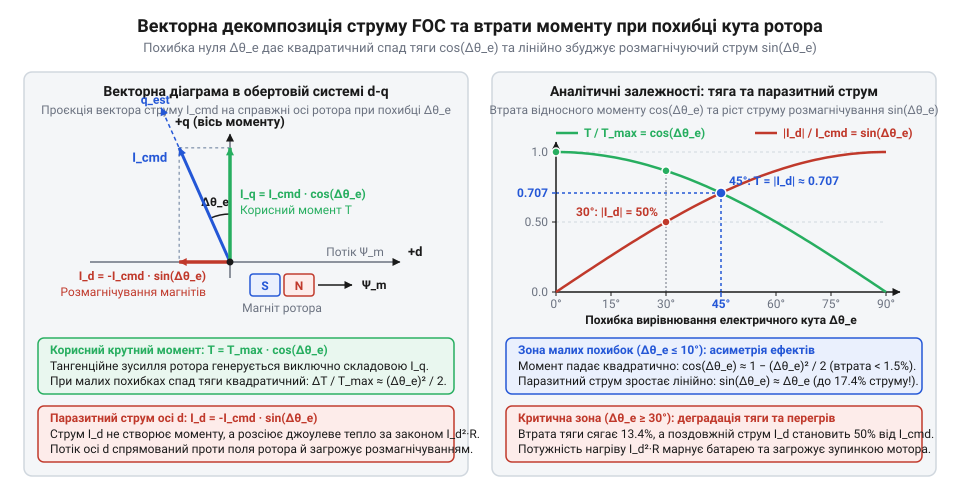
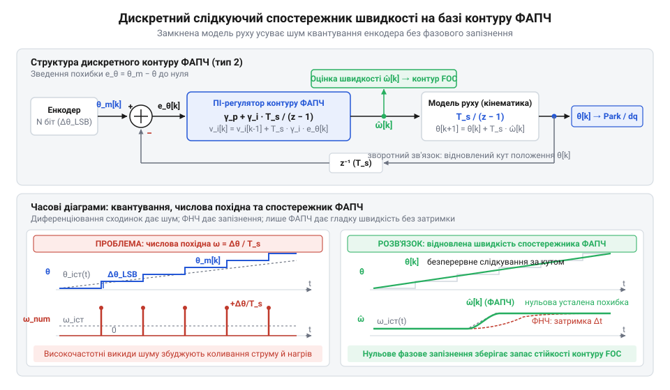

# Розрахунок кутової роздільної здатності енкодера, квантування швидкості та математичне узгодження електричного кута

<preknowlist>
- [Tower Pro SG90 — мікросерво 9g](root:cat-hw-actuators/sg90-servo) — концепція замкненого контуру керування положенням вихідного вала за сигналом зворотного зв'язку та фізичні обмеження класичного аналогового потенціометра (скінченний діапазон кута, шуми доріжки, відсутність дискретної швидкості)
</preknowlist>

## Зрив векторного керування та шум швидкості

На відміну від [простих аналогових мікросервоприводів](root:cat-hw-actuators/sg90-servo), де положення вала зчитує резистивний потенціометр, безколекторний сервопривод спирається на цифрове векторне керування (англ. @@en|field-oriented control@@, FOC; від @@en|field@@ — поле та @@en|orient@@ — орієнтувати) та вимагає безперервного узгодження полів. Якщо встановити абсолютний магнітний енкодер (англ. @@en|encoder@@; від @@en|encode@@ — кодувати) і подати живлення без точного електричного нуля, ротор не зрушить плавно. Двигун завмирає, споживає граничний струм, розжарює обмотки за лічені секунди, видає різкий свист із вібрацією або несподівано зривається в некерований реверсивний розгін.

Причина криється у спотворенні просторового кута поля статора відносно магнітів ротора. Для максимального корисного моменту поле обмоток має випереджати ротор строго на 90° електричних. Похибка монтажу датчика зміщує цю фазу. Струм перестає створювати обертання та спрямовується прямо в полюси ротора, створюючи радіальне притискання й перетворюючи всю потужність на тепло. Якщо кутове зміщення перевищує чверть електричного оберту, вектор сили змінює знак: виникає додатний зворотний зв'язок, і ротор зривається в аварійне обертання.

Другий зрив стається при спробі обчислити швидкість ротора. Першу похідну кута зазвичай оцінюють простою різницею відліків за крок таймера контуру. Проте сенсор виконує квантування (лат. @@la|quantum@@ — скільки) просторового кута з дискретним кроком молодшого розряду. На робочій частоті контуру 10–20 кГц випадковий шум в одну дискрету перетворюється на стрибки швидкості в сотні обертів на хвилину.

**Обчислення на прикладі:** стрибок кутової швидкості `Δω` для 12-бітного енкодера з кутовим кроком `Δθ_m` за період квантування `T_s = 50 мкс` (частота контуру 20 кГц):

```
Δω
= Δθ_m / T_s                     [визначення стрибка швидкості як відношення кванта кута до періоду]
= (2·π / 4096) / (50·10⁻⁶)       [підстановка кутового кроку 12-бітного енкодера та періоду 50 мкс]
≈ 30.68 рад/с                    [обчислення кутової швидкості в радіанах за секунду]
≈ 293 об/хв                      [перерахунок в оберти за хвилину через множення на 60 / (2·π)]
```

Навіть за повної нерухомості вала однократне коливання молодшого розряду алгоритм сприймає як фіктивний рух зі швидкістю майже 293 оберти за хвилину. Регулятор миттєво реагує на ці сплески, спричиняючи джиттер (англ. @@en|jitter@@; від @@en|jitter@@ — тремтіти) — пульсації моменту та акустичний свист. Згладжування сигналу аперіодичним фільтром низьких частот не рятує: фільтр вносить фазове запізнення, знищує запас стійкості контуру та збуджує стійкі автоколивання.

Керування приводом вимагає суворого математичного розрахунку: узгодження координат енкодера з електричними фазами статора та побудови спостережника швидкості, здатного фільтрувати шум дискретизації без фазового запізнення.

## Механічний кут, полюси та електрична фаза

У безколекторному синхронному приводі крутний момент виникає лише тоді, коли магнітне поле статора випереджає власне поле ротора під строго визначеним кутом. Якщо контролер помиляється з просторовою орієнтацією ротора, поле статора замість обертання вала починає стискати підшипники та перегрівати мідь обмоток. Закріплений на валу @@en|абсолютний енкодер@@ вимірює геометричний механічний кут повороту ротора `θ_m`, де `θ_m ∈ [0, 2π)`. Однак обмотки статора взаємодіють не з геометричним валом, а з періодичною структурою його магнітів. Ротор містить цілу кількість пар магнітних полюсів `p`, де кожна пара утворює один повний магнітний період чергування північного й південного полюсів.

Коли ротор повертається на одну пару полюсів, магнітне поле відносно статора проходить повний цикл у `2·π` радіанів. Тому за один механічний оберт вала фазний вектор магнітомоторної сили статора здійснює рівно `p` повних періодів. Ми визначаємо електричний кут статора `θ_e` через механічний кут ротора `θ_m` та кількість пар полюсів `p`:

```
θ_e = (p · θ_m) mod 2π
```

Операція взяття за модулем `2·π` утримує електричний кут у межах одного періоду комутації `[0, 2π)`. Завдяки цьому багатополюсний двигун здійснює кілька електричних циклів за один геометричний поворот вала.

Під час монтажу датчика його нульова риска ніколи точно не збігається з магнітною віссю фази привода. Цю просторову невідповідність задає постійне кутове зміщення монтажу `θ_offset`. Фізичне зміщення корпусу або чутливого елемента сенсора на механічний кут `Δθ_mech` створює електричний зсув `θ_offset = p · Δθ_mech`. За один геометричний оберт ротора магнітне поле проходить `p` повних періодів, тому просторова неточність встановлення масштабується й помножується рівно в `p` разів. Через це навіть незначна монтажна похибка в один градус на двигуні з сімома парами полюсів (`p = 7`) призводить до семи градусів електричного зсуву. Механічні допуски деталей і зазори кріпильних отворів не дають змоги усунути такий зсув точним ручним виставлянням, тому його вимірюють і компенсують програмно в обчисленнях поля. Крім того, залежно від розташування енкодера на передньому чи задньому кінці вала, наростання коду датчика може відповідати прямому або зворотному чергуванню фаз. Для узгодження напрямків обертання слугує знаковий множник напрямку `dir ∈ {-1, +1}`. Ми розраховуємо електричний кут `θ_e` за виміряним механічним кутом `θ_m`, ураховуючи зміщення `θ_offset`, напрямок `dir` та кількість пар полюсів `p`:

```
θ_e = (dir · p · θ_m + θ_offset) mod 2π
```

Отриманий електричний кут переносить обчислення з нерухомої системи відліку датчика в обертову систему координат фазного поля ротора — осі `d-q`. @@en|Пряма вісь@@ (англ. *direct* — спрямований уздовж) `d` збігається з віссю постійних магнітів ротора, а @@la|поперечна вісь@@ (лат. *quadratura* — перпендикулярність) `q` випереджає її на кут `π/2` радіанів і відповідає за створення корисного крутного моменту.

## Аналітика похибки юстування електричного нуля

У контурі @@en|векторного керування@@ весь заданий струм статора повинен потрапляти строго в поперечну вісь `q`, створюючи максимальний крутний момент на кожен ампер без зайвих втрат. Якщо ж @@de|юстування@@ (нім. *justieren* — точно вивіряти) нульового зміщення виконано з похибкою, контролер використовує замість істинного електричного кута `θ_e` його розрахункову оцінку `θ_hat_e`. Їхня різниця утворює похибку вирівнювання електричного нуля `Δθ_e = θ_e - θ_hat_e`. Через цей кутовий зсув вектор заданого струму статора `I_cmd` відхиляється від осі `q`.

Ми знаходимо проекції повного вектора струму статора `I_cmd` на реальні осі ротора `q` та `d`:

```
I_q = I_cmd · cos(Δθ_e)
I_d = I_cmd · sin(Δθ_e)
```

Корисна складова струму `I_q` спадає за косинусом похибки, а вздовж поздовжньої осі виникає паразитний струм прямої осі `I_d`. Відповідно вихідний крутний момент `T` зменшується відносно свого максимуму `T_max`. Ми виводимо відносну втрату крутного моменту `ΔT / T_max` через похибку `Δθ_e`:

```
ΔT / T_max = (T_max - T) / T_max
           = (T_max - T_max · cos(Δθ_e)) / T_max    [підстановка виразу моменту]
           = 1 - cos(Δθ_e)                          [скорочення T_max]
           ≈ 1 - (1 - (Δθ_e)² / 2)                  [розклад косинуса в ряд Тейлора]
           = (Δθ_e)² / 2                            [спрощення виразу]
```

Для малих похибок деградація моменту зростає пропорційно квадрату кутового зсуву `Δθ_e`. Наприклад, похибка `Δθ_e = 10°` (0.1745 радіана) дає спад корисного моменту лише на `(0.1745)² / 2 ≈ 0.015` (1.5%). Проте паразитний струм прямої осі `I_d = I_cmd · sin(10°) ≈ 0.174 · I_cmd` перевищує 17% від усієї амплітуди. Цей струм не виконує корисної механічної роботи, але разом із поперечною складовою бере участь у розсіюванні потужності на активному опорі фаз статора.

Ми виводимо сумарні джоулеві втрати нагріву трифазної обмотки `P_heat` через опір однієї фази статора `R_phase` та проекції струмів `I_d` і `I_q`:

```
P_heat = 1.5 · R_phase · (I_d² + I_q²)
       = 1.5 · R_phase · ((I_cmd · sin(Δθ_e))² + (I_cmd · cos(Δθ_e))²)    [підстановка проекцій струму]
       = 1.5 · R_phase · I_cmd² · (sin²(Δθ_e) + cos²(Δθ_e))                [винесення I_cmd² за дужки]
       = 1.5 · R_phase · I_cmd²                                            [тригонометрична одиниця]
```

Через тригонометричну тотожність теплове навантаження статора взагалі не залежить від кутової похибки й залишається незмінним при тій самій амплітуді струму завдання `I_cmd`.

На тлі незмінних джоулевих втрат корисний крутний момент зменшується за законом `T = T_max · cos(Δθ_e)`, через що корисна механічна потужність `P_mech = T · ω_m` на кутовій швидкості вала `ω_m` також спадає пропорційно косинусу похибки. Ми розраховуємо електромеханічний коефіцієнт корисної дії `η` як відношення корисної механічної потужності до суми механічної потужності та теплових втрат:

```
η = P_mech / (P_mech + P_heat)
  = (T · ω_m) / (T · ω_m + P_heat)                                                      [визначення механічної потужності]
  = (T_max · cos(Δθ_e) · ω_m) / (T_max · cos(Δθ_e) · ω_m + 1.5 · R_phase · I_cmd²)    [підстановка виразів T і P_heat]
```

Оскільки чисельник меншає за косинусом, а тепловий доданок `P_heat` у знаменнику залишається сталим, електромеханічний ККД падає. Якщо ж сервопривод утримує задане навантаження і контур для збереження крутного моменту змушений підіймати струм завдання до `I_cmd / cos(Δθ_e)`, джоулеві втрати зростають як `1 / cos²(Δθ_e) ≈ 1 + (Δθ_e)²`. Це спричиняє стрімкий перегрів обмоток, а паразитний струм прямої осі `I_d` створює зустрічне розмагнічуюче поле, що загрожує незворотною втратою залишкової індукції постійних магнітів ротора.


*Геометричний розклад струму статора в осях d-q: кутова похибка зменшує корисний струм I_q і породжує розмагнічуючу складову I_d.*

Подальше зростання похибки руйнує стійкість контуру. При `Δθ_e = 90°` косинус дорівнює нулю: корисний крутний момент повністю зникає, і привід перестає реагувати на команду струму. Якщо ж похибка перевищує `90°`, величина `cos(Δθ_e)` стає від'ємною, змінюючи напрямок моменту на протилежний. Замість стабілізації контур отримує додатний зворотний зв'язок, що призводить до некерованого аварійного розгону ротора. Щоб утримати втрати моменту в межах 0.1%, а паразитний струм — нижче 3%, похибка юстування нуля не повинна перевищувати 1–2° електричних. Автоматизоване визначення зміщення в коді описує [калібрування фазового нуля](root:cat-hw-actuators/bldc-servo-controller/proj-bldc-actuator-commissioning-and-tuning.md).

## Роздільність енкодера та квантування положення

У сервоприводі контролер не бачить неперервного обертання: сенсор квантує кут, перетворюючи плавний рух на сходинки. Магнітний @@en|абсолютний енкодер@@ розрядністю `N` біт ділить механічний оберт `2·π` на `2^N` секторів. Ширина сектора задає крок просторового @@en|квантування@@ (англ. *quantization*, від лат. *quantum* — скільки) кута `Δθ_m`:

```
Δθ_m = 2·π / 2^N
```

Будь-який поворот ротора всередині сектора залишається непоміченим для сенсора.

У @@en|векторному керуванні@@ кут масштабується кількістю пар полюсів `p`. Крок квантування електричного кута `Δθ_e` пов'язує розрядність із фазою статора:

```
Δθ_e = p · Δθ_m
     = p · 2·π / 2^N      [підстановка механічного кроку]
```

Кожна пара полюсів ротора розтягує дискретність датчика на статорі в `p` разів.

Усередині кванта помилка `e_θ` розподілена рівномірно на `[-Δθ_m / 2, +Δθ_m / 2]` із нульовим сподіванням `E[e_θ] = 0`. Її @@la|дисперсія@@ (лат. *dispersio* — розсіювання) `σ_θ²` показує потужність шуму квантування:

```
σ_θ² = ∫ (e_θ)² · (1 / Δθ_m) de_θ        [інтеграл дисперсії від -Δθ_m/2 до +Δθ_m/2]
     = (1 / Δθ_m) · [(e_θ)³ / 3]         [первісна степеневої функції]
     = (Δθ_m)² / 12                      [підстановка меж інтегрування]
```

Кожен додатковий біт розрядності датчика зменшує дисперсію помилки в чотири рази.

Розрядність визначає клас точності привода. Енкодер на 12 біт формує 4096 позицій (`Δθ_m ≈ 0.088°`), на 14 біт — 16384 рівні (`Δθ_m ≈ 0.022°`), а на 16 біт — 65536 позицій (`Δθ_m ≈ 0.0055°`).
Для двигунів із `p = 1` точності 12 біт достатньо. Проте для `p = 7` або `p = 14` електричний крок 12-бітного сенсора сягає `Δθ_e = 0.61°` та `1.23°`. Такі сходинки спричиняють стрибки кута в перетвореннях координат і породжують гармоніки моменту.
Фізична @@en|диференціальна нелінійність@@ (англ. *differential nonlinearity*, @@en|DNL@@) спотворює ширину кодів, додаючи фазовий @@en|джиттер@@ (англ. *jitter* — тремтіння). Тому для приводів із `p ≥ 7` потрібна розрядність від 14 біт. Підключення сенсора розглядає [апаратний інтерфейс енкодера](root:hw-sensing/absolute-encoder-gray-code).

## Числове диференціювання та шум квантування швидкості

У цифровому сервоприводі контур швидкості вимагає першої похідної кутового положення ротора. Сенсор видає дискретні координати `θ_m[k]`. Кінцево-різницеве @@en|числове диференціювання@@ (англ. *numerical differentiation*, від лат. *differentia* — різниця) обчислює оцінку швидкості `ω_hat[k]` через приріст кута за @@en|період дискретизації@@ (англ. *sampling period*, від лат. *discretus* — розділений) `T_s`:

```
ω_hat[k] = (θ_m[k] - θ_m[k-1]) / T_s
```

Найменша зміна позиції на один крок просторового @@en|квантування@@ `Δθ_m = 2·π / 2^N` визначає дискретність швидкості `Δω`:

```
Δω = Δθ_m / T_s
   = 2·π / (2^N · T_s)      [підстановка кутового кроку]
```

Цей вираз пов'язує розрядність датчика `N` і період опитування із квантом оцінки швидкості.

Звідси виникає парадокс високочастотних контурів керування: зменшення періоду `T_s` різко погіршує роздільність швидкості. Для 12-бітного енкодера (`N = 12`) при періоді `T_s = 100` мкс (частота контуру 10 кГц) мінімальний стрибок становить:

```
Δω = 2·π / (4096 · 10⁻⁴)
   ≈ 15.34 рад/с           [обчислення в радіанах за секунду]
   ≈ 146.5 об/хв           [перерахунок через 60 / (2·π)]
```

Якщо ротор за такт не перетнув межу коду, алгоритм повертає нульову швидкість, а зміна позиції на одну одиницю спричиняє миттєвий сплеск на 146.5 обертів за хвилину.

Оскільки похибки квантування двох сусідніх відліків кута `e_θ[k]` та `e_θ[k-1]` некорельовані, їхні дисперсії `σ_θ² = (Δθ_m)² / 12` додаються. Дисперсія шуму числової похідної `σ_ω²` вибухає обернено пропорційно квадрату інтервалу часу:

```
σ_ω² = 2 · σ_θ² / T_s²
     = 2 · ((Δθ_m)² / 12) / T_s²        [підстановка дисперсії положення]
     = (Δθ_m)² / (6 · T_s²)             [скорочення коефіцієнтів]
```

Ділення на малу величину `T_s²` багаторазово підсилює високочастотний шум. Різницевий оператор діє як фільтр верхніх частот із коефіцієнтом передачі, що лінійно зростає з частотою, зосереджуючи максимальну потужність похибки біля @@en|частоти Найквіста@@ (англ. *Nyquist frequency*, за прізвищем інженера Гаррі Найквіста).

Спроба згладити ці сплески аперіодичним @@en|фільтром низьких частот@@ (англ. *low-pass filter*) першого порядку із частотою зрізу `ω_c` вносить @@en|фазове запізнення@@ (англ. *phase lag*) `Δφ`:

```
Δφ = -arctan(ω / ω_c)
```

Відставання за фазою зменшує @@en|запас стійкості за фазою@@ (англ. *phase margin*) у [каскадному контурі регулювання](root:com-signal/three-loop-cascade). Намагання підвищити коефіцієнт підсилення регулятора швидкості призводить до збудження низькочастотних автоколивань вала.

## Дискретний спостережник швидкості на базі ФАПЧ

Числове диференціювання кута перетворює крок просторового квантування енкодера на високочастотний шум, а лінійний фільтр низьких частот руйнує запас стійкості фазовим запізненням. Щоб оцінити швидкість без затримки та згладити східчастий сигнал, застосовують замкнений @@en|слідкуючий спостережник@@ (англ. *tracking observer*) на основі @@en|контуру фазового автопідстроювання@@ (англ. *phase-locked loop*, @@en|PLL@@). Спостережник моделює кінематику руху як подвійний інтегратор. Він генерує відновлений кут `θ_hat` та оцінку швидкості `ω_hat`, узгоджуючи їх із виміряним кутом `θ_m` через пропорційно-інтегральний (ПІ) регулятор кутової неузгодженості `e_θ = θ_m - θ_hat`.

Ми знаходимо передавальну функцію замкненого спостережника `G(s) = θ_hat(s) / θ_m(s)` через коефіцієнти підсилення регулятора `γ_p` та `γ_i`:

```
G(s) = (γ_p · s + γ_i) / (s² + γ_p · s + γ_i)
     = (2·ζ·ω_0·s + ω_0²) / (s² + 2·ζ·ω_0·s + ω_0²)    [параметризація контуру]
```

У цьому виразі `ω_0` визначає власну смугу пропускання, а `ζ` задає @@de|коефіцієнт демпфування@@ (нім. *dämpfen* — глушити; зазвичай обирають `ζ = 0.707–1.0`). Зіставлення поліномів знаменника дає формули параметричного синтезу: пропорційний коефіцієнт `γ_p = 2·ζ·ω_0`, а інтегральний — `γ_i = ω_0²`. Оцінка швидкості є похідною відновленого положення: `ω_hat(s) = s · θ_hat(s) = s · G(s) · θ_m(s)`.

Завдяки двом послідовним інтеграторам у замкненому контурі система має другий порядок @@el|астатизму@@ (грец. *astatos* — мінливий). Для руху зі сталою швидкістю `θ_m(t) = ω · t`, де вхідний сигнал у просторі Лапласа становить `θ_m(s) = ω / s²`, усталена помилка оцінки швидкості `e_ω,inf` тотожно дорівнює нулю:

```
e_ω,inf = lim (s → 0) s · (ω(s) - ω_hat(s))
        = lim (s → 0) s · ((ω / s) · (1 - G(s)))                   [теорема про кінцеве значення]
        = lim (s → 0) s · ((ω / s) · s² / (s² + 2·ζ·ω_0·s + ω_0²)) [підстановка 1 - G(s)]
        = 0                                                        [граничний перехід при s → 0]
```

Нульова усталена похибка означає відсутність фазового запізнення при сталій швидкості: спостережник точно відстежує рух ротора, водночас фільтруючи високочастотний шум дискретності енкодера.


*Структура контуру ФАПЧ і часові діаграми: подвійне інтегрування з ПІ-корекцією придушує шум квантування кута та забезпечує нульове фазове запізнення відновленої швидкості.*

Для виконання в таймерному перериванні з періодом дискретизації `T_s` рівняння спостережника записують у кінцево-різницевій формі:

```
e_θ[k] = θ_m[k] - θ_hat[k]
v_i[k] = v_i[k-1] + T_s · γ_i · e_θ[k]
ω_hat[k] = v_i[k] + γ_p · e_θ[k]
θ_hat[k+1] = θ_hat[k] + T_s · ω_hat[k]
```

Різницю `e_θ[k]` зводять до інтервалу `[-π, π)`, щоб виключити стрибок на межі повного оберту `2·π`. Змінна `v_i[k]` накопичує інтегральний стан, а вихідна оцінка `ω_hat[k]` надходить у контур регулювання швидкості без вібрацій і джиттеру.
