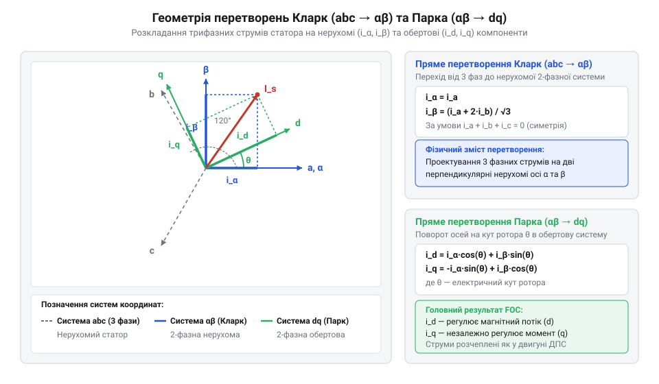
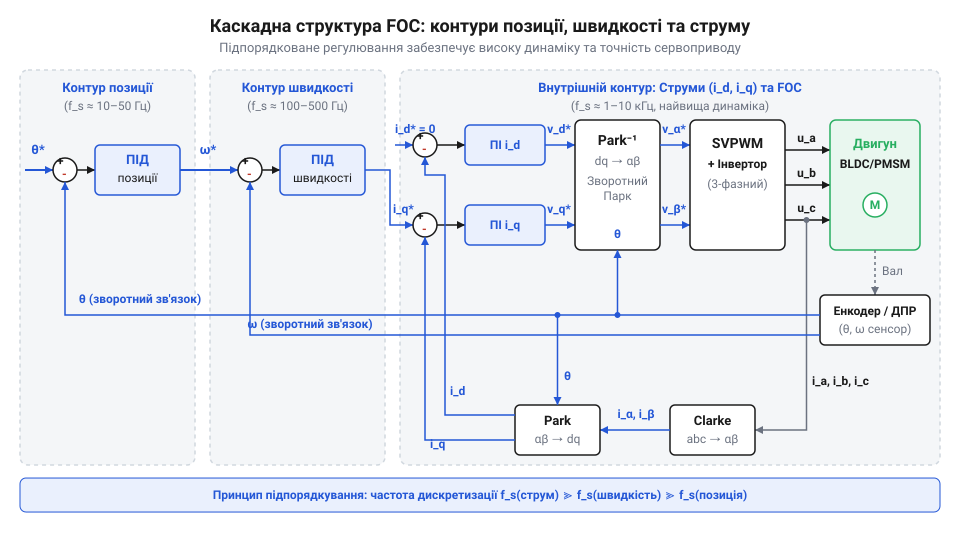

# Математичні перетворення Кларк — Парка та каскадне регулювання FOC

<preknowlist>
- [Сервоприводи радіокерованих моделей: будова, редуктори та ШІМ-керування](root:cat-hw-actuators/rc-servo-mechanisms-and-control) — принципи замкненого керування позицією та базові поняття широтної модуляції
</preknowlist>

## Проблема пульсацій та ідея векторного керування

Під час дискретного перемикання фаз безколекторного двигуна через кожні 60 електричних градусів індуктивність обмоток заважає струму змінитися миттєво. Це викликає пульсації крутного моменту (@@en|torque ripple@@) та акустичний шум.

Навіть за подачі синусоїдальних струмів `i_a`, `i_b`, `i_c` у стаціонарній трифазній системі `a, b, c` виникають обмеження. Електричну частоту `f_e` за кількості пар полюсів `p` та швидкості обертання `n` (об/хв) описує формула:

```
f_e = (p · n) / 60
```

Зі зростанням швидкості висока частота струмів статора викликає фазове запізнення й амплітудне згасання в нерухомих ПІ-регуляторах. Індуктивний перехресний зв'язок фаз за умови `i_a + i_b + i_c = 0` наводить протиелектрорушійну силу (@@en|back-EMF@@, від англ. *back electromotive force*), унеможливлюючи незалежне керування кожною фазою — на відміну від простих схем у [аналогових сервоприводах SG90](root:cat-hw-actuators/sg90-servo) або [металевих сервоприводах MG90S](root:cat-hw-actuators/mg90s-servo).

Розв'язок пропонує аналогія з колекторним двигуном постійного струму, де щітки утримують кут 90 градусів між полями статора й ротора. Його електромагнітний момент `M` залежить від конструктивної константи `k_m`, магнітного потоку `Φ` та струму якоря `I_a`:

```
M = k_m · Φ · I_a
```

Постійні струми збудження й якоря дозволяють ПІ-регуляторам працювати без статичної похибки.

Метод @@en|Field Oriented Control@@ (від англ. *field-oriented* — орієнтований за полем, скорочено FOC або векторне керування) відтворює ці умови для безколекторної машини, проектуючи вектор струму статора в обертову систему координат `dq`:
1. Поздовжня вісь `d` (@@en|direct axis@@ — від англ. *direct* — поздовжній) спрямована вздовж потоку ротора, а її струм `i_d` відповідає за намагнічування. 2. Поперечна вісь `q` (@@en|quadrature axis@@ — від англ. *quadrature* — зсунутий на 90 градусів) ортогональна до осі `d`, а її струм `i_q` створює крутний момент.

У системі `dq` змінні струми перетворюються на постійні величини `i_d` та `i_q`. ПІ-регулятори окремо підтримують потік і момент, усуваючи фазове запізнення. У контексті [будови безколекторних двигунів](root:hw-motion/bldc-motor) це ортогональне розділення ліквідує пульсації моменту, забезпечуючи порівняно з базовим [ШІМ-керуванням сервоприводами](root:cat-hw-actuators/rc-servo-mechanisms-and-control) плавність ходу на будь-якій швидкості.

## Геометрія перетворень Кларк і Парка

Перехід від виміряних фазних струмів статора до обертових компонентів `i_d` та `i_q` здійснюється двома послідовними ортогональними перетвореннями координат: Кларка та Парка.

@@en|Clarke transformation@@ проектує трифазну систему стаціонарних осей `a`, `b`, `c` (зсунутих на 120°) у двофазну нерухому декартову систему `α`, `β`, де вісь `α` суміщена з віссю фази `a`, а вісь `β` розташована під кутом +90° до неї.

У симетричній трифазній системі без нейтрального провідника `i_a + i_b + i_c = 0`, тому струм третьої фази становить:

i_c = -i_a - i_b

За амплітудно-збереженого варіанта перетворення з множником `K = 2/3` проекція миттєвих струмів фаз `i_a`, `i_b`, `i_c` на вісь `α` (з кутами 0°, 120° і 240°) визначає складову `i_α`:

i_α = (2 / 3) · (i_a · cos(0°) + i_b · cos(120°) + i_c · cos(240°))
    = (2 / 3) · (i_a - (1 / 2) · i_b - (1 / 2) · i_c)                     [підстановка значень тригонометричних функцій]
    = (2 / 3) · (i_a - (1 / 2) · i_b - (1 / 2) · (-i_a - i_b))            [заміна i_c = -i_a - i_b]
    = (2 / 3) · (i_a - (1 / 2) · i_b + (1 / 2) · i_a + (1 / 2) · i_b)     [розкриття дужок]
    = (2 / 3) · ((3 / 2) · i_a)                                           [зведення подібних доданків]
    = i_a                                                                 [скорочення множників]

Проекція на ортогональну вісь `β` розраховується аналогічно через синуси кутів для складової `i_β`:

i_β = (2 / 3) · (i_a · sin(0°) + i_b · sin(120°) + i_c · sin(240°))
    = (2 / 3) · (0 + i_b · (√3 / 2) - i_c · (√3 / 2))                    [підстановка значень синусів]
    = (1 / √3) · (i_b - i_c)                                             [винесення множника √3/2 та скорочення з 2/3]
    = (1 / √3) · (i_b - (-i_a - i_b))                                    [заміна i_c = -i_a - i_b]
    = (1 / √3) · (i_a + 2 · i_b)                                         [зведення подібних доданків]

Отже, для обчислення вектора `(i_α, i_β)` достатньо виміряти струми фаз `i_a` та `i_b`.

@@en|Park transformation@@ обертає двофазну систему `(i_α, i_β)` на кут ротора `θ` (між віссю `α` статора та віссю `d` ротора), переводячи струми в обертову систему `(i_d, i_q)`:

i_d = i_α · cos(θ) + i_β · sin(θ)
i_q = -i_α · sin(θ) + i_β · cos(θ)


*Взаємне розташування стаціонарних осей трифазної системи abc, двофазної системи alpha-beta та обертової системи dq під кутом theta.*

У результаті змінно-струмові величини `i_α` та `i_β` у стаціонарному режимі стають постійними значеннями `i_d` (поздовжня складова) та `i_q` (поперечна складова).

Після розрахунку керуючих напруг `u_d` та `u_q` здійснюються зворотні перетворення. Зворотне перетворення Парка повертає напруги в осі `α, β` обертанням на кут `-θ`:

u_α = u_d · cos(θ) - u_q · sin(θ)
u_β = u_d · sin(θ) + u_q · cos(θ)

Зворотне перетворення Кларка переводить напруги `u_α, u_β` у трифазні значення `u_a, u_b, u_c`:

u_a = u_α
u_b = -1/2 · u_α + (√3 / 2) · u_β
u_c = -1/2 · u_α - (√3 / 2) · u_β

Практична реалізація прямих та зворотних перетворень Кларка й Парка мовою C для мікроконтролера:

:::code math-foc-transformations-cascades/c/foc-clarke.c

## Математичний синтез просторово-векторної ШІМ

Згенеровані зворотним перетворенням Парка напруги `u_α` та `u_β` задають бажаний вектор напруги статора у нерухомій площині. Для формування цих напруг силовим інвертором застосовують @@en|Space Vector PWM@@ (лат. *spatium* — простір, *vector* — носій; англ. *pulse*, *width*, *modulation* — просторово-векторна широтно-імпульсна модуляція, скорочено @@en|SVPWM@@).

Трифазний мостовий інвертор має три стійки ключів, що працюють у протифазі для запобігання короткому замиканню шини живлення `U_dc`. Це створює `2³ = 8` дискретних станів інвертора:

1. Шість активних векторів `V_1(100)`, `V_2(110)`, `V_3(010)`, `V_4(011)`, `V_5(001)`, `V_6(101)` однакового модуля `(2/3) · U_dc`, розміщених у площині `αβ` під кутами 0°, 60°, 120°, 180°, 240° та 300°. Вони ділять площину на шість рівних секторів (сектори I–VI). 2. Два нульових вектори `V_0(000)` та `V_7(111)` нульового модуля, коли всі фази двигуна замкнені на один потенціал.

Заданий результуючий вектор напруги `U_out` усередині кожного сектора синтезується шляхом усереднення двох суміжних активних базових векторів `V_k`, `V_(k+1)` та нульового вектора `V_zero` протягом періоду комутації ШІМ `T_s`. Час роботи векторів визначає рівняння вольт-секундного балансу:

U_out · T_s = V_k · T_1 + V_(k+1) · T_2 + V_zero · T_0
T_1 + T_2 + T_0 = T_s

де `T_1` та `T_2` — тривалості активних векторів, а `T_0` — сумарний час нульових векторів.

Для Сектора I (між `V_1` під 0° та `V_2` під 60°) тривалості `T_1` і `T_2` обчислюють через проекції `u_α`, `u_β` та напругу шини `U_dc`:

T_1 = (√3 · T_s / U_dc) · ((√3 / 2) · u_α - (1 / 2) · u_β)
T_2 = (√3 · T_s / U_dc) · u_β
T_0 = T_s - T_1 - T_2

Щоб мінімізувати перемикання ключів і пульсації струму, застосовують симетричну 7-сегментну послідовність ШІМ. У ній `T_0` ділиться порівну між `V_0` та `V_7`, а ключі перемикаються поодинці у кожному півмості: `V_0 → V_1 → V_2 → V_7 → V_2 → V_1 → V_0`.

Порівняємо використання напруги шини між синусоїдальною ШІМ (@@en|SPWM@@, від англ. *sinusoidal pulse-width modulation*) та @@en|SVPWM@@. У класичній @@en|SPWM@@ максимальна амплітуда фазної напруги обмежена півшиною живлення:

U_max_spwm = U_dc / 2 = 0.500 · U_dc

У @@en|SVPWM@@ максимальна амплітуда `U_max_svpwm` відповідає радіусу вписаного кола у шестикутник активних векторів:

U_max_svpwm = ((2 / 3) · U_dc) · cos(30°)
            = ((2 / 3) · U_dc) · (√3 / 2)                    [значення cos(30°)]
            = U_dc / √3 ≈ 0.577 · U_dc                       [скорочення двійок]

Коефіцієнт підвищення ефективності використання напруги живлення `k_gain`:

k_gain = (U_dc / √3) / (U_dc / 2)
       = 2 / √3 ≈ 1.1547                                    [ділення дробів]

Таким чином, @@en|SVPWM@@ забезпечує на **15.47% вищий коефіцієнт використання напруги шини живлення** порівняно з @@en|SPWM@@. Це дозволяє двигуну розвивати на 15.5% вищу максимальну швидкість обертання та розширює динамічний діапазон моменту. Для розширення амплітуди напруги інвертора за межі вписаного кола шестикутника векторів та виходу в зону прямокутної ШІМ читайте статтю про [режими перемодуляції у просторово-векторній ШІМ](root:hw-motion/overmodulation-svpwm).

Обчислення коефіцієнтів заповнення імпульсів (@@en|duty cycle@@, англ. *duty* — робота, *cycle* — цикл) та вибір сектора в алгоритмі реального часу ілюструє C-код:

:::code math-foc-transformations-cascades/c/foc-svpwm.c

## Ієрархія каскадних контурів регулювання

Спроба керувати позицією ротора напряму через напругу інвертора дестабілізує сервопривід через різницю інерційності: струм у фазах змінюється за мікросекунди, а механічний ротор розганяється десятки мілісекунд. При стрибку позиції регулятор подасть максимальну напругу, викликавши сплеск струму, що здатен спалити транзистори чи розмагнітити магніти ротора ще до початку руху вала.

Цю проблему розв'язує @@en|cascaded control@@ (від італ. *cascata* — водоспад) за принципом @@en|subordinate control@@ (від англ. *subordinate* — підпорядкований; супідрядне регулювання). Система розбивається на три вкладені контури, де кожен зовнішній рівень формує уставлення для внутрішнього. На відміну від [класичних сервоприводів](root:cat-hw-actuators/rc-servo-mechanisms-and-control), це забезпечує повний контроль динамічного стану двигуна.


*Ієрархічна структура каскадного векторного керування з трьома підпорядкованими контурами та компенсацією перехресних зв'язків.*

Структура каскаду містить три підпорядковані контури:
1. **Зовнішній контур позиції (@@en|position loop@@)**. Отримує заданий кут `θ_ref` і кут ротора `θ_m` від енкодера, обчислює похибку та формує уставлення кутової швидкості `ω_ref`. Через повільність механіки діє на найнижчій частоті дискретизації `f_s,p` (500 Гц – 1 кГц). 2. **Середній контур швидкості (@@en|velocity loop@@)**. Зіставляє `ω_ref` із фактичною швидкістю `ω_m` від енкодера або [спостерігача станів](root:com-signal/bldc-rotor-observer) і задає поперечний струм моменту `i_q_ref`. Для неявнополюсних роторів уставлення намагнічувального струму `i_d_ref` дорівнює нулю. Частота дискретизації `f_s,v` становить 1–5 кГц. 3. **Внутрішній контур струму (@@en|current loop@@)**. Окремі регулятори для струмів `i_d` і `i_q` порівнюють уставлення `i_d_ref`, `i_q_ref` із виміряними значеннями та вираховують напруги `u_d` і `u_q` для блоку ШІМ. Це найшвидший контур, який працює на частоті шімування `f_sw` (10–20 кГц). Для розрахунку кутового положення ротора за згенерованою проти-ЕРС без використання фізичного енкодера перегляньте матеріал про [бездатчикові алгоритми визначення положення ротора в FOC](root:hw-motion/bldc-sensorless-observer).

Для стійкості каскаду розраховують @@en|bandwidth@@ (від англ. *bandwidth* — смуга пропускання) кожного рівня. Смуга внутрішнього струмового контуру `f_bw,i` має перевищувати смугу швидкості `f_bw,v` у 5–10 разів, а смуга швидкості — смугу позиції `f_bw,p` у стільки ж разів:

f_bw,i >> f_bw,v >> f_bw,p

Це дає змогу зовнішньому контуру сприймати внутрішній як безінерційну ланку. Зближення смуг і частот дискретизації викликає фазовий зсув, резонанс та автоколивання, як у [потужних металевих сервоприводах](root:cat-hw-actuators/mg90s-servo).

На високих швидкостях виникає @@en|cross-coupling@@ (від англ. *cross-coupling* — перехресний зв'язок): протиелектрорушійна сила та взаємна індуктивність пов'язують осі `d` і `q`. Напруги `u_d` та `u_q` залежать від опору обмотки `R_s`, струмів `i_d` і `i_q`, індуктивностей осей `L_d` і `L_q`, електричної кутової швидкості `ω_e` та магнітного потоку ротора `λ_m`:

u_d = R_s · i_d + L_d · (di_d / dt) - ω_e · L_q · i_q
u_q = R_s · i_q + L_q · (di_q / dt) + ω_e · L_d · i_d + ω_e · λ_m

Доданки `-ω_e · L_q · i_q` та `+ω_e · (L_d · i_d + λ_m)` діють як взаємні збурення. Для їх усунення застосовують @@en|feedforward compensation@@ (від англ. *feedforward* — прямий зв'язок), додаючи компенсаційні члени до виходів регуляторів:

u_d_final = u_d_pi - ω_e · L_q · i_q
u_q_final = u_q_pi + ω_e · (L_d · i_d + λ_m)

Після компенсації кожен канал струму стає лінійною ланкою першого порядку `L · (di/dt) + R · i = u_pi`, що спрощує налаштування ПІ-регуляторів за технічним оптимумом.

## Дискретизація регуляторів та реальний час

Для виконання на мікроконтролері безперервні рівняння векторного керування переводять у дискретну форму через @@en|discretization@@ (від лат. *discretus* — розділений) з періодом `T_s = 1 / f_s`. Безперервний ПІ-регулятор обчислює вихід `u(t)` з похибки `e(t) = r(t) - y(t)`. Для обчислювача використовують чисельне інтегрування за @@en|Euler method@@ (методом Ейлера назад), де на кроці `k` вихід `u[k]` становить:

e[k] = r[k] - y[k]
P[k] = K_p · e[k]
I[k] = I[k-1] + K_i_d · e[k]                         [чисельне інтегрування методом Ейлера назад]
u[k] = P[k] + I[k]                                  [сумування пропорційної та інтегральної частин]

де `K_i_d = K_i · T_s` — дискретний коефіцієнт, обчислений під час ініціалізації для зменшення кількості множень у реальному часі.

Фізичне обмеження напруги інвертора значенням `U_max = U_dc / √3` створює ризик @@en|integrator windup@@ (від англ. *windup* — накручування). Якщо обчислений вихід перевищує `U_max`, ключі подають граничну напругу, але похибка `e[k]` продовжує накопичуватись у `I[k]`. Після зміни знаку похибки перевищена сума тримає вихід у насиченні, викликаючи перерегулювання та коливання, на відміну від обмеженого ходу в [мікросервоприводах серії SG90](root:cat-hw-actuators/sg90-servo).

Для протидії цьому застосовують алгоритми @@en|anti-windup@@. За методом @@en|back-calculation@@ (від англ. *back-calculation* — зворотне обчислення) різницю між обмеженим виходом `u_sat[k]` та ненасиченим `u_unsat[k]` повертають у контур інтегратора з коефіцієнтом `K_bc`: Для детальнішого ознайомлення з чисельною реалізацією аналогових регуляторів у дискретному часі та алгоритмами запобігання насиченню інтеграторів дивіться статтю про [дискретизацію ПІД-регуляторів та алгоритми Anti-Windup](root:com-signal/discrete-pid).

I[k] = I[k-1] + K_i_d · e[k] + K_bc · (u_sat[k] - u_unsat[k])      [корекція інтегратора за обмеження виходу]

Алгоритм FOC виконується в обробнику переривань @@en|interrupt service routine@@ (від англ. *interrupt service routine*, ISR) таймера ШІМ за строгим регламентом:
1. **Вимірювання струмів та положення**. У центрі періоду ШІМ тригер АЦП зчитує фазні струми `i_a`, `i_b` без завад перемикання ключів, після чого зчитується кут `θ_e` та швидкість `ω_e`. 2. **Прямі перетворення**. Струми переводяться у `i_d`, `i_q` через перетворення Кларк та Парка. 3. **ПІ-регулювання**. Дискретні ПІ-регулятори з компенсацією перехресних зв'язків та @@en|anti-windup@@ обчислюють напруги `u_d`, `u_q`. 4. **Зворотне перетворення та ШІМ**. Зворотний Парк відновлює `u_α`, `u_β`, після чого ШІМ-модуль обраховує тривалості `T_1, T_2, T_0` і оновлює регістри `CCR1, CCR2, CCR3`.

Приклад реалізації дискретного ПІ-регулятора з протидією насиченню та викликом у реальному часі:

:::tabs
:::code math-foc-transformations-cascades/c/snippet-3.c
:::code math-foc-transformations-cascades/cpp/picontroller.cpp
:::