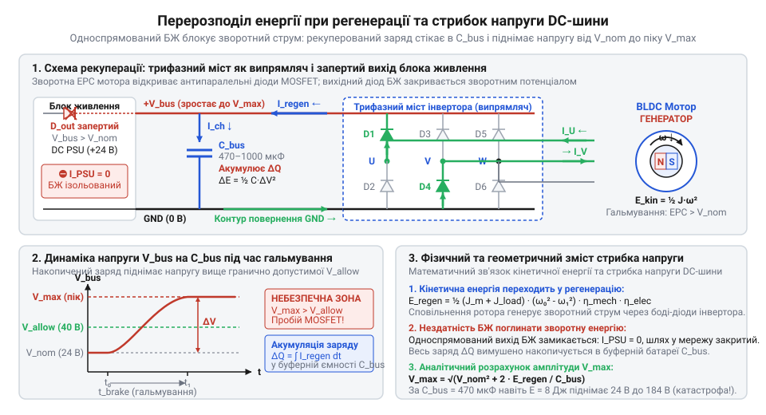
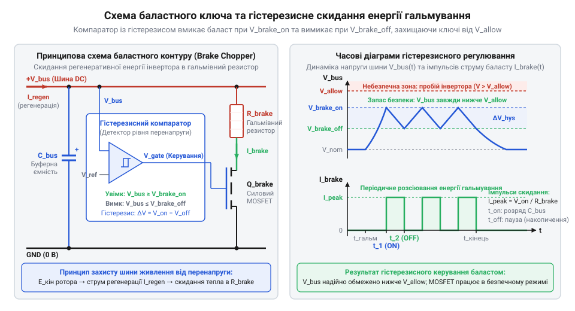

# Математичний розрахунок енергії регенерації, стрибка напруги на шині живлення та параметрів баластного резистора

## Небезпека перенапруги під час різкого гальмування

Під час екстреного гальмування або швидкого реверсу сервопривода з масивним навантаженням система може раптово вийти з ладу. Блок живлення вимикається за аварійною помилкою, або силова плата інвертора спалахує з тріском і димом. Причина полягає в тому, що при сповільненні безколекторний мотор (@@en|BLDC@@) починає працювати як генератор. Відбувається регенерація (лат. *regeneratio* — відродження, відновлення) енергії: накопичена кінетична енергія обертових мас ротора й механізму повертається назад у вигляді електричного струму.

Трифазний інвертор (лат. *invertere* — перевертати, обертати) у цей момент мимоволі перетворюється на некерований випрямляч. Згенерована обмотками мотора зворотна електрорушійна сила (ЕРС) відкриває антипаралельні зворотні діоди силових транзисторів @@en|MOSFET@@. У результаті весь регенеративний струм спрямовується назад у лінію живлення постійного струму (@@en|DC-шину@@).

Проте стандартні імпульсні блоки живлення є суто [односпрямованими перетворювачами](root:hw-power/switching-psu). Їхні вихідні випрямні діоди чи керовані ключі розраховані на передачу енергії лише в один бік — від мережі змінного струму до навантаження. Коли з боку мотора приходить зустрічний струм, вихідний діод блока живлення надійно закривається, і джерело повністю ізолюється від шини.

Оскільки зворотний шлях у мережу заблоковано, весь рекуперований заряд змушений стікати в буферний конденсатор (лат. *condensare* — згущувати) шини `C_bus`. Напруга на ньому стрімко зростає від номінального рівня живлення `V_nom` до піку `V_max`. Якщо напруга перетинає поріг спрацьовування вбудованого захисту блока від перенапруги (@@en|Overvoltage Protection@@, @@en|OVP@@), джерело аварійно вимикається й блокує керування приводом. Якщо ж захист не встигає або поріг аварії вищий, сплеск `V_max` перевищує граничну напругу пробою стік-витік `V_(BR)DSS` ключів @@en|MOSFET@@ чи допустиму напругу діелектрика конденсаторів. Виникає лавинний пробій, що випалює кристали транзисторів і призводить до вибуху буферних електролітів.


*Перерозподіл регенеративного струму через зворотні діоди інвертора на запертий вихід блока живлення та графік зростання напруги на конденсаторі C_bus: односпрямованість джерела змушує рекуперований заряд накопичуватися в ємності, викликаючи небезпечний стрибок напруги від V_nom до піку V_max.*

Звичайний блок живлення фізично не здатний поглинати повернену енергію. Щоб зберегти компоненти інвертора неушкодженими під час динамічного гальмування, інженер мусить точно розрахувати енергетичний баланс привода й передбачити активний баластний контур (@@en|brake chopper@@) для скидання надлишкової енергії в тепло.

## Механіка регенерації та енергетичний баланс

Щоб розрахувати захист від перенапруги, інженеру необхідно знати точну кількість енергії, яка повернеться на шину живлення під час гальмування. Початковим джерелом цієї енергії є механічний рух. Обертові маси ротора мотора з власним моментом інерції (лат. *inertia* — непорушність) `J_m` та [зведеного навантаження](root:hw-motion/reflected-load-inertia) `J_load` утворюють сумарну інерцію `J_total = J_m + J_load` і накопичують кінетичну (грец. *kinetikos* — рушійний) енергію. Під час сповільнення від початкової кутової швидкості `omega_0` до кінцевої `omega_1` система вивільняє різницю кінетичної енергії `E_kin`:

```
E_kin
= 0.5 · J_total · (omega_0² - omega_1²)               [теорема про зміну кінетичної енергії]
= 0.5 · (J_m + J_load) · (omega_0² - omega_1²)        [підстановка сумарного моменту інерції]
```

Цей вираз описує повний механічний ресурс, доступний для перетворення на електрику: чим масивніше навантаження і вища початкова швидкість, тим більший енергетичний удар очікує на силову частину при сповільненні.

Коли кутова швидкість спадає, мотор переходить у генераторний режим. Згенерований струм повертається на @@en|DC-шину@@ через антипаралельні діоди інвертора або через відкриті канали транзисторів @@en|MOSFET@@ під час активної ШІМ-комутації (@@en|PWM@@). Проте до електричної шини доходить лише частка механічного руху. Спершу тертя в підшипниках і зачепленнях редуктора розсіює частину роботи в тепло. Це визначає механічний коефіцієнт корисної дії `eta_mech` і лишає на валу мотора енергію `E_mech = E_kin · eta_mech`. Потім рекуперований струм зазнає джоулевих втрат на омічному опорі фазних обмоток двигуна `R_ph` та втрат перемикання в ключах інвертора, що задає електричний ККД `eta_elec`. Цей коефіцієнт залежить від амплітуди регенеративного струму `I`: омічні втрати у фазах зростають пропорційно до квадрата струму `I² · R_ph`, тоді як генерована електрична потужність збільшується зі струмом лише лінійно. Під час різкого сповільнення високий струм спричиняє значні омічні втрати: величина `eta_elec` падає, тому надходження енергії на шину зменшується ціною сильного нагрівання обмоток. Під час плавного сповільнення малий струм дає незначні втрати: величина `eta_elec` лишається високою, тому майже вся механічна енергія вала перетворюється на електрику.

У результаті чиста регенеративна енергія `E_regen`, яка заряджає конденсатори шини, формується послідовним зменшенням механічної енергії на коефіцієнти корисної дії обох підсистем:

```
E_regen
= E_mech · eta_elec                                         [електричні втрати в обмотках та інверторі]
= E_kin · eta_mech · eta_elec                               [механічні втрати в підшипниках і редукторі]
= 0.5 · (J_m + J_load) · (omega_0² - omega_1²) · eta_mech · eta_elec    [підстановка кінетичної енергії системи]
```

Обчислене значення `E_regen` показує справжню частку енергії, яка досягає буферних конденсаторів шини за інтервал гальмування. Якщо маневр завершується повною зупинкою ротора (`omega_1 = 0`), вираз дає піковий обсяг електричного заряду, стрибок напруги від якого тепер можна точно спрогнозувати.

## Стрибок напруги на буферних конденсаторах

Коли регенерована енергія `E_regen` повертається через інвертор на @@en|DC-шину@@ за відсутності активного скидання, єдиним приймачем заряду стає батарея буферних конденсаторів ємністю `C_bus`. До початку гальмування конденсатори вже заряджені до номінальної напруги джерела живлення `V_nom` і зберігають енергію електричного поля `E_cap = 0.5 · C_bus · V_nom²`. Повернений заряд додається до накопиченого, збільшуючи електричну енергію та піднімаючи потенціал шини до пікового значення `V_max`. Рівняння енергетичного балансу електричного поля зв'язує початковий і кінцевий стани конденсатора:

```
V_max
= √(2 · (0.5 · C_bus · V_nom² + E_regen) / C_bus)    [закон збереження енергії електричного поля]
= √(V_nom² + 2 · E_regen / C_bus)                   [спрощення виразу для пікової напруги]
```

Отриманий вираз показує, що пікова напруга шини зростає пропорційно квадратному кореню від регенерованої енергії та нелінійно спадає зі збільшенням буферної ємності. Різниця між кінцевим і початковим рівнями визначає результуючий стрибок напруги `Delta_V = V_max - V_nom`.

Щоб силові транзистори @@en|MOSFET@@ та самі конденсатори не зазнали пробою, амплітуда `V_max` не повинна перевищувати гранично допустиму напругу компонентів `V_allow`. Підстановка граничної умови `V_max ≤ V_allow` в енергетичний баланс дає аналітичний вираз для мінімально необхідної буферної ємності `C_min`:

```
C_min
= 2 · E_regen / (V_allow² - V_nom²)    [умова утримання напруги в межах V_max ≤ V_allow]
```

Оскільки різниця квадратів `(V_allow² - V_nom²)` у знаменнику при типовому інженерному запасі надійності є невеликою, розрахункова ємність стрімко зростає навіть за помірної енергії сповільнення. Наприклад, для сервопривода з номіналом `V_nom = 24` В і порогом безпеки `V_allow = 30` В регенерація скромних `E_regen = 5` Дж потребує `C_min = 2 · 5 / (30² - 24²) ≈ 0.031` Ф, тобто понад 30 000 мкФ.

Проте габарити компактних плат сервоприводів дозволяють встановити [буферні електролітичні конденсатори](root:hw-power/converter-caps) сумарною ємністю лише 470–1000 мкФ. За наявної ємності `C_bus = 470` мкФ та сама енергія 5 Дж спричинить стрибок до `V_max ≈ 148` В і миттєвий лавинний пробій ключів інвертора. Реальні конденсатори також мають еквівалентний послідовний опір (@@en|ESR@@, лат. *aequivalens* — рівноцінний), утворений матеріалом виводів, обкладок та електроліту. Під час різкого гальмування імпульсний струм регенерації `I_regen` тече крізь цей опір і створює додатковий миттєвий стрибок напруги `I_regen · ESR`. Цей омічний стрибок з'являється на шині одразу на фронті імпульсу, ще до накопичення заряду в ємності, тому сумарна пікова напруга сягає `V_peak = V_max + I_regen · ESR`. За імпульсного струму `I_regen = 20` А типовий опір `ESR = 150` мОм створює додаткові 3 В перенапруги в перші ж мікросекунди сповільнення та прискорює пробій транзисторів. Фізична неможливість розмістити батарею ємністю в десятки тисяч мікрофарад доводить неспроможність суто ємнісного демпфування (нім. *dämpfen* — приглушувати, гасити) і робить керований баластний резистор обов'язковим елементом захисту.

## Поріг баласту та опір резистора

Коли буферні конденсатори не здатні поглинути регенерований заряд без аварійного стрибка напруги, надлишок енергії необхідно примусово перетворити на тепло. Для цього паралельно @@en|DC-шині@@ встановлюють модуль динамічного гальмування — баластний ключ (англ. @@en|brake chopper@@, від *chop* — рубати, відсікати), побудований на керованому силовому транзисторі з послідовним резистором `R_brake`.

Ключ відкривається за порогом напруги `V_brake_on`. Цей потенціал обирають строго вищим за максимальну напругу блока живлення з урахуванням пульсацій та нестабільності мережі (`V_brake_on > V_nom_max`), щоб баласт не споживав струм від самого джерела. Водночас поріг увімкнення має лежати нижче гранично допустимої напруги транзисторів інвертора `V_allow`. Щоб уникнути брязкоту перемикань через пульсації напруги, [аналоговий компаратор напруги](root:hw-motion/bldc-servo-hardware-interface) закриває ключ за нижчим порогом `V_brake_off`, формуючи гістерезисний (грец. *hysteresis* — запізнення, відставання) коридор керування.


*Принципова схема модуля динамічного гальмування та динаміка напруги V_bus(t) і струму I_brake(t): компаратор відкриває силовий ключ при досягненні V_brake_on і відсікає струм на рівні V_brake_off, що надійно утримує напругу шини нижче гранично небезпечного порога V_allow.*

Щоб напруга шини не зростала під час інтенсивного сповільнення, баластний контур повинен розсіювати потужність, не меншу за пікову потужність регенерації `P_regen_peak`. Оскільки потужність на резисторі дорівнює `V_brake_on² / R_brake`, умова перехоплення струму визначає максимально допустимий опір `R_brake_max`:

```
R_brake_max
= V_brake_on² / P_regen_peak    [умова розсіювання пікової регенеративної потужності]
```

Якщо встановити опір, більший за розраховану межу, струм розряду буде недостатнім, і напруга на шині продовжить підніматися до аварійного порога.

З іншого боку, занадто малий опір викличе небезпечний сплеск струму через відкритий ключ: `I_brake = V_brake_on / R_brake`. Щоб амплітуда імпульсу не перевищила граничний струм стоку `I_D_max` і не вивела кристал за межі області безпечної роботи (англ. @@en|Safe Operating Area@@, @@en|SOA@@), опір резистора обмежують знизу мінімальною величиною `R_brake_min`:

```
R_brake_min
= V_brake_on / I_D_max          [обмеження пікового струму транзистора в межах SOA]
```

Розрахований інтервал `[R_brake_min, R_brake_max]` задає діапазон опорів, у якому баластний резистор надійно скидає повернену енергію без загрози електричного пробою силового ключа. Перевірити допустимість імпульсного струму стоку та теплові межі кристала за паспортом ключа дозволяє [область безпечної роботи силових польових транзисторів (SOA)](root:hw-components/soa-power-devices).

## Пікова та середньозважена теплова потужність

Гальмівний резистор сервопривода працює у повторно-короткочасному режимі: активне скидання енергії триває десятки мілісекунд під час сповільнення, після чого настає тривала пауза розгону або рівномірного руху. Обирати резистор виключно за піковою потужністю гальмування було б конструктивною помилкою: деталь на сотні ватів виявилася б значно більшою за весь привод. Нагрів резистора у сталому циклі з періодом `T_cycle` визначає середня теплова потужність `P_avg`, яку обчислюють діленням регенерованої енергії `E_regen` на повний час циклу:

```
P_avg
= E_regen / T_cycle              [визначення середньої потужності за період циклу]
```

Отримана величина задає базову вимогу тривалого теплового балансу: `P_avg ≤ P_rated`, де `P_rated` — паспортна номінальна потужність (англ. @@en|rated power@@, від англ. *rate* — оцінювати, нормувати) резистора за природного чи примусового охолодження. Якщо тривале теплове навантаження перевищує можливості конвекції корпусу, застосовують [розрахунок теплового радіатора](root:hw-motion/regenerative-brake-chopper-module).

Під час самого гальмування тривалістю `t_brake` напруга шини сягає порога активації ключа `V_brake_on`, спричиняючи пікову електричну потужність на баласті:

```
P_peak
= V_brake_on² / R_brake          [пікова електрична потужність на гальмівному резисторі]
```

Значення `P_peak` у десятки разів перевищує `P_rated`. Резистор витримує такий сплеск завдяки внутрішній теплоємності: за час у частки секунди тепло зосереджується в керамічному осерді та дротяній намотці (англ. @@en|wirewound resistor@@) і не встигає дістатися зовнішньої поверхні. Динаміку нагріву резистивного елемента під час короткого імпульсу описує перехідний тепловий опір (англ. @@en|transient thermal impedance@@, від лат. *transire* — переходити та *impedire* — перешкоджати) `Z_th(t)`.

Виробники силових резисторів нормують здатність витримувати короткі імпульси графіками перевантаження (англ. @@en|pulse derating factor@@). Вони визначають коефіцієнт `k_pulse(t_brake)`, що показує кратність допустимої потужності імпульсу відносно `P_rated` для заданого часу `t_brake`. Надійність резистора гарантують дві одночасні умови: неперевищення тривалої середньої потужності `P_avg ≤ P_rated` та обмеження енергії одиночного імпульсу `E_regen ≤ E_pulse_max`, де `E_pulse_max = P_rated · k_pulse(t_brake) · t_brake`. Теплофізику коротких імпульсів струму, розрахунок перехідного теплового опору та роботу з графіками pulse derating детально розкриває [імпульсна перевантажувальна здатність силових резисторів](root:hw-components/resistor-pulse-power-rating).

## Наскрізний інженерний алгоритм синтезу захисту

Синтез модуля динамічного гальмування об'єднує механічні та електричні моделі в послідовний інженерний алгоритм:
1. Розрахунок повної кінетичної та чистої регенерованої енергії з урахуванням механічних і електричних втрат.
2. Оцінка стрибка напруги на наявній буферній ємності шини для перевірки ризику пробою.
3. Вибір порогів увімкнення та вимкнення баластного ключа з урахуванням напруги живлення і запасу міцності напівпровідників.
4. Розрахунок діапазону опорів резистора за обмеженнями струму ключа та пікової потужності регенерації, вибір найближчого стандартного номіналу.
5. Обчислення пікової та середньої потужностей розсіювання, вибір номіналу резистора за критеріями тривалого балансу й імпульсної стійкості.

**Розрахунок системи гальмування BLDC-привода.**
Вихідні дані: напруга живлення `V_nom = 24` В, гранична напруга транзисторів інвертора `V_allow = 40` В, наявна ємність шини `C_bus = 470` мкФ, сумарна інерція `J_total = 0.002` кг·м², сповільнення від `3000` об/хв (`omega_0 = 314.16` рад/с) до повної зупинки за `t_brake = 0.05` с із періодом циклу `T_cycle = 1.5` с, сумарний коефіцієнт втрат `eta_mech · eta_elec = 0.80`, граничний струм силового ключа `I_D_max = 14` А.

Повна кінетична енергія обертання та чиста енергія регенерації визначають електричний заряд, що повертається в шину:

```
E_kin
= 0.5 · J_total · omega_0²
= 0.5 · 0.002 · 314.16²
= 9.87 Дж                        [кінетична енергія механічної системи]

E_regen
= E_kin · eta_mech · eta_elec
= 9.87 · 0.80
= 7.89 Дж                        [регенерована енергія з урахуванням втрат]
```

За відсутності баласту цей заряд викликає катастрофічний стрибок напруги на штатній ємності:

```
V_max
= √(V_nom² + 2 · E_regen / C_bus)
= √(24² + 2 · 7.89 / (470 · 10⁻⁶))
= 184 В                          [пікова напруга шини без баластного скидання]
```

Оскільки напруга `184` В значно перевищує межу транзисторів `V_allow = 40` В, наявність баластного ключа є критично необхідною. Пороги комутації призначають між робочою напругою джерела та межею транзисторів: `V_brake_on = 28` В, `V_brake_off = 26` В.

Діапазон опору резистора обмежують струмом ключа `I_D_max` та піковою потужністю регенерації `P_regen_peak = 224` Вт:

```
R_brake_min
= V_brake_on / I_D_max
= 28 / 14
= 2.0 Ом                         [обмеження пікового струму стоку в межах SOA]

R_brake_max
= V_brake_on² / P_regen_peak
= 28² / 224
= 3.5 Ом                         [умова гарантованого перехоплення регенерації]
```

З допустимого інтервалу `[2.0, 3.5]` Ом обирають стандартний номінал ряду E24 `R_brake = 3.3` Ом. Він визначає пікове електричне та середнє теплове навантаження баласту:

```
P_peak
= V_brake_on² / R_brake
= 28² / 3.3
= 238 Вт                         [пікова імпульсна потужність на резисторі]

P_avg
= E_regen / T_cycle
= 7.89 / 1.5
= 5.26 Вт                        [середня теплова потужність за період циклу]
```

Для реалізації баласту обирають дротяний резистор в алюмінієвому корпусі з номінальною потужністю `P_rated = 10` Вт. Середня потужність задовольняє тривалу умову: `P_avg = 5.26 Вт ≤ 10 Вт`. Для імпульсу тривалістю `50` мс графік імпульсного перевантаження допускає коефіцієнт `k_pulse = 25`, забезпечуючи допустиму пікову потужність `P_peak_allow = 10 · 25 = 250` Вт. Оскільки `238 Вт ≤ 250 Вт`, резистор надійно витримує повторно-короткочасні гальмівні цикли без перегріву та пробою силових ключів.
