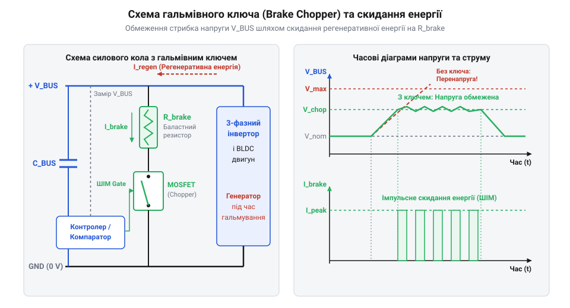
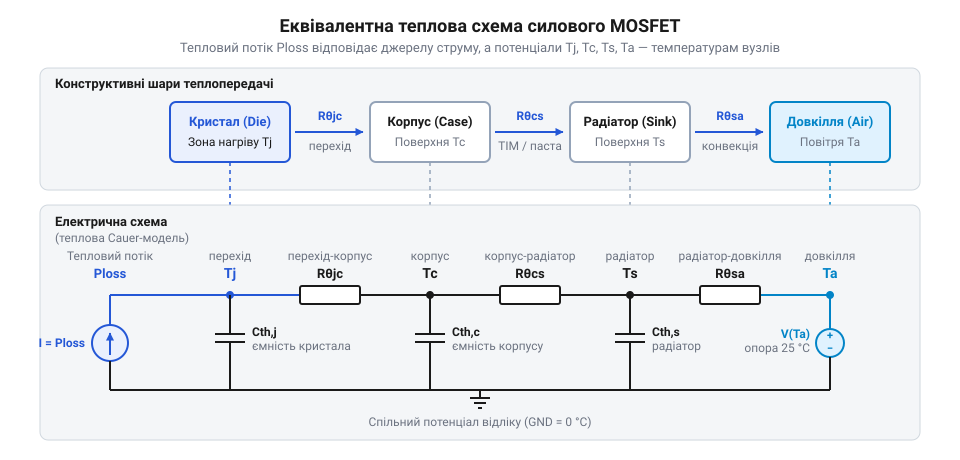

# Розрахунок енергетики регенеративного гальмування та теплового балансу

<preknowlist>
- [Сервоприводи радіокерованих моделей: будова, редуктори та ШІМ-керування](root:cat-hw-actuators/rc-servo-mechanisms-and-control) — Принцип роботи мостового інвертора, принципи ШІМ-керування обмотками та механічні передавальні відношення редуктора.
</preknowlist>

## Перенапруження шини при гальмуванні двигуна

Під час роботи електроприводу в усталеному режимі мостовий інвертор передає електричну енергію від джерела живлення до обмоток двигуна, перетворюючи її на механічну роботу обертання ротора та приєднаного навантаження. Для регулювання швидкості та моменту використовується [керування обмотками моста](root:cat-hw-actuators/rc-servo-mechanisms-and-control). Проте під час стрімкого уповільнення, примусового скидання швидкості або реверсу напрямку руху накопичена механічна енергія обертових мас прагне зберегти свій стан. Обертовий ротор разом із механізмом перетворюється на генератор, а силова схема приводу переходить у режим регенеративного гальмування (від лат. @@la|regeneratio@@ — відродження, відновлення).

Фізична природа цього процесу обумовлена явищем електромагнітної індукції. Обертаючись, ротор безколекторного двигуна постійного струму (від англ. @@en|BLDC@@ — @@en|Brushless Direct Current@@) своїм магнітним полем наводить у фазних обмотках статора проти-ЕРС (від англ. @@en|back EMF@@ — @@en|back electromotive force@@). Амплітуда проти-ЕРС прямо пропорційна кутовій швидкості обертання `ω`. Якщо коефіцієнт проти-ЕРС двигуна становить `K_e`, а кутова швидкість дорівнює `ω`, то амплітуда наведеної напруги обчислюється як:

```
E_emf = K_e · ω [амплітуда проти-ЕРС фази]
```

Коли керувальна система зменшує коефіцієнт заповнення ШІМ (від англ. @@en|PWM@@ — @@en|Pulse-Width Modulation@@) або повністю вимикає активні силові @@en|MOSFET@@-ключі для зупинки двигуна, напруга, що подається на фази від інвертора, стає меншою за сформовану проти-ЕРС `E_emf`. У цей момент струм у фазах змінює свій напрямок на протилежний. Завдяки наявності паразитних технологічних діодів (вбудованих @@en|body diodes@@) у структурі силових ключів або при активному синхронному випрямленні, 3-фазний мостовий інвертор починає працювати як некерований діодний випрямляч. Згенерований струм регенерації тече з обмоток двигуна у зворотному напрямку — безпосередньо в шину постійного струму (від англ. @@en|DC bus@@).

Більшість імпульсних джерел живлення та мережевих адаптерів є односпрямованими: вони не здатні поглинати струм, що повертається з боку навантаження. Зворотний діод на виході блокиратора джерела або закритий випрямний міст відсікають регенеративний струм від первинної мережі. В результаті єдиним елементом силового кола, здатним прийняти цей електричний заряд, стає згладжувальний конденсатор шини `C_BUS`.

Сумарна кінетична енергія `E_mech`, накопичена в обертових масах системи, визначається моментом інерції `J_total` (сума моментів інерції ротора двигуна, редуктора та приєднаного навантаження) і початковою кутовою швидкістю `ω₀`:

```
E_mech = (1/2) · J_total · ω₀² [накопичена кінетична енергія]
```

Під час гальмування частина цієї енергії неминуче розсіюється у вигляді тепла на активному опорі фазних обмоток `R_phase` та витрачається на подолання механічного тертя в редукторі з коефіцієнтом корисної дії `η_mech`. Решта кінетичної енергії перетворюється на електричну енергію регенерації `E_regen`:

```
E_regen = E_mech · η_mech - I_brake² · R_phase · t_brake [електрична енергія регенерації]
```

де `I_brake` — середнє значення струму гальмування, а `t_brake` — тривалість інтервалу уповільнення.

Оскільки струм регенерації заряджає ємність шини живлення `C_BUS`, напруга на ній зростає від початкового значення `V_BUS_0` до нового пікового рівня `V_BUS_max`. Для визначення стрибка напруги скористаємося законом збереження енергії для накопичувального конденсатора:

```
E_C2 = E_C1 + E_regen                                          [баланс енергії шини]
(1/2) · C_BUS · V_BUS_max² = (1/2) · C_BUS · V_BUS_0² + E_regen [підстановка формули енергії конденсатора]
V_BUS_max² = V_BUS_0² + (2 · E_regen) ÷ C_BUS                   [ділення на (1/2) · C_BUS]
V_BUS_max = √(V_BUS_0² + (2 · E_regen) ÷ C_BUS)                 [добування квадратного кореня]
```

З отриманого виразу видно, що за відсутності спеціалізованих захисних кіл або надзвичайно великої ємності `C_BUS` підйом напруги може багаторазово перевищити номінальне значення шини `V_BUS_0`.

Розглянемо практичний розрахунок для сервоприводу.

**Умова:** BLDC-сервопривод працює від джерела живлення `V_BUS_0 = 24 В`. На шині встановлено електролітичний конденсатор ємністю `C_BUS = 1000 мкФ` (`0.001 Ф`). Сумарний зведений момент інерції вала `J_total = 0.0006 кг·м²`. Початкова швидкість обертання `n₀ = 6000 об/хв` (`ω₀ = 628.32 рад/с`). Механічний ККД редуктора `η_mech = 0.85`. Втратами на опір обмоток для отримання найгіршого оціночного випадку знехтуємо (`E_regen ≈ E_mech · η_mech`).

```
ω₀ = (6000 × 2 × π) ÷ 60 = 628.32 рад/с               [переведення швидкості в рад/с]
E_mech = 0.5 × 0.0006 × (628.32)²
       = 0.5 × 0.0006 × 394786 = 11.84 Дж             [обчислення кінетичної енергії]
E_regen = 11.84 × 0.85 = 10.06 Дж                      [обчислення регенеративної енергії]
V_BUS_max = √((24)² + (2 × 10.06) ÷ 0.001)
          = √(576 + 20120) = √20696 ≈ 143.86 В         [обчислення пікової напруги шини]
```

**Висновок:** Під час стрімкої зупинки ротора напруга на шині живлення стрибає з `24 В` до `143.86 В`.

Таке екстремальне зростання напруги є руйнівним для силового модуля. Більшість ключів у низьковольтних інверторах мають граничну напругу сток-витік `V_DS_max` на рівні `30 В` або `60 В`. Перевищення `V_DS_max` призводить до незворотного лавинного пробою (від англ. @@en|avalanche breakdown@@ — лавинне руйнування p-n переходу) силових @@en|MOSFET@@ та вибуху електролітичних конденсаторів. Навіть у мікросервоприводах або у пристроях, де використовуються [серво з металевим редуктором](root:cat-hw-actuators/mg90s-servo) та [сервоприводи постійного обертання](root:cat-hw-actuators/continuous-rotation-servo-mod), інтенсивне гальмування без контролю напруги шини викликає аварійне перезавантаження контролера через спрацьовування захисту від перенапруження або фізичне вигорання ключів.

Отже, виникає критична потреба у створенні активного кола обмеження напруги, яке при досягненні безпечного порогу поглинатиме та розсіюватиме надлишкову енергію регенерації.

## Розрахунок гальмівного ключа та резистора

Щоб запобігти небезпечному підйому напруги на шині постійного струму `V_BUS`, у силову схему інвертора вбудовують гальмівний переривач (від англ. @@en|brake chopper@@ — пристрій уривчастого комутування гальмівного навантаження), який працює паралельно із згладжувальними конденсаторами `C_BUS`. Схема складається з порогового компаратора (від лат. @@la|comparare@@ — порівнювати), швидкого силового @@en|MOSFET@@-ключа та потужного баластного резистора `R_brake` (від нім. @@de|Ballast@@ — стабілізувальний вантаж).


*Схема гальмівного переривача та часові діаграми напруги шини живлення під час скидання регенеративної енергії.*

Принцип дії гальмівного переривача базується на безперервному моніторингу напруги `V_BUS`. Компаратор має вбудований гістерезис (від грец. @@el|hysteresis@@ — запізнення, відставання) з двома уставками: верхньою напругою ввімкнення `V_upper` та нижньою напругою вимкнення `V_lower`. Коли під час гальмування регенеративний струм заряджає ємність шини і напруга досягає верхньої межі `V_upper`, компаратор відкриває гальмівний ключ. Баластний резистор `R_brake` підключається паралельно шині живлення, створюючи низькоомний шлях для скидання накопиченої енергії у вигляді тепла. В результаті розряджання ємності `C_BUS` напруга знижується до рівня `V_lower`, після чого ключ закривається. Якщо гальмування триває, цей цикл розряджання повторюється з високою частотою. Для вибору спеціалізованих мікросхем та проектування аналогових схем керування гальмівним ключем перегляньте статтю про [контролери гальмівних переривачів та схеми керування гальмівним ключем](root:hw-power/brake-chopper-controller-ic).

Для забезпечення надійної роботи системи важливо правильно розрахувати опір резистора `R_brake`, його імпульсну й середню потужність, а також вибрати параметри гальмівного ключа.

Опір баластного резистора визначається з умови, що при максимальній генерованій потужності гальмування `P_regen_peak` струм через резистор повинен повністю відводити енергію, не дозволяючи напрузі перевищити `V_upper`. Пікова механічна потужність гальмування обчислюється через гальмівний момент `M_brake` та максимальну кутову швидкість `ω_max`:

```
P_mech_peak = M_brake · ω_max [пікова механічна потужність гальмування]
```

З урахуванням механічного ККД `η_mech` та електричних втрат на фазному опорі обмоток `R_phase` при струмі гальмування `I_brake`, пікова електрична потужність регенерації `P_regen_peak` становить:

```
P_regen_peak = P_mech_peak · η_mech - I_brake² · R_phase [пікова потужність регенерації]
```

Шукана величина баластного опору `R_brake` повинна забезпечувати поглинання потужності `P_regen_peak` при напрузі `V_upper`:

```
P_brake_peak = V_upper² ÷ R_brake               [потужність розсіювання на резисторі]
V_upper² ÷ R_brake ≥ P_regen_peak               [умова обмеження напруги]
R_brake ≤ V_upper² ÷ P_regen_peak               [максимально припустимий опір резистора]
```

З іншого боку, опір `R_brake` не повинен бути занадто малим, оскільки це спричинить надмірний амплітудний струм через гальмівний ключ `I_chopper_peak = V_upper ÷ R_brake`, що може перевищити граничний струм стоку @@en|MOSFET@@ `I_DS_max`.

Крім опору, баластний резистор характеризується двома тепловими параметрами:
1. **Пікова імпульсна потужність** `P_pulse` — резистор повинен витримувати короткочасний вибух потужності `P_pulse = V_upper² ÷ R_brake` протягом часу гальмування `t_brake` без руйнування струмоведучого шару. 2. **Середня потужність розсіювання** `P_avg` — визначається для повторно-короткочасного циклу з періодом `T_cycle` (заданий цикл гальмування):

```
P_avg = (P_pulse · t_brake) ÷ T_cycle = E_regen ÷ T_cycle [середня теплова потужність]
```

Силовий @@en|MOSFET@@-ключ гальмівного переривача вибирається за двома головними критеріями:
- Гранична напруга сток-витік `V_DS_max ≥ V_upper · 1.25` (із 25-відсотковим запасом на індуктивні викиди). - Максимальний імпульсний струм стоку `I_DM ≥ V_upper ÷ R_brake`.

Проведемо повний розрахунок параметрів гальмівного вузла для конкретного сервоприводу.

**Умова:** Привод виконує цикл позиціювання з повторним гальмуванням кожні `T_cycle = 2.0 с`. Параметри гальмування: гальмівний момент `M_brake = 2.5 Н·м`, кутова швидкість у момент початку гальмування `ω_max = 300 рад/с`, тривалість гальмування `t_brake = 0.15 с`. Механічний ККД `η_mech = 0.90`, активний опір між двома фазами двигуна `R_phase = 0.4 Ом`, струм гальмування `I_brake = 12 А`. Номінальна напруга шини `V_BUS_0 = 24 В`. Порогова напруга спрацьовування компаратора встановлена на рівні `V_upper = 28 В`.

```
P_mech_peak = 2.5 × 300 = 750 Вт                                [пікова механічна потужність]
P_loss_copper = (12)² × 0.4 = 144 × 0.4 = 57.6 Вт               [втрати в обмотках двигуна]
P_regen_peak = 750 × 0.90 - 57.6 = 675 - 57.6 = 617.4 Вт        [пікова регенеративна потужність]
R_brake ≤ (28)² ÷ 617.4 = 784 ÷ 617.4 ≈ 1.27 Ом                  [граничний опір резистора]
```

Обираємо найближче стандартне значення опору з меншого боку: `R_brake = 1.0 Ом`.

```
I_chopper_peak = 28 ÷ 1.0 = 28 А                                 [піковий струм через ключ]
P_pulse = (28)² ÷ 1.0 = 784 Вт                                   [фактична імпульсна потужність]
E_regen = 617.4 × 0.15 = 92.61 Дж                                [енергія одного імпульсу гальмування]
P_avg = 92.61 ÷ 2.0 = 46.31 Вт                                   [середня потужність розсіювання]
```

**Висновок:** Для надійного захисту шини живлення необхідно встановити баластний резистор опором `1.0 Ом`, який розрахований на імпульсну потужність не менше `784 Вт` тривалістю `0.15 с` та тривалу розсіювану потужність `P_avg ≥ 50 Вт`. Силовий @@en|MOSFET@@-ключ повинен мати граничну напругу сток-витік `V_DS_max ≥ 35 В` (з урахуванням запасу від `28 В`) та допустимий імпульсний струм `I_DM ≥ 30 А`.

## Статичні та комутаційні втрати MOSFET

Навіть після встановлення кола обмеження напруги регенерації мостовий інвертор безколекторного двигуна зазнає інтенсивного внутрішнього нагрівання під час штатної роботи. Помилково вважати силовий транзистор ідеальним ключем із нульовим опором у відкритому стані та миттєвим перемиканням. Реальні силові транзистори (від англ. @@en|MOSFET@@ — @@en|Metal-Oxide-Semiconductor Field-Effect Transistor@@) перетворюють частину електричної енергії на тепло через два фізичні механізми: опір відкритого каналу та перехідні комутаційні процеси.

Статичні втрати потужності (втрати провідності) виникають тоді, коли струм фази протікає через відкритий напівпровідниковий канал. У стані насичення канал транзистора поводиться як активний опір сток-витік `R_DS(on)`. Оскільки струм у фазах безколекторного приводу змінюється за синусоїдальним або трапецеїдальним законом під час [ШІМ-керування обмотками](root:cat-hw-actuators/rc-servo-mechanisms-and-control), теплова потужність провідності `P_cond` визначається середньоквадратичним (діючим) значенням фазного струму `I_RMS` (від англ. @@en|RMS@@ — @@en|Root Mean Square@@):

```
P_cond = I_RMS² · R_DS(on) [втрати провідності силового ключа]
```

Фізична особливість статичних втрат полягає у позитивному температурному коефіцієнті опору кремнію. Під час нагрівання кристала від кімнатної температури `25 °C` до робочих `100 °C`–`125 °C` опір відкритого каналу `R_DS(on)` зростає у `1.5`–`2.0` рази. Якщо цим ефектом знехтувати, виникає явище теплового розгону (від англ. @@en|thermal runaway@@ — саморозгін напівпровідника через лавинне зростання опору та втрат), що призводить до руйнування ключів під тривалим навантаженням.

Другою складовою є комутаційні (динамічні) втрати `P_sw`, які виникають під час зміни стану ключа з закритого на відкритий та навпаки. Оскільки затвор має паразитну вхідну ємність `C_iss` та ємність Міллера `C_rss`, процес перезаряду затвора обмежений струмом драйвера. Через це транзистор не перемикається миттєво: струм стоку `I_D` та напруга сток-витік `V_DS` протягом часу наростання `t_r` та часу спаду `t_f` одночасно мають високі значення.

Під час кожного фронту перемикання на силовому переході розсіюється імпульс енергії `E_sw`. Потужність динамічних втрат прямо пропорційна напрузі шини `V_BUS`, струму навантаження `I_load` та частоті ШІМ `f_PWM` (від англ. @@en|PWM@@ — @@en|Pulse-Width Modulation@@):

```
E_sw = (1/2) · V_BUS · I_load · (t_r + t_f) [енергія втрат за один цикл перемикання]
P_sw = E_sw · f_PWM                        [сумарна комутаційна потужність]
P_sw = (1/2) · V_BUS · I_load · (t_r + t_f) · f_PWM [загальна формула комутаційних втрат]
```

Прагнення зменшити час перемикання `t_r` та `t_f` шляхом збільшення струму затвора наражається на фізичну межу: надзвичайно висока швидкість зміни напруги `dv/dt` та струму `di/dt` спричиняє электромагнітні завади й викликає хибне відкривання протилежного ключа стойки через ємність Міллера. Навіть у колах із компактними [серво з металевим редуктором](root:cat-hw-actuators/mg90s-servo) це може спричинити короткочасне наскрізне коротке замикання півмоста. Для детального розрахунку бутстрепного живлення та вибору схемотехніки керування затворами ключів інвертора дивіться матеріал про [драйвери затворів силових MOSFET у мостових інверторах](root:hw-power/mosfet-gate-drivers-in-h-bridge).

Окрім перехідних фронтів, у напівмістових топологіях виникають втрати зворотного відновлення паразитного боді-діода `P_rr` (від англ. @@en|reverse recovery loss@@). Коли відкривається комплементарний ключ, паразитний діод розряджає накопичений заряд `Q_rr`, створюючи пік струму:

```
P_rr = Q_rr · V_BUS · f_PWM [втрати зворотного відновлення боді-діода]
```

Під час мертвого часу (від англ. @@en|dead time@@ — пауза між вимкненням одного ключа та ввімкненням іншого) струм фази протікає через боді-діод із високим падінням напруги `V_SD ≈ 0.7`–`1.2 В`. Застосування алгоритму синхронного випрямлення (від англ. @@en|synchronous rectification@@), коли після завершення мертвого часу відкривається канал @@en|MOSFET@@ із низьким опором `R_DS(on)`, кардинально зменшує ці втрати. Для поглибленого вивчення фізики мінімізації втрат провідності та налаштування часових пауз дивіться матеріал про [синхронне випрямлення та оптимізацію мертвого часу в інверторах](root:hw-power/dead-time-sizing).

Повна потужність теплових втрат одного силового ключа складається зі статичних та комутаційних компонентів:

```
P_FET = P_cond + P_sw + P_rr [сумарна потужність втрат одного ключа]
```

Для 3-фазного мостового інвертора з 6 силових ключів загальний тепловий бюджет силового модуля `P_inverter` становить:

```
P_inverter = 6 · P_FET [загальна теплова потужність інвертора]
```

Проведемо розрахунок теплових втрат для інвертора BLDC-сервоприводу.

**Умова:** 3-фазний мостовий інвертор працює від шини живлення `V_BUS = 36 В`. Діючий струм фази `I_RMS = 15 А`. Частота ШІМ встановлена на рівні `f_PWM = 30 кГц` (`30000 Гц`). Обрано силові @@en|MOSFET@@ з опором відкритого каналу `R_DS(on) = 4.0 мОм` (`0.004 Ом`) при `25 °C`. При робочій температурі кристала `100 °C` коефіцієнт зростання опору становить `K_T = 1.5` (`R_DS(on)_100 = 6.0 мОм`). Тривалість фронтів перемикання: час наростання `t_r = 30 нс`, час спаду `t_f = 40 нс` (`t_r + t_f = 70 нс = 70 × 10⁻⁹ с`). Заряд зворотного відновлення боді-діода `Q_rr = 40 нКл` (`40 × 10⁻⁹ Кл`).

```
R_DS(on)_100 = 0.004 × 1.5 = 0.006 Ом                              [корекція опору на температуру]
P_cond = (15)² × 0.006 = 225 × 0.006 = 1.35 Вт                    [обчислення статичних втрат]
P_sw = 0.5 × 36 × 15 × (70 × 10⁻⁹) × 30000
     = 0.5 × 36 × 15 × 0.00000007 × 30000 = 0.567 Вт             [обчислення комутаційних втрат]
P_rr = (40 × 10⁻⁹) × 36 × 30000 = 0.0432 Вт                       [втрати зворотного відновлення]
P_FET = 1.35 + 0.567 + 0.0432 ≈ 1.96 Вт                            [сумарні втрати одного ключа]
P_inverter = 6 × 1.96 = 11.76 Вт                                   [загальна теплова потужність інвертора]
```

**Висновок:** Кожен із шести силових ключів розсіює `1.96 Вт` тепла, а модуль загалом виділяє `11.76 Вт`. Підвищення частоти ШІМ для усунення акустичного шуму приводу лінійно збільшує комутаційні втрати, що вимагає ретельного обчислення теплового балансу.

## Теплова модель силового модуля й радіатора

Знаючи сумарну потужність теплових втрат `P_inverter`, необхідно забезпечити відведення тепла від напівпровідникових кристалів до навколишнього середовища, щоб їхня температура не перевищувала гранично припустиму величину `T_j_max` (зазвичай `150 °C` або `175 °C`). Для розрахунку температурних режимів використовується математичний апарат електротеплової аналогії (від англ. @@en|electro-thermal analogy@@ — моделювання теплових процесів за допомогою еквівалентних електричних кіл).

У цій моделі виділювана теплова потужність `P` моделюється джерелом струму, температура `T` — електричним потенціалом, а опір передачі тепла між шарами матеріалів — термічним опором `R_th` (вимірюється в `°C/Вт` або `К/Вт`).


*Еквівалентна електрична схема теплового ланцюга силового ключа та радіатора, де тепловий потік моделюється як струм, а температура — як потенціал.*

Тепловий шлях від місця виділення тепла всередині напівпровідникового переходу (від англ. @@en|junction@@ — p-n перехід кристала) до навколишнього повітря складається з трьох послідовних ланок:

1. **Опір «кристал-корпус»** `R_th_JC` (від англ. @@en|junction-to-case@@) — внутрішній термічний опір від напівпровідникової пластини до підкладки корпусу. Визначений конструкцією корпусу (наприклад, TO-220, DPAK або DirectFET) і наводиться у документації. 2. **Опір «корпус-радіатор»** `R_th_CS` (від англ. @@en|case-to-sink@@) — термічний опір контактного шару. Залежить від термопасти або ізолювальної силіконової термопрокладки (від англ. @@en|thermal pad@@). 3. **Опір «радіатор-довкілля»** `R_th_SA` (від англ. @@en|sink-to-ambient@@) — термічний опір радіатора (від англ. @@en|heat sink@@), який розсіює тепло в навколишнє середовище конвекцією або обдувом.

Для поверхнево-монтованих ключів у малогабаритних пристроях, таких як [мікросервоприводи](root:cat-hw-actuators/sg90-servo) та сервоприводи [родини Power HD](root:cat-hw-actuators/powerhd-family), роль радіатора виконують внутрішні мідні шари друкованої плати. Теплопередача від транзистора до внутрішніх шарів забезпечується масивом металізованих теплових отворів (від англ. @@en|thermal vias@@), кожен з яких додає паралельний термічний опір порядку `100 °C/Вт`–`150 °C/Вт`. Для детального розрахунку термічного опору мідних шарів та масивів переходів перегляньте статтю про [термоотвори та теплову топологію друкованих плат силових драйверів](root:hw-pcb/thermal-vias).

У сталому тепловому режимі сумарний термічний опір `R_th_total` дорівнює сумі опорів усіх послідовних ланок:

```
R_th_total = R_th_JC + R_th_CS + R_th_SA [сумарний термічний опір ланцюга]
```

Розрахункова температура напівпровідникового переходу `T_j` під дією теплового потоку `P_FET` при температурі довкілля `T_a` обчислюється за формулою:

```
T_j = T_a + P_FET · R_th_total [температура напівпровідникового переходу]
```

Для забезпечення довговічності силових модулів застосовують інженерне правило зниження параметрів (від англ. @@en|derating@@ — навмисне обмеження максимальних робочих температур): робоча температура кристала `T_j` не повинна перевищувати `100 °C`–`110 °C`.

Окрім сталого режиму, важливо враховувати теплову інерційність. Кожен шар матеріалу має теплоємність `C_th` (вимірюється в `Дж/°C`). Під час короткочасних імпульсів гальмування або прискорення (тривалістю десятки мілісекунд) тепловий потік не встигає прогріти масивний радіатор. У таких динамічних режимах замість статичного опору `R_th` використовують перехідний термічний імпеданс `Z_th(t)` (від англ. @@en|transient thermal impedance@@), значення якого для коротких імпульсів є значно меншим за `R_th`, що захищає кристал від миттєвого перегріву.

Сформулюємо методику розрахунку необхідного термічного опору радіатора `R_th_SA` для силового модуля BLDC-драйвера.

**Умова:** 6 силових ключів інвертора розсіюють загальну теплову потужність `P_inverter = 12 Вт` (по `P_FET = 2.0 Вт` на кожен транзистор). Транзистори встановлені на один спільний алюмінієвий радіатор через ізоляційні термопрокладки. Гранична робоча температура кристала обмежена рівнем `T_j_max_working = 110 °C`. Максимальна температура у відсіку приводу `T_a = 50 °C`. Параметри ключів: внутрішній опір «кристал-корпус» `R_th_JC = 2.5 °C/Вт`, опір термопрокладки «корпус-радіатор» `R_th_CS = 0.5 °C/Вт` на один транзистор.

```
ΔT_max = 110 - 50 = 60 °C                                          [максимально припустимий перепад температур]
ΔT_JC_CS = 2.0 × (2.5 + 0.5) = 2.0 × 3.0 = 6.0 °C                 [перепад температур на корпусі та прокладці]
T_s_max = 110 - 6.0 = 104.0 °C                                     [максимально припустима температура радіатора]
ΔT_SA = 104.0 - 50 = 54.0 °C                                       [припустимий перепад на радіаторі]
R_th_SA ≤ 54.0 ÷ 12.0 = 4.5 °C/Вт                                  [максимальний термічний опір радіатора]
```

**Висновок:** Для забезпечення теплового балансу силового модуля спільному радіаторові необхідно мати термічний опір `R_th_SA ≤ 4.5 °C/Вт`. Якщо габаритні обмеження не дозволяють встановити такий радіатор при природній конвекції, застосовують примусове обдування або використовують зовнішню металеву конструкцію як додатковий тепловод.