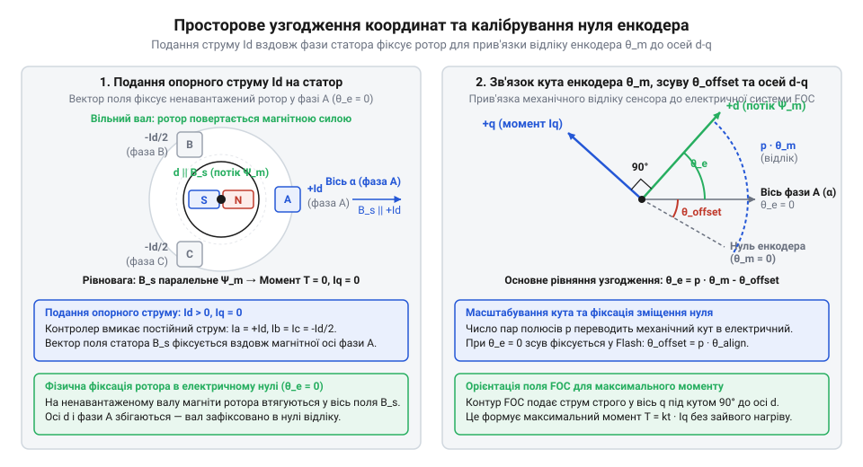

# Введення в дію інтегрального сервопривода: калібрування електричного нуля, фазування обмоток та автоналаштування контурів

<preknowlist>
- [Tower Pro SG90 — мікросерво 9g](root:cat-hw-actuators/sg90-servo) — принцип замкненого позиційного керування приводом, відпрацювання цільового кута за датчиком зворотного зв'язку та обмеження класичних щіткових сервомашинок із потенціометром
- [Серво-роги (запасні)](root:cat-hw-actuators/servo-horns) — способи жорсткого механічного сполучення вихідного вала привода з навантаженням та вплив приєднаної маси на динаміку перехідних процесів
</preknowlist>

## Небезпека пуску без узгодження координат

На відміну від простих щіткових сервомашинок на кшталт [мікросервопривода SG90](root:cat-hw-actuators/sg90-servo), де полярність напруги безпосередньо визначає напрямок руху вала, інтегральний безколекторний сервопривід (від лат. @@la|servus@@ — «слуга») вимагає постійного знання просторового положення магнітів. Спроба одразу замкнути контур швидкості чи позиціювання, коли на вал уже змонтовано [жорсткі серво-роги](root:cat-hw-actuators/servo-horns) з навантаженням, перетворює пристрій на джерело аварійних ударів. Контролер [векторного керування FOC](root:hw-motion/foc-control) (англ. @@en|Field-Oriented Control@@, скорочено @@en|FOC@@) формує обертове магнітне поле статора (від лат. @@la|stator@@ — «той, хто стоїть») за показами кутового давача — енкодера (від англ. @@en|encode@@ — «кодувати»).

Без попереднього калібрування контролер не знає, де перебувають полюси ротора (від лат. @@la|rotare@@ — «обертатися»), і прикладає вектор напруги під випадковим електричним кутом. Якщо похибка орієнтації перевищує 90 електричних градусів, електромагнітний момент змінює знак. Від'ємний зворотний зв'язок стає додатним: замість виправлення відхилення магнітне поле штовхає ротор у бік помилки. Вал зривається в неконтрольований розгін у рознос, виникають жорсткі вібрації та високий вереск, а ударне навантаження здатне зрізати зубці редуктора.

Водночас через несинхронне обертання проти-ЕРС (електрорушійна сила) не встигає компенсувати прикладену напругу. Струм у фазах лавиноподібно зростає, за кілька секунд перегріваючи обмотки та вибиваючи ключі [трифазного силового інвертора](root:hw-motion/three-phase-inverter-bridge) (від лат. @@la|invertere@@ — «перевертати»). Спроба пуску «наосліп» неминуче руйнує або механічний вузол, або електроніку. Замкнене керування @@en|FOC@@ можливе лише після детермінованої процедури введення в дію: вимірювання опору й індуктивності, верифікації чергування фаз і прив'язки електричного нуля енкодера до осі статора.

## Визначення активного опору та індуктивності

Для налаштування контурів струму алгоритму @@en|FOC@@ регулятор має знати електричні параметри підключеного мотора. Запуск без точних характеристик обмоток унеможливлює розрахунок коефіцієнтів підсилення, спричиняючи коливання струму або повільний відгук привода.

Силовий @@la|інвертор@@ вимірює активний опір мотора без зовнішніх приладів. Контролер подає на обмотки серію коротких каліброваних імпульсів постійної напруги малого рівня вздовж осі прямої складової поля, коли кут @@la|ротора@@ умовно прийнято за нуль. Тривалість імпульсу обирають достатньою для затухання перехідного процесу наростання струму, але замалою, щоб зрушити ненавантажений @@la|ротор@@ без [важелів вихідного вала](root:cat-hw-actuators/servo-horns). Вбудований у силовий міст вимірювальний @@en|шунт@@ (англ. shunt — відгалуження), описаний через [апаратний інтерфейс драйвера](root:hw-motion/bldc-servo-hardware-interface), фіксує усталене значення струму.

Активний фазний опір `R` обчислюють із прикладеної тестової напруги `U` та виміряного стаціонарного струму `I`:

R = U / I      [закон Ома для постійного струму]

Тут напруга `U` ділиться на струм `I` без урахування реактивної складової, оскільки в усталеному режимі постійного струму спад напруги на @@la|індуктивності@@ дорівнює нулю. Контролер перевіряє поріг струму: значення нижче рівня шуму свідчить про обрив фази, а перевищення граничного струму викликає аварійне вимкнення.

Далі на фази подають високочастотні імпульси змінної полярності для визначення @@la|індуктивності@@ (лат. inductio — наведення). Знакозмінні імпульси запобігають появі постійного магнітного потоку, виключаючи механічний поворот вала та компенсуючи апаратний зсув нуля аналого-цифрового перетворювача. Амплітуду обирають так, щоб магнітопровід @@la|статора@@ не увійшов у магнітне @@la|насичення@@ (лат. saturatio — пересичення), коли проникність заліза різко падає.

Еквівалентну фазну @@la|індуктивність@@ `L` обчислюють через напругу імпульсу `U`, спад напруги на активному опорі від середнього струму `I`, тривалість тестового такту `Δt` та викликаний приріст струму `ΔI`:

L = (U - R · I) · Δt / ΔI      [закон електромагнітної індукції]

Отримані значення опору й @@la|індуктивності@@ визначають електричну постійну часу фази `τ = L / R`, необхідну для аналітичного синтезу регулятора струму.

## Фазування обмоток і верифікація полюсів

Знання електричних параметрів обмоток недостатньо для замикання контурів: невідповідність порядку чергування фаз напрямку @@en|енкодера@@ або хибна кількість полюсів перетворюють від'ємний зворотний зв'язок на додатний, спричиняючи розгін вала в рознос.

Для перевірки відповідності застосовують обертання у @@en|відкритому контурі@@ (англ. open loop — незамкнене коло) методом @@en|мікрокроку@@ (грец. mikros — малий та англ. step — крок). Контролер генерує плавно обертовий вектор напруги статора без урахування показів положення, використовуючи алгоритми, описані через [принципи векторного керування](root:hw-motion/foc-control). Магнітне поле @@la|ротора@@ втягується у поле @@la|статора@@ й змушує ненавантажений вал повільно обертатися слідом за віртуальним вектором.

Під час руху контролер зіставляє знак приросту кута завдання зі знаком приросту відліків, які передає @@en|енкодер@@. Якщо знаки збігаються, фазування вважається прямим. Якщо ж @@en|енкодер@@ фіксує обертання у протилежний бік, контролер програмно змінює порядок фаз, міняючи місями дві фазні осі в перетвореннях координат без фізичного перекомутування дротів.

Здійснивши задану кількість повних обертів електричного вектора, система визначає кількість @@en|пар полюсів@@ (англ. pole pairs). Кількість @@en|пар полюсів@@ `p` обчислюють як відношення сумарного електричного кута повороту вектора `Δθ_elec` до виміряного енкодером механічного кута повороту вала `Δθ_mech`:

p = Δθ_elec / |Δθ_mech|      [співвідношення електричного та механічного кутів]

Результат ділення округлюють до найближчого цілого, оскільки кутовий крок між полюсами @@la|статора@@ є строго фіксованим конструкцією мотора. Якщо @@la|ротор@@ не зрушив з місця, алгоритм фіксує механічне заклинювання або обрив зв'язку з датчиком. Відхилення отриманого дробового значення від найближчого цілого понад чверть свідчить про пропуск кроків або зрив синхронізації поля, що вимагає аварійної зупинки калібрування.

## Калібрування зміщення електричного нуля енкодера

Для створення максимального моменту на кожен ампер струму алгоритм @@en|FOC@@ має прикладати вектор магнітного поля @@la|статора@@ строго під кутом 90 електричних градусів до поля постійних магнітів @@la|ротора@@. Проте абсолютний @@en|енкодер@@ після ввімкнення повертає довільний кут, не прив'язаний до орієнтації полюсів. Будь-яке кутове відхилення пропорційно зменшує корисну тягу мотора й спричиняє паразитний нагрів обмоток.

Для пошуку відліку контролер подає постійний струм поздовжньої осі `Id` за нульового поперечного струму `Iq = 0`. Цей струм створює нерухомий опорний магнітний вектор уздовж осі першої фази. Магніти @@la|ротора@@ втягуються в опорне поле, повертаючи вал у положення електричного нуля, немов стрілка компаса. Після затухання коливань контролер фіксує покази датчика як кутове зміщення нуля (англ. @@en|zero offset@@) `θ_offset`. Вал має бути ненавантаженим: статичний опір від приєднаних [серво-рогів](root:cat-hw-actuators/servo-horns) відхиляє @@la|ротор@@ і вносить похибку.

*Струм Id орієнтує вісь ротора за фазою A, визначаючи зміщення θ_offset для перетворення координат d-q.*

Миттєвий електричний кут комутації `θ_elec` обчислюють за кутом вала `θ_mech`, кількістю @@en|пар полюсів@@ `p` та зміщенням нуля `θ_offset`:

θ_elec = (p · θ_mech - θ_offset) mod 2π      [трансляція координат ротора]

Множення на кількість полюсів масштабує кут в електричні періоди, а віднімання зміщення суміщає координати. Залишок від ділення на `2π` повертає кут у діапазон одного оберту для орієнтації струму в [обертовій системі координат d-q](root:hw-motion/foc-control).

## Аналітичне налаштування контуру фазного струму

Узгодження електричного кута дає змогу безпечно орієнтувати поле @@la|статора@@, але подача напруги без регулювання струму призводить до аварійних перевантажень. Струм визначає крутний момент мотора, тому сервоконтролер замикає найглибший @@en|контур струму@@ поздовжньої та поперечної осей `Id` та `Iq`, перетворюючи @@la|інвертор@@ на кероване джерело сили. Фазна обмотка є послідовним RL-ланцюгом із передавальною функцією `G(s) = 1 / (L · s + R)` та електричною постійною часу `τ = L / R`.

Замість тривалого емпіричного підбору застосовують аналітичну компенсацію полюса (англ. @@en|pole-zero cancellation@@). Нуль пропорційно-інтегрального регулятора (від лат. @@la|proportionalis@@ — «домірний» та @@la|integro@@ — «відновлюю», скорочено @@en|ПІ-регулятор@@) обирають так, щоб компенсувати полюс обмотки: `Ki / Kp = R / L`. Завдяки цьому замкнений контур перетворюється на аперіодичну ланку зі смугою пропускання `ω_bw` (англ. @@en|bandwidth@@, вимірюється в рад/с).

Коефіцієнти підсилення контуру струму розраховують через смугу пропускання `ω_bw`, @@la|індуктивність@@ `L` та активний опір `R`:

Kp = ω_bw · L      [компенсація полюса обмотки]
Ki = ω_bw · R      [налаштування інтегральної складової]

Смугу `ω_bw` обмежують частотою комутації: щоб уникнути фазового запізнення від дискретизації, частоту зрізу обирають не вище однієї десятої від частоти перемикання ШІМ.

Для перевірки параметрів виконують тест на @@en|сходинковий відгук@@ (англ. @@en|step response@@). За заблокованого @@la|ротора@@ подають стрибок завдання струму `Iq`. Контролер вимірює форму струму на @@en|шунтах@@: аперіодичне наростання без перерегулювання (англ. @@en|overshoot@@ — вихід за межу) підтверджує стійкість. Коливання свідчать про занижену @@la|індуктивність@@ або затримку вимірювання.

## Налаштування контурів швидкості та позиції

Налаштований @@en|контур струму@@ стабілізує момент, проте механічні параметри привода невідомі: змонтовані механізми та [серво-роги](root:cat-hw-actuators/servo-horns) додають момент інерції `J` та коефіцієнт в'язкого тертя `B`. Керування будують за каскадною схемою (від фр. @@fr|cascade@@ — «водоспад»): зовнішній пропорційний контур позиції обчислює цільову швидкість, внутрішній контур швидкості формує завдання струму моменту `Iq`, а @@en|контур струму@@ створює напругу на фазах.

Контури налаштовують послідовно від внутрішнього до зовнішнього за графіком ступінчастого відгуку. Спершу налаштовують контур швидкості, подаючи сходинку завдання. Завищений коефіцієнт `Kp` спричиняє недодемпфований рух із надмірним перерегулюванням, що породжує металевий дзвін у вузлі та нагрів мотора. Занижений `Kp` дає передемпфовану мляву реакцію з великим динамічним відставанням. Ціллю є критичне демпфування (від нім. @@de|dämpfen@@ — «глушити»): мінімальний час встановлення та перерегулювання не більше 5%.

*Форма перехідних кривих швидкості та кута під навантаженням: критичне демпфування забезпечує максимальну швидкодію без вібрацій і дзвону.*

Чисельне диференціювання кута вала `Δθ / Δt` підсилює високочастотний шум квантування @@en|енкодера@@, збурюючи струм. Сигнал швидкості згладжують через [цифровий фільтр низьких частот](root:com-signal/band-filters) без внесення фазового зсуву. Після стабілізації швидкості замикають контур позиції, обираючи його смугу пропускання утричі нижчою за контур швидкості для виключення коливань. Інтегратор швидкості обмежують за допомогою [алгоритму захисту від насичення](root:math-analysis/anti-windup), що усуває закидання струму під час зупинки.

## Діагностика типових збоїв під час пуску

Навіть після коректного автокалібрування привід під час різких маневрів може раптово втратити тягу або вимкнутися за захистом. Найпідступнішим дефектом монтажу є прослизання магніту (англ. @@en|angle slip@@). Якщо дисковий магніт закріплено на торці вала ненадійно, під дією кутового прискорення він провертається на кілька градусів. Унаслідок цього зсуву кут комутації втрачає узгодженість: замість кута 90 електричних градусів поле @@la|статора@@ спрямовується повз магніти @@la|ротора@@. Корисний момент падає, а контур позиції намагається компенсувати помилку й вдуває в обмотки граничний струм, спричиняючи стрімкий аварійний нагрів мотора без навантаження у статиці.

Інша відмова виникає під час різкого сповільнення [масивних серво-рогів](root:cat-hw-actuators/servo-horns): кінетична енергія навантаження перетворює мотор на генератор. Зворотний струм через діоди силового @@la|інвертора@@ заряджає конденсатори шини живлення, викликаючи сплеск напруги. Якщо напруга шини перевищує безпечну межу транзисторів, контролер фіксує перенапругу (англ. @@en|overvoltage fault@@) і знеструмлює фази. Для скидання надлишку регенеративної енергії використовують модуль гальмівного баласту (від англ. @@en|brake@@ — «гальмо» та @@en|chop@@ — «рубати», англ. @@en|brake chopper@@), який розсіює струм на резисторі.

На малих швидкостях рівномірність руху збурює зубчастий момент (від англ. @@en|cog@@ — «зубець», англ. @@en|cogging torque@@) — паразитна пульсація від притягання ротора до пазів заліза. Її усувають попередньою компенсацією зубчастого моменту через пряму корекцію струму `Iq`. Нарешті, швидка комутація ключів інвертора наводить електромагнітні завади (англ. @@en|EMI@@) на сигнальні дроти @@en|енкодера@@. Паразитний фазовий шум діагностують за дрижанням кутової швидкості у стані спокою та придушують крученими парами з диференціальним приймачем.
