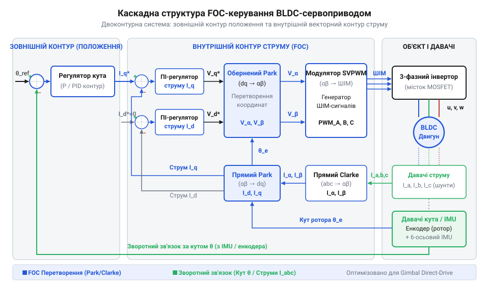
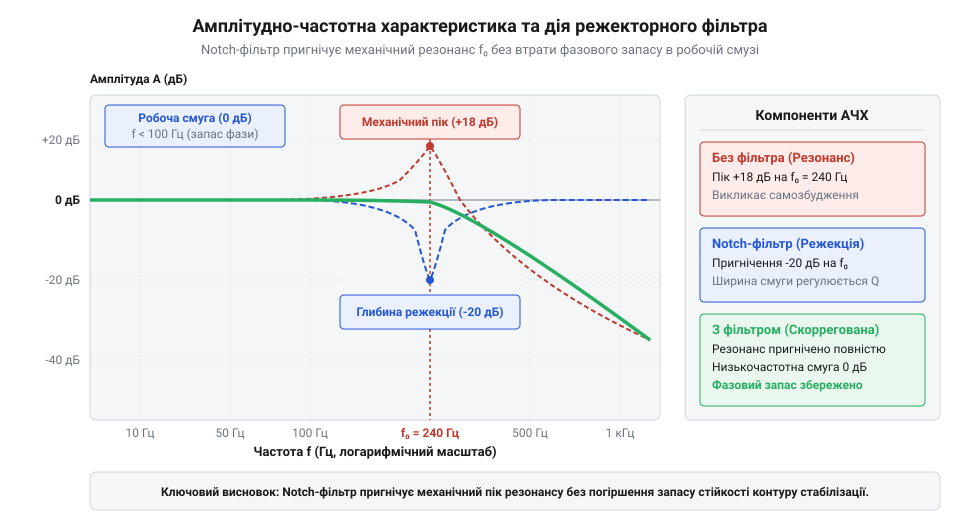
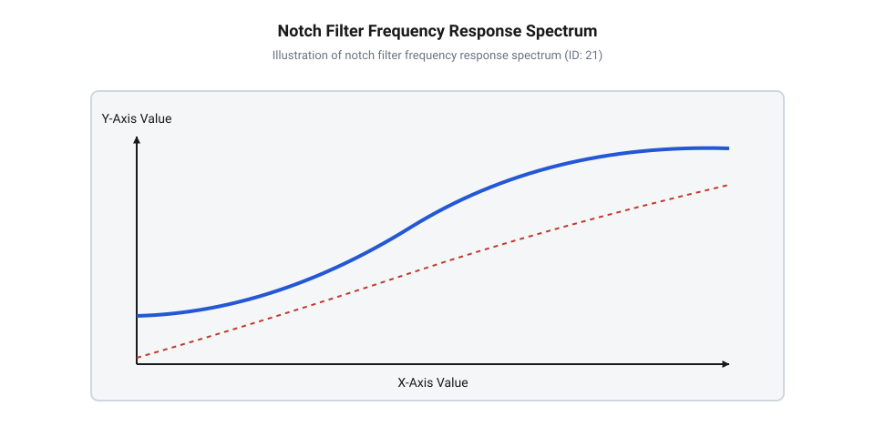

# Реалізація безредукторного підвісу камери з ультраплавним FOC-керуванням

<preknowlist>
- [Сервоприводи радіокерованих моделей: будова, редуктори та ШІМ-керування](root:cat-hw-actuators/rc-servo-mechanisms-and-control) — розуміння принципу роботи класичного ШІМ-керування, зворотного зв'язку за положенням та обмежень механічних редукторів
</preknowlist>

## Проблема мікродрижання та перехід до FOC

Зйомка відео з ручних стабілізаторів, мультироторних дронів або рухомих платформ висуває наджорсткі вимоги до точності утримання оптичної осі камери. При використанні сучасних матриць високої роздільної здатності або довгофокусних об'єктивів навіть найменше кутове відхилення у частки градуса перетворюється на видиме розмиття зображення та дрібне високочастотне дрижання (від англ. @@en|micro-jitter@@, мікродрижання).

Спроба застосувати класичні [сервоприводи радіокерованих моделей](root:cat-hw-actuators/rc-servo-mechanisms-and-control) для стабілізації підвісу камери виявляє фундаментальні фізичні обмеження механічних передач. Будь-який понижувальний редуктор — чи то із зубчастими шестернями, чи із черв'ячною передачею — має механічний люфт (від нім. @@de|Luft@@, зазор). Коли система стабілізації намагається внести мікрокорекцію кута, мотор повертається на малий кут, але вихідний вал залишається нерухомим, поки зубці шестерень не оберуть зазор. При зміні напрямку обертання цей люфт створює мертву зону позиціонування, викликаючи дискретні ривки камери замість плавної компенсації.

Крім люфту, механічний редуктор створює паразитні вібрації від совання й зачеплення зубців шестерень під навантаженням. Високошвидкісне обертання ротора мотора, трансформоване у низькі оберти вихідного вала, передає на рамку підвісу пружні деформації та високочастотний шумок. Звичайний аналоговий чи цифровий ШІМ-сервопривод із потенціометром зворотного зв'язку оновлює позицію з частотою 50–333 Гц та володіє дискретним кроком позиціонування, що принципово унеможливлює субградусну плавність. Крокові двигуни та 6-крокові безколекторні мотори при покроковому перемиканні фаз також створюють зубцевий магнітний момент (від англ. @@en|cogging torque@@), який відчувається як дискретні клацання при обертанні.

Для досягнення абсолютно плавної стабілізації камери необхідна відмова від механічних передач і перехід до прямого приводу (від англ. @@en|Direct Drive@@). У безредукторному підвісі рамка камери кріпиться безпосередньо на ротор спеціалізованого безколекторного мотора постійного струму (від англ. @@en|Brushless DC Motor@@, BLDC). Відсутність шестерень повністю усуває механічний люфт, тертя та знос, забезпечуючи нульову затримку відгуку на механічний момент.

Однак прямий привід вимагає принципово іншого способу керування двигуном. Замість дискретного перемикання фаз застосовують орієнтоване на поле керування (від англ. @@en|Field-Oriented Control@@, FOC, векторне керування). Векторне керування безперервно вимірює кутове положення ротора та формує у статорних обмотках плавну синусоїдальну систему трифазних струмів. Вектор магнітного поля статора утримується суворо ортогонально (під кутом 90 електричних градусів) до вектора постійних магнітів ротора. Завдяки цьому мотор формує ідеально рівномірний обертовий момент без мікрострибків, а редукція передавального відношення реалізується екологічно «магнітним шляхом» за рахунок великої кількості полюсних пар (наприклад, 12 або 14 полюсів).

## Налаштування FOC-контуру високоопірних BLDC-моторів

Математична основа векторного керування FOC полягає у перетворенні трифазної системи координат статора у двофазну обертову систему, прив'язану до ротора. На відміну від силових BLDC-моторів дронів, де фазовий опір становить одиниці міліом, спеціалізовані підвісні BLDC-мотори (від англ. @@en|Gimbal Motor@@) намотуються великою кількістю витків тонкого дроту. Їхній фазовий опір становить 10–20 Ом, а робочі струми обмежені сотнями міліампер.

Високий фазовий опір робить шунтові вимірювання струму малоефективними через низьке співвідношення сигнал/шум. Тому в підвісах камери часто застосовують напруговий режим FOC (від англ. @@en|Voltage-Mode FOC@@), де векторний контур формує вектори напруги $V_d$ та $V_q$, які безпосередньо визначають струм через омічний опір обмоток $I \approx V / R$.

Для керування моментом FOC виконує послідовність векторних перетворень. Спочатку перетворення Кларка (від англ. @@en|Clarke Transformation@@) переводить трифазні величини статора $(a, b, c)$ у двофазну непорушну ортогональну систему координат $(\alpha, \beta)$:

```
v_alpha = v_a
v_beta  = (v_a + 2 × v_b) / √3
```

Наступне перетворення Парка (від англ. @@en|Park Transformation@@) обертає систему координат $(\alpha, \beta)$ на поточний електричний кут ротора $\theta_e$, переходячи в роторну систему $(d, q)$:

```
v_d =  v_alpha × cos(theta_e) + v_beta × sin(theta_e)
v_q = -v_alpha × sin(theta_e) + v_beta × cos(theta_e)
```

У цій системі вісь $d$ відповідає за поздовжнє намагнічування ротора (у стабілізаторах її задають рівною нулю $V_d = 0$), а вісь $q$ виражає корисний обертовий момент $V_q$.


*Структурна схема FOC-контуру: перетворення координат Кларка й Парка, регулятори струмів d/q та SVPWM-модулятор для прямого приводу.*

Після розрахунку вихідних керуючих напруг $V_d$ та $V_q$ зворотне перетворення Парка формує напруги $V_\alpha$ та $V_\beta$, які подаються на просторово-векторний ШІМ-модулятор (від англ. @@en|Space Vector Pulse Width Modulation@@, SVPWM). На відміну від звичайної синусоїдальної модуляції, SVPWM підмішує в сигнатуру напруг нульову послідовність (від англ. @@en|Zero-Sequence Voltage@@, зсув нейтралі):

```
v_zero = 0.5 × (v_min + v_max)
duty_a = (v_a - v_zero) / v_dc + 0.5
duty_b = (v_b - v_zero) / v_dc + 0.5
duty_c = (v_c - v_zero) / v_dc + 0.5
```

Це дозволяє розширити максимальну вихідну напругу фаз на $15.5\%$ при тій самій напрузі DC-шини $V_{dc}$ та зменшити гармонійні спотворення.

Для силового керування трифазним інвертором силові ключі програмують у режимі вирівнювання ШІМ по центру (від англ. @@en|Center-Aligned Mode 1@@). Апаратний таймер лічить у двох напрямках ($0 \to \text{ARR} \to 0$), що зменшує вищаній шумок перемикання. Між комплементарними виходами фаз обов'язково впроваджують мертвий час (від англ. @@en|Dead-time@@) тривалістю $1.0\dots 1.5\ \mu\text{s}$, який запобігає короткому замиканню стійки інвертора.

Нижче наведено практичну реалізацію математичних перетворень FOC та конфігурації ШІМ-драйвера:

:::tabs
@tab C
:::code proj-camera-gimbal-stabilizer/c/include/foc_math.h
:::code proj-camera-gimbal-stabilizer/c/src/foc_math.c 38-44
:::code proj-camera-gimbal-stabilizer/c/src/foc_math.c 62-70
:::code proj-camera-gimbal-stabilizer/c/src/foc_math.c 96-131
:::code proj-camera-gimbal-stabilizer/c/include/pwm_driver.h
:::code proj-camera-gimbal-stabilizer/c/src/pwm_driver.c 56-118
@tab C++
:::code proj-camera-gimbal-stabilizer/cpp/include/foc_modulator.hpp
:::code proj-camera-gimbal-stabilizer/cpp/src/foc_modulator.cpp
:::

## Інтеграція SPI IMU та розрахунок кута

Зворотний зв'язок за кутовим положенням і швидкістю камери забезпечує інерційний модуль (від англ. @@en|Inertial Measurement Unit@@, IMU), що складається з 3-осьового акселерометра та 3-осьового гіроскопа. Оскільки контур стабілізації підвісу працює на частотах 1–2 кГц, опитування давача через повільну шину I2C (400 кГц) створює неприпустимі затримки до 1.5 мс. Для високошвидкісного зв'язку застосовують інтерфейс SPI на частоті 8 МГц (режим SPI Mode 3: $\text{CPOL}=1, \text{CPHA}=1$).

Опитування IMU виконують у режимі пакетного зчитування (від англ. @@en|burst read@@). За одну транзакцію зі зсувом лінії Chip Select ($\text{CS}$, від англ. @@en|Chip Select@@) мікроконтролер вичитує послідовний блок із 14 байт (прискорення, температура та кутова швидкість). Це гарантує атомарність і часову синхронність усіх знятих фізичних величин.

Гіроскоп вимірює кутову швидкість $\omega$, інтегрування якої дає миттєвий кут. Проте сирий гіроскоп має дрейф нуля (від англ. @@en|zero-rate offset@@), через який інтегральна помилка кута накопичується з часом. Акселерометр вимірює вектор прискорення вільного падіння $g$ та дає абсолютну орієнтацію за кутами нахилу у статиці, але чутливий до динамічних лінійних прискорень і вібрацій. Сигнали обох давачів об'єднують у комплементарному або Калманівському фільтрі: високочастотна складова береться з інтеграла гіроскопа, а низькочастотна корекція дрейфу — з акселерометра. Детальніше про алгоритми поєднання сигналів давачів та математичне виведення коефіцієнтів фільтрації читайте у статті про [комплементарну фільтрацію кутового положення IMU](root:com-signal/complementary-filter).

При підвищенні коефіцієнтів підсилення контуру стабілізації виникає проблема механічного резонансу. Механічна рамка підвісу, жорсткість кріплення камери та ротори моторів утворюють коливальну систему з власною резонансною частотою (зазвичай у діапазоні 50–400 Гц). Сигнал вібрації з давача IMU потрапляє у регулятор швидкості, підсилюється і викликає самозбудження підвісу, що супроводжується високочастотним свистом та втратою стабільності.

Для усунення резонансних піків у контур зворотного зв'язку вбудовують цифровий режекторний БІХ-фільтр (від англ. @@en|Notch filter@@). Фільтр будують за структурою прямої форми II (від англ. @@en|Direct Form II@@):

```
w[n] = x[n] - a1 × w[n-1] - a2 × w[n-2]
y[n] = b0 × w[n] + b1 × w[n-1] + b2 × w[n-2]
```


*Графік АЧХ демонструє точкове приглушення піку механічного резонансу системи на резонансній частоті 400 Гц.*

Режекторний фільтр точково вирізає вузьку смугу частот навколо резонансного піку $f_0$ з добротністю $Q$, не вносячи фазового зсуву на низьких робочих частотах стабілізації ($0\dots 20\ \text{Гц}$).

Нижче наведено повну реалізацію низькорівневого SPI-драйвера IMU, БІХ Notch-фільтра та головного циклу керування стабілізатором:

:::tabs
@tab C
:::code proj-camera-gimbal-stabilizer/c/include/imu_spi.h
:::code proj-camera-gimbal-stabilizer/c/src/imu_spi.c 63-94
:::code proj-camera-gimbal-stabilizer/c/src/imu_spi.c 167-200
:::code proj-camera-gimbal-stabilizer/c/include/notch_filter.h
:::code proj-camera-gimbal-stabilizer/c/src/notch_filter.c 30-87
:::code proj-camera-gimbal-stabilizer/c/src/main.c 16-125
@tab C++
:::code proj-camera-gimbal-stabilizer/cpp/include/imu_spi.hpp
:::code proj-camera-gimbal-stabilizer/cpp/src/imu_spi.cpp
:::code proj-camera-gimbal-stabilizer/cpp/include/notch_filter.hpp
:::code proj-camera-gimbal-stabilizer/cpp/src/notch_filter.cpp
:::code proj-camera-gimbal-stabilizer/cpp/include/cascade_pid.hpp
:::code proj-camera-gimbal-stabilizer/cpp/src/cascade_pid.cpp
:::code proj-camera-gimbal-stabilizer/cpp/include/gimbal_controller.hpp
:::code proj-camera-gimbal-stabilizer/cpp/src/gimbal_controller.cpp
:::code proj-camera-gimbal-stabilizer/cpp/src/main.cpp
:::

## Побудова каскадного контуру замкненої стабілізації

Прямий привод (@@en|Direct Drive@@) підвісу камери позбавлений демпфуючих механічних редукторів, тому будь-який зовнішній порив вітру чи різке прискорення носія миттєво відхиляють оптичну вісь. Спроба керувати положенням камери за допомогою одного класичного ПІД-регулятора (від @@en|PID controller@@ — пропорційно-інтегрально-диференціальний регулятор), який перетворює помилку кута безпосередньо у напругу мотора, призводить до нерозв'язного конфлікту. При малих коефіцієнтах підвіс реагує мляво й «пливе» під дією ваги камери, а при високих коефіцієнтах система миттєво втрачає стійкість і впадає у високочастотні автоколивання.

Причина полягає у фізиці прямого приводу: кутове прискорення ротора пропорційне моменту мотора, а не самому куту. Щоб гасити механічні збурення до того, як вони накопичать кутову помилку, застосовують каскадне регулювання (від @@en|cascade@@ — водоспад, послідовність). Схема складається з двох замкнених контурів, вкладених один в інший:
1. **Зовнішній контур кута (позиціонування)** — порівнює заданий кут утримання горизонту θ_ref із поточним кутом θ, обчисленим інерціальним давачем (@@en|IMU@@). Його завдання — сформувати цільову кутову швидкість ω_ref. 2. **Внутрішній контур кутової швидкості** — порівнює задану швидкість ω_ref із миттєвою кутовою швидкістю ω, яку віддає @@en|gyroscope@@ (гіроскоп). Його вихід генерує задання квадратурного струму I_q (або напруги V_q) для векторного регулятора FOC.


*Рис. 4.1. Двоконтурна каскадна структура регулювання: зовнішній контур кута вираховує бажану кутову швидкість, а внутрішній контур швидкості генерує моментоутворюючий струм Iq.*

Внутрішній контур швидкості працює значно швидше за зовнішній (частота дискретизації 1–20 кГц). Він миттєво відпрацьовує будь-які швидкі механічні поштовхи, не чекаючи, поки камера помітно відхилиться за кутом. На відміну від класичних сервоприводів радіокерованих моделей, про які детально описано у статті про [Сервоприводи радіокерованих моделей: будова, редуктори та ШІМ-керування](root:cat-hw-actuators/rc-servo-mechanisms-and-control), де люфти та тертя в шестернях природно гасять коливання, безредукторний підвіс покладається виключно на швидкодію внутрішнього контуру.

При похилі камери або статичному дисбалансі корисного навантаження (коли центр мас камери не збігається з віссю обертання) виникає постійний гравітаційний момент T_g = m · g · r · sin(θ). Для його компенсації внутрішній контур швидкості містить інтегральну складову K_i. Вона накопичує струм утримання I_q доти, доки статична помилка швидкості й кута не зменшиться до нуля.

Проте при швидких маневрах або фізичному блокуванні підвісу виникає небезпека насичення інтегратора (@@en|integrator windup@@). Інтегральна сума продовжує безмежно зростати, і коли камера повертається в нормальний стан, регулятор тривалий час видає максимальний струм у протилежний бік, спричиняючи сильний проліт (@@en|overshoot@@). Для відсікання цього ефекту застосовують обмеження накопичення (@@en|anti-windup@@ limiter):

```
I[n] = I[n-1] + e[n] · Δt
I_clamped[n] = clamp(I[n], -I_max, I_max)      [обмеження інтегратора]
```

Розглянемо обчислення каскадного контуру в C++ класі `CascadePidController`:

:::code proj-camera-gimbal-stabilizer/cpp/include/cascade_pid.hpp 16-62

Реалізація методу `update` наочно демонструє послідовну передачу сигналу від зовнішього контуру кута до внутрішнього контуру швидкості із захистом від насичення:

:::code proj-camera-gimbal-stabilizer/cpp/src/cascade_pid.cpp 15-58

## Приглушення механічних резонансів режекторними фільтрами

Після налаштування високих коефіцієнтів каскадного ПІД-контролера підвіс камери набуває високої жорсткості, але розробник стикається з новою проблемою: рама починає видавати високочастотний писк, гудіти або самозбуджуватися на частотах 300–500 Гц. Це явище зумовлене власними механічними резонансами конструкції підвісу.

Легкі карбонові або алюмінієві промені підвісу мають власну пружність. Коли двигун створює швидку зміну моменту, рама згинається як струна. Гіроскоп на платформі камери фіксує цю високочастотну мікровібрацію і передає її у контур зворотного зв'язку. Внутрішній регулятор швидкості підсилює цей сигнал і подає відповідні пульсації струму на двигун, утворюючи позитивний зворотний зв'язок на резонансній частоті f_r.

Спроба придушити цю вібрацію звичайним фільтром низьких частот (@@en|Low-Pass Filter@@ / @@en|LPF@@) призводить до катастрофи: фільтр низьких частот вносить фазове запізнення (@@en|phase lag@@) на робочих частотах стабілізації, що знижує запас стійкості контуру й викликає низькочастотне розгойдування камери.

Розв'язанням є застосування цифрового режекторного фільтра (від @@en|notch filter@@ — вирізний/режекторний фільтр, @@en|biquad@@). Він вузько спрямовано вирізає лише вузьку смугу частот навколо резонансу f_0, залишаючи амплітуду й фазу на сусідніх частотах практично без змін.


*Рис. 5.1. Спектральний аналіз сигналу гіроскопа: режекторний Notch-фільтр локально пригнічує резонансний пік на частоті 400 Гц без фазового спотворення на робочих частотах.*

Щоб визначити точну частоту режекції f_0, проводять спектральний аналіз помилки позиціонування або сигналу гіроскопа за допомогою Швидкого Перетворення Фур'є (@@en|Fast Fourier Transform@@ / @@en|FFT@@). На спектрограмі механічний резонанс проявляється у вигляді гострого амплітудного піка. Докладний математичний апарат обчислення спектрограм та практичні методи ідентифікації резонансних піків розкрито у матеріалі про [спектральний аналіз механічних резонансів робототехнічних конструкцій](root:com-signal/fft-vibration-analysis).

Математично цифровий Notch-фільтр другого порядку описується в Z-області передавальною функцією:

```
H(z) = (b0 + b1·z⁻¹ + b2·z⁻²) / (1 + a1·z⁻¹ + a2·z⁻²)
```

Розрахунок коефіцієнтів виконується за центральною частотою f_0, добротністю Q = f_0 / BW (де BW — ширина смуги режекції) та частотою дискретизації f_s:

```
ω0 = 2 · π · f0 / fs                           [цифрова частота]
α = sin(ω0) / (2 · Q)                           [параметр ширини смуги]

b0_norm = 1 / (1 + α)                           [нормуючий дільник a0]
b0 = b0_norm                                    [коефіцієнт чисельника b0]
b1 = -2 · cos(ω0) · b0_norm                     [коефіцієнт чисельника b1]
b2 = b0_norm                                    [коефіцієнт чисельника b2]
a1 = -2 · cos(ω0) · b0_norm                     [коефіцієнт знаменника a1]
a2 = (1 - α) · b0_norm                          [коефіцієнт знаменника a2]
```

Для обчислення кожного відліку в реальному часі використовується канонічна пряма форма II (Direct Form II):

```
w[n] = x[n] - a1 · w[n-1] - a2 · w[n-2]          [проміжний стан]
y[n] = b0 · w[n] + b1 · w[n-1] + b2 · w[n-2]      [вихідний відлік]
```

Низькорівнева C-реалізація ініціалізації та виконання різницевого рівняння Notch-фільтра подана нижче:

:::code proj-camera-gimbal-stabilizer/c/src/notch_filter.c 30-87

У головному циклі керування FOC двоосьовий Notch-фільтр підключається безпосередньо до сирих даних гіроскопа до їх передачі у каскадний регулятор:

:::code proj-camera-gimbal-stabilizer/c/src/main.c 44-78

У результаті застосування режекторного фільтра високочастотна вібрація усувається, а контур FOC залишається стійким навіть при максимальних коефіцієнтах підсилення, забезпечуючи ультраплавну стабілізацію камери.