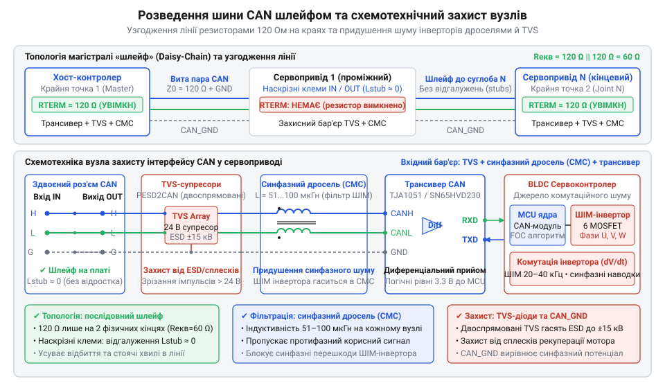
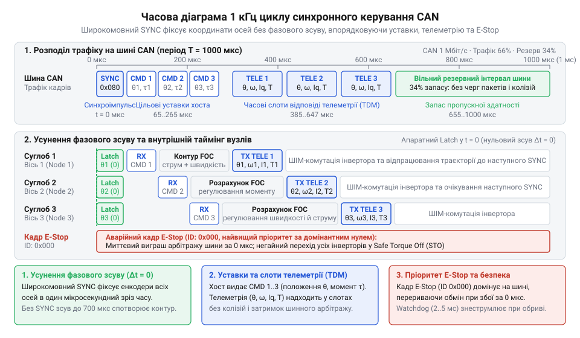

# Побудова розподіленої мережі сервоприводів на шині CAN із синхронним керуванням і телеметрією

<preknowlist>
- [Tower Pro SG90 — мікросерво 9g](root:cat-hw-actuators/sg90-servo) — класичне керування сервоприводом імпульсним ШІМ-сигналом (1–2 мс), концепція одностороннього керування без зворотного зв'язку та фізичні обмеження індивідуального підключення кожного привода окремими сигнальними лініями до контролера.
- [MG90S V2 — мікросерво з металевим редуктором](root:cat-hw-actuators/mg90s-servo) — струмові перехідні процеси при динамічному русі сервоприводів під механічним навантаженням, стрибки споживання струму та необхідність буферизації силового живлення.
</preknowlist>

## Колапс радіальної проводки багатоосьового маніпулятора

Створюючи поворотний підвіс або маніпулятор на 4–6 осей, кожен привод часто намагаються під'єднати окремим кабелем від центрального контролера, подібно до [класичних сервоприводів](root:cat-hw-actuators/sg90-servo) (від лат. @@la|servus@@ — слуга, раб). Така радіальна топологія (від лат. @@la|radius@@ — промінь) «зірка» (англ. @@en|star topology@@) вимагає щонайменше три-чотири провідники на вузол: живлення, спільну землю та несиметричні сигнальні лінії ШІМ чи @@en|UART@@. У просторовій кінематиці кабелі кінцевих ланок проходять крізь усі проміжні шарніри, утворюючи біля основи джгут із 20–30 жил. Під час обертання суглобів цей пучок чинить пружний опір моторам, скручується й перетирається об краї деталей. Уже за кілька годин циклічного руху мідні жили зазнають утомного зламу, спричиняючи раптовий обрив живлення або сигналу.

Механічний знос доповнюється електричним колапсом. Потужні сервовузли використовують трифазні безколекторні мотори (англ. @@en|brushless DC@@, скорочено @@en|BLDC@@) із силовими інверторами (від лат. @@la|invertere@@ — перевертати, обертати). Їхні ключі комутують струми в десятки ампер за наносекунди. Стрімка комутація струму через паразитні індуктивності та ємності щільного джгута наводить потужні електромагнітні завади на сусідні сигнальні лінії. Ці сплески спотворюють форму імпульсів, викликаючи хаотичний @@en|jitter@@ (від англ. @@en|jitter@@ — тремтіння), хибні спрацьовування та втрату кроків на сусідніх осях.

Радіальне розведення створює й інформаційний глухий кут. Односторонній зв'язок не дає центральному контролеру зворотної телеметрії (від грец. @@gr|tele@@ — далеко та @@gr|metron@@ — міра): хост не знає про стрибок струму, перегрів ключів чи механічне заклинювання суглоба. До того ж послідовне формування імпульсів для різних портів вносить часовий розкид, викликаючи фазовий розсинхрон осей і викривляючи траєкторію маніпулятора. Просте нарощування жил чи екранів лише збільшує жорсткість джгута. Неминучим розв'язком стає перехід від радіальних кіл до спільної диференціальної шини @@en|CAN@@ (англ. @@en|Controller Area Network@@ — мережа контролерів), прокладеної топологією «шлейф» (англ. @@en|daisy-chain@@).

## Побудова диференціальної лінії та схемотехнічний захист

Просте з'єднання сервоприводів довільною парою дротів руйнує зв'язок: круті фронти сигналів шини @@en|CAN@@ на швидкостях до 1 Мбіт/с відбиваються від розривів середовища, створюючи стоячі хвилі й спотворюючи біти. Щоб усунути відбиття, магістраль будують за строгою топологією «шлейф» (англ. @@en|daisy-chain@@) на базі витої пари (англ. @@en|twisted pair@@) із хвильовим опором 120 Ом. Будь-яке бічне відгалуження (англ. @@en|stub@@ — обрубок) працює як розімкнена лінія й породжує паразитні сплески, тому його довжину обмежують до 0.3 м або заводять кабель безпосередньо у контакти плати. На двох фізично крайніх кінцях шини між провідниками @@en|CANH@@ і @@en|CANL@@ встановлюють термінальні резистори (від лат. @@la|terminus@@ — межа; англ. @@en|terminator@@) номіналом 120 Ом. З'єднані паралельно, вони дають еквівалентний опір лінії 60 Ом і повністю поглинають енергію хвилі.

Електричне оточення сервопривода насичене завадами від ключів інвертора, здатних випалити [диференціальні трансивери](root:com-devices/can-bus) шини @@en|CAN@@ (англ. @@en|transceiver@@, від @@en|transmitter@@ — передавач та @@en|receiver@@ — приймач, як-от @@en|TJA1050@@ чи @@en|SN65HVD230@@). Для захисту на кожному вузлі встановлюють два схемотехнічні бар'єри. Швидкодіючі двоспрямовані @@en|TVS@@-діоди (англ. @@en|transient voltage suppressor@@ — обмежувач перехідних напруг) за пікосекунди відводять високовольтні комутаційні сплески на землю. Синфазний дросель (від нім. @@de|drosseln@@ — глушити; англ. @@en|common-mode choke@@) відсікає високочастотний шум ШІМ, наведений однаково на обидві жили, не перешкоджаючи проходженню корисного протифазного сигналу. Окремий провідник @@en|CAN_GND@@ з'єднує логічні землі вузлів, запобігаючи зсуву опорних потенціалів і виникненню силових земляних петель (англ. @@en|ground loop@@).

*Послідовне підключення сервоприводів витою парою зі спільним провідником CAN_GND, крайовими термінаторами 120 Ом, синфазними дроселями та TVS-діодами для узгодження імпедансу й придушення перешкод інвертора.*

## Архітектура протоколу та апаратна фільтрація

Одночасна передача кількох приводів руйнує зв'язок. У шині @@en|CAN@@ конфлікт розв'язує бітовий арбітраж (від лат. @@la|arbitrari@@ — вирішувати; англ. @@en|arbitration@@). Логічний нуль на шині є домінантним (від лат. @@la|dominari@@ — панувати; англ. @@en|dominant@@), а одиниця — рецесивною (від лат. @@la|recedere@@ — відступати; англ. @@en|recessive@@). Якщо вузли передають біти одночасно, нуль пересилює одиницю. Вузол з одиницею зчитує нуль, фіксує втрату пріоритету й негайно вимикає передавач без пошкодження чужого кадру. Через це менше число ідентифікатора (англ. @@en|CAN ID@@) має найвищий пріоритет.

В 11-бітному кадрі (@@en|CAN 2.0A@@) старші біти задають тип повідомлення, а молодші — номер вузла (англ. @@en|Node ID@@). Нульовий @@en|ID@@ 0x000 віддають аварійній зупинці @@en|E-Stop@@ (англ. @@en|emergency stop@@), яка миттєво перехоплює шину. Рух суглобів тактує широкомовна синхромітка @@en|SYNC@@ (від грец. @@gr|synchronos@@ — одночасний; англ. @@en|synchronization@@): усі осі водночас фіксують позицію, після чого хост транслює уставки, а приводи повертають телеметрію у виділених слотах. На відміну від громіздкого [протоколу CANopen CiA 402](root:com-protocol/can-open), прямий розклад гарантує детермінізм 1 кГц циклу.

*Розподіл 1 кГц циклу в шині CAN: маркер SYNC вирівнює зняття координат суглобів, адресні кадри передають уставки осей, а слоти телеметрії та кадр E-Stop усувають колізії.*

Корисне навантаження (англ. @@en|payload@@) обмежене 8 байтами. Замість повільних чисел із рухомою комою (англ. @@en|floating-point@@), координати, швидкість і струм кодують цілими числами з фіксованою комою (англ. @@en|fixed-point@@). Наприклад, 32-бітне поле кута з кроком 0.001° та два 16-бітних поля швидкості й фазного струму займають рівно 8 байтів кадру.

Щоб ядро привода не витрачало час на чужі кадри, вмикають апаратну фільтрацію. У контролері @@en|CAN@@ налаштовують фільтр (англ. @@en|Filter ID@@) і маску (від фр. @@fr|masque@@ — личина; англ. @@en|mask@@). Одиниці в масці вимагають суворого збігу бітів ідентифікатора з фільтром, а нулі їх ігнорують. Це дозволяє приводу приймати власні уставки за @@en|Node ID@@ та загальні кадри @@en|SYNC@@ і @@en|E-Stop@@, відсікаючи решту повідомлень апаратно без переривання процесора.

## Синхронне циклічне керування та телеметрія

Послідовне надсилання команд суглобам руйнує узгодженість руху. Якщо хост передає цільові координати почергово, кожен кадр витрачає час на передачу шиною @@en|CAN@@. Останній привод отримує завдання на кілька мілісекунд пізніше за перший. Через цей фазовий зсув суглоби рухаються неузгоджено, а просторова [траєкторія кінцевої точки](root:sys-dron/manipulator-kinematics-trajectory-planning) інструмента (англ. @@en|tool center point@@, @@en|TCP@@) вигинається й відхиляється від розрахункової.

Щоб усунути запізнення, хост організовує жорсткий цикл керування із частотою 1 кГц, що тактується апаратним таймером. Цикл поділено на дві фази. Спочатку хост по черзі розсилає вузлам адресні кадри з уставками кута й моменту. Приводи не застосовують їх одразу, а записують у буфер очікування — тіньовий регістр (англ. @@en|shadow register@@). Наприкінці фази хост транслює короткий широкомовний кадр @@en|SYNC@@. За цим сигналом усі приводи одночасно переносять значення з тіньових регістрів у робочий [контур векторного керування](root:hw-motion/foc-control) (англ. @@en|field-oriented control@@, @@en|FOC@@) в один фізичний момент часу.

Зворотний зв'язок збирають у другій половині мілісекундного інтервалу. Отримавши @@en|SYNC@@, кожен привод миттєво фіксує стан своїх давачів і відправляє кадр телеметрії у виділений часовий слот (англ. @@en|time slot@@), прив'язаний до його @@en|Node ID@@. Кадр містить дійсний кут ротора, кутову швидкість, фазний струм моменту `I_q`, напругу живлення та температуру @@en|MOSFET@@-інвертора. Хост вичитує телеметрію через чергу переривань без блокування процесора, поновлюючи стан кінематичної моделі перед початком наступного 1 кГц циклу.

## Сторожовий нагляд і координована аварійна зупинка

Раптовий обрив кабелю, вібрація роз'єму чи зависання хоста під час швидкого руху маніпулятора перетворюють багатоланковий механізм на некерований таран. Якщо суглоб втрачає потік команд, він продовжує рух за останньою уставкою або безконтрольно падає під дією сили тяжіння. Щоб запобігти аварії, кожен привід захищають сторожовим таймером зв'язку (англ. @@en|watchdog@@ — сторожовий собака). Якщо свіжий пакет керування не надходить протягом установленого таймауту (англ. @@en|timeout@@ — вихід часу, зазвичай 20–50 мс), привід миттєво знеструмлює фази або вмикає динамічне гальмування (англ. @@en|dynamic braking@@). Замикання обмоток мотора через нижні ключі інвертора на @@en|MOSFET@@-транзисторах генерує проти-ЕРС і гасить швидкість шарніра без зовнішнього живлення.

Аварія загрожує системі й зсередини шарніра. Механічна перешкода викликає заклинювання ротора зі стрімким стрибком фазного струму `I_q`, деградація силового каскаду веде до перегріву ключів, а [стрибки споживання струму](root:cat-hw-actuators/mg90s-servo) просаджують спільне живлення. Хост безперервно зіставляє дані телеметрії з безпечними порогами й фіксує пропуск пакетів вузла. Виявивши критичну аномалію бодай однієї осі, хост негайно транслює широкомовний кадр аварійної зупинки @@en|E-Stop@@ з нульовим ідентифікатором @@en|CAN ID@@ 0x000. Домінантні нулі ідентифікатора миттєво виграють арбітраж і переривають будь-яку передачу на шині @@en|CAN@@. Усі приводи водночас зчитують @@en|E-Stop@@ і синхронно гасять рух, захищаючи кінематику маніпулятора від поломки.

## Пусконалагодження, діагностика та придушення завад

Перший запуск сервомережі починають зі знеструмленої перевірки лінії. Мультиметр між провідниками @@en|CANH@@ і @@en|CANL@@ має показати рівно 60 Ом: це підтверджує наявність обох термінаторів по 120 Ом і цілісність кабелю. Потім фізичний стан шини перевіряють осцилографом (від лат. @@la|oscillare@@ — гойдатися та грец. @@gr|graphein@@ — писати; англ. @@en|oscilloscope@@). У рецесивному стані напруга обох ліній становить 2.5 В, тому диференціальна напруга `V_diff` між @@en|CANH@@ і @@en|CANL@@ дорівнює 0 В. У домінантному стані трансивер підтягує @@en|CANH@@ до 3.5 В, а @@en|CANL@@ опускає до 1.5 В, створюючи перепад `V_diff` близько 2.0 В. Фронти імпульсів мають бути рівними, без сходинок відбиттів і затяжного дзвону (англ. @@en|ringing@@) — високочастотних коливань на перепадах напруги, викликаних паразитними індуктивностями відгалужень.

Якщо рівні напруг у нормі, але пакети губляться, причину збоїв шукають у внутрішніх регістрах контролера @@en|CAN@@. Апаратний лічильник помилок передавання (англ. @@en|transmit error counter@@, @@en|TEC@@) і лічильник помилок приймання (англ. @@en|receive error counter@@, @@en|REC@@) фіксують спотворення бітів чи контрольної суми. У штатному стані активної помилки (англ. @@en|Error Active@@, обидва лічильники нижче 128) вузол сповіщає про збій домінантним прапорцем. При зростанні @@en|TEC@@ або @@en|REC@@ понад 128 контролер переходить у стан пасивної помилки (англ. @@en|Error Passive@@), позначаючи збої лише рецесивними бітами, щоб не блокувати шину. Якщо ж @@en|TEC@@ перевищує 255, вузол переходить у режим вимкнення від шини (англ. @@en|Bus-Off@@), повністю від'єднуючи свій трансивер.

Найчастіша причина блокування шини без апаратних шумів — неузгоджена точка вибірки (англ. @@en|sample point@@), тобто момент зчитування стану лінії всередині бітового інтервалу. Для сервомереж її встановлюють на рівні 75–80% тривалості біта на всіх вузлах. Якщо ж збої виникають під час руху моторів, причиною є синфазні завади та контури заземлення, вимоги до яких визначає специфікація [апаратного інтерфейсу сервоконтролера](root:cat-hw-actuators/bldc-servo-controller/api-bldc-servo-hardware-interface.md). Щоб усунути наведення від силових ключів, екран витої пари заземлюють строго в одній точці біля хоста, виключаючи вирівнювальні струми.
