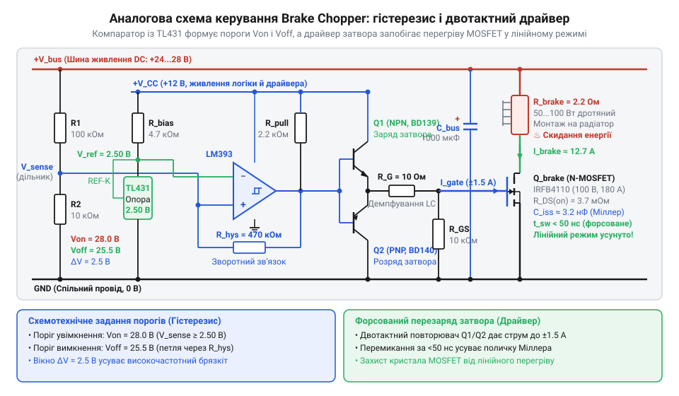
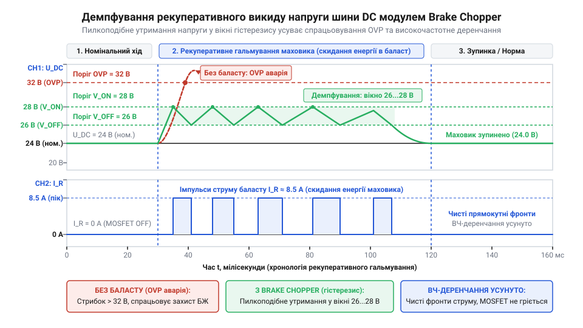

# Створення модуля баластного гальмування для захисту шини живлення від стрибків напруги

<preknowlist>
- [Tower Pro SG90 — мікросерво 9g](root:cat-hw-actuators/sg90-servo) — організація живлення приводів від спільної шини постійного струму DC та вразливість напівпровідникових ключів інвертора до перенапруги
- [Серво-роги (запасні)](root:cat-hw-actuators/servo-horns) — механічне закріплення важелів та інерційних навантажень на валу привода, накопичення кінетичної енергії обертання та її перехід у генераторний струм при гальмуванні
</preknowlist>

## Рекуперативний викид напруги під час гальмування

Під час швидкого позиціювання механізмів сервопривід має не лише миттєво розганяти, а й різко сповільнювати масивні рухомі частини. Коли двигун екстрено гальмує важіль, закріплений на [жорсткому серво-розі](root:cat-hw-actuators/servo-horns), система наражається на раптову аварію: імпульсний блок живлення вимикається через спрацьовування апаратного захисту від перенапруги (@@en|Overvoltage Protection@@, OVP — від англ. @@en|overvoltage@@ — перенапруга та @@en|protection@@ — захист), знеструмлюючи привід, або ж на платі інвертора з тріском вибухають електролітичні конденсатори та пробиваються силові польові транзистори (@@en|MOSFET@@, від англ. @@en|metal-oxide-semiconductor field-effect transistor@@). Принцип побудови порогових вузлів компарації та логіку аварійного блокування імпульсного джерела детально розкриває [захист вторинних блоків живлення від перенапруги (OVP)](root:hw-power/smps-overvoltage-protection).

Причина аварії полягає у зміні напрямку потоку механічної та електричної енергії. Під час сповільнення накопичена кінетична енергія навантаження продовжує обертати ротор, переводячи двигун із рушійного режиму в генераторний. Індукована обмотками зворотна ЕРС (електрорушійна сила; англ. @@en|back-EMF@@, від @@en|back electromotive force@@) перевищує напругу живлення. Струм рекуперації (від лат. *recuperatio* — повернення, відновлення; англ. @@en|regeneration@@) тече у зворотному напрямку через антипаралельні діоди ключів інвертора безпосередньо в лінію живлення постійного струму (@@en|DC bus@@). Фізичні процеси прямого зміщення внутрішніх паразитних діодів силових транзисторів під час реверсу індуктивного навантаження пояснює [провідність антипаралельних діодів інверторних MOSFET у генераторному режимі](root:hw-components/body-diode).

Стандартні імпульсні блоки живлення принципово односпрямовані: їхні вихідні діодні чи синхронні випрямлячі віддають струм у навантаження, але фізично не здатні пропустити зворотний потік енергії назад у первинну мережу. Єдиним тимчасовим резервуаром для витісненого заряду залишаються конденсатори фільтра шини.

Приріст напруги `ΔV` на конденсаторі ємністю `C_bus` від надлишкового заряду `ΔQ`, принесеного струмом рекуперації `I_regen` за час гальмування `Δt`, описує співвідношення:

```
ΔV
= ΔQ / C_bus                     [визначення напруги на ємності через заряд]
= (I_regen · Δt) / C_bus         [вираз заряду через струм рекуперації та час]
```

Оскільки сумарна ємність фільтра шини обмежена сотнями чи тисячами мікрофарад, рекуперативний струм у десятки амперів за лічені мілісекунди підкидає напругу `V_bus` значно вище порогу міцності напівпровідників. Щоб запобігти аварійному знеструмленню та руйнуванню схеми, надлишкову електричну енергію необхідно примусово поглинати безпосередньо на шині за допомогою автономного гальмівного модуля (@@en|brake chopper@@, від англ. @@en|brake@@ — гальмо та @@en|chop@@ — рубати, переривати).

## Розрахунок баластного резистора та потужності

Щоб убезпечити шину постійного струму (@@en|DC bus@@) від перенапруги, баласт має встигати розсіювати пікову потужність рекуперації. Під час лінійного сповільнення системи із сумарним моментом інерції `J_total` від кутової швидкості `ω₀` до зупинки за час `t_decel` кінетична енергія `E_kin` вивільняється з трикутним профілем потужності. З урахуванням коефіцієнта корисної дії `η` генерації та порогу увімкнення `V_on`, максимально допустимий опір резистора `R_brake` для скидання пікової електричної потужності `P_regen` визначає виведення:

```
R_brake
≤ V_on² / P_regen                [умова відведення пікової потужності напругою Von]
= (V_on² · t_decel) / (2 · E_kin · η) [вираз через кінетичну енергію та час сповільнення]
= (V_on² · t_decel) / (J_total · ω₀² · η) [підстановка енергії обертання 0.5 · J_total · ω₀²]
```

Отриманий вираз задає верхню межу: якщо взяти більший номінал, струм розряду виявиться замалим, і напруга шини перевищить безпечний поріг.

Знизу опір лімітує граничний імпульсний струм комутуючого транзистора `I_fet_max`: опір має задовольняти обмеження `R_brake ≥ V_on / I_fet_max`. Номінал обирають із ряду `E24` у менший бік для гарантованого відведення потужності, а амплітудний струм розряду становить `I_brake_peak = V_on / R_brake`.

Тривале нагрівання визначає середня розсіювана потужність `P_avg = (E_kin · η) / T_cycle` за період циклу маневру `T_cycle` (робочий цикл; англ. @@en|duty cycle@@, від @@en|duty@@ — робота та @@en|cycle@@ — цикл). Оскільки активне гальмування займає малу частку циклу, середня потужність у рази менша за пікову.

Як баласт застосовують дротяні резистори (англ. @@en|wirewound resistor@@, від @@en|wire@@ — дріт та @@en|wound@@ — намотаний) в алюмінієвих корпусах. Завдяки високій теплоємності ніхромової спіралі вони витримують 5–10-кратне імпульсне перевантаження. Проте для тривалого відведення тепла із запасом `P_rated ≥ 1.35 · P_avg` корпус монтують через термопасту на [зовнішній охолоджувальний радіатор](root:hw-components/thermal-chain): на вільному повітрі через температурне зниження номіналу (@@en|derating@@, від англ. префікса @@en|de-@@ — зменшення та @@en|rate@@ — номінал) допустима потужність падає до 25% паспортної. Фізичні процеси адіабатичного нагрівання дротяної спіралі короткочасними імпульсами струму та роботу з графіками зниження потужності описує [імпульсна перевантажувальна здатність дротяних резисторів](root:hw-components/resistor-pulse-power-rating).

## Силовий MOSFET і швидкий драйвер затвора

Баластний резистор опором `R_brake` не можна тримати під'єднаним постійно, інакше він висадить блок живлення в штатному режимі. Його вмикають лише на мить рекуперації N-канальним польовим транзистором (@@en|N-MOSFET@@) у нижньому плечі схеми. Кристал обирають за трьома критеріями: гранична напруга сток-витік `V_ds_max ≥ 1.3 · V_on` захищає від індуктивних викидів понад поріг увімкнення `V_on`; допустимий імпульсний струм `I_d_pulse ≥ 2 · I_brake_peak` створює запас за піковим струмом баласту `I_brake_peak`; а малий опір відкритого каналу `R_ds_on` у кілька міліомів мінімізує статичні втрати провідності `P_stat = I_brake_peak² · R_ds_on`.

Головна загроза криється в моменті перемикання. Затвор @@en|MOSFET@@ ізольований діелектриком і утворює паразитну ємність сток-затвор `C_gd`. Під час відкриття спад напруги на стоці створює через `C_gd` зустрічний струм у затвор. Цей зворотний зв'язок — ефект Міллера (англ. @@en|Miller effect@@, за прізвищем американського інженера Джона Міллера) — фіксує напругу затвора на плато Міллера (англ. @@en|Miller plateau@@, від фр. @@fr|plateau@@ — площина). Доки заряд Міллера `Q_gd` стікає, транзистор зависає в лінійному режимі, утримуючи водночас високу напругу шини й повний струм розряду. Динамічний вплив ємності зворотного зв'язку стік-затвор та методику аналітичного розрахунку комутаційних втрат детально розкриває [плато Міллера та динамічні втрати перемикання силових MOSFET](root:hw-components/switching-losses).

Миттєву пікову потужність `P_sw_peak`, яка в цей час перетворюється на тепло безпосередньо в кристалі, визначає вираз:

```
P_sw_peak
= V_on · I_brake_peak             [добуток напруги шини на комутований струм]
= V_on² / R_brake                 [підстановка закону Ома для розрядного струму]
```

При напрузі 56 В і баласті 4 Ом потужність сягає 784 Вт. Якщо керувати затвором від слабкого виходу компаратора зі струмом 10 мА, перезаряджання затягується на мікросекунди, і кристал кремнію згоряє від теплового пробою (англ. @@en|thermal runaway@@, від @@en|thermal@@ — тепловий та @@en|runaway@@ — утікач).

Щоб скоротити перемикання до безпечних 20–50 нс, затвору потрібен струм у кілька амперів. Для цього встановлюють [швидкий драйвер затвора](root:hw-power/gate-driver) (англ. @@en|gate driver@@, від @@en|gate@@ — затвор та @@en|drive@@ — надавати руху) — двотактний каскад (англ. @@en|push-pull@@, від @@en|push@@ — штовхати та @@en|pull@@ — тягнути) на біполярних транзисторах або мікросхемі. Він живиться від локального керамічного конденсатора й перезаряджає затвор імпульсним струмом `I_gate = Q_g / t_sw`, де повний заряд `Q_g` переноситься за час `t_sw`, зводячи динамічні втрати майже до нуля.

## Аналоговий компаратор із регульованим гістерезисом

Керувати силовим ключем через мікроконтролер небезпечно: затримка обробки переривання та вимірювання АЦП у десятки мікросекунд дозволить рекуперативному викиду спалити схему ще до спрацьовування програми. Тому модуль @@en|brake chopper@@ потребує автономної апаратної реакції. Напругу лінії живлення (@@en|DC bus@@) безперервно контролює швидкий аналоговий компаратор (від лат. *comparare* — порівнювати; англ. @@en|comparator@@), який зіставляє масштабований сигнал шини зі стабільним рівнем від прецизійного джерела опори (@@en|TL431@@, від англ. @@en|voltage reference@@).

Простий компаратор з єдиним порогом приречений на відмову. Щойно напруга сягає межі й баластний @@en|MOSFET@@ відкривається, комутований струм у десятки амперів спричиняє спад напруги на паразитному омічному та індуктивному імпедансі провідників. Напруга на вході миттєво просідає, змушуючи схему негайно закрити транзистор. Струм зникає, напруга знову стрибає вгору, і ключ відмикається знов. Виникає високочастотне комутаційне деренчання (англ. @@en|chatter@@, від @@en|chatter@@ — цокотіти, деренчати) на частотах сотень кілогерців: ключ безупинно зависає в лінійному режимі, і комутаційні втрати перегрівають кристал за лічені мілісекунди.

Щоб розвести точки вмикання й вимикання, між виходом і неінвертуючим входом компаратора вводять позитивний зворотний зв'язок через резистор `R_f`. Це перетворює каскад на [пороговий тригер Шмітта](root:hw-analog/schmitt-trigger) (англ. @@en|Schmitt trigger@@, за прізвищем американського вченого Отто Шмітта) з регульованим гістерезисом (від грец. *hysterēsis* — запізнення, відставання; англ. @@en|hysteresis@@). Необхідний опір резистора зворотного зв'язку `R_f` визначають через ширину вікна гістерезису `ΔV_hys = V_on - V_off`, базовий опір верхнього резистора дільника `R_1` та розмах вихідної напруги компаратора `V_dd`:

```
R_f
= R_1 · V_dd / ΔV_hys                 [вираз опору зворотного зв'язку через вікно гістерезису]
= R_1 · V_dd / (V_on - V_off)         [підстановка верхнього та нижнього порогів шини]
```

Опір нижнього резистора на землю `R_2` знаходять зі співвідношення `1 / R_2 = (V_on - V_ref) / (V_ref · R_1) - 1 / R_f`, де `V_ref` — стабільна опорна напруга 2.5 В від мікросхеми @@en|TL431@@. Чим менший номінал `R_f`, тим ширшим стає вікно комутації. Завдяки гістерезису в кілька вольтів динамічне просідання шини під час розряду не досягає рівня `V_off`, усуваючи паразитне деренчання біля порогової межі.


*Схема порогового детектора з джерелом опори TL431, тригером Шмітта та драйвером затвора, що задає вікно комутації Von і Voff.*

## Топологія друкованої плати та тепловідведення

Навіть бездоганно розрахована схема захисту виходить із ладу за перші наносекунди гальмування, якщо силові провідники мають надмірну довжину. При замиканні баластного ключа струм у десятки ампер наростає практично миттєво. Будь-яка доріжка на друкованій платі (англ. @@en|printed circuit board@@, @@en|PCB@@) має власну паразитну індуктивність (від лат. *parasitus* — нахлібник; @@en|parasitic inductance@@). Швидкий спад струму за час комутації `dt` крізь індуктивність замкненого контуру `L_loop` генерує піковий сплеск індуктивної напруги `V_spike`:

```text
V_spike = L_loop · (di / dt)     [індуктивна проти-ЕРС розриву струму]
```

Величина сплеску прямо пропорційна площі провідників, тому навіть одиниці наногенрі при швидкому обриві десятків ампер створюють імпульс у сотні вольт. Цей викид підсумовується з напругою шини живлення та викликає лавинний пробій силового @@en|MOSFET@@.

Щоб звести викид до нуля, площу високочастотного контуру між конденсаторами шини, баластним резистором і транзистором мінімізують до геометричної межі. Силові шини розводять широкими мідними полігонами (від грец. *polygōnos* — багатокутний; @@en|copper pour@@) на суміжних шарах плати. Струм повернення через полігон землі протікає строго під живильною доріжкою, створюючи протилежно спрямовані магнітні поля, які взаємно компенсують паразитну індуктивність. Безпосередньо біля виводів транзистора встановлюють керамічні конденсатори з низькою паразитною індуктивністю виводів (англ. @@en|equivalent series inductance@@, @@en|ESL@@), які поглинають високочастотні струмові імпульси на місці. Якщо залишкові коливання не зникають, паралельно ключу монтують демпферний RC-ланцюг.

Гальмівні імпульси виділяють значну теплову енергію. Сумарний тепловий опір (англ. @@en|thermal resistance@@) `R_th_total` визначає різницю температур між напівпровідниковим кристалом та навколишнім середовищем через внутрішній опір «перехід-корпус» `R_th_jc`, контактний шар підкладки `R_th_cs` та опір радіатора `R_th_sa`:

```text
R_th_total = R_th_jc + R_th_cs + R_th_sa     [послідовний тепловий ланцюг]
```

Оскільки теплові опори додаються послідовно, навіть якісний масивний радіатор не врятує кристал від пробою при поганому контакті корпусу. Транзистор і резистор фіксують на алюмінієвому радіаторі через теплопровідні діелектричні підкладки (англ. @@en|thermal pad@@) із нанесенням силіконової термопасти. Для усунення повітряних мікропорожнин деталі притискають гвинтами з пружними конічними шайбами, які підтримують постійне зусилля притискання під час циклічного теплового розширення металу.

## Стендова верифікація та осцилографічна діагностика

Перед подачею повної потужності змонтований модуль підлягає обов'язковій поетапній перевірці: коротке замикання в силовій частині здатне миттєво знищити інвертор і джерело живлення. Первинний контроль виконують мультиметром при знеструмленій платі, продзвонюючи відсутність замикань між шиною живлення, стоком транзистора та спільним провідником землі. Потім на мікросхему компаратора подають опорну напругу від слабкострумового лабораторного блока живлення зі струмовим лімітом 100 мА. Повільно підвищуючи напругу на вимірювальному вході, фіксують пороги спрацьовування: вихідний каскад драйвера мусить чітко перемикатися в логічну одиницю при напрузі `V_on` і повертатися в нуль лише при падінні до `V_off`.

Динамічні випробування проводять на навантажувальному стенді з сервоприводом і масивним маховиком. Щоб передати різке гальмівне зусилля без люфтів і руйнування механіки, вал мотора з'єднують із навантаженням через [жорсткі металеві серво-роги](root:cat-hw-actuators/servo-horns).

Для реєстрації перехідних процесів двоканальний осцилограф (від лат. *oscillo* — гойдаюся + грец. *grapho* — пишу; англ. @@en|oscilloscope@@) підключають до шини живлення та затвора ключа:


*Осцилограма рекуперативного перехідного процесу: баластний переривач утримує напругу шини у вікні гістерезису без комутаційного деренчання, запобігаючи аварійному вимкненню блока живлення.*

Розрахункову поведінку шини DC та баланс струмів під час гальмування підтверджує симуляція:

:::code proj-regenerative-brake-chopper-module/py/chopper_sim.py 174-198

Осцилографічний аналіз виявляє три типові несправності:

1. Високочастотний комутаційний дзвін (англ. @@en|ringing@@) на стоку польового транзистора вказує на надмірну довжину дротів до баластного резистора; дефект усувають скороченням довжини провідників або монтажем антипаралельного діода Шотткі (на честь фізика Вальтера Шотткі; @@en|Schottky diode@@).
2. Хаотичне деренчання виникає через потрапляння імпульсного шуму ШІМ інвертора на вхід компаратора; для захисту точку зняття напруги під'єднують кельвінівською парою (на честь фізика Вільяма Томсона, лорда Кельвіна; @@en|Kelvin connection@@) безпосередньо до виводів конденсаторної батареї.
3. Постійний перегрів резистора свідчить про занижений поріг `V_off`, розташований нижче напруги холостого ходу блока живлення; у цьому стані модуль розряджає саме мережеве джерело, вимагаючи точного підстроювання резистивного дільника.
