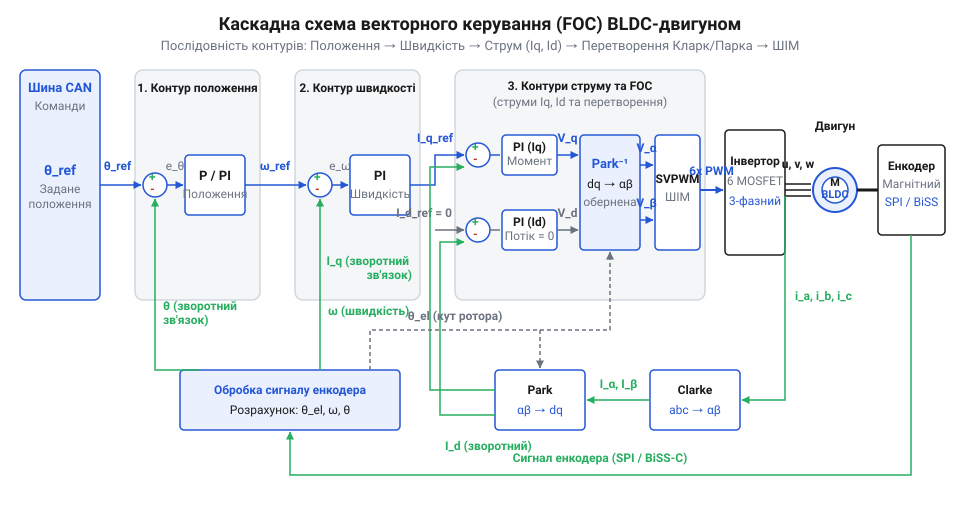
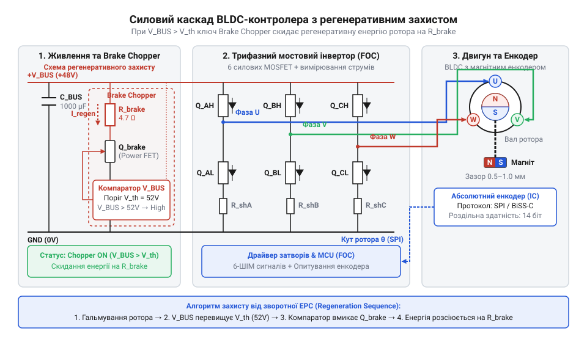
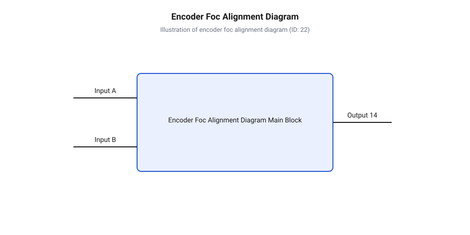
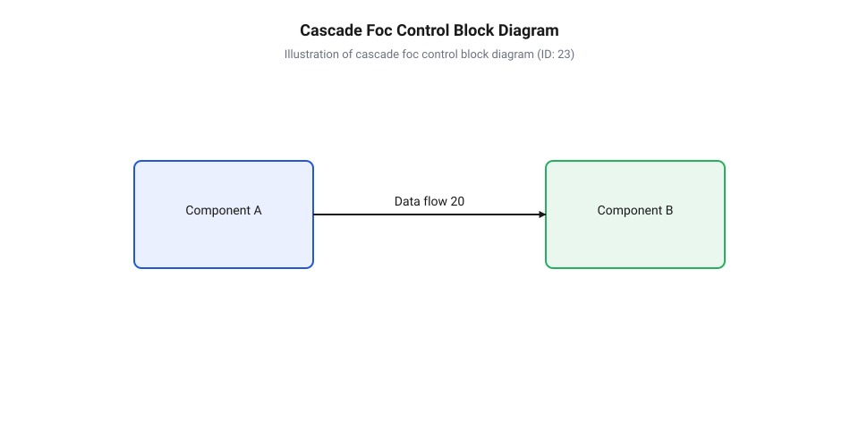

# Проєктування та налаштування роботизованого суглоба на базі BLDC-сервоконтролера

<preknowlist>
- [Сервоприводи радіокерованих моделей: будова, редуктори та ШІМ-керування](root:cat-hw-actuators/rc-servo-mechanisms-and-control) — загальні принципи побудови сервоприводів, механічні редуктори та обмеження класичного ШІМ-керування
</preknowlist>

## Вимоги до високодинамічного роботизованого суглоба

При розробці крокуючих роботів, багатоланкових маніпуляторів та екзоскелетів інженери регулярно стикаються з проблемою втрати керованості привода під час високих динамічних навантажень. Якщо застосувати класичні [сервоприводи радіокерованих моделей](root:cat-hw-actuators/rc-servo-mechanisms-and-control) або крокові двигуни, система швидко показує свої межі. При швидкому реверсі, стрибках чи зіткненні ланки з перешкодою колекторні мотори перегріваються через низький коефіцієнт корисної дії, а пластикові або крихкі металеві редуктори ламають зубці. Навіть міцніше [мікросерво з металевим редуктором](root:cat-hw-actuators/mg90s-servo) чи модифіковані [сервоприводи постійного обертання](root:cat-hw-actuators/continuous-rotation-servo-mod) не здатні забезпечити швидку реакцію на зовнішнє обурення через велику інерційність та обмежену смугу пропускання аналогового або низькочастотного каналу керування.

Сучасний високодинамічний роботизований суглоб вимагає прямого або квазіпрямого приводу — @@en|QDD@@ (англ. *Quasi-Direct Drive*, від *quasi* — квазі + *direct* — прямий + *drive* — привід). В основі такого вузла лежить безколекторний двигун постійного струму — @@en|BLDC@@ (англ. *Brushless Direct Current*, від *brushless* — безщітковий + *direct current* — постійний струм). Двигуни типу @@en|BLDC@@ з великим діаметром ротора та багатополюсною конфігурацією забезпечують високу щільність крутного моменту при відносно низькому власному моменті інерції `J_rot`. Використання низькопередаточного хвильового або планетарного редуктора (із коефіцієнтом редукції `i = 6..10`) зберігає високу прозорість приводу — @@en|back-drivability@@ (англ. *back-drivability*, від *back* — назад + *drive* — керувати + *ability* — здатність), що дозволяє роботу амортизувати зовнішні удари та вимірювати механічне зусилля за струмом фаз без використання громіздких тензометричних датчиків.

Однак сам по собі мотор @@en|BLDC@@ вимагає прецизійного інтегрованого векторного контролера. Керування за допомогою простої трапецеїдальної комутації створює відчутні пульсації моменту — @@en|torque ripple@@ (англ. *torque ripple*, від *torque* — момент + *ripple* — пульсація), що спричиняє вібрації ланок робота та передчасне зношування механіки. Для досягнення плавного руху та миттєвого відгуку контролер реалізує векторне керування — @@en|FOC@@ (англ. *Field-Oriented Control*, від *field* — поле + *oriented* — орієнтований + *control* — керування). Метод @@en|FOC@@ розкладає трифазний струм статора на дві ортогональні компоненти в обертовій системі координат ротора: магнітний потік `d` та створюючий момент `q`. Підтримання струму `I_d = 0` забезпечує режим максимального моменту на ампер — @@en|MTPA@@ (англ. *Maximum Torque Per Ampere*, від *maximum* — максимальний + *torque* — крутний момент + *per* — на + *ampere* — ампер).

Апаратні та системні вимоги до контролера роботизованого суглоба формуються наступним чином:
1. **Каскадна структура регуляторів:** контур струму виконується з частотою дискретизації `10..20 kHz`, контур швидкості — `1..2 kHz`, а контур положення — `500..1000 Hz`. 2. **Інтегрована силова частина:** інвертор на польових транзисторах — @@en|MOSFET@@ (англ. *Metal-Oxide-Semiconductor Field-Effect Transistor*, від *metal* — метал + *oxide* — оксид + *semiconductor* — напівпровідник + *field-effect transistor* — польовий транзистор) — розміщується безпосередньо на тильній стороні двигуна для мінімізації індуктивності фазних дротів та зниження рівня електромагнітних завад. 3. **Швидкісний мережевий інтерфейс:** для синхронізації десятків суглобів у реальному часі використовується шина @@en|CAN FD@@ (англ. *Controller Area Network Flexible Data-Rate*, від *controller* — контролер + *area network* — мережа + *flexible* — гнучкий + *data-rate* — швидкість даних) із пропускною здатністю до 5..8 Мбіт/с.


*Структурна схема каскадного векторного керування BLDC-двигуном із контурами струму, швидкості та положення: ієрархічна передача сигналів помилки між регуляторами.*

## Підключення абсолютного енкодера кутового положення

Алгоритм векторного керування @@en|FOC@@ принципово не здатний працювати без точного знання електричного кута ротора `θ_el`. Якщо класичний інкрементальний енкодер втрачає відліки при швидкому гальмуванні або потребує процедури пошуку нульової позначки при кожному ввімкненні живлення, це неприпустимо для роботизованої кінцівки. Спроба виконати пошук нуля під дією зовнішнього навантаження (наприклад, коли робот спирається на поверхню) призводить до падіння або механічного пошкодження суглоба. Тому роботизований суглоб вимагає абсолютного магнітного енкодера, який миттєво після подачі живлення видає точну кутову координату.

Абсолютний магнітний енкодер вимірює вектор магнітного поля діаметрально намагніченого магніту, закріпленого на торці вала ротора. Внутрішній датчик Холла або тунельний магніторезистивний елемент перетворює кут повороту у цифровий код із роздільною здатністю від 14 до 18 біт на один оберт.

Для передачі кутового положення від енкодера до мікроконтролера застосовують два основні протоколи:
1. **Інтерфейс @@en|SPI@@** (англ. *Serial Peripheral Interface*, від *serial* — послідовний + *peripheral* — периферійний + *interface* — інтерфейс): стандартний чотирипровідний шинний протокол. Дозволяє читати дані на частотах тактування до 10..20 МГц. Проте @@en|SPI@@ розроблений для застосування всередині плати і має низьку завадостійкість при винесенні датчика на довгий кабель. 2. **Протокол @@en|BiSS-C@@** (англ. *Bidirectional Synchronous Serial C-mode*, від *bidirectional* — двонапрямлений + *synchronous* — синхронний + *serial* — послідовний): промисловий відкритий протокол точки-до-точки. Використовує диференційні лінії передачі сигналів за стандартом @@en|RS-422@@ (лінія тактування `MA` та лінія даних `SL`). Забезпечує неперервну передачу потоку даних із підтвердженням цілісності через контрольну суму — @@en|CRC@@ (англ. *Cyclic Redundancy Check*, від *cyclic* — циклічний + *redundancy* — надлишковість + *check* — перевірка) — та затримкою обробки менше 1 мкс.

При побудові високосилового суглоба головною перешкодою для енкодера є високочастотні завади від інвертора, де силові транзистори @@en|MOSFET@@ перемикають струми до 40..80 А із частотою 20..40 кГц та крутизною фронтів `dV/dt > 5 V/ns`. Для захисту сигнальних кіл від емпіричних завад застосовують такі апаратні заходи:
- Окреме розведення аналогової землі `AGND` енкодера та силової землі `PGND` інвертора із з'єднанням лише в одній точці («зірка») біля конденсатора фільтра шини живлення. - Встановлення феритових фільтрів та керамічних розв'язувальних конденсаторів номіналом 100 нФ безпосередньо біля виводів живлення мікросхеми енкодера. - Застосування диференційних трансиверів @@en|RS-422@@ для ліній `BiSS-C` або екранованих витих пар для сигналів @@en|SPI@@.

Обчислимо кутову роздільну здатність `θ_res` та дискретність кутового кроку `Δθ_rad` для 14-бітного абсолютного магнітного енкодера. Кількість відліків на один повний оберт `N_counts` становить:

N_counts = 2ⁿ
         = 2¹⁴                  [підстановка розрядності n = 14 біт]
         = 16384 відліки        [загальна кількість градацій на 360 градусів]

Звідси кутова роздільна здатність у градусах `θ_res` визначається як:

θ_res = 360⁰ / N_counts
      = 360 / 16384             [ділення повного кута на кількість дискретів]
      ≈ 0.021972⁰               [кут одного дискрета енкодера]

Переведемо дискретність кутового положення ротора у радіани `Δθ_rad`:

Δθ_rad = 2π / N_counts
       = 6.2831853 / 16384      [ділення довжини кола у радіанах на 16384]
       ≈ 0.0003835 rad          [дискретність кута в радіанах]

Така висока дискретність `Δθ_rad ≈ 0.000384 rad` дає змогу обчислювати швидкість обертання ротора шляхом чисельного диференціювання кута `ω = Δθ / Δt` без виникнення квантувального шуму у контурі швидкості.

## Схема захисту від регенеративної ЕРС

Під час швидкого гальмування роботизованої кінцівки або при зовнішній дії (наприклад, коли робот падає або примусово провертає суглоб зовні) кінетична енергія механічної ланки перетворюється на електричну. Двигун @@en|BLDC@@ переходить у режим генератора, і виникає зворотна електрорушійна сила — @@en|back-EMF@@ (англ. *back electromotive force*, від *back* — зворотна + *electromotive* — електрорушійна + *force* — сила). Струм гальмування протікає через зворотні паразитні діоди силових транзисторів @@en|MOSFET@@ трифазного інвертора назад у шину живлення постійного струму. Якщо джерело живлення є однонапрямленим (наприклад, мережевий блок живлення без акумулятора), регенеративний струм не може зайти в джерело і заряджає конденсатори шини. Це викликає лавиноподібне зростання напруги `U_bus`, що легко виходить за межі допустимої напруги транзисторів `V_DS_max` і спричиняє пробій силового каскаду.

Для запобігання аварійним стрибкам напруги силову шину обладнують схемою активного скидання енергії — @@en|Brake Chopper@@ (англ. *Brake Chopper*, від *brake* — гальмо + *chopper* — переривач). Схема складається з компаратора чи аналогово-цифрового перетворювача (АЦП) мікроконтролера, який безперервно відстежує напругу `U_bus`, силового ключа (N-канального транзистора @@en|MOSFET@@) та потужного баластного резистора `R_brake`.


*Принципова схема силового каскаду BLDC-контролера з підключенням баластного резистора скидання енергії та магнітного енкодера: організація кола активного захисту шини живлення.*

Схема працює за гістерезисним принципом: коли напруга `U_bus` перевищує верхній поріг увімкнення `U_th_on`, мікроконтролер відкриває силовий ключ, і надлишкова енергія розсіюється на баластному резисторі у вигляді тепла. Як тільки напруга знижується до безпечного рівня `U_th_off`, ключ закривається.

Проведемо повний розрахунок параметрів баластного резистора `R_brake` та силового ключа захисту для роботизованого суглоба з наступними вхідними даними:
- Номінальна напруга живлення шини: `U_nom = 24.0 V`. - Максимально припустима напруга шини: `U_max = 30.0 V` (поріг спрацьовування захисту `U_th_on = 28.0 V`). - Пікова механічна потужність гальмування: `P_brake = 150.0 W`. - Тривалість гальмування: `t_brake = 0.5 s` при періоді циклу рухів `T_cycle = 5.0 s`.

**Крок 1: Розрахунок максимального опору баластного резистора `R_brake_max`.**
Щоб опір встигав скидати пікову потужність `P_brake` при досягненні граничної напруги `U_max`, опір `R_brake_max` обчислюється з виразу:

R_brake_max = U_max² / P_brake
            = 30.0² / 150.0       [підстановка напруги та потужності]
            = 900.0 / 150.0       [піднесення напруги до квадрата]
            = 6.0 Ω               [граничний опір баластного резистора]

Обираємо стандартний номінал резистора `R_brake = 5.6 Ω`.

**Крок 2: Обчислення пікового струму ключа `I_brake_peak`.**
При відкриванні силового ключа під напругою `U_max = 30.0 V` через транзистор протікає піковий струм `I_brake_peak`:

I_brake_peak = U_max / R_brake
             = 30.0 / 5.6         [ділення максимальної напруги на опір баласту]
             ≈ 5.357 A            [піковий струм гальмівного ключа]

Транзистор @@en|MOSFET@@ для схеми скидання вибирають із постійним струмом стоку `I_D ≥ 10.0 A` та напругою сток-витік `V_DS ≥ 50.0 V`.

**Крок 3: Розрахунок енергії імпульсу `E_pulse` та середньої розсіюваної потужності `P_avg`.**
Енергія поодинокого імпульсу гальмування `E_pulse`, яку повинен витримати резистор без руйнування, становить:

E_pulse = P_brake · t_brake
        = 150.0 · 0.5             [множення пікової потужності на тривалість]
        = 75.0 J                  [енергія одного гальмівного імпульсу]

Середня потужність `P_avg`, яка розсіюватиметься на резисторі при циклічній роботі з періодом `T_cycle = 5.0 s`, обчислюється як:

P_avg = E_pulse / T_cycle
      = 75.0 / 5.0                [ділення енергії імпульсу на період повторення]
      = 15.0 W                    [мінімальна номінальна потужність розсіювання]

Таким чином, для надійного захисту силового каскаду від регенеративної зворотної ЕРС необхідно встановити дротяний або керамічний резистор у металевому радіаторному корпусі номіналом `5.6 Ω` із номінальною потужністю не менше `20.0 W` (з урахуванням технологічного запасу) та імпульсною стійкістю не менше `75.0 J`.

## Автокалібрування фаз та нульового положення

Високодинамічний роботизований суглоб із векторним керуванням `@@en|FOC@@` вимагає знання точного електричного кута магнітного поля ротора в кожен мікросекундний такт обчислень. Абсолютний магнітний `@@en|енкодер@@` вимірює механічний кут вала `θ_mech`, однак електричний кут статора `θ_el` пов'язаний із ним через кількість `@@en|полюсна пара|полюсних пар@@` (від англійського @@en|pole pair@@ — пара магнітних полюсів ротора) `p` та початковий механічний зсув `θ_offset`:

`θ_el = (p × θ_mech - θ_offset) mod 2π`

Помилка у значенні `θ_offset` навіть у кілька електричних градусів призводить до того, що алгоритм FOC некоректно розкладає струм статора на намагнічувальну складову вздовж `@@en|d-вісь|d-осі@@` (від англійського @@en|direct axis@@ — пряма магнітна вісь) та моментоутворювальну складову вздовж `@@en|q-вісь|q-осі@@` (від англійського @@en|quadrature axis@@ — поперечна магнітна вісь). Це викликає падіння ККД, перегрів силових `@@en|MOSFET@@` ключів, пульсації моменту та ризик втрати керованості. Оскільки механічне встановлення енкодера на вал не дає ідеального збігу його фізичної нульової позначки з магнітною віссю фази А, необхідне програмне `@@en|автокалібрування@@` (від грецького @@el|autos@@ — сам та арабського @@ar|al-qalib@@ — форма).

Процедура калібрування виконується автоматично при першому включенні або сервісному обслуговуванні суглоба та складається з чотирьох послідовних етапів.


*Схема суміщення магнітної осі ротора з електричною віссю статора під час автокалібрування нульового зміщення.*

Першим кроком є визначення відповідності напрямку обертання та розрахунок кількості полюсних пар `p`. Контролер подає на фази двигуна постійну напругу з заданим кутом `θ_el = 0`, фіксуючи ротор у позиції фази А. Далі вектор напруги повільно обертається у відкритому контурі від `0` до `2π` електричних радіан. Контролер зчитує зміну показів енкодера `Δθ_mech`. Якщо механічний кут зменшується при зростанні електричного, порядок фаз U-V-W або напрямок відліку енкодера є інвертованим — у програмі інвертується знак енкодера. Кількість полюсних пар обчислюється як відношення повного електричного оберту до зміщення механічного кута:

```
p = Δθ_el ÷ Δθ_mech
  = 2π ÷ (θ_mech(2π) - θ_mech(0))      [відношення електричного кута до механічного]
```

Другим кроком є позиціонування ротора в електричний нуль (`θ_el = 0`). Контролер подає тестовий струм вирівнювання `Id = I_align` (порядку 20–30% від номінального струму двигуна) при `Iq = 0`. Магнітне поле статора створює відновлювальний момент, який притягує постійний магніт ротора прямо до осі фази А. Після витримування паузи 300–500 мс для згасання механічних коливань зчитується перше значення механічного кута `θ_mech,0`.

Третім кроком є компенсація статичного тертя та `@@en|когінг-момент|когінг-моменту@@` (від англійського @@en|cogging torque@@ — зубчастий момент залипання ротора). Оскільки опір тертя у редукторі не дозволяє ротору зупинитися точно в ідеальному центрі магнітної осі, контролер виконує підхід до нуля з двох протилежних напрямків: спочатку повертає вектор на `+θ_align` і плавно повертає до нуля, фіксуючи `θ_mech,+`, а потім робить аналогічний підхід із `-θ_align`, фіксуючи `θ_mech,-`. Підсумкове нульове зміщення обчислюється як середнє арифметичне:

```
θ_mech_avg = (θ_mech,+ + θ_mech,-) ÷ 2      [середнє значення механічного кута]
θ_offset = (p × θ_mech_avg) mod 2π           [переведення в електричний зсув кута]
```

Четвертим кроком є збереження параметрів у енергонезалежній пам'яті. Значення `θ_offset` та прапор напрямку обертання записуються у Flash-пам'ять контролера. Під час кожного робочого циклу `FOC` електричний кут обчислюється за апаратно зчитаним механічним кутом за одну операцію множення та віднімання.

:::tabs
:::code proj-robotic-articulated-joint/c/run-foc-alignment.c
:::code proj-robotic-articulated-joint/cpp/foccalibrator.cpp
:::

## Налаштування каскадних контурів векторного керування

Після калібрування нульового кута керування рухом роботизованого суглоба реалізується через `@@en|каскадний контур@@` (від італійського @@it|cascata@@ — водоспад) векторного керування. Оскільки електричні процеси в обмотках статора відбуваються в мікросекундному діапазоні, а механічний розгін маси суглоба — у мілісекундному, єдиний регулятор не здатний одночасно забезпечити швидкодію та захист від перевантажень. Каскадна структура поділяє керування на три вкладені замкнені контури: контур струму (моменту), контур швидкості та контур позиції.


*Каскадна структура векторного керування з трьома замкненими контурами струму, швидкості та кутового положення.*

Внутрішній контур регулює моментоутворювальний струм `Iq` та намагнічувальний струм `Id`. Він працює на найвищій частоті дискретизації (зазвичай 10–20 кГц, синхронно з частотою `@@en|ШІМ@@`). Середній контур регулює кутову швидкість `ω` і виконується на частоті 1–5 кГц, а його вихідним сигналом є задане значення струму `Iq_ref`. Зовнішній контур керує кутовим положенням `θ`, працює на частоті 500 Гц – 1 кГц та формує уставку швидкості `ω_ref`.

Головне правило налаштування каскадної системи — підпорядкування смуг пропускання (принцип поділу частот). Для забезпечення стійкості без резонансного взаємовиклику `@@en|ширина смуги пропускання@@` (від англійського @@en|bandwidth@@ — смуга частот) кожного внутрішнього контуру має бути у 3–10 разів ширшою за смугу зовнішнього:

```
ω_c,i >> ω_c,v >> ω_c,p      [ієрархічне розділення смуг пропускання]
```

Налаштування виконується послідовно в напрямку від внутрішнього контуру до зовнішнього.

На першому етапі розраховуються коефіцієнти `@@en|PI-регулятор@@` (від англійського @@en|proportional-integral controller@@ — пропорційно-інтегральний регулятор) струму. Вхідними даними є індуктивність фази статора `Lq` та її активний опір `Rs`. Бажана частота зрізу контуру струму `ω_c,i` обирається як `1/10` від частоти комутації ШІМ. Розрахунок коефіцієнтів виконується за методом компенсації полюса електричної сталої часу двигуна `τ_e = Lq ÷ Rs`:

```
Kp,i = Lq × ω_c,i              [пропорційний коефіцієнт контуру струму]
Ki,i = Rs × ω_c,i              [інтегральний коефіцієнт контуру струму]
```

За таких коефіцієнтів передавальна функція замкненого контуру струму наближається до аперіодичного ланки першого порядку без `@@en|перерегулювання@@` (від англійського @@en|overshoot@@ — перевищення цільового значення при перехідному процесі).

На другому етапі налаштовується контур швидкості. Бажана смуга пропускання `ω_c,v` обирається у 5–10 разів меншою за `ω_c,i`. Коефіцієнти залежать від сумарного моменту інерції ротора та приєднаного навантаження `J`, а також коефіцієнта в'язкого тертя `B`:

```
Kp,v = J × ω_c,v               [пропорційний коефіцієнт контуру швидкості]
Ki,v = B × ω_c,v               [інтегральний коефіцієнт контуру швидкості]
```

У контурі швидкості обов'язково застосовується алгоритм обмеження інтегральної суми (@@en|anti-windup@@). Коли розбіжність за швидкістю велика і вихід регулятора досягає максимального допустимого струму `I_max`, накопичення інтеграла блокується, запобігаючи глибокому перерегулюванню при зупинці.

На третьому етапі налаштовується зовнішній контур позиції. Оскільки контур швидкості вже має високу динаміку та компенсує стаціонарне збурення моменту навантаження, у контурі позиції достатньо застосувати пропорційний `P-регулятор` із коефіцієнтом `Kp,p = ω_c,p`, де `ω_c,p` становить `1/3 - 1/5` від `ω_c,v`. Додавання інтегральної складової у контур позиції вкрай небажане, оскільки воно вносить додаткове `@@en|запізнення за фазою@@` (від англійського @@en|phase lag@@ — запізнення за фазою) і викликає низкочастотні коливання ("полювання") навколо цільової точки. Для підвищення точності відстеження швидких траєкторій додатково вводиться пряме зв'язування за швидкістю та прискоренням (@@en|feedforward compensation@@).

На відміну від [аналогових радіокерованих приводів](root:cat-hw-actuators/rc-servo-mechanisms-and-control), де пропорційно-диференціальний підхід не дає можливості обмежити момент або динамічно регулювати жорсткість суглоба, каскадна FOC-система приймає по шині `@@en|CAN FD@@` вектори цільової позиції, обмеження швидкості та максимального моменту. При виконанні рухів у режимі взаємодії з довкіллям суглоб подавляє зовнішні поштовхи за рахунок швидкого струмового обмеження, зберігаючи високу точність позиціонування під змінним навантаженням.