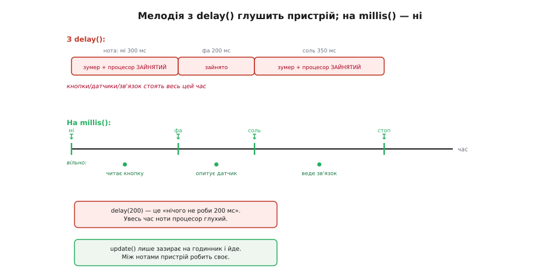

# ⚙️ Керування зумером у коді: від «пік» до мелодії без затримок

Звести зумер до одного `digitalWrite` — це половина правди. Половина, якої вистачить, поки пристрій уміє лише одне: пискнути й забути. Щойно ви хочете, **щоб зумер грав мелодію, а пристрій тим часом жив** — читав кнопки, крутив мотор, тримав зв'язок, — простий підхід розсипається, і треба зовсім інша механіка. Ця замітка проводить від найтупішого «увімкнув/вимкнув» до неблокувального програвача мелодій, розбирає популярний формат рінгтонів, яким ті мелодії задають, і закінчує тим, як завести гучний електромагнітний зумер через транзистор так, щоб не спалити ні вивід, ні сам ключ.

Уся розвилка коду тримається на тому самому питанні, що й уся апаратна частина: **активний зумер чи пасивний**. Активний — це вимикач, з ним нема про що писати статтю. Пасивний — це генератор частоти, і саме навколо нього народжується весь цікавий код: ноти, ритм, мелодія, автомат станів. Тому левова частка нижче — про пасивний. Мова тут суто заліза — таймери, регістри, точний час у мілісекундах, — тож увесь код природно лягає на C/C++, і жодна інша мова тут нічого не додасть (ноти на пасивному зумері не програють ані Python-ом, ані TypeScript-ом — це робота апаратного таймера мікроконтролера). Приклади нижче йдуть трьома доріжками — Arduino, ESP-IDF і STM32 HAL: задача на всіх мікроконтролерах та сама (вивід, апаратний таймер, лічильник мілісекунд), різняться лише імена, якими її звуть у кожному середовищі.

## Активний зумер: рівно вимикач

Почнімо з простого, щоб відбити його раз і назавжди. Активний зумер має власний генератор усередині; ваша справа — подати або зняти живлення. У коді це не відрізняється від світлодіода: один вивід у режимі виходу, одиниця на ньому — виє, нуль — мовчить. Як цей вивід смикати, кожне середовище зве по-своєму, але дія скрізь одна.

:::tabs
:::code api-buzzer-drive/c/arduino/aktyvnyi-zumer-rivno.ino
:::code api-buzzer-drive/c/esp-idf/aktyvnyi-zumer-rivno.c
:::code api-buzzer-drive/c/stm32/aktyvnyi-zumer-rivno.c
:::

І тут причаїлася перша класична пастка, через яку люди годинами шукають неіснуючий баг. **Активний зумер не грає мелодій.** Якщо подати на нього меандр 440 Гц, а потім 880 Гц — чим би ви той меандр не робили, `tone()` в Arduino чи каналом таймера деінде, — ви почуєте **ту саму ноту** обидва рази, його зашиту резонансну. Причина проста: генератор жене на вивід прямокутну хвилю потрібної частоти, але активному зумеру байдужа ваша частота — його генератор бачить лише «є живлення / нема живлення» і гуде своєю. Ваш меандр він фактично випрямляє й ігнорує. Тому правило залізне: **хочете різні тони — беріть пасивний зумер**; на активному застрягнете на одній ноті назавжди.

> 🔧 **Навіщо це.** Вибір активний/пасивний робиться **до** паяння й пишеться в перший рядок коду. Плутанина тут — найчастіша причина скарги «зумер не працює» або «tone() грає одну ноту». Якщо ваша задача — просто сигнал події (пік на натиск, писк на помилку), активний ідеальний: тривіальний код, нуль таймерів, гучно й надійно. Якщо ж у вимогах є слово «мелодія» чи «різні звуки на різні події» — активний фізично не впорається, і жоден код це не полагодить.

## Пасивний зумер: генератор частоти в руці

Пасивний зумер сам мовчить — це гола коливальна система. Щоб він задзвенів, вивід мусить **гойдати його прямокутною хвилею**: скільки герц подасте, таку ноту й почуєте. Хвилю робить **апаратний таймер**: він сам, у фоні, смикає вивід із заданою частотою й тримає її, поки ви не спините, — процесор у цьому не бере участі. Ручка до цього таймера в кожному середовищі своя: в Arduino це готова пара `tone(pin, freq)` / `noTone(pin)`, в ESP-IDF — модуль LEDC (частота таймера плюс шпаруватість 50 % на каналі), у STM32 — канал таймера в режимі ШІМ, де частоту задає регістр перезавантаження `ARR`, а шпаруватість — `CCR`.

Ноти — це просто частоти. Рівномірно темперований стрій прив'язаний до `ля` першої октави = 440 Гц, а кожен наступний півтон вищий у ¹²√2 ≈ 1.05946 раза. Звідси й таблиця частот, яку зазвичай виносять у заголовок:

:::tabs
:::code api-buzzer-drive/c/arduino/pasyvnyi-zumer-henerator.ino
:::code api-buzzer-drive/c/esp-idf/pasyvnyi-zumer-henerator.c
:::code api-buzzer-drive/c/stm32/pasyvnyi-zumer-henerator.c
:::

Це працює, звучить — і водночас містить **другу велику пастку**, найпідступнішу з усіх. Придивіться до `delay(ms)` усередині `playNote`. Поки грає нота, `delay` **замерзає всю програму**: 200 мілісекунд процесор не робить нічого, крім чекання. Зіграти чотири ноти — це майже секунда повної глухоти пристрою: кнопки не читаються, датчики не опитуються, зв'язок стоїть. Для іграшки, де крім зумера нічого немає, це терпимо. Для будь-якого справжнього приладу — вирок.

> 🔧 **Навіщо це.** `delay()` — не пауза для зумера, це пауза для **всього мікроконтролера**. Він однопотоковий: поки крутиться `delay`, жоден інший рядок не виконується. Мелодія з `delay` перетворює пристрій на цеглину рівно на час програвання. Якщо десь у вашому коді паралельно має щось відбуватися — а воно майже завжди має, — мелодію треба вести **без блокування**. Це не оздоба, а різниця між прошивкою-демкою і прошивкою, що працює в реальному пристрої.

## Неблокувальна мелодія: годинник замість затримки

Ідея, що ламає закляття `delay()`, обманливо проста. Замість «зіграй ноту й **чекай** 200 мс» ми кажемо: «зіграй ноту, **запам'ятай, о котрій годині** її пора змінити, і йди займайся своїм». А в головному циклі щоразу лише **зазираємо на годинник**: якщо час ноти вийшов — перемикаємо на наступну; якщо ні — нічого не робимо й повертаємось до інших справ. Годинник тут — вільно біжучий лічильник мілісекунд від старту, який є на кожному мікроконтролері: `millis()` в Arduino, `HAL_GetTick()` у STM32 HAL, `esp_timer_get_time()` (мікросекунди) в ESP-IDF.

Різниця між двома підходами найкраще видно на осі часу.


*Угорі: під час кожної ноти `delay` тримає процесор у глухому очікуванні — уся смуга «зайнято», інші справи не встигають. Унизу: `millis()`-підхід витрачає на ноту лише коротку мить перемикання, а весь проміжок між нотами процесор вільний і встигає обслужити кнопку, датчик, зв'язок. Звук той самий; різниця — у тому, живий пристрій чи заморожений.*

Формально це **скінченний автомат**: стан — «яку ноту зараз граємо» (індекс у партитурі) плюс «коли її пора змінити» (мітка часу). Подія, що рухає автомат, — настання цього часу. Обгорнімо все у клас, щоб мати змогу тримати кілька мелодій і вмикати їх подіями.

:::tabs
:::code api-buzzer-drive/c/arduino/neblokuvalna-melodiia.ino
:::code api-buzzer-drive/c/esp-idf/neblokuvalna-melodiia.c
:::code api-buzzer-drive/c/stm32/neblokuvalna-melodiia.c
:::

Партитуру задаємо масивом, а `loop()` тепер вільний як птах:

:::tabs
:::code api-buzzer-drive/c/arduino/neblokuvalna-melodiia-2.ino
:::code api-buzzer-drive/c/esp-idf/neblokuvalna-melodiia-2.c
:::code api-buzzer-drive/c/stm32/neblokuvalna-melodiia-2.c
:::

Розберімо, **чому** ця конструкція неблокувальна, бо тут криється вся суть. Ключ — рядок `if (millis() < noteEndsAt) return;`. Він перетворює «чекати» на «перевірити й піти». `update()` не витрачає час — він або миттєво повертається (нота ще грає), або за наносекунди перемикає ноту й знову повертається. Проміжок між викликами `update()` цілком належить решті програми. Зумер грає «сам собою» на апаратному таймері (і `tone()`, і LEDC, і канал ШІМ уже фонові!), а наш автомат лише вчасно каже йому, коли міняти частоту. Пристрій жодної миті не стоїть.

Є одна тонкість, про яку треба знати заздалегідь, бо вона колись вкусить: будь-який 32-бітний лічильник мілісекунд (`millis()`, `HAL_GetTick()`) **переповнюється** приблизно через 49.7 доби й скидається в нуль. Наше порівняння `millis() < noteEndsAt` цей момент переживає болісно — на межі переповнення нота може обірватися чи зависнути. Рятунок — **завжди рахувати різницю**, а не порівнювати абсолютні значення: тримати не «коли скінчиться», а «коли почалася», і питати `millis() - noteStartedAt >= n.ms`. Віднімання беззнакових чисел коректне навіть на переході через нуль (переповнення «згортається» саме так, як треба) — у вкладці STM32 вище перевірка написана саме через різницю. Для мелодії, що грає секунди, ви майже певно не влучите в ту межу — але звичка рахувати різницю, а не порівнювати абсолют, рятує в тисячі інших місць, тож варто закладати її одразу.

> 🔧 **Навіщо це.** Автомат станів на `millis()` — це не спеціальний трюк для зумера, а **основний спосіб робити на мікроконтролері кілька справ «одночасно»** без операційної системи. Той самий кістяк («запам'ятай мить події → у циклі перевіряй, чи настала») веде миготіння світлодіода, антидребезг кнопки, тайм-аути зв'язку, періодичне опитування датчиків. Освоївши його на мелодії зумера — а це вдячний, чутний на вухо приклад, — ви отримуєте шаблон, який далі копіюватимете всюди. І навпаки: доки в коді сидить `delay()`, паралельність неможлива в принципі.

## RTTTL: мелодія як рядок тексту

Забивати партитуру масивом `{частота, тривалість}` руками — марудно й нечитабельно. Куди зручніше записати мелодію **людською нотацією**, а програму навчити її грати. Саме для цього колись і придумали **RTTTL** (англ. *Ring Tone Text Transfer Language* — мова передавання рінгтонів). Формат розробила Nokia наприкінці 1990-х як частину системи Smart Messaging, щоб пересилати рінгтони есемескою; ним рясніли всі тогочасні телефони, і донині в мережі лежать тисячі готових мелодій одним рядком (авторство Nokia в довідниках зазвичай подають без первинного документа — статус: усталене, але слабко задокументоване).

Виглядає RTTTL так:

```
Ode:d=4,o=5,b=125:8e,8e,8f,8g,8g,8f,8e,8d,8c,8c,8d,8e,4e.,8d,2d
```

Рядок ділиться двокрапками на **три частини**:

- **Назва** — до двокрапки (`Ode`). До 10 символів, двокрапки в ній бути не може. На звук не впливає — просто підпис.
- **Умовчання** — набір `ключ=значення` через кому. Три параметри: `d` — тривалість ноти за замовчуванням (4 = чвертка), `o` — октава за замовчуванням, `b` — темп у ударах за хвилину (BPM).
- **Ноти** — через кому. Кожна нота: **тривалість** (число-дільник цілої ноти), потім **буква** (`c d e f g a b`, а `p` — пауза), далі за потреби **октава** й **крапка** (подовжує на половину). Будь-який із цих трьох хвостиків можна пропустити — тоді береться умовчання. Так `8e` = восьма нота `мі` в октаві за замовчуванням, `4e.` = чвертка з крапкою (ціла × ³⁄₈), `2p` = півнотна пауза.

Ключ до програвання — **як тривалість-дільник перетворити на мілісекунди**. Домовленість музична й проста: **чвертка = один удар**. При темпі `b` ударів за хвилину один удар триває `60000 / b` мілісекунд. Ціла нота — це чотири удари, тобто `240000 / b` мс. А нота з дільником `d` (де `d` ∈ {1,2,4,8,16,32}) — це `(240000 / b) / d` мс. Крапка домножує на 1.5.

**Тривалість ноти в мілісекундах (темп b = 125, дільник d).**
```
Ціла нота (4 удари):      240000 / 125          = 1920 мс
Чвертка   (d = 4):       (240000 / 125) / 4     =  480 мс
Восьма    (d = 8):       (240000 / 125) / 8     =  240 мс
Чвертка з крапкою:       480 · 1.5              =  720 мс
```

Тепер напишемо **мінімальний парсер**, що читає такий рядок і зводить його до тих самих увімкнень частоти. Щоб не тягти купу пам'яті, тримаємо мелодію у флеші й читаємо посимвольно. Тут вилазить різниця архітектур: на 8-бітному AVR флеш — окремий адресний простір, тому Arduino вимагає `PROGMEM` і читання через `pgm_read_*`; на 32-бітних МК (ESP32, STM32) флеш відображений у спільний простір, і звичайного `const` досить — таблиця й так лежить у флеші й читається як звичайна пам'ять. Наведу спершу серце парсера — розбір **однієї ноти**, бо саме тут вся логіка формату:

:::tabs
:::code api-buzzer-drive/c/arduino/rtttl-melodiia-iak-riadok.ino
:::code api-buzzer-drive/c/esp-idf/rtttl-melodiia-iak-riadok.c
:::

А тепер сам прохід по рядку. Логіка одна на кожну ноту: прочитати число-тривалість (якщо є) → літеру → необов'язковий `#` → необов'язкову цифру-октаву → необов'язкову крапку → порахувати частоту й тривалість → зіграти:

:::tabs
:::code api-buzzer-drive/c/arduino/rtttl-melodiia-iak-riadok-2.ino
:::code api-buzzer-drive/c/esp-idf/rtttl-melodiia-iak-riadok-2.c
:::

Ужити його — три рядки:

:::tabs
```arduino
const char ODE_RTTTL[] PROGMEM =
  "Ode:d=4,o=5,b=125:8e,8e,8f,8g,8g,8f,8e,8d,8c,8c,8d,8e,4e.,8d,2d";

RtttlPlayer player(8);

void setup() { player.begin(ODE_RTTTL); }
void loop()  { player.update(); /* решта пристрою тут вільно живе */ }
```
```esp-idf
static const char ODE_RTTTL[] =
  "Ode:d=4,o=5,b=125:8e,8e,8f,8g,8g,8f,8e,8d,8c,8c,8d,8e,4e.,8d,2d";

void app_main(void) {
  buzzer_init();
  xTaskCreate(rtttl_task, "rtttl", 3072, (void *)ODE_RTTTL, 4, NULL);
  // решта пристрою живе у своїх задачах і мелодії не помічає
}
```
:::

Зверніть увагу, що парсер збудований на **тому самому неблокувальному кістяку**: `update()` дивиться на годинник і повертається, а решту часу пристрій вільний. Там, де під рукою є планувальник (вкладка ESP-IDF), той самий наслідок дає інший механізм — мелодія їде у власній задачі, і її чекання віддає процесор іншим задачам замість крутити його вхолосту. Ми не читаємо весь рядок наперед у масив — розбираємо ноту за нотою «на льоту», прямо коли настає її час. Це не лише економить пам'ять (мелодія живе в `PROGMEM`, у RAM — жменька змінних), а й показує гарну звичку: **не будувати велику структуру там, де досить курсора**.

Кілька практичних застережень до цього мінімального парсера. Він свідомо простий і покриває звичайні мелодії, але не всі крайні випадки формату. По-перше, у деяких RTTTL крапка стоїть **після** октави (`e5.`), а в деяких — після літери перед октавою (`e.5`); повний парсер має ловити крапку в обох місцях, наш очікує її **в кінці**. По-друге, дехто пише умовчання в іншому порядку чи з пробілами — наш код терпить пробіли між нотами, але не всередині заголовка. По-третє, ми не обробляємо тривалість `.` як самостійну (без числа). Для навчального програвача цього досить; для промислового варто взяти готову бібліотеку (їх для Arduino й ESP32 багато) — але тепер ви знаєте **точно, що вона робить усередині**, і полагодите її, коли якийсь рінгтон «не так грає».

## ESP32: `tone()` не завжди є — беремо апаратний PWM (LEDC)

На класичному Arduino Uno функція `tone()` завжди під рукою. На **ESP32** історія інша й варта окремої уваги, бо на ній спотикаються при переході з Uno. Ранні версії ядра ESP32 for Arduino взагалі **не мали** `tone()`; звук роблять через штатний апаратний широтно-імпульсний модулятор — **LEDC** (*LED Control*, спочатку задуманий для плавного світіння світлодіодів, але це той самий генератор прямокутної хвилі, який чудово гойдає пасивний зумер). У новіших ядрах `tone()`-обгортку додали, та керувати LEDC напряму все одно корисно: він дає точнішу частоту, кілька незалежних каналів і не конфліктує з іншим кодом за єдиний таймер. У самому ESP-IDF жодного `tone()` нема взагалі — там із LEDC працюють напряму, тобто йдуть тим самим шляхом, лише без обгортки.

І тут чатує **пастка версій**, на якій зараз горить чи не кожен, хто оновив ядро: у **ESP32 core 3.0** API LEDC переробили, і старі приклади з інтернету **не збираються**. Раніше канал заводили парою `ledcSetup(channel, freq, resBits)` + `ledcAttachPin(pin, channel)`; у 3.0 обидві функції прибрали, а натомість є одна — `ledcAttach(pin, freq, resolution)`, що сама призначає канал на вивід (статус: підтверджено офіційним гайдом міграції Espressif 2.x → 3.0). Ось код під **сучасне ядро 3.x**:

:::tabs
:::code api-buzzer-drive/c/arduino/esp32-tone-ne-zavzhdy-ie.ino
:::code api-buzzer-drive/c/esp-idf/esp32-tone-ne-zavzhdy-ie.c
:::

Ключова функція — `ledcWriteTone(pin, freq)`: вона налаштовує LEDC на 50-відсотковий меандр заданої частоти (саме такий і треба зумеру) і повертає реально встановлену частоту (0 при помилці). Є ще зручна `ledcWriteNote(pin, note, octave)`, яка приймає ноту як символьну константу й октаву — тобто **сама рахує частоту** за темперованим строєм; для мелодій із нотами буває чистіше за таблицю герців. Щоб звільнити вивід, — `ledcDetach(pin)`.

> 🔧 **Навіщо це.** Якщо ви прийшли на ESP32 з Uno й механічно скопіювали приклад із `ledcSetup`/`ledcAttachPin`, а компілятор лається «not declared» — це не ваш баг і не бита плата, а зміна API у ядрі 3.0. Або оновіть код на `ledcAttach`, або (гірше) відкотіть ядро на 2.x. Знати про цю розвилку — заощадити вечір гугління незрозумілих помилок збірки. І ширше: на ESP32 звук майже завжди варто вести через LEDC напряму, а не через `tone()`-обгортку — більше контролю, точніша частота, менше сюрпризів із поділом таймерів.

## Драйв гучного зумера: транзистор, база, діод

Дотепер зумер сидів **прямо на виводі** — так можна лише для малострумного п'єзо (одиниці міліампер, вивід тягне). **Електромагнітний** зумер — це котушка, крізь яку тече справжній струм; апетит у нього **десятки міліампер** (30, 50, буває більше), і вивід мікроконтролера стільки віддати не годен. Вішати такий зумер прямо на GPIO не можна: у кращому разі він звучатиме кволо (виводу бракує сили розгойдати котушку), у гіршому — ви повільно вбиваєте сам вивід, перевантажуючи його понад паспортну стелю.

Рішення — класичний [транзистор-ключ](root:hw-components/bjt-switch): біполярний транзистор, що працює не плавним підсилювачем, а вимикачем — маленький струм бази або відмикає великий струм колектора «до упору», або тримає його закритим. Вивід МК керує лише **базою** транзистора через резистор, а важкий струм зумера тече **крізь транзистор**, не крізь вивід. Слабка логіка командує, потужний ключ тягне. У коді від цього не змінюється **нічого** — усі попередні приклади (активний, пасивний, мелодія, RTTTL) працюють без правок: ви так само робите `digitalWrite`, `tone` чи `ledcWriteTone` на керуючому виводі, тільки цей вивід тепер відмикає транзистор, а не живить зумер напряму. Змінюється **схема**, не програма.

Один момент коду все ж вартий уваги — **полярність керування**. У найпростішій схемі з NPN-транзистором (емітер на землю, зумер між «плюсом» живлення й колектором) `HIGH` на базі **вмикає** зумер, `LOW` — вимикає. Логіка пряма, збігається з інтуїцією. Але якщо вам трапиться схема з PNP згори або з готовим модулем, де стоїть інвертор, — рівні можуть виявитися **зворотними** (`LOW` вмикає). Тому, налагоджуючи чужу плату, спершу з'ясуйте, яким рівнем вона вмикається, а не припускайте.

Тепер — **розрахунок базового резистора**, серце цієї схеми. Транзистор в ролі ключа має бути в **насиченні** — відкритий «до упору», щоб на ньому падало якнайменше напруги (інакше він гріється й краде вольти в зумера). Для цього струм бази має бути з **запасом** більший за той мінімум, що диктує коефіцієнт підсилення.

**Базовий резистор для NPN-ключа (МК 3.3 В, зумер 50 мА, β ≈ 100).**
```
Дано:  Vio = 3.3 В       напруга виводу в стані «1»
       Vbe ≈ 0.7 В       падіння база-емітер відкритого кремнієвого NPN
       Ic  = 50 мА       робочий струм зумера (0.050 А)
       β   ≈ 100         коефіцієнт підсилення (у datasheet — hFE)

Мінімальний струм бази, щоб транзистор ледь відкрив цей струм:
       Ib(мін) = Ic / β = 0.050 / 100 = 0.5 мА

Для НАСИЧЕННЯ беремо з запасом ×3..×5 (ключ, не підсилювач):
       Ib(беремо) ≈ 2 мА

На резисторі падає різниця «вивід мінус Vbe»:
       Vr = Vio − Vbe = 3.3 − 0.7 = 2.6 В

Опір за законом Ома:
       R = Vr / Ib = 2.6 / 0.002 = 1300 Ом

Найближчий ходовий номінал — 1 кОм (дасть трохи більший струм бази,
транзистор насититься надійніше). Ось чому в таких схемах майже
завжди стоїть «1k» у базі — це не магія, а цей розрахунок.
```

Логіка розрахунку варта того, щоб її **зрозуміти, а не завчити**. Мінімальний струм бази `Ic / β` — це межа, на якій транзистор ледь-ледь пропускає потрібний струм колектора, ще працюючи як підсилювач. Але **ключу підсилення не треба** — йому треба бути повністю відкритим, і тому струм бази беруть у кілька разів більшим за цю межу, заганяючи транзистор глибоко в насичення. Запас ×3..×5 і дає той «1k»: з ним транзистор відкривається твердо, падіння на ньому мінімальне, майже вся напруга живлення дістається зумеру. Поставите замість «1k» умовні «10k» — струм бази впаде вп'ятеро, транзистор ледь прочиниться, на ньому осяде півживлення, зумер захрипить упівголоса, а транзистор грітиметься. Тому завеликий базовий резистор — така сама помилка, як його відсутність.

І остання, **найпідступніша деталь — діод-гасник**, без якого схема з електромагнітним зумером живе недовго й помирає загадково. Котушка ненавидить, коли їй різко обривають струм. У мить, коли транзистор закривається, магнітне поле котушки миттєво спадає, і за законом самоіндукції вона **вихлюпує накопичену енергію викидом високої напруги зворотної полярності** — десятки, а то й сотні вольтів на частку мілісекунди. Це [брикання котушки](root:hw-components/inductor-kickback): що різкіше обриваєш струм в індуктивності, то вищий стрибок напруги на ній, бо котушка силкується втримати струм незмінним. Цей викид б'є прямо в колектор транзистора й **пробиває** його. Найгидкіше, що схема при цьому «якось працює»: транзистор витримує перші тисячі перемикань, зумер пищить, усе начебто гаразд — а через тиждень чи місяць транзистор раптом мертвий, і причину шукають де завгодно, тільки не тут.

Ліки — **діод паралельно зумеру, увімкнений «навпаки»**: катодом до «плюса» живлення, анодом до колектора. У нормальній роботі він закритий і схемі не заважає (струм тече крізь зумер як має). Але в мить кидка полярність напруги на котушці **перевертається**, діод відкривається й **замикає викид сам на себе** — енергія котушки безпечно розсіюється по петлі «котушка → діод», не доходячи до транзистора. Годиться звичайний випрямний діод на кшталт 1N4148 (для малих струмів) чи 1N4007. Для п'єзозумера цей діод **не потрібен** зовсім — там немає котушки, немає й кидка; але для будь-якого котушкового (електромагнітного) зумера він **обов'язковий**.

> 🔧 **Навіщо це.** Діод-гасник — це страховка від невидимого. Кидок котушки не побачиш «на око», його не покаже мультиметр; він триває мікросекунди, але реально пробиває транзистори в схемах, де про нього забули. Одна дешева деталь копійкою рятує від «плаваючих» відмов, які потім тижнями шукають у прошивці, хоча винне залізо. Правило просте: **керуєш котушкою через транзистор — став діод**, завжди, рефлекторно. Це стосується не лише зумера, а будь-якого індуктивного навантаження: реле, соленоїда, мотора. Звичка ставити гасник біля кожної котушки — ознака того, що ви розумієте, чому схеми вмирають.

## Що врізати в пам'ять

Пройдений шлях коротко, щоб лишилося головне.

- **Активний зумер — це один рівень на виводі** (`digitalWrite`, `gpio_set_level`, `HAL_GPIO_WritePin` — питання середовища, не суті). Ніяких частот; `tone()` на ньому дає одну ноту (свою резонансну), а не мелодію. Потрібні різні тони — беріть пасивний, і жоден код цього не обійде.
- **Пасивний зумер — це апаратний таймер, що жене меандр:** `tone()` / `noTone()` в Arduino, LEDC в ESP32/ESP-IDF, канал таймера в режимі ШІМ у STM32. Ноти — це частоти в герцах; пауза — 0 Гц.
- **`delay()` у мелодії заморожує весь пристрій.** Для будь-чого серйознішого за іграшку ведіть звук **неблокувально**: автомат станів на `millis()` — «запам'ятай, коли міняти ноту, а в циклі лише зазирай на годинник». Цей самий кістяк далі веде всю псевдопаралельність на МК.
- **RTTTL** дає мелодію одним текстовим рядком (`назва:умовчання:ноти`); тривалість-дільник переводиться в мілісекунди через темп: ціла нота = `240000 / bpm` мс. Мінімальний парсер лягає на той самий неблокувальний кістяк.
- **ESP32:** звук через LEDC; у ядрі **3.0** API змінився — `ledcAttach(pin, freq, res)` замість старих `ledcSetup` + `ledcAttachPin`. Старі приклади з інтернету на новому ядрі не збираються.
- **Гучний/електромагнітний зумер — через транзистор-ключ.** Базовий резистор рахується під **насичення** (струм бази з запасом ×3..×5 над `Ic/β`) — звідси ходовий «1k». Код не змінюється, змінюється схема.
- **Біля котушкового зумера — діод-гасник** (катодом до «плюса»), завжди. Забудете — кидок самоіндукції поволі вб'є транзистор, і відмову шукатимете деінде. Для п'єзо діод зайвий.
