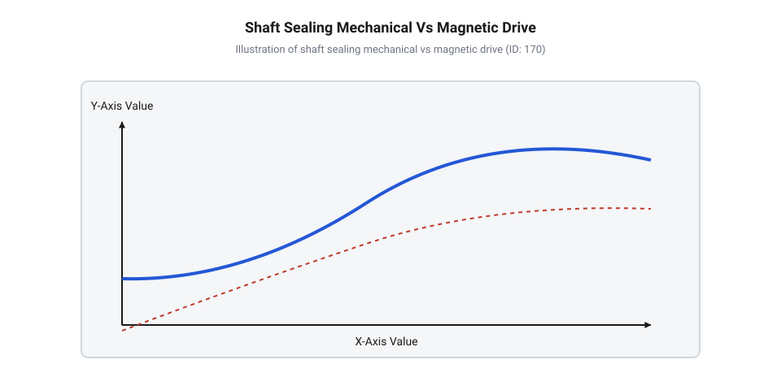
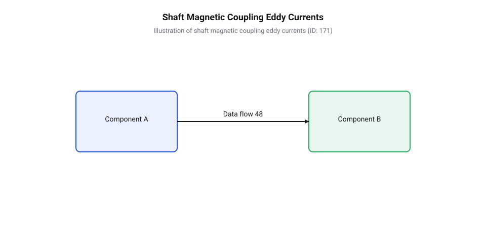
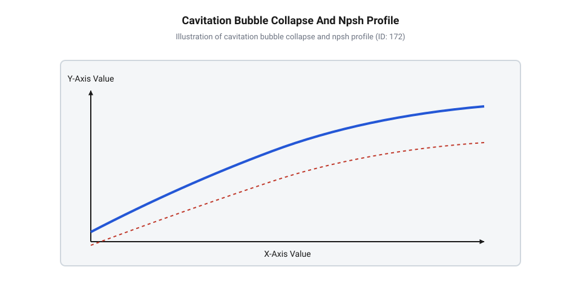
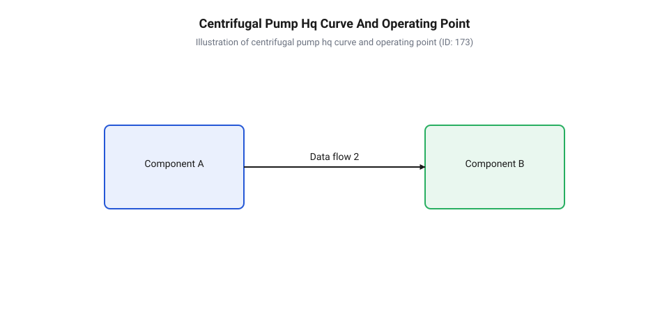
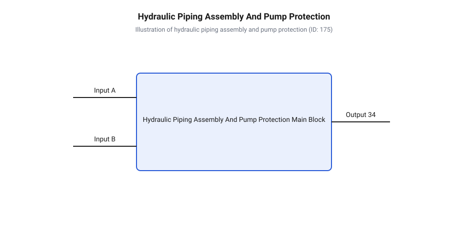

# Відцентрові насоси

<preknowlist>
- [Мембранні мікропомпи](root:cat-hw-actuators/diaphragm-micro-pumps) — принципи об'ємного витіснення рідини та джерела виникнення циклічних пульсацій тиску під час роботи
- [Перистальтичні насоси](root:cat-hw-actuators/peristaltic-pumps) — особливості дозованого перекачування герметичними шлангами та обмеження за продуктивністю і гладкістю потоку
</preknowlist>

## Необхідність безперервного перекачування великих об'ємів

Уявіть інженерну задачу, де необхідно забезпечити безупинне перекачування сотень або тисяч кубічних метрів рідини на годину: контур охолодження теплової електростанції, міська система водопостачання, циркуляційна мережа хімічного реактора або магістральний технологічний трубопровід. Усі ці системи вимагають стабільного, рівномірного потоку без затримок і перепадів тиску. Першою інтуїтивною думкою інженера може бути використання вже знайомих насосів об'ємного типу — наприклад, поршневих зворотно-поступальних механізмів або промислових версій таких пристроїв, як [мембранні мікропомпи](root:cat-hw-actuators/diaphragm-micro-pumps) чи [перистальтичні насоси](root:cat-hw-actuators/peristaltic-pumps). Проте при спробі масштабного збільшення продуктивності об'ємні витіснювачі впираються в жорсткі фізичні та механічні обмеження.

Принцип роботи будь-якого об'ємного витіснювача полягає в циклічному заповненні робочої камери рідиною з наступним її витісненням за рахунок зменшення об'єму цієї камери. У зворотно-поступальних насосах (від лат. *reciprocus* — зворотний, той що рухається туди-сюди; @@en|reciprocating pump@@) поршень або плунжер під час кожного ходу повинен розганяти стовп рідини від нульової швидкості до максимуму, а в кінці ходу — повністю його зупиняти. Оскільки рідина має значну масу `m` та нестисливість, її циклічне прискорення `a` вимагає прикладення величезних інерційних сил відповідно до другого закону Ньютона:

```
F_in = m · a
```

У протяжних трубопроводах цей інерційний напір прискорення стовпа рідини `h_a` прямо залежить від довжини трубопроводу `L`, співвідношення площ поршня й труби та частоти обертання вала `ω`:

```
h_a = (L / g) · (A_p / A_d) · ω² · r · cos(ω · t)
```

де:
`L` — довжина всмоктувальної чи нагнітальної лінії (м);
`A_p / A_d` — співвідношення площ поршня та трубопроводу;
`ω` — кутова швидкість кривошипа приводу (рад/с);
`r` — радіус кривошипа (м).

Під час високочастотного реверсу поршня ці інерційні сили викликають руйнівні стрибки тиску в трубопроводі — гідравлічний удар (від грец. *hydor* — вода; @@en|hydraulic shock@@). Спроба збільшити витрату шляхом підвищення частоти ходів поршня призводить до того, що амплітуда пульсацій тиску зростає пропорційно квадрату частоти обертання приводного вала, створюючи ризик розриву труб і руйнування арматури.

Другим слабким місцем об'ємного перекачування при високих витратах є механізм розподілу потоку. Аби рідина рухалася в одному напрямку, зворотно-поступальний насос вимагає наявності самодіючих всмоктувальних та нагнітальних зворотних клапанів (від англ. *check valve*; @@en|check valve@@). Під час перекачування великих об'ємів запобіжні та зворотні клапани змушені відкриватися й закриватися десятки разів на секунду. Масивна тарілка або куля клапана має власну інерцію: вона запізнюється із закриттям, викликаючи зворотні витоки, а при посадці на сідло відчуває жорсткі ударні навантаження. Це спричиняє швидкий механічний знос, ерозію ущільнювальних поверхонь та втомне руйнування пружин.

Крім того, сама природа об'ємного витіснення є принципово дискретною: потік на виході насоса рухається імпульсами. Щоб згладити ці пульсації тиску (від лат. *pulsatio* — поштовх; @@en|pulsation@@) у промислових масштабах, доводиться встановлювати громіздкі гідроакумулятори (від лат. *accumulator* — збирач; @@en|pulsation dampener@@) — демпферні ємності з повітряними або газовими подушками. Це суттєво збільшує габарити, масу та вартість установки, але не усуває проблему зносу рухомих деталей усередині самого насоса.

Отже, спроба наростити продуктивність шляхом збільшення геометричних розмірів поршнів чи циліндрів викликає експоненційне зростання маси рухомих частин і гідродинамічного опору. Впираючись у ці фізичні межі, інженерна думка прийшла до фундаментальної зміни парадигми: замість циклічного замкнення й витіснення фіксованих об'ємів рідини необхідний перехід до безперервного динамічного розгону потоку.

Історія розвитку відцентрових насосів бере початок у XVII столітті з ідеї французького фізика Дені Папена (Denis Papin), який запропонував використовувати відцентрову силу обертових лопатей у круглому корпусі для підйому води (так званий «гессенський насос»). Згодом, у XVIII столітті, видатний математик Леонард Ейлер (Leonhard Euler) сформулював фундаментальне рівняння турбомашин, створивши строгу математичну теорію динамічного перекачування. Перехід від первинних прямих лопаток до вигнутих профільованих коліс та спіральних розширюваних корпусів перетворив відцентровий насос на домінуюче рішення у світовій промисловості. Розуміння цієї еволюції пояснює, чому сучасні конструкції набули саме такої геометричної форми: вона стала результатом багатовікового інженерного компромісу між гідравлічним ККД, напірною характеристикою та механічною надійністю.

Динамічний розгін означає, що механічна енергія приводу передається рідині не через прямий тиск поршня на замкнений об'єм, а через безперервну передачу кінетичної енергії (від грец. *kinetikos* — той, що приводить у рух; @@grc|kinetic energy@@) обертовим елементом. Рідина протікає крізь проточну частину без зупинок, клапанів та реверсивних рухів. Це усуває джерело пульсацій тиску й дозволяє досягати гігантських об'ємів витрати при компактних габаритах обладнання, відкриваючи шлях до використання відцентрового принципу перекачування.

## Фізика відцентрового розгону та волюта

В основу роботи відцентрового насоса (від лат. *centrum* — центр і *fugere* — тікати; @@en|centrifugal pump@@) покладено принцип перетворення кінетичної енергії обертального руху на статичний гідродинамічний тиск рідини (від грец. *hydor* — вода і *dynamis* — сила; @@grc|hydrodynamic pressure@@). Цей процес відбувається у два послідовні етапи: спочатку робоче колесо розганяє рідину, надаючи їй високої швидкості, а потім спіральний корпус сповільнює її, трансформуючи швидкісний напір у потенційну енергію тиску.

Рідина потрапляє в насос через всмоктувальний патрубок вздовж осі обертання у центральну область — вічко робочого колеса (від лат. *impellere* — приводити в рух, штовхати; @@en|impeller eye@@). Тут вона захоплюється обертовими лопатками імпелера (@@en|impeller@@), який обертається з кутовою швидкістю `ω` (в радіанах за секунду, де `ω = 2 · π · n / 60`, а `n` — частота обертання вала в обертах за хвилину). Як тільки частка рідини потрапляє в міжлопаточний канал на радіусі `r₁`, на неї починає діяти відцентрова сила:

```
F_c = m · ω² · r
```

Ця сила спрямована радіально від центра обертання до периферії. Під її дією рідина відкидається до зовнішнього краю колеса на радіус `r₂`. Рухаючись міжлопаточнім каналом, частка рідини бере участь у складному русі, який описується трикутником швидкостей. Вона обертається разом із колесом з переносною окружною швидкістю `u` та одночасно ковзає вздовж лопатки з відносною швидкістю `w`. 

На виході з робочого колеса (на радіусі `r₂`) вектор абсолютної швидкості рідини `v₂` є геометричною сумою окружної швидкості периферії колеса `u₂ = ω · r₂` та відносної швидкості виходу з каналу `w₂`. Абсолютну швидкість `v₂` можна розкласти на дві взаємно перпендикулярні складові: тангенціальну `v_u₂` (спрямовану по дотичній до кола) та меридіональну/радіальну `v_m₂` (спрямовану перпендикулярно до кола виходу).

Меридіональна складова `v_m₂` безпосередньо визначає об'ємну витрату насоса `Q`:

```
Q = π · d₂ · b₂ · v_m₂
```

де `d₂` — зовнішній діаметр робочого колеса (м), а `b₂` — ширина вихідного отвору між дисками колеса (м).

У свою чергу, тангенціальна складова `v_u₂` визначає величину теоретичного напору, який насос передає середовищу. Математичний зв'язок між параметрами обертання колеса та закруткою потоку описується фундаментальним рівнянням Ейлера для турбомашин (від ім'я Л. Ейлера; @@de|Euler equation@@). Теоретичний набір напору `H_∞` (виражений у метрах рідинного стовпа) розраховується за формулою:

```
H_∞ = (u₂ · v_u₂ - u₁ · v_u₁) / g
= (u₂ · v_u₂) / g      [за умови беззакрутного осьового входу, v_u₁ = 0]
```

де:
`u₁`, `u₂` — окружна швидкість лопаток на вході `r₁` та виході `r₂` (м/с);
`v_u₁`, `v_u₂` — тангенціальні проєкції абсолютної швидкості рідини на окружний напрямок на вході та виході (м/с);
`g` — прискорення вільного падіння (≈ 9.81 м/с²).

Для глибокого вивчення теоретичних підвалин розраховано [математичний опис H-Q характеристик](root:cat-hw-actuators/centrifugal-pumps/math-euler-pump-equation-and-affinity-laws.md), рівняння Ейлера та закони подібності, які пов'язують геометричні кути лопатей із напірними характеристиками.

Проте рідина, що вилітає з робочого колеса, має величезну кінетичну енергію (динамічний напір `H_dyn = v₂² / (2 · g)`), але порівняно низький статичний тиск. Якби цей високошвидкісний потік одразу потрапив у вихідний трубопровід, висока швидкість викликала б велетенське гідродинамічне тертя й турбулентні втрати, перетворивши більшу частину енергії на марне тепло.

Щоб трансформувати кінетичну енергію потоку на корисний статичний тиск, робоче колесо поміщають у спіральний корпус — волюту (від італ. *voluta* — завиток, згорт; @@en|volute@@). Волюта є каналом змінно прохідного перерізу, який охоплює робоче колесо по периметру. Починаючись від вузького розсікача — язика волюти (від англ. *cutwater*; @@en|cutwater@@), площа поперечного перерізу каналу `A` плавно збільшується за спіраллю в напрямку руху потоку аж до нагнітального патрубка.

Згідно з рівнянням нерозривності потоку для нестисливої рідини, витрата `Q` через будь-який переріз є сталою:

```
Q = A · v = const
```

Оскільки площа перерізу волютного каналу `A` поступово зростає вздовж шляху руху рідини, абсолютна швидкість потоку `v` вимушено зменшується. Відповідно до закону Бернуллі (від імені Д. Бернуллі; @@fr|Bernoulli's principle@@), загальна питома енергія потоку залишається сталою (без урахування втрат на тертя):

```
H_total = p_stat / (ρ · g) + v² / (2 · g) = const
```

При сповільненні потоку (зменшенні динамічного напору `v² / (2 · g)`) статичний тиск `p_stat` неминуче зростає. Дифузорний нагнітальний патрубок (від лат. *diffundere* — розливати, розсіювати; @@en|diffuser@@) на виході з волюти завершує це перетворення, плавно знижуючи швидкість рідини до нормальної швидкості в трубопроводі й забезпечуючи максимальне зростання статичного тиску.


*Гідродинамічний потік у робочому колесі та волюті: розширення перерізу спірального каналу сповільнює рідину й перетворює кінетичну енергію на статичний тиск.*

Нерівномірність розподілу тиску вздовж спіралі волюти на режимах, що відрізняються від розрахункової точки оптимальної витрати, створює на валу радіальну гідравлічну силу `F_r`. Крім того, різниця площ між переднім диском (з отвором всмоктування) та суцільним заднім диском замкненого колеса породжує незкомпенсовану осьову силу `F_a`, яка намагається змістити вал у бік входу. Для зняття цього навантаження в задньому диску виконують розвантажувальні отвори або встановлюють розвантажувальні лопатки на зворотному боці.

Ефективність гідродинамічного перетворення та здатність насоса працювати з різними робочими середовищами суттєво залежать від конструктивного виконання робочих коліс. За залежністю між дисками та лопатками імпелери (@@en|impeller@@) поділяють на три основні типи:

1. **Замкнені робочі колеса** (@@en|closed impeller@@): лопатки розташовані між двома суцільними дисками — заднім (приводним) та переднім (із всмоктувальним отвором). Така конструкція повністю запобігає перетіканню рідини через вершини лопаток з області високого тиску в область низького тиску. Це забезпечує найвищий гідравлічний ККД (`η = 75...88%`) і високий напір. Замкнені колеса є стандартом для чистих рідин, питної та технічної води, де відсутні великі механічні домішки. 2. **Напіввідкриті робочі колеса** (@@en|semi-open impeller@@): мають лише задній диск, тоді як передня сторона лопаток залишається відкритою й рухається з мінімальним зазором вздовж внутрішньої стінки корпусу насоса. Вони поступаються замкненим колесам за ККД через вихрові перетікання через торець лопатей, проте здатні перекачувати рідини з помірним вмістом завислих часток, шламів або в'язких домішок. Втрати регулюються точним виставлянням осьового зазору між лопатками та корпусом. 3. **Відкриті робочі колеса** (@@en|open impeller@@): позбавлені дисків, а лопатки кріпляться безпосередньо до центральної маточини. Вони мають найнижчий ККД через значні внутрішні витоки, але володіють винятковою стійкістю до забивання. Відкриті колеса застосовують у дренажних, фекальних та шламових насосах, де пріоритетом є прохідність для твердих включень, волокон та бруду.

Крім наявності дисків, вирішальну роль у формуванні напірно-витратної характеристики насоса відіграє геометрія та вигин лопаток на периферії робочого колеса:

* **Загнуті назад лопатки** (кут виходу `β₂ < 90°` відносно окружної швидкості): потік залишає колесо у напрямку, протилежному напрямку обертання. Це забезпечує найвищий гідравлічний ККД, м'яку падаючу H-Q характеристику (тиск падає із зростанням витрати) та самообмеження споживаної потужності. При збільшенні витрати навантаження на привід досягає насичення, що захищає електродвигун від перевантаження. Таку геометрію мають понад 90% промислових відцентрових насосів. * **Радіальні лопатки** (`β₂ = 90°`): лопатки спрямовані строго по радіусу. Забезпечують вищий напір при тих самих діаметрі та обертах, ніж загнуті назад, і легше виготовляються з високотвердих зносостійких сплавів, тому застосовуються в шламових та ґрунтових насосах. * **Загнуті вперед лопатки** (`β₂ > 90°`): потік вилітає в напрямку обертання колеса з високою абсолютною швидкістю. Вони забезпечують максимальний напір при малих габаритах колеса, проте мають низький ККД і зростаючу характеристику споживаної потужності: при падінні опору мережі витрата зростає, спричиняючи стрімке зростання навантаження на валу та ризик згоряння двигуна. У рідких середовищах застосовуються вкрай рідко, переважно у компактних повітряних вентиляторах.

Отже, поєднання геометрії робочого колеса та сповільнювального волютного корпусу визначає базовий гідродинамічний профіль відцентрового насоса, готуючи підґрунтя для розгляду питань механічного з'єднання приводу та герметизації обертового вала.

## Герметизація вала та магнітні муфти

Коли робоче колесо відцентрового насоса розганяє рідину і створює високий тиск у спіральному корпусі, виникає фундаментальна фізична суперечність на механічній межі пристрою. Обертовий вал приводу мусить проходити крізь нерухому стінку корпусу, щоб передавати крутний момент від зовнішнього двигуна до імпелера. Оскільки статичний тиск усередині волюти перевищує зовнішній атмосферний тиск, рідина безперервно прагне витекти назовні крізь зазор між валом та корпусом. На всмоктувальній же стороні, де утворюється розрідження, зовнішнє повітря навпаки намагається проникнути всередину робочої камери, що спричиняє завітрювання потоку. Надійне розмежування цих середовищ без надмірного тертьового зносу та перегріву вимагає застосування спеціалізованих вузлів герметизації.

Найпростішим історичним розв'язком цього завдання є сальникова набивка (від @@de|Stopfbuchse@@ — коробка для заповнення). Конструктивно вона є ущільнювальною камерою навколо вала, заповненою м'яким плетеним шнуром із волокон (бавовна, фторопласт або графітований азбест), який просочено мастилом. Нажимна букса аксіально стискає шнур, змушуючи його радіально розширюватися і щільно притискатися до поверхні захисної втулки вала. Фізичний компроміс @@de|сальникової набивки@@ полягає в тому, що вона не забезпечує абсолютної герметичності: для охолодження та змащування контактної зони крізь ущільнення мусить проціджуватися контрольоване мікропротікання рідини (близько 10–20 крапель на хвилину). Якщо затягнути буксу наглухо, сухе тертя миттєво обвуглить набивку та пошкодить поверхню вала. Через потребу в постійному обслуговуванні та наявність протікань @@de|сальникова набивка@@ застосовується переважно для неагресивних рідин і води в системних вузлах, де в [механічному та електричному інтерфейсі](root:cat-hw-actuators/centrifugal-pumps/api-centrifugal-pump-mechanical-and-electrical-interface.md) агрегату передбачено дренажний відвід.

Для усунення крапельних втрат та забезпечення високої герметичності використовують торцеве ущільнення (від @@en|mechanical seal@@ — механічне ущільнення). У цьому вузлі ущільнювальний контакт перенесено з циліндричної поверхні вала на перпендикулярну торцеву площину. Вузол складається з двох високоточних пришліфованих кілець: нерухомого, зафіксованого в корпусі, та обертового, закріпленого на валу. Пружини та гідравлічний тиск перекачуваного середовища притискають пари тертя одна до одної. Між торцями кілець утворюється мікроскопічний рідкий клин завтовшки менше одного мікрометра, який виконує роль гідродинамічної опори та рідинного затвора. Баланс між гідравлічним розмикаючим тиском у плівці та механічним стисканням пружин забезпечує практично нульовий рівень витоків при мінімальному зносі. Матеріальні пари кілець (пара графіт-кераміка або карбід кремнію-карбід кремнію) дають змогу працювати під високим тиском і при високих температурах, але @@en|торцеве ущільнення@@ є вкрай чутливим до наявності абразивних часток та сухого тертя, яке призводить до термічного розтріскування кілець.


*Конструктивна еволюція методів ізоляції вала від контактної набивки до герметичного магнітного бар'єра.*

Коли перекачуване середовище є високотоксичним, вибухонебезпечним або хімічно агресивним, навіть мікроскопічні ризики розгерметизації @@en|торцевого ущільнення@@ стають неприпустимими. У таких умовах використовують герметичний екранований насос (від @@en|canned motor pump@@), у якому застосовується магнітна муфта (від @@la|magnetis@@ — магніт). У цій конструкції наскрізний вал повністю відсутній: робоче колесо закріплене на внутрішньому роторі, який разом із підшипниками ковзання розміщений усередині герметичного скляного або металевого екрана (герметичної гільзи). Зовнішній ведучий магнітний ротор надягається поверх екрана і з'єднується з валом електродвигуна. Крутний момент передається від зовнішніх постійних магнітів до внутрішніх крізь суцільну стінку екрана за рахунок магнітної взаємодії.

Передавання обертового магнітного поля крізь електропровідний металевий екран (наприклад, із нержавіючої сталі або титанового сплаву) спричиняє фізичний побічний ефект: силові лінії поля наводять у стінці гільзи вихрові струми (від @@en|eddy currents@@). Ці струми створюють паразитичний гальмівний момент і виділяють значну кількість тепла, що знижує ККД приводу та вимагає відведення теплоти частиною перекачуваного потоку. Для усунення втрат на @@en|вихрові струми@@ в сучасних безсальникових насосах герметичні екрани виготовляють із високоміцної кераміки (наприклад, діоксиду цирконію) або спеціальних полімерів, які не мають електричної провідності. Порівняльна характеристика типів герметизації показує, що перехід від @@de|сальникової набивки@@ до @@en|торцевих ущільнень@@ та @@la|магнітних муфт@@ послідовно вирішує проблему витоків за рахунок ускладнення конструкції та підвищення вимог до чистоти рідини.


*Схема показує виникнення вихрових струмів у металевому герметичному екрані магнітної муфти та викликаний ними розподіл теплових втрат.*

## Обмеження сухого ходу та кавітація

Поширеною помилкою при експлуатації відцентрових помпових машин є припущення, що вони здатні створювати всмоктувальне розрідження в порожньому трубопроводі. На відміну від об'ємних гідромашин, таких як [мембранні мікропомпи](root:cat-hw-actuators/diaphragm-micro-pumps) або [перистальтичні насоси](root:cat-hw-actuators/peristaltic-pumps), які захоплюють і витісняють фіксовані об'єми середовища незалежно від його фазового стану, відцентровий насос не володіє здатністю до сухого самовсмоктування. Фізична причина цього полягає в різниці густини середовищ: густина повітря при атмосферному тиску становить приблизно 1.2 кг/м³, що майже в 800 разів менше за густину води. При обертанні імпелера в повітряному середовищі відцентровий розгін створює прирост статичного тиску, який пропорційний густині середовища:

```
Δp = 0.5 · ρ · (v₂² - v₁²)
```

Через мізерне значення `ρ` для повітря згенерований тиск становить лише кілька десятків паскалів, чого абсолютно недостатньо для підйому рідини з нижнього резервуара та подолання опору зворотного клапана.

Якщо відцентровий насос вмикається незаповненим або втрачає рідину під час роботи, виникає режим, який називають сухий хід (від @@en|dry run@@). При @@en|сухому ході@@ робоче колесо продовжує обертатися з високою частотою, але відсутність рідини позбавляє вузли тертя (опорні підшипники ковзання та @@en|торцеві ущільнення@@) необхідного змащування й охолодження. Внаслідок сухого тертя температура ущільнювальних кілець за кілька секунд перевищує 200 °C, що призводить до деструкції еластомірних ущільнювальних кілець, термічного шоку й розтріскування керамічних торців, а також до заклинювання щілинних ущільнень робочого колеса. Для запобігання деструкції відцентровий насос перед пуском мусить бути повністю заповнений рідиною (заправлений), а всмоктувальний тракт обладнується датчиками протоку або захисними реле тиску.

Навіть при повному заповненні насоса рідиною виникає інша небезпечна гідродинамічна загроза — кавітація (від @@la|cavitas@@ — порожнеча). Під час входження потоку в око робочого колеса (всмоктувальний патрубок) рідина прискорюється через зменшення прохідного перерізу та обертальний розгін. Згідно із законом Бернуллі, зростання локальної швидкості потоку викликає падіння статичного тиску. Якщо місцевий статичний тиск падає нижче тиску насиченої пари `p_v` даної рідини при робочій температурі, рідина миттєво закипає з утворенням бульбашок пари (кавітаційних каверн від @@la|caverna@@).


*Падіння статичного тиску в зоні всмоктування імпелера та послідовність ерозійного руйнування кавітаційної бульбашки.*

Утворені кавітаційні бульбашки переносяться потоком у зону підвищеного тиску на периферії робочого колеса. Потрапляючи в область, де тиск перевищує тиск насиченої пари `p_v`, пара в бульбашках миттєво конденсується. Відбувається вибухоподібне схлопування каверни, під час якого оточуюча рідина стрімко заповнює порожнину. Це генерує локальні мікрострумені зі швидкостями 100–500 м/с і піковими тисками схлопування до 1–2 ГПа (десятки тисяч атмосфер). Постійний бомбардувальний вплив цих мікроструменів на поверхню лопатей спричиняє кавітаційну ерозію — механічне викришування металу, яке супроводжується сильним шумом, вібрацією та різким падінням гідравлічного напору.

Для оцінки безпеки роботи насоса відносно @@la|кавітації@@ використовують кавітаційний запас (від @@en|net positive suction head@@, NPSH). Введено два поняття: наявний кавітаційний запас мережі `NPSH_a` (available) та необхідний кавітаційний запас насоса `NPSH_r` (required). Величина `NPSH_a` характеризує абсолютний напір рідини на вході в насос над тиском насиченої пари:

```
NPSH_a = (p_in - p_v) / (ρ · g) + (v_in² / (2 · g))
= (p_atm + p_stat - h_loss - p_v) / (ρ · g)    [урахування геометричної висоти всмоктування та втрат на тертя]
```

Значення `NPSH_r` визначається конструкцією імпелера і показує падіння тиску всередині самого насоса. Безаварійна робота без @@la|кавітації@@ можлива лише за умови:

```
NPSH_a > NPSH_r + margin
```

де `margin` — безпечний запас напору (зазвичай 0.5–1.0 м).

При зменшенні розмірів робочих коліс до мікрогідравлічного масштабу (діаметри коліс від кількох міліметрів до кількох сантиметрів) фізика гідродинамічних процесів зазнає суттєвих змін. Зменшення характерного геометричного розміру каналу `L` призводить до падіння числа Рейнольдса:

```
Re = (ρ · v · L) / μ
```

У мікроканалах товщина пристінкового межового шару стає порівнянною з шириною самого проточного каналу. Внаслідок цього домінуючим фактором стають втрати на в'язке тертя, а не інерційне перетворення кінетичної енергії. Одночасно висока частота обертання мікроімппелерів (десятки тисяч обертів на хвилину) створює високі локальні градієнти швидкості, що провокує явище мікрокавітації у вузьких зазорах. Сукупність в'язких втрат та мікрокавітації спричиняє різке падіння гідравлічного ККД мікронасосів із 80–85 % (притаманних промисловим масштабним насосам) до 10–25 %, що обмежує доцільність використання відцентрового принципу в мікрофлюїдиці.

Взаємодія відцентрового насоса з гідравлічною мережею описується за допомогою кривих напору й витрати. Напірно-витратна характеристика насоса `H(Q)` показує зменшення створюваного напору при зростанні об'ємної витрати. Гідравлічна мережа має власну характеристику опору `H_sys(Q)`, де потрібний напір складається зі статичного підйому `H_stat` та квадратичних втрат на тертя в трубах і арматурі:

```
H_sys = H_stat + k · Q²
```

Перетин цих двох кривих визначає стаціонарну робочу точку (від @@en|operating point@@) гідравлічного вузла.


*Суміщення напірно-витратної характеристики відцентрового насоса та параболічної кривої опору гідравлічної мережі.*

Зміна положення @@en|робочої точки@@ здійснюється або дроселюванням (зміною коефіцієнта опору мережі `k`), або регулюванням частоти обертання вала (зміною самої кривої `H(Q)`), де закони масштабування напору та витрати визначає [математичний опис H-Q](root:cat-hw-actuators/centrifugal-pumps/math-euler-pump-equation-and-affinity-laws.md) на основі рівняння Ейлера. Правильний вибір @@en|робочої точки@@ в області максимального ККД та забезпечення належного кавітаційного запасу є основою надійної експлуатації насосного агрегату, а конкретні методи розрахунку всмоктувальної лінії та захисної автоматики розкрито у [проєктуванні гідравлічної обв'язки](root:cat-hw-actuators/centrifugal-pumps/proj-centrifugal-pump-hydraulic-assembly-and-protection.md) відцентрового вузла.

## Квадратичне навантаження та робоча точка

Підключення відцентрового насоса до електродвигуна створює специфічний тип механічного узгодження, який кардинально відрізняється від роботи з поршневими чи гвинтовими гідромашинами. На відміну від об'ємних помп, де момент опору майже не залежить від швидкості й визначається лише створеним тиском, відцентровий насос формує квадратичне навантаження (від @@en|quadratic load@@). При обертанні робочого колеса гідродинамічний опір рідини руху лопатей обумовлений турбулентним в'язким тертям та інерційним прискоренням потоку. Сила гідродинамічного опору лопатей зростає пропорційно квадрату окружної швидкості імпелера `v₂ = π · D · n`. Оскільки крутний момент дорівнює добутку сили на плече застосування, механічний момент опору `M_load` на валу насоса зростає квадратично від частоти обертання `n`:

```
M_load = k_M · n²
```

Зважаючи на те, що механічна потужність на валу дорівнює добутку крутного моменту на кутову швидкість `P = M · ω` (де `ω = 2 · π · n`), потужність `P_mech`, яку двигун мусить передавати на відцентровий агрегат, зростає за кубічним законом:

```
P_mech = k_P · n³
```

Ця кубічна залежність означає, що при збільшенні обертів вала вдвічі споживана потужність зростає у вісім разів. Вона визначає як вимоги до електричної потужності двигуна, так і динаміку пускових режимів.

Розрахунок споживаної електричної та механічної потужності відцентрового агрегату базується на його робочих гідравлічних параметрах: об'ємній витраті `Q`, згенерованому напорі `H`, густині перекачуваного середовища `ρ` та повному коефіцієнті корисної дії `η`. Гідравлічна потужність потоку `P_hydr` визначається як енергія, надана рідині за одиницю часу:

```
P_hydr = ρ · g · Q · H
```

Загальна споживана потужність на валу приводу враховує внутрішні гідравлічні, об'ємні та механічні втрати насоса:

```
P_mech = (ρ · g · Q · H) / η    [урахування повного ККД насоса]
```

Для відцентрових коліс із лопатками, вигнутими назад (кут `β₂ < 90°`), споживана потужність `P_mech` монотонно зростає зі збільшенням витрати `Q`. З цієї причини пуск відцентрового насоса здійснюють при закритій напірній засувці (`Q = 0`), що відповідає мінімальній споживаній потужності двигуна і запобігає струмовому перевантаженню під час розгону. Навпаки, вихід на режим «відкритого кінця» (робота без опору мережі при максимальній витраті `Q_max`) спричиняє максимальне споживання потужності та може призвести до згоряння обмоток електродвигуна. Для розрахунку електричних параметрів приводу спираються на [електричний інтерфейс підключення](root:cat-hw-actuators/centrifugal-pumps/api-centrifugal-pump-mechanical-and-electrical-interface.md) насосного агрегату, де вказуються пускові струми та коефіцієнт потужності `cos φ`.

**Приклад розрахунку потужності насосного приводу**
Промисловий відцентровий насос перекачує воду (`ρ = 1000 kg/m³`) з об'ємною витратою `Q = 0.05 m³/s` (180 м³/год) та створює напір `H = 40 m`. Загальний ККД насоса на даному режимі становить `η = 0.78` (78 %).

```
P_hydr = 1000 · 9.81 · 0.05 · 40
= 19620 W                       [корисна гідравлічна потужність 19.62 кВт]

P_mech = 19620 / 0.78
= 25154 W                       [необхідна потужність на валу 25.15 кВт]
```

При виборі електродвигуна обирають стандартну номінальну потужність із коефіцієнтом запасу `k_res = 1.15` (15 %): `P_nom ≥ 25.15 · 1.15 = 28.9 кВт`, що відповідає стандартному двигуну на 30 кВт.

Робочий стан гідравлічного вузла визначається взаємодією двох незалежних систем: самого відцентрового насоса та зв'язаного з ним трубопроводу. Напірно-витратна характеристика насоса `H(Q)` визначає, який напір здатний створити імпелер при даній об'ємній витраті. Гідравлічна мережа чинить опір проходженню рідини, який описується кривою `H_sys(Q)`:

```
H_sys = H_stat + k_sys · Q²
```

де `H_stat` — статична висота підйому та різниця тисків між вихідним і приймальним резервуарами, а `k_sys · Q²` — квадратичні втрати напору на тертя вздовж стінок труб та в локальних опорах (вентилях, колінах, звуженнях). Перетин кривої насоса `H(Q)` із кривою опору мережі `H_sys(Q)` утворює стійку робочу точку (від @@en|operating point@@). У цій точці напір, що генерується відцентровим розгоном, точно дорівнює сумі статичного підйому та гідравлічних втрат у мережі.


*Залежність моменту й потужності від обертів вала та енергетична різниця між дроселюванням і частотним регулюванням.*

Регулювання подачі рідини в технологічних процесах виконується двома принципово різними способами: дроселюванням засувкою або зміною частоти обертання вала. Дроселювання (від @@de|drosseln@@ — пригнічувати, звужувати) полягає у штучному перекритті напірного трубопроводу засувкою. Це збільшує коефіцієнт опору мережі `k_sys`, роблячи параболу `H_sys(Q)` крутішою. Робоча точка зміщується вбік менших витрат `Q`, однак створюваний насосом напір при цьому зростає. Фізичний недолік дроселювання полягає в тому, що надлишок тиску безповоротно розсіюється у вигляді тепла на звуженні засувки, а ККД агрегату стрімко падає.

Альтернативним та значно ефективнішим методом є застосування частотно-регульованого приводу (від @@en|variable frequency drive@@, ЧП). Зміна частоти обертання вала `n` зміщує саму напірно-витратну характеристику насоса `H(Q)`. Залежність створюваного напору та витрати від частоти обертання розраховують через [закони гідродинамічної подібності](root:cat-hw-actuators/centrifugal-pumps/math-euler-pump-equation-and-affinity-laws.md), які випливають із рівняння Ейлера:

```
Q₂ = Q₁ · (n₂ / n₁)
H₂ = H₁ · (n₂ / n₁)²
P₂ = P₁ · (n₂ / n₁)³
```

Завдяки кубічному закону зниження потужності при зменшенні обертів вала на 20 % (`n₂ = 0.8 · n₁`) споживання електроенергії знижується до:

```
P₂ = P₁ · 0.8³
= 0.512 · P₁                    [зменшення споживання на 48.8 %]
```

Частотне регулювання змінює позицію робочої точки вздовж природної параболи опору мережі без виникнення штучних гідравлічних втрат на дроселях, забезпечуючи максимальну енергетичну ефективність приводу.

## Вибір помпи та гідравлічне обв'язування

При проєктуванні гідравлічної системи інженер постає перед вибором між відцентровими насосами та об'ємними помпами (від @@en|positive displacement pumps@@). Фізичні відмінності цих технологій визначають сфери їхнього оптимального застосування під конкретні фізико-хімічні властивості перекачуваного середовища. Відцентрові насоси є беззаперечними лідерами в задачах, що вимагають високої об'ємної витрати при безперервному, позбавленому пульсацій потоці рідин із низькою та середньою динамічною в'язкістю (від @@la|viscosus@@ — липкий, до 100–150 сСт). Вони мають компактні габарити, високу надійність через відсутність рухомих клапанів та легко агрегатуються з високообертовими електродвигунами. Однак при підвищенні в'язкості рідини втрати на внутрішнє в'язке тертя стрімко знижують їхній ККД, а згенерований напір залежить від протитиску мережі.

На противагу цьому, об'ємні гідромашини — такі як пристрої з [принципами мембранного витіснення](root:cat-hw-actuators/diaphragm-micro-pumps) або [перистальтичними насосами](root:cat-hw-actuators/peristaltic-pumps) — витісняють жорстко зафіксований об'єм рідини за кожен робочий цикл. Вони виявляються незамінними, коли потрібно перекачувати високов'язкі пасти, суспензії з абразивними включеннями, зсувочутливі біологічні середовища (які руйнуються від високих зсувних напружень в імпелері), забезпечувати точне дозування або створювати високі тиски при малих витратах. Крім того, об'ємні помпи володіють здатністю до сухого самовсмоктування, тоді як відцентровий насос вимагає попереднього заповнення рідкою фазою. Головними компромісами об'ємного принципу є циклічні пульсації тиску, підвищений механічний знос клапанів і еластомерних елементів, а також обмеження за максимальною продуктивністю.

Надійність та безперебійність експлуатації відцентрового насоса в складі промислової установки вимагає проєктування правильного гідравлічного обв'язування (від @@en|piping assembly@@). Будь-який відцентровий агрегат є чутливим до умов всмоктування: наявність повітряних кишень або вихрових воронок у всмоктувальному трубопроводі спричиняє завітрювання (від @@en|air binding@@) і зрив потоку. Щоб запобігти скупченню виділеного з рідини газу, всмоктувальний трубопровід монтують із безперервним підйомом у бік всмоктувального патрубка насоса (ухил не менше 0.005). Двофазні суміші повітря й рідини викликають нестабільність тиску на вході в імпелер. Переходи між різними діаметрами труб на горизонтальних ділянках всмоктування виконують виключно ексцентричними перехідниками зі пласкою верхньою твірною, що виключає утворення повітряних пасток.


*Схема монтажу всмоктувальної та напірної ліній із розташованим байпасом, фільтром, зворотним клапаном та запобіжними датчиками.*

Для захисту механічних вузлів насоса від абразивного руйнування та засмічення на всмоктувальній лінії обов'язково встановлюють сітчастий фільтр (від @@de|Siebfilter@@) або приймальний фут-клапан (від @@en|foot valve@@) із сітчастою насадкою, якщо забір здійснюється з відкритої ємності. Розмір комірок фільтра добирають таким чином, щоб затримувати частки, чий діаметр перевищує критичні зазори між імпелером та ущільнювальними кільцями корпуса. На напірній лінії безпосередньо за вихідним патрубком монтують зворотний клапан (від @@de|Rückschlagventil@@) та регулювально-запірну засувку. Зворотний клапан відсікає зворотний потік рідини при раптовій зупинці двигуна, запобігаючи виникненню небезпечного гідравлічного удару (від @@en|water hammer@@) та розкручуванню імпелера у зворотний бік.

Коли насос працює в режимі перемінної витрати або можливе повне перекриття напірної засувки, виникає загроза роботи на «закриту засувку» (нульова витрата). У цьому режимі вся механічна потужність приводу витрачається на тертя рідини всередині волюти, що призводить до стрімкого закипання рідини, випаровування та термічного руйнування торцевих ущільнень. Для відведення тепла обв'язку обладнується байпасною лінією (байпас від @@en|bypass@@ — обхід) із перепускним клапаном або лінії мінімальної витрати, яка скидає частину гарячого потоку назад у приймальний резервуар.

Завершальним контуром безпеки відцентрового вузла є комплексна автоматика захисту. Вона включає датчики протоку (від @@en|flow sensor@@) або реле сухого ходу на всмоктуванні, які миттєво знеструмлюють двигун при втраті рідини, а також манометри та датчики вібрації для моніторингу кавітаційних режимів. Повний опис типових монтажних схем, графіків розрахунку гідравлічних втрат та алгоритми роботи захисної автоматики представлено у матеріалі про [проєктування гідравлічної обв'язки](root:cat-hw-actuators/centrifugal-pumps/proj-centrifugal-pump-hydraulic-assembly-and-protection.md) насосних агрегатів.