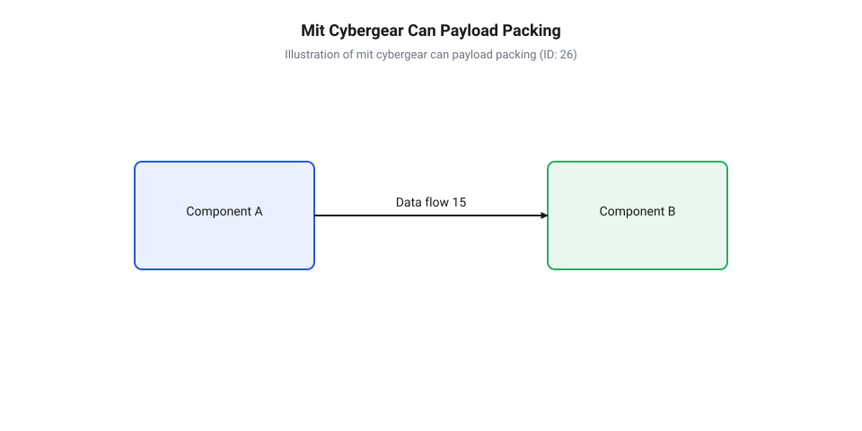
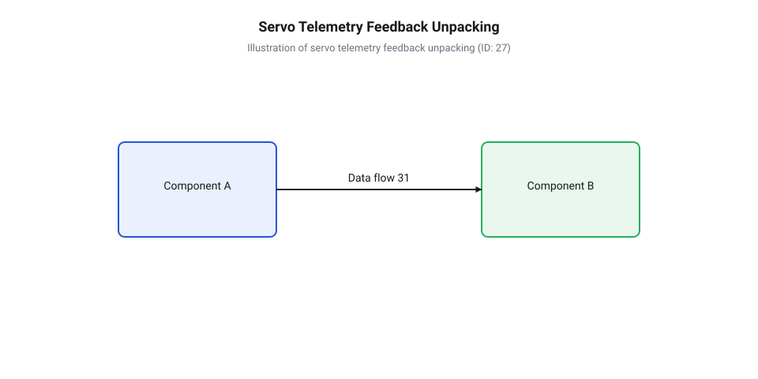

# Програмний API керування коаксіальними сервомодулями через CAN-шину

<preknowlist>
- [Безколекторні інтегральні сервоконтролери](root:cat-hw-actuators/bldc-servo-controller) — Принципи побудови силових контурів та базові режими керування безколекторним мотором.
- [Теплова модель та активний захист сервоприводів](root:cat-hw-actuators/servo-thermal-protection) — Принципи розрахунку термічних меж та логіка спрацьовування апаратних захистів.
</preknowlist>

## Проблема синхронного керування багатосуглобовими роботами

Під час проєктування динамічних робототехнічних систем — крокуючих чотириногих платформ, антропоморфних роботів або багатоланкових маніпуляторів — розробники стикаються з проблемою швидкої та синхронної передачі команд до десятків приводів. Класичні системи керування на основі імпульсно-кодової модуляції, де використовуються [звичайні сервоприводи та ШІМ-керування](root:cat-hw-actuators/rc-servo-mechanisms-and-control), базуються на з'єднанні «точка-точка». У такій топології кожен серводвигун вимагає окремої сигнальної лінії, а також провідників живлення та заземлення. Коли кількість суглобів сягає 12–24 одиниць, кабельна траса перетворюється на важкий джгут дротів, який проходить крізь рухомі з'єднання робота, створюючи додатковий механічний опір та підвищуючи ризик перетирання й обриву провідників.

Крім фізичних обмежень кабельного господарства, ШІМ-інтерфейс (від @@en|Pulse-Width Modulation@@ — широтно-імпульсна модуляція) створює критичні затримки та розсинхронізацію в контурі керування. Стандартна [частота оновлення кадрів ШІМ](root:cat-hw-actuators/servo-pwm-frame-rate) становить від 50 до 333 @@en|Гц@@. При такій частоті затримка між розрахунком траєкторії центральним контролером та реальним початком руху вала приводу досягає 3–20 мілісекунд. Через те що мікроконтролер генерує імпульси для різних каналів послідовно або з невеликим часовим зсувом (@@en|jitter@@), виникає десинхронізація руху окремих суглобів. Для крокуючого робота це означає, що при інтенсивному бігу або стрибках ноги торкаються опорної поверхні неузгоджено, генеруючи ударні навантаження та втрату стійкості.

Іншою фундаментальною вадою аналогових та простих ШІМ-ліній є відсутність зворотного зв'язку. ШІМ-сигнал є однонаправленим: він передає лише бажаний кут повороту. Центральний процесор робота працює «наосліп», не маючи інформації про реальне положення ротора, поточну кутову швидкість, розвинений момент чи температуру обмоток. У результаті будь-яке виникнення перешкоди призводить до зсуву вала, виходу приводу в [зону нечутливості та дрижання](root:cat-hw-actuators/servo-deadband-and-jitter) або термічного пробою без можливості апаратної діагностики з боку польотного контролера.

Для вирішення цих проблем у сучасній робототехніці використовують коаксіальні сервомодулі, що об'єднують безколекторний двигун (@@en|BLDC@@), високоточний планетарний або хвильовий редуктор, абсолютний магнітний енкодер (від @@en|encoder@@ — кодувальник) та [інтегральний сервоконтролер](root:cat-hw-actuators/bldc-servo-controller). Всі модулі об'єднуються у єдину послідовну мережу через цифрову шину @@en|CAN@@ (від @@en|Controller Area Network@@ — мережа контролерних зон) або її високошвидкісну модифікацію @@en|CAN FD@@ (від @@en|Flexible Data-Rate@@ — гнучка швидкість передачі даних). Топологія шини вимагає лише двох сигнальних провідників (`CAN_H` та `CAN_L`), що прокладаються транзитом від одного суглоба до іншого.

Шина @@en|CAN@@ є детермінованим цифровим протоколом із шинною топологією та апаратною пріоритезацією повідомлень. Вона забезпечує високу завадостійкість завдяки диференційній передачі сигналів. Завдяки використанню протоколів комбінованого контуру керування (зокрема @@en|MIT Protocol@@ та @@en|CyberGear@@) керуючий контролер відправляє кадри з частотою 1 @@en|кГц@@ і більше. У кожному кадрі пакується не просто цільовий кут, а повний setpoint PD-регулятора (від @@en|Proportional-Derivative@@ — пропорційно-диференціальний) з додатковим прямим моментом (@@en|feedforward torque@@). У відповідь сервомодуль миттєво повертає телеметрію стану, що дозволяє реалізувати імпедансне керування (@@en|impedance control@@) для м'якої взаємодії робота з навколишнім середовищем.

## Структура кадрів та ідентифікатори CAN

Для координації роботи багатьох приводів у єдиній мережі @@en|CAN@@ необхідно забезпечити чітку адресацію пристроїв та розрізнення типів команд без збільшення обсягу корисного навантаження кадру. У протоколах керування робототехнічними сервомодулями, таких як @@en|MIT Protocol@@ та Xiaomi @@en|CyberGear@@, це завдання вирішується шляхом пакування службових метаданих безпосередньо у 29-бітний розширений ідентифікатор кадру (@@en|Extended Frame ID@@ / @@en|CAN 2.0B@@).

Стандартний 11-бітний ідентифікатор обмежений 2048 унікальними адресами і не дає змоги зручно розділити код операції та адресу пристрою в одному заголовку. Розширений 29-бітний ідентифікатор надає 536 870 912 комбінацій, що дозволяє розбити бітове поле заголовка на окремі функціональні сегменти: режим роботи (@@en|mode@@), ідентифікатор цільового приводу (@@en|target ID@@), ідентифікатор майстра або хост-контролера (@@en|master ID@@) та додаткові параметри чи коди помилок.

У протоколі @@en|MIT Protocol@@ 29-бітний ідентифікатор кадру (@@en|CAN ID@@) має таку бітову структуру:

```
[28 .. 24]  — Тип команди / Режим керування (5 біт)
[23 .. 16]  — Резерв / Додаткові дані (8 біт)
[15 ..  8]  — Ідентифікатор сервомодуля (Target Motor ID, 8 біт)
[ 7 ..  0]  — Ідентифікатор центрального контролера (Master ID, 8 біт)
```

Режим керування в описі @@en|MIT Protocol@@ визначає, як саме привід інтерпретуватиме корисне навантаження кадру:
- `0x00` (@@en|Control Mode@@) — кадр керування PD-контуром (передача `p`, `v`, `K_p`, `K_d`, `t`);
- `0x01` (@@en|Motor Enable@@) — команда переведення приводу в активний робочий стан (подача струму на фази BLDC);
- `0x02` (@@en|Motor Disable@@) — зняття напруги з мотора (перехід у стан вільного вибігу / @@en|coasting@@);
- `0x03` (@@en|Set Zero Position@@) — програмна установка поточного механічного кута як нульового положення;
- `0x04` (@@en|Clear Faults@@) — скидання прапорців системних аварій та помилок.

У протоколі @@en|CyberGear@@ структура 29-бітного ідентифікатора сформована аналогічно, але з розширеним кодуванням команд для читання та запису поодиноких індексів регістрів під час конфігурування:

```
[28 .. 24]  — Код типу пакета (CMD_TYPE, 5 біт)
[23 .. 16]  — Адреса хоста або додатковий параметр (DATA/MASTER_ID, 8 біт)
[15 ..  8]  — Ідентифікатор сервомодуля (CAN_ID, 8 біт)
[ 7 ..  0]  — Адреса отримувача відповіді (DEST_ID, 8 біт)
```

Завдяки такій побудові арбітраж шини @@en|CAN@@ відпрацьовує на апаратному рівні контролера шини. Кадри з вищим пріоритетом (наприклад, зупинка приводу або аварійні команди) мають менше числове значення у старших бітах ідентифікатора, тому вони автоматично виграють арбітраж на шині без затримки та без зіткнення пакетів (@@en|collision@@).

Для збирання 29-бітного ідентифікатора у програмному коді контролера використовуються побітові зсуви (@@en|bit shifts@@) та маскування. Наприклад, щоб сформувати кадр керування для сервоприводу з ID `0x05` від хоста з ID `0x00` у режимі `0x00`, виконується наступна операція:

```
can_id = ((cmd_mode & 0x1F) << 24) | ((target_id & 0xFF) << 8) | (master_id & 0xFF);
```

Коли привід приймає такий кадр, його внутрішній мікроконтролер перевіряє молодші біти адреси. Якщо `target_id` збігається з власним збереженим адресою сервомодуля у EEPROM або якщо встановлено широкомовну адресу (`0xFF`), привід розпаковує корисне навантаження та виконує обчислення FOC-векторного контуру (від @@en|Field-Oriented Control@@ — векторне керування).

## Упаковка команд комбінованого PD-контуру керування

Головною перевагою протоколів керування коаксіальними сервомодулями є можливість передачі повного набору параметрів комбінованого PD-регулятора разом із прямим моментом у єдиному стандартному 8-байтовому кадрі @@en|CAN@@. Це дозволяє реалізувати рівняння розрахунку результуючого моменту `t_out` безпосередньо на силовому драйвері сервоприводу:

```
t_out = t_ff + K_p × (p_des - p_act) + K_d × (v_des - v_act)
```

де `p_des` та `v_des` — цільові кут і швидкість, `p_act` та `v_act` — поточна телеметрія енкодера, `K_p` та `K_d` — коефіцієнти жорсткості та демпфування, а `t_ff` — прямий момент (@@en|feedforward torque@@), що розраховується динамічною моделлю робота для компенсації сили тяжіння та інерції ланок.

Оскільки передача 5 чисел із плаваючою крапкою одинарної точності (формату @@en|float32@@) вимагала б 5 × 4 = 20 байтів (що перевищує ліміт 8 байтів для класичної шини @@en|CAN 2.0B@@), використовують алгоритм бітового ущільнення та квантування (від @@en|quantization@@ — нормування та дискретизація). Фізичні значення масштабуються у безрозмірні цілі числа фіксованої розрядності (16 або 12 біт) у межах заданого діапазону.

Типові межі фізичних величин та їхня розрядність у протоколі @@en|MIT Protocol@@:
- Цільове положення `p`: від `-12.5` до `+12.5` @@en|рад@@ (16 біт, від `0` до `65535`);
- Цільова швидкість `v`: від `-30.0` до `+30.0` @@en|рад/с@@ (12 біт, від `0` до `4095`);
- Пропорційний коефіцієнт `K_p`: від `0.0` до `500.0` @@en|Н·м/рад@@ (12 біт, від `0` до `4095`);
- Диференціальний коефіцієнт `K_d`: від `0.0` до `5.0` @@en|Н·м·с/рад@@ (12 біт, від `0` до `4095`);
- Прямий момент `t`: від `-12.0` до `+12.0` @@en|Н·м@@ (12 біт, від `0` до `4095`).

Сумарна кількість бітів дорівнює: 16 + 12 + 12 + 12 + 12 = 64 біти, що точно відповідає 8 байтам корисного навантаження (@@en|payload@@).

Для перетворення числового значення `phys_val` із плаваючою крапкою у ціле число фіксованої розрядності `uint_val` застосовується формула квантування:

```
norm_val = (phys_val - phys_min) / (phys_max - phys_min)      [нормування у діапазон 0.0 .. 1.0]
uint_val = round(norm_val × max_int)                          [масштабування до максимального цілого]
```


*Схема бітового ущільнення параметрів p, v, t, Kp, Kd у 8-байтове корисне навантаження CAN-кадру.*

Ущільнені цілочисельні значення розташовуються у 8 байтах буфера кадру @@en|CAN@@ у певному бітовому порядку. Нижче наведено ідіоматичну реалізацію упаковки параметрів мовами C та C++.

:::tabs
:::code api-coaxial-servo-can-protocol/c/float-to-uint.c
:::code api-coaxial-servo-can-protocol/cpp/servocommandpacker.cpp
:::

## Розпакування телеметрії зворотного зв'язку сервомодуля

Після отримання кадру керування коаксіальний сервомодуль негайно надсилає у відповідь кадр телеметрії (від @@en|telemetry@@ — віддалені вимірювання). Цей пакет містить виміряні сенсорами значення фізичного стану мотора: поточний абсолютний кут повороту вала, кутову швидкість, оцінений момент (розрахований через виміряний фазний струм мотора) та температуру силових транзисторів або обмоток.

Кадр відповіді сервомодуля також має обсяг 8 байтів корисного навантаження і розпаковується за зворотними формулами декодування цілих чисел у плаваючу крапку.

Типова структура байтів пакета відповіді (телеметрії):
- Байт 0: Ідентифікатор відповідавшого приводу (ID, 8 біт);
- Байт 1–2: Поточний кут ротора `p_act` (16 біт, від `0` до `65535`);
- Байт 3 та старші 4 біти байта 4: Поточна швидкість `v_act` (12 біт, від `0` до `4095`);
- Молодші 4 біти байта 4 та байт 5: Виміряний момент/струм `t_act` (12 біт, від `0` до `4095`);
- Байт 6: Температура елементів приводу `temp` (8 біт, у градусах Цельсія зі зміщенням);
- Байт 7: Байт статусу та прапорців помилок (8 біт).

Для відновлення фізичного значення `phys_val` із квантованого цілого `uint_val` використовується формула зворотного декодування:

```
norm_val = uint_val / max_int                                 [відновлення нормованої частки 0.0 .. 1.0]
phys_val = phys_min + norm_val × (phys_max - phys_min)        [переведення у фізичні одиниці]
```


*Структура CAN-кадру відповіді сервомодуля з виділеними полями кута, швидкості, струму та прапорців системних помилок.*

Отримані значення кута, швидкості та моменту передаються до алгоритмів прямої та зворотної кінематики робота. Це дає змогу контролеру верхнього рівня оцінювати зовнішні сили, що діють на кінцеву ланку маніпулятора чи ногу робота, розраховувати реакцію опори та коригувати цільову траєкторію в режимі реального часу.

Нижче наведено приклад коду для розпакування 8-байтового масиву телеметрії мовами C та C++.

:::tabs
:::code api-coaxial-servo-can-protocol/c/uint-to-float.c
:::code api-coaxial-servo-can-protocol/cpp/servotelemetry.cpp
:::

## Обробка системних помилок та калібрування нуля

Під час екстремальних навантажень або інтенсивного руху роботу сервомодулі можуть виходити за межі штатного робочого діапазону. Захист силових мостів і мотора реалізується на рівні внутрішньої прошивки приводу, яка при виникненні аварійної ситуації встановлює відповідний прапор у байті статусу і переводить привід у безпечний режим (зняття струму з фаз).

Аналіз бітів статусу телеметрії (байт 7):
- Біт 0 (`0x01`) — Знижена напруга живлення (@@en|Under-Voltage Lockout@@ / @@en|UVLO@@): напруга на DC-шині впала нижче критичного порогу (наприклад, менше 18 В при номіналі 24 В);
- Біт 1 (`0x02`) — Перевантаження за струмом (@@en|Over-Current Protection@@ / @@en|OCP@@): фазний струм перевищив допустиму пікову межу драйвера;
- Біт 2 (`0x04`) — Перегрів (@@en|Over-Temperature Protection@@ / @@en|OTP@@): температура силових ключів або обмоток досягла порогового значення (зазвичай понад 85 °C). Детальніше принципи роботи захистів описано в матеріалі [теплова модель та активний захист](root:cat-hw-actuators/servo-thermal-protection);
- Біт 3 (`0x08`) — Збій абсолютного енкодера (@@en|Encoder Fault@@): втрата магнітного сигналу датчика положення ротора;
- Біт 4 (`0x10`) — Некалібрований нуль (@@en|Uncalibrated Zero@@): відсутні збережені константи узгодження ротора та енкодера у енергонезалежній пам'яті.

При виникненні будь-якого з апаратних захистів (біти 0–3) привід блокує виконання нових команд PD-контуру до моменту усунення причини аварії та надсилання спеціального кадру скидання помилок (@@en|Clear Faults Command@@).

Для процедури скидання аварій у протоколах сервомодулів сформовано окремий код режиму в 29-бітному CAN ID (наприклад, Mode `0x04` для @@en|MIT Protocol@@ або запис `0` в регістр помилок для @@en|CyberGear@@).

Процедура калібрування нульової позиції абсолютного енкодера необхідна під час первинного складання робота або після заміни сервомодуля. Магнітний енкодер вимірює кут ротора відносно власного зафіксованого магніту, проте механічний нуль суглоба робота має відповідати чіткій кінематичній конфігурації (наприклад, повністю випрямленій нозі робота).

Порядок проведения калібрування нуля:
1. За допомогою фіксатора або шаблону механічно встановити ланку робота у чітке нульове положення. 2. Переконатися, що мотор знеструмлений (режим `0x02` — @@en|Motor Disable@@), аби уникнути випадкових ривків вала. 3. Надіслати сервісний кадр із кодом команди установки нуля (Mode `0x03`). 4. Привід зчитує поточний фізичний кут енкодера, записує його як зсув (@@en|zero offset@@) у внутрішню EEPROM або @@en|Flash@@ та повертає підтвердження у кадри відповіді.

Додатково для налаштування системи корисно виконувати [калібрування нейтралі сервоприводів](root:cat-hw-actuators/continuous-servo-potentiometer-tuning), якщо в системі використовуються сервісні вузли допоміжної механіки.

Нижче наведено приклад виконання розпізнавання помилок, надсилання команди скидання аварій та процедури встановлення нульового положення мовами C та C++.

:::tabs
:::code api-coaxial-servo-can-protocol/c/make-mit-can-id.c
:::code api-coaxial-servo-can-protocol/cpp/servoservicemanager.cpp
:::