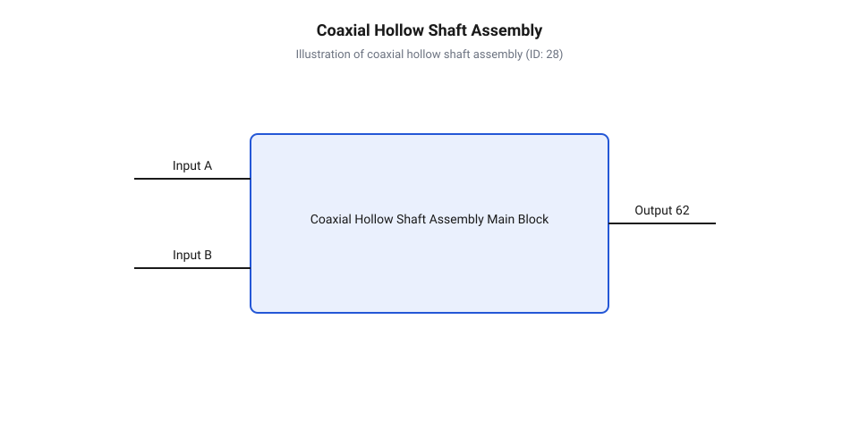
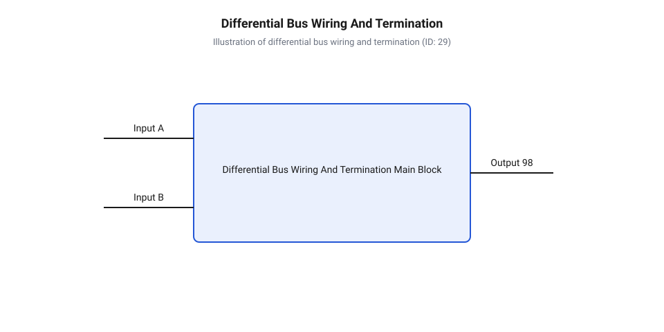

# Залізний інтерфейс коаксіальних сервомодулів: механічне кріплення, порожнистий вал та шини підключення

<preknowlist>
- [Безколекторні інтегральні сервоконтролери](root:cat-hw-actuators/bldc-servo-controller) — базові принципи побудови силових мостів та фазного живлення безколекторних моторів
- [Теплова модель та активний захист сервоприводів](root:cat-hw-actuators/servo-thermal-protection) — причини виникнення теплового розгону та основи розрахунку теплового опору напівпровідникових ключів
</preknowlist>

## Захист джгутів і монтаж модуля

Проєктування робототехнічних суглобів із багатьма ступенями вільностей неминуче стикається з проблемою прокладання проводів через рухомі осі. Коли привід здійснює багаторазові зворотно-поступальні або обертальні рухи, зовнішні кабельні джгути піддаються постійному згинанню, скручуванню та зачіпленню за елементи конструкції. У класичних робототехнічних системах, де застосовуються звичайні [сервоприводи радіокерованих моделей](root:cat-hw-actuators/rc-servo-mechanisms-and-control), сигнальні та силові провідники виводяться зовні корпусу. Це призводить до швидкого перетирання ізоляції, виникнення внутрішніх обривів мідних жил та ризику потрапляння проводів у зуби редуктора, спричиняючи [абразивний знос шестерень](root:cat-hw-actuators/servo-gear-shear-and-wear) або повний клик механізму.

Вирішенням цієї проблеми став @@en|coaxial servo module@@ (від англ. *coaxial* — співвісний, *servo* — сервопривід). Конструкція такого приводу об'єднує безколекторний електродвигун, високоточний редуктор (хвильовий або планетарний), абсолютний енкодер та плату керування в єдиному циліндричному корпусі навколо спільної осі обертання. Ключовим геометричним елементом цього компонування є @@en|hollow shaft@@ (від англ. *hollow* — порожнистий, *shaft* — вал) — центральний наскрізний отвір, що проходить крізь усі ротаційні вузли приводу. Прокладання кабельного джгута суворо вздовж нейтральної осі обертання мінімізує механічні напруження в провідниках, оскільки радіус згину залишається сталим, а лінії не піддаються поперечному зміщенню щодо корпусу.

Однак щільне інтегроване компонування створює жорсткі вимоги до фізичного монтажу та теплового захисту. Сучасні приводи використовують [безколекторні інтегральні сервоконтролери](root:cat-hw-actuators/bldc-servo-controller), силові ключі яких розташовані безпосередньо всередині герметичного модуля. Під час роботи силовий інвертор виділяє значну кількість тепла на компактній площі друкованої плати. Якщо модуль закріплено ненадійно або через проміжні пластикові кронштейни з високим тепловим опором, накопичене тепло не має шляхів для розсіювання, що призводить до швидкого перегріву та термічного руйнування транзисторів.

Таким чином, механічний монтаж коаксіального сервомодуля не є простою фіксацією деталі в просторі — це єдина система, яка одночасно забезпечує передачу високого крутного моменту, захист внутрішніх електричних комунікацій та ефективне відведення тепла на несучу структуру маніпулятора. Правильно підготовлений фланцевий інтерфейс і продуманий канал порожнистого вала створюють основу для надійного розведення силових та інтерфейсних шин приводу.

## Механічний монтаж та відведення тепла

Надійне закріплення коаксіального модуля та забезпечення його теплового режиму базуються на жорсткому фланцевому з'єднанні. Застосування @@en|flange mount@@ (від старофр. *flanche* — край, бок) дозволяє передавати високі радіальні та осьові навантаження безпосередньо на металевий корпус роботизованого плеча, уникаючи деформацій і паразитних люфтів, які виникають при використанні традиційних важільних схем, як-от [кінематика важільних механізмів](root:cat-hw-actuators/servo-pushrod-kinematics).

Прокладання кабельного джгута через @@en|hollow shaft@@ вимагає дотримання геометричних норм заповнення внутрішнього каналу. Коефіцієнт заповнення отвору не повинен перевищувати 40–50% від його поперечної площі. Це необхідно для того, щоб провідники могли вільно перерозподілятися під час скручування, не зазнаючи внутрішнього стискання та тертя жила об жилу. Вхідні та вихідні кромки порожнистого вала повинні мати радіусні фаски або оснащуватися захисними втулками з гладкого полімеру (наприклад, фторопласту), а сам джгун охоплюють текстильним або силіконовим плетеним рукавом (@@en|sleeving@@).

Для захисту провідників від надмірного скручування в сочлененнях із обмеженим кутом повороту встановлюють механічні обмежувачі ходу (стопори). Якщо ж суглоб вимагає необмеженого обертання, у канал вала інтегрують @@en|slip ring@@ (від англ. *slip ring* — струмознімальне кільце). На нерухомому та рухомому виходах з вала обов'язково передбачають фіксатори натягу (@@en|strain relief@@), які жорстко затискають кабель, відсікаючи передачу механічного зусилля на вхідні роз'єми контролера.


*Конструктивний розріз коаксіального приводу з центральним кабельним каналом і фланцевим тепловим контактом.*

Теплова архітектура монтажу спирається на передачу втрат потужності інвертора та обмоток статора на зовнішню металеву конструкцію. Між фланцем сервомодуля та монтажною площадкою маніпулятора укладають @@en|thermal interface material@@ (від грец. *therme* — тепло, лат. *inter* — між та *facies* — поверхня) у вигляді термопрокладок (@@en|thermal pad@@) або високотеплопровідних паст. Поверхня монтажного фланця повинна мати площинність не гірше 0.05 мм і шорсткість Ra < 1.6 мкм для виключення повітряних прошарків.

Обчислимо загальний перепад температури `ΔT` між силовими напівпровідниками сервомодуля та довкіллям за відомої теплової потужності втрат `P_loss` та послідовних теплових опорів:

```
R_th_total = R_th_jc + R_th_tim + R_th_sa      [сумування послідовних теплових опорів]
ΔT = P_loss · R_th_total                        [закон Ома для теплового кола]
```

Тут `R_th_jc` — тепловий опір від кристала напівпровідника до корпусу модуля, `R_th_tim` — опір шару термопрокладки, а `R_th_sa` — опір між фланцем приводу та несучою конструкцією. Якщо тепловий контакт недостатньо щільний, температура кристала перевищує допустимий ліміт 125 °C, що вимагає враховувати [теплову модель та активний захист](root:cat-hw-actuators/servo-thermal-protection) для запобігання апаратній аварії.

## Силове живлення та вибір роз'ємів

Електричне живлення коаксіальних сервомодулів здійснюється від джерела постійного струму напругою від 24V до 48V. Вибір підвищеного рівня напруги (48V замість 12V або 24V) є обумовленим прагненням зменшити робочий струм при збереженні тієї самої механічної потужності на валу. Оскільки втрати енергії в кабельному джгуті пропорційні квадрату струму, зменшення струму вдвічі знижує тепловиділення в провідниках у чотири рази та дозволяє використовувати кабелі меншого перерізу.

Під час вибору перерізу силових жил за стандартом @@en|AWG@@ (від англ. *American Wire Gauge* — американський калібр проводів) необхідно враховувати не лише номінальне споживання, а й пікові струми при розгоні та гальмуванні ротора. Недостатній переріз провідника спричиняє спад напруги (@@en|voltage drop@@), через який контролер може самовільно перезавантажуватися в моменти пікових навантажень.

Для визначення спаду напруги `ΔV` на провідниках живлення довжиною `L` з питомим опором міді `ρ` та перерізом `A` при піковому струмі `I_peak` застосовують розрахунок двохпровідної лінії:

```
R_line = ρ · (2 · L) / A      [опір прямого та зворотного силових провідників]
ΔV = I_peak · R_line          [падіння напруги на силовій лінії]
```

Значення `ρ` для міді становить 0.0175 Ом·мм²/м. Якщо розрахований спад `ΔV` перевищує 5% від номінальних 48 В, контролер може збиватися в перезавантаження через спрацьовування захисту від зниженої напруги (@@en|under-voltage lockout@@).

Силові роз'єми повинні забезпечувати низький перехідний опір контактів та стійкість до постійної вібрації. Оптимальним вибором є промислові циліндричні роз'єми серії M12 або спеціалізовані ножові з'єднувачі з фіксаторами (наприклад, @@en|Micro-Fit@@ або @@en|XT60@@) із золоченими контактами. Роз'єм повинен мати засувку (@@en|latch mechanism@@), що унеможливлює самовільне розмикання під впливом динамічних прискорень суглоба.

Окрему увагу приділяють фільтрації та буферизації живлення. Швидке гальмування безколекторного мотора переводить його в режим генератора, повертаючи кінетичну енергію в силове коло (@@en|regenerative braking@@). Для поглинання цих кидків напруги та пригнічення високочастотних імпульсних завад від ШІМ-інвертора безпосередньо на вхідних силових клемах кожного сервомодуля встановлюють згладжувальні електролітичні та керамічні конденсатори (@@en|decoupling capacitor@@). Для захисту від імпульсних перенапруг додатково застосовують захисні супресорні діоди (@@en|TVS diode@@).

## Підключення шин CAN та RS-485

Передача команд керування та зчитування телеметрії в сучасних робототехнічних комплексах виконуються через послідовні диференційні шини зв'язку @@en|CAN bus@@ (від англ. *Controller Area Network*), @@en|CAN FD@@ або @@en|RS-485@@. Для об'єднання кількох сервомодулів у єдину мережу застосовують суворо шлейфову топологію (@@en|daisy-chain@@, від англ. *daisy-chain* — шлейфове підключення), при якій кабель зв'язку заходить у перший модуль і послідовно прямує до наступного. Утворення розгалужень («зірок» або довгих відпаїв) недопустиме, оскільки вони створюють точки неузгодженості імпедансу та викликають відбиття високочастотних сигналів.

В основі надійності цих шин лежить диференціальна пара (@@en|differential pair@@, від лат. *differentia* — різниця). Сигнали передаються протифазно по двох скручених провідниках (вита пара): лінії CAN_H / CAN_L або A / B у RS-485. Завада від силового інвертора наводить однаковий шум на обидва проводи, але різницевий підсилювач приймача вираховує їхню різницю, повністю пригнічуючи синфазну заваду (@@en|common-mode rejection ratio@@).

Для запобігання відбиттю хвилі від відкритих кінців лінії на обох фізичних краях шини встановлюють термінальні резистори (@@en|termination resistor@@, від лат. *terminatio* — закінчення) номіналом 120 Ом. Вони повинні відповідати хвильовому опору кабелю, який становить `Z_0 = 120 Ω`.

Еквівалентний опір `R_eq` виміряний між сигнальними лініями вимкненої шини з двома паралельно підключеними термінаторами `R_term = 120 Ω` обчислюється так:

```
1 / R_eq = (1 / R_term1) + (1 / R_term2)      [паралельне з'єднання опорів]
R_eq = (120 · 120) / (120 + 120) = 60 Ω        [підстановка значень]
```

Отримане значення 60 Ом слугує головним критерієм фізичної цілісності узгодженої лінії зв'язку під час перевірки мультиметром.


*Шлейфова топологія шини диференціальних сигналів із правильним розведенням термінаторів та заземленням екрана.*

Захист від електромагнітних завад забезпечується використанням екранованої витої пари (@@en|shielded twisted pair@@). Металевий екран кабелю заземлюють лише в одній точці — на боці центрального контролера або джерела живлення. Двоштокове заземлення екрана з обох боків категорично заборонено, оскільки різниця потенціалів між корпусами модулів створює контур заземлення (@@en|ground loop@@), яким протікають зрівняльні струми промислової частоти та завади інвертора.

## Діагностика збоїв фізичного рівня

Введення в експлуатацію та обслуговування коаксіальних сервоприводів вимагають систематичного підходу до діагностики фізичного рівня. Найбільш підступними є механічні пошкодження джгута всередині @@en|hollow shaft@@. Через втому металу або мікроперетирають жили при тривалому скручуванні виникає нестабільний контакт. Це проявляється як періодична втрата пакетів зв'язку, поява помилок (@@en|error frames@@) на шині CAN або як спорадична [зона нечутливості та дрижання](root:cat-hw-actuators/servo-deadband-and-jitter) вала під час повороту суглоба в певні кутові положення. Локалізація таких обривів здійснюється шляхом безперервної прозвонки жил мультиметром у режимі вимірювання опору при повільному вручну прокручуванні вала на повний кут ходу.

Діагностика мережі живлення передбачає контроль спаду напруги та пульсацій. За допомогою осцилографа (@@en|oscilloscope@@, від лат. *oscillare* — коливатися та грец. *skopeo* — дивитися) вимірюють рівень напруги безпосередньо на силових клемах модуля під час інтенсивного розгону ротора. Якщо на осцилограмі спостерігаються просідання амплітуди понад 5–10% або високочастотні викиди зворотної ЕРС при гальмуванні, це свідчить про недостатній переріз провідників живлення або вихід з ладу буферних конденсаторів (@@en|decoupling capacitor@@).

Діагностика сигнальної шини зв'язку починається з вимірювання статичного опору між лініями CAN_H та CAN_L (або A та B в RS-485) при вимкненому живленні:
- **60 Ом**: шину узгоджено правильно (діють два термінатори по 120 Ом). - **120 Ом**: відсутній один із термінаторів або стався обрив сигнальної лінії. - **40 Ом**: помилково встановлено третій термінальний резистор. - **0–5 Ом**: коротке замикання між сигнальними провідниками або на екран.

Динамічна перевірка сигналів проводиться осцилографом у диференціальному режимі (`V_diff = V_CANH - V_CANL`). Здоровий диференціальний сигнал CAN має чіткі прямокутні фронти з амплітудою домінуючого стану близько 2.0 V та рецесивного близько 0 V. Наявність дзвону (@@en|ringing@@), завалу фронтів або значного зміщення синфазної напруги вказує на відсутність заземлення екрана, неправильний хвильовий опір кабелю або наявність довгих неузгоджених відпаїв від основної магістралі шини.