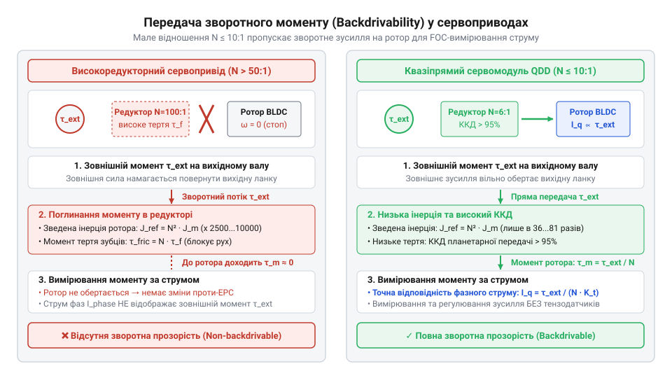
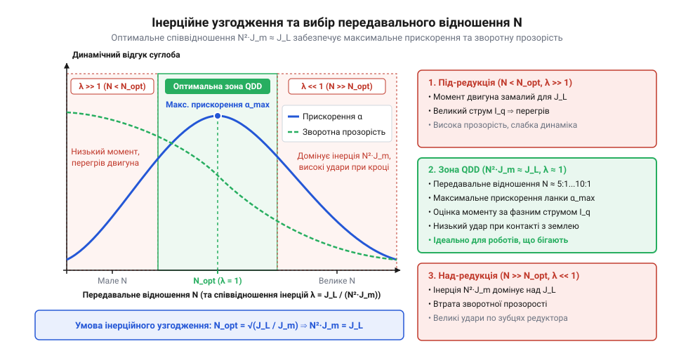
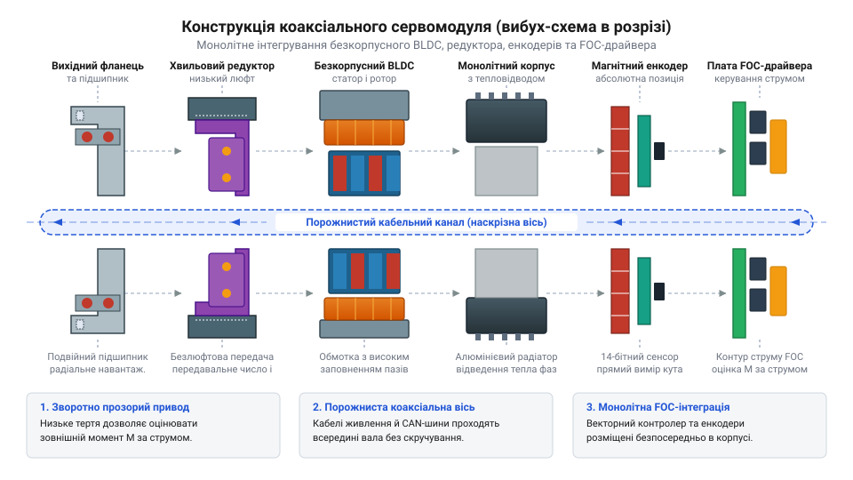
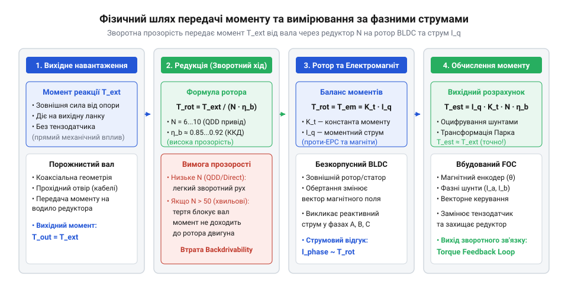
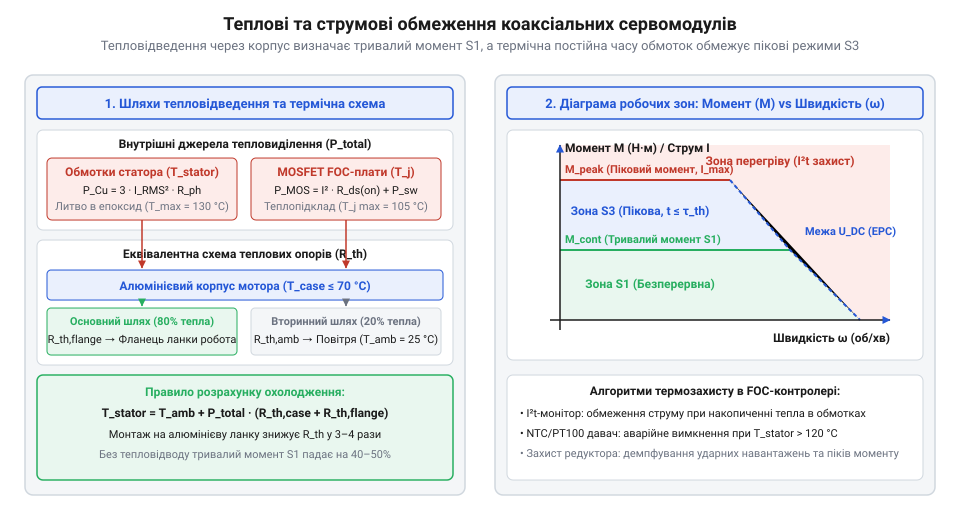
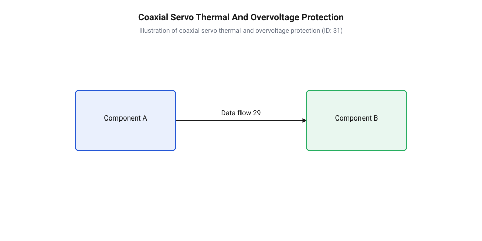

# Коаксіальні сервомодулі прямого приводу

<preknowlist>
- [Безколекторні інтегральні сервоконтролери](root:cat-hw-actuators/bldc-servo-controller) — базові принципи керування та фазної комутації безколекторних двигунів постійного струму
- [Сервоприводи радіокерованих моделей: будова, редуктори та ШІМ-керування](root:cat-hw-actuators/rc-servo-mechanisms-and-control) — класичну будову сервоприводу, поняття редукції та закриту систему регулювання
- [Теплова модель та активний захист сервоприводів](root:cat-hw-actuators/servo-thermal-protection) — принципи нагріву обмоток, теплові часові константи та критерії спрацьовування термозахисту
- [Зсувні навантаження та абразивний знос шестерень сервоприводів](root:cat-hw-actuators/servo-gear-shear-and-wear) — механіку зносу зубчастих передач і вплив механічних ударів на редуктор
</preknowlist>

## Обмеження традиційних приводів у робототехніці

При спробі побудувати динамічного крокуючого робота або високошвидкісний маніпулятор розробники регулярно стикаються з катастрофічними поломками механічної частини та кабельного господарства. Класичний @@en|сервопривод@@, побудований за схемою з високим коефіцієнтом @@en|редукції@@ (`N = 100:1` або навіть `N = 300:1`), чудово підходить для стаціонарних позиціонерів або [модельних завдань](root:cat-hw-actuators/rc-servo-mechanisms-and-control). У таких умовах від приводу вимагається лише утримання заданої позиції при помірних кутових швидкостях. Проте коли нога чотириногого чи антропоморфного робота з силою вдаряється об тверду поверхню під час бігу або стрибка, традиційний привід миттєво стає головним джерелом аварійних відмов.

Причина масового виходу з ладу шестерень полягає у фізиці ротаційної інерції. Власний момент інерції ротора безколекторного двигуна `J_m` здається малим і незначним. Однак з боку вихідного вала приводу ця інерція трансформується через квадрат передавального відношення редуктора `N`. Це явище має назву @@en|зведений момент інерції@@ (англ. @@en|reflected inertia@@). При спробі зовнішнього зусилля повернути вихідний вал приводу еквівалентна інерційна маса, яку відчуває зовнішній об'єкт, обчислюється за формулою:

```
J_ref = J_m · N² + J_gears
```

де:
`J_ref` — зведений момент інерції на вихідному фланці приводу (кг·м²);
`J_m` — власний момент інерції ротора безколекторного двигуна (кг·м²);
`N` — передавальне відношення редуктора (безрозмірна величина);
`J_gears` — власний момент інерції елементів редуктора (кг·м²).

Якщо передавальне відношення становить `N = 100`, коефіцієнт `N²` дорівнює `10 000`. Це означає, що при жорсткому зовнішньому ударі об підлогу ротор двигуна поводиться так, ніби його момент інерції збільшився у 10 000 разів. Ударне навантаження на вихідному валу не здатне миттєво розігнати ротор до кутової швидкості, яка у 100 разів перевищує швидкість вала. Уся кінетична енергія зіткнення розсіюється безпосередньо у тонкій зоні контакту зубчастої передачі. На відміну від [мікросерво з металевим редуктором](root:cat-hw-actuators/mg90s-servo), розрахованих на статичні навантаження, у динамічному робототехнічному суглобі виникають [руйнівні зсувні навантаження](root:cat-hw-actuators/servo-gear-shear-and-wear). Вони спричиняють миттєве зрізання зубів, втомне фарбування загартованого шару сталі та покрошення шестерень.


*Схема передачі механічного моменту: у високоредукторному приводі зовнішній удар блокується високим зведеним моментом інерції та тертям шестерень, викликаючи руйнування зубів, тоді як у квазіпрямому приводі момент вільно транслюється на ротор двигуна.*

Другим критичним обмеженням є втрата @@en|зворотної прозорості@@ (англ. @@en|backdrivability@@, від *back* — «назад» та *drive* — «вести, рухати»). Високе передавальне відношення у поєднанні з тертям у багатоступеневих редукторах створює ситуацію, коли зворотний ККД приводу прямує до нуля. Привод стає механічно заблокованим з боку навантаження.

У сучасній робототехніці зворотно прозорий привод дає змогу вимірювати та регулювати контактні зусилля без застосування спеціальних датчиків. Оскільки ротор двигуна механічно зв'язаний із навантаженням через низьке передавальне відношення, зовнішній момент на шарнірі безпосередньо передається на ротор. Це дозволяє здійснювати @@en|пропріоцептивне відчуття зусилля@@ (від лат. *proprius* — «власний» та *capere* — «приймати»), обчислюючи момент за фазними струмами статора. Якщо ж зворотна прозорість відсутня, внутрішнє тертя шестерень повністю маскує зовнішні сили. У такому разі для вимірювання зусиль взаємодії з довкіллям доводиться встановлювати зовнішні тензометричні датчики крутного моменту. Ці датчики є надзвичайно крихкими, схильними до дрейфу нуля, дорогими та значно ускладнюють конструкцію шарніра.

Крім того, високий зведений момент інерції погіршує @@en|інерційне узгодження@@ (англ. @@en|inertia matching@@). Динамічний відгук суглоба визначається співвідношенням інерції корисного навантаження `J_L` та зведеної інерції приводу `J_ref`. Коли `J_ref` у сотні разів перевищує `J_L`, динаміка системи повністю домінується власним ротором двигуна, а контур регулювання моменту втрачає смугу пропускання і стає нестійким при контакті з жорсткими перешкодами.

Детальний математичний апарат зворотної прозорості та інерційного узгодження наведено у матеріалі про [математичну модель зворотної прозорості](root:cat-hw-actuators/coaxial-servo-modules/math-backdrivability-and-reflected-inertia.md). Зміна парадигми від масивних жорстких приводів до легких пружних та квазіпрямих модулів висвітлена у матеріалі про [історію виникнення концепції](root:cat-hw-actuators/coaxial-servo-modules/hist-coaxial-servo-modules-evolution.md) квазіпрямого приводу.


*Графік залежності динамічного відгуку суглоба від співвідношення інерції навантаження та передавального відношення редуктора.*

Окрім силових та інерційних проблем, традиційне компонування приводів створює важкі кабельні пастки. Звичайний серводвигун виготовляється із суцільним вихідним валом (англ. @@en|solid shaft@@). Керуючий силовий драйвер та плата контролера розташовуються окремо від приводу — у центральному корпусі робота або на проміжній секції маніпулятора.

У суглобі з кількома ступенями вільності силові провода живлення двигунів та сигнальні лінії енкодерів змушені прокладатися із зовнішнього боку шарнірів. Під час активного руху суглоба кабель зазнає багаторазового згину, скручування та розтягування. Це призводить до механічного стирання ізоляції, виникнення втомних тріщин у мідних жилах та передчасного обриву кіл. Крім того, зовнішня петля кабелю обмежує максимальний кут повороту суглоба, унеможливлюючи нескінченне обертання на 360°, та зачіпається за навколишні предмети.

Довгі фазні провода між виносним контролером і двигуном діють як випромінюючі антени. Під час перемикання силових ключів @@en|інвертора@@ з високими швидкостями наростання напруги у кабелях виникає потужна @@en|електромагнітна завада@@ (англ. @@en|electromagnetic interference@@, EMI), яка наводиться на чутливі сигнальні кола енкодерів та датчиків, викликаючи дрижання позиції.

Отже, конструктивна еволюція робототехнічних суглобів сформувала чіткий перелік фізичних вимог до ідеального приводу:
1. Мале передавальне відношення редуктора (`N = 1:1` ... `1:10`) для мінімізації зведеного моменту інерції `J_ref` та збереження високої зворотної прозорості. 2. Високомоментний безкорпусний безколекторний двигун великого діаметра, здатний компенсувати малу редукцію високим власним електромеханічним моментом. 3. Порожнистий центральний вал (англ. @@en|hollow shaft@@) для внутрішнього прокладання кабельних трас через вісь обертання суглоба. 4. Концентрична монолітна компоновка, у якій двигун, низьколюфтовий редуктор, двоконтурні absolute magnet encoders та плата @@en|векторного керування@@ (Field-Oriented Control, FOC) об'єднані у спільному компактному корпусі.

## Анатомія коаксіального сервомодуля прямого приводу

@@en|Коаксіальний сервомодуль@@ (від лат. *co-* — «разом» та *axis* — «вісь», тобто розташований на спільній центральній осі) являє собою інтегрований електромеханічний привод, у якому безкорпусний BLDC-двигун, низьколюфтовий редуктор, вимірювальні енкодери та силовий FOC-контролер розміщені концентрично шар за шаром навколо наскрізного порожнистого вала.


*Вибух-схема коаксіального сервомодуля в розрізі, що показує розташування статора, зовнішнього ротора, низьколюфтового редуктора, магнітних енкодерів і плати FOC-драйвера вздовж порожнистої осі.*

Ядром коаксіального модуля є @@en|безкорпусний BLDC-двигун@@ (англ. @@en|frameless BLDC motor@@). На відміну від стандартних моторів у власному металевому кожусі, безкорпусний двигун складається лише з двох окремих компонентів: статора із трифазною мідною обмоткою та ротора з високоенергетичними постійними магнітами (`NdFeB`). Статор запресовується безпосередньо в зовнішній алюмінієвий корпус сервомодуля, який одночасно виконує роль силового несучого елемента та теплового радіатора.

Щоб розвивати високий крутний момент при низькій частоті обертання без використання великих редукторів, у коаксіальних модулях застосовують багатополюсні двигуни з великим зовнішнім діаметром та малим осьовим розміром (так звана @@en|млинцева конфігурація@@, англ. @@en|pancake motor@@). Кількість магнітних полюсів ротора `2p` може досягати 14, 21 або 28. Це забезпечує високе значення коефіцієнта моменту `K_t` (Н·м/А). Детальний аналіз конструктивних типів статорів та механічного монтажу подано у матеріалі про [конструкцію безкорпусних двигунів](root:hw-motion/frameless-bldc-motors-integration).

Для досягнення високої питомої потужності у квазіпрямих приводах (QDD) всередину ротора двигуна вбудовується компактний одноступеневий @@en|планетарний редуктор@@ або @@en|циклоїдний редуктор@@. Завдяки малій редукції (`N = 1:5` ... `1:10`) вдається досягти таких фізичних характеристик:
- Кутовий @@de|люфт@@ (від нім. *Luft* — «повітря, зазор», англ. @@en|backlash@@) не перевищує 1–3 кутових мінут (arcmin), що гарантує високу точність позиціонування. - Механічний ККД редуктора у прямому та зворотному напрямках становить 90–95%, забезпечуючи чудову зворотну прозорість. - Модуль зубів колес значно більший, ніж у багаторівневих модельних редукторах, що виключає ризик зрізання зубів при динамічних перевантаженнях.

Принципи розрахунку геометрії зачеплення, ККД та кінематичних схем детально описані у матеріалі про [кінематику планетарних і циклоїдних передач](root:hw-motion/cycloidal-and-planetary-servo-reducers).

Центральною віссю всього сервомодуля є наскрізний @@en|порожнистий вал@@ (англ. @@en|hollow shaft@@). Його внутрішній світловий отвір діаметром 10–25 мм проходить наскрізь через плату електроніки, статор, ротор, редуктор та вихідний фланець.

Це дає змогу прокласти силові кабелі шини живлення DC (24–48 В) та диференційну шину зв'язку CAN / CAN FD безпосередньо крізь геометричний центр обертання шарніра. При повороті суглоба кабель лише злегка скручується навколо власної поздовжньої осі без вигину та тертя. Це повністю усуває ризик перетирання дротів і дає змогу будувати суглоби робота з нескінченним кутом обертання. Інженерні стандарти механічного кріплення та розводки інтерфейсів висвітлює [конфігурація залізного інтерфейсу](root:cat-hw-actuators/coaxial-servo-modules/api-coaxial-servo-hardware-interface.md).

Для прецизійного векторного керування FOC та надійного відстеження кутового положення у коаксіальному сервомодулі встановлюють дві незалежні системи вимірювання на основі оф-осьових absolute magnet encoders:
1. **Вхідний енкодер ротора**: вимірює кутовий стан ротора двигуна (`θ_m`) до редуктора. Його показники необхідні для розрахунку точного електричного кута статора `θ_e = p · θ_m` з високою частотою оновлення (від 10 до 40 кГц), що забезпечує плавне формування векторів струму FOC без пульсацій моменту. 2. **Вихідний енкодер шарніра**: вимірює кутове положення вихідного фланця (`θ_L`) після редуктора. Це дає змогу компенсувати кутову пружність передачі, визначати точний абсолютний кут суглоба при включенні живлення без процедури пошуку нульової позначки та контролювати зовнішні відхилення під навантаженням.

Під час заводського калібрування вимірюється кутовий зсув між магнітним нулем енкодера та електричною віссю d статора. Це гарантує точне утримання векторного керування за стратегією `I_d = 0` для максимального моменту на один Ампер струму. Принцип роботи та методи калібрування описано у матеріалі про [оф-осьові магнітні енкодери](root:hw-sensing/absolute-magnetic-encoders-off-axis).

Силова електроніка сервомодуля виконана у вигляді кільцевої плати FOC-драйвера, що розміщується безпосередньо у торцевій частині корпусу. На платі розташовані силові MOSFET-транзистори, прецизійні струмові шунти, мікроконтролер керування та драйвери затворів.

Завдяки прямій вимірюваній інформації про фазні струми статора `I_a`, `I_b` та кут ротора `θ_m`, контролер виконує перетворення Кларка та Парка, виділяючи квадратурну складову струму `I_q`. Оскільки редуктор має високий ККД та мале передавальне відношення, вихідний крутний момент сервомодуля пропорційний квадратурному струму:

```
τ_out = 1.5 · p · λ_f · I_q · N · η
```

де:
`τ_out` — крутний момент на вихідному фланці приводу (Н·м);
`p` — кількість пар магнітних полюсів ротора двигуна (безрозмірна величина);
`λ_f` — амплітуда зчепленого магнітного потоку постійних магнітів ротора (Вб);
`I_q` — квадратурна складова струму статора в обертальній системі координат dq (А);
`N` — передавальне відношення редуктора (для прямого приводу `N = 1`);
`η` — механічний ККД редуктора (безрозмірна величина, `0.90` ... `0.98`).

Ця формула лежить в основі @@en|пропріоцептивного керування моментом@@, даючи змогу контролеру оцінювати та обмежувати зусилля на суглобах робота без зовнішніх датчиків сили. Виділення тепла у мідних обмотках та MOSFET-ключах відводиться безпосередньо через суцільний алюмінієвий корпус на конструктивні елементи робота, розрахунок чого висвітлює [тепловий розрахунок привода](root:hw-components/thermal-management-integrated-servo-drives) та [теплова модель сервоприводів](root:cat-hw-actuators/servo-thermal-protection).

Математичні деталі FOC-алгоритмів та розрахунку теплових режимів розкрито у матеріалі про [математику оцінювання моменту FOC](root:cat-hw-actuators/coaxial-servo-modules/math-foc-torque-estimation-and-thermal-limits.md). Програмні регістри керування моментом, швидкістю та позицією описано у матеріалі про [програмний API керування через CAN](root:cat-hw-actuators/coaxial-servo-modules/api-coaxial-servo-can-protocol.md), а нюанси програмування FOC-контурів висвітлює матеріалі про [вбудоване векторне керування](root:hw-motion/field-oriented-control-embedded-implementation).

Залежно від вимог до момента та маси коаксіальні сервомодулі поділяють на два класи:

1. **Прямий привод (Direct Drive, DD)**: передавальне відношення дорівнює `N = 1:1` (редуктор повністю відсутній, ротор з'єднаний безпосередньо з вихідним фланцем). Така схема володіє абсолютною зворотною прозорістю, нульовим люфтом та нескінченним ресурсом механіки. Проте для отримання високих моментів потрібен двигун великих габаритів. Типові застосування — високоточні підвіси стабілізації та [хаптичні важелі зворотного зв'язку](root:cat-hw-actuators/coaxial-servo-modules/proj-haptic-force-feedback-joint.md). 2. **Квазіпрямий привод (Quasi-Direct Drive, QDD)**: передавальне відношення становить `N = 1:5` ... `1:10`. Завдяки невеликій редукції питомий момент досягає 15–30 Н·м/кг при збереженні низької зведеної інерції та високої зворотної прозорості. Це ідеальний вибір для [інтеграції приводів у робоноги](root:cat-hw-actuators/coaxial-servo-modules/proj-quadruped-robot-actuator-integration.md) та динамічних робототехнічних суглобів.

## Зворотна прозорість та оцінка моменту

Коли зовнішня сила штовхає ланку робота з класичним високоредукторним сервоприводом, механізм залишається нерухомим або ламається. У [традиційні мікросервоприводи](root:cat-hw-actuators/sg90-mg90-micro-servos-family) встановлюють редуктори з передавальним відношенням `N = 100...300`. Така висока редукція перетворює привод на механічний клапан одностороннього руху: мотора вистачає для обертання вала, але зовнішній момент на валу не може провернути ротор назад через високе тертя та колосальну зведену інерцію. 

Конструкція коаксіального сервомодуля прямого та квазіпрямого приводу (від англ. @@en|Quasi-Direct Drive@@, QDD) вирішує цю проблему за допомогою **зворотної прозорості** (від англ. @@en|backdrivability@@ — здатність механізму передавати механічний рух і зусилля у зворотному напрямку, від вихідного вала до ротора двигуна). Зменшення передавального відношення до `N = 6...9` дозволяє зовнішньому моменту вільно повертати ротор без ризику зрізати зубці шестерень.

### Механіка зворотної прозорості та зведена інерція

Фізична можливість зворотно провернути привод визначається балансом моментів на роторі двигуна. Якщо до вихідного вала прикладено зовнішній момент `τ_ext`, то момент `τ_rotor`, який доходить до ротора безколекторного двигуна, описується виразом:

```
τ_rotor = (τ_ext / (N · η)) - τ_fric_rotor
```
[де τ_rotor — момент на роторі, N — передавальне відношення, η — ККД редуктора, τ_fric_rotor — власне тертя ротора та вальниць]

Однак для розгону ротора зі сторони вихідного вала потрібне кутове прискорення `θ̈_rotor = N · θ̈_out`. З огляду на це, власний момент інерції ротора `J_m` перераховується на вихідний вал як **зведений момент інерції** `J_ref`:

```
J_ref = N² · J_m
```
[де J_ref — зведений момент інерції на вихідному валу, N — передавальне відношення редуктора, J_m — власний момент інерції ротора]

Квадратична залежність `N²` демонструє, чому високоредукторні приводи втрачають зворотну прозорість. Якщо ротор з власним моментом інерції `J_m = 10⁻⁴ кг·м²` працює з редуктором `N = 100`, його зведена інерція на валу становить `J_ref = 100² · 10⁻⁴ = 1.0 кг·м²`. Для швидкого провертання такого вала зовні потрібні гігантські зусилля. У коаксіальному приводі з `N = 6` той самий ротор створює зведену інерцію `J_ref = 6² · 10⁻⁴ = 0.0036 кг·м²`, що робить привод м'яким, чутливим та зворотно-прозорим.

Визначення межі зворотної прозорості та розрахунок динамічних навантажень розгортає [математична модель зворотної прозорості](root:cat-hw-actuators/coaxial-servo-modules/math-backdrivability-and-reflected-inertia.md).

### Оцінка моменту за фазними струмами FOC (Пропріоцепція)

Завдяки зворотній прозорості будь-яке механічне зусилля, прикладене до суглоба робота, безпосередньо передається на ротор двигуна. У векторному керуванні (від англ. @@en|Field-Oriented Control@@, FOC) електлектромеханічний момент безколекторного двигуна чітко пропорційний квадратурній компоненті фазного струму `I_q`:

```
τ_motor = (3 / 2) · p · λ_f · I_q
        = k_t · I_q                      [де k_t — конструктивна моментна стала двигуна]
```
[де p — кількість пар магнітних полюсів ротора, λ_f — зчіпний магнітний потік постійних магнітів, I_q — квадратурний струм]

Алгоритми векторного керування та вимірювання струмів містить [векторне керування моментом FOC](root:cat-hw-actuators/coaxial-servo-modules/math-foc-torque-estimation-and-thermal-limits.md), а їхню програмну реалізацію описує [практична реалізація FOC у прошивці](root:hw-motion/field-oriented-control-embedded-implementation).

Оскільки контролер приводу постійно вимірює фазні струми за допомогою вимірювальних шунтів, зовнішній момент `τ_ext` на вихідному валу обчислюється без застосування зовнішніх датчиків сили:

```
τ_ext_est = N · η · k_t · I_q - J_ref · θ̈_out - b_sys · θ̇_out - τ_c · sgn(θ̇_out)
```
[де b_sys — коефіціент в'язкого тертя, τ_c — момент сухого тертя Кулона, θ̇_out — кутова швидкість, θ̈_out — кутове прискорення вала]

Цей принцип називається **пропріоцепцією** (від лат. @@la|proprius@@ — власний і @@la|capere@@ — сприймати, здатність суглоба відчувати власне навантаження через фазний струм, від англ. @@en|proprioceptive sensing@@). Вона дозволяє роботові відчувати рельєф поверхні, виявляти перешкоди та пом'якшувати удари під час стрибків без тензометричних датчиків (від англ. @@en|strain gauges@@), які є крихкими та дорогими. Отримані пропріоцептивні дані слугують математичним підґрунтям для [керування імпедансом та гнучкістю роботизованих суглобів](root:hw-motion/impedance-control-robotics), що дозволяє роботові безпечно взаємодіяти з довкіллям.


*Схема передачі механічного зусилля від вихідного вала до ротора двигуна показує, як зворотний момент перетворюється на квадратурний струм FOC для пропріоцептивного вимірювання навантаження.*

Історичний шлях розвитку цієї технології висвітлює [еволюція зворотно-прозорих приводів](root:cat-hw-actuators/coaxial-servo-modules/hist-coaxial-servo-modules-evolution.md). Практичне застосування пропріоцепції для інтерактивних важелів розглядає [будова силомоментного важеля](root:cat-hw-actuators/coaxial-servo-modules/proj-haptic-force-feedback-joint.md), а передачу даних у керуючу мережу описує [передача оцінки моменту через CAN-шину](root:cat-hw-actuators/coaxial-servo-modules/api-coaxial-servo-can-protocol.md).

### Джерела похибок та обмеження струмової оцінки моменту

Незважаючи на елегантність струмової оцінки, вона має фізичні обмеження:

1. **Сухе тертя Кулона (від англ. @@en|Coulomb friction@@):** Взаємодія зубців у [планетарних та циклоїдних редукторах](root:hw-motion/cycloidal-and-planetary-servo-reducers) створює момент тертя спокою `τ_c`. Зовнішній момент, менший за `N · τ_c`, не може провернути редуктор і не відображається у фазних струмах. 2. **Зубчасте тертя ротора (від англ. @@en|cogging torque@@):** Взаємодія постійних магнітів ротора із зубцями статора викликає періодичні пульсації моменту залежно від кутового положення ротора. 3. **Люфт редуктора (від англ. @@en|gear backlash@@):** У межах кутового зазору між зубцями вихідний вал механічно від'єднаний від ротора, що викликає тимчасову втрату чутливості під час зміни напрямку руху. 4. **Динамічний момент прискорення:** При високих кутових прискореннях значима частка струму витрачається на розгін власної інерції ротора `J_ref · θ̈_out`, тому похибки вимірювання прискорення спотворюють оцінку зовнішньої сили.

У прошивці мікроконтролера оцінку моменту та компенсацію тертя реалізують таким чином:

:::tabs
@tab C
:::code coaxial-servo-modules-d/c/stm32/estimate-external-torque.c
@tab C++
:::code coaxial-servo-modules-d/cpp/stm32/torqueestimator.cpp
:::

## Критерії вибору та інерційне узгодження

Підбір коаксіального сервомодуля лише за статичним моментом утримування вантажу — поширена помилка проектування. У високодинамічних роботах (наприклад, у крокуючих чотириногих платформах або маніпуляторах-маніпуляторах) привод, обраний без урахування прискорень та теплових режимів, або швидко перегрівається, або втрачає керованість через механічний резонанс.

Обґрунтований вибір коаксіального сервомодуля базується на трьох взаємопов'язаних критеріях:
1. **Тепловий режим (тривалий `τ_cont` та піковий `τ_peak` момент).**
2. **Коефіцієнт інерційного узгодження (`I_ratio`).**
3. **Механічна жорсткість та резонансні частоти конструкції.**

### Теплові обмеження: Тривалий проти Пікового моменту

Коаксіальний сервомодуль об'єднує обмотки статора, редуктор та сипові MOSFET-транзистори FOC-інвертора в одному монолітному алюмінієвому корпусі. 

- **Піковий момент (`τ_peak` / від англ. @@en|peak torque@@):** Обмежується максимальним струмом ключів інвертора та магнітним насиченням сердечника статора. Цей режим може тривати лише кілька секунд (типово `1...5` секунд) до моменту критичного нагріву обмоток. - **Тривалий момент (`τ_cont` / від англ. @@en|continuous torque@@):** Межа, за якої Джоулеві втрати в обмотках (`P_loss = (3/2) · R_ph · I_q²`) дорівнюють тепловому потоку, що відводиться через корпус у довкілля.

Процес поширення тепла всередині сервомодуля демонструє теплова модель:


*Тепловий баланс сервомодуля: відведення теплової потужності від статорних обмоток та силових MOSFET через корпусні елементи на конструктивні ланки робота.*

Оцінку теплових часових констант та теплового опору виконують за допомогою [моделювання теплового захисту](root:cat-hw-actuators/servo-thermal-protection) та методик, які описує [тепловий розрахунок та охолодження роботоприводів](root:hw-components/thermal-management-integrated-servo-drives). Конструктивні вимоги до відведення тепла через фланці корпусу містить [конструктивне відведення тепла через корпус](root:cat-hw-actuators/coaxial-servo-modules/api-coaxial-servo-hardware-interface.md).

Для циклічних рухів робота середньоквадратичний момент `τ_rms` не повинен перевищувати `τ_cont`:

```
τ_rms = √( (1 / T_cycle) · ∫₀ᵀᶜʸᶜˡᵉ τ²(t) dt ) ≤ τ_cont
```
[де T_cycle — період робочого циклу руху, τ(t) — миттєвий момент на вихідному валу сервомодуля]

### Інерційне узгодження (Inertia Matching)

Коли безкорпусний двигун повертає ланку робота через редуктор `N`, відбувається взаємодія моменту інерції ланки `J_L` та зведеного моменту інерції ротора `J_ref = N² · J_m`.

**Коефіцієнт інерційного узгодження** (від англ. @@en|inertia matching ratio@@) виражається співвідношенням:

```
I_ratio = J_L / J_ref = J_L / (N² · J_m)
```
[де J_L — момент інерції навантаження ланки робота, J_m — власний момент інерції ротора, N — передавальне відношення]

Співвідношення `I_ratio` визначає динаміку та енергоефективність приводу:

- **Максимальне кутове прискорення (`I_ratio = 1`):** Фізично доведено, що для передачі максимального кутового прискорення навантаженню `J_L` при заданому моменті двигуна передавальне відношення редуктора має дорівнювати:
```
N_opt = √( J_L / J_m )
```
[де N_opt — оптимальне передавальне відношення для максимального прискорення навантаження]
- **Класична промислова робототехніка (`I_ratio >> 100`):** Привисоке `N` створює `J_ref >> J_L`. Привод легко контролює позицію ланки незалежно від її маси, але реакція на зовнішні удари відсутня, а енерговитрати на розгін власного ротора високі. - **Квазіпрямий привод робоногів (`I_ratio = 1...5`):** Низьке передавальне відношення `N = 6...9` узгоджує інерцію ротора `J_m` великого діаметра з інерцією ланки `J_L`. Це забезпечує максимальну динаміку прискорення, мінімальні втрати при поглинанні ударів та збереження зворотної прозорості.

Математичне виведення інерційного узгодження розкриває [математичне виведення інерційного узгодження](root:cat-hw-actuators/coaxial-servo-modules/math-backdrivability-and-reflected-inertia.md), а приклад розрахунку суглобів робонога наведено у матеріалі [інтеграція приводів у суглоби чотириногого робота](root:cat-hw-actuators/coaxial-servo-modules/proj-quadruped-robot-actuator-integration.md).

### Механічні резонанси та втрата керованості

Вибір занадто малого `N` при великій інерції ланки (`I_ratio > 20...30`) створює ризик втрати стійкості замкненого контуру керування. Пружність зубчастої передачі та вала утворює механічний осцилятор із резонансною частотою:

```
f_res = (1 / (2 · π)) · √( K_J / J_eff )
```
[де K_J — кутова жорсткість редуктора в Н·м/рад, J_eff = (J_ref · J_L) / (J_ref + J_L) — ефективний момент інерції]

Якщо резонансна частота `f_res` потрапляє у смугу пропускання контуру позиціонування FOC (типово `50...200 Гц`), у суглобі виникають автоколивання (від англ. @@en|chatter@@ або @@en|limit cycles@@). Це призводить до гучного брязкоту, підвищеного [зносу зубчастої передачі](root:cat-hw-actuators/servo-gear-shear-and-wear) та виходу з ладу силових транзисторів.

Обчислення оптимального передавального відношення та перевірку інерційного узгодження реалізують у розрахунковому модулі:

:::tabs
@tab C
:::code coaxial-servo-modules-d/c/calculate-optimal-gear-ratio.c
@tab C++
:::code coaxial-servo-modules-d/cpp/motorspecs.cpp
:::

## Тепловий режим та захист електроніки

Монолітна коаксіальна компоновка створює безпрецедентну щільність потужності, але водночас формує жорсткі теплові обмеження. На відміну від класичних промислових приводів, де силовий інвертор винесено в окрему шафу за метри від двигуна, у коаксіальному модулі кільцева плата @@en|FOC-контролера@@ (від англ. @@en|Field-Oriented Control@@, @@en|FOC@@, корінь @@en|field@@ — поле) розташована за кілька міліметрів від нагрітих обмоток статора. Під час інтенсивної роботи приводу в щільно закритому металевому корпусі виникає взаємний тепловий уплив: мідні обмотки @@en|безкорпусного BLDC-двигуна@@ (від англ. @@en|frameless BLDC motor@@, корінь @@en|frameless@@ — без каркаса), крізь які протікає великий квадратурний струм `I_q`, виділяють джоулеве тепло, а силові @@en|MOSFET-транзистори@@ (від англ. @@en|Metal-Oxide-Semiconductor Field-Effect Transistor@@, @@en|MOSFET@@) інвертора додають втрати провідності й перемикання. Без ретельно розрахованих шляхів скидання тепла температура всередині герметичного модуля стрімко зростає, піддаючи ризику як напівпровідникову електроніку, так і магнітну систему ротора.

Оскільки усередині компактного сервомодуля немає місця для вентиляторів або каналів рідинного охолодження, єдиним ефективним каналом скидання теплової енергії залишається пряма теплопровідність крізь зовнішній корпус приводу. Тепло від зубців статора передається через високоефективний @@en|теплопровідний компаунд@@ (від англ. @@en|potting compound@@, корінь @@en|pot@@ — горщик) на алюмінієвий корпус модуля, після чого має безперешкодно виводитися на несучий елемент конструкції робота — стегнову секцію, важіль маніпулятора або кронштейн. При проектуванні механічних вузлів вкрай важливо враховувати тепловий опір контактного фланця. Застосування вуглепластикових (карбонових) деталей без металевих закладних теплових містків створює тепловий бар'єр, через який температура статора може піднятися на кілька десятків градусів вище за критичну позначку. Детальний аналіз конструктивних методів осадження теплових потоків наведено у матеріалі про [тепловий розрахунок та охолодження](root:hw-components/thermal-management-integrated-servo-drives).

Сумарне теплове навантаження в закритому об'ємі розраховується як сума втрат у міді статора та втрат на силових ключах інвертора:

```
P_loss = 1.5 · I_q² · R_ph + P_sw + P_cond    [загальна потужність тепловиділення модуля]
```

де `P_loss` — сумарна теплова потужність втрат, `I_q` — квадратурний струм векторного керування, `R_ph` — міжфазний опір обмоток статора, `P_sw` — динамічні втрати перемикання транзисторів, `P_cond` — статичні втрати провідності на відкритому каналі MOSFET.

Тривалий перегрів внутрішнього об'єму модуля першочергово загрожує роторним магнітам. Для досягнення рекордного моменту в коаксіальних сервомодулях застосовують високоенергетичні @@en|неодимові магніти NdFeB@@ (від англ. @@en|Neodymium-Iron-Boron@@). При досягненні граничної робочої температури конкретної марки магніту або критичної @@en|температури Кюрі@@ (на честь фізика @@en|Curie@@) у матеріалі починається незворотна @@en|термічна демагнетизація@@ (від англ. @@en|thermal demagnetization@@, корінь @@en|magnet@@ — магніт). Втрата магнітного потоку ротора знижує конструктивний коефіцієнт моменту `K_t`, через що [безпечний інтегральний сервоконтролер](root:cat-hw-actuators/bldc-servo-controller) змушений подавати ще більший струм `I_q` для підтримки необхідного зусилля. Це викликає каскадне саморозігрівання та остаточну руйнацію мотора.


*Схема поширення тепла від статора й силових транзисторів до корпусу та шинна система захисту від зворотної ЕРС.*

Окрім теплового розгону, інтегрована електроніка наражається на високий ризик електричного пробою під час динамічного гальмування приводу. Коли робот виконує стрибок, приземлення або різку зупинку важкого маніпулятора, зовнішнє механічне навантаження провертає вал у зворотному напрямку або примушує ротор швидко сповільнюватися. Завдяки високій зворотній прозорості низькоредукторної передачі сервомодуль переходить у генераторний режим, виробляючи @@en|зворотну ЕРС@@ (від англ. @@en|back electromotive force@@, @@en|back EMF@@, корінь @@en|electromotive@@ — що рухає електрику). Згенерована напруга фаз пропорційна кутовій швидкості обертання:

```
V_back = K_e · ω_rot               [амплітуда згенерованої зворотної ЕРС]
```

де `V_back` — напруга зворотної ЕРС, `K_e` — коефіціент електрорушійної сили двигуна, `ω_rot` — швидкість обертання ротора до редуктора.

Оскільки силові MOSFET-транзистори мають @@en|вбудовані паразитні діоди@@ (від англ. @@en|body diodes@@), згенерований фазний струм скидається безпосередньо в силову шину живлення `V_bus`, заряджаючи накопичувальні конденсатори. Якщо джерело живлення робота (акумулятор або мережевий блок) не здатне швидко ввібрати цей зворотний імпульс енергії, напруга на шині `V_bus` миттєво перевищує максимально припустимий рівень пробою драйверів і силових ключів, спричиняючи апаратне вигорання плати.

Для запобігання аварійним ситуаціям сучасні коаксіальні сервомодулі реалізують двопелюстковий захист: апаратний @@en|гальмівний резистор@@ (від англ. @@en|brake resistor / TVS shunt@@) та програмно-математичну модель @@en|теплового дроселювання струму@@ (від англ. @@en|thermal throttling@@, корінь @@en|throttle@@ — обмежувати потік). При стрибку напруги `V_bus` вище безпечного порогу апаратний компаратор плати негайно відкриває потужний транзисторний ключ, скидаючи надлишок кінетичної енергії на баластний резистор або супресор. Паралельно з цим прошивка, що виконує [векторне керування](root:hw-motion/field-oriented-control-embedded-implementation), у реальному часі обчислює математичну модель `I²t` на основі свідчень NTC-терморезисторів статора й силового мосту. Замість аварійного вимкнення приводу під навантаженням контролер плавно плафонує граничний струм `I_q`, даючи змогу робототехнічній системі зберегти стійкість і безпечно охолонути. Алгоритмічні основи побудови таких моделей викладено у статті про [теплова модель та активний захист](root:cat-hw-actuators/servo-thermal-protection), а математичні залежності теплових часових констант описано у [оцінюванні моменту й теплових меж](root:cat-hw-actuators/coaxial-servo-modules/math-foc-torque-estimation-and-thermal-limits.md).

Приклад вбудованого алгоритму захисту FOC-контролера від перегріву та перенапруги показано нижче:

:::tabs
@tab C
:::code coaxial-servo-modules-d/c/update-servo-protection.c
@tab C++
:::code coaxial-servo-modules-d/cpp/servoprotectionmodule.cpp
:::