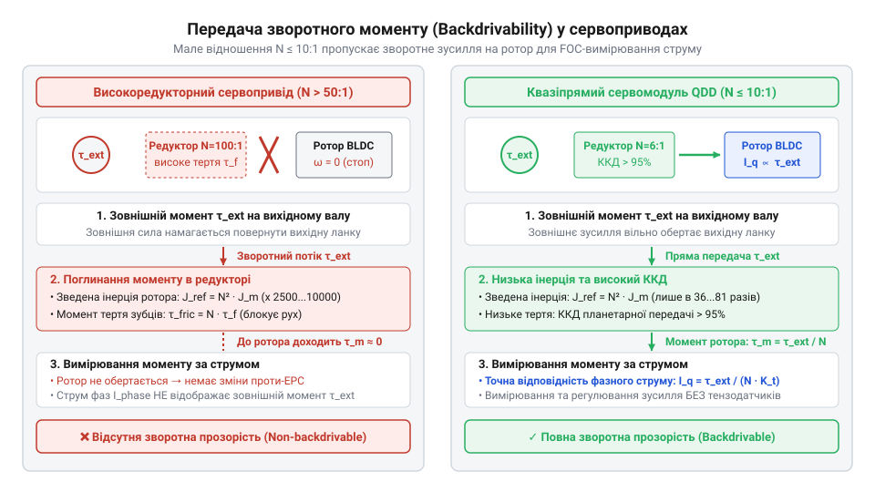
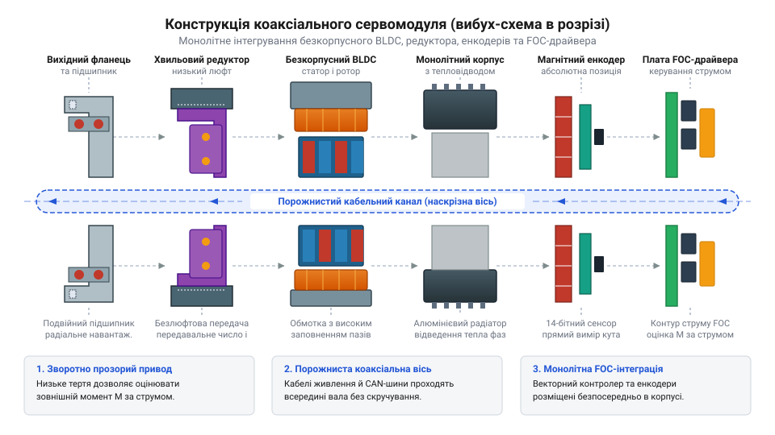
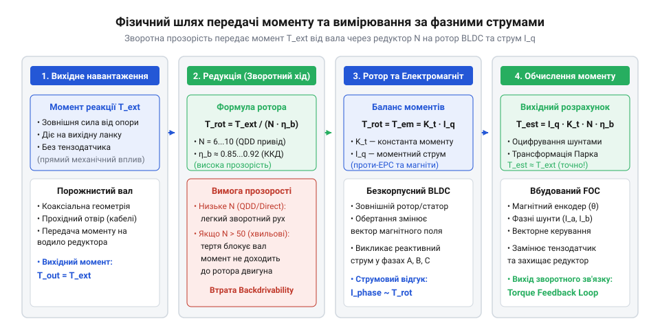
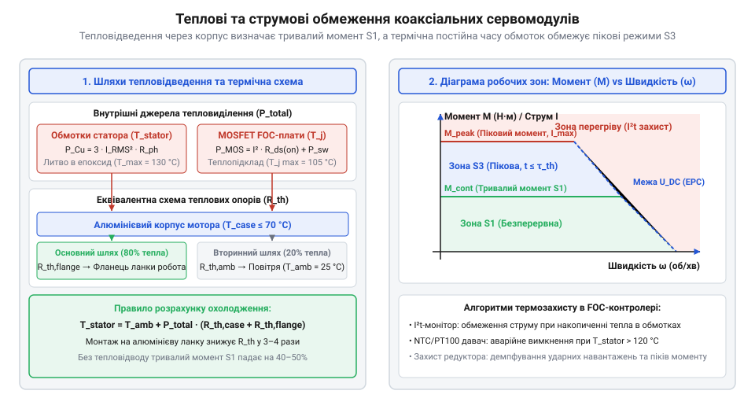
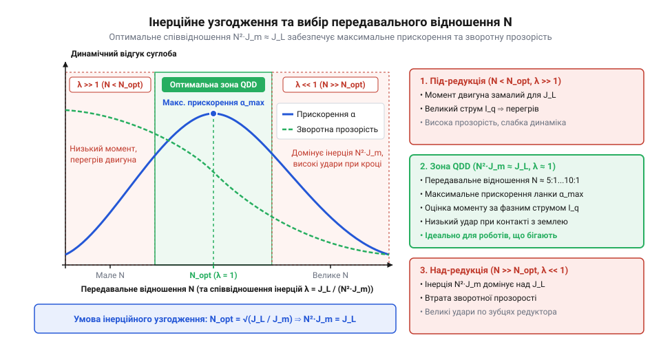
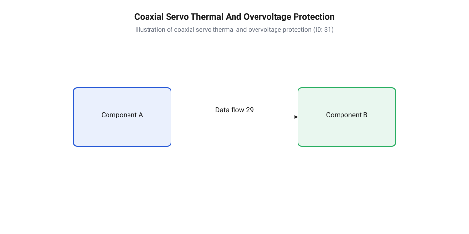

# Коаксіальні сервомодулі прямого приводу

<preknowlist>
- [Безколекторні інтегральні сервоконтролери](root:cat-hw-actuators/bldc-servo-controller) — базові принципи керування та фазної комутації безколекторних двигунів постійного струму
- [Сервоприводи радіокерованих моделей: будова, редуктори та ШІМ-керування](root:cat-hw-actuators/rc-servo-mechanisms-and-control) — класичну будову сервоприводу, поняття редукції та закриту систему регулювання
- [Теплова модель та активний захист сервоприводів](root:cat-hw-actuators/servo-thermal-protection) — принципи нагріву обмоток, теплові часові константи та критерії спрацьовування термозахисту
- [Зсувні навантаження та абразивний знос шестерень сервоприводів](root:cat-hw-actuators/servo-gear-shear-and-wear) — механіку зносу зубчастих передач і вплив механічних ударів на редуктор
</preknowlist>

## Обмеження традиційних приводів у робототехніці

Під час крокування робота при кожному контакті з поверхнею виникають ударні імпульси. У [традиційних модельних сервоприводах](root:cat-hw-actuators/rc-servo-mechanisms-and-control) високе передавальне відношення `N` (понад 100:1) створює високий опір зворотному руху. Зведений момент інерції ротора `J_ref`, відчутний з боку вихідного вала, зростає пропорційно квадрату редукції:

```
J_ref = J_m × N²
      = J_m × N × N             [квадрат передавального відношення]
```

де `J_m` — момент інерції ротора, а `N` — передавальне відношення. При великих `N` привід поводиться як жорстке затискання: вихідний вал не здатен провернутися під дією удару. Енергія зіткнення не розсіюється у русі ротора, а руйнує зуби передачі, прискорюючи [абразивний знос шестерень](root:cat-hw-actuators/servo-gear-shear-and-wear). Відсутність зворотної прозорості (англ. @@en|backdrivability@@; від англ. @@en|back drive@@ — зворотний рух) унеможливлює податливу взаємодію із середовищем, що вимагає зміни конструктивної парадигми.


*Порівняння шляхів проходження ударного навантаження: у високоредукторному приводі сила руйнує шестерні, а в квазіпрямому — провертає ротор.*

## Анатомія коаксіального сервомодуля прямого приводу

Розв'язанням проблеми вразливості став коаксіальний сервомодуль прямого та квазіпрямого приводу (англ. @@en|Quasi-Direct Drive@@, @@en|QDD@@; від лат. @@la|quasi@@ — ніби, майже). Усі елементи модуля інтегровані в циліндричний корпус навколо порожнистого вала (англ. @@en|hollow shaft@@). Серцем системи є багатополюсний безкорпусний двигун (англ. @@en|frameless BLDC motor@@; від англ. @@en|frameless@@ — безкорпусний) млинцевого типу (англ. @@en|pancake motor@@) з великим діаметром статора та ротора, що забезпечує високий момент на моторній осі.

До ротора під'єднано одноступеневий редуктор малого передавального відношення (`N` від 6:1 до 10:1). На коаксіальній осі розташовані два абсолютні магнітні енкодери: один вимірює кут ротора для [векторного сервоконтролера](root:cat-hw-actuators/bldc-servo-controller) (англ. @@en|Field-Oriented Control@@, @@en|FOC@@), інший — кут вихідного вала. Канал порожнистого вала дає змогу прокладати провідники всередині суглоба, усуваючи стирання джгутів при обертанні шарніра.


*Компоновка коаксіального модуля: млинцевий безкорпусний BLDC-двигун, низькоредукційний редуктор, двоконтурні енкодери та наскрізний порожнистий вал.*

## Механіка зворотної прозорості та пропріоцепція

Завдяки малій редукції `N` (6:1...10:1) зведений момент інерції ротора знижується у сотні разів. Це забезпечує високу зворотну прозорість: зовнішній момент `τ_ext`, прикладений до вихідного вала, вільно провертає ротор електродвигуна, транслюючись на моторний вал як `τ_m = τ_ext / N`.

Це відкриває можливість пропріоцептивного відчуття зусиль (англ. @@en|proprioceptive sensing@@; від лат. @@la|proprius@@ — власний та @@la|capere@@ — брати). Векторний контролер керує струмом статора у синхронній d-q системі координат. Квадратурна складова струму `i_q` напряму пропорційна моменту двигуна:

```
τ_ext = N × τ_m
      = N × K_t × i_q           [лінійна залежність моменту від струму q-осі]
```

де `N` — редукція, `K_t` — коефіцієнт моменту, а `i_q` — квадратурний струм. Вимірюючи фазні струми, контролер визначає зовнішні контактні сили без застосування додаткових тензодатчиків.


*Двосторонній потік моменту в квазіпрямому приводі: зовнішня сила транслюється на ротор і точно вимірюється через квадратурну складову струму.*

## Критерії вибору та інерційне узгодження

Вибір модуля починається з аналізу двох номіналів моменту: тривалого `τ_cont` (обмеженого нагрівом обмоток) та пікового `τ_peak` (обмеженого насиченням магнітопроводу). Для високодинамічних роботів вирішальним є інерційне узгодження (англ. @@en|inertia matching@@). Для максимізації кутового прискорення навантаження `α_load` зведений момент інерції ротора має дорівнювати моменту інерції навантаження `J_load`.


*Тепловий баланс сервомодуля показує шляхи відведення теплової потужності від статорних обмоток і силових транзисторів @@en|MOSFET@@ через корпусні елементи на конструктивні ланки робота.*

Оптимальне передавальне відношення `N_opt` визначається з співвідношення інерцій:

```
N_opt = √(J_load / J_m)         [умова рівності зведеної інерції ротора та навантаження]
```

де `J_load` — момент інерції ланки, а `J_m` — момент інерції ротора. Жорсткість редуктора `K_gear` разом із `J_load` визначає механічну резонансну частоту шарніра:

```
f_res = (1 / 2π) × √(K_gear / J_load)  [власна механічна частота суглоба]
```

Збіг частоти FOC із `f_res` викликає автоколивання, що вимагає вибору редуктора з підвищеною жорсткістю.


*Графік інерційного узгодження: максимізація кутового прискорення досягається при рівності зведеної інерції ротора та інерції навантаження.*

## Тепловий режим та захист електроніки

Щільне компонування електроніки та мотора створює високі теплові навантаження. Втрати в обмотках та силових ключах нагрівають внутрішній об'єм. При перевищенні критичної температури (80...105 °C) виникає ризик демагнетизації неодимових магнітів ротора (NdFeB). Для запобігання перегріву контролер реалізує [активний тепловий захист](root:cat-hw-actuators/servo-thermal-protection) на основі `i²t`-моделі та термодатчиків, плавно знижуючи струм (тепловий @@en|derating@@).

Другою загрозою є генераторний режим при гальмуванні. Зворотна ЕРС (англ. @@en|back EMF@@; від англ. @@en|electromotive force@@ — електрорушійна сила) створює зворотний струм у шину живлення. Захисна схема контролера фіксує перенапругу й скидає рекуперовану енергію на гальмівний резистор (англ. @@en|brake resistor@@ або @@en|chopper@@), гарантуючи безаварійну роботу приводу.


*Тепловий захист та ланцюг поглинання зворотної ЕРС: обмеження струму за температурою статора та скидання енергії гальмування на баластний резистор.*