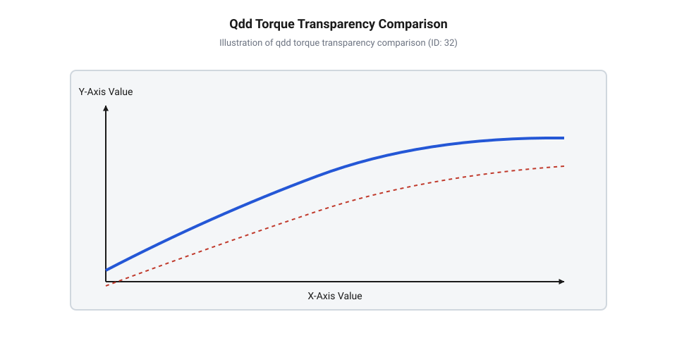
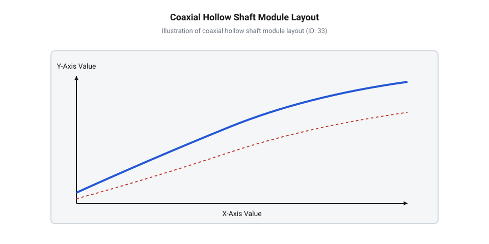

# Еволюція коаксіальних сервомодулів: від масивних промислових робоприводів до квазіпрямого приводу робоногів

<preknowlist>
- [Безколекторні інтегральні сервоконтролери](root:cat-hw-actuators/bldc-servo-controller) — принципи керування безколекторними моторами (BLDC) та вимірювання струму у фазах
- [Сервоприводи радіокерованих моделей: будова, редуктори та ШІМ-керування](root:cat-hw-actuators/rc-servo-mechanisms-and-control) — базову компоновку традиційного сервоприводу та функціональну роль редуктора й зворотного зв'язку
</preknowlist>

## Крихкість і жорсткість класичних робоприводів

Промислові маніпулятори проєктувалися для прецизійного переміщення деталей, де головними критеріями були жорстке утримання траєкторії та точність позиціонування. Щоб забезпечити великий крутний момент від невеликих двигунів, конструктори застосовували редуктори з високим передавальним числом `N > 100:1` — двоступеневі планетарні або хвильові редуктори (від англ. @@en|harmonic drive@@, @@en|harmonic@@ — гармонійний, @@en|drive@@ — привід).

При спробі перенести таку архітектуру на крокуючі мобільні платформи виявився фундаментальний бар'єр. Під час стрибка або крокування нога робота зазнає жорсткого удару об ґрунт, який діє миттєвим зовнішнім зусиллям на вихідний вал. Оскільки ротор двигуна обертається в `N` разів швидше за вихідний вал, роторна інерція двигуна, приведена до вихідного вала суглоба (`J_out`), зростає пропорційно квадрату передавального числа:

```
J_out = N² · J_rotor
```

де `J_rotor` — власний момент інерції ротора двигуна, `N` — передавальне число редуктора, а `J_out` — приведена інерція, яку бачить зовнішнє середовище на вихідному валу.

При `N = 100:1` квадрат передавального числа `N²` сягає `10000`. Щоб миттєво провернути вихідний вал під дією удару ґрунту, потрібно розігнати ротор двигуна з інерційним спротивом, помноженим у десять тисяч разів. Суглоб поводиться як жорстка стіна, втрачаючи прозорість (від англ. @@en|backdrivability@@, @@en|back-@@ — назад, @@en|drivability@@ — керованість, здатність редуктора обертатися у зворотному напрямку під дією зовнішнього зусилля на вихідному валу). Кінетична енергія удару розсіюється на зубах редуктора, спричиняючи [зсувні навантаження та абразивний знос шестерень сервоприводів](root:cat-hw-actuators/servo-gear-shear-and-wear) або сколювання зубчастого вінця.

Щоб захистити редуктори та керувати зусиллям, розробники спробували інтегрувати пружні елементи та тензометричні давачі сили (від англ. @@en|strain gauge@@, @@en|strain@@ — деформація, @@en|gauge@@ — вимірювач, тензорезистори) у схемі сервоприводів із послідовною пружністю (від англ. @@en|Series Elastic Actuator@@, @@en|SEA@@). Однак від імпактних ударів тензорезистори тріскаються, втрачають калібрувальний нуль чи дають зсув сигналу, а механічна пружина знижує смугу пропускання контуру керування та викликає небажані резонансні коливання кінцівок.


*Порівняння класичного промислового приводу та квазіпрямого приводу (QDD): високе передавальне число блокує зовнішній удар, тоді як низьке передавальне число вільно передає момент зворотного удару на ротор мотора.*

Усвідомлення цих обмежень довело, що промислова концепція приводу з великим редукційним числом є непридатною для високодинамічної робототехніки. Для робоногів знадобилася принципово інша архітектура, здатна поглинати імпульси та витримувати ударні навантаження без крихких давачів сили.

## Рознесені компоненти та проблема кабельних мереж

Ранні робототехнічні системи зіштовхнулися з конструктивною розрозненістю вузлів. Суглоби збирали з окремих деталей: електродвигун кріпився до силової рами, його вал з'єднувався з винесеним редуктором через муфти, а на протилежному кінці встановлювався оптичний або магнітний енкодер для відстеження кутового положення. Від цього вузла прокладали довгі дрітові джгути до центрального корпусу, де розміщувалися [безколекторні інтегральні сервоконтролери](root:cat-hw-actuators/bldc-servo-controller).

Така рознесена схема створювала колосальні труднощі під час проєктування багатоосьових маніпуляторів і кінцівок крокуючих роботів:

1. **Кабельний хаос і знос.** Кожен суглоб потребував фазних дротів живлення, ліній енкодера, датчиків температури та гальма. У роботі з 12 degrees of freedom (від англ. @@en|Degrees of Freedom@@, @@en|DoF@@ — ступені вільності) крізь рухомі суглоби проходило понад сотню провідників. При розмахах кінцівок кабельні петлі заплутувалися та зазнавали механічного стирання.

2. **Паразитні наведення.** Сильнострумові фазні лінії мотора зі ШІМ-частотою у десятки кілогерців прокладалися поруч із слабострумовими сигналами датчиків. Це спричиняло високочастотні наведення й викривлення даних позиціонування, що вимагало додаткового екранування та обважнювало джгути.

3. **Розподіл мас та інерція кінцівок.** Кабелі, роз'єми та корпуси окремих компонентів додавали вагу на дистальних (віддалених від тулуба) сегментах ніг. Чим більша маса на кінці ноги, тим вищий момент інерції всієї кінцівки та витрати енергії на її перенесення.


*Конструктивна компоновка монолітного коаксіального сервомодуля: безкорпусний мотор, планетарна передача, вбудований контролер та прохідний порожнистий вал для внутрішнього прокладання кабелів.*

Для вирішення кабельної проблеми виникла потреба в монолітній компоновці, ключовим елементом якої став прохідний порожнистий вал (від англ. @@en|hollow shaft@@, @@en|hollow@@ — порожнистий, @@en|shaft@@ — вал).

Порожнистий вал проходить наскрізь крізь геометричний центр сервоприводу — крізь отвір статора мотора, сонячну шестерню редуктора та плату контролера. Це дозволяє прокласти силову шину живлення та цифровий інтерфейс (наприклад, CAN або EtherCAT) усередині осі обертання суглоба. Провідники не утворюють зовнішніх петель, не перекручуються при обертанні й захищені металевим корпусом від пошкоджень та завад.

## Прорив MIT Cheetah та квазіпрямий привід

Концептуальний прорив у приводній робототехніці відбувся в лабораторії біоміметичної робототехніки Массачусетського технологічного інституту (від англ. @@en|MIT Biomimetic Robotics Lab@@) під керівництвом Санбе Кіма (англ. @@en|Sangbae Kim@@) під час розробки MIT Cheetah (2012–2014 роки). Дослідники поставили під сумнів догму про обов'язковість високого передавального числа.

Замість важких безредукторних приводів прямої дії (від англ. @@en|Direct Drive@@, @@en|DD@@, де `N = 1:1`), команда MIT створила квазіпрямий привід (від англ. @@en|Quasi-Direct Drive@@, @@en|QDD@@, @@en|quasi-@@ — ніби, квазі-, @@en|direct drive@@ — прямий привід).

Концепція QDD поєднує два рішення:

1. **Безкорпусний бесколекторний мотор великого діаметра** (від англ. @@en|frameless motor@@). Його статор має багатополюсну структуру, а ротор — великий діаметр при малій довжині («пампушкова» геометрія, від англ. @@en|pancake motor@@). Великий радіус створює максимальне плече для електромагнітної сили, забезпечуючи високий момент при низькій масі.

2. **Одноступеневий планетарний редуктор із низьким передавальним числом** (`N ≤ 10:1`, зазвичай від `N = 6:1` до `N = 9:1`).

Завдяки радикальному зменшенню `N` приведена інерція ротора `J_out` знизилася в сотні разів:

```
N_classic = 100:1  =>  N_classic² = 10000
N_QDD = 6:1        =>  N_QDD² = 36
```

Приведена інерція приводу QDD менша у `10000 / 36 ≈ 277` разів порівняно з промисловим сервоприводом аналогічного моменту. Це повернуло приводу високу прозорість (від англ. @@en|transparency@@ або @@en|backdrivability@@). При ударі ноги об землю вихідний вал і ротор вільно провертаються, поглинаючи кінетичний удар без пошкодження зубів редуктора.

Завдяки такій прозорості стало можливим вилучити механічні давачі сили. Оскільки тертя та інерція в низькоступеневому редукторі мізерні, момент на вихідному валу `τ_out` строго пропорційний моменту двигуна `τ_m`:

```
τ_m = K_t · I_q
τ_out = N · η · τ_m = N · η · K_t · I_q
```

де `τ_out` — крутний момент на вихідному валу, `N` — передавальне число, `η` — коефіцієнт корисної дії (`η > 0.9`), `K_t` — коефіцієнт моменту двигуна (від англ. @@en|torque constant@@, Н·м/А), а `I_q` — квадратурний фазовий струм статора.

Вимірюючи фазовий струм шунтами або датчиками Голла, силовий контролер оцінює зовнішнє зусилля з частотою в кілька кілогерців. Цей проприоцептивний привід (від англ. @@en|proprioceptive actuation@@, @@en|proprioception@@ — м'язове відчуття власного тіла) дозволив роботу MIT Cheetah бігати й стрибати, відчуваючи ґрунт виключно через струм у фазах моторів.

Детальний аналіз відмінностей QDD від повністю безредукторного приводу (@@en|Direct Drive@@) та межі застосовності струмової оцінки моменту (зокрема через зубчасте прилипання ротора від англ. @@en|cogging torque@@, тертя й температурний дрейф) розглянуто в розділі 5.

## Монолітна коаксіальна архітектура сучасних модулів

Розвиток квазіпрямого приводу привів до монолітної (від грец. @@el|monos@@ — один, @@el|lithos@@ — камінь, суцільноінтегрована компоновка) та коаксіальної (від лат. @@la|co-@@ — разом, @@la|axis@@ — вісь, співвісна архітектура з єдиною віссю двигуна, редуктора й вала) архітектури. Усі елементи приводу об'єднано всередині циліндричного алюмінієвого або титанового корпусу.

Конструкція модуля базується на чотирьох співвісних компонентах:

1. **Безкорпусний бесколекторний мотор** (від англ. @@en|frameless motor@@, @@en|frame@@ — корпус або рама). Статор запресовується в зовнішній корпус-радіатор, а ротор великого діаметра закріплюється на внутрішній втулці.

2. **Одноступеневий коаксіальний планетарний редуктор**. Сонячна шестерня сидить на роторі, а вінцева з внутрішніми зубами нарізана в стінці корпусу, що дає передавальне число `N ≤ 10:1`.

3. **Вбудована плата керування та абсолютні енкодери**. На торці монтуються [безколекторні інтегральні сервоконтролери](root:cat-hw-actuators/bldc-servo-controller) та планарні магнітні енкодери (від англ. @@en|encoder@@, @@en|encode@@ — кодувати) для векторного керування FOC й вимірювання кута вихідного вала.

4. **Наскрізний порожнистий вал** (від англ. @@en|hollow shaft@@). Через центр приводу проходить прохідний отвір діаметром 15–30 мм.

Суцільна компоновка радикально підвищує силову щільність (від англ. @@en|torque density@@, @@en|torque@@ — крутний момент, @@en|density@@ — щільність, співвідношення моменту до маси): корпус слугує елементом силового каркаса роботизованої кінцівки, усуваючи зовнішні муфти й кронштейни. Підключення за топологією @@en|daisy-chain@@ (від англ. @@en|daisy-chain@@, @@en|daisy@@ — маргаритка, @@en|chain@@ — ланцюг, послідовне з'єднання модулів єдиною шиною) дозволяє прокладати кабелі живлення та шини CAN або EtherCAT крізь порожнисті вали, ліквідовуючи ризик перекручування дротів під час обертання.

## Розвінчання міфів та межі квазіпрямого приводу

Прямий привід (від англ. @@en|Direct Drive@@, @@en|DD@@) взагалі не має редуктора (`N = 1:1`), що дає абсолютну механічну прозорість (від англ. @@en|backdrivability@@), але вимагає громіздкого мотора з великою масою міді й сталі для генерації моменту (наприклад, 50 Н·м). Натомість квазіпрямий привід (від англ. @@en|Quasi-Direct Drive@@, @@en|QDD@@) поєднує низькоступінчасту планетарну передачу (`N = 6:1`..`9:1`) із компактним двигуном. Це масштабує крутний момент у 6–9 разів за незначного зростання приведеної інерції ротора (`N² = 36..81`), зберігаючи баланс силової щільності й зворотної керованості.

Оцінка крутного моменту за фазовим струмом `I_q` спирається на формулу `τ_out = N · η · K_t · I_q`, де коефіцієнт моменту `K_t` та коефіцієнт корисної дії `η` вважаються константами. На практиці виникають фізичні нелінійності:

1. **Сухе тертя та люфт.** Тертя в зачепленні й підшипниках разом із люфтом (від нім. @@de|Luft@@ — повітря) на мікрошвидкостях розсинхронізовують зростання струму `I_q` та появу моменту на валу.

2. **Зубчасте прилипання.** Взаємодія магнітів ротора зі статором викликає пульсацію моменту (від англ. @@en|cogging torque@@), додаючи гармонійну похибку залежно від кута повороту.

3. **Температурний дрейф.** Нагрівання неодимових магнітів при навантаженні знижує магнітний потік, зумовлюючи температурний дрейф (від англ. @@en|thermal drift@@) параметра `K_t`. Без врахування [активного теплового захисту](root:cat-hw-actuators/servo-thermal-protection) похибка оцінки сягає 10–15%.

Через ці обмеження @@en|QDD@@-модулі з оцінкою моменту за струмом ефективні для квадропедів, гуманоїдів і коботів, де критичні високодинамічна локомоція й поглинання ударів. Вони не замінюють приводи з високим передавальним числом і тензодатчиками у верстатах ЧПК чи хірургічних роботах, які вимагають субміліметрової точності позиціонування, абсолютної жорсткості утримання та відсутності таких дефектів, як [зона нечутливості й дрижання](root:cat-hw-actuators/servo-deadband-and-jitter).