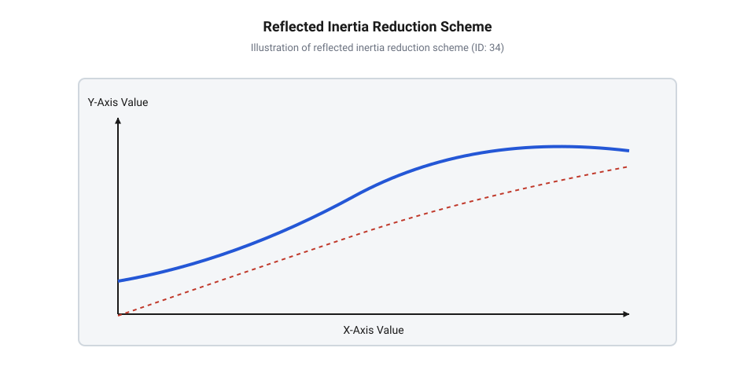
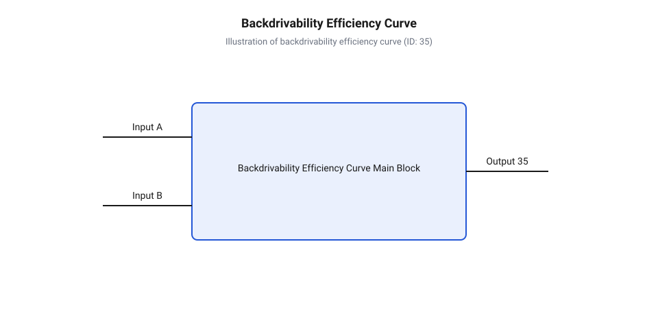

# Математика зворотної прозорості та інерційного узгодження коаксіального приводу

<preknowlist>
- [Сервоприводи радіокерованих моделей: будова, редуктори та ШІМ-керування](root:cat-hw-actuators/rc-servo-mechanisms-and-control) — пристрій редуктора та принцип передачі моменту від мотора до вихідного вала
- [Зсувні навантаження та абразивний знос шестерень сервоприводів](root:cat-hw-actuators/servo-gear-shear-and-wear) — механіку виникнення тертя та межі міцності зубчастих передач
</preknowlist>

## Ударне руйнування та сліпота приводу

Коли крокуючий робот або робот-маніпулятор виконує швидкий рух у реальному середовищі, його кінцева ланка неминуче зазнає раптових силових взаємодій із перешкодами. Уявімо ногу чотириногого апарата, яка під час бігу на високій швидкості натрапляє на нерухомий камінь або сходинку. У момент контакту на вихідний вал суглобового механізму діє миттєвий зовнішній ударний момент. Якщо в суглобі встановлено @@en|coaxial actuator@@ (латин. *co-* — спільний, *axis* — вісь, тобто коаксіальний привід із суміщеними осями мотора та редуктора) з високим коефіцієнтом редукції, робот опиняється перед подвійною фізичною та керувальною катастрофою: механічним руйнуванням зубчастої передачі та повною втратою здатності відчувати зовнішнє зусилля.

Традиційні [сервоприводи радіокерованих моделей](root:cat-hw-actuators/rc-servo-mechanisms-and-control) та промислові серводвигуни проектуються із розрахунком на максимальний вихідний момент при мінімальних габаритах мотора. Для цього застосовують великі передавальні відношення редуктора (порядок `N = 100`..`200`). Водночас розробники часто забувають, що редуктор є двостороннім механічним трансформатором. В умовах прямого руху від мотора до навантаження високе `N` масштабує момент мотора, але під час зовнішнього удару по вихідній ланці силовий потік розвертається у зворотному напрямку. 

Зовнішній удар намагається миттєво розігнати вал мотора від стану спокою до величезної кутової швидкості крізь кінематичний ланцюг редуктора. Оскільки ротор мотора має власну масу та момент інерції, його розгін вимагає прикладення гігантського моменту на вихідному валу. Усі ці зусилля передаються безпосередньо через зубчасті зачеплення шестерень. В результаті крихітні зубці перших ступенів редуктора зазнають колосального перевантаження, що призводить до катастрофічних руйнувань через [зсувні навантаження та абразивний знос](root:cat-hw-actuators/servo-gear-shear-and-wear) зубців або зрізання осей сателітів.

Друга критична проблема високоредукторних приводів полягає у втраті @@en|proprioception@@ (латин. *proprius* — власний, *capere* — брати, сприймати, тобто пропріоцепція або відчуття власних силових взаємодій). В сучасній динамічній робототехніці відчуття силового контакту намагаються реалізувати без громіздких та крихких зовнішніх датчиків моменту, спираючись на вимірювання фазних струмів у вихідних каскадах [безколекторних інтегральних сервоконтролерів](root:cat-hw-actuators/bldc-servo-controller). Оскільки електромагнітний момент мотора прямо пропорційний струму квадратурної осі `I_q`, очікується, що зовнішнє зусилля на вихідному валу можна легко вирахувати за пропорцією.

Проте у високоредукторному приводі ця логіка руйнується через внутрішнє тертя та інерційне маскування. Зовнішнє зусилля, що діє на вихідну ланку, вимушене спочатку подолати сухе тертя в усій зубчастій передачі та підшипниках. Доки зовнішній момент не перевищить поріг рушення редуктора, ротор мотора залишається нерухомим, а струм у обмотках мотора не змінюється жодним чином. Привод стає абсолютним «сліпим» до зовнішніх перешкод: робот може спиратися на стіну чи затискати крихкий предмет, але струмовий сенсор фіксуватиме лише струм утримання власної позиції.

Щоб позбутися ілюзії силової прозорості та захистити механіку від ударного руйнування, необхідно оцінювати привід через параметр @@en|backdrivability@@ (англ. *back* — назад, *drive* — рухати, *ability* — здатність, тобто зворотна провертальність чи зворотна прозорість). Для цього потрібен суворий математичний аналіз зворотної динаміки, який пов'язує передавальне відношення, моменти інерції та коефіцієнти тертя в єдину модель.

## Квадратичне масштабування інерції ротора мотора

Для розуміння динамічного відгуку суглоба при зовнішніх збуреннях необхідно вивести рівняння зв'язку між валом мотора та вихідним валом коаксіального редуктора. Розглянемо привід із передавальним відношенням `N`, де кут повороту ротора `θ_mot`, його кутова швидкість `ω_mot` та кутове прискорення `α_mot` пов'язані з вихідними параметрами `θ_out`, `ω_out` та `α_out` кінематичними співвідношеннями:

```
θ_mot = N · θ_out
ω_mot = N · ω_out
α_mot = N · α_out
```

Припустимо, що ротор мотора має власний момент інерції `J_rot`, а до вихідного вала приєднано навантаження з моментом інерції `J_load`. Для визначення сумарної кінетичної енергії системи `E_k` додаємо кінетичну енергію обертання ротора мотора та кінетичну енергію вихідного навантаження через вихідну кутову швидкість `ω_out`:

```
E_k = (1 / 2) · J_rot · ω_mot² + (1 / 2) · J_load · ω_out²
= (1 / 2) · J_rot · (N · ω_out)² + (1 / 2) · J_load · ω_out²      [підстановка відношення ω_mot = N · ω_out]
= (1 / 2) · (J_rot · N² + J_load) · ω_out²                        [винесення (1/2) · ω_out² за дужки]
```

З виведеної формули кінетичної енергії чітко видно еквівалентний момент інерції, який бачить зовнішнє середовище на вихідному валу приводу. Цю величину називають @@en|reflected inertia@@ (англ. *reflect* — відбивати, відображати, *inertia* — інерція, тобто зведена або відбита інерція на вихідній ланці):

```
J_ref = J_rot · N² + J_load
```

Коефіцієнт редукції `N` входить у формулу в квадраті! Це означає, що навіть крихітний ротор безколекторного мотора з моментом інерції `J_rot = 10⁻⁵ kg·m²`, з'єднаний із редуктором з передавальним відношенням `N = 100`, утворює на вихідному валу зведену інерцію ротора:

```
J_rot_ref = J_rot · N²
= 10⁻⁵ · 100²                                                    [підстановка N = 100]
= 10⁻⁵ · 10000                                                    [піднесення до квадрата]
= 0.1 kg·m²
```


*Принцип передачі моментів та інерцій у коаксіальному приводі: інерція ротора масштабується квадратично для вихідного вала.*

Якщо момент інерції самої ноги чи ланки маніпулятора `J_load` становить `0.02 kg·m²`, то `83%` всієї інерції суглоба припадає не на зовнішню конструкцію, а на зведену інерцію ротора мотора!

При раптовому ударному зіткненні вихідна ланка робота зазнає вимушеного кутового прискорення `α_out`. Згідно з другим законом Ньютона для обертального руху, реактивний ударний момент `τ_shock`, який виникає на зубцях редуктора, розраховується як:

```
τ_shock = J_ref · α_out
= (J_rot · N² + J_load) · α_out
```

За високих значень `N` еквівалентна маса ротора поводиться як непорушна ковадло. Зовнішня сила не здатна швидко провернути мотор, тому увесь кінетичний імпульс удару гаситься деформацією та зламом зубців шестерень. Саме тому на відміну від дрібних приводів із [металевими редукторами мікросервоприводів](root:cat-hw-actuators/mg90s-servo) чи конструкцій з [вуглеволоконним редуктором](root:cat-hw-actuators/sg92r-servo), високодинамічні крокуючі роботи потребують кардинально іншого співвідношення інерцій.

Якщо ж подивитися на динаміку з боку мотора, то зведений момент інерції навантаження, який діє на ротор `J_ref_mot`, навпаки, зменшується в `N²` разів:

```
J_ref_mot = J_rot + J_load / N²
```

Це пояснює, чому мотору легко керувати важкими важелями через високу редукцію, але при цьому привід повністю втрачає зворотну динамічну прозорість.

Для досягнення максимального кутового прискорення навантаження за обмеженої потужності мотора застосовують принцип @@en|inertia matching@@ (англ. *inertia* — інерція, *match* — узгоджувати, добирати пару). Узгодження інерцій досягається тоді, коли зведена інерція ротора дорівнює інерції навантаження:

```
J_rot · N² = J_load
⇒ N_opt = √(J_load / J_rot)
```

Проте для забезпечення високої @@en|backdrivability@@ у високодинамічних роботах (наприклад, чотириногих бігунах) розробники свідомо обирають передавальне відношення `N`, значно менше за `N_opt`, переходячи до концепції @@en|quasi-direct drive@@ (латин. *quasi* — ніби, майже, та англ. *direct drive* — прямий привід). Завдяки використанню низької редукції (`N = 6`..`10`) у поєднанні з високомоментними моторами з зовнішнім ротором, зведена інерція `J_rot · N²` зменшується в сотні разів, роблячи привід прозорим та стійким до ударів.

## Межа зворотного провертання та ККД

Крім інерційного опіку, зворотний рух приводу зустрічає опір механічних втрат у редукторі. Для аналізу межі провертання необхідно розрізняти прямий ККД `η_d` (передача енергії від мотора до навантаження) та зворотний ККД `η_r` (передача енергії від вихідного вала до мотора).

Під час прямого руху момент на вихідному валу `τ_out` з урахуванням втрат на тертя дорівнює:

```
τ_out = τ_mot · N · η_d
```

Втрата моменту на тертя `τ_loss`, зведена до вихідного вала, становить:

```
τ_loss = τ_mot · N · (1 - η_d)
```

Коли зовнішня сила діє на вихідну ланку з моментом `τ_ext`, вона намагається провернути редуктор у зворотному напрямку. Тертя в зачепленні шестерень завжди протидіє напрямку руху, незалежно від того, яка ланка є ведучою. Зв'язок між зворотним ККД `η_r` та прямим ККД `η_d` для зубчастих передач виводять із балансу сил тертя:

```
η_r = (τ_out_useful) / τ_ext
= 2 - 1 / η_d      [формула зворотного ККД через прямий ККД]
```


*Залежність зворотного ККД від прямого ККД та передавального відношення: зона самогальмування виникає при падінні зворотного ККД до нуля.*

З отриманого виразу випливає критична умова фізичної поведінки приводу. Визначимо межу, за якої зворотний ККД падає до нуля або стає від'ємним:

```
η_r ≤ 0
⇒ 2 - 1 / η_d ≤ 0
⇒ 1 / η_d ≥ 2
⇒ η_d ≤ 0.5
```

Якщо прямий ККД редуктора `η_d` є меншим або дорівнює `50%` (`0.5`), зворотний ККД `η_r` стає нульовим! Це явище називається @@en|self-locking@@ (англ. *self* — сам, *lock* — замикати, тобто самогальмування). У режимі самогальмування жоден зовнішній момент `τ_ext`, яким би великим він не був, не здатний провернути вал мотора. Уся зовнішня енергія повністю розсіюється на розклинювання та тертя у зубцях. Прикладами самогальмівних передач є черв'ячні редуктори, багатоступеневі @@en|planetary gearbox@@ (грец. *planetes* — блукаюче світило) та деякі типи високоредукторних @@en|strain wave gear@@ (англ. *strain* — деформація, *wave* — хвиля, тобто хвильових редукторів).

Розглянемо повну динамічну модель моменту зворотного провертання `τ_ext` з урахуванням зведеної інерції `J_ref`, в'язкого тертя та сухого Кулонового тертя. Нехай `τ_coul_mot` — момент сухого тертя ротора мотора, `τ_coul_out` — сухе тертя вихідного підшипника, `B_rot` — коефіціент @@en|viscous friction@@ (латин. *viscosus* — липкий, в'язкий) мотора, а `B_load` — в'язке тертя навантаження.

Рівняння балансу моментів на вихідному валу під час зворотного провертання має вигляд:

```
τ_ext = J_ref · α_out + (B_rot · N² + B_load) · ω_out + (N / η_r) · τ_coul_mot + τ_coul_out
```

Щоб зрушити вал з місця від зовнішнього зусилля (статичний режим `α_out = 0`, `ω_out = 0`), зовнішній момент повинен подолати поріг сухого тертя @@en|Coulomb friction@@ (від імені французького фізика Шарля Кулона, *Charles de Coulomb*):

```
τ_ext_min = (N / η_r) · τ_coul_mot + τ_coul_out
```

Величина `τ_ext_min` визначає точну межу «сліпоти» та зворотної прозорості приводу. Доки зовнішній момент `τ_ext` менший за `τ_ext_min`, мотор не відчуває жодної зміни положення чи струму. Для створення роботів, здатних безпечно взаємодіяти з людиною та адаптуватися до рельєфу без застосування коштовних тензометричних датчиків, інженери замість традиційного [потенціометричного зворотного зв'язку](root:cat-hw-actuators/servo-feedback-potentiometer) проектують коаксіальні приводи з `η_d > 85%` та мінімальним передавальним відношенням (`N < 10`), що гарантує низьке значення `τ_ext_min` та високу пропріоцептивну точність.

## Розрахунок критичного передавального відношення приводу

Коли робототехнічний суглоб стикається з непередбаченою перешкодою або отримує раптовий удар від поверхні, кінетична енергія навантаження намагається миттєво провернути вихідний вал приводу. У класичних сервомеханізмах з високим коефіцієнтом редукції ротор мотора діє як майже нерухома стіна через квадратичне зростання зведеної інерції. Вся сила удару припадає на останні ступені редуктора: якщо [зсувні навантаження шестерень](root:cat-hw-actuators/servo-gear-shear-and-wear) перевищують межу міцності матеріалу зубців, відбувається механічна аварія зі зрізанням зубців до того, як мотор взагалі встигне зрушити з місця. Крім того, високе тертя в редукторі робить датчики струму мотора повністю «сліпими» до зовнішніх сил, оскільки момент тертя перекриває корисний сигнал. Для запобігання цим явищам необхідно визначити @@en|критичне передавальне відношення@@ (англ. *critical transmission ratio*) `N_crit`, яке встановлює верхню межу передавального відношення редуктора для збереження @@en|пропріоцептивної прозорості@@ (англ. *proprioceptive transparency*, від лат. *proprius* — власний + *capere* — сприймати) та механічного захисту приводу.

Щоб побудувати математичний критерій для `N_crit`, необхідно поєднати дві незалежні умови: захист зубчастої передачі від ударного руйнування та забезпечення чутливості вимірювання струму мотора. Розглянемо спочатку механіку ударного навантаження. При зовнішньому кутовому прискоренні вала `alpha_max_impact` момент, що виникає на зубцях редуктора, визначається прискоренням зведеного моменту інерції ротора `J_rot` з урахуванням передавального відношення `N`. Момент удару `tau_impact`, який діє на останній ступінь редуктора, виражається як добуток зведеної інерції ротора `J_rot · N²` на прискорення навантаження `alpha_max_impact`. Щоб зубці редуктора не зрізало, цей момент не повинен перевищувати гранично допустиму @@en|межу зсувного навантаження@@ (англ. *shear torque limit*) `tau_shear`:

```
tau_impact = J_rot · N² · alpha_max_impact
J_rot · N² · alpha_max_impact ≤ tau_shear       [умова цілісності зубців]
N² ≤ tau_shear ÷ (J_rot · alpha_max_impact)      [ділення на J_rot та alpha_max_impact]
N_crit_impact = √(tau_shear ÷ (J_rot · alpha_max_impact))  [добування квадратного кореня]
```

Перед початком обчислень пояснимо позначення: `J_rot` — момент інерції ротора мотора у кілограмах на квадратний метр, `N` — передавальне відношення редуктора, `alpha_max_impact` — максимальне кутове прискорення вихідного вала при ударі в радіанах за секунду в квадраті, `tau_shear` — граничний момент зрізу зубців редуктора в ньютон-метрах, а `N_crit_impact` — граничне передавальне відношення за умовою міцності.

Друга умова визначається межею @@en|зворотної прозорості@@ (англ. *backdrivability*). Для того щоб [безколекторні інтегральні сервоконтролери](root:cat-hw-actuators/bldc-servo-controller) могли точно реєструвати зовнішній момент `Delta_tau_ext` за виміряним струмом фаз мотора, момент внутрішнього тертя, перерахований на вихідний вал, не повинен перевищувати потрібну точність вимірювання. Момент протидії провертанню зі сторони вихідного вала з урахуванням зворотного ККД `eta_r` дорівнює:

```
tau_backdrive = (tau_m_fric · N) ÷ eta_r
(tau_m_fric · N) ÷ eta_r ≤ Delta_tau_ext         [умова струмової чутливості]
N ≤ (Delta_tau_ext · eta_r) ÷ tau_m_fric         [вираження N через параметри тертя]
N_crit_proprio = (Delta_tau_ext · eta_r) ÷ tau_m_fric  [граничне значення для пропріоцепції]
```

Тут `tau_m_fric` — власне сухе тертя мотора на його власному валу в ньютон-метрах, `eta_r` — зворотний ККД редуктора (де `eta_r = 2 - 1 ÷ eta_d`), `Delta_tau_ext` — мінімальний зовнішній момент, який має впевнено фіксуватися системою керування, а `N_crit_proprio` — граничне значення редукції для пропріоцепції.

Отож, підсумкове @@en|критичне передавальне відношення@@ `N_crit` обирається як мінімум з двох отриманих граничних значень: `N_crit = min(N_crit_impact, N_crit_proprio)`. Перевищимо це значення під час проектування, і привод втратить або здатність витримувати удари без поломки шестерень, або здатність відчувати зовнішнє середовище через струм мотора.

**Обчислення критичного передавального відношення для коаксіального суглоба**

Розглянемо практичний приклад розрахунку для безколекторного мотора з моментом інерції ротора `J_rot = 1.2 × 10⁻⁵ kg·m²` та власне тертям `tau_m_fric = 0.005 N·m`. Редуктор має прямий ККД `eta_d = 0.85`, межу зсуву зубців `tau_shear = 12.0 N·m`. Робот має витримувати ударні прискорення суглоба до `alpha_max_impact = 400 rad/s²`, а система керування повинна відчувати зовнішній момент з точністю `Delta_tau_ext = 0.5 N·m`.

```
eta_r = 2 - (1 ÷ 0.85) ≈ 2 - 1.176 = 0.824        [зворотний ККД редуктора]
N_crit_impact = √(12.0 ÷ (1.2 × 10⁻⁵ × 400))    [межа міцності зубців]
= √(12.0 ÷ 0.0048) = √2500 = 50                 [граничне N за ударом]

N_crit_proprio = (0.5 × 0.824) ÷ 0.005          [межа струмової чутливості]
= 0.412 ÷ 0.005 = 82.4                          [граничне N за пропріоцепцією]

N_crit = min(50, 82.4) = 50                     [підсумковий критерій]
```

З обчислень видно, що найжорсткішим обмеженням у цьому випадку є ударне навантаження на зубці редуктора, яке обмежує коефіцієнт редукції значенням `N ≤ 50`. На відміну від традиційних приводів на кшталт [сервоприводів MG90S V2](root:cat-hw-actuators/mg90s-servo), де передавальне відношення сягає 200:1 і більше, вибір `N = 36` забезпечить як цілісність механізму при ударах, так і високу @@en|пропріоцептивну прозорість@@.

## Інерційне узгодження та вибір параметрів

Після визначення верхньої межі `N_crit` виникає питання: як обрати конкретне значення передавального відношення `N` та параметри мотора для досягнення максимальної динаміки? Якщо обрати `N` занадто малим, мотор не зможе розвинути достатній момент для прискорення масивного навантаження. Якщо ж обрати `N` занадто великим, майже весь електромагнітний момент мотора витрачатиметься на прискорення його власного ротора, чия @@en|зведена інерція@@ (англ. *reflected inertia*) на вихідному валу зростає як `J_rot · N²`. У результаті привод перегрівається, а кутове прискорення ланки робота падає. Щоб мінімізувати втрати енергії та отримати найшвидший динамічний відгук, застосовують метод, який називається @@en|інерційне узгодження@@ (англ. *inertia matching*, від лат. *inertia* — нерухомість, бездіяльність).

Знайдемо математичну умову, за якої кутове прискорення навантаження `alpha_load` досягає максимуму при заданому максимальному моменті мотора `tau_m_max`. Записуючи рівняння руху для системи, виразимо момент мотора через прискорення ротора та момент, переданий на навантаження інерцією `J_load`:

```
tau_m_max = J_rot · alpha_m + (1 ÷ N) · J_load · alpha_load
alpha_m = N · alpha_load                         [кінематичний зв'язок кутових прискорень]
tau_m_max = J_rot · N · alpha_load + (J_load ÷ N) · alpha_load  [підстановка alpha_m]
tau_m_max = alpha_load · (J_rot · N + J_load ÷ N) [винесення alpha_load за дужки]
alpha_load = tau_m_max ÷ (J_rot · N + J_load ÷ N) [вираження прискорення навантаження]
```

Для визначення символів перед їх аналізом: `tau_m_max` — максимальний розвиваний момент мотора на власному валу у ньютон-метрах, `alpha_m` — кутове прискорення ротора в радіанах за секунду в квадраті, `alpha_load` — кутове прискорення вихідного вала навантаження, `J_load` — момент інерції зовнішнього навантаження (ланки робота) у кілограмах на квадратний метр, `N` — передавальне відношення.

Щоб максимізувати `alpha_load`, необхідно мінімізувати знаменник виразу `f(N) = J_rot · N + J_load ÷ N`. Знайдемо першу похідну функції `f(N)` по `N` і прирівняємо її до нуля:

```
df ÷ dN = J_rot - J_load ÷ N² = 0                [умова екстремуму функції]
J_rot = J_load ÷ N²                              [перенесення членів рівняння]
N² = J_load ÷ J_rot                              [вираження N квадрат]
N_opt = √(J_load ÷ J_rot)                        [оптимальне передавальне відношення]
```

Отриманий результат показує, що оптимальне передавальне відношення `N_opt` досягається тоді, коли зведена інерція ротора `J_rot · N²` стає рівною моменту інерції навантаження `J_load`. У цій точці рівно половина механічної потужності мотора витрачається на розгін ротора, а друга половина — на розгін корисної маси.

У робототехніці з силовими взаємодіями (наприклад, у крокуючих роботах або маніпуляторах прямого контакту) розраховане за критерієм @@en|інерційного узгодження@@ `N_opt` нерідко виявляється більшим за критичне значення `N_crit`. Якщо бездумно обрати `N = N_opt`, привод втратить зворотно-прозорі властивості та перетвориться на жорсткий нечутливий механізм. Тому підхід до проектування систем типу @@en|квазіпрямий привод@@ (англ. *quasi-direct drive*, від лат. *quasi* — ніби, майже) полягає у дотриманні жорсткого компромісу:

```
N_design ≤ min(N_opt, N_crit)                   [критерій вибору коефіцієнта редукції]
```

Зазвичай для квазіпрямих приводів обирають високомоментні мотори з великим діаметром ротора (так звані pancake-BLDC) та малим передавальним відношенням редуктора в діапазоні від 6:1 до 10:1. Це дозволяє утримувати `N` значно нижче `N_crit`, забезпечуючи наднизький @@en|момент зворотного провертання@@ (англ. *backdrive torque*) та відмінну пропріоцепцію при збереженні високої силової щільності.

**Обчислення оптимального передавального відношення та вибір мотора**

Проведемо розрахунок для суглоба ноги крокуючого робота, де момент інерції ланки становить `J_load = 0.045 kg·m²`. Протестуємо два варіанти моторів: компактний мотор з `J_rot_1 = 8.0 × 10⁻⁶ kg·m²` та високомоментний безколекторний мотор з `J_rot_2 = 1.8 × 10⁻⁴ kg·m²`.

```
N_opt_1 = √(0.045 ÷ (8.0 × 10⁻⁶)) = √5625 = 75   [оптимальне N для першого мотора]
N_opt_2 = √(0.045 ÷ (1.8 × 10⁻⁴)) = √250 = 15.8  [оптимальне N для другого мотора]
```

Якщо для конкретної конструкції суглоба обчислене `N_crit` за умовами міцності та зворотного провертання становить `N_crit = 12`, то для першого мотора значення `N_opt_1 = 75` є недопустимим, оскільки перевищує `N_crit` більш ніж у 6 разів. Вибір другого мотора з більшим ротором дозволяє встановити `N_design = 10`, що близько до `N_opt_2 = 15.8` і повністю задовольняє умову `N_design ≤ N_crit`. На відміну від моделей з [9-грамових мікросервоприводів](root:cat-hw-actuators/sg90-mg90-micro-servos-family), де коефіцієнт редукції оптимізований виключно під статичний утримуючий момент, грамотне інерційне узгодження квазіпрямого мотора гарантує максимальну динаміку та захист від ударів.