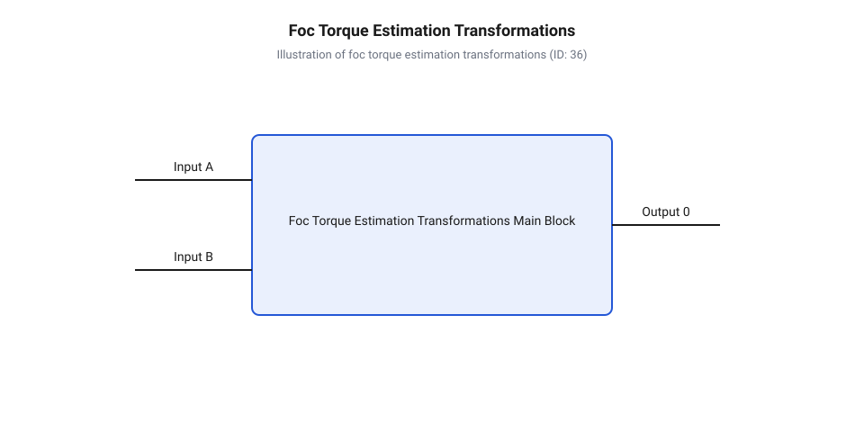
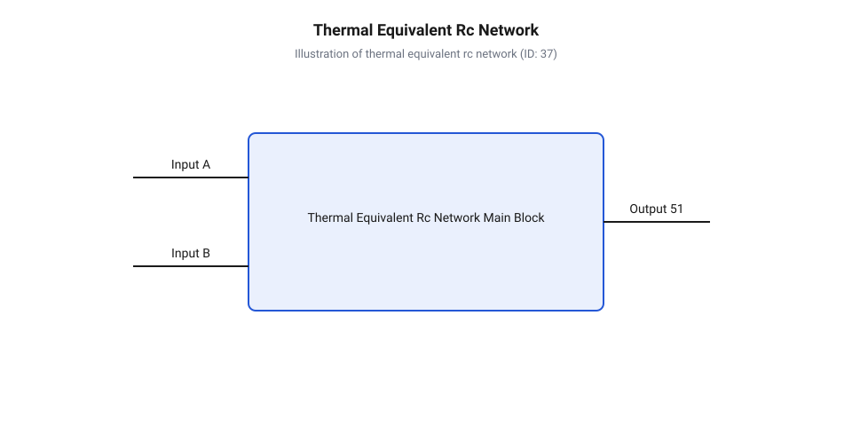

# Математика оцінювання моменту за струмом FOC та теплового режиму сервомодуля

<preknowlist>
- [Безколекторні інтегральні сервоконтролери](root:cat-hw-actuators/bldc-servo-controller) — принципи побудови інвертора та трифазного керування BLDC-моторами
- [Теплова модель та активний захист сервоприводів](root:cat-hw-actuators/servo-thermal-protection) — базові уявлення про температурні межі та захист приводів від перегріву
</preknowlist>

## Проблема невідомого моменту та перегріву

Пряме вимірювання амплітуди фазних струмів або споживаного струму живлення не дає точної інформації про механічний момент сервомодуля під навантаженням.

Синусоїдальний струм фази безколекторного двигуна ділиться на корисну моментну та намагнічувальну складові залежно від положення ротора. Через зсув вектора струму відносно магнітного поля виміряна амплітуда викривляє значення реального моменту. Для точної оцінки зусилля застосовують @@en|векторне керування@@ (від англ. *field-oriented control*, *field* — поле, *orient* — орієнтувати), у якому струм розщеплюється на намагнічувальний @@en|прямий струм@@ (від лат. *directus* — прямий) `I_d` та моментний @@en|квадратурний струм@@ (від лат. *quadratura* — надання квадратної форми) `I_q`. Сучасні [безколекторні інтегральні сервоконтролери](root:cat-hw-actuators/bldc-servo-controller) розраховують `I_q`, проте це вирішує лише електромагнітне завдання.

Другий чинник — зміна параметрів двигуна через нагрівання. Втрати енергії перетворюються на тепло у монолітному корпусі сервомодуля. Зі зростанням температури обмоток підвищується опір міді й зростають @@en|джоулеві втрати@@ (від англ. *Joule*, за ім'ям фізика Джеймса Джоуля), а неодимові магніти ротора втрачають @@en|потокозчеплення@@ (від лат. *fluxus* — потік) `ψ_m`. Падіння магнітного потоку зменшує моментний коефіцієнт, змушуючи контролер збільшувати `I_q` для утримання навантаження.

Виникає @@en|термічний розгін@@ (від англ. *thermal runaway*): підвищений струм викликає додатковий нагрів, ще більше послаблюючи магніти й збільшуючи опір. Без урахування температури обмоток і магнітів контролер вважає моментний коефіцієнт сталим, через що реальний момент падає, а двигун перегрівається. Тому [теплова модель та активний захист](root:cat-hw-actuators/servo-thermal-protection) разом із FOC-оцінювачем є обов'язковими для безпечної роботи приводу.

## Математика оцінювання моменту у FOC

Для обчислення електромеханічного моменту трифазні струми `I_a`, `I_b`, `I_c` переводять у рухому систему координат ротора. Першим кроком @@en|перетворення Кларк@@ (від англ. *Clarke transformation*, за ім'ям Едіт Кларк) проектує струми статора на двофазну @@en|стаціонарна система координат@@ `(α, β)`.

Оскільки в симетричній обмотці `I_a + I_b + I_c = 0`, ортогональні складові `I_α` (уздовж фази A) та `I_β` (перпендикулярна вісь) обчислюють за фазними струмами `I_a` та `I_b`:

I_α = I_a
I_β = (I_a + 2 × I_b) / √3                            [перетворення Кларк у стаціонарну двофазну систему]

Вектор `(I_α, I_β)` обертається разом із ротором. Щоб виділити постійні складові струму, @@en|перетворення Парка@@ (від англ. *Park transformation*, за ім'ям Роберта Парка) повертає координати на електричний кут `θ_e` в @@en|обертова система координат@@ `(d, q)`:

I_d = I_α × cos(θ_e) + I_β × sin(θ_e)                [пряма складова струму намагнічування]
I_q = -I_α × sin(θ_e) + I_β × cos(θ_e)               [квадратурна складова моментоутворення]

Електричний кут `θ_e` пов'язаний із механічним кутом `θ_m` через кількість @@en|пара полюсів@@ `p` магнітного ротора:

θ_e = p × θ_m                                        [зв'язок електричного та механічного кутів ротора]

Вісь `d` спрямована вздовж магнітного потоку ротора (`I_d` відповідає за намагнічування), а повернута на 90° вісь `q` є джерелом обертального моменту (`I_q`).

*Схема послідовного перетворення трифазних струмів у обертову систему координат d-q та обчислення вихідного моменту сервомодуля.*

За квадратурним струмом `I_q` та @@en|потокозчеплення@@ неодимових магнітів `ψ_m` обчислюють електромеханічний момент мотора `T_e`:

T_e = 1.5 × p × ψ_m × I_q                            [електромеханічний момент безколекторного мотора]

Добуток `1.5 × p × ψ_m` виражає @@en|коефіцієнт моменту@@ двигуна `K_t` (Н·м/А). Через редуктор із @@en|передавальне число@@ `N` та ККД `η` визначають корисний момент `T_out`:

T_out = T_e × N × η                                  [корисний момент на вихідному валу сервомодуля]

Механічний ККД редуктора зменшується зі зростанням навантаження та швидкості, тому важливо враховувати [зсувні навантаження та абразивний знос](root:cat-hw-actuators/servo-gear-shear-and-wear) шестерень.

**Розрахунок електромеханічного та вихідного моменту для 14-полюсного сервомодуля**

Для 14-полюсного мотора (`p = 7`, `ψ_m = 0.012` Вб) з редуктором (`N = 36`, `η = 0.85`) при струмі `I_q = 8.0` А (`I_d = 0`):

K_t = 1.5 × 7 × 0.012 = 0.126                         [обчислення коефіцієнта моменту мотора, Н·м/А]
T_e = 0.126 × 8.0 = 1.008                             [електромеханічний момент ротора мотора, Н·м]
T_out = 1.008 × 36 × 0.85 = 30.845                    [корисний момент на вихідному валу сервомодуля, Н·м]

Квадратурний струм 8.0 А забезпечує момент мотора 1.008 Н·м, що після трансформування редуктором дає 30.85 Н·м корисного моменту на вихідному фланці сервомодуля.

## Моделювання втрат потужності в сервомодулі

Тепловиділення в FOC-сервомодулі складається з трьох основних компонентів: джоулевих втрат у мідних обмотках статора, нелінійних втрат у сталевому осерді та механічних втрат у редукторі й підшипниках.

@@en|джоулеві втрати@@ у трифазній обмотці статора `P_cu` (Вт) залежать від амплітуди вектора струму в системі `(d, q)` та поточного опору фази:

P_cu = 1.5 × R_stator × (I_d² + I_q²)                 [джоулеві втрати у трифазній обмотці статора]

Тут `R_stator` — фазний опір обмотки статора (Ом). Оскільки опір міді зростає з температурою, його значення постійно коригується за залежністю:

R_stator(T) = R_20 × (1 + α_cu × (T - 20))            [температурна корекція опору міді статора]

де `R_20` — опір при 20 °C, `α_cu ≈ 0.00393` K⁻¹ — температурний коефіцієнт міді, а `T` — поточна температура обмотки (°C).

Втрати у сталевому осерді `P_core` виникають під дією змінного магнітного поля і складаються з втрат на @@en|гістерезис@@ (від грец. *hysteresis* — відставання) `P_hyst` та @@en|вихорові струми Фуко@@ (від фр. *Foucault*, за ім'ям фізика Леона Фуко) `P_eddy`:

P_hyst = k_h × f × Bⁿ                                 [втрати на перемагнічування та гістерезис сталі]
P_eddy = k_e × f² × B²                                [втрати на вихорові струми у пластинах статора]
P_core = P_hyst + P_eddy                              [сумарні нелінійні втрати в сталевому осерді]

У цих рівняннях `f = (p × ω_m) / (2 × π)` — фундаментальна електрична частота (Гц), `ω_m` — механічна кутова швидкість ротора (рад/с), `B` — магнітна індукція у сталі (Тесла), `k_h` та `k_e` — коефіцієнти сталі, а `n ≈ 1.6 ... 2.0` — показник Штайнметца.

Механічні втрати в редукторі `P_mech` обчислюються на основі переданої потужності та ККД:

P_mech = T_e × ω_m × (1 - η)                          [потужність втрат на тертя у редукторі]

Сума всіх складових визначає повний тепловий потік `P_total` у внутрішньому об'ємі модуля:

P_total = P_cu + P_core + P_mech                      [сумарний тепловий потік втрат у сервомодулі]

Для моделювання поширення тепла будують [теплова модель та активний захист](root:cat-hw-actuators/servo-thermal-protection) у вигляді еквівалентної теплової RC-схеми монолітного корпусу. У цій схемі тепловий потік `P_total` відповідає джерелу струму, температура `T` — потенціалу, @@en|термічний опір@@ (від грец. *therme* — тепло) `R_th` (K/Вт) — опору, а @@en|теплоємність@@ (від грец. *therme* — тепло) `C_th` (Дж/K) — ємності.

*Еквівалентна теплова схема з трьома вузлами (обмотка, осердя статора, корпус) та термічними RC-ланцюжками.*

Динаміка зміни температури вузла описується диференціальним рівнянням теплового балансу:

C_th × (dT / dt) + (T - T_amb) / R_th = P_total       [диференціальне рівняння теплового балансу сервомодуля]

Добуток параметрів визначає @@en|теплова часова константа@@ `τ_th = R_th × C_th` (секунди). При сталому навантаженні температура корпусу змінюється за експоненційним законом:

T(t) = T_amb + P_total × R_th × (1 - e⁻ᵗ⁾ᵀʰ)            [динаміка нагріву корпусу під постійним навантаженням]

де `T_amb` — температура навколишнього середовища (°C).

**Розрахунок теплових втрат та стаціонарної температури обмотки сервомодуля**

Приймемо `R_20 = 0.15` Ом, `T = 80` °C, струми `I_q = 8.0` А та `I_d = 0` А, частоту `f = 350` Гц, втрати у сталі `P_core = 20.0` Вт, кутову швидкість `ω_m = 31.4` рад/с, момент `T_e = 1.008` Н·м, ККД `η = 0.85`, термічний опір `R_th = 1.2` K/Вт та температуру довкілля `T_amb = 25` °C.

R_stator(80) = 0.15 × (1 + 0.00393 × (80 - 20)) = 0.1853 [опір обмотки при температурі 80 °C, Ом]
P_cu = 1.5 × 0.1853 × 8.0² = 17.789                    [джоулеві втрати в міді обмотки, Вт]
P_mech = 1.008 × 31.4 × (1 - 0.85) = 4.748            [механічні втрати в редукторі, Вт]
P_total = 17.789 + 20.0 + 4.748 = 42.537              [сумарне тепловиділення сервомодуля, Вт]
T_steady = 25 + 42.537 × 1.2 = 76.044                 [стаціонарна температура корпусу, °C]

При загальному тепловиділенні 42.54 Вт стаціонарна температура корпусу сервомодуля становить 76.04 °C, що залишається у припустимих межах для неодимових магнітів та електроніки.

## Еквівалентна теплова схема монолітного корпусу

У компактних співвісних сервомодулях втрачувана потужність `P_total` перетворюється на тепло в герметичному алюмінієвому корпусі. Щоб визначити температурний режим компонентів і знайти граничне безперервне навантаження без перегріву, будують еквівалентну теплову RC-схему.

Схема описує передачу тепла між обмоткою статора, магнітами ротора та корпусом. Кожен елемент має власну @@en|теплоємність@@ `C_th` (Дж/K), що залежить від його маси `m` та питомої теплоємності матеріалу `c_p`:

C_th = m × c_p                                       [теплоємність конструкційного елемента сервомодуля]

Вузли поєднані через @@en|термічний опір@@ `R_th` (K/Вт), який характеризує опір теплопровідності внутрішніх ізоляційних шарів та конвекцію в довкілля. Добуток опору та ємності визначає значення @@en|теплова часова константа@@ `τ_th = R_th × C_th`. Мала маса обмотки зумовлює низьку часову константу статора `τ_stator` (секунди), тоді як масивний алюмінієвий корпус має значно більшу `τ_case` (хвилини).

Зростання температури корпусу `T_case(t)` та обмотки `T_stator(t)` відносно навколишнього середовища `T_amb` описують експоненційними залежностями:

T_case(t) = T_amb + P_total × R_th_case × (1 - e⁻ᵗᐟτ_case) [зміна температури корпусу в часі]
T_stator(t) = T_case(t) + P_stator × R_th_stator × (1 - e⁻ᵗᐟτ_stator) [перегрів обмотки відносно корпусу]

При тривалій роботі (`t >> τ_case`) система досягає стаціонарного теплового стану, розсіюючи всю виділену потужність у довкілля.

На основі стаціонарного теплового балансу реалізують [активний тепловий захист](root:cat-hw-actuators/servo-thermal-protection) та обчислюють @@en|тривалий безперервний момент@@ (від англ. *continuous torque*, *continue* — тривати, *torque* — крутний момент) `T_cont` — граничний момент на валу, при якому температура елементів не перевищує допустиму `T_max` (105 °C для статора, 85 °C для магнітів). У цьому стані максимально припустима втрачувана потужність обмежена термічним опором системи:

P_total_max = (T_max - T_amb) / R_th_total            [гранична теплова потужність стаціонарного режиму]

Виражаючи джоулеві втрати через квадратурний струм `I_q` та коефіцієнт моменту `K_t`, виводять модель тривалого безперервного моменту:

T_cont = N × η × K_t × √((P_total_max - P_core - P_mech) / (1.5 × R_stator(T_max))) [математична модель тривалого безперервного моменту сервомодуля]

Ця залежність показує, що тривалий момент обмежений термічним опором корпусу й теплостійкістю ізоляції.

**Розрахунок тривалого безперервного моменту T_cont для FOC-сервомодуля**

Приймемо `N = 36`, `η = 0.85`, `K_t = 0.126` Н·м/А, `R_20 = 0.15` Ом, `R_th_total = 1.6` K/Вт, `T_max = 105` °C, `T_amb = 25` °C, `P_core = 15.0` Вт та `P_mech = 5.0` Вт.

R_stator(105) = 0.15 × (1 + 0.00393 × (105 - 20)) = 0.2001 [опір обмотки статора при 105 °C, Ом]
P_total_max = (105 - 25) / 1.6 = 50.0                [максимально припустима сумарна потужність втрат, Вт]
P_cu_max = 50.0 - 15.0 - 5.0 = 30.0                   [максимально припустимі джоулеві втрати статора, Вт]
I_q_cont = √(30.0 / (1.5 × 0.2001)) = 9.997           [граничний тривалий квадратурний струм, А]
T_e_cont = 0.126 × 9.997 = 1.2596                     [граничний тривалий момент мотора, Н·м]
T_cont = 1.2596 × 36 × 0.85 = 38.544                  [тривалий безперервний момент на вихідному валу, Н·м]

Тривалий безперервний момент даного сервомодуля становить 38.54 Н·м при квадратурному струмі 10.0 А.

## Розрахунок обмежень @@en|пікового моменту@@ T_peak

Для динамічних маневрів приводу необхідний короткочасний @@en|піковий момент@@ (від англ. *peak torque*, *peak* — вершина, шпиль) `T_peak`, що перевищує номінальний `T_cont`. Через пропорційність джоулевих втрат квадрату струму (`P_cu ∝ I_q²`) піковий режим спричиняє швидкий нагрів двох критичних вузлів.

Перша межа — незворотне @@en|розмагнічування@@ (від франц. *démagnétiser*, *dé-* — усунення, *magnétiser* — намагнічувати) неодимових магнітів ротора через падіння коерцитивної сили під дією поля `I_d` при перегріві. Другий чинник — силові ключі, що їх містять [безколекторні інтегральні сервоконтролери](root:cat-hw-actuators/bldc-servo-controller), де перевищення температури кристала 150 °C спричиняє аварійне вимкнення. Режими їхньої роботи описує [теплова модель та активний захист](root:cat-hw-actuators/servo-thermal-protection).

Коли тривалість пікового імпульсу `t_pulse << τ_stator`, тепло не встигає передатися на корпус. Виникає @@en|адіабатичний нагрів@@ (від грец. *adiabatos* — неперехідний, той що не пропускає тепло), де вся джоулева енергія йде на нагрів міді статора:

C_stator × (dT / dt) = P_cu_peak                      [рівняння адіабатичного нагріву статора]

Інтегрування від `T_init` до граничної температури `T_max` дає максимальну тривалість імпульсу:

t_peak_max = (C_stator × (T_max - T_init)) / P_cu_peak [гранична тривалість пікового моменту в адіабатичному наближенні]

Якщо тривалість імпульсу порівняна з `τ_stator`, враховують тепловідведення до корпусу через експоненційну модель:

T_stator(t) = T_init + (T_steady_peak - T_init) × (1 - e⁻ᵗᐟτ_stator) [динаміка нагріву з урахуванням тепловідведення]

де `T_steady_peak = T_init + P_cu_peak × R_stator_case`. Розв'язок відносно часу визначає точний вираз:

t_peak_max = -τ_stator × ln(1 - (T_max - T_init) / (P_cu_peak × R_th_stator_case)) [точна математична модель часового обмеження пікового моменту]

Для надійності у прошивку контролера інтегрують @@en|активний тепловий захист@@ (від лат. *activus* — діяльний). Алгоритм моделює тепловий стан і здійснює @@en|дерейтінг струму@@ (від англ. *current derating*, *de-* — зниження, *rate* — рівень) — примусове обмеження `I_q` до безпечного `I_cont`.

**Розрахунок допустимої тривалості @@en|пікового моменту@@ T_peak**

Обчислимо граничний час пікового струму `I_q_peak = 25.0` А для сервомодуля з `C_stator = 40.0` Дж/K, `T_init = 60` °C та `T_max = 105` °C.

R_stator(60) = 0.15 × (1 + 0.00393 × (60 - 20)) = 0.1736 [опір обмотки статора при 60 °C, Ом]
P_cu_peak = 1.5 × 0.1736 × 25.0² = 162.75              [джоулеві втрати при піковому струмі, Вт]
ΔT_allow = 105 - 60 = 45.0                            [допустимий температурний приріст обмотки, °C]
E_allow = 40.0 × 45.0 = 1800.0                        [допустимий запас теплової енергії обмотки, Дж]
t_peak_max = 1800.0 / 162.75 = 11.06                  [максимально припустима тривалість пікового імпульсу, с]

При початковій температурі 60 °C піковий струм 25.0 А обмежений 11.06 секунди, після чого прошивка знижує момент для запобігання перегріву.