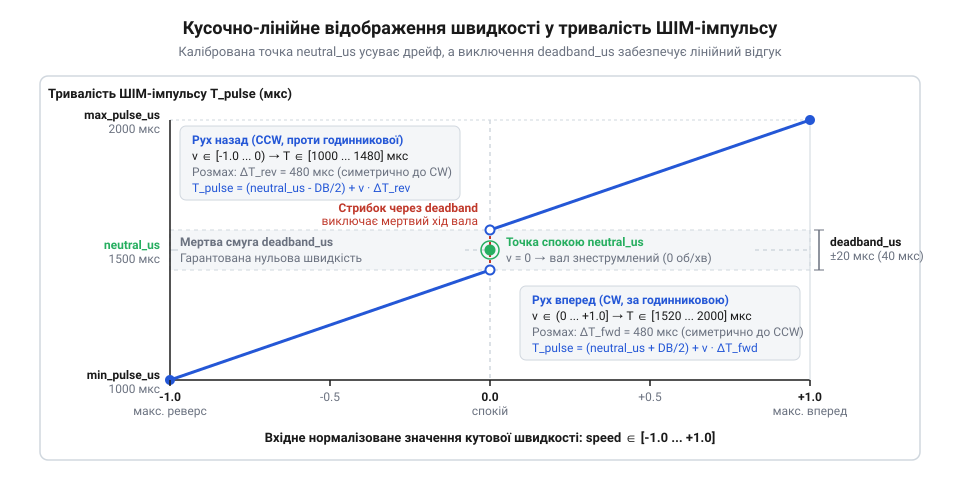
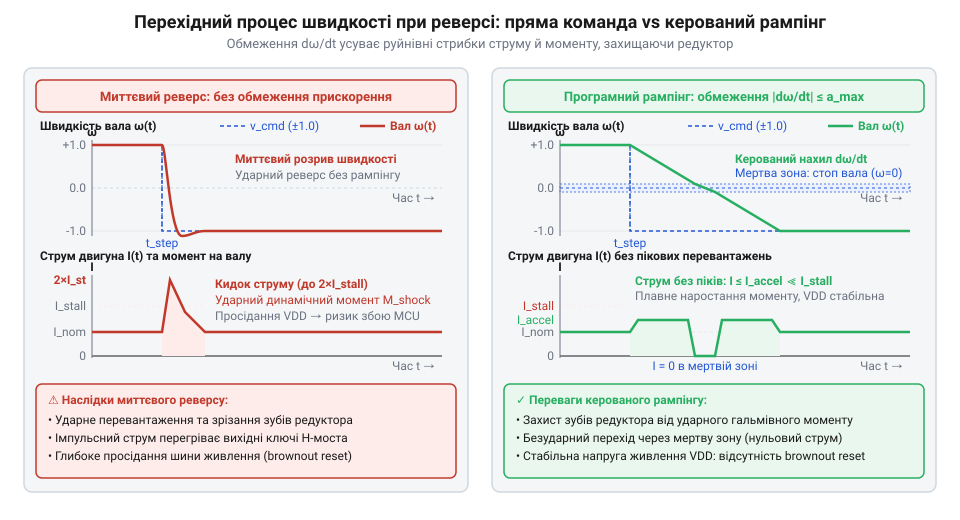

# Програмний інтерфейс (C/C++) драйвера керування швидкістю та калібруванням сервопривода постійного обертання

<preknowlist>
- [Tower Pro SG90 — мікросерво 9g](root:cat-hw-actuators/sg90-servo) — стандартні часові параметри керувального сигналу RC-сервоприводів (частота 50 Гц, період 20 мс, робочий діапазон тривалості імпульсів 1000–2000 мкс із номінальною нейтраллю 1500 мкс) та базова схема реакції внутрішнього підсилювача на ширину імпульсу
- [MG90S V2 — мікросерво з металевим редуктором](root:cat-hw-actuators/mg90s-servo) — уразливість механічного редуктора мікросервопривода до ударних динамічних навантажень при різкому реверсі та характерні кидки пускового струму двигуна, що викликають просідання напруги живлення
</preknowlist>

## Чому стандартний серводрайвер непридатний для обертання

Спроба керувати модифікованим сервоприводом постійного обертання за допомогою стандартної бібліотеки на зразок `Servo.h` призводить до збоїв уже під час зупинки. Програмний виклик надсилає імпульс 1500 мкс, очікуючи повного спокою вала. Проте після [модифікації привода для обертання](root:cat-hw-actuators/continuous-rotation-servo-mod) зворотний зв'язок розірвано: потенціометр зворотного зв'язку замінено резистивним дільником. Через технологічний розкид номіналів і температурний дрейф (від нідерландського @@nl|drijven@@ — плавати, гнати) електрична середина зміщується. Сигнал 1500 мкс створює ненульову різницю напруг на внутрішньому підсилювачі помилки, і вал повільно повзе вбік.

Керування кутами від 0 до 180 градусів втрачає фізичний зміст для безперервного обертання. Внутрішня мікросхема сервопривода містить компаратор (від латинського @@la|comparare@@ — порівнювати), який вимірює різницю тривалостей зовнішнього керувального імпульсу та внутрішнього опорного сигналу. Задля максимальної жорсткості утримання позиції передавальна характеристика цього компаратора має надвисокий коефіцієнт підсилення. Через це ширина зони лінійності внутрішньої мікросхеми становить лише 20–40 мкс довкола електричної нейтралі: тільки в цьому вузькому діапазоні напруга на двигуні наростає пропорційно до похибки. Щойно відхилення перевищує цю межу, передавальна характеристика компаратора входить у насичення й повністю відкриває силові транзистори H-моста. У стандартній бібліотеці `Servo.h` один градус відповідає 5–10 мкс тривалості імпульсу, тому команда в кілька градусів миттєво виводить компаратор у насичення. Замість плавного наростання швидкості виникає нелінійний стрибок від нуля одразу до максимальних обертів.

Миттєвий реверс (від латинського @@la|reversus@@ — повернений назад) із максимального ходу вперед на повний назад — стрибок тривалості імпульсу з 2000 до 1000 мкс — руйнує привід. Ударний динамічний момент зрізає пластикові зуби шестерень [мікросервопривода SG90](root:cat-hw-actuators/sg90-servo) та розбиває редуктор [металевого привода MG90S](root:cat-hw-actuators/mg90s-servo). Водночас ротор генерує зустрічну електрорушійну силу, через що струм перевантаження просаджує лінію живлення й викликає скидання мікроконтролера через @@en|Brown-Out Reset@@ (BOR). Робота з приводом обертання вимагає спеціалізованого драйвера: із програмним калібруванням точки спокою, мертвою зоною та динамічним обмеженням прискорення.

## Структура конфігурації та параметри калібрування

Щоб врахувати індивідуальний розкид резисторів дільника й механіки кожного привода, параметри зберігають у структурі конфігурації:

:::tabs
```c
typedef struct {
    uint16_t neutral_us;
    uint16_t deadband_us;
    uint16_t min_pulse_us;
    uint16_t max_pulse_us;
    bool inverted;
} servo_continuous_config_t;
```
```cpp
struct ServoContinuousConfig {
    uint16_t neutral_us = 1500;
    uint16_t deadband_us = 30;
    uint16_t min_pulse_us = 1000;
    uint16_t max_pulse_us = 2000;
    bool inverted = false;
};
```
:::

Точка спокою `neutral_us` задає дійсну тривалість імпульсу, за якої вал залишається нерухомим. Її визначають індивідуально через калібрування (від арабського @@ar|qalib@@ — форма, мірило); зазвичай вона перебуває в межах 1470–1530 мкс. Для ручного пошуку цієї точки вал повністю звільняють від механічного навантаження, а мікроконтролер налаштовують на надсилання тестових імпульсів за командами через послідовний порт (англ. @@en|serial port@@). Починаючи з номінальних 1500 мкс, тривалість сигналу зменшують із кроком 1 мкс і паузою на подолання тертя в редукторі, доки вал не почне ледь помітно повзти в один бік — це значення фіксують як нижній поріг зрушення. Потім тривалість так само збільшують із кроком 1 мкс вгору крізь зону спокою, відзначаючи верхній поріг початку обертання у зворотний бік. Середина між двома знайденими межами визначає дійсне значення `neutral_us`, що врівноважує апаратне зміщення внутрішнього дільника привода. Якщо проводити калібрування під навантаженням або надсилати тестові імпульси без пауз, механічний опір та інерція шестерень спотворять межі, спричинивши паразитний дрейф після налаштування.

Навколо точки спокою виділяють мертву зону (англ. @@en|deadband@@) шириною `deadband_us`. Це захисне часове вікно, усередині якого швидкість примусово обнуляється. Ширина 20–40 мкс перекриває температурне зміщення дільника та нестабільність фронтів таймера мікроконтролера, гарантуючи відсутність паразитного дрейфу.

Поля `min_pulse_us` та `max_pulse_us` (за замовчуванням 1000 і 2000 мкс) визначають межі ШІМ-сигналу. Прапорець `inverted` виконує програмну інверсію (від латинського @@la|inversio@@ — перевертання) полярності керування, узгоджуючи додатний напрямок швидкості з механікою без зміни монтажу.

Зсув точки спокою `neutral_us` робить плечі ходу несиметричними: діапазон руху вперед `max_pulse_us - neutral_us` не дорівнює запасу назад `neutral_us - min_pulse_us`. Драйвер враховує це зміщення: кутова швидкість розраховується з окремими коефіцієнтами масштабування від меж мертвої зони, що усуває нечутливість біля нуля й вирівнює діапазон швидкостей в обох напрямках.

## Апаратна ініціалізація таймерів на різних платформах

Генерація сигналу сервопривода вимагає стабільної частоти 50 Гц (період 20 мс). Дискретність (від латинського @@la|discretus@@ — розділений) таймера, гірша за 1 мкс, викликає східчасту зміну швидкості та сіпання вала, а запуск ШІМ на некоректному виводі чи за зайнятого каналу веде до збою.

Шар абстракції апаратури (англ. @@en|Hardware Abstraction Layer@@, HAL) уніфікує доступ до таймерів із єдиним інтерфейсом ініціалізації:

:::tabs
```c
typedef enum {
    SERVO_OK = 0,
    ERR_INVALID_ARG,
    ERR_TIMER_BUSY,
    ERR_PWM_INIT_FAILED
} servo_err_t;

servo_err_t servo_continuous_init(servo_t *servo, const servo_continuous_config_t *cfg, int pin);
```
```cpp
enum class ServoError { Ok = 0, InvalidArg, TimerBusy, PwmInitFailed };

ServoError init(const ServoContinuousConfig& cfg, int pin);
```
:::

Під капотом драйвер конфігурує периферію цільової платформи:
- в Arduino задіює бібліотеку `Servo` або переривання апаратних таймерів;
- в ESP-IDF налаштовує модулі `MCPWM` чи `LEDC` із тактуванням кроком не більше 1 мкс;
- у STM32 HAL запускає ШІМ на таймері `TIMx` викликом `HAL_TIM_PWM_Start()`.

Перед генерацією `servo_continuous_init()` валідує ресурси: перевіряє придатність GPIO для ШІМ, вільність каналу таймера (`ERR_TIMER_BUSY`) та узгодженість меж `min_pulse_us < neutral_us < max_pulse_us` при `deadband_us > 0` (`ERR_INVALID_ARG`). Помилка запуску периферії повертає `ERR_PWM_INIT_FAILED`, блокуючи роботу в некоректному стані.

## Нормалізоване керування швидкістю та безпечне відключення

Пряме завдання тривалості імпульсу прив'язує логіку до калібрування конкретного мотора. Драйвер приховує це за нормалізованою (від латинського @@la|normalis@@ — за правилом) швидкістю `v ∈ [-1.0, 1.0]`: значення +1.0 відповідає повному ходу за годинниковою стрілкою, -1.0 — проти неї, а 0.0 — зупинці. Прапорець `inverted` змінює знак команди на протилежний.

Щоб усунути затримку старту, рух починають від меж мертвої зони `deadband_us`. Для швидкості `v > 0` тривалість імпульсу `t_pwm` обчислюють від точки спокою `neutral_us`, напівширини мертвої зони `δ = deadband_us / 2` та максимальної межі `max_pulse_us`:

```
t_pwm
= (neutral_us + δ) + v · (max_pulse_us - (neutral_us + δ))      [рух вперед, v > 0]
= (neutral_us - δ) - |v| · ((neutral_us - δ) - min_pulse_us)    [рух назад, v < 0]
```

Коли `v = 0`, драйвер повертає значення `neutral_us`. Такий кусочно-лінійний перерахунок прибирає зону нечутливості біля нуля та вирівнює темп ходу несиметричних плечей.


*Кусочно-лінійна характеристика: у межах мертвої зони імпульс зафіксовано на neutral_us, а зовні тривалість лінійно сягає апаратних меж.*

Для ручного пошуку нейтралі функція `servo_continuous_set_pulse_us()` надсилає тривалість в обхід нормалізації.

:::tabs
```c
void servo_continuous_set_speed(servo_t *servo, float speed);
void servo_continuous_set_pulse_us(servo_t *servo, uint16_t pulse_us);
void servo_continuous_detach(servo_t *servo);
```
```cpp
void set_speed(float speed);
void set_pulse_us(uint16_t pulse_us);
void detach();
```
:::

Нульова швидкість продовжує випромінювати імпульси `neutral_us`, тримаючи схему під струмом. Метод `servo_continuous_detach()` повністю вимикає генерацію ШІМ. Підсилювач привода знеструмлює двигун і переводить ротор у стан вільного вибігу (англ. @@en|coasting@@), знімаючи споживання струму та усуваючи вібрації під час простою.

## Програмний рампінг швидкості та обмеження прискорення

Ступінчаста зміна напрямку обертання від +1.0 до -1.0 діє на рухому систему як механічний удар. Вал за інерцією продовжує обертатися вперед, тоді як внутрішній мікромотор уже намагається крутитися назад. У цей момент проти-ЕРС двигуна додається до напруги живлення, струм різко підскакує, а зуби шестерень у [редукторах мікросервоприводів](root:cat-hw-actuators/mg90s-servo) зазнають руйнівного динамічного зрізу.

Захист вузлів забезпечує @@en|програмний рампінг@@ (англ. @@en|ramp@@ — похила площина, спуск) — обмеження темпу наростання сигналу (англ. @@en|slew rate limiter@@, від @@en|slew@@ — повертати). Він обмежує кутове прискорення привода значенням `a_max`, гарантуючи дотримання умови `|dω/dt| ≤ a_max`. Замість миттєвого стрибка зміна швидкості розгортається у плавний перехід: кероване гальмування до повної зупинки, безнавантажувальний прохід крізь @@en|мертву зону@@ та плавний розгін у зворотному напрямку.


*Перехідний процес швидкості: миттєвий стрибок спричиняє ударний момент і кидок пускового струму, тоді як керований програмний рампінг забезпечує безпечне проходження мертвої зони та плавний реверс.*

У дискретній системі оновлення викликається періодично з кроком часу `dt`. Щоб обчислити максимальний крок приросту нормалізованої швидкості `Δω` за один цикл, граничне прискорення `a_max` множать на тривалість інтервалу:

```
Δω = a_max · dt
```

Отриманий крок задає максимальну зміну швидкості за одну ітерацію. Поточне значення `current_speed` підтягується до заданого `target_speed` додаванням або відніманням `Δω`, доки вони не зрівняються. Це виключає перевантаження механіки під час @@en|реверсу@@.

## Інтеграція в цикл керування та обробка збоїв

У керуванні приводами неприпустимо використовувати блокуючі виклики затримок на зразок `delay()`: вони зупиняють процесор і блокують опитування сенсорів. Оновлення стану привода виносять у @@en|неблокуючий виклик@@ `update(dt)`, який диспетчеризується системним таймером або періодичною задачею RTOS.

Перед застосуванням вхідної команди драйвер виконує відсікання (англ. @@en|clamping@@, від @@en|clamp@@ — затискати), примусово утримуючи швидкість у межах `[-1.0, 1.0]`. Це виключає формування імпульсів за межами допустимих для апаратури таймінгів.

Якщо верхній рівень керування припиняє надсилати сигнали через збій зв'язку, спрацьовує аварійний захист (англ. @@en|failsafe@@). Сторожовий таймер серцебиття (англ. @@en|heartbeat watchdog@@, від @@en|watchdog@@ — сторожовий пес) фіксує мітку часу кожної команди `set_speed()`. Коли різниця між поточним часом і міткою перевищує встановлений таймаут, драйвер примусово скидає цільову швидкість у нуль для керованого гальмування або знеструмлює обмотки через `detach()`, переводячи вал у @@en|вільний вибіг@@. Такий підхід захищає [шасі з диференціальним приводом](root:sys-dron/differential-drive-kinematics) від аварійного руху.

:::tabs
:::code api-continuous-servo-driver-cpp/c/servo-driver-set-speed.c
:::code api-continuous-servo-driver-cpp/cpp/continuousservodriver.cpp
:::
