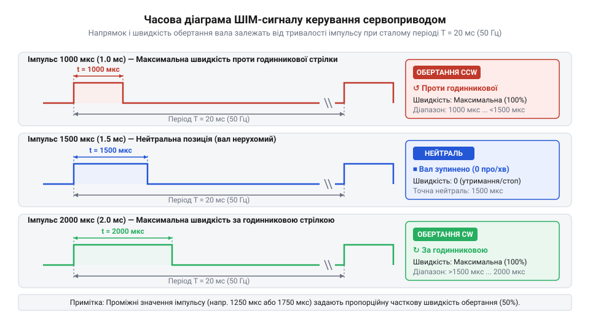
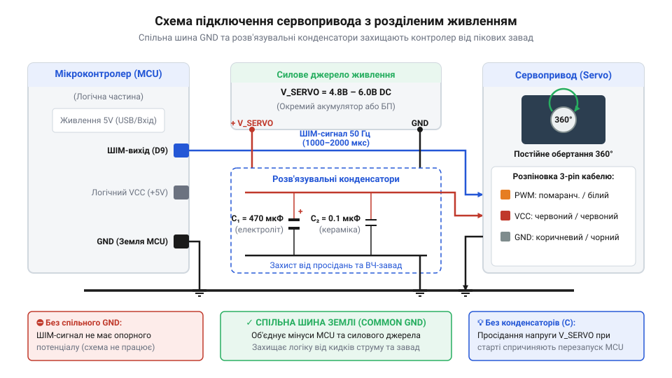

# Апаратний інтерфейс та електричні параметри сервоприводів постійного обертання

<preknowlist>
- [Сервоприводи радіокерованих моделей: будова, редуктори та ШІМ-керування](root:cat-hw-actuators/rc-servo-mechanisms-and-control) — базові принципи ШІМ-керування, призначення потенціометра зворотного зв'язку та механічна будова редуктора класичного сервопривода
</preknowlist>

## Спонтанне обертання та перезавантаження контролера

Коли розробник вперше підключає @@en|сервопривод@@ (від лат. *servus* — слуга, помічник) постійного обертання до мікроконтролера та подає стандартну команду позиціонування, пристрій поводиться геть несподівано: замість повертання вала на заданий кут колесо робота починає беззупинно крутитися на максимальній швидкості. Спроба заблокувати вал руками чи дати роботу рушити під навантаженням призводить до іншої проблеми — керівна плата раптово гасне й перезавантажується.

Така поведінка спричинена принциповою відмінністю внутрішньої схеми привода постійного обертання від класичного позиційного сервомеханізму. У звичайному сервоприводі внутрішній @@en|потенціометр@@ (від лат. *potentia* — сила, та грец. *metron* — міра) жорстко з'єднаний із вихідним валом і формує сигнал зворотного зв'язку за позицією. Коли плата подає імпульс, вбудована мікросхема порівнює його тривалість із поточним положенням вала, вмикає мостовий @@en|драйвер@@ (від англ. *driver* — привід, керуючий вузол) двигуна і повертає вал доти, доки неузгодженість не зменшиться до нуля.

У модифікованому @@en|сервоприводі@@ постійного обертання механічний обмежувач кута видалено, а зворотний зв'язок від вала розірвано. Внутрішній @@en|потенціометр@@ або зафіксовано в середньому положенні підлаштувальним гвинтом, або замінено на паралельний дільник із двох постійних резисторів. У результаті електроніка @@en|сервопривода@@ постійно «вважає», що вал перебуває точно посередині діапазону. Будь-який вхідний сигнал, що відрізняється від середнього значення, сприймається аналоговим порівнювачем як нескінченна помилка позиціонування. Через це плата керування видає на мости двигуна повну напругу, змушуючи ротор обертатися без зупинки.

Друга частина проблеми — перезавантаження мікроконтролера — криється в електричних параметрах кола живлення. У момент пуску або механічного заклинювання електродвигун споживає пусковий струм, що в кілька разів перевищує номінальний рівень. Якщо силова частина @@en|сервопривода@@ та чутлива логіка керуючого процесора підключені до однієї спільної шини живлення без розв'язувальних елементів, пусковий сплеск струму викликає падіння напруги нижче допустимого порогу скидання мікроконтролера.

Щоб побудувати дієздатну робототехнічну систему, необхідно відмовитися від сприйняття @@en|сервопривода@@ як кутового актуатора. Апаратний інтерфейс @@en|сервопривода@@ постійного обертання працює як пропорційний регулятор швидкості та напрямку, а його надійна експлуатація вимагає суворого дотримання часових допусків сигналу та правильної топології кіл живлення.

## Фізичний інтерфейс та кольорове маркування

Фізичне підключення @@en|сервопривода@@ постійного обертання здійснюється через трижильний гнучкий кабель, що закінчується триконтактним гніздовим роз'ємом із кроком 2.54 мм. Незважаючи на єдину електричну функціональність контактів, у моделюванні та промисловій робототехніці поширені два основних стандарти кольорового маркування провідників: @@en|JR@@ та @@en|Futaba@@. Безпомилкова ідентифікація цих ліній запобігає пошкодженню керуючих кіл мікроконтролера.

Стандарт @@en|JR@@ (Graupner/JR) використовує коричневий колір для загального проводу заземлення (@@en|GND@@), червоний колір для позитивної шини живлення (@@en|VCC@@) та оранжевий колір для керуючого @@en|ШІМ@@-сигналу (широтно-імпульсна @@en|модуляція@@, від лат. *modulatio* — розміреність). У стандарті @@en|Futaba@@ заземлення маркується чорним кольором, позитивний полюс живлення — червоним, а сигнальна лінія — білим. В обох стандартах провідник живлення завжди розташований на центральному контакті роз'єму.

Таке розташування контактів є продуманим захисним рішенням. Якщо роз'єм стандарту @@en|JR@@ без механічного ключа буде випадково підключений до трипінової вилки у зворотному напрямку, земляний та сигнальний контакти поміняються місцями, але центральний провідник живлення залишиться на своєму місці. Це виключає подачу зворотної полярності живлення безпосередньо між шинами @@en|VCC@@ та @@en|GND@@ внутрішньої плати привода, захищаючи напівпровідникові ключі від термічного руйнування.

Механічно роз'єми @@en|Futaba@@ мають додатковий виступ-ключ на бічній грані пластикового корпусу, який запобігає неправильному вставлянню в спеціалізовані плати. Роз'єми @@en|JR@@ мають зрізані фаски на боковинах контактної групи. Більшість сучасних планарних модулів розширення та драйверів для таких пристроїв, як мікросервопривод [Tower Pro SG90](root:cat-hw-actuators/sg90-servo) або металевий [MG90S V2](root:cat-hw-actuators/mg90s-servo), оснащені універсальними роз'ємами, сумісними з обома стандартами.

Загалом @@en|сервоприводи@@ постійного обертання, збудовані на базі поширених [9-грамових мікросервоприводів](root:cat-hw-actuators/sg90-mg90-micro-servos-family) або потужніших пристроїв [родини Power HD](root:cat-hw-actuators/powerhd-family), вимагають надійного механічного фіксування роз'ємів. У мобільних роботах вибраційне навантаження може призвести до сповзання штекера, що спричиняє обрив лінії заземлення або сигнального проводу під час руху.

## Часові параметри керуючого ШІМ-сигналу

Керування @@en|сервоприводом@@ постійного обертання здійснюється за допомогою імпульсного сигналу з фіксованою частотою 50 Гц, що відповідає періоду повторення T = 20 мс (20000 мкс). Інформаційним параметром є не коефіцієнт заповнення, а абсолютна тривалість високого рівня імпульсу, яка варіюється в діапазоні від 1000 мкс до 2000 мкс.

На відміну від позиційних приводів, де тривалість імпульсу визначає кутове положення вала, у @@en|сервоприводі@@ постійного обертання ця величина задає напрямок та кутову швидкість. Центральне значення тривалості імпульсу — 1500 мкс — відповідає стану нейтралі. У цьому стані внутрішній порівнювач фіксує нульову різницю напруг між вхідним сигналом і опорним дільником, тому напруга на мості двигуна відсутня, і вал перебуває в стані спокою.

Зменшення тривалості імпульсу нижче 1500 мкс (у діапазоні від 1500 мкс до 1000 мкс) викликає обертання вала проти годинникової стрілки (CCW). Чим коротшим є імпульс, тим більша різниця напруги формується у внутрішньому підсилювачі помилки, і тим вищою є швидкість обертання. При досягненні тривалості 1000 мкс привод виходить на максимальну швидкість обертання у зворотному напрямку. Збільшення тривалості імпульсу понад 1500 мкс (у діапазоні від 1500 мкс до 2000 мкс) призводить до обертання за годинниковою стрілкою (CW), де імпульс 2000 мкс відповідає максимальним обертам.


*Залежність кутової швидкості й напрямку обертання вала від тривалості керуючого імпульсу ШІМ при фіксованому періоді 20 мс.*

Залежність швидкості від тривалості імпульсу є лінійною лише у вузькому діапазоні поблизу нейтралі (приблизно ±200 мкс від 1500 мкс). У діапазонах 1000–1300 мкс та 1700–2000 мкс аналоговий внутрішній @@en|драйвер@@ входить у насичення, і швидкість обертання стабілізується на максимальному рівні, визначеному напругою живлення та механічним опором [зубчастого редуктора](root:cat-hw-actuators/rc-servo-mechanisms-and-control).

Поблизу точки 1500 мкс існує так звана мертва зона (@@en|deadband@@) шириною 10–30 мкс (наприклад, 1490–1510 мкс). Вона спеціально закладена у внутрішній контролер привода для того, щоб невеликі флуктуації часу від мікроконтролера не викликали небажаного повільного дрейфу вала під час зупинки.

## Енергетичні режими та струмові навантаження

Розрахунок системи живлення для @@en|сервоприводів@@ постійного обертання вимагає аналізу трьох характерних електричних режимів споживання при номінальній робочій напрузі від 4.8 В до 6.0 В. Ігнорування пікових струмів є найпоширенішою причиною апаратних збоїв у робототехнічних комплексах.

Перший режим — струм спокою в режимі утримання (idle current). Коли на сигнальну лінію подається імпульс нейтралі 1500 мкс і вал зупинений, внутрішня електронна плата споживає від 5 мА до 15 мА. Цей струм витрачається на роботу внутрішнього генератора, аналогових операційних підсилювачів та дільника напруги.

Другий режим — робочий струм під номінальним навантаженням (operating current). Під час стабільного обертання вала з приєднаним колесом або механізмом споживання легких мікросервоскладових становить 150–350 мА. Для потужних сервоприводів, таких як HD-1501MG, робочий струм під навантаженням сягає 500–1200 мА.

Третій режим — струм заклинювання ротора (@@en|stall current@@, від англ. *stall* — заклинювання, зупинка). Він виникає в момент старту двигуна з місця або при механічному блокуванні колеса. У цей момент індуктивний опір обмоток не працює, а струм обмежується лише їхнім омічним опором. Для малопотужних приводів струм заклинювання становить 500–800 мА, тоді як для середньогабаритних та високомоментних сервоприводів він досягає 2.5–3.0 А на один привод.

При спроектуванні силової шини для мобільної платформи з чотирма приводами розрахунок максимального струму здійснюється за сумою пікових струмів:

```text
I_peak = N × I_stall
       = 4 × 0.8 А        [підстановка параметрів 4 приводів]
       = 3.2 А            [загальний піковий струм споживання]
```

Якщо підключити такі приводи через тонкі з'єднувальні провідники з омічним опором лінії R_line = 0.2 Ом, то під час пуску падіння напруги на провідниках становитиме:

```text
U_drop = I_peak × R_line
       = 3.2 А × 0.2 Ом   [розрахунок спаду напруги на лінії]
       = 0.64 В           [величина просідання напруги]
```

При вихідній напрузі батареї 5.0 В напруга на шині впаде до 4.36 В. Якщо мікроконтролер живиться від цієї ж шини, таке просідання гарантовано викликає спрацьовування схем скидання за низькою напругою (Brown-out Reset).

## Схема розділеного живлення та фільтрації

Для забезпечення завадостійкості системи розробляють принципову схему з розділенням силового кола та кола живлення логіки мікроконтролера. Головне правило такої схеми — використання окремого джерела живлення або потужного DC-DC перетворювача для @@en|сервоприводів@@ із забезпеченням єдиної точки заземлення (@@en|Common GND@@, від англ. *ground* — земля).

Окремий силовий модуль забезпечує @@en|сервоприводи@@ напругою 5.0–6.0 В, тоді як мікроконтролер отримує стабільну напругу від власного лінійного регулятора чи USB-порту. З'єднання земляних провідників двох джерел в одній точці є обов'язковим: без спільного заземлення керуючий @@en|ШІМ@@-сигнал не матиме опорного потенціалу відносно вхідного каскаду @@en|сервопривода@@, що призведе до хаотичного обертання ротора.

Для компенсації високочастотних завад від колекторних щіток та придушення низькочастотних просідань напруги паралельно силовій шині встановлюють комбіновані розв'язувальні @@en|конденсатори@@ (від лат. *condensare* — згущувати). Електролітичний @@en|конденсатор@@ ємністю 470–1000 мкФ згладжує кидки струму при пуску двигунів, виконуючи роль локального накопичувача енергії. Керамічний @@en|конденсатор@@ ємністю 0.1 мкФ (100 нФ) шунтує високочастотні імпульсні завади безпосередньо біля клем живлення кожного @@en|сервопривода@@.


*Схема розділеного живлення логічної та силової шин для запобігання просіданню напруги мікроконтролера під час пускових струмів.*

Нижче наведено приклад програмної генерації @@en|ШІМ@@-сигналу для керування напрямком та швидкістю обертання @@en|сервопривода@@ постійного обертання на мовах C та C++.

:::tabs
@tab C
:::code api-continuous-servo-hardware-interface/c/servo-init.c
@tab C++
:::code api-continuous-servo-hardware-interface/cpp/continuousservo.cpp
:::

Для підключення механічних коліс або валів до привода застосовують стандартні [серво-роги](root:cat-hw-actuators/servo-horns), які кріпляться до вихідного шліцьового вала фіксуючим гвинтом.

## Діагностика завад та усунення дрейфу

Під час практичної експлуатації @@en|сервоприводів@@ постійного обертання часто виникають дві основні апаратні проблеми: @@en|дрейф@@ (від нід. *drijven* — плавати, гнати) нейтралі та електричний @@en|джитер@@ (від англ. *jitter* — тремтіння) сигнальної лінії.

@@en|Дрейф@@ нейтралі виявляється у повільному самовільному обертанні вала тоді, коли мікроконтролер видає еталонний імпульс тривалістю точно 1500 мкс. Це відбувається через температурний вихід параметрів аналогових резисторів, похибки заводського калібрування дільника або механічний зсув внутрішнього @@en|потенціометра@@. Усунення дрейфу виконують двома способами:

1. Апаратне калібрування: більшість @@en|сервоприводів@@ мають отвір у корпусі проти внутрішнього @@en|потенціометра@@. Подавши сигнал 1500 мкс, точної зупинки вала досягають обережним повертанням підлаштувального гвинта діелектричною викруткою до повного припинення руху ротора. 2. Програмне калібрування: якщо апаратне підлаштування недоступне, у коді мікроконтролера експериментально підбирають значення цифрової нейтралі (наприклад, 1508 мкс або 1493 мкс) та запроваджують розширену програмну мертву зону (наприклад, `1500 ± 15 мкс`), у межах якої генератор імпульсів видає відкориговане значення зупинки. Докладний покроковий алгоритм усунення зсуву точки зупинки та точного підлаштування дільника наведено у статті про [налаштування та калібрування нейтралі сервоприводів](root:cat-hw-actuators/continuous-servo-potentiometer-tuning).

Друга проблема — @@en|джетер@@ сигнальної лінії — виявляється у хаотичних сіпаннях та коротких сплесках швидкості привода. Причиною є наведення електромагнітних завад від потужних силових провідників на довгий сигнальний кабель, а також висячий стан вхідного виводу мікроконтролера під час ініціалізації та перезавантаження.

Для нейтралізації сигнальних завад застосовують підтягувальний резистор (pull-down) номіналом 10 кОм між сигнальною лінією та землею @@en|GND@@. Він утримує на входу @@en|сервопривода@@ низький логічний рівень під час старту мікроконтролера, запобігаючи спонтанному обертанню двигунів. У мобільних роботах із довжиною кабелів понад 30 см сигнальну лінію рекомендується звивати із провідником @@en|GND@@ у виту пару або застосовувати екрановані провідники.

У високоточних системах керування переходять від аналогових сервоприводів до цифрових або застосовують [безколекторні інтегральні сервоконтролери](root:cat-hw-actuators/bldc-servo-controller), які забезпечують цифрове узгодження протоколів і відсутність дрейфу нейтралі.