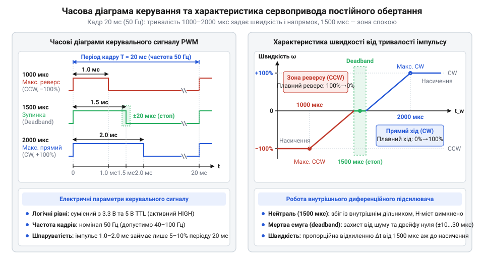
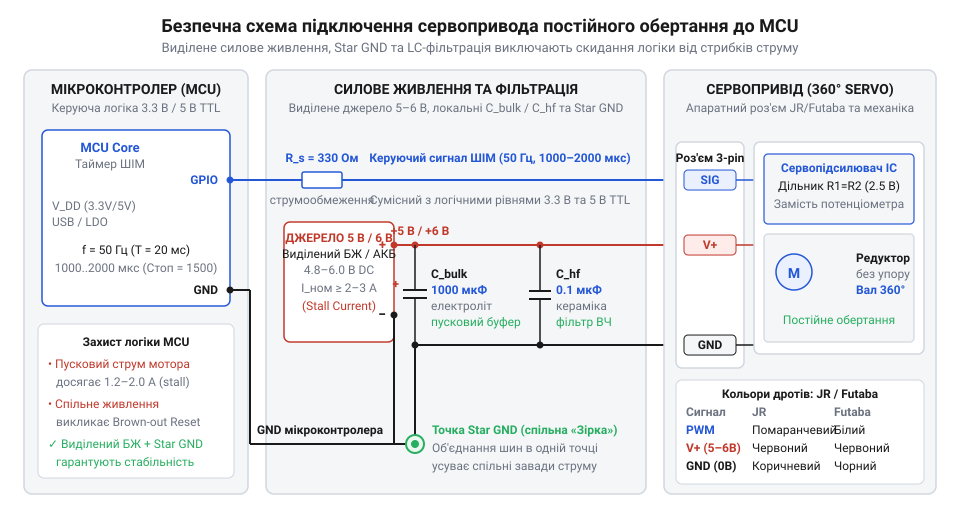

# Залізний інтерфейс сервопривода постійного обертання: схема, розпіновка, електричні параметри та часові діаграми

<preknowlist>
- [Tower Pro SG90 — мікросерво 9g](root:cat-hw-actuators/sg90-servo) — будова класичного позиційного сервопривода (двигун, редуктор, потенціометр зворотного зв'язку, плата драйвера) та трипровідний інтерфейс імпульсного керування кутом
- [Серво-роги (запасні)](root:cat-hw-actuators/servo-horns) — стандарти зубчастих шліців вихідного вала, спосіб механічного сполучення з насадками та правила осьової фіксації кріпильним гвинтом
</preknowlist>

## Проблема безперервного приводу та схемотехніка модифікації

Для коліс мобільного робота чи барабана лебідки потрібне нескінченне обертання з точним регулюванням швидкості й напрямку. Звичайний колекторний мотор вимагає зовнішнього силового драйвера та редуктора, що займає багато місця на шасі. Натомість [класичний позиційний сервопривід](root:cat-hw-actuators/sg90-servo) (від лат. *servus* — слуга) об'єднує двигун, редуктор і блок керування в одному компактному корпусі, але кут повороту його вала жорстко обмежений сектором 0–180°. Якщо спробувати обертати такий вал безперервно, упорний штифт вихідного колеса редуктора впирається в механічний стопор: зубці шестерень зрізає, а ротор заклинює, що загрожує швидким вигоранням обмоток.

Щоб зняти кутове обмеження, упорний штифт механічно видаляють. Проте вільного обертання недостатньо: вихідний вал жорстко зчеплений із рухомим контактом штатного потенціометра зворотного зв'язку. Внутрішня мікросхема керування постійно порівнює сигнал кутового завдання з напругою на потенціометрі й вимикає живлення мотора, щойно вал досягає заданого кута. Щоб розірвати це коло контролю положення, потенціометр відпаюють, а замість нього до мікросхеми @@en|сервопідсилювача@@ підключають симетричний резистивний дільник із двох високоточних резисторів (типово 2.2–5.1 кОм).

Цей дільник формує на вимірювальному вході фіксовану напругу штучної середньої точки. Сервопідсилювач сприймає її як вічне перебування вала в нейтральній точці спокою, що відповідає вхідному імпульсу 1500 мкс. Коли з мікроконтролера надходить імпульс іншої тривалості, мікросхема фіксує постійну помилку неузгодженості. Намагаючись компенсувати уявне відхилення, [вбудований силовий міст](root:hw-motion/h-bridge) (@@en|H-міст@@, від англ. *H-bridge*, де чотири транзисторні ключі утворюють перемичку для реверсування струму) безперервно подає напругу на мотор. Відхилення тривалості керувального імпульсу від 1500 мкс перетворюється з регулятора кута на керування швидкістю та напрямком безперервного обертання.

## Стандарти роз'ємів, розпіновка та шліцьовий вал

Для підключення живлення та логічного сигналу сервоприводи оснащують трипровідним шлейфом із гніздовим роз'ємом кроку 2.54 мм. У робототехніці поширені два фізичні стандарти таких роз'ємів: @@en|JR@@ (від назви розробника *Japan Remote Control*) та @@en|Futaba@@. Корпус @@en|Futaba@@ має бічний поляризаційний виступ-ключ, що унеможливлює неправильне з'єднання. Натомість роз'єм @@en|JR@@ ключа позбавлений і має лише незначні скоси на торцях, через що легко входить у стандартні штирьові гребінки зворотною стороною.

Призначення ліній визначають за колірним маркуванням дротів. Центральним контактом в обох стандартах є позитивна лінія живлення VCC червоного кольору. Спільний мінус GND розташовано з одного краю: він коричневий у @@en|JR@@ або чорний у @@en|Futaba@@. З протилежного краю йде сигнальна лінія Signal: помаранчева або жовта в @@en|JR@@ та біла у @@en|Futaba@@.

Центральне розташування VCC страхує привід від прямої переполюсовки живлення: при розвороті симетричного роз'єму @@en|JR@@ на 180° плюсовий контакт залишається на центральному штирі. Проте крайні контакти міняються місцями: лінія керування замикається на мінус джерела, а силовий мінус привода потрапляє на сигнальний порт мікроконтролера. Якщо мікроконтролер намагається керувати лінією, зворотний струм електродвигуна потече через слабкострумовий вихід процесора, що загрожує вигоранням порту GPIO та апаратною втратою керування.

Крутний момент на механізм передає вихідний вал, що має зубчасті @@de|шліци@@ (від нім. *Schlitz* — поздовжній паз або щілина). Профіль зубців стандартизовано за їх кількістю: від 21T у мікросервах до 25T у повнорозмірних приводах (літера «T» позначає англ. @@en|teeth@@ — зубці). [Змінні важелі та колеса](root:cat-hw-actuators/servo-horns) насаджують на вал співвісно й виключно ручним зусиллям, оскільки перекіс або ударне забивання кришать латунні чи пластикові шестерні редуктора. Після посадки насадку надійно притискають осьовим гвинтом у торець вала: під радіальним навантаженням під час руху робота незафіксоване колесо розгойдується й зісковзує зі @@de|шліців@@.

## Електричні параметри живлення та логічні рівні

Без стабільного живлення сервопривід втрачає крутний момент або спричиняє раптові збої логіки. Робочий діапазон напруги становить 4.8–6.0 В — це відповідає чотирьом акумуляторам NiMH або стабілізованій лінії 5 В чи 6 В. Напруга прямо визначає динаміку: підвищення з 4.8 В до 6.0 В збільшує напругу на обмотках двигуна, піднімаючи швидкість обертання вала та крутний момент на 20–30%.

Струм споживання залежить від механічного навантаження на валу. У стані спокою схема споживає лише 10–20 мА для живлення сервопідсилювача. Під час вільного обертання без навантаження струм холостого ходу зростає до 50–150 мА, долаючи внутрішнє тертя шестерень редуктора. Якщо ж вал зупиняється через перешкоду, ротор перестає створювати проти-ЕРС: струм обмежується лише низьким омічним опором обмоток і стрибає до небезпечного значення заклинювання — @@en|stall current@@ (від англ. *stall* — глухнути, зупинятися через перешкоду). Він сягає 600–800 мА у [поширених мікроприводах SG90](root:cat-hw-actuators/sg90-servo) та 1.5–2.5 А у потужних [сервоприводах Power HD](root:cat-hw-actuators/powerhd-family) стандартного розміру. Джерело живлення зобов'язане витримувати сумарний струм заклинювання з запасом 20–30%, інакше пікове навантаження просадить напругу й перезавантажить керуючу електроніку.

Сигнальна лінія струмом майже не навантажується завдяки високому вхідному опору в десятки кілоом. Вхідний каскад виконано за стандартом @@en|TTL@@ (від англ. *Transistor-Transistor Logic* — транзисторно-транзисторна логіка) з порогом розпізнавання високого рівня 1.5–2.0 В. Це дозволяє подавати сигнал керування безпосередньо з виводів 3.3-вольтових мікроконтролерів без перетворювачів рівнів, навіть коли силову лінію заживлено від 6.0 В.

## Часові параметри керувального сигналу та реверс

Швидкість і напрямок обертання задають тривалістю імпульсів [протоколу імпульсного керування](root:com-devices/pwm-servo-protocol). Базова частота кадрів становить 50 Гц із періодом `T = 20 мс` (допустимо 40–100 Гц або період 10–25 мс), адже інформацію несе лише довжина високого рівня, а не пауза між імпульсами.

Номінальний діапазон тривалості становить 1000–2000 мкс (із можливим розширенням до 500–2500 мкс). Центральне значення 1500 мкс відповідає точці спокою: сервопідсилювач фіксує нульову похибку відносно внутрішнього дільника й знеструмлює мотор через ключі @@en|H-моста@@. Скорочення імпульсу від 1500 до 1000 мкс спричиняє обертання за годинниковою стрілкою з плавним зростанням швидкості до максимуму на 1000 мкс. Подовження імпульсу від 1500 до 2000 мкс перемикає полярність моста, зумовлюючи реверс проти годинникової стрілки з піком на 2000 мкс.

Щоб вал не повз від теплового дрейфу резисторів дільника чи тремтіння таймера мікроконтролера, у серводрайвері передбачено апаратну мертву смугу — @@en|deadband@@ (від англ. *dead* — нечутливий та *band* — смуга). Вона задає вікно `±2...10 мкс` навколо позначки 1500 мкс, у межах якого мотор гарантовано лишається вимкненим.

*Зміна тривалості імпульсу відносно мертвої смуги навколо 1500 мкс плавно регулює швидкість і задає напрямок безперервного обертання вала.*

## Схема безпечного підключення до мікроконтролера

Пряме живлення сервопривода від виходу 5 В плати чи шини USB спричиняє циклічні перезавантаження або зависання мікроконтролера. Пускові стрибки струму мотора сягають 0.8–1.5 А, що перевищує ліміт вбудованого стабілізатора. Сплеск струму просаджує напругу живлення нижче 2.7–2.9 В, викликаючи спрацьовування апаратного [детектора просідання живлення](root:hw-arch/mcu-brownout-reset) (англ. @@en|Brown-out Reset@@, @@en|BOR@@, від @@en|brown-out@@ — спад напруги та @@en|reset@@ — скидання). Супервізор перезапускає процесор, привід знеструмлюється, напруга відновлюється, а після рестарту алгоритм знову подає сигнал, зациклюючи систему.

Збої усувають роздільним живленням: мікроконтролер живлять від джерела логіки, а сервопривід — від окремої лінії 5 В або 6 В з об'єднанням мінусових провідників в одній спільній точці «зіркою» (англ. @@en|star ground@@). Це унеможливлює протікання силових зворотних струмів через сигнальні земляні доріжки плати.

Біля роз'єму привода встановлюють фільтри: паралельно живленню запаюють буферний електролітичний або танталовий конденсатор (від англ. @@en|buffer@@ — пом'якшувач) ємністю 470–1000 мкФ для покриття пускових просідань та керамічний конденсатор 0.1 мкФ для шунтування іскріння щіток колектора. Сигнальну лінію захищають послідовним резистором 100–330 Ом: він обмежує струм через вивід @@en|GPIO@@ (від англ. @@en|General Purpose Input/Output@@ — вхід/вихід загального призначення) при комутаційних викидах або помилковій переполюсовці роз'єму.

*Принципова електрична схема підключення: роздільне силове живлення з точкою Star GND запобігає перезавантаженням мікроконтролера, а локальні конденсатори та резистор GPIO захищають цифрові кола від завад.*

## Керування швидкістю, усунення дрейфу та збоїв

Навіть за коректної схеми під час першого пуску вал часто не завмирає на сигналі 1500 мкс, а повільно повзе. Самочинний дрейф точки спокою зумовлений розкидом опорів внутрішнього дільника та температурною нестабільністю RC-генератора серводрайвера. При нагріванні опір дільника пливе, зміщуючи поріг рівноваги (наприклад, до 1512 мкс) за межі мертвої смуги @@en|deadband@@. За наявності підлаштовного резистора нейтраль калібрують апаратно обертанням тримера. За фіксованих резисторів зміщення компенсують програмно: сканують ширину імпульсу навколо 1500 мкс, визначають зону нерухомості вала та призначають фактичний центр новою точкою спокою в коді.

Хаотичне тремтіння вала (англ. @@en|jitter@@, від англ. *jitter* — тремтіти) викликають програмні затримки таймерів, де переривання процесора спотворюють сигнал, або шуми живлення. Коливання виходять за поріг @@en|deadband@@, змушуючи @@en|сервопідсилювач@@ смикати двигун. Тремтіння ліквідують генерацією імпульсів суто апаратними ШІМ-таймерами без програмних очікувань.

Критичною загрозою є тривале заклинювання ротора (@@en|stall@@) при упорі вала в перешкоду. Зникнення проти-ЕРС викликає постійний струм @@en|stall current@@ (0.8–2.5 А), що перетворюється на тепло. У приводах із пластиковими шестернями на кшталт [мікросервоприводів SG90](root:cat-hw-actuators/sg90-servo) нагрів деформує нейлон і зрізає зубці, а в [моделях із металевим редуктором](root:cat-hw-actuators/mg90s-servo) спричиняє тепловий пробій ключів @@en|H-моста@@. Надійний апаратний захист забезпечує самовідновлюваний запобіжник @@en|PTC PolySwitch@@ (від англ. @@en|Positive Temperature Coefficient@@ — позитивний температурний коефіцієнт) у колі VCC: при перевантаженні його опір стрибкоподібно зростає, знижуючи струм до безпечних міліамперів до охолодження.
