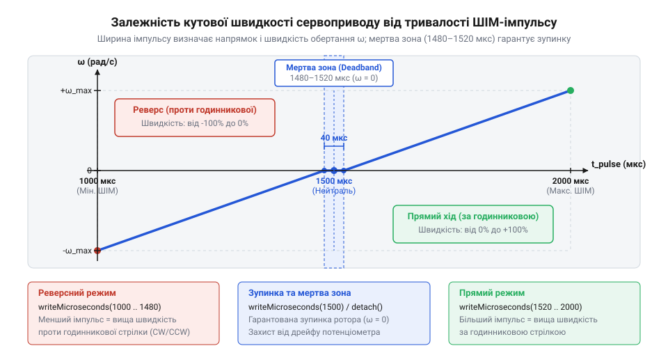
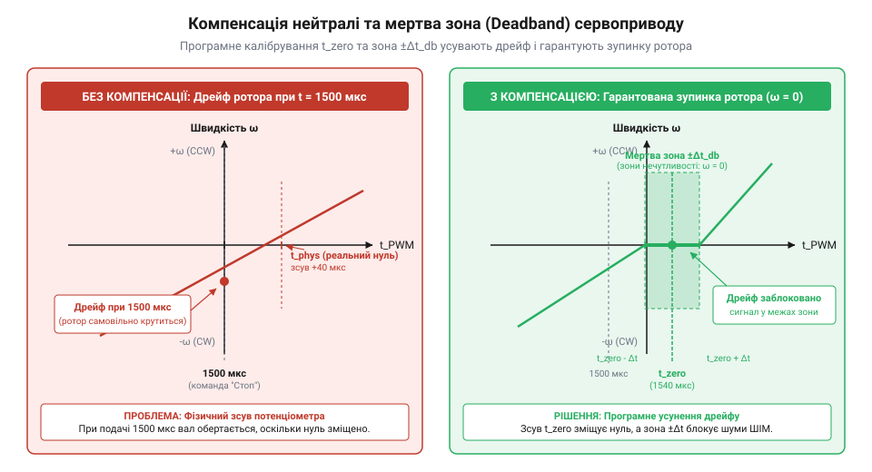

# Програмний інтерфейс керування швидкістю та компенсації дрейфу нейтралі

<preknowlist>
- [Сервоприводи радіокерованих моделей: будова, редуктори та ШІМ-керування](root:cat-hw-actuators/rc-servo-mechanisms-and-control) — базові принципи створення ШІМ-імпульсів стандартної частоти 50 Гц та призначення внутрішнього потенціометра зворотного зв'язку.
</preknowlist>

## Самочинний рух ротора під час старту

При початковій подачі живлення на мікроконтролер та ініціалізації стандартної бібліотеки керування сервоприводами розробники часто зустрічаються із непередбачуваною поведінкою: замість утримання вала у фіксованому положенні ротор приводу робить різкий самочинний ривок або починає безперервно обертатися і повільно «повзти». Цей початковий ривок виникає через стан виводів мікроконтролера до налаштування ШІМ-периферії: вони перебувають у високоімпедансному тристатному стані (від @@en|tri-state@@ — три стани) або підтягнуті внутрішніми резисторами (від @@en|pull-up@@ — підтягування вгору та @@en|pull-down@@ — підтягування вниз). У цей короткий проміжок часу внутрішній декодер сервоприводу сприймає плаваючий потенціал або статичний логічний рівень як хибний керуючий імпульс і подає напругу на мотор. У стандартних [сервоприводах радіокерованих моделей](root:cat-hw-actuators/rc-servo-mechanisms-and-control) внутрішній потенціометр (від @@la|potentia@@ — сила та @@gr|μετρέω@@ — вимірюю) механічно з'єднаний із вихідним валом і формує замкнений контур зворотного зв'язку за кутом, тому після ініціалізації привід швидко компенсує помилку й зупиняється. У модифікованому `сервоприводі` (від @@de|Servomotor@@, де @@la|servus@@ — слуга) постійного обертання цей механічний зв'язок розірвано: @@la|потенціометр@@ або зафіксовано в центральному положенні, або замінено на дільник із двох постійних резисторів.

Коли мікроконтролер подає сигнал з тривалістю імпульсу 1500 мкс, внутрішня мікросхема драйвера порівнює напругу цього ШІМ-сигналу (від @@en|pulse-width modulation@@, широтно-імпульсна модуляція) із напругою на внутрішньому опорному дільнику. Якщо через технологічний розкид опору резисторів, температурне розширення матеріалів або нестабільність опорного живлення виникає навіть мінімальна різниця потенціалів у кілька мілівольт, внутрішній підсилювач помилки сприймає це як відхилення від цільового кута. У звичайному сервоприводі мотор повернув би вал, змістив повзунок потенціометра та звів помилку до нуля. Проте у модифікованому мотор не може змінити опір нерухомого дільника. У результаті підсилювач помилки безперервно видає керуючу напругу на @@en|H-bridge@@ драйвера, викликаючи самочинне обертання ротора.

Спроба позиціонувати такий мотор традиційною командою вказування кута втрачає фізичний сенс. Модифікований сервопривод перетворюється з позиційного @@en|actuator@@ на редукторний мотор постійного струму із вбудованим @@en|H-bridge@@ та ШІМ-декодером. Керуючий сигнал із тривалістю імпульсів від 1000 до 2000 мкс тепер визначає не кут повороту вала, а напрямок та кутову швидкість його обертання. Для коректної роботи з таким пристроєм потрібен програмний @@en|API@@, який оперує тривалістю імпульсу в мікросекундах, враховує дрейф нейтральної точки та забезпечує програмне калібрування нульової швидкості.

## Мапування тривалості імпульсу у швидкість

У програмному інтерфейсі керування сервоприводом постійного обертання ширина імпульсу @@en|PWM@@ прямо пропорційна кутовій швидкості. Стандартний керуючий кадр має період `T_period = 20` мс (частота 50 Гц). У межах цього кадру тривалість високого рівня імпульсу `t_pulse` варіюється у діапазоні від 1000 мкс до 2000 мкс. Центральне значення `t_neutral = 1500` мкс відповідає стану спокою (нульова кутова швидкість). Зменшення тривалості імпульсу нижче 1500 мкс змушує мотор обертатися в один бік (наприклад, проти годинникової стрілки, CCW), а збільшення понад 1500 мкс — в протилежний бік (за годинниковою стрілкою, CW).

Коли тривалість імпульсу становить 1000 мкс, на драйвер мотора подається максимальна напруга зворотного ходу (-100% тяги). При 2000 мкс драйвер відкриває транзистори для максимального прямого ходу (+100% тяги). Зміна тривалості між нейтраллю та крайніми значеннями задає лінійну зміну кутової швидкості.


*Залежність кутової швидкості обертання ротора від тривалості імпульсу ШІМ: при 1500 мкс мотор зупинений, при зменшенні імпульсу до 1000 мкс зростає швидкість проти годинникової стрілки, а при збільшенні до 2000 мкс — за годинниковою стрілкою.*

Для розрахунку необхідної тривалості імпульсу `t_pulse` за заданою відносною швидкістю `v` (від -100% до +100%) застосовують математичне мапування. Розрахуємо тривалість імпульсу `t_pulse` для заданої відносної швидкості `v = 50%` при нейтральній точці `t_neutral = 1500` мкс та максимальному відхиленні `Δt_max = 500` мкс:

```
t_pulse = t_neutral + (v / 100) × Δt_max
= 1500 + (50 / 100) × 500              [підстановка значень швидкості та відхилення]
= 1500 + 0.5 × 500                     [нормалізація швидкості]
= 1500 + 250                           [обчислення приросту тривалості]
= 1750 мкс                             [підсумкова тривалість імпульсу]
```

Отримане значення 1750 мкс відповідає півмаксимальній швидкості обертання за годинниковою стрілкою.

Застосування виклику `write(angle)` з базових бібліотек мікроконтролерів є небажаним, оскільки цей метод оперує дискретними градусами від 0 до 180, що дає лише 181 рівень швидкості та спричиняє помилки заокруглення. Натомість програмний @@en|API@@ повинен використовувати пряме встановлення тривалості імпульсу в мікросекундах за допомогою функції `writeMicroseconds()`, яка забезпечує дискретність у 1000 кроків.

Для реалізації мапування швидкості в програмі використовуються відповідні функції керування:

:::tabs
== Arduino C++
:::code api-continuous-servo-software-control/cpp/arduino/continuousservo.cpp
== ESP-IDF C
:::code api-continuous-servo-software-control/c/esp-idf/continuous-servo-init.c
:::

## Компенсація дрейфу та мертва зона

На практиці теоретична нейтральна точка 1500 мкс майже ніколи не збігається з реальним нулем фізичного сервоприводу. Фізичні причини дрейфу нейтралі (від @@nl|drijven@@ — плавати, гнати) полягають у розкиді опорів внутрішніх резисторів дільника (до ±5%), температурній нестабільності компаратора драйвера та зміні напруги силового живлення. У сервоприводах [лінійки 9-грамових мікросервоприводів](root:cat-hw-actuators/sg90-mg90-micro-servos-family), таких як [Tower Pro SG90](root:cat-hw-actuators/sg90-servo) чи [MG90S V2](root:cat-hw-actuators/mg90s-servo), а також у моделях [Power HD HD-1370A](root:cat-hw-actuators/hd-1370a-servo), реальний нуль може перебувати на рівні 1480 мкс або 1525 мкс. Якщо на такий привод подати 1500 мкс, мотор буде постійно обертатися з невеликою швидкістю.

Крім того, біля точки нуля внутрішня схема керування має високий коефіцієнт підсилення, через що найменші шуми керуючого сигналу викликають дрижання (від @@en|jitter@@) та дзижчання редуктора. Для вирішення цієї проблеми у програмному @@en|API@@ реалізують два механізми: програмну компенсацію зсуву нейтралі та зону нечутливості (від @@en|deadband@@).

Зсув нейтралі `t_offset` визначається під час калібрування і додається до номінального значення 1500 мкс. Мертва зона (від @@en|deadband@@) `t_deadband` задає симетричний інтервал навколо відкаліброваної нейтралі `t_neutral_cal = t_neutral + t_offset`. Якщо обчислений керуючий сигнал потрапляє у діапазон `[t_neutral_cal - t_deadband, t_neutral_cal + t_deadband]`, програмне забезпечення примусово встановлює тривалість імпульсу рівною `t_neutral_cal`.


*Характеристика зсуву нейтральної точки та зон нечутливості: програмна компенсація зміщує центр характеристики на виміряний фізичний нуль, а зона нечутливості ґарантує повне знеструмлення мотора у центрі.*

Розрахунок вихідного керуючого імпульсу `t_out` з урахуванням зміщення нейтралі `t_offset = 20` мкс та мертвої зони `t_deadband = 15` мкс виконується за алгоритмом:

```
t_neutral_cal = 1500 + t_offset
= 1500 + 20                             [додавання зсуву нейтралі]
= 1520 мкс                              [відкалібрована нейтраль]

t_out = t_neutral_cal                   [якщо |t_cmd - t_neutral_cal| <= t_deadband]
= 1520 мкс                              [примусова зупинка у мертвій зоні]
```

Завдяки цьому мотор надійно зупиняється без необхідності тонкого механічного доналаштування внутрішнього потенціометра викруткою.

Розглянемо реалізацію програмної компенсації нейтралі та мертвої зони:

:::tabs
== Arduino C++
:::code api-continuous-servo-software-control/cpp/arduino/calibratedservo.cpp
== ESP-IDF C
:::code api-continuous-servo-software-control/c/esp-idf/calibrated-servo-write-pulse.c
:::

## Плавні рампи прискорення та реверсу

Різка зміна ширини імпульсу від 1000 мкс (максимальний реверс) до 2000 мкс (максимальний прямий хід) створює критичні навантаження на приводний вузол. Під час реверсу обертовий ротор мотора та зубчасті колеса редуктора мають значний момент інерції. При миттєвій зміні полярності живлення мотора виникає проти-ЕРС (проти-електрорушійна сила), яка додається до напруги джерела живлення.

В результаті пусковий струм мотора може перевищувати номінальний робочий струм у 4–6 разів. Це викликає просідання напруги на загальній шині живлення, що призводить до перезавантаження мікроконтролера. Крім того, миттєвий удар у пластиковому редукторі мікросервоприводів [Tower Pro SG90](root:cat-hw-actuators/sg90-servo) призводить до зрізання зубців або швидкого зносу пластикових з'єднань, якими кріпляться [серво-роги](root:cat-hw-actuators/servo-horns).

Для усунення цих явищ використовується програмна рампа прискорення (від @@fr|rampe@@ — похилий схил). Рампа обмежує максимально допустиму швидкість зміни тривалості імпульсу за одиницю часу `dt`. Замість стрибкоподібного встановлення нового значення тривалості імпульсу програмний алгоритм плавно змінює поточну тривалість `t_current` у напрямку цільової `t_target` з фіксованим кроком `step_us` на кожному ітераційному тику таймера.

Обчислимо часовий інтервал `t_ramp`, необхідний для повного реверсу від 1000 мкс до 2000 мкс при кроці рампи `step_us = 10` мкс за період кадру `t_step = 20` мс (щосекундне оновлення з частотою 50 Гц):

```
total_delta = 2000 - 1000
= 1000 мкс                              [загальна зміна тривалості імпульсу]

steps_count = total_delta / step_us
= 1000 / 10                             [кількість кроків оновлення]
= 100 кроків                            [необхідні ітерації]

t_ramp = steps_count × t_step
= 100 × 20 мс                           [перемноження кроків на період кадру]
= 2000 мс = 2.0 с                       [загальний час плавного реверсу]
```

Така затримка у 2.0 секунди повністю усуває струмові сплески та механічні удари.

Нижче наведено приклад реалізації неблокуючої рампи прискорення:

:::tabs
== Arduino C++
:::code api-continuous-servo-software-control/cpp/arduino/rampedservo.cpp
== ESP-IDF C
:::code api-continuous-servo-software-control/c/esp-idf/servo-ramp-task.c
:::

## Управління станом та аварійне відключення

У роботі з сервоприводами критично важливо розрізняти стан подачі центрального імпульсу (1500 мкс) та повне відключення генерації ШІМ-сигналу. Функція `attach()` приєднує вивід мікроконтролера до внутрішнього таймера та починає генерувати прямокутні імпульси заданої тривалості. Функція `detach()` зупиняє генератор таймера і переводить керуючий вивід у стан високого імпедансу або низького логічного рівня.

При надсиланні імпульсу 1500 мкс внутрішня схема керування сервоприводу залишається активною: підсилювач помилки відстежує сигнал і утримує мостові транзистори драйвера готовими до роботи. Якщо на сигнальній лінії є шуми або нейтраль має невиявлений дрейф, мотор продовжуватиме споживати струм спокою і може самочинно зміщуватися. При виклику `detach()` внутрішній декодер сервоприводу втрачає вхідний ШІМ-сигнал і повністю знеструмлює мостові транзистори H-моста. Мотор переходить у режим вибігу (вільного обертання без електричного гальмування), усуваючи будь-яке споживання енергії та ризик самочинного дрейфу.

Для безпеки роботи приводу у складних робототехнічних системах програмний @@en|API@@ повинен містити сторожовий таймер (від @@en|watchdog timer@@, @@en|failsafe watchdog@@). У разі зависання керуючого контролера, збою інтерфейсу зв'язку (UART, SPI, Wi-Fi) або відсутності нових команд від верхнього рівня протягом заданого таймауту (від @@en|timeout@@) (наприклад, 500 мс) сторожовий таймер повинен автоматично викликати `detach()` або переводити мотор у безпечний стан зупинки.

Нижче наведено приклад реалізації безпечного керування із захисним сторожовим таймером:

:::tabs
== Arduino C++
:::code api-continuous-servo-software-control/cpp/arduino/safeservo.cpp
== ESP-IDF C
:::code api-continuous-servo-software-control/c/esp-idf/safe-servo-update-cmd.c
:::